# AI 中文字体设计手册（附 100+提示词案例）

> 来源：[https://yunyinghui.feishu.cn/docx/FPLydi3KIo43ZAxKd5gcostgnvb](https://yunyinghui.feishu.cn/docx/FPLydi3KIo43ZAxKd5gcostgnvb)

> 适用人群：学习 AI 字体设计人群

> 首发时间：2025 年 04 月 28 日

> 更新时间：2025 年 05 月 20 日

> **内容出品方：**[Mix AI Lab](https://yunyinghui.feishu.cn/wiki/WhelwZnxQi55mpkOzatc3Xran5b?from=from_copylink)**×智设 AI**

> **内容出品人：**** **** **

> **使用建议：****在电脑端学习，体验将更加丰富。若想快速定位**精确内容，你可以利用快捷键 Ctrl+F（Windows 用户）或 Command+F（Mac 用户）搜索关键词或短语，迅速找到你需要的信息。同时，你也可以直接点击学习导航的相关文字，便可一键直达学习板块。

> **持续更新 AI 字体设计****相关教程实用场景等板块内容，****永久免费在线查看，****欢迎收藏转发支持，文末有惊喜****。**

2025 年 4 月，AI 图像模型又迎来重磅升级，字节跳动发布的 Seedream 3.0 模型，能够精准的根据用户指令生成中文字体。

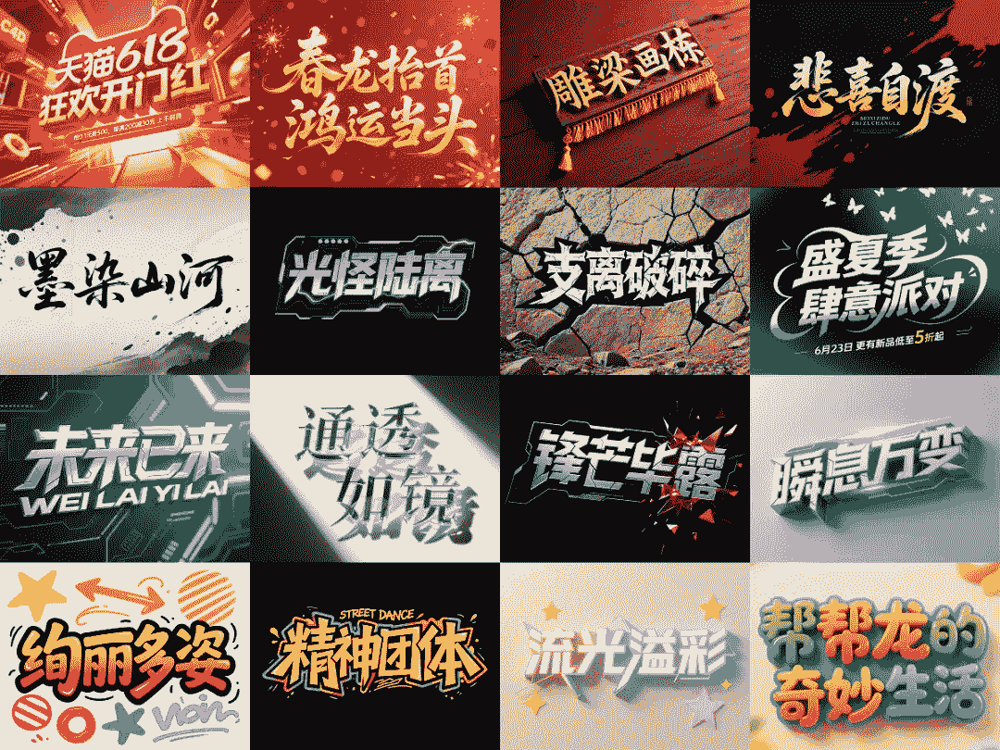

虽迟但到，今天将为大家详细分享如何撰写 AI 生成文字的提示词。本文将分**享两套提示词创作技巧，全文内容丰富，累计**超 1 万字。而大家也不需要细嚼慢咽， 文章的后半部分将提供两套“智能体指令模板”，能够一键调用本文所涵盖的全部知识点。这是言川花了近一个月的研究成果，今天开源分享给大家！

> 注：本文使用的 AI 图像生成工具是即梦 AI 和豆包 AI，这两个产品的图像生成模型均基于 Seedream 3.0。

# **一、通用提示词模板**

> 【文字内容】+【字体类型】+【字体描述】+【主题风格】，示例：

>

+   文字内容：暗夜幽灵

+   字体风格：哥特风格字体

+   字体描述：字体线条尖锐细长，字母笔画粗细对比鲜明

+   字效描述：文字模拟金属质感，如钢铁、铜或黄金

>

> 完整提示词：“暗夜幽灵”，哥特风格字体，字体线条尖锐细长，字母笔画粗细对比鲜明。采用金属字效，具有强烈的金属质感，通常伴随着高光和阴影的对比，展现出硬朗、冷峻的视觉效果。

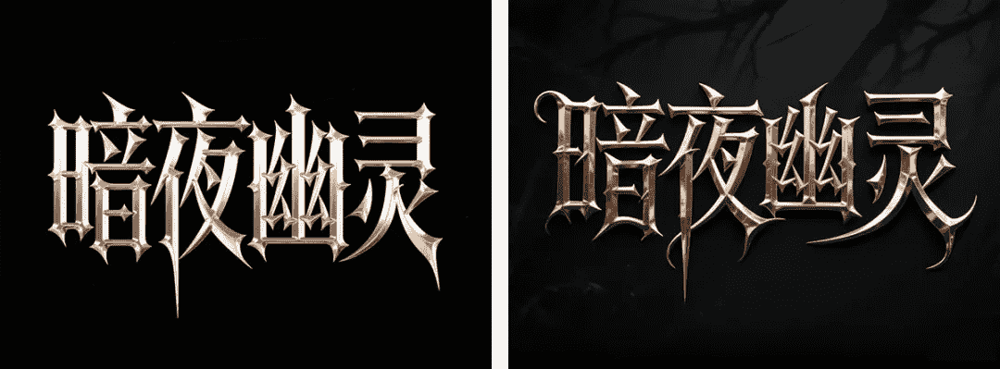

这套通用的提示词模板可玩性非常高，你可以自由发挥创意、尝试多种字效风格的组合。但前提是，你可能需要掌握一定字体设计的知识点。

在本文，我给大家收集整理了一些常见的字体风格和字效，供大家学习参考。

## **1.字体类型**

字体类型/风格指的是字体设计中的一种表现形式，它决定了字体的外观和视觉特征。它不仅仅是字体的基础形态（如宋体、黑体等），还包括了各种设计效果和细节调整，使得字体能适应不同的设计需求和情感表达。

### **1.1 简约风格**

> **时尚体： **设计前卫独特，线条简洁流畅，具有强烈现代感与潮流属性。

提示词示例：“潮流先锋”，时尚体，设计前卫独特，线条简洁流畅，具有强烈现代感与潮流属性，黑底白字。

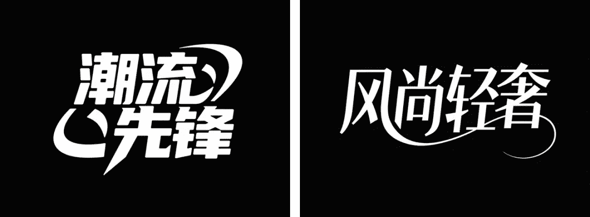

> **极简无衬线手写： **线条简洁流畅，具有强烈现代感与潮流属性。

提示词示例：“清风徐来”，极简无衬线手写，笔画简洁流畅，线条粗细均匀，黑底白字。

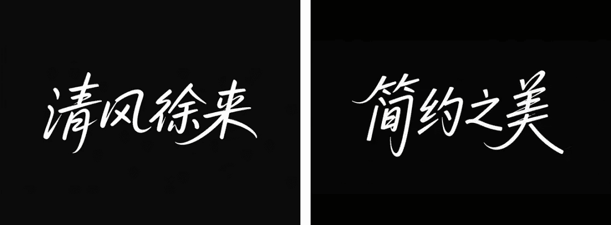

> **细线体： **字形精致纤细流畅。

提示词示例：“纤细流光”，细线体，字形精致纤细流畅，黑底白字。

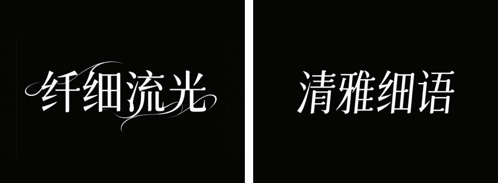

> **单线字体： **单一线条构成，线条简洁清晰，无填充且粗细一致。

提示词示例：“纤线灵动”，单线字体，单一线条构成，线条简洁清晰，无填充且粗细一致，黑底白字。

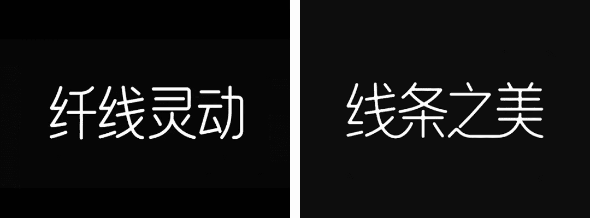

> **现代衬线体： **衬线较短且笔画较为细长。

提示词示例：“都市韵律”，现代衬线体，衬线较短且笔画较为细长，黑底白字。

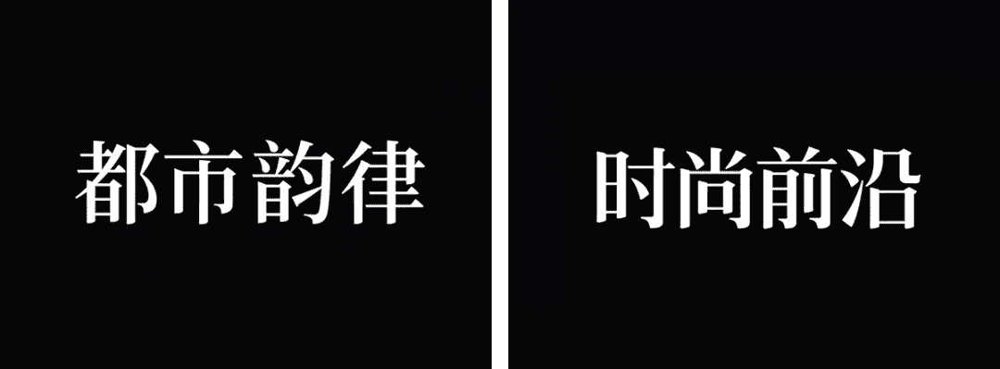

> **极简手写体： **衬线较短且笔画较为细长。

提示词示例：“清新手迹”，极简手写体，衬线较短且笔画较为细长，黑底白字。

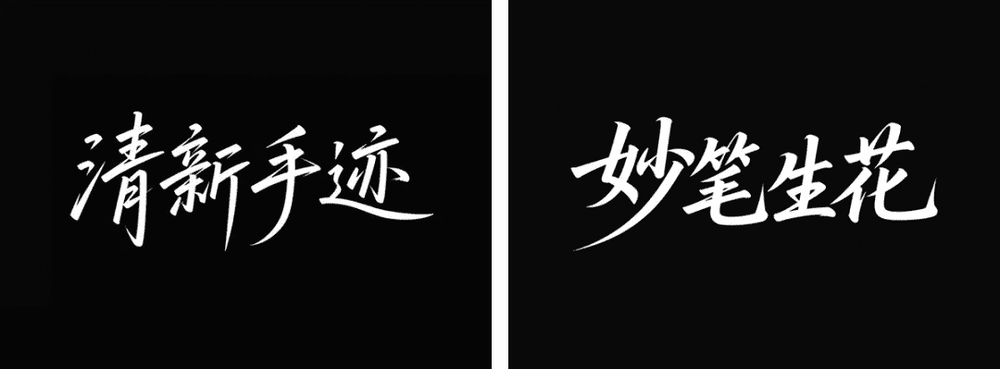

### **1.2 艺术风格**

> **弯曲字体： **笔画多曲线，线条流畅自然，整体柔和优雅，给人动感印象。

提示词示例：“信手拈来”，弯曲字体，笔画多曲线，线条流畅自然，整体柔和优雅，给人动感印象，黑底白字。

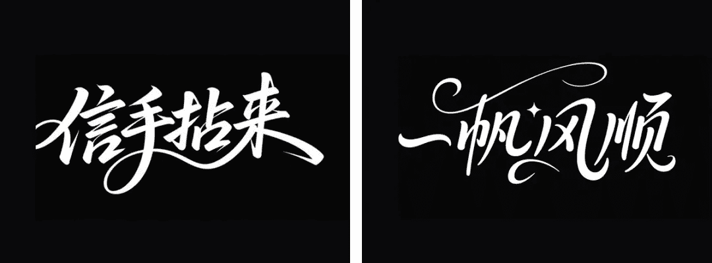

> **手绘字体： **模拟手绘效果，笔画自然灵动。

提示词示例：“栩栩如生”，手绘字体，模拟手绘效果，笔画自然灵动，黑底白字。

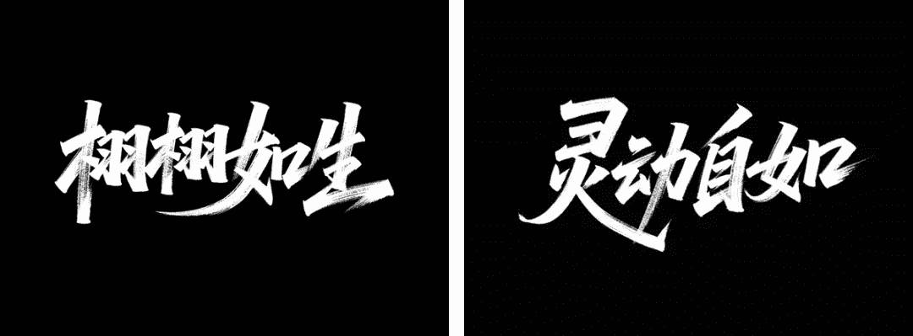

> **涂鸦字体： **线条随性、不对称，粗犷生动，笔画不规则自由。

提示词示例：“天马行空”，涂鸦字体，线条随性、不对称，粗犷生动，笔画不规则自由，黑底白字。

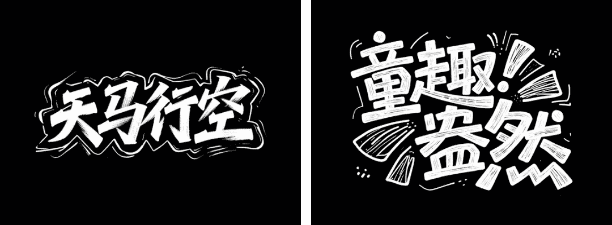

> **艺术字体： **笔画结构富有创意，强调艺术表现力。

提示词示例：“浑然天成”，艺术字体，笔画结构富有创意，强调艺术表现力，黑底白字。

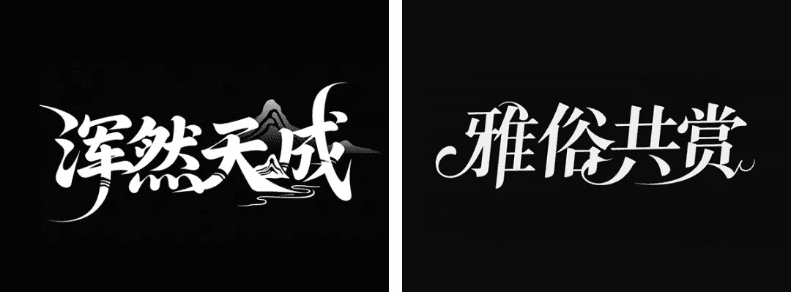

> **夸张体： **字形设计大胆夸张，线条粗细变化大，具有强烈视觉冲击力。

提示词示例：“惊世骇俗”，夸张体，字形设计大胆夸张，线条粗细变化大，具有强烈视觉冲击力，黑底白字。

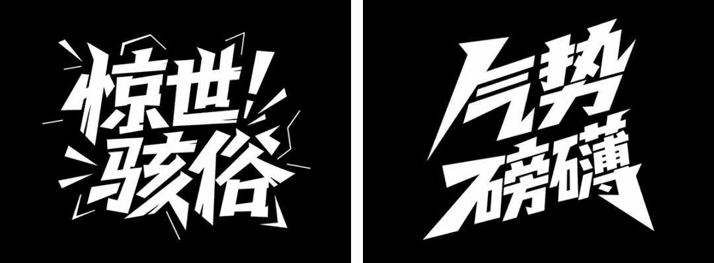

> **未来感字体： **线条简洁硬朗，结构几何化，充满科技感与未来感。

提示词示例：“智能驱动”，未来感字体，线条简洁硬朗，结构几何化，充满科技感与未来感，黑底白字。

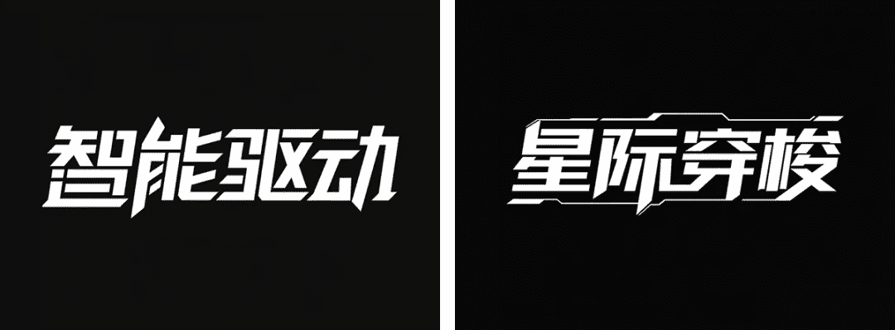

> **趣味变形体： **字形结构不规则，笔画夸张变形，富有创意和趣味性。

提示词示例：“妙趣横生”，趣味变形体，字形结构不规则，笔画夸张变形，富有创意和趣味性，黑底白字。

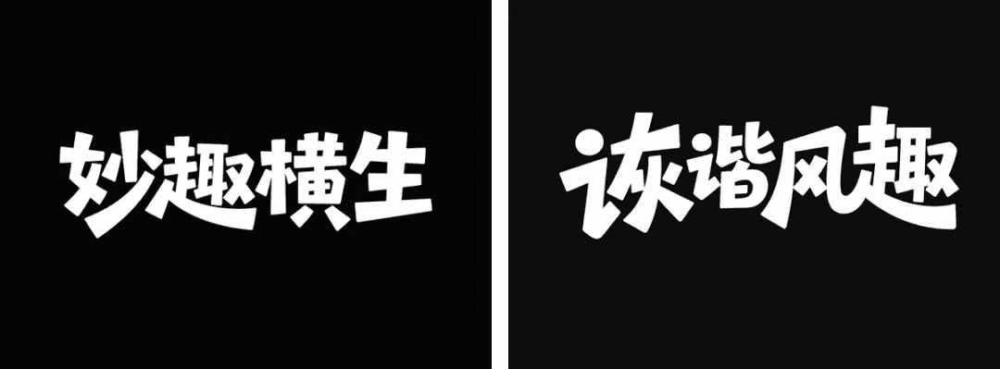

> **像素风格体： **字形由方块状像素组成，呈现出数字化、复古的效果。

提示词示例：“游戏人生”，像素风格体，字形由方块状像素组成，呈现出数字化、复古的效果，黑底白字。

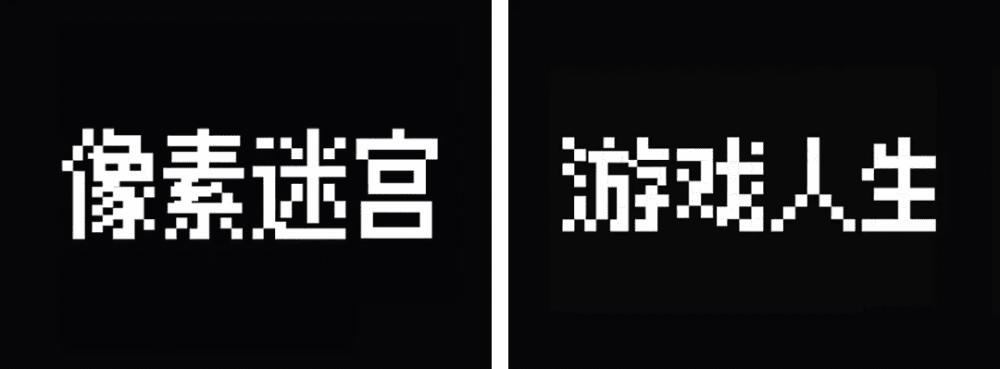

### **1.3 复古风格**

> **复古字体： **设计风格模仿古代字体，具有怀旧古朴气息。

提示词示例：“古韵流芳”，复古字体，设计风格模仿古代字体，具有怀旧古朴气息，黑底白字。

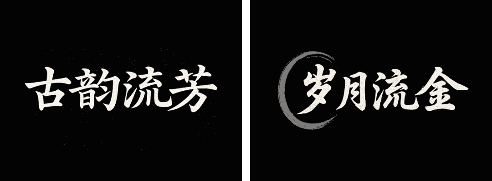

> **哥特风格字体： **字体线条尖锐细长，字母笔画粗细对比鲜明。

提示词示例：“阴森恐怖”，哥特风格字体，字体线条尖锐细长，字母笔画粗细对比鲜明，黑底白字。

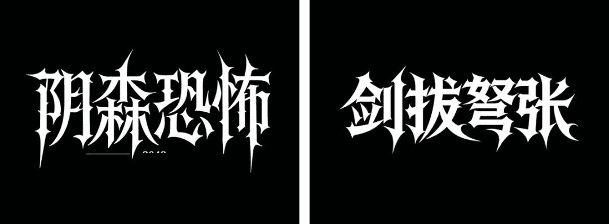

> **西部风格字体： **笔画粗壮且线条锐利，整体风格粗犷不羁，充满西部荒野的狂野感。

提示词示例：“狂野奔放”，西部风格字体，笔画粗壮且线条锐利，整体风格粗犷不羁，充满西部荒野的狂野感，黑底白字。

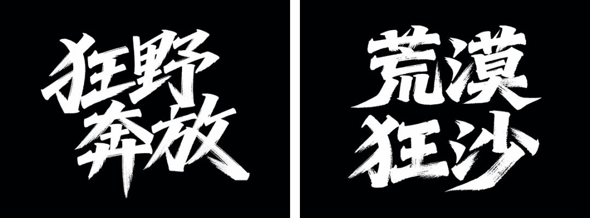

> **复古美式手写字体： **手写字体线条柔和随意，笔画有起伏顿挫，充满手写的随性与怀旧感。

提示词示例：“怀旧情结”，复古美式手写字体，手写字体线条柔和随意，笔画有起伏顿挫，充满手写的随性与怀旧感，黑底白字。

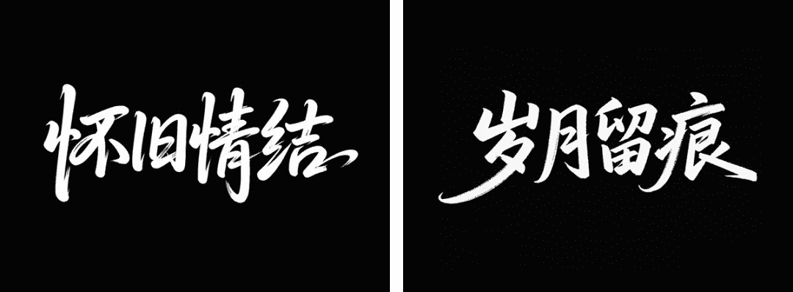

### **1.4 卡通风格**

> **可爱体： **笔画圆润流畅，结构扁圆，重心偏高，充满童趣活力，风格俏皮活泼。

提示词示例：“活泼灵动”，可爱体：笔画圆润流畅，结构扁圆，重心偏高，充满童趣活力，风格俏皮活泼，黑底白字。

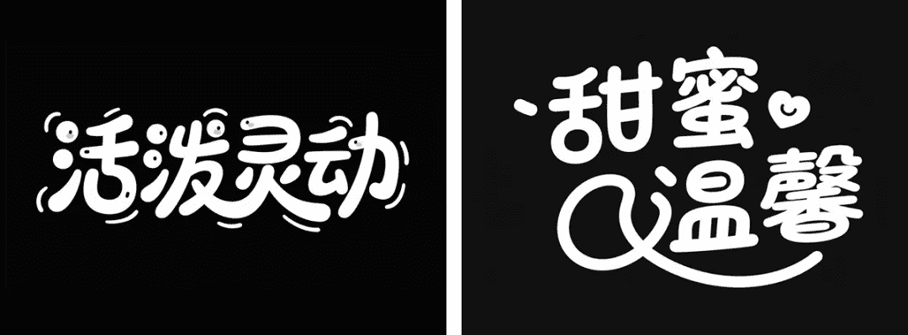

> **圆体： **字形圆润饱满，笔画末端呈圆弧状，给人友好亲切感。

提示词示例：“圆满如意”， 圆体， 字形圆润饱满，笔画末端呈圆弧状，给人友好亲切感，黑底白字。

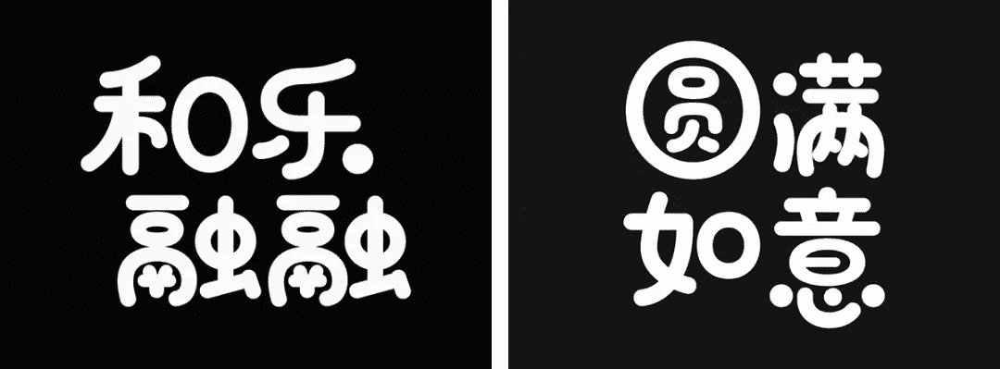

> **胖字体： **笔画粗壮饱满，线条圆润厚实，字形显得敦实可爱。

提示词示例：“福态可掬”，胖字体，笔画粗壮饱满，线条圆润厚实，字形显得敦实可爱，黑底白字。

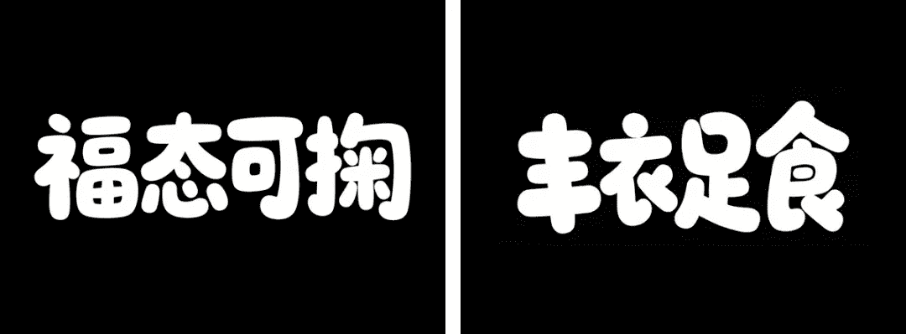

> **软糖体： **字体呈现出类似软糖的柔软、流动感，通常饱满而有弹性。

提示词示例：“萌趣横生”，软糖体，字体呈现出类似软糖的柔软、流动感，通常饱满而有弹性，黑底白字。

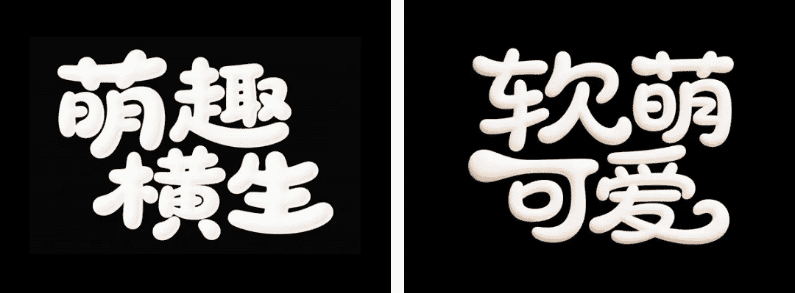

> **泡泡体： **字体形态类似泡泡，笔画膨胀且圆润。

提示词示例：“梦幻泡泡”，泡泡体，字体形态类似泡泡，笔画膨胀且圆润，黑底白字。

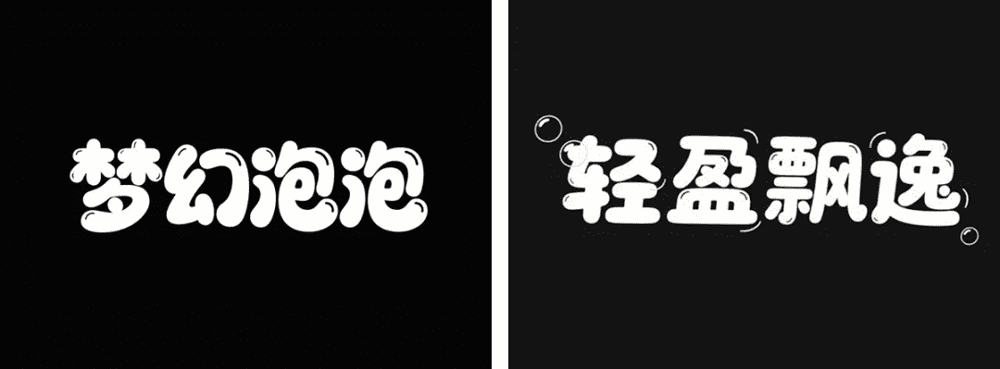

> **动物形态体： **字形在设计中融入了动物元素或轮廓，突出可爱和活泼感。

提示词示例：“动物世界”，动物形态体，字形在设计中融入了动物元素或轮廓，突出可爱和活泼感，黑底白字。

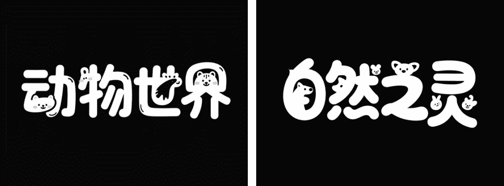

> **卡通手写体： **笔画圆润且富有弹性，模仿儿童手写风格，带有随意和俏皮感。

提示词示例：“奇幻冒险”，卡通手写体，笔画圆润且富有弹性，模仿儿童手写风格，带有随意和俏皮感，黑底白字。

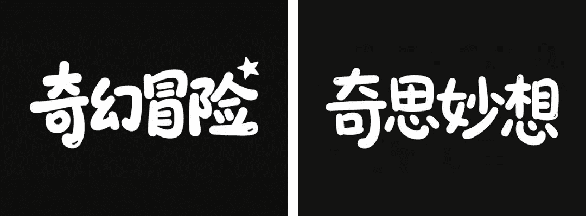

### **1.5 书法风格**

> **连笔字： **模仿手写书法，笔画连贯流畅，富有艺术书写感。

提示词示例：“行云流水”，连笔字，模仿手写书法，笔画连贯流畅，富有艺术书写感，黑底白字。

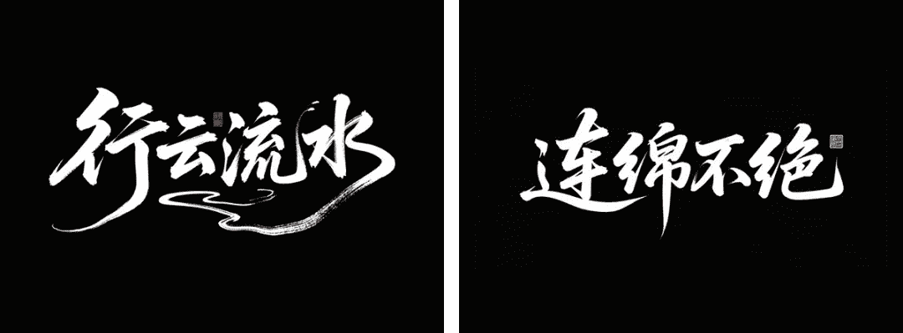

> **草书风格： **笔画简化连贯，书写流畅快速，艺术性高。

提示词示例：“凤舞龙飞”，草书风格，笔画简化连贯，书写流畅快速，艺术性高，黑底白字。

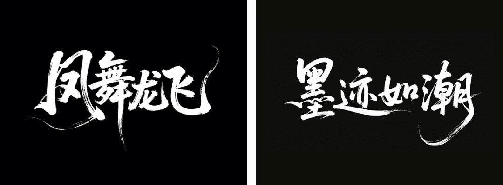

> **楷书风格： **笔画端正、规范，结构严谨，字形清晰工整。

提示词示例：“一丝不苟”，楷书风格，笔画端正、规范，结构严谨，字形清晰工整，黑底白字。

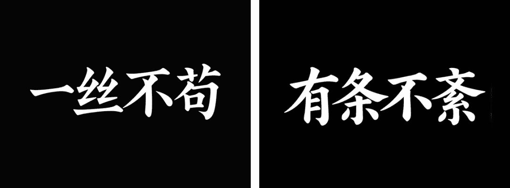

> **行书风格： **介于楷书与草书之间，笔画连贯，书写自然。

提示词示例：“飘逸潇洒”，行书风格，介于楷书与草书之间，笔画连贯，书写自然，黑底白字。

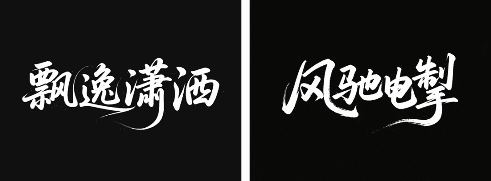

> **秀丽笔手写体： **字体线条流畅自然，笔画细腻秀美，富有手写温度。

提示词示例：“古韵悠长”，秀丽笔手写体，字体线条流畅自然，笔画细腻秀美，富有手写温度，黑底白字。

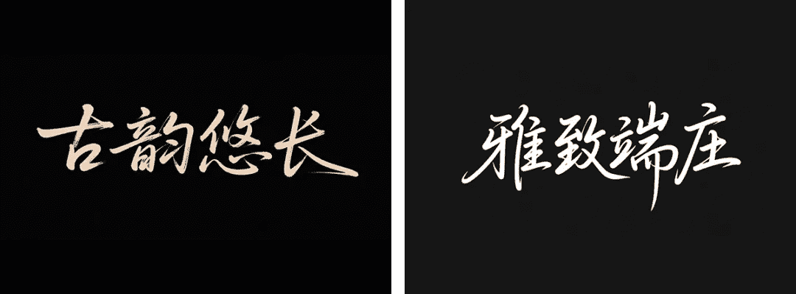

## **2.常见字效**

字效指的是在字体设计中，通过不同的视觉效果增强字体的表现力，通常用于提升视觉冲击力、表达情感或匹配特定的设计主题。

### **2.1 卡通字效**

> **卡通字效： **圆润线条，鲜艳颜色，夸张变形，动感趣味，亲和力强。

提**示词**示例：“童言无忌”，可爱体，笔画圆润流畅，结构扁圆，重心偏高，充满童趣活力，风格俏皮活泼。采用卡通字效 ， 圆润线条，鲜艳颜色，夸张变形，动感趣味，亲和力强。

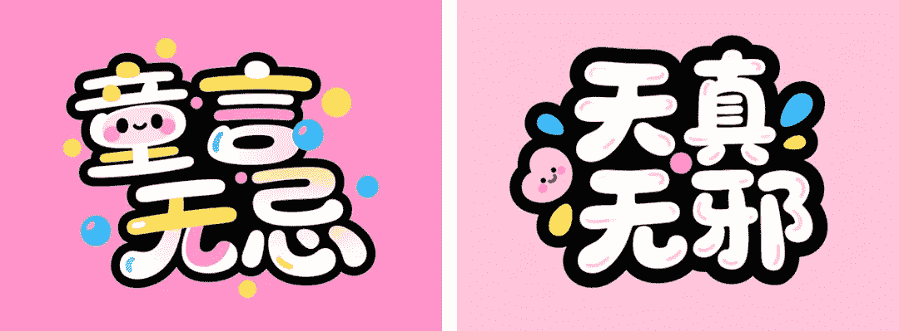

### **2.2 立体字效**

> **立体字效： **深度感，阴影效果，光泽反射，层次分明，现代感强，边缘突出。

提示词示例：“瞬息万变”，未来感字体，线条简洁硬朗，结构几何化，充满科技感与未来感。采用立体字效，深度感，阴影效果，光泽反射，层次分明，现代感强，边缘突出。


### **2.3 发光字效**

> **发光字效： **具有强烈的发光效果，色彩丰富且层次分明。

提示词示例：“光彩夺目”，未来感字体，线条简洁硬朗，结构几何化，充满科技感与未来感，采用发光字效，具有强烈的发光效果，色彩丰富且层次分明。


### **2.4 液体字效**

> **液体字效： **具有动态流动的形态、自然渐变的色彩、丰富的光影变化以及独特的透明质感。

提示词示例：“波光粼粼 ”，时尚体，设计前卫独特，线条简洁流畅，具有强烈现代感与潮流属性，采用液体字效，具有动态流动的形态、自然渐变的色彩、丰富的光影变化以及独特的透明质感。

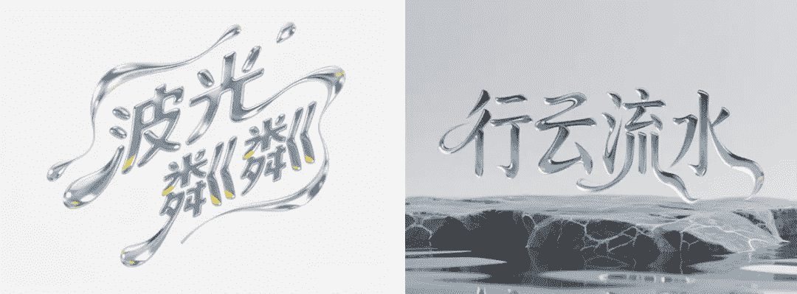

### **2.5 金属字效**

> **金属字效： **具有强烈的金属质感，通常伴随着高光和阴影的对比，展现出硬朗、冷峻的视觉效果。

提示词示例：“锋芒毕露”，未来感字体，线条简洁硬朗，结构几何化，充满科技感与未来感。采用金属字效，具有强烈的金属质感，通常伴随着高光和阴影的对比，展现出硬朗、冷峻的视觉效果。

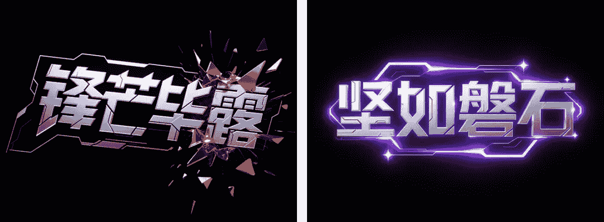

### **2.6 木质字效**

> **木质字效： **具有自然木纹和质朴色彩，带立体感与阴影效果。

提示词示例：“根深叶茂”，复古字体，设计风格模仿古代字体，具有怀旧古朴气息。采用木质字效，具有自然木纹和质朴色彩，带立体感与阴影效果。


### **2.7 火焰字效**

> **火焰字效： **具有鲜明的火焰色彩，呈现燃烧与闪烁的动态效果。

提示词示例：“烈火燎原”，草书风格，笔画简化连贯，书写流畅快速，艺术性高。采用火焰字效，具有鲜明的火焰色彩，呈现燃烧与闪烁的动态效果。

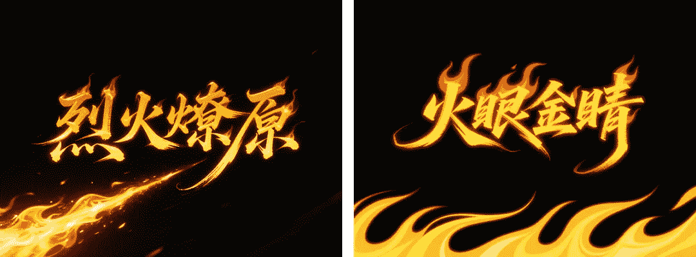

### **2.8 冰霜字效**

> **冰霜字效： **具有冰晶质感，带冷色调、立体感与霜冻纹理。

提示词示例：“雪窖冰天”，艺术字体，笔画结构富有创意，强调艺术表现力。采用冰霜字效，具有冰晶质感，带冷色调、立体感与霜冻纹理。


### **2.9 水墨字效**

> **水墨字效： **墨色层次丰富，晕染自然，带有书法线条和文化意境。

提示词示例：“墨染山河”，行书风格，介于楷书与草书之间，笔画连贯，书写自然。采用水墨字效，墨色层次丰富，晕染自然，带有书法线条和文化意境。

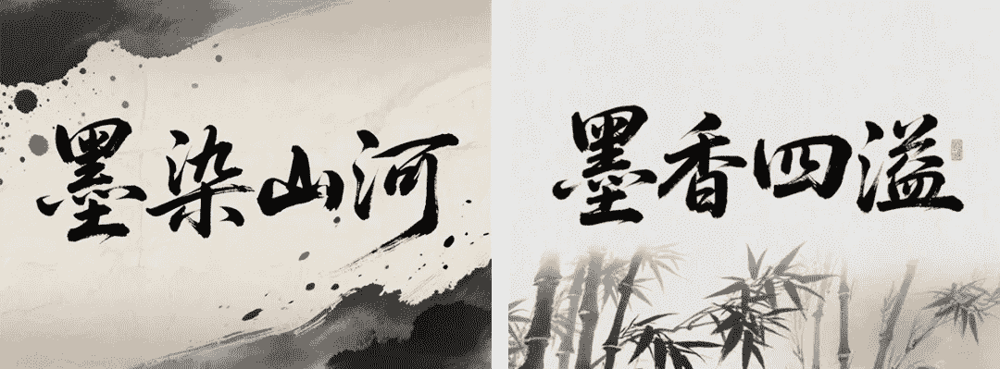

### **2.10 裂纹字效**

> **裂纹字效： **具有表面粗糙、不规则裂纹纹理，带深度与阴影效果，给人以破碎、陈旧的视觉感受。

提示词示例：“山崩地裂 ”，西部风格字体，笔画粗壮且线条锐利，整体风格粗犷不羁，充满西部荒野的狂野感。采用裂纹字效，具有表面粗糙、不规则裂纹纹理，带深度与阴影效果，给人以破碎、陈旧的视觉感受。

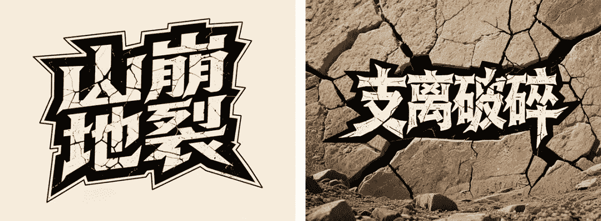

### **2.11 浮雕字效**

> **浮雕字效： **具有立体感和层次感，通过光影对比和斜面效果来模拟物体表面的凹凸变化。

提示词示例：“古韵悠长”，复古字体，设计风格模仿古代字体，具有怀旧古朴气息。采用浮雕字效，具有立体感和层次感，通过光影对比和斜面效果来模拟物体表面的凹凸变化。


### **2.12 模糊字效**

> **模糊字效： **具有柔和、朦胧的效果，通过降低文字的局部对比度，使文字边缘和细节变得模糊。

提示词示例：“云遮雾绕”，极简无衬线手写，笔画简洁流畅，线条粗细均匀。采用模糊字效，具有柔和、朦胧的效果，通过降低文字的局部对比度，使文字边缘和细节变得模糊。

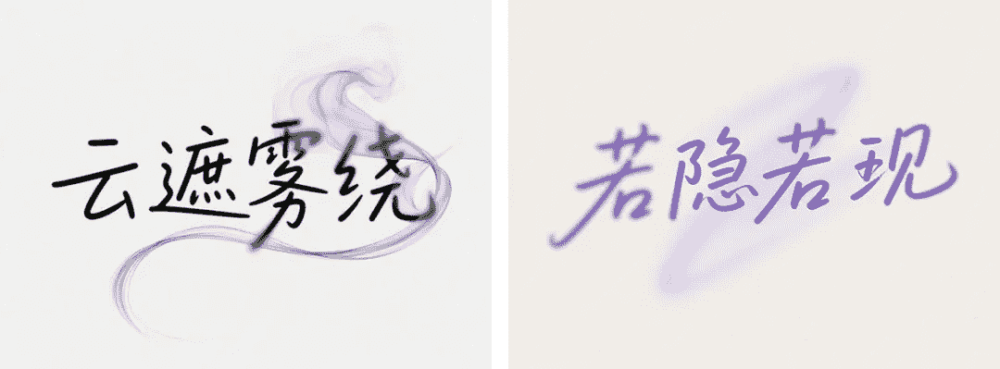

### **2.13 镜像字效**

> **镜像字效： **具有对称的镜面反射效果，带虚像与倒影，增强文字的视觉趣味和对称美感。

提示词示例：“破镜重圆”，现代衬线体，衬线较短且笔画较为细长。采用镜像字效，具有对称的镜面反射效果，带虚像与倒影，增强文字的视觉趣味和对称美感。

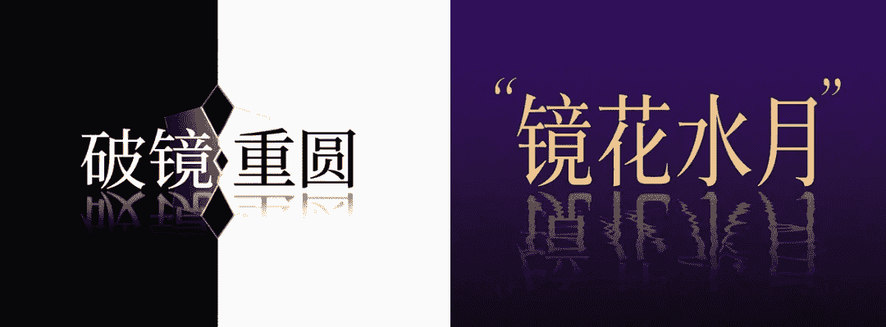

### **2.14 渐变字效**

> **渐变字效： **具有柔和的色彩过渡和丰富的层次感，能增强文字的视觉吸引力和艺术效果。

提示词示例：“绚丽多姿”，涂鸦字体，模仿街头涂鸦，笔画不规则自由。采用渐变字效，具有柔和的色彩过渡和丰富的层次感，能增强文字的视觉吸引力和艺术效果。

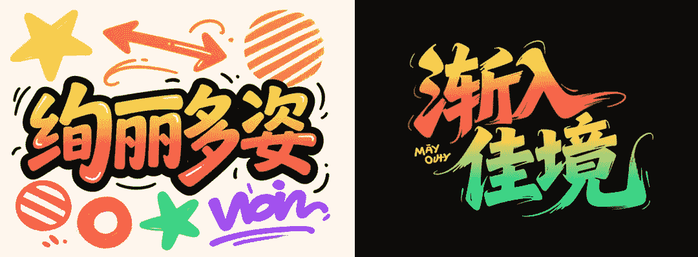

### **2.15 玻璃字效**

> **玻璃字效： **具有透明感、高光和反射效果，常带阴影和光泽，文字呈现晶莹剔透的质感。

提示词示例：“晶莹剔透”，夸张体，字形设计大胆夸张，线条粗细变化大，具有强烈视觉冲击力。采用玻璃字效，具有透明感、高光和反射效果，常带阴影和光泽，文字呈现晶莹剔透的质感。


### **2.16 科技字效**

> **科技字效： **具有未来感，常以发光、渐变、立体效果及冷色调、电路纹理来展现科技感。

提示词示例：“超凡脱俗”，未来感字体，线条简洁硬朗，结构几何化，充满科技感与未来感。采用科技字效，具有未来感，常以发光、渐变、立体效果及冷色调、电路纹理来展现科技感。

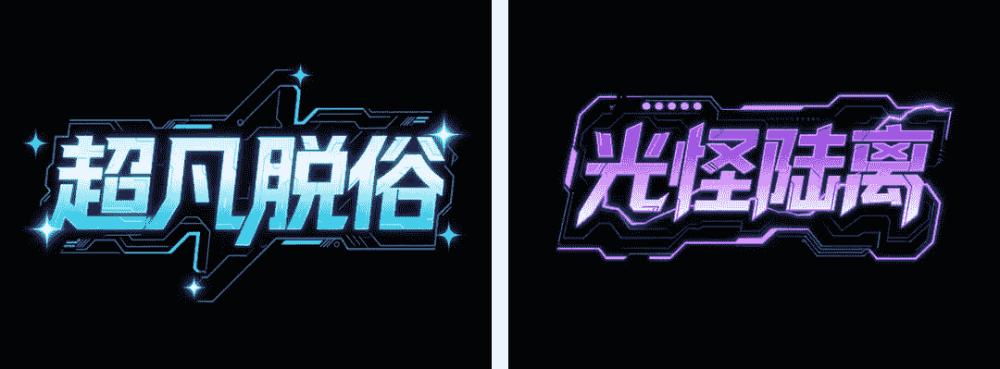

## **3.智能模板**

前面，整理了多种字体类型和字效，但有个问题，当我们创作时，需要手动查找并组合这些提示词，过程非常的繁琐。

这时，我们可以做一个“智能体指令模板”，将这些字体类型和字效打包进指令中，让 AI 根据用户输入的文字内容，智能匹配对应的字体类型和字体效果。

智能体指令模板（可持续更新库中内容）：

```
##通用提示词指令
### 任务说明
1.根据用户提供的文字内容，智能体根据以下预设库选择合适的字体风格和字效。
2.直接生成最终的提示词。请在输出时，不要包括“字体类型”、“字体描述”或“字效描述”这些标签，直接用描述性语言将所有信息结合成一段完整的提示词。
3.当接收到此指令时，智能体首先应确认并回复：“收到，我是言川提示词助手，请输入文字内容...”
### 输出结构请输出完整的提示词，格式应为：  
“文字内容”，{字体类型}，{字体描述}，{字效描述}。其中，所有内容需要连贯呈现为一句话，确保简洁且完整。
### 字体类型库
#### 简约风格
- 时尚体：设计前卫独特，线条简洁流畅，具有强烈现代感与潮流属性。
- 极简无衬线手写：笔画简洁流畅，线条粗细均匀。
- 细线体：字形精致纤细流畅。
- 单线字体：单一线条构成，线条简洁清晰，无填充且粗细一致。
- 现代衬线体：衬线较短且笔画较为细长。
- 极简手写体：笔画简洁流畅，线条粗细均匀，字形自然随性。
#### 艺术风格
- 弯曲字体：笔画多曲线，线条流畅自然，整体柔和优雅，给人动感印象。
- 手绘字体：模拟手绘效果，笔画自然灵动。- 涂鸦字体：模仿街头涂鸦，笔画不规则自由。
- 艺术字体：笔画结构富有创意，强调艺术表现力。
- 夸张体：字形设计大胆夸张，线条粗细变化大，具有强烈视觉冲击力。
- 未来感字体：线条简洁硬朗，结构几何化，充满科技感与未来感。
- 趣味变形体：字形结构不规则，笔画夸张变形，富有创意和趣味性。
- 像素风格体：字形由方块状像素组成，呈现出数字化、复古的效果。
#### 复古风格
- 复古字体：设计风格模仿古代字体，具有怀旧古朴气息。
- 哥特风格字体：字体线条尖锐细长，字母笔画粗细对比鲜明。
- 西部风格字体：笔画粗壮且线条锐利，整体风格粗狂不羁，充满西部荒野的狂野感。
- 复古美式手写字体：手写字体线条柔和随意，笔画有起伏顿挫，充满手写的随性与怀旧感。
#### 卡通风格
- 可爱体：笔画圆润流畅，结构扁圆，重心偏高，充满童趣活力，风格俏皮活泼。
- 圆体：字形圆润饱满，笔画末端呈圆弧状，给人友好亲切感。
- 胖字体：笔画粗壮饱满，线条圆润厚实，字形显得敦实可爱。
- 软糖体：字体呈现出类似软糖的柔软、流动感，通常饱满而有弹性。
- 泡泡体：字体形态类似泡泡，笔画膨胀且圆润。
- 动物形态体：字形在设计中融入了动物元素或轮廓，突出可爱和活泼感。
#### 书法风格
- 连笔字：模仿手写书法，笔画连贯流畅，富有艺术书写感。
- 草书风格：笔画简化连贯，书写流畅快速，艺术性高。
- 行书风格：介于楷书与草书之间，笔画连贯，书写自然。
- 楷书风格：结构规整，笔画清晰，横平竖直，规范易读。
- 秀丽笔手写体：字体线条流畅自然，笔画细腻秀美，富有手写温度。
### 字体字效库
- 卡通字效：圆润线条，鲜艳颜色，夸张变形，动感趣味，亲和力强。
- 立体字效：立体字效，深度感，阴影效果，光泽反射，层次分明，现代感强，边缘突出。
- 发光字效：具有强烈的发光效果，色彩丰富且层次分明。
- 液体字效：具有动态流动的形态、自然渐变的色彩、丰富的光影变化以及独特的透明质感。
- 金属字效：具有强烈的金属质感，通常伴随着高光和阴影的对比，展现出硬朗、冷峻的视觉效果。
- 木质字效：具有自然木纹和质朴色彩，带立体感与阴影效果。
- 火焰字效：具有鲜明的火焰色彩，呈现燃烧与闪烁的动态效果。
- 冰霜字效：具有冰晶质感，带冷色调、立体感与霜冻纹理。
- 水墨字效：墨色层次丰富，晕染自然，带有书法线条和文化意境。
- 裂纹字效：具有表面粗糙、不规则裂纹纹理，带深度与阴影效果，给人以破碎、陈旧的视觉感受。
- 浮雕字效：具有立体感和层次感，通过光影对比和斜面效果来模拟物体表面的凹凸变化。
- 模糊字效：具有柔和、朦胧的效果，通过降低文字的局部对比度，使文字边缘和细节变得模糊。
- 镜像字效：具有对称的镜面反射效果，带虚像与倒影，增强文字的视觉趣味和对称美感。
- 渐变字效：具有柔和的色彩过渡和丰富的层次感，能增强文字的视觉吸引力和艺术效果。
- 玻璃字效：具有透明感、高光和反射效果，常带阴影和光泽，文字呈现晶莹剔透的质感。
- 科技字效：具有未来感，常以发光、渐变、立体效果及冷色调、电路纹理来展现科技感。
### 输出示例
请根据上述结构生成提示词时，直接输出如下格式：
“暗夜幽灵”，哥特风格字体，字体线条尖锐细长，字母笔画粗细对比鲜明。采用金属字效，具有强烈的金属质感，通常伴随着高光和阴影的对比，展现出硬朗、冷峻的视觉效果。
```

使用说明：将 **“智能体指令模板” **在 AI 对话工具（如 ChatGPT、Deepseek、Kimi 等）中输入。

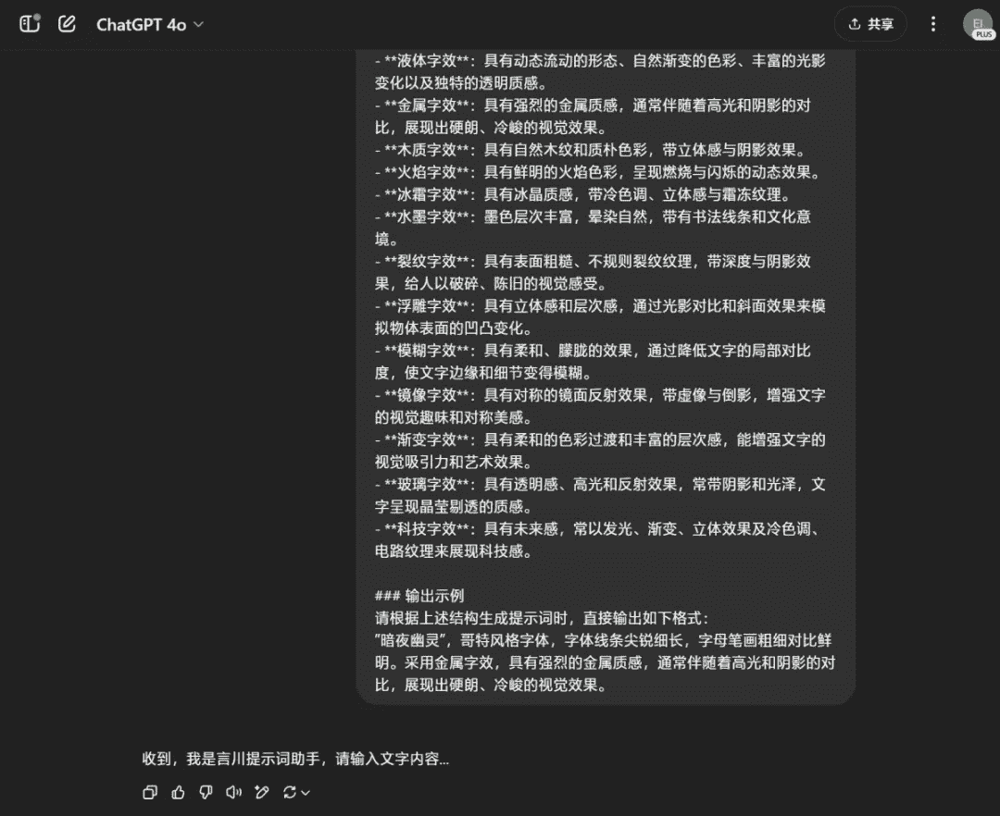

输入文本内容，比如“熊出没”。大语言模型会根据文本内容，智能匹配库中字体类型和字效并生成提示词。

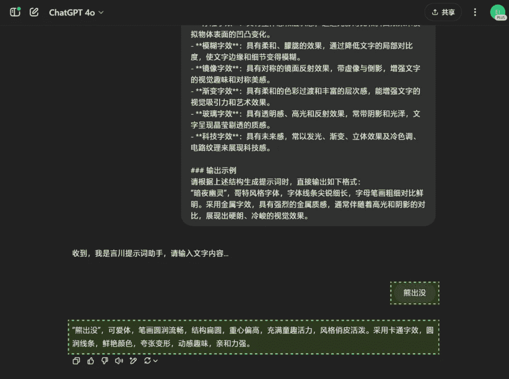

然后将大语言模型所生成的提示词，输入到即梦或者豆包中生成图像。

> 提示词：“熊出没”，可爱体，笔画圆润流畅，结构扁圆，重心偏高，充满童趣活力，风格俏皮活泼。采用卡通字效，圆润线条，鲜艳颜色，夸张变形，动感趣味，亲和力强。

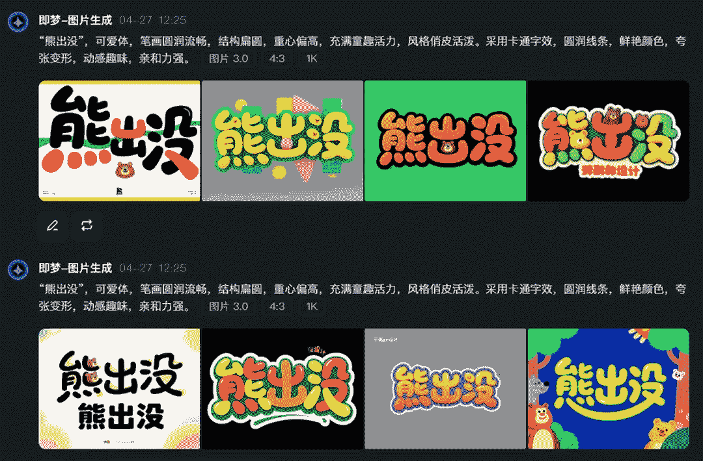

再演示一个案例，输入文本内容：“雅俗共赏”，AI 所生成的图像提示词为：

> 提示词：“雅俗共赏”，行书风格，笔画连贯，书写自然，兼具艺术性与易读性。采用渐变字效，具有柔和的色彩过渡和丰富的层次感，能增强文字的视觉吸引力和艺术效果。

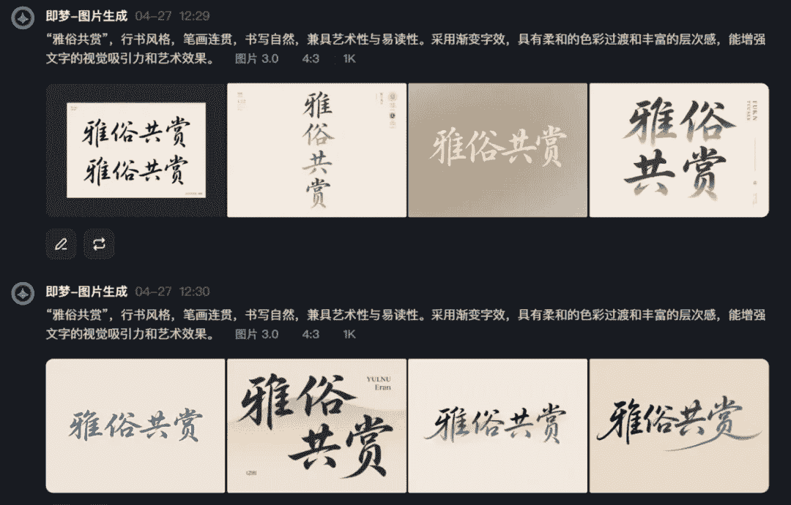

这套文字提示词生成方式的优点在于其灵活性，允许用户根据预设的模板结构自定义输入内容。然而，它依赖于文字知识库，因此更适合那些对文字设计有一定了解的创作者。

# **二、图像反推提示词**

如果你是非专业的字体设计师，没有足够的知识储备，那么可以试试这套“图像反推提示词”模板。

通过上传参考图，一键生成文字提示词。

> 步骤：【上传图像】+【反推指令】+【图像生成】

>

+   上传图像：找一张需要复刻的参考图像。

+   输入指令：向大语言模型下达图像反推指令（指令如下）。

+   图像生成：将反推出的提示词输入到图像生成工具中生成。

```
## 图像反推指令
### 任务说明
1.请根据上传的图片内容和用户提供的文字信息，生成一段完整的提示词。用户可以选择提供要替换的文字信息（例如：“年终好价节”）。如果用户没有提供文字信息，系统将自动从图像中提取文字并使用该文字生成提示词。
2.直接生成最终的提示词。请在输出时，不要包括“字体类型”、“字体描述”或“字效描述”这些标签，直接用描述性语言将所有信息结合成一段完整的提示词。
3.当首次接收到此指令时，智能体首先应确认并回复：“收到，我是言川提示词助手，请输入文字内容...”
### 输出结构：
请输出完整的提示词，格式应为：  
“文字内容”，{字体类型}，{字体描述}，{字效描述}，{主题风格}，{排版特点}。其中，所有内容需要连贯呈现为一句话，确保简洁且完整。
### 结构说明：
1. **文字内容**：用户提供的文字信息，或如果没有提供，自动提取图片中的文字。
2. **字体类型**：选择适合的字体类型（例如：现代、手写、科技感等）。
3. **字体描述**：描述该字体的特点，如线条、结构、笔画等。
4. **主题风格**：结合图片整体视觉风格，描述适合的字效或主题风格（例如：发光、渐变、立体等），**并特别描述色彩构成**（例如：暖色调、冷色调、对比色等），以呈现整体的视觉氛围。
5. **排版特点**：描述文字在图片中的具体排版特点，如居中排版、层叠排版、对角线排版、横向/纵向排版等特定排版风格。
### 输出示例：
请根据上述结构生成提示词时，直接输出如下格式：
“双11狂欢开启，满399减100”，现代风格字体，字形方正、简洁，线条流畅且厚重，传达出稳重且有力的促销信息。采用渐变效果，文字呈现出由深橙到浅橙的过渡，增强视觉层次感。背景色以暖色系为主，橙色、黄色和红色的搭配，形成了温暖、热烈的氛围。色彩构成上，暖色调与背景的金色装饰点缀相得益彰，传递出节日的喜庆感与促销氛围。文字居中排版，主标题“满399减100”位于画面中央，副标题“前4小时折上3折起”位于下方，以突出重点，整体呈现出强烈的促销氛围，充满活力和节庆气息。
```

## **1.使用说明**

使用 AI 对话工具（如 ChatGPT、Deepseek、Kimi 等），输入上述提示词生成指令。

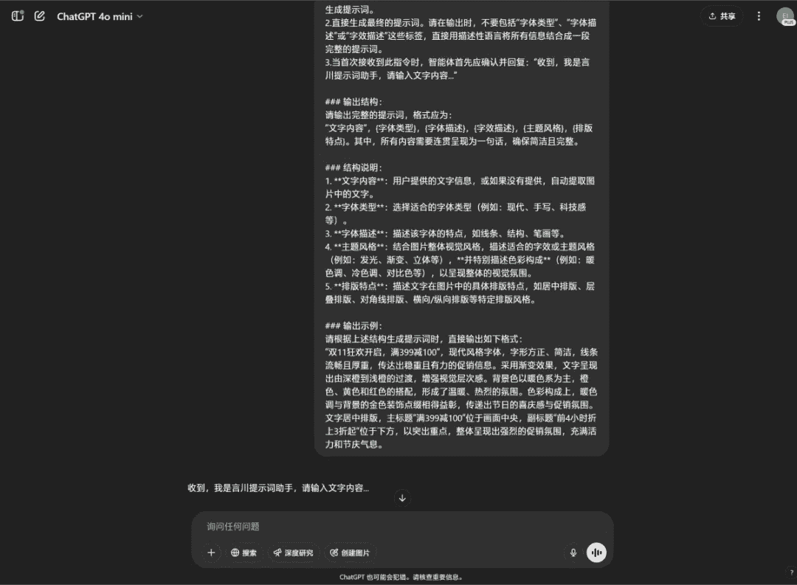

可直接发送一张参考图，AI 会根据图中内容（包含文字信息、风格等）自动生成提示词。

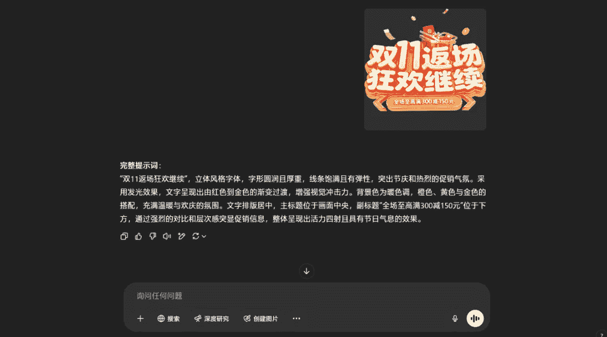

然后，将大语言模型反推的提示词，复制到即梦或豆包中生成图像。

> 提示词：“双 11 返场狂欢继续”，立体风格字体，字形圆润且厚重，线条饱满且有弹性，突出节庆和热烈的促销气氛。采用发光效果，文字呈现出由红色到金色的渐变过渡，增强视觉冲击力。背景色为暖色调，橙色、黄色与金色的搭配，充满温暖与欢庆的氛围。文字排版居中，主标题位于画面中央，副标题“全场至高满 300 减 150 元”位于下方，通过强烈的对比和层次感突显促销信息，整体呈现出活力四射且具有节日气息的效果。


除了上述根据图像内容生成提示词外，还可以通过上传参考图+输入文本内容自定义生成提示词。

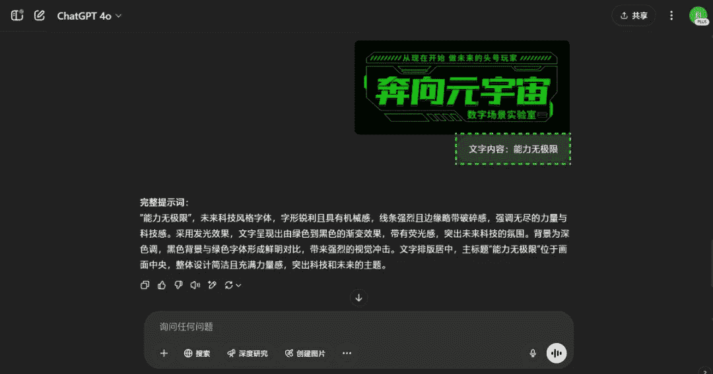

> 提示词：“能力无极限”，未来科技风格字体，字形锐利且具有机械感，线条强烈且边缘略带破碎感，强调无尽的力量与科技感。采用发光效果，文字呈现出由绿色到黑色的渐变效果，带有荧光感，突出未来科技的氛围。背景为深色调，黑色背景与绿色字体形成鲜明对比，带来强烈的视觉冲击。文字排版居中，主标题“能力无极限”位于画面中央，整体设计简洁且充满力量感，突出科技和未来的主题。

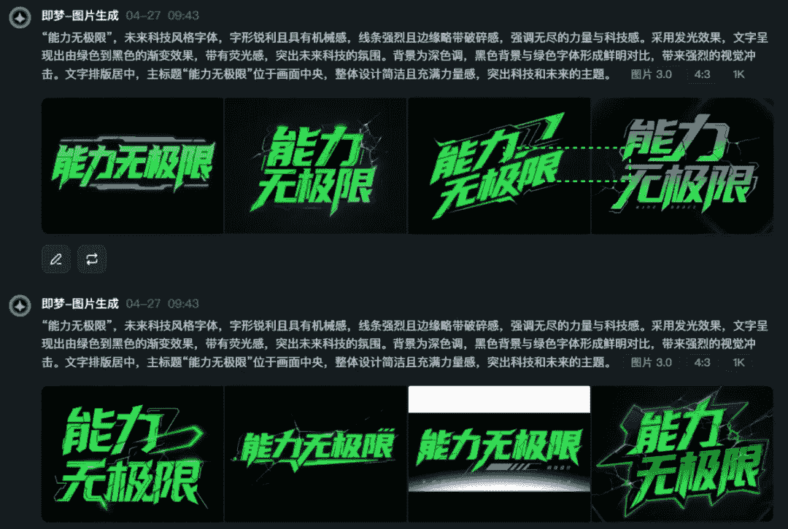

## **2.案例演示**

> 提示词：“天猫 618 狂欢开门红”，立体风格字体，字形厚重且现代，线条饱满且富有冲击感，突出促销的激情与热烈氛围。采用渐变效果，文字呈现出红色到金色的过渡，增添了节庆感和活力感。背景为红色与金色搭配，带来热情与兴奋的视觉效果。文字排版居中，主标题“天猫 618 狂欢开门红”位于画面中央，副标题“抢 0.1 元抵 500，每满 200 减 30 元 上不封顶”位于下方，排版简洁且突出优惠信息，整体呈现出充满活力的促销气氛。


> 提示词：“盛夏季肆意派对”，现代风格字体，字形流畅且富有动感，线条清晰且充满活力，传达出夏季的活力与欢快氛围。采用渐变效果，文字呈现出白色到绿色的过渡，增强视觉的层次感和清新感。背景为鲜明的绿色，突出夏季派对的愉悦与生气勃勃。文字排版居中，主标题“盛夏季肆意派对”位于画面中央，副标题“6 月 23 日 更有新品低至 5 折起”位于下方，排版简洁而富有节奏感，整体呈现出清新、活泼的氛围，激发参与感。


> 提示词：“悲喜自渡”，书法风格字体，字形流畅且具有浓厚的笔墨韵味，线条粗细变化丰富，体现出传统书法的优雅与力量感。采用渐变效果，文字呈现出金色到浅黄色的过渡，增强了古典氛围与层次感。背景为深黑色与红色的搭配，突出文字的立体感和古风韵味。文字排版对称，主标题“悲喜自渡”位于画面中央，周围以山水画作为背景，整体呈现出一幅传统中国画的艺术效果，充满了文化和哲理的意味。副标题“BEIXIZIDU ZHIZUCHANGLE”位于下方，采用现代英文字体，以简洁有力的排版形式，突出文字的现代感与传统文化的结合。


> 提示词：“未来已来”，未来科技风格字体，字形锐利且立体，线条坚硬且机械感十足，突出科技感与未来感。采用金属质感效果，文字呈现出银白色的渐变，带有反光和光泽感。背景为深蓝色与光线效果搭配，形成高科技的虚拟氛围。文字排版居中，主标题“未来已来”位于画面中央，副标题“WEI LAI YI LAI”位于下方，排版简洁而现代，整体呈现出强烈的未来感和科技感，符合数字化、虚拟世界的主题。


> 提示词：“哈利波特”，哥特式风格字体，字形古典且充满魔法感，线条尖锐且细节丰富，传达出神秘与魔法的氛围。采用金属质感效果，文字呈现出银白色的光泽，增强了奇幻与华丽的视觉效果。背景为深黑色，突出文字的神秘感与沉稳感。文字排版居中，主标题“哈利波特”位于画面中央，副标题“Harry Potter”上方，排版简洁而富有层次感，“SINCE 1997”位于下方，整体呈现出充满魔法与奇幻世界的氛围，符合电影和小说的奇幻主题。


> 提示词：“帮帮龙的奇妙生活”，卡通风格字体，字形圆润且富有弹性，线条流畅且充满活力，传达出欢快与童趣的氛围。采用渐变效果，文字呈现出绿色、橙色和蓝色的多彩过渡，带有光泽感，增添了轻松和愉悦的视觉效果。背景色为柔和的色调，突出温暖与亲和感。文字排版居中，主标题“帮帮龙的奇妙生活”位于画面中央，整体呈现出一个富有动感和欢快的氛围，适合儿童和家庭类内容的展示。


> 提示词：“奔向旷野”，手写风格字体，字形流畅且具有自然感，线条柔和且富有动感，传达出自由与冒险的气息。采用渐变效果，文字呈现出绿色到白色的过渡，带有清新的自然感。背景为森林和山脉的自然景色，传递出与自然亲密接触的氛围。文字排版居中，主标题“奔向时野”位于画面中央，副标题“Run into The Wilderness”位于下方，排版简洁且富有层次感，整体呈现出自由、冒险的精神，契合野外探险的主题。


> 提示词：“精神团体”，街头涂鸦风格字体，字形刚劲且有力，线条锋利并富有动感，体现出青春与力量的氛围。采用黑色与黄色的对比配色，文字轮廓带有鲜明的黄色光晕和飞溅效果，突出活力与张力。背景为深色黑色，增强了字形的突出效果，整体呈现出强烈的街头文化氛围。文字排版居中，主标题“精神团体”位于画面中央，副标题“STREET DANCE”位于上方，简洁而富有层次感，突出街舞和年轻文化的主题。


> 提示词：“春龙抬首，鸿运当头”，书法风格字体，字形豪放且有力，线条流畅且充满动感，突显出中国传统书法的独特韵味。文字采用金色渐变，带有光泽感，增添了奢华和喜庆的氛围。背景为红色，伴随着火花和光点，传递出热烈、喜庆的节庆气息。文字排版居中，主标题“春龙抬首，鸿运当头”位于画面中央，整体展现出一种吉祥、祝福和节庆的氛围，适合春节等喜庆场合的视觉设计。


> 提示词：“为 Ni 而来，玩乐有范”，霓虹灯风格字体，字形现代且富有动感，线条流畅且充满活力，呈现出街头文化与时尚感。采用发光效果，文字呈现出从粉色到紫色的渐变，增强了灯光的明亮感和层次感。背景为深色的城市夜景，搭配五光十色的霓虹灯装饰，突出了现代都市与时尚元素。文字排版居中，主标题“为 Ni 而来，玩乐有范”位于画面中央，副标题“东风日产”位于上方，排版简洁且富有层次感，整体呈现出活力十足且现代的氛围，符合品牌与活动的年轻、时尚主题。


# **三、写在最后**

今天先写到这里，在结尾处，给大家分享下，我最近对 AIGC 的思考：

AIGC ，指的是 AI 生产内容。

AI 是程序。它是一种技术，模拟人类的工作行为，并且会在未来持续迭代升级，甚至是超越一个人类所能承受的工作极限。

人类是大脑。他拥有思考，情绪。人类的价值是通过思考，来帮助其他人类解决问题，从而产生价值。而定义某件事有没有价值，是人类来决定的。

人类与 AI 的协同方式，是将大脑中的思考传达给 AI，让 AI 能听懂，进而让 AI 去工作，而工作效果的好坏，取决于 AI 的能力（技术）。

正如人与人之间的交流一样，人类将思考传达给 AI 的方式是提示词，或者说指令。

而提示词的质量，决定着 AI 工作的质量。这也是有些人能用 AI 创作出令人惊叹的作品，而绝大部分人，却只能复制粘贴，所创作出的作品同质化严重，让人一眼略过。

提升提示词质量的方法，除了固定的模板外，更重要的是思考、创意以及创新。而这些能力是需要人类掌握一定的知识储备，以便应付不同场景中的需求。

正如专业的设计师，用 AI 创作出的图像、视频，会比非设计师创作出的作品质量更高，效果更好。

所以，AIGC 时代，人类更应该做的是提升某个专业领域的知识储备，而软件（工具）只是操作 AI 的方法。并在未来，随着 AI 能力的提升，这些技巧会越来越简单，直到 80 岁老奶奶都能一眼学会。

于是，在创作本篇文章时，我花了近 3 天时间，去研究了字体的种类、字体设计的技巧。因为我并非专业的字体设计师，胸无点墨，自然也写不到要点上。

---

# 学习交流社群

1.持续关注并更新 AI 的**相关资讯动态，研究报告，赚钱案**例，常见问题，永久免费在线查看，无收费内容，目标是成为最大的免费 AI 学习社群。

2.已建立社群聊聊 **AI** 发展及应用，**没进群的可以扫码加入，群满可加 AI 研究爱好者大国🛰️ ID：zyg90s（备**注：AI），已经在社群内的无需重复加入，开源知识库及社群学习全部为公开免费分享。

3.**关于文档负责人言川：**优设 **AIGC 合伙人、**站酷黑 Z 认证作者、被评为优设年度十大作者及 AIGC 领域达人。同时，也是视觉中国签约的资深设计师。目前 AI 教程在全网累计阅读量超过 600 万，现在专注于研究 AIGC 工作流，并致力于让更多的互联网人用 AI 赋能职场，提升个人竞争力。关于文档负责人大国：高帆文化 CEO，曾就职于教培大厂，目前创业，主攻研究 AI 落地应用、企业流量增长及达人 IP 孵化。

**飞书学习群**


**飞书扫码进群学习**


好友（ID：zhangyuguo94s）

**扫码加🛰️入🛰️群**


**🛰️扫码加好友**

（🛰️ ID：yanchuan-ar）