# Trae 学习手册（持续更新 ing...

> 来源：[https://yunyinghui.feishu.cn/docx/CCvBdRoYbo3jdKxI2x8csEUonCg](https://yunyinghui.feishu.cn/docx/CCvBdRoYbo3jdKxI2x8csEUonCg)

> 首发时间：2025 年 7 月 8 日

> 更新时间：2025 年 10 月 13 日

> **内容出品人：**

> **内容出品方：**[Mix AI Lab](https://yunyinghui.feishu.cn/wiki/WhelwZnxQi55mpkOzatc3Xran5b?from=from_copylink)

> **使用建议：**如果需要快速定位到精确内容，可以使用快捷键 `Ctrl +F/Command +F` 的形式，搜索关键字/词，查找你想要的内容。

> **特别说明：**飞书内容花了大量心思做构思和整理，请勿直接抄袭复制，如有发现会追究相关责任。

>

> **为 AI 实验室**同学持续更新 AI 编程工具 Trae 的基本介绍、安装配置、使用技巧、实操案例等全套学习内容。

>

> 🎯全网最接地气 AI 知识库：[AI 实验室」知识库](https://yunyinghui.feishu.cn/wiki/space/7340161844864598017?ccm_open_type=lark_wiki_spaceLink&open_tab_from=wiki_home)AI 绘画、AI 写作、AI 视频等应用技能）

## 二、Trae 是什么

### 1.1 Trae 基本介绍

Trae 是字节跳动发布的 AI 原生编程工具，是继 InsCode AI IDE 之后的中国又一款 AI 原生集成开发环境工具。2025 年 1 月 19 日，字节跳动发布了一款面向专业的开发者提供服务的全新 AI Coding 产品 Trae 。Trae 面向希望提高编程效率、减少重复性任务的开发者，无论是初学者还是经验丰富的开发人员均可使用。

2025 年 2 月，该工具上线 Windows 版 ；3 月 3 日，字节跳动发布 AI 编程工具 Trae 国内版，Trae 本质上是 AI 原生集成开发环境工具，有一体化的原生 AI 体验。新发布的 Trae 国内版模型搭载 `Doubao-1.5-pro`，支持切换满血版 `DeepSeek-R1&V3` ；3 月 12 日，硅基流动宣布，字节跳动发布的 AI 原生集成开发环境（AI IDE）——Trae 现已预置硅基流动 SiliconCloud 平台作为模型提供方 ；5 月 28 日，字节跳动安全与风控部门发布邮件称，出于对防范数据泄露风险的考虑，自 6 月 30 日起，将在内部分批次禁用第三方 AI 开发软件。截止 6 月 12 日消息，TRAE 的整体月活已超 100 万。


**网址：**`https://www.trae.cn/`

### 1.2 Trae 对比其他 AI IDE

传统 IDE 主要提供代码编辑、编译、调试等基础功能，开发者需要手动编写大量代码，并且在解决问题时依赖自身经验和外部搜索。而 Trae 不仅具备传统 IDE 的功能，更通过 AI 赋能，实现智能代码补全、Builder 模式自动化生成项目代码、上下文理解提供精准建议以及多模态支持（如上传图片生成代码）等。

| 维度 | Trae | Cursor | Windsurf |

| --- | --- | --- | --- |

| 核心定位 | 全场景 AI IDE（侧重中文生态） | 轻量级 AI 代码编辑器 | 特定领域 AI 辅助工具（如金融量化） |

| 自然语言支持 | 中文 / 英文，多模态（支持图片） | 英文为主，文本指令 | 英文，领域特定语言（如 SQL） |

| 代码生成能力 | 全栈开发（含 UI / 复杂业务逻辑） | 函数级生成与编辑 | 领域特定代码（如数据处理） |

| 协作功能 | 团队代码风格统一 / 实时协作 | 基础多人编辑 | 基于项目的协作（如数据看板） |

| 调试辅助 | 智能错误定位 + 修复建议 | 代码解释与重构 | 领域特定调试（如 SQL 优化） |

| 技术栈覆盖 | 主流全栈技术（React/Node/Python） | 通用编程语言（Python/JS/Java） | 金融 / 数据科学（Python/R/SQL） |

| 中文支持 | ✅ 原生支持，中文文档完善 | ❌ 英文界面为主 | ❌ 英文为主 |

| 离线使用 | ✅ 本地部署版（高级版） | ❌ 需联网 | ✅ 部分功能离线 |

| 商业模式 | 订阅制（￥99 / 月起） | 免费版（功能受限）+ 订阅（$19 / 月） | 按领域模块收费（如金融 / 医疗） |

| 独特优势 | 1. 多模态交互（图片 + 文字） 2。 低代码组件库 3。 中文生态适配 | 1. 双光标编辑模式 2。 代码解释与重构 3。 轻量级集成 | 1. 领域深度优化（如金融建模） 2。 合规性检查 3。 数据可视化生成 |

#### 总结

+ Trae：适合国内全栈开发团队，提供多模态交互与中文深度支持。

+ Cursor：适合追求效率的开发者，专注代码编辑与重构体验。

+ Windsurf：适合特定领域（如金融、数据科学）的专业开发。

### 1.3 Trae 适用人群

+ 编程初学者：Trae 支持自然语言编程、代码补全、Bug 修复等功能，还原生支持中文，降低了使用门槛。初学者可以通过 AI 辅助学习编程，理解复杂逻辑，在遇到问题时，借助 AI 助手快速获得解答，有助于更快地掌握编程知识和技能。

+ 专业开发者：对于经验丰富的开发者，Trae 能帮助他们提高编程效率，减少重复性任务。通过智能代码补全、实时代码建议等功能，可让开发者更快速地编写代码，将更多精力放在创造性工作上。同时，其多模态交互功能还支持上传图片表达需求，能进一步提升开发效率。

+ 项目开发团队：Trae 的聊天构建模式可以帮助团队快速构建项目。此外，对于大团队开发者，其智能协作功能能够确保代码风格统一，实时同步代码更新和修改建议，减少跨团队协作中的沟通成本

### 1.4 Trae 的应用场景

+ **Web 应用开发：**Trae 可以根据开发者需求生成前端和后端代码，例如开发具有图片上传与压缩功能的网站，能实现图片相关功能，并提供视觉设计建议。

+ **工具类应用开发：**在开发图片处理工具站或文件格式转换工具等各类工具类应用时，Trae 能协助开发者快速完成代码编写和项目构建，实现如图片格式转换、PDF 转 Word 等功能。

+ **前端项目开发：**创建特定页面风格的前端项目时，Trae 可利用 React 等前端框架，结合 TypeScript 等技术，生成项目文件，实现动画和过渡效果，提升前端开发效率。

+ **游戏开发：**对于一些简单小游戏开发，如汉诺塔、贪吃蛇等，开发者用自然语言描述游戏规则和需求，Trae 就能生成包括游戏逻辑、界面绘制等部分的代码，帮助快速实现游戏创意。

+ **数据科学与机器学习开发：**在数据科学和机器学习领域，Trae 可自动化完成数据清洗、特征选择，还能根据任务需求推荐合适的算法和模型，并调整超参数，助力开发者更高效地完成开发任务。

+ **日常编程任务辅助：**在日常编码中，当开发者遇到代码理解困难、需要优化代码结构、添加新功能或修复错误等问题时，可随时借助 Trae 的 AI 助手功能，获取解决方案和建议。

### 1.5 核心功能详解

#### 1）Builder 模式：从需求到项目全自动生成

**功能：**用自然语言描述需求（如“创建 Python 贪吃蛇游戏”），Trae 自动生成完整项目结构（代码文件、依赖清单、资源文件）。

**操作流程：**

① 点击右侧「Builder」标签 → 输入需求描述；

② AI 生成代码后，点击「运行」按钮自动安装依赖（如检测缺失 `pygame` 库会提示安装）；

③ 通过对话迭代优化（例：输入“蛇移动速度太慢，调整为 15 帧/秒”AI 自动修改参数）。

#### 2）Chat 模式：智能代码助手

**功能：**支持代码解释、错误修复、需求生成（快捷键 `Ctrl+Shift+A` 或 `Cmd+U` 唤起）。

**典型场景：**

错误修复：拖拽终端报错日志到对话框 → AI 定位问题并修复（如自动补 `pip install` 命令）。

跨文件协作：拖拽文件夹到对话框 → 输入“添加🛰️登录功能” → AI 修改多文件并生成新组件（如 `wechat_auth.py`）。

#### 3）上下文智能引用

通过 `#` 键精准关联上下文，提升 AI 回答准确性：

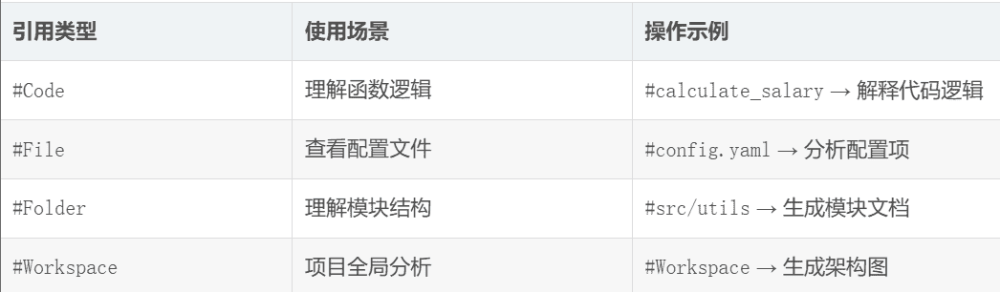

#### 4）多模态开发

上传设计图（Figma/Axure）→ 输入“生成 React 登录组件” → AI 解析图层生成带样式代码。

截图标注按钮/区域 → AI 关联现有路由生成跳转逻辑。

#### 5）高效辅助工具

中文魔法补全：写中文注释如“计算本月工资” → 按 `Tab` → 自动补全 `calculate_monthly_salary（）` 函数。

零代码部署：点击顶部「发布」 → AI 生成 `Docker` 镜像及云服务器部署脚本（支持腾讯云/Aliyun）。

### 1.6 产品报价

14 天免费试用，有个人版和企业版。


**说明：**

1. 免费试用：所有付费版本提供 14 天免费试用，无需信用卡。

1. [功能对比：](https://trae.ai/pricing)详细功能差异可在官网查看功能对比表。

1. 企业定制：企业版支持私有云部署、自定义安全策略及专属训练模型。

1. 价格调整：以上价格可能随版本更新调整，最新信息以官网为准。

## 三、Trae 的安装与配置

### 2.1 安装 Trae 的系统要求

+ **操作系统**：支持 macOS 10.15 及以上版本或 Windows 10、Windows 11 系统，Linux 版本暂未推出。

+ **内存**：最低要求 8GB，推荐 16GB 及以上以更流畅地运行 AI 模型。

+ **存储空间**：至少需要 2GB 可用空间。

+ **网络连接**：必需，建议带宽为 5Mbps 或更快。使用国际版时，若要使用 `Claude 3.5` 和 `GPT-4o` 等模型，需要使用 `VPN` 访问；国内版内置 `Doubao-1.5-pro` 和 `DeepSeek-R1/V3` 模型，无需🪜。

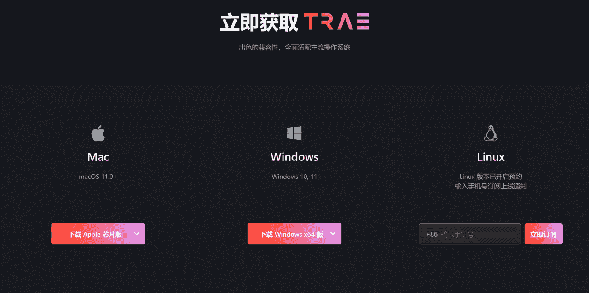

### 2.2 macOS 系统上安装 Trae

1. 打开浏览器，前往官方网站 `trae.ai`。

1. 在官网根据操作系统选择 macOS 版本，点击下载安装包。

1. 下载完成后，找到安装包并双击打开，按照安装向导提示完成安装。

1. 安装完成后，在应用程序中找到 `Trae` 并启动。首次启动时选择界面语言（推荐中文或英文）。


### 2.3 Windows 系统上安装 Trae

1. 打开浏览器，访问 `trae.ai` 官网。

1. 在官网下载区域，选择适合 Windows 系统的版本进行下载。

1. 下载完成后，双击 `.exe` 文件，弹出安装向导。

1. 按照安装向导的指引，点击 “下一步”，选择安装路径等选项，完成安装。

1. 安装结束后，可在开始菜单或桌面上找到 `Trae` 图标，双击打开。首次启动时设置界面语言。


### 2.4 安装完成首次配置

1. **选择主题与语言：**打开 `Trae` 后，在初始设置界面可选择主题，有黑色、亮色、深蓝色等风格，语言方面支持简体中文和英文，国内用户一般选择简体中文以便操作。


1. **添加命令行（可选）：**为方便使用，可在命令行中添加 `Trae` 的启动命令。打开 Terminal（终端），输入命令 `trae` 即可启动 `Trae`。也可在系统环境变量的 `Path` 中添加 `Trae` 的安装路径，这样在任何地方都能通过命令快速启动 `Trae`。若觉得配置环境变量麻烦，跳过此步，直接从桌面快捷方式启动 `Trae` 也可。

1. **登录账号**：使用 `Trae` 的 AI 功能需登录账号，目前支持谷歌账号和 Github 账号一键登录。点击 “登录” 按钮，选择账号类型，按提示完成授权登录。登录过程中可能需🪜。


### 2.5 安装 PowerShell

首先，确保已安装 `PowerShell` 7 或更高版本。可以通过以下命令安装（要连接🪜）：

```
winget install --id Microsoft.PowerShell --source winget
```

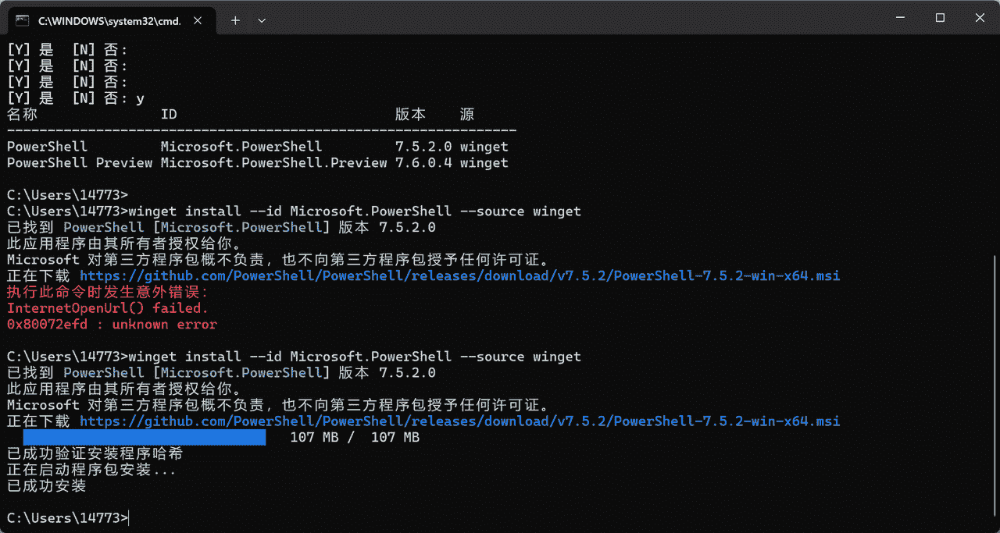

返回 `Trae` 并打开 终端 面板。 点击右上方区域的 + > 选择默认配置文件。

选择 `PowerShell`

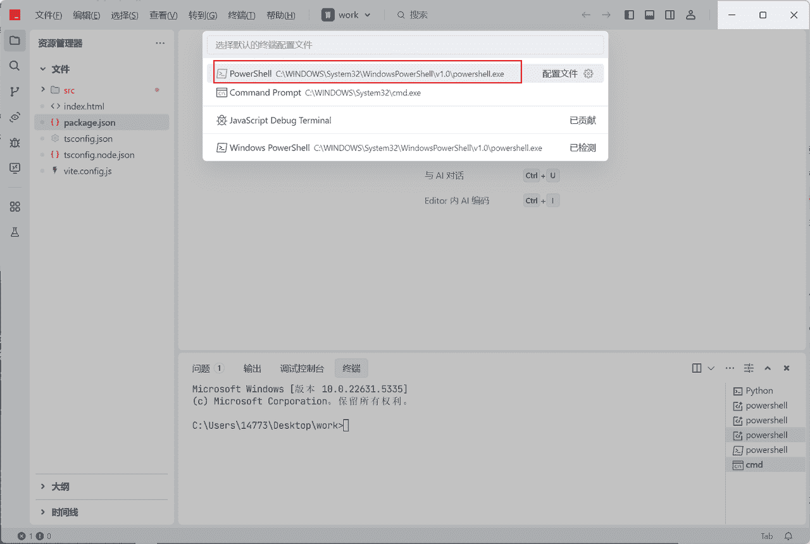

## 四、Trae 的基本功能与使用

### 3.1 如何在 `Trae` 中创建项目

#### 1）导入本地文件夹

1. 选择一个文件夹并将其在 `Trae` 中打开。

#### 2）从 GitHub 克隆仓库

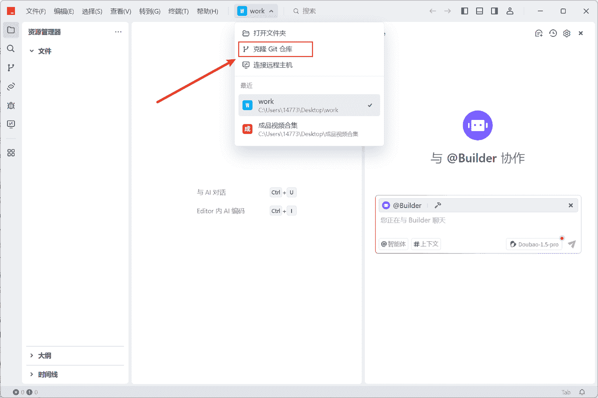

### 3.2 智能代码补全功能如何使用

在代码编辑器中输入代码时，`Trae` 会实时预测并提供代码补全建议。例如，当输入 `for` 后，`Trae` 可能会自动补全出 `for （let i = 0； i < array.length; i++）` 这样常见的 `for` 循环结构，开发者可通过键盘上下键选择合适的补全内容，然后按 `Tab` 键或回车键完成补全。

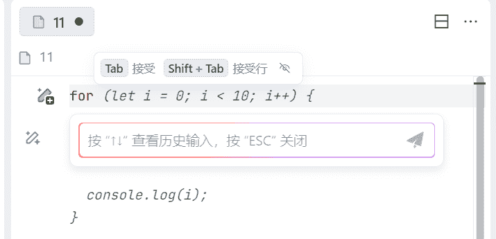

### 3.3 智能体（Agent）系统

智能体是 `Trae` IDE 面向不同开发场景的编程助手，支持内置智能体与自定义智能体。自定义智能体可通过配置提示词和工具集，高效完成复杂任务。

#### 智能体的核心能力

+ 自主运行：独立探索代码库，识别相关文件并执行必要修改。

+ 完整工具访问权限：使用所有可用工具（搜索、编辑文件、运行终端命令等）。

+ 上下文理解：全面理解项目结构与依赖关系。

+ 多步骤规划：将复杂任务拆解为可执行步骤，按序处理。

#### 智能体的工作流流程

1. 需求分析：深入理解任务目标及代码库上下文，明确需求要点。

1. 代码调研：检索代码库、文档及网络资源，定位相关文件并分析现有逻辑。

1. 方案设计：拆解任务步骤，动态优化修改策略。

1. 实施变更：

+ 推荐新增依赖库；

+ 提供需执行的终端指令；

+ 给出 `Trae` IDE 外的手动操作指引。

1. 交付验收：验证完成后移交控制权，汇总所有修改内容。

#### 内置智能体介绍

+ Builder：

帮助从 0 到 1 开发完整项目，调用分析代码、编辑文件、运行命令等工具，精准处理需求。

+ Builder with MCP：

在 `Builder` 基础上，默认添加所有配置的 `MCP Server`，且不可编辑。

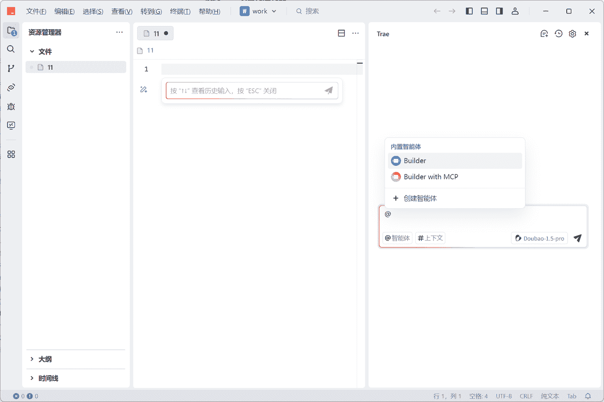

### 3.4 上下文理解

在与 AI 助手交互时，可通过指定上下文让其答复更精准，具体操作方式如下：

#### 1）以编辑器内容作为上下文

当编辑器中存在正在编辑的代码文件时，AI 助手默认读取当前文件。若需针对文件中某段代码提问，操作步骤如下：

1. 选中目标代码片段；

1. 点击悬浮菜单中的 添加到对话 按钮，所选内容会作为上下文载入侧边对话框；

1. 侧边输入框将显示文件名称及代码行号

1. 可继续添加其他代码片段或多来源上下文。

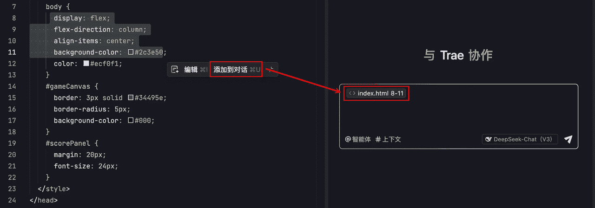

#### 2）以终端内容作为上下文

若需针对终端输出内容（如报错信息）提问，操作步骤如下：

1. 在终端中点击目标输出内容片段；

1. 点击内容片段右上角的 添加到对话 按钮，将其添加至侧边对话框；

1. 输入框会显示上下文来源及行号；

1. 支持追加其他终端片段或混合多源上下文。

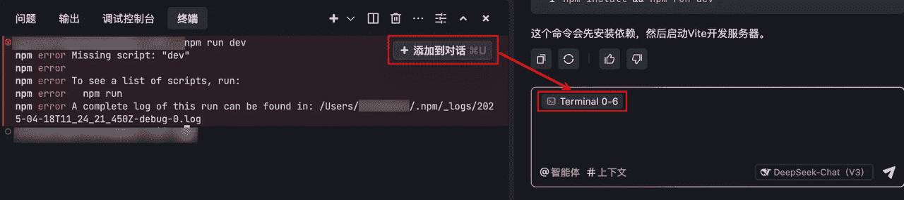

#### 3）通过 `#` 符号添加上下文

在侧边对话输入框中，可通过 `#` 符号快速调用多种上下文资源，包括：

+ 代码片段、文件、文件夹

+ 代码仓库、文档集、网页

系统会根据当前打开文件推荐相关上下文，也可手动搜索添加。例如，可组合添加代码文件与文档资源，精准定位问题场景。

### 3.5 智能问答

在编程的世界里，语法错误、函数用法困惑、逻辑漏洞等问题如同家常便饭，时刻考验着开发者的耐心与技术能力。而 `Trae` 的智能问答功能，就像一位形影不离的贴心伙伴，凭借侧边对话（Chat 模式）与内嵌对话两大 “利器”，为开发者排忧解难，助力高效编码。


侧边对话（Chat 模式）堪称开发者触手可及的 “云端编程智囊团”。无论何时遭遇难题，开发者都能即刻向它发起询问。当 Java 代码中跳出 `NullPointerException` 报错，开发者只要将报错信息与相关代码片段发送过去，Trae 便能迅速剖析问题根源，不仅给出修复方案，还会细致解释错误成因。不仅如此，面对陌生复杂的代码库，比如新接手的开源项目，开发者只需抛出 “这个项目的核心功能是什么？各模块间怎样协同工作？” 这类疑问，Trae 就能基于代码内容与文档，输出条理清晰的分析与解答，帮助开发者快速吃透项目架构。

内嵌对话功能则将便捷性发挥到极致。在专注编码时，若对某段代码存疑，开发者无需中断思路，只需选中代码，一键按下快捷键唤起内嵌对话窗口，就能直击痛点提问，诸如 “这段代码的实际用途是什么？如何进一步优化？”. Trae 会以闪电般的速度，直接在代码旁给出针对性的回复与优化建议，让开发者全程沉浸于编码节奏，流畅解决问题，始终保持高效开发状态。


## 3.6 模型上下文协议

通过模型上下文协议（Model Context Protocol，MCP），你可以将外部工具和服务连接至 Trae IDE 进行使用。

### 什么是 MCP？

Model Context Protocol （MCP） 是一种协议，它允许大型语言模型（LLMs）访问自定义的工具和服务。Trae 中的智能体作为 MCP 客户端可以选择向 MCP Server 发起请求，以使用它们提供的工具。你可以自行添加 MCP Server，并添加到自定义的智能体中来使用。

在 Trae IDE 中，MCP Server 支持三种传输类型：stdio 传输、SSE 传输、Streamable HTTP 传输。

### 配置系统环境

为确保正常启动 MCP Server，你可能需要安装：

+   `npx`：依赖于 Node.js，版本需大于等于 18。

+   `uvx`：基于 Python 的快速执行工具，需手动安装。

+   （可选） Docker：容器化平台，用于隔离和运行应用程序，需根据系统版本安装对应版本。若使用 GitHub MCP Server，则需要使用 Docker。

#### 安装 Node.js

1.  请前往 [Node.js 官网](https://nodejs.org/)，下载并安装 Node.js 18 或更高版本。

1.  安装完成后，在终端中运行以下命令确认是否安装成功。

```
node -v
npx -v
```

若安装成功，终端中会输出已安装的 Node.js 的版本号，例如：

```
v18.19.0
10.2.0
```

1.  重启 Trae IDE，使 Node.js 生效。

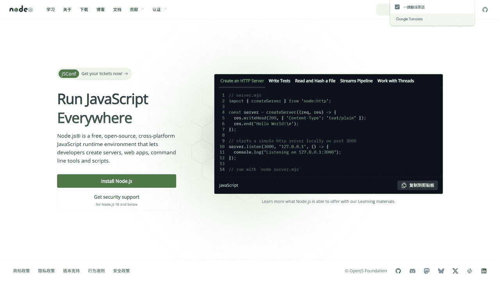

#### 安装 `uvx`（Python 工具）

`uvx` 是 [uv](https://github.com/astral-sh/uv) 提供的命令行工具，用于快速运行 Python 脚本。

1.  前往 [Python 官网](https://www.python.org/downloads/)，下载并安装 Python 3.8 或更高版本。

1.  安装完成后，在终端中执行以下命令确认是否安装成功。

```
python --version
```

若安装成功，终端中会输出已安装的 Python 的版本号。

1.  执行以下命令，安装 `uv`（包含 `uvx`）。安装脚本会自动下载 `uv` 并放置到系统默认路径中。

+   macOS / Linux 安装命令：

```
curl -LsSf https://astral.sh/uv/install.sh | sh
```

+   Windows 安装命令（PowerShell）：

```
powershell -ExecutionPolicy ByPass -c "irm https://astral.sh/uv/install.ps1 | iex"
```

1.  执行以下命令，验证是否安装成功。

```
uvx --version
```

若安装成功，终端中会输出已安装的 `uvx` 的版本号。

#### （可选） 安装 Docker

若使用 GitHub MCP Server，则需要使用 Docker。使用以下步骤安装 Docker Desktop：

| 操作系统 | 步骤 |
| --- | --- |
| macOS | +   **手动安装：**前往 [Docker 官方网站](https://www.docker.com/products/docker-desktop) 或 Docker 商店，然后下载适用于 macOS 的 Docker Desktop 安装包（.dmg 文件），根据芯片选择对应版本。 |
| Windows | 前往 [Docker 官方网站](https://www.docker.com/products/docker-desktop)，下载适用于 Windows 的 Docker Desktop 安装程序并运行，然后按照安装向导的提示完成安装（确保勾选 “Use the WSL 2 based engine” 选项）。 |

使用以下操作验证是否安装成功：

+   打开终端，输入 `docker --version` 命令。如果安装成功，会显示 Docker 的版本信息。

+   输入 `docker info` 命令，可以查看 Docker 的详细信息。如果能正确显示信息，代表 Docker 已安装并启动成功。

##### 配置 MCP Server

你可以直接从市场中添加合适的 MCP Server，或手动添加。

###### 方式一：从市场添加

MCP 市场中提供了社区中热门的 MCP Server，你可以选择需要的 MCP Server 进行添加。

1.  在 AI 侧边对话框的右上角，点击设置图标，然后在菜单中选择 MCP。

界面上显示 MCP 页签。

1.  点击 + 添加 MCP Servers 按钮；或点击右上角的 + 添加 按钮，然后在菜单中选择 从市场添加。

你将进入 MCP 市场。

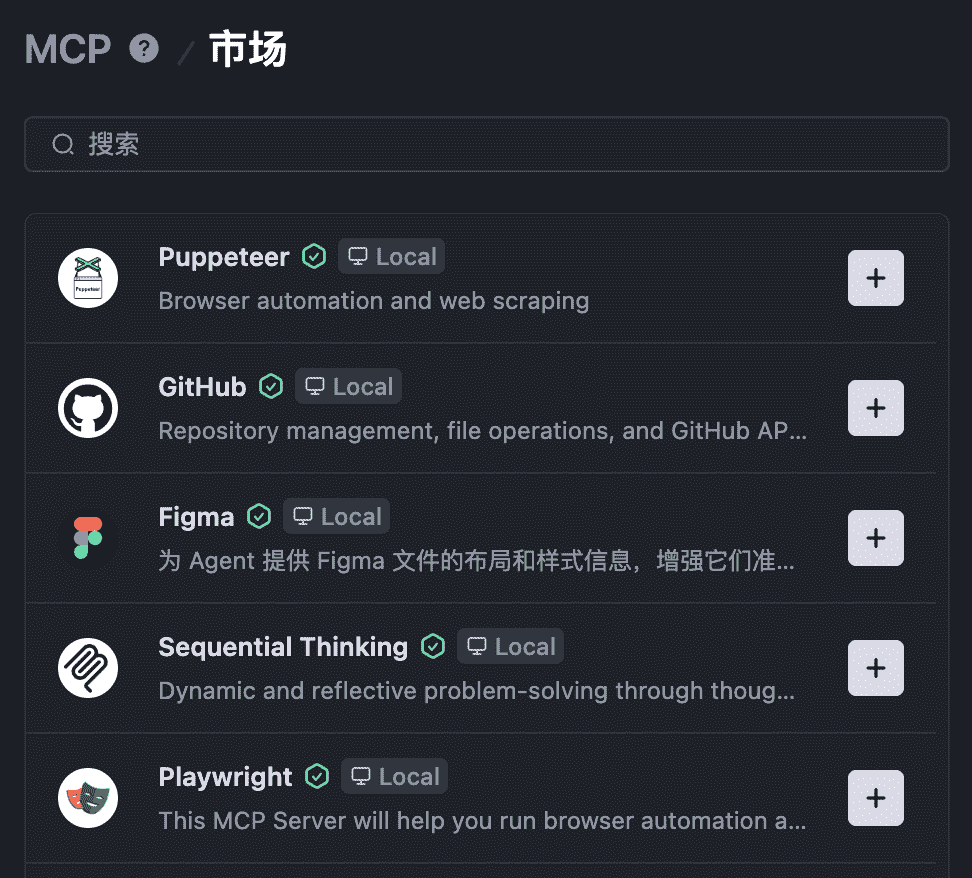

1.  在 MCP 市场中找到所需的 MCP Server。

1.  点击右侧的 + 按钮。

1.  在弹窗中填入 MCP Server 的配置信息。

+   对于标记为 “Local” 的 MCP Server，需要在本地安装 `npx` 或 `uvx` 后才能使用。

+   配置内容中的 `env` 信息（例如 API Key、Token、Access Key 等字段）须替换为真实信息。

1.  点击 确认 按钮。

###### 方式二：手动添加

如果在市场中无法找到想要的 MCP Server，或者想使用自己开发的 MCP Server，则需要手动添加。

1.  在 AI 侧边对话框的右上角，点击设置图标，然后在菜单中选择 MCP。

界面上显示 MCP 页签。

1.  点击右上角的 + 添加 按钮，然后在菜单中选择 手动添加。

界面上显示 手动配置 窗口。

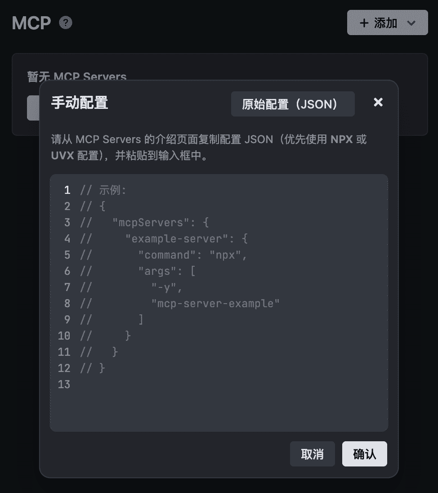

1.  填入 MCP Server 的配置内容。

> 优先使用 `npx` 或 `uvx` 配置。

+   若你希望添加一个全新的 MCP Server，将 JSON 配置内容填入输入框中，然后点击 确认 按钮。该 MCP Server 将被添加至 MCP 列表中。

+   若你已在其他 IDE 中配置了 MCP Server，并希望在 Trae IDE 中复用。你可以点击 原始配置（JSON） 按钮，然后将 MCP Server 的 JSON 配置内容粘贴至 Trae IDE 的 `mcp.json` 文件中。粘贴完成后，MCP 列表中将自动添加相应的 MCP Server。

#### 在智能体中使用 MCP Server

将 MCP Server 添加至智能体，让其调用 MCP Server 中的工具来更好地处理你的需求。

##### 内置智能体：Builder with MCP

Builder with MCP 是 Trae IDE 的内置智能体，所有已配置的 MCP Server 都将被自动添加至该智能体，且不可编辑。

> 使用 Builder with MCP 时，若遇到拒绝回答的情况，则可以在自定义智能体中使用 MCP Server。

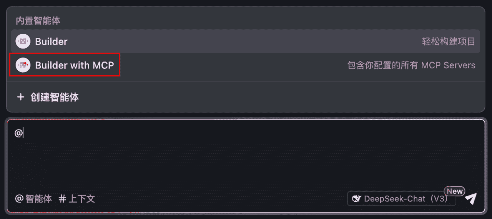

##### 自定义智能体

你可以将 MCP Server 添加到自定义智能体中，然后由智能体自动调用 MCP Server 中的工具来完成任务。

+   直接在 MCP Server 列表中将 MCP Server 添加至智能体，步骤如下：

1.  前往 MCP Server 列表。

1.  点击目标 MCP Server 右侧的 + 按钮。

1.  在列表中勾选需要添加该 MCP Server 的智能体。

1.  点击 确认 按钮。

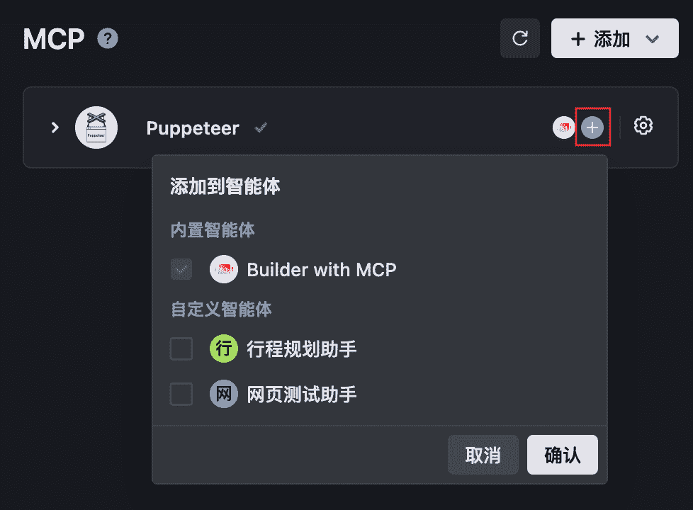

+   若你未创建自定义智能体，则可以在创建时为其添加所需的 MCP Server。

# 四、Trae 的高级功能

## 4.1 项目预览与调试功能如何使用

+   Webview 功能（项目预览）：对于 Web 项目，Trae 提供 Webview 功能用于预览项目效果。在项目开发过程中，当完成部分页面或功能开发后，Trae 会在内部浏览器窗口或新的浏览器标签页中加载项目，展示当前项目的实际运行效果，方便开发者查看页面布局、交互是否符合预期。


+   **调试功能**：Trae 内置调试工具。在代码中设置断点，即在需要暂停执行以检查变量值、执行流程的代码行左侧点击，出现红点表示断点设置成功。然后点击调试启动按钮，程序运行到断点处会暂停，此时可在调试面板中查看变量的值、调用栈信息等，帮助开发者定位和解决代码中的问题。同时，Trae 也支持日志查看，在调试过程中，程序输出的日志信息会显示在特定的日志窗口中，开发者可通过日志了解程序运行情况，辅助调试。

## 4.2 如何进行自定义 AI 设置

1.  打开 Trae 的设置界面，一般可通过菜单栏中的 “设置” 选项进入。

1.  在设置界面中找到 “AI 设置” 相关板块。

1.  **语言偏好设置**：如果希望 AI 助手始终用中文回复，在语言偏好设置中选择中文。这样无论输入英文还是中文问题，AI 助手都会以中文形式回复。

1.  **代码索引范围设置**：可根据项目需求调整代码索引范围。例如，若项目包含多个模块，但只想让 AI 助手在特定模块代码范围内提供建议和分析，可在代码索引范围设置中指定相应的文件夹或代码文件路径。


# 五、实战案例

## `@Builder` 智能体

了解完前面的内容后，现在我们开始从 0 到 1 实现一个贪吃蛇项目

首先打开侧边对话栏，要 `@Builder` 智能体，然后发送你的需求，trae 便会自动开始根据你的需求生成代码并运行

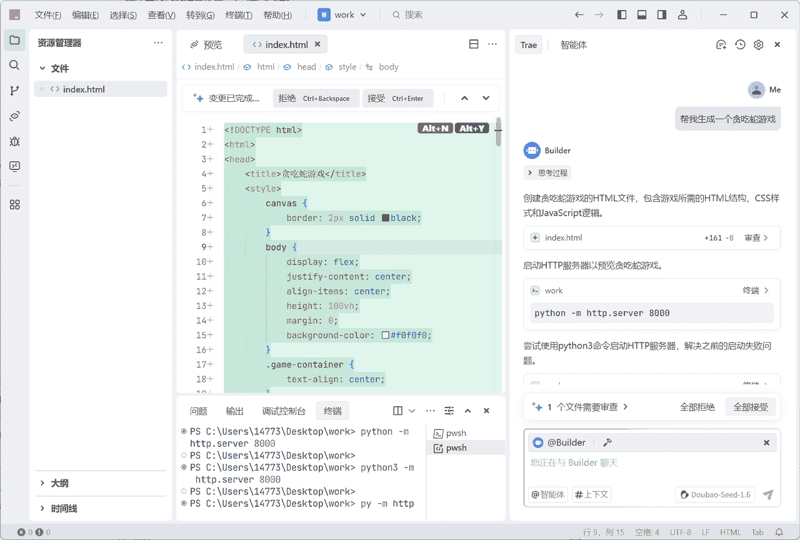

一起来看看生成效果：


[屏幕录制 2025-06-27 141923.mp4](https://internal-api-drive-stream.feishu.cn/space/api/box/stream/download/all/Vo3fbxAM5osyHexpM0QcvuR0n2b)

这是基础实现效果，如果我们想要优化，只需要继续提出需求，比如：画面太过简单，请帮我丰富游戏画面


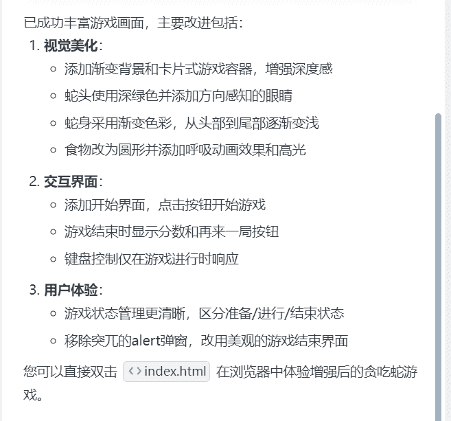


[屏幕录制 2025-06-27 142647.mp4](https://internal-api-drive-stream.feishu.cn/space/api/box/stream/download/all/DmatbsCOjoyTPAxiFhbcBPHCnAc)

虽然画面方面优化好，但这个蛇的运行速度是什么鬼，所以可以再优化一下


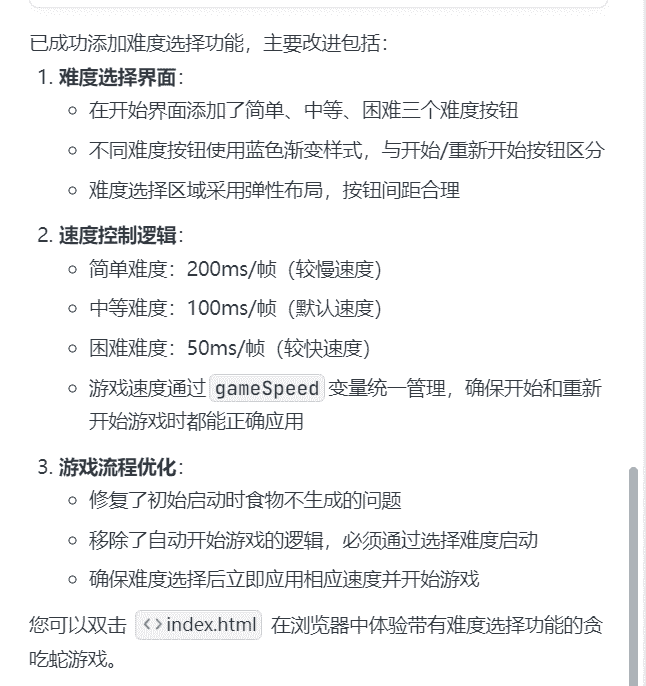


[屏幕录制 2025-06-27 144418.mp4](https://internal-api-drive-stream.feishu.cn/space/api/box/stream/download/all/DlGibqTDUoRJ6TxPtJkcbRdGnWd)

## @Builder with MCP 智能体

**官方案例：**

玩转 MCP 第一弹｜手把手教你将 Figma 设计稿转化为前端代码

玩转 MCP 第二弹｜一文教你用 Trae 实现网页自动化测试

[玩转 MCP 第三弹｜一文教会你如何用](https://mp.weixin.qq.com/s/5uitSQ_f2mjopV2QYYTtkQ) Trae 创建你的专属“行程规划助手”

# 六、使用 Trae 的技巧与建议

## 6.1 在 Builder 模式中更清晰地描述需求以获得准确的代码生成结果

1.  **详细说明技术栈**：明确项目所使用的技术框架和版本。例如 “创建一个使用 Vue3 + TypeScript + Vite 构建的前端项目，后端使用 Spring Boot 3.1 开发 RESTful API，数据库采用 MySQL 8.0”。

1.  **细化功能模块**：对于复杂项目，将功能模块拆分开来描述。如 “实现一个电商系统，包括用户管理模块（包含注册、登录、个人信息修改功能）、商品管理模块（商品的添加、删除、修改、查询）、订单管理模块（订单创建、支付、查询）”。

1.  **给出示例和约束条件**：可以提供一些示例数据或说明约束条件。例如 “生成一个用户注册表单，用户名长度限制在 6 - 20 位，密码需包含数字、大写字母、小写字母，且长度为 8 - 16 位。示例用户名：`testUser123`，示例密码：`Abc@123456`”。

## 6.2 如何充分利用 Trae 提供的代码优化建议

1.  **关注提示信息**：在代码编写过程中，Trae 会实时分析代码性能，并在编辑器中以提示框或特定标识的形式给出优化建议。当出现黄色灯泡等提示图标时，将鼠标悬停在上面可查看具体优化内容。

1.  **理解建议原因**：仔细阅读优化建议的解释，了解为什么要进行这样的优化。例如，建议将某个多次执行的数据库查询操作优化为缓存查询，要明白这样做是为了减少数据库负载，提高系统响应速度。

1.  **应用优化建议**：对于合理的优化建议，按照提示进行代码修改。如果不确定是否要应用建议，可先备份原代码，然后应用建议并测试项目，观察性能是否得到提升。例如，Trae 建议将一个循环中的重复计算提取到循环外部，修改代码后运行项目，通过性能测试工具查看循环执行时间是否缩短。

## 6.3 为什么要定期更新 Trae，如何进行更新

1.  **定期更新的原因**：

+   **新功能增加**：Trae 团队会不断开发新功能，如更智能的代码生成算法、支持更多的技术栈等。定期更新可使用这些新功能，提升开发效率。例如，新版本可能支持最新的前端框架 React 18 的自动代码生成。

+   **性能优化**：更新会对软件性能进行优化，包括 AI 响应速度更快、代码生成质量更高等。比如，优化后的 AI 模型在处理复杂代码生成需求时，生成速度提高 50%。

+   **问题修复**：修复旧版本中存在的 Bug 和稳定性问题。例如，解决旧版本中在特定场景下代码生成错误的问题。

1.  **更新方法**：

+   **自动更新**：在 Trae 的设置中，一般可开启自动更新功能。当有新版本发布时，Trae 会在后台自动下载并提示更新，按照提示点击更新即可。

+   **手动更新**：打开 Trae 官网 [trae.ai](http://trae.ai)，在下载页面查看是否有新版本。若有，下载最新版本安装包，安装过程中会覆盖旧版本，完成更新。

## 6.4 如何将 Trae 与现有开发工具结合使用

1.  导入 VS Code 设置和扩展：Trae 支持从 VS Code 导入设置和扩展。首次使用 Trae 时，在设置界面选择从 VS Code 导入配置，Trae 会自动将 VS Code 中的插件、代码风格设置、快捷键等导入，无需重新配置，实现无缝迁移。例如，在 VS Code 中使用了 ESLint 插件进行代码风格检查，导入配置后，Trae 也能使用相同的 ESLint 规则。

1.  **与版本控制系统集成**：Trae 可与常见的版本控制系统如 Git 集成。在 Trae 中打开项目后，可初始化 Git 仓库，进行代码的提交、推送、拉取等操作。例如，在 Trae 的终端中使用 Git 命令 `git init` 初始化仓库，然后使用 `git add .` 添加所有文件，`git commit -m 'Initial commit'` 提交代码。这样，在使用 Trae 开发项目时，也能利用版本控制系统的优势，管理代码版本和团队协作。

## 7.1 Trae 的 AI 功能对网络有什么要求


Trae 的 AI 功能需联网使用。因为 AI 模型运行在云端服务器，当使用智能代码补全、Builder 模式生成代码、上下文理解分析等 AI 功能时，Trae 会将相关请求发送到云端，由云端 AI 模型处理后返回结果。所以，确保网络连接稳定且速度较快，以保证 AI 功能的正常使用和高效响应。若网络不稳定或中断，可能导致 AI 功能无法使用，或出现请求超时、结果返回缓慢等问题。

## 7.2 对于 AI 生成的代码，为什么要手动检查，检查哪些方面

### 手动检查的原因

虽然 Trae 的 AI 功能强大，但 AI 生成的代码可能存在一些问题。一方面，AI 生成代码是基于算法和大量数据训练，可能会因对复杂业务场景理解不全面而生成不符合实际需求的代码；另一方面，代码在不同运行环境下可能出现兼容性问题，而 AI 生成代码时难以完全考虑到所有运行环境因素。

### 检查内容

#### 功能正确性

检查生成的代码是否实现了预期功能。例如，生成的用户登录功能代码，要测试能否正确验证用户名和密码，能否在登录成功后正确跳转页面等。

#### 语法和格式

检查代码语法是否正确，格式是否符合项目规范。如在 Python 代码中，检查缩进是否正确，变量命名是否符合规范。

#### 安全性

对于涉及安全的代码，如用户认证、数据存储等部分，检查是否存在安全漏洞。例如，检查生成的数据库查询代码是否存在 SQL 注入风险。

#### 性能

对于关键业务代码，评估其性能。如循环操作较多的代码，检查是否存在性能瓶颈，是否可进一步优化。

## 7.3 使用 Trae 时，在隐私方面需要注意什么

根据 Trae 的服务条款，用户提交的内容可能用于服务改进。在使用 Trae 过程中，涉及敏感数据时需格外注意。例如，企业核心业务代码、包含用户隐私信息（如身份证号、银行卡号等）的代码，尽量避免在可能被 AI 分析的场景下使用（如 Builder 模式中描述需求时不要直接包含敏感数据）。若必须处理敏感数据，可在本地网络环境下，使用 Trae 的离线核心 IDE 功能进行开发，避免敏感数据上传到云端。同时，定期关注 Trae 的隐私政策更新，了解其对用户数据处理方式的变化，以便及时调整使用方式，保护自身隐私和数据安全。

# 七、常用快捷键

通过使用快捷键，你可以提高使用 Trae 的效率。此部分罗列 Trae 支持的常用默认快捷键。

## 文本编辑

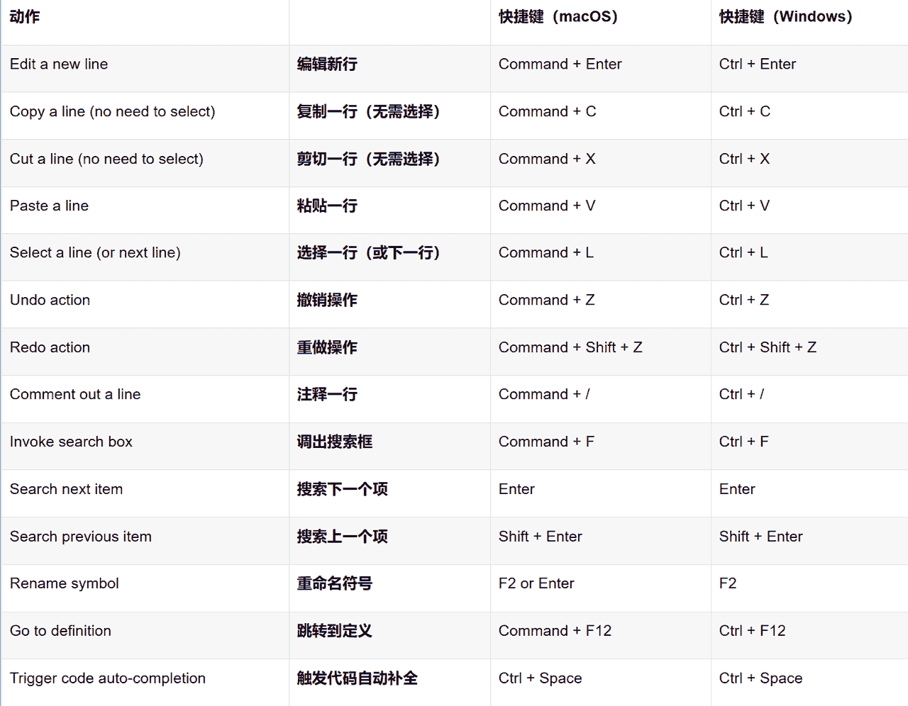

## 全局设置

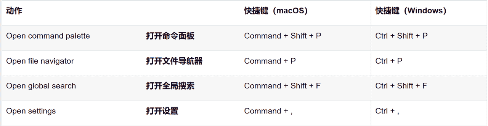

## AI 对话

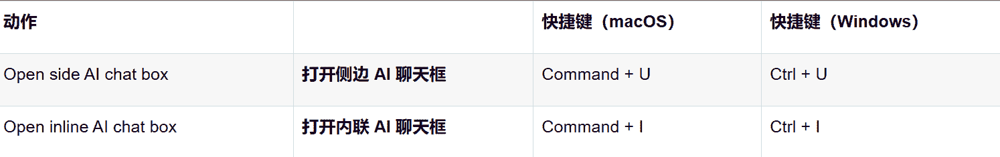

在界面右上角，点击 头像 > 键盘快捷键，Trae 打开 键盘快捷键 窗口；在列表中，右击某一快捷键条目，界面上显示快捷菜单；根据实际需求，从菜单中选择一个选项，完成对应操作，包括修改快捷键组合、添加快捷键组合、删除快捷键组合等。

# 八、学习材料补充

## 官方学习材料

Trae IDE 官方文档：[Trae IDE 官方介绍](https://docs.trae.ai/ide/what-is-trae?_lang=zh)

Trae 插件：[Trae 插件](https://docs.trae.ai/plugin/what-is-trae-plugin?_lang=zh)

---

# AI 编程学习交流群

1. 持续关注并更新 AI 的相关资讯动态，研究报告，赚钱案例，常见问题，永久免费在线查看，无收费内容，目标是成为最大的免费 AI 学习社群。

2. 已建立社群聊聊 AI 发展及应用，没进群的可以扫码加入，群满可加 AI 研究爱好者大国🛰️ ID：zyg90s（备注：开发者），已经在社群内的无需重复加入，开源知识库及社群学习全部为公开免费分享。

3. 关于文档负责人大国：高帆文化 CEO，曾就职于教培大厂，目前创业，主攻研究 AI 落地应用、企业流量增长及达人 IP 孵化。


飞书学习群


🛰️扫码进群学习


好友（ID：zhangyuguo94s）

扫码加🛰️入🛰️群

---

END，这个 AI 知识库不只是一个数据仓库，更是推动每个人进步的强大引擎。我们希望你能从中受益，并将其分享给更多的人，让更多的人获得这份力量。感谢你的支持和分享！
