# TRAE 2025 年度产品报告

> 来源：[https://yunyinghui.feishu.cn/docx/J4kddTo8po8oFPxGacWcU0OenDg](https://yunyinghui.feishu.cn/docx/J4kddTo8po8oFPxGacWcU0OenDg)

> **来源👸号： ** 字节跳动技术团队

> **推荐理由：**这篇文章总结了该AI Coding工具在2025年的发展历程和关键成就。

2025 年，AI Coding 行业快速迭代和发展，而对 TRAE 而言，这更是一段在用户陪伴下，从 0 到 1 摸索前行的重要旅程。

今年 1 月和 3 月，TRAE 国际版、中国版分别正式发布。我们始终怀着敬畏之心，紧跟行业和用户需求打磨产品，希望给大家带来更好的产品与体验。

截至年底，TRAE 累计在全球范围内收获了超过 600 万用户，我们深感荣幸也倍感责任。是大家的创意与需求，让 TRAE 有了落地的意义，更是每一位开发者的实践与探索，和我们共同拓展了开发生产力与创造的边界。

# 2025：TRAE 从 0 到 1 这一年，与 600 万开发者共同成长

今年，AI Coding 从技术创新走向实际应用，深刻变革开发者的生产场景。行业需求已从单点高效的代码补全，升级为全流程、自驱动的 Agent 开发模式；开发者规模持续增长，AI Coding 工具的用户规模也在逐渐扩大。

TRAE 也很幸运成为这一进程的亲历者、见证者、参与者。截至目前， TRAE 总注册用户数 600 万，覆盖全球近 200 个国家和地区 ；月活突破 160 万 ，活跃用户遍布中国、美国、巴西、印度、日本等国家和地区。

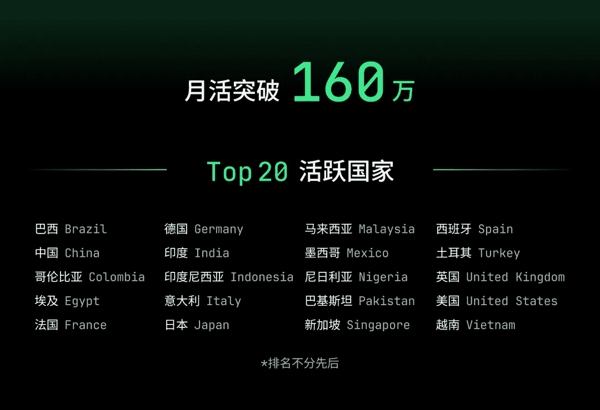

此外，TRAE Agent 算法始终创新迭代，在内外部的评测集分数都有显著提升；其中在 SWE-Bench Verified  榜单中，TRAE 无论是在闭源 SOTA 模型还是在字节自研模型上，都达到了 第一 。

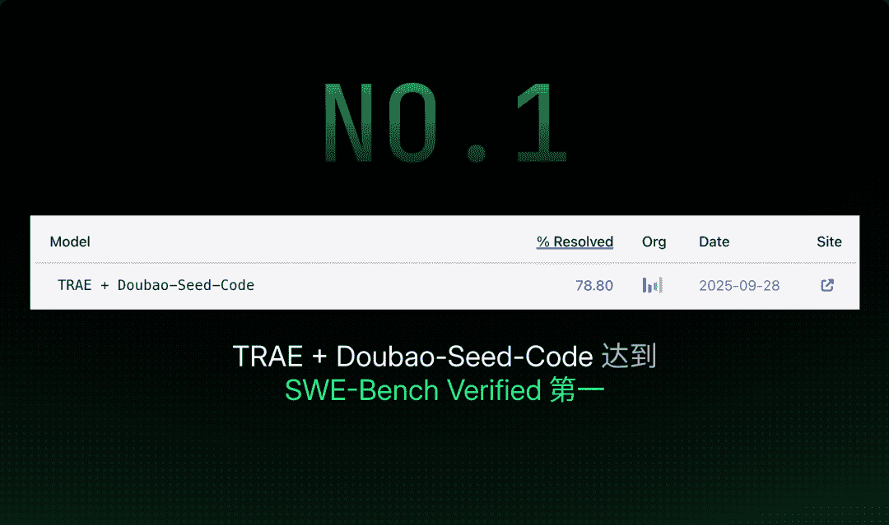

产品形态不断丰富，覆盖各种场景

TRAE 发布至今，不仅实现 IDE 与 插件 双产品形态覆盖，更在 IDE 中创新性推出 SOLO 模式 。2025 年，TRAE 中国版和国际版各完成了 超过 100 次 产品功能迭代和优化，确保了对用户需求和前沿技术的快速响应。

左右滑动查看 产品迭代三大阶段

为了给企业用户带来更好的服务， TRAE CN 企业版 也已发布，针对企业研发的性能要求、部署适配、效能追踪和代码安全四大“刚需”进行了全面优化。

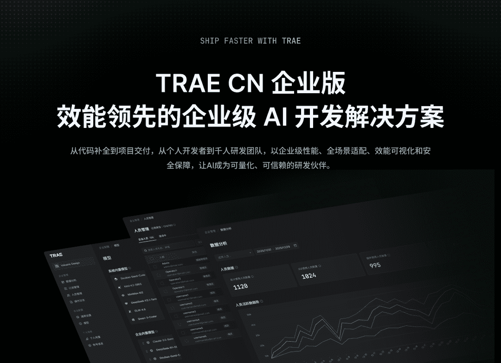

产品功能持续更新，优化体验细节

在一次次的版本更新中，用户的反馈也是我们持续优化迭代的动力。我们努力做到及时响应需求，不断优化 产品体验。

+   产品的响应速度更快。

+   整体的稳定性逐步提升。

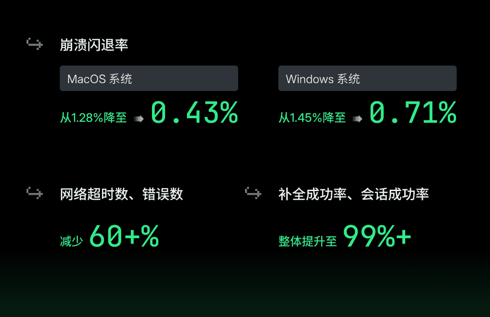

+   内存占用大幅优化，开发体验更流畅。

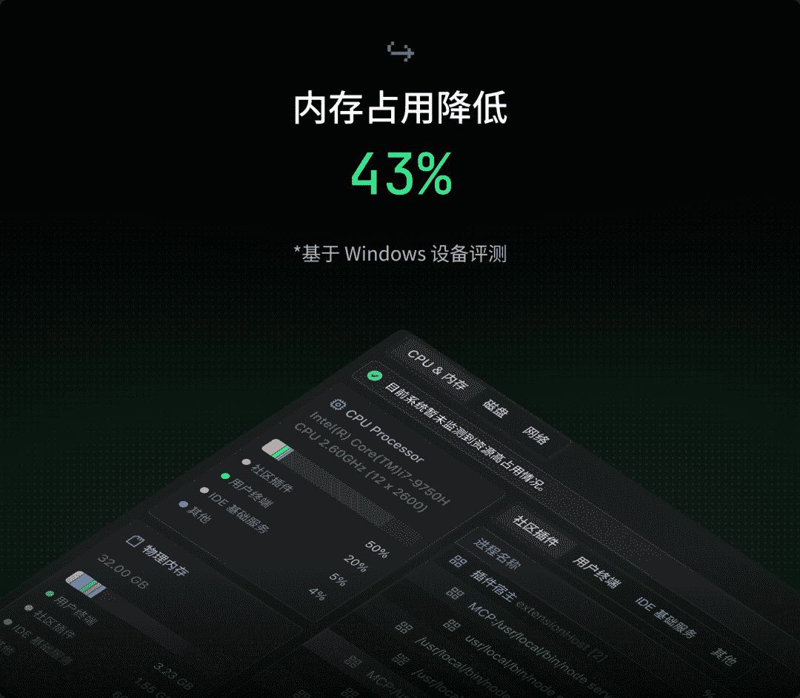

+   同时，无论是 IDE 还是 SOLO 模式，TRAE 都在为开发者提供更丰富的上下文和更具响应式的功能。

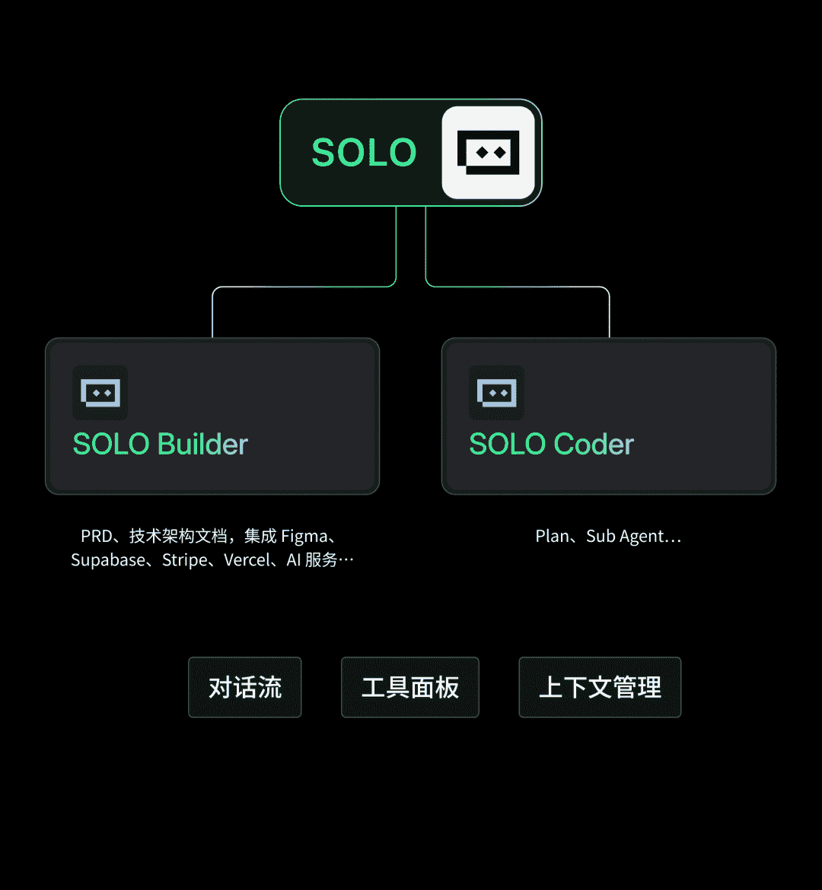

左右滑动切换查看 IDE/SOLO 功能

TRAE 深耕 AI Coding 产品落地的同时，持续产出学术研究成果，探索 AI Coding 领域前沿方向，并将成果逐步融入 TRAE 产品中。2025 年，我们在 NeurIPS、ACL、ICSE、FSE、ASE 等 CCF-A 类国际顶会发表了 10 余篇 学术论文，其中 1 篇入选 NeurIPS Spotlight 论文。

此外，我们也 开源 了 trae-agent 以回馈技术社区，在 GitHub 上收获了 10.2k Stars ，合入社区 PR 191 个 ，被克隆 超 1000 次 。

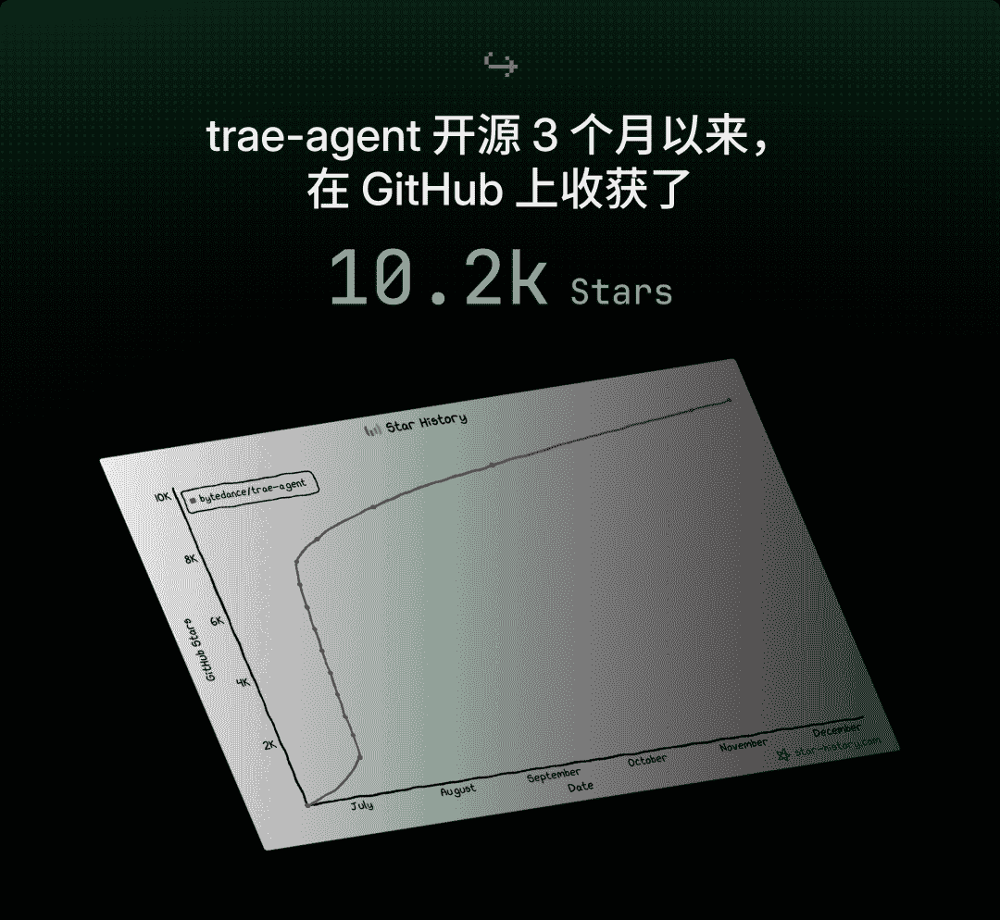

# 从代码补全到复杂任务，TRAE 成为开发者的生产力伙伴

2025 年，TRAE 为全球开发者带来了实际生产力提升，以及用户工作模式的演变。TRAE Token 消耗大幅增长，近半年日均 Token 消耗量提升了 近 700% ，在这一年内为全球用户总共生成 近 1000 亿 行代码。

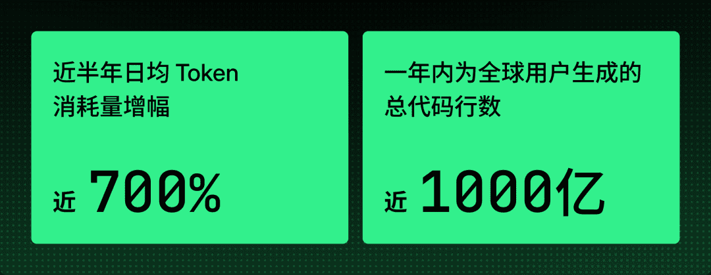

使用粘性不断增强，伴随开发日常

+   这一年， TRAE 用户总共发起了近 6000 万 个 会话，发送了近 5 亿 条 Query，与 AI 进行深入的创新和协作。

+   TRAE 用户中的周均活跃天数 近 5 天 ， 工作日全勤 ；其中，国际版付费用户的周均活跃天数 超过 6 天 ，实现 自然周全勤。

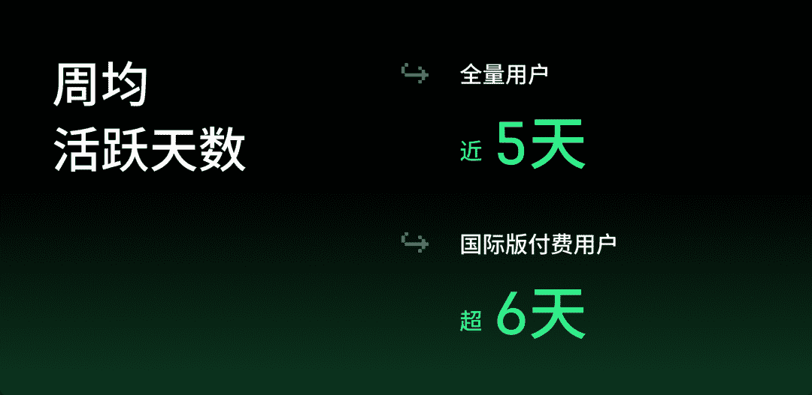

+   约 6000 名 用户在 2025 年使用 TRAE 写代码的天数 超过 200 天 ，这些用户也代表了最早注册、连续活跃的一批忠实用户。

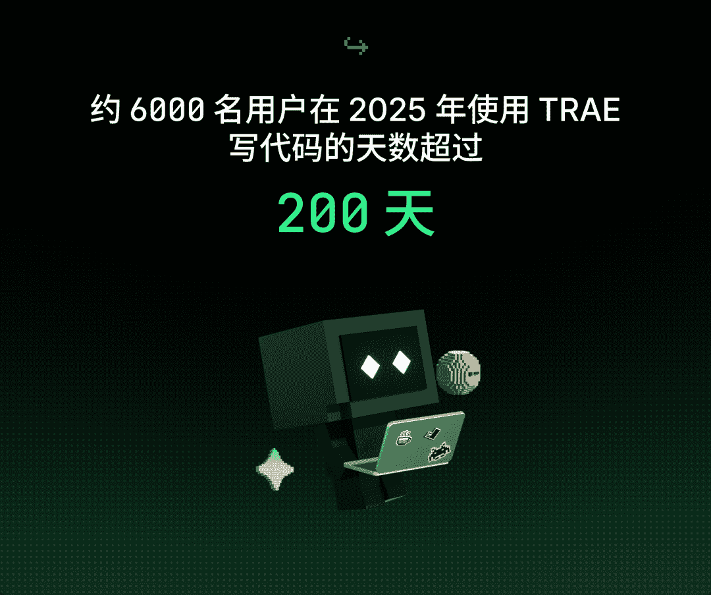

编码辅助持续优化，补全体验提升

Cue 今年实现关键技术性突破，在代码续写及预测跳转、跨文件代码预测及跳转等方面的探索处于行业头部。 超过 50% 的用户每天主动使用 Cue 功能进行代码编辑，智能代码补全与建议已成为高频刚需。

+   自上线以来，Cue 累计推荐 近 10 亿 次代码，采纳率提升了 80%+ ，用户体验获得显著优化。

+

+   关键指标 CPO >1 ，意味着用户的每一次 Typing 都可以稳定获得有效的 AI 编码建议，真正为用户手写代码带来了效率提升。（*CPO：Characters per Opportunity，用户每次输入后 AI 为代码贡献的字符数）

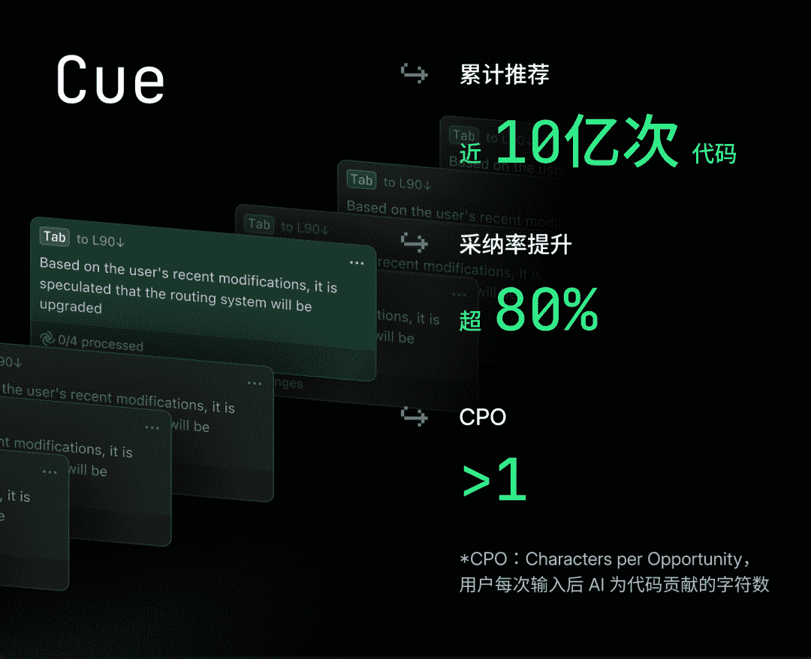

AI 赋能开发新范式，效能稳步加深

在 TRAE 中，开发者与 AI 的交互在加深，AI 在连续、多轮、更复杂的项目中承担了更多实质性工作，成为真正参与开发流程的核心助手。

+   SOLO 模式 发布后，与 IDE 模式共同构建起互补的智能开发协作生态，让开发者能根据任务需求灵活切换工作方式；用户在 SOLO 中通过智能对话解决复杂问题，有效融入日常开发工作流。

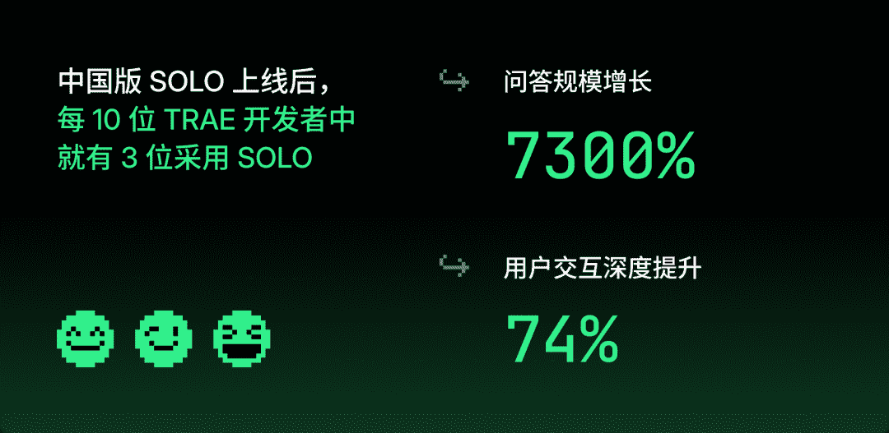

左右滑动查看 国际版/中国版 SOLO 相关数据

+   更专业的开发应用场景，技术栈覆盖广且适配多类开发场景的编程语言使用： TRAE 在用户的真实开发中，承担起越来越重要的工作。

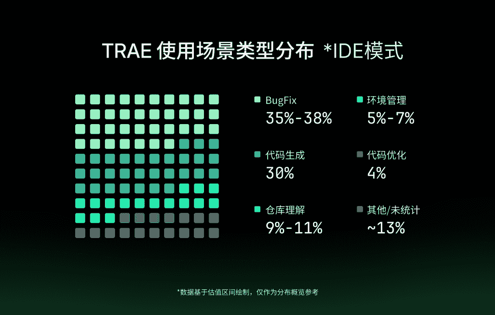

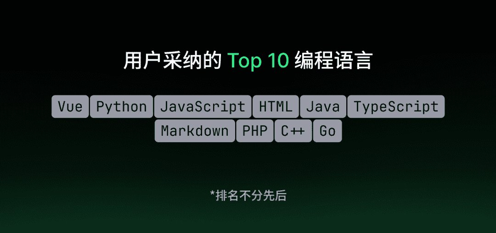

通过 TRAE 智能体、MCP 生态，以及丰富的上下文类型，用户与 AI 的协作更智能、更深度，可以更高效地完成跨任务、跨工具的项目开发。

+   TRAE 支持 MCP 数量达 1.1 万 个 。MCP 成为支撑 Web 自动化、全栈开发、深度代码分析等复杂场景的重要基础架构，将大模型的认知能力无缝嵌入到实际工作流中。

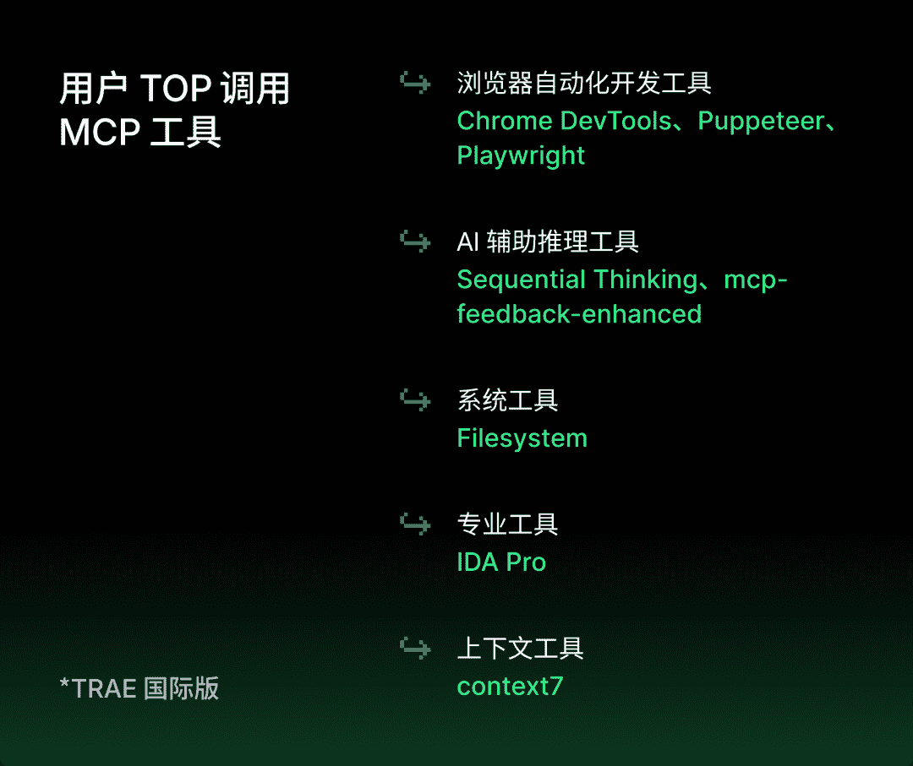

+   越来越多的用户会倾向于使用多种内置智能体解决不同的问题，也会根据需求创建自定义智能体。目前 TRAE 中累计成功创建/编辑更新的自定义智能体达 36.5 万 个。

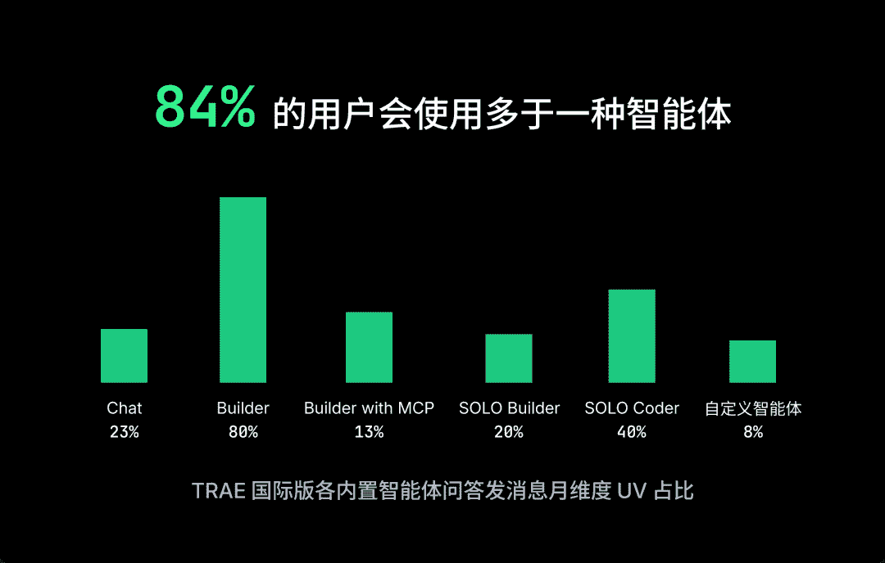

左右滑动查看 中国版/国际版智能体使用相关数据

+   TRAE 支持用户添加 10 余种 不同的上下文类型， 超过半数 的用户会在和 AI 协作开发的过程中使用上下文管理。

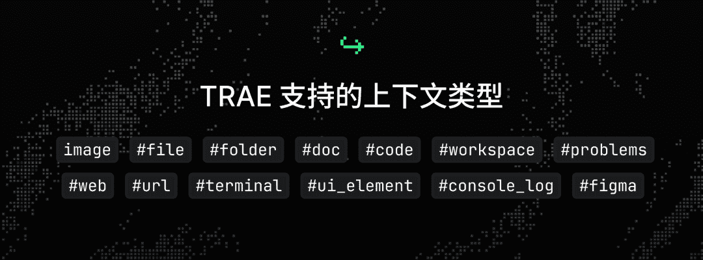

# 社区共建：链接逐步深化，互相激发创造

2025 年，TRAE 的足迹遍布全球 60+ 个城市，通过共 130+ 场官方黑客松、Meetup 以及 TRAE Friends、TRAE on Campus 等活动，与 2 万 余名 开发者线下相聚。

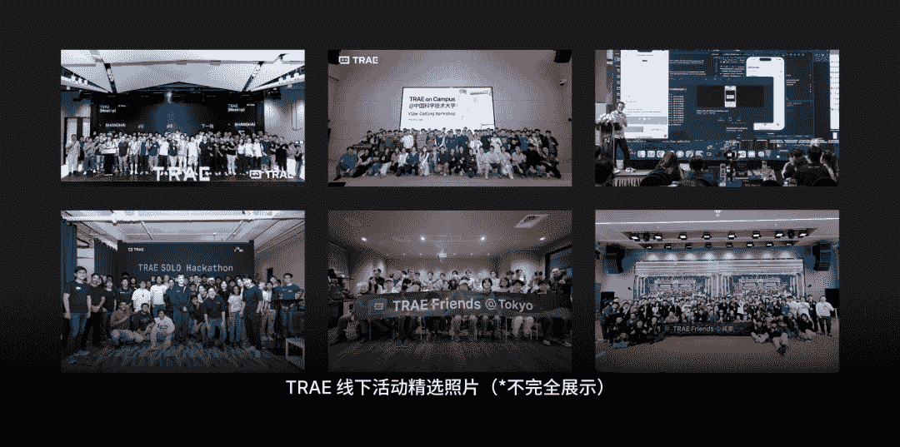

我们也在线上建设起了面向全球开发者的 10 个 官方社群，以及 80+ 个城市、校园社群，与 10 万+ 用户共同进行前沿探索与自由交流。用户的高频互动、每周精选的高价值内容等，共建起这个充满活力、温度与价值的 AI 编程社区。

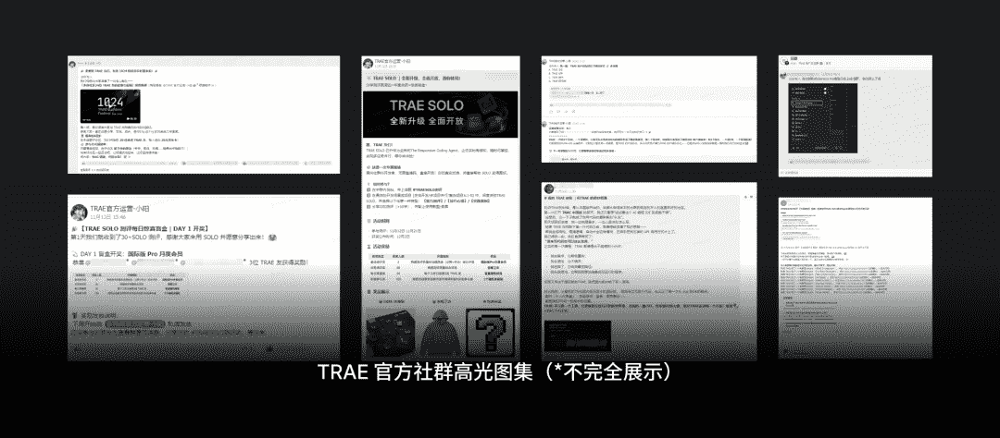

TRAE 十分有幸成为开发者实现想法的工具，一起将创意落地为现实。

+   数万名 开发者利用 TRAE SOLO 的自主能力，高效地实现了他们的创意项目。

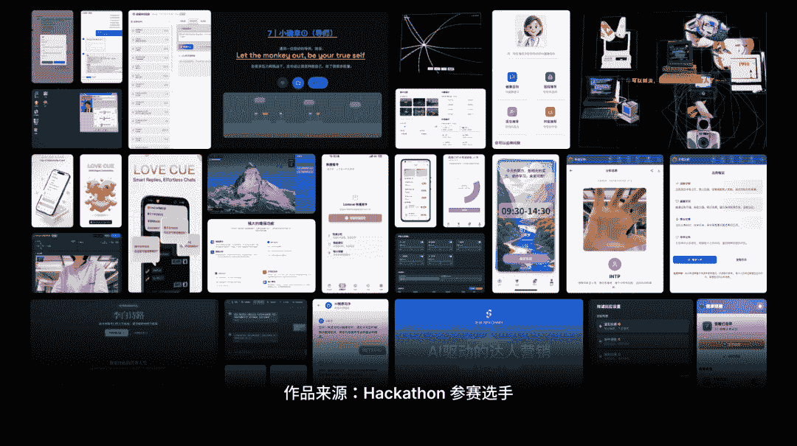

+   超过 200 篇 来自全球 TRAE 开 发者社区的最佳实践投稿，同样验证了 TRAE 在提升效 率、赋能开发上的核心价值。

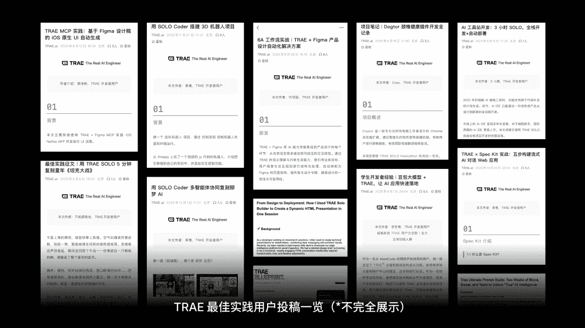

# 结语：迈向下一阶段的智能开发浪潮

回望 2025，AI Coding 已经开始参与到更复杂的开发任务中，而不再局限于基础的编程辅助。但要让 AI 更稳定地承接和更自动化地开发复杂项目，同时开发者也有真切的感知和掌控，未来还需要行业共同探索和推动。

对 TRAE 来说，打好底层能力、认真聆听用户的实际需求、把产品一步步磨稳磨透，仍是我们最重要的事情。同时，我们也会继续探索更多真实的使用场景，让 AI 在协作和项目支持中发挥更可靠的作用。

行业的变化还在加速，而智能开发时代也刚刚开始。TRAE 希望能继续与广大开发者同行，在不断试验与改进中，把更实用、更可持续的 AI 开发能力带入日常开发，让未来的开发方式变得更高效、更自由一些。