# Cursor 学习手册（持续更新 ing...)

> 来源：[https://yunyinghui.feishu.cn/docx/ElzWdp9OioXyJEx68kOc9SPcnle](https://yunyinghui.feishu.cn/docx/ElzWdp9OioXyJEx68kOc9SPcnle)

> 首发时间：2025 年 7 月 14 日

> 更新时间：2025 年 7 月 17 日

> **内容出品人：**** **** **

> **内容出品方：**[Mix AI Lab](https://yunyinghui.feishu.cn/wiki/WhelwZnxQi55mpkOzatc3Xran5b?from=from_copylink)

> **使用建议：**如果需要快速定位到精确内容，可以使用快捷键 Ctrl +F/Command +F 的形式，搜索关键字/词，查找你想要的内容。

> **特别说明：**飞书内容花了大量心思做构思和整理，请勿直接抄袭复制，如有发现会追究相关责任。

>

> **为 AI 实验室**同学持续更新 AI 编程工具 Cursor 的基本介绍、安装配置、使用技巧、实操案例等全套学习内容。

>

> 🎯全**网最接地气 AI 知识库：「**[**AI 实验室」知识库（**](https://yunyinghui.feishu.cn/wiki/space/7340161844864598017?ccm_open_type=lark_wiki_spaceLink&open_tab_from=wiki_home)AI 绘画、AI 写作、AI 视频等应用技能）

# **一、Cursor 简介**

## **1、****企业简介与使命**

Cursor 是一款融合 AI 能力的现代代码编辑器，旨在提升开发者的编码效率。其母公司 Anysphere Inc。 是一家成立于 2022 年的应用研究实验室，其使命极为明确：通过打造一种“人机混合”程序员，构建“未来的工程师”。这种混合工程师的效率将比任何纯人类或纯 AI 程序员高出一个数量级。这一定位至关重要，因为它揭示了 Cursor 产品的核心哲学：AI 是人类创造力的增强器，而非替代品。Anysphere 的目标是让开发者能够以思想的速度进行迭代，即使在最复杂的系统中也能毫不费力地掌控代码库，消除所有低效的键盘操作。

Anysphere 的发展速度堪称“火箭式上升”。自 2023 年产品 Cursor 发布以来，公司迅速获得了市场的认可和资本的青睐，2023 年，公司获得 OpenAI 创业基金领投的 800 万美元种子轮融资。2024 年 8 月，由 Andreessen Horowitz（a16z）领投，公司完成 6000 万美元的 A 轮融资，估值达到 4 亿美元 。随后，公司估值一路飙升，在 2025 年的一轮融资后达到 99 亿美元 。Cursor 成为增长最快的 SaaS 产品之一，年经常性收入（ARR）迅速突破 1 亿美元，并吸引了超过一百万的日活跃用户。Product Hunt 官方发布了 2024 年度最佳榜单（Golden Kitty Awards 金喵奖）中，“2024 年度产品” 奖项由 Cursor 获得。

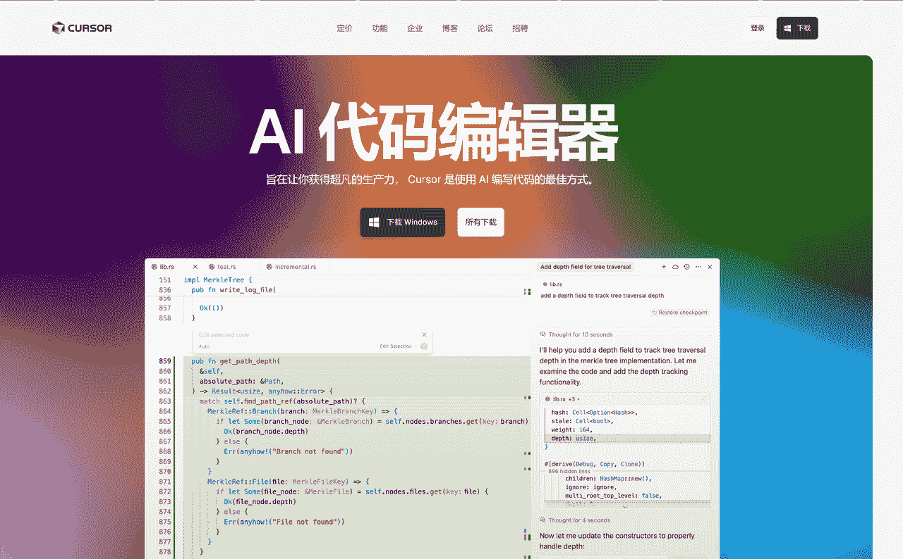

**企业官网**

官方地址：[cursor 官网](https://cursor.com/?from=home)

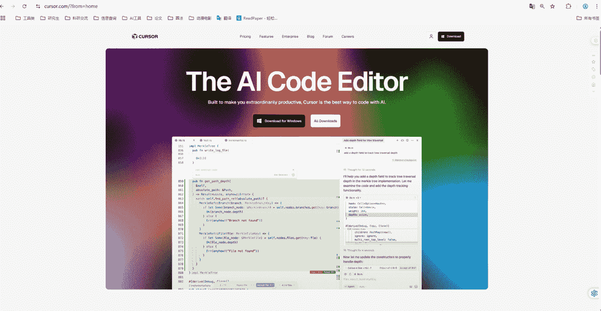

## **2、****团队信息**

Anysphere 由四位麻省理工学院（MIT）的同窗好友——Michael Truell、Sualeh Asif、Arvid Lunnemark 和 Aman Sanger 共同创立。他们在计算机科学、人工智能和大规模软件工程领域拥有深厚的学术背景和实践经验，四位创始人都拥有麻省理工学院计算机科学和数学的深厚学术背景。

2022 年，四人共同创立了 Anysphere 公司，并于 2023 年正式发布了 Cursor 1。产品发布初期，增长一度非常缓慢，团队甚至感到“士气低落”，并开始质疑自己的宏大愿景是否过于理想化。然而，让他们坚持下去的关键在于，他们自己就是 Cursor 最忠实的用户，能够亲身体验到产品的潜力并快速迭代。通过 Cmd/Ctrl+K 实现的行内指令编辑和对整个代码库进行索引的上下文理解能力之后，Cursor 的增长曲线开始“一飞冲天”。凭借其独特的产品理念和惊人的增长速度，Anysphere 迅速获得了包括 Andreessen Horowitz （a16z）、OpenAI 创业基金、Thrive Capital 在内的顶级风险投资机构的青睐，估值在短时间内飙升。

尽管团队背景高度相似，但每位创始人都为公司带来了独特的技能和视角：

| **创始人 （Founder）** | **职位 （Position）** | **核心经历与成就 （Key Experi**ence &amp; Achievements） |
| --- | --- | --- |
| Michael Truell | CEO &amp; 技术领袖 | 作为团队的技术领袖和 CEO，他年仅 14 岁就开发过风靡全球的编程游戏，并拥有在谷歌、Two Sigma 等顶级公司的实习经历 。他主要负责公司的整体战略和对“代码之后”编程未来的愿景探索 。 |
| Sualeh Asif | CPO （首席产品官） | 来自巴基斯坦，曾多次代表国家参加国际数学奥林匹克竞赛，拥有在 IBM Watson 从事 AI 翻译架构研究的经验 。作为首席产品官，他专注于将前沿 AI 技术与产品体验完美融合 。 |
| Arvid Lunnemark | 性能优化专家 | 来自瑞典，是国际信息学和数学奥林匹克竞赛的双料奖牌得主，曾在 Stripe、Jane Street 等对系统性能要求极高的公司工作 。他主要负责 Cursor 的性能优化，确保其在功能强大的同时保持流畅 。 |
| Aman Sanger | 产品开发驱动者 &amp; 跨界领导者 | 凭借其杰出贡献入选《福布斯》“30 位 30 岁以下精英榜” 。他不仅拥有在谷歌、桥水基金的实习经验和创办 AI 咨询公司的经历，还是 MIT 校壁球队的队长和两届全美最佳阵容成员，展现了技术、商业和领导力的完美结合 。 |

**延展阅读：**

[25 岁 MIT 辍学天才一战成](https://36kr.com/p/3292368761047042)名，3 年成为 90 亿美金公司 CEO

---

## **3、****火爆原因**

+   **零成本上手**：**它完**美继承了 VS Code，所有界面、快捷键和插件都能直接用，开发者感觉就像“回家”一样，没有任何学习和迁移成本，且可有免费使用机会。

+   **项目级理解：**与许多只分析单个文件的 AI 工具不同，Cursor 能够索引并理解你的整个项目代码库，当你让它重构或修复一个复杂 bug 时，它知道所有文件之间的关联，所以建议更精准、更智能。

+   **强大的 AI Agent：**Cursor 的“代理模式”（Agent Mode）能自主执行复杂的多步骤任务，用户无需逐行写代码，而是像“指挥官”一样下达高级指令（如“为项目添加登录功能”），AI 会帮你完成大部分执行工作。

**延展学习：**

[**Contrary Research 提**](https://research.contrary.com/company/anysphere)供的 Anysphere 公司的深度研究

## 4、Cursor 的核心功能亮点

**1. AI 代理（Agent）**

这是 Cursor 最具颠覆性的功能，它将 AI 从一个被动的建议者，转变为一个能主动完成任务的执行者 。

**端到端任务执行**：你可以用自然语言下达一个高级指令，比如“在整个项目中实现用户认证功能”。AI 代理会自主分析代码库，识别需要修改的文件，编写并应用代码，甚至运行终端命令来安装依赖库 。

**自主纠错**：在执行任务时，如果遇到编译或错误，代理会尝试自动分析并修复问题，然后继续执行，极大地减少了手动调试的时间。

**后台与异步工作**：可以将耗时长的任务（如大规模重构）交给后台代理处理。你甚至可以关闭 IDE，任务完成后代理会通过 Slack 等方式通知你。这些代理还可以通过网页或移动设备进行管理和交互 。

**2. 全局上下文理解**

**Curso**r 的核心优势在于它对整个代码库的深度理解 。

**项目级索引**：Cursor 会索引你项目中的所有文件和代码符号，建立一个完整的“知识图谱”。这使得它在回答问题或生成代码时，能够考虑到跨文件的依赖关系和项目整体架构，建议因此更加精准 。

**精准上下文注入 （****@****符号）**：你可以通过@符号，手动将特定的文件、文件夹、甚至是外部网站（@Web）或库的官方文档（@Docs）作为上下文提供给 AI，确保它在回答问题时拥有最相关的信息。

**3. AI 交互与代码生成**

Cursor 将 AI 无缝融入到你最熟悉的编码动作中，提供了多种高效的交互方式。

**行内编辑 （****Cmd/Ctrl + K****）**：这是最常用的功能。选中一段代码或在空白处，用自然语言描述你的意图（如“将这段代码重构为可复用函数”或“生成一个 API 端点”），AI 会即时生成或修改代码 。

**智能 Tab 自动完成**：由 Cursor 的专有模型驱动，它能预测你下一步的编码意图，提供跨越多行的代码建议。你只需按 Tab 键就能快速应用一系列相关的代码修改，极大提升编码效率。

**智能调试与重构**：能主动识别潜在 bug，用自然语言解释错误原因，**并提供修复方案。在重**构时，它会提供清晰的差异（diff）视图，让你在完全掌控的情况下审查和接受修改 。

**4. 高度可扩展与定制化**

Cursor 不仅功能强大，还为高级用户和团队提供了极大的灵活性。

**模型上下文协议 （MCP）**：这是一个开放协议，允许 Cursor 连接到任何外部工具或数据源（如 Jira， Figma， Sentry 等）。这意味着 AI 可以直接查询任务管理系统、读取设计稿参数，将开发工作流与外部世界无缝打通。

**自定义规则 （****。cursorrules****）**：你可以在项目中创建一个。cursorrules 文件，定义全局的编码规范和技术偏好（如“总是使用函数式编程风格”、“网络请求使用 fetch 而非 axios”）。AI 在处理该项目时会严格遵守这些规则，确保了团队协作的一致性 。

**模型选择自由**：支持灵活切换使用 GPT-4o、Claude 3.5 Sonnet 等业界顶尖模型，甚至允许用户使用自己的 API 密钥，以根据任务需求和成本进行优化 。

## 5**、****Cursor **适用人群

Cursor 是一款融合了 AI 能力的现代代码编辑器，凭借其强大的功能和友好的界面，能满足不同编程水平和需求的人群。适合使用 Cursor 的主要人群：

### 1）**编程初学者**

+   **降低入门门槛**：借助自然语言生成代码的功能，初学者无需死记硬背复杂的语法，通过描述需求就能获取基础代码框架，从而把更多精力放在编程逻辑的学习上。

+   **即时纠错与优化**：AI 可以实时检查代码，指出语法错误并给出优化建议，帮助新手养成良好的编码习惯。

+   **交互式学习**：在编码过程中，随时通过 Ctrl+K 与 AI 交流，获取代码解释或解决方案，这比查阅文档更高效。

### 2）**Python 开发者**

+   **AI 驱动的代码生成**：对于 Python 这种脚本语言，Cursor 能快速生成数据处理、Web 开发（如 Flask/Django）、机器学习（如 Pandas/NumPy）等常见功能的代码。

+   **自动化测试**：可以自动生成单元测试用例，比如针对 Python 函数的 pytest 测试代码，提升测试效率。

+   **集成 Jupyter 支持**：方便进行数据分析和可视化，能在编辑器内直接运行 Python 代码块。

### 3）**全栈开发者**

+   **多语言支持**：支持 JavaScript、TypeScript、Python、Java 等多种语言，适合开发前后端应用。

+   **代码协作**：团队成员可以共享 AI 生成的代码片段，保持代码风格一致，还能通过实时协作功能共同编辑代码。

+   **快速原型开发**：利用 AI 快速生成前端 UI 组件（如 React/Vue）和后端 API，加速项目迭代。

### 4）**数据分析师**

+   **数据分析加速**：快速生成 Pandas、NumPy 代码，实现数据清洗、可视化和建模，例如一键生成绘制图表的 Matplotlib 代码。

+   **自然语言处理**：对于 NLP 任务，可直接生成使用 Hugging Face Transformers 或 spaCy 的代码框架。

+   **与 Jupyter 集成**：无缝衔接数据探索和模型训练工作流。

### 5） **需要提升效率的程序员**

+   **减少重复劳动**：自动生成样板代码（如 API 路由、数据库模式），节省时间。

+   **智能补全**：基于上下文的多行代码补全，比传统 IDE 更智能，例如在编写循环或条件语句时。

+   **代码重构**：AI 可协助进行代码重构，如将函数拆分成更小的单元，或转换代码风格。

### 6）**远程团队成员**

+   **实时协作**：多人可同时编辑和查看代码，支持语音讨论，就像在同一个办公室工作一样。

+   **共享 AI 会话**：团队成员可以共享与 AI 的对话历史，方便知识传递和问题解决。

### 7） **自由职业者和独立开发者**

+   **一站式开发**：从构思到实现，借助 AI 快速完成项目，尤其适合个人开发者独立承担多个角色的情况。

+   **保持代码质量**：AI 帮助检查代码漏洞，确保交付的项目符合行业标准。

### 8） **教育工作者和学生**

+   **教学辅助**：教师可以用 Cursor 快速演示代码示例，学生则能即时获得 AI 的指导，解答编程作业中的问题。

+   **项目实践**：学生在完成课程项目时，遇到技术难题可随时求助 AI，加速学习过程。

### 不适合 Cursor 的人群

+   **追求极致性能的底层开发者**：开发操作系统、嵌入式系统等对性能要求极高的场景，可能需要更专业的工具。

+   **完全不懂编程的非技术人员**：虽然 Cursor 降低了编程门槛，但仍需要基本的编程概念才能理解和调整 AI 生成的代码。

Cursor 是一款通用工具，尤其适合那些希望通过 AI 提升编程效率、降低重复性工作的开发者。如果你是编程新手，它能帮助你快速入门；如果你是有经验的开发者，它则能成为你的得力助手，让你更专注于核心业务逻辑的实现。

## 6、Cursor 与 GitHub Copilot 的对比

| ### 特性 | ### **Cursor ** | ### **GitHub Copilot** | ### 分析与关键差异 |
| --- | --- | --- | --- |
| **可定制性** | 原生、全栈集成。作为 VS Code 的独立分支，拥有对环境的完全控制权 。 | 作为插件运行，受限于宿主编辑器（VS Code）的 API，访问权限有限 。 | Cursor 的原生架构使其能够实现更强大的功能，如项目级重构和自主的代理工作流，这是插件模式难以企及的。 |
| **数据隐私** | **项目级**。通过索引整个代码库，实现对项目语义的深度理解，能够处理跨文件的复杂依赖关系 。 | 主要为**文件级**，虽然具备一定的工作区感知能力，但对整个  项目的理解深度有限 。 | Cursor 的“全盘理解”能力使其在处理复杂的多文件任务 |
| **功能扩展** | “代理模式”可端到端执行多步骤复杂任务，包括运行终端命令、检测并循环修复错误，具备高度自主性。 | 代理功能相对受限，许多操作需要用户手动批准，自主性较低。 | Cursor 的代理旨在将开发者的角色从“执行者”转变为“指导者”，实现更高层次的自动化。 |
| **模型灵活性** | 支持多种业界领先模型（如 GPT-4o， Claude 3.5 Sonnet），并允许用户使用自己的 API 密钥，实现模型混用和成本优化。 | 主要使用 OpenAI 模型，用户选择有限，无法自定义 API 密钥。 | Cursor 为高级用户提供了更大的灵活性和成本控制能力，可以根据任务类型选择最合适的模型。 |
| **调试与错误处理** | 主动识别潜在 bug，建议修复方案，并用自然语言解释复杂的错误信息，显著缩短调试时间。 | 更多依赖 VS Code 传统的调试工具，AI 主要提供建议和辅助，而非主动诊断。 | Cursor 的 AI 辅助调试功能将调试过程从被动的“寻找”转变为主动的“诊断与修复”。 |
| **定价模型** | 提供功能受限的免费版；Pro 版（约 20 美元/月）提供无限制的 AI 功能使用。 | 订阅制，通常与 GitHub 的其他服务捆绑销售。 | Cursor 的定价模型清晰直接，其 Pro 版对追求极致效率的个人开发者和小型团队极具吸引力。 |

**产品演进与重要资料****：**

**1、**[**Cursor 功能变更日记**](https://cursor.com/changelog)

**2、**Cursor 核心团队发布的系列文章，深入探讨了他们正在解决的工程难题

**3、**[**Cursor 团队整理的笔记**](https://cursor.com/blog)

**4、**[**Cursor 官方文档**](https://docs.cursor.com/welcome)

# **二、Cursor 使用方式**

## **1****、****下载与安装**

注册 cursor：https://cursor.com/

1.  下载对应版本的 cursor：其中 Windows 点击主页右上角会自动下载 windows 的安装版本，mac 系统和 linux 系统的同学可根据系统对应下载。

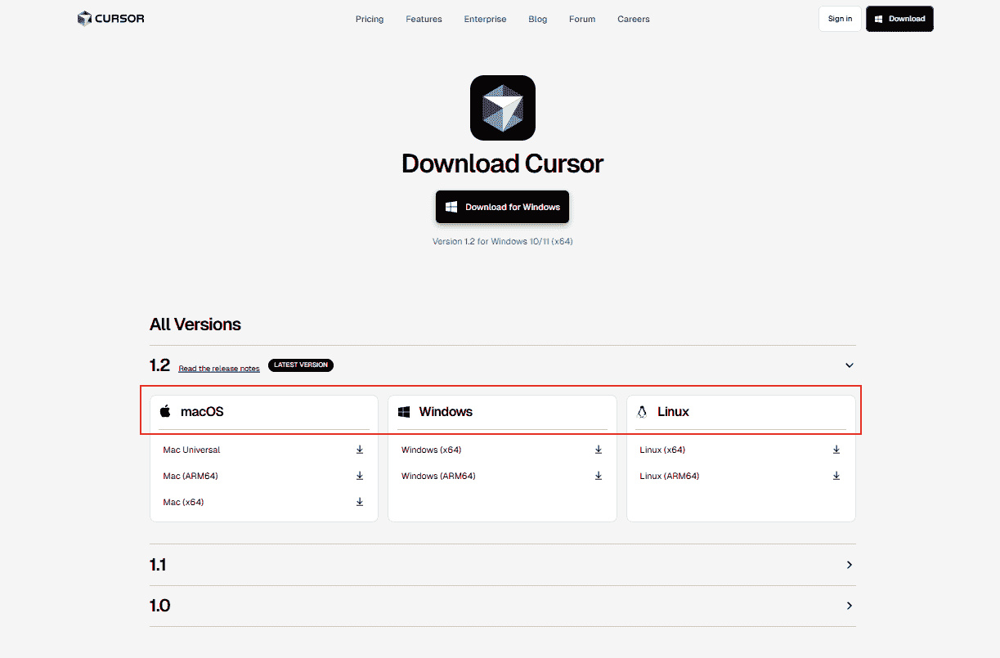

1.  出现安装提示不必担心，点击确认即可

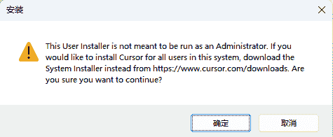

1.  选择附加任务，请全选，减少环境配置的工作等。

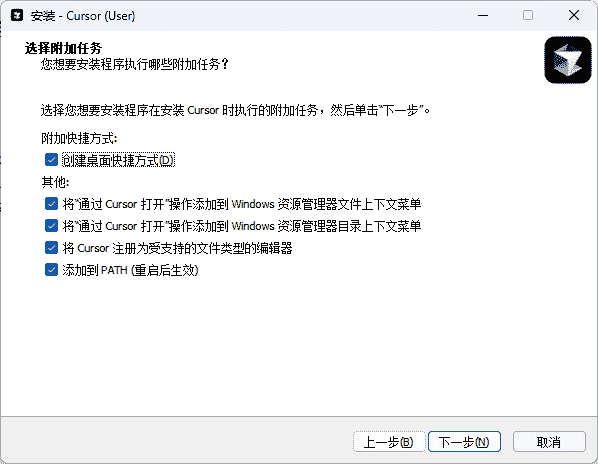

1.  初始化时，keyboard 选择 VS code，第二个 Language for AI 选择中文，AI 交流时则会选择中文回复，第三个点击开启后点击 continue。

1.  使用 VScode 的朋友可以导入 Vscode 的插件，点击 Use ，没有就选择

## **2、注册账号**

若你没有 Cursor 账号，在启动界面会看到 “Sign up” 按钮，点击进入注册页面。你可以使用邮箱进行注册，按照提示输入邮箱地址、设置密码，再次确认密码后，点击 “Create account” 完成注册。

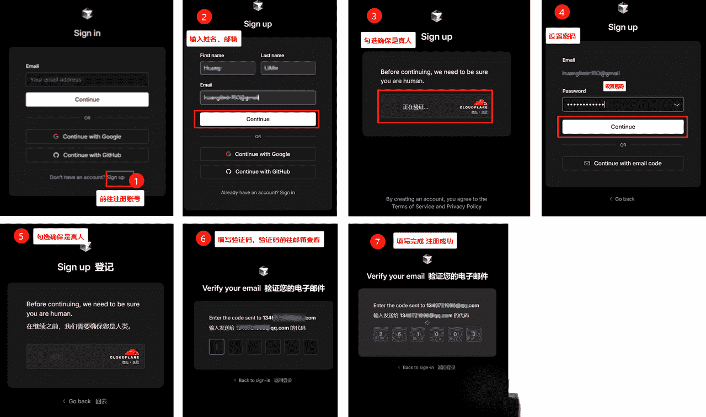

## **3****、****登录账号**

如果你已有账号，在启动界面点击 “Log in”，输入注册时使用的邮箱和密码，点击 “Log in” 即可登录。登录成功后，你将进入 Cursor 的主界面。

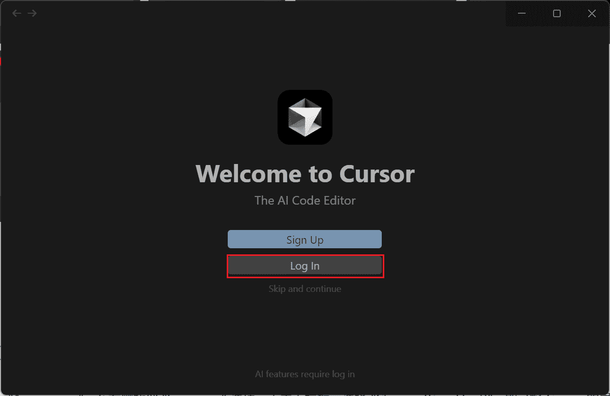

## **4、**** ****语言****汉化**

1.  **安装插件，点击**左上角 4 个方块的图标，下方输入框中输入chinese。在插件列表找到Chinese(Simplified)，点击【Install】按钮进行安装

1.  观察左侧弹出的界面，点击正方形物体，并在搜索栏搜索 Chinese，点击中文简体的 install。点击 Trust

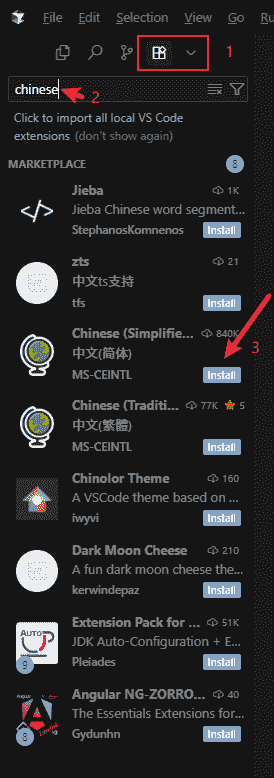

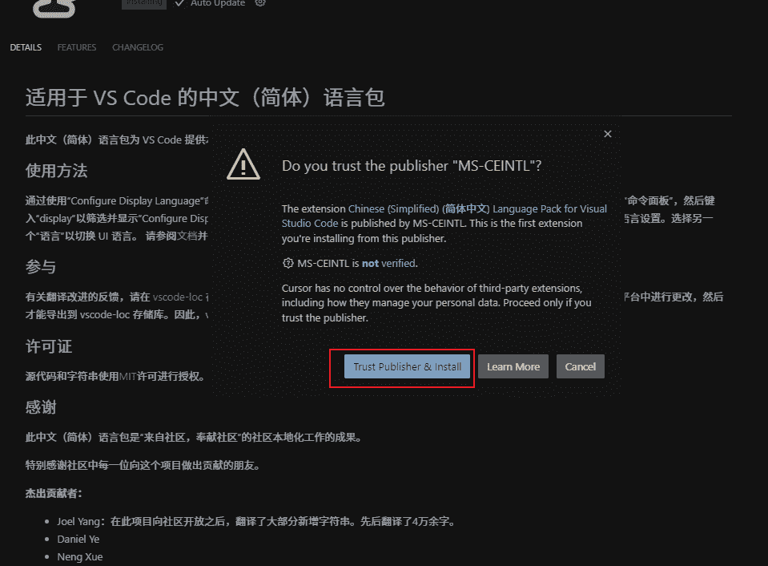

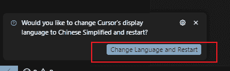

## 5**、**主界面介绍

1.  菜单栏：位于窗口的顶部，包含文件、编辑、视图、运行、工具和帮助等菜单项。

1.  侧边栏：位于窗口的左侧，通常显示项目文件结构、搜索、版本控制等功能。

1.  编辑区：位于窗口的中央，是编写和编辑代码的主要区域。

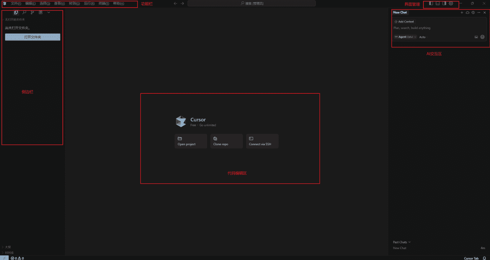

## **6、****打开目录 **

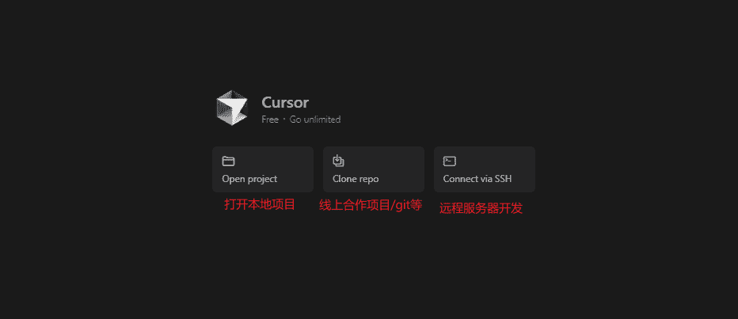

除此之外，也可以在项目文件夹处点击右键，点击使用 cursor 打开。

# **三、Cursor 的核心功能**

## **1、****Cursor 快捷键及功能**

1.  CTRL+ L：打开对话框，可以看到右侧的 chat 栏，可以和 AI 实时沟通。

1.  CTRL+ K：打开生成窗口，可以在光标上方打开生成窗口，这个时候你可以输入你的指令，让 AI 帮你修改或者生成一些代码，实现自然语言编程。

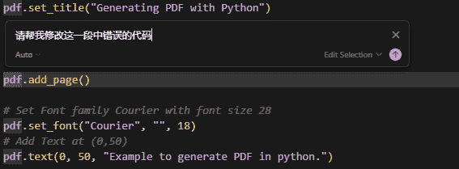

1.  CTRL+ENTER/CTRL+DEL：快速的接受和拒绝 cursor 的修改，accept/reject 的快捷键

1.  CTRL+B：左侧面板隐藏或显示

1.  CTRL+ALT+J：书签

## **2、****Cursor Tab**

Cursor Tab 是我们本地的自动补全功能。它是一个更强大的 Copilot，能够建议整个差异，并具有特别好的记忆。在光标周围建议编辑，而不仅仅是插入额外的代码。同时修改多行。根据您最近的更改和 linter 错误提出建议。

1.  **代码/注释自动补全**

首先我们使用Ctrl+K给 Ai agent 命令，让其生成一段可以测试 Tab 按键的 python 代码，当我将首行注释时，python 代码由于无法识别 tk 是什么而产生报错（可以看到第一行文字颜色稍浅，是 tab 功能的提示输入），让我们尝试将第一段删除，并敲击键盘上的tab键进行使用。同时，在编写程序时，Cursor 有时候也会帮我们自动注释，这个时候敲击tab同样可以注释。

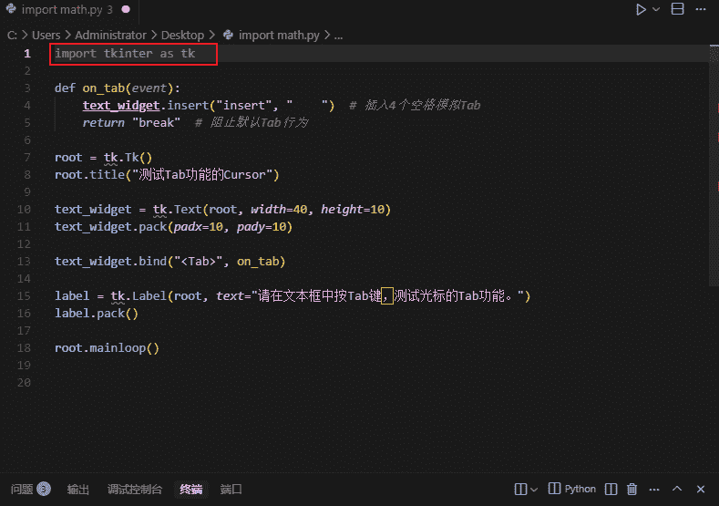

1.  Tab 自动补全后，先点击右上角三角小箭头，是启动功能，然后会生成我们代码的结果小窗口（测试 Tab 功能的程序，并能够进行直接测试）。

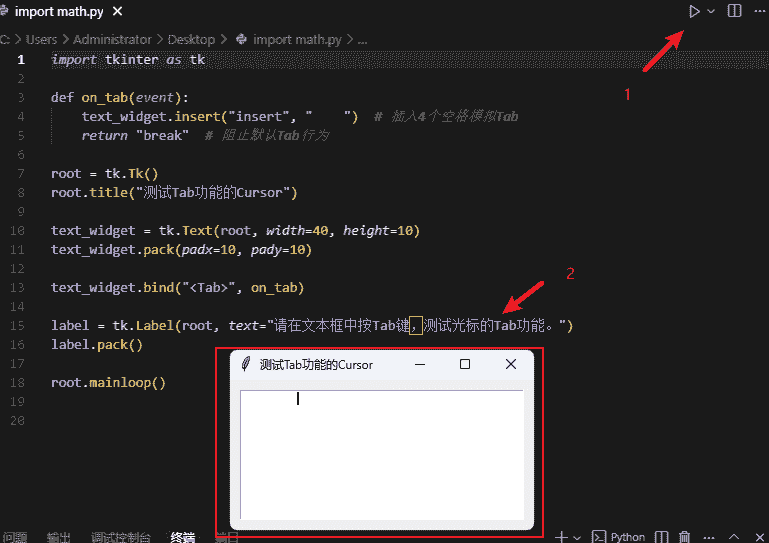

1.  **Tab 键的深度使用**：

Tab：按Tab键接受整个建议。

Esc：按Esc键拒绝整个建议。

Ctrl+→：逐字接受建议。

1.  **文件跳转**

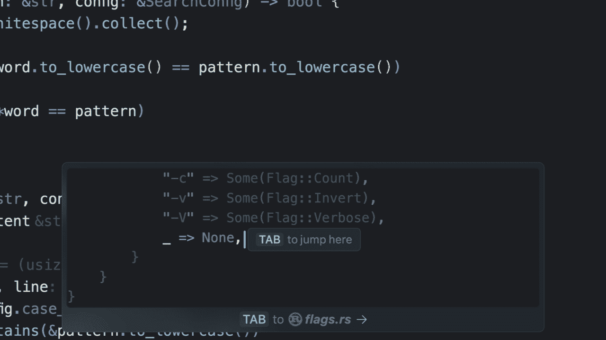

Tab 会预测开发者接下来可能需要编辑的位置，并在接受当前修改后自动建议跳转到下一个相关位置。只需再次按下 Tab键即可快速跳转，极大减少了鼠标操作和手动寻找的时间。在某些项目中，当我们有多个文件时，Tab 也会帮我们预测下个文件功能的位置，敲击Tab进行文件的跳转。

1.  从 GitHub Copilot 迁移

由于 Cursor 默认与 GitHub Copilot 一起使用，当同时安装了 GitHub Copilot 和 Cursor。我们建议在使用 Cursor 时关闭 GitHub Copilot。默认情况下，Cursor 优先于 GitHub Copilot。如果您想使用 GitHub Copilot，可以在设置中禁用 Cursor。

## **3、****Cursor**** ****模型设置**

1.  打开设置，点击右上角的小齿轮，然后点击 Models

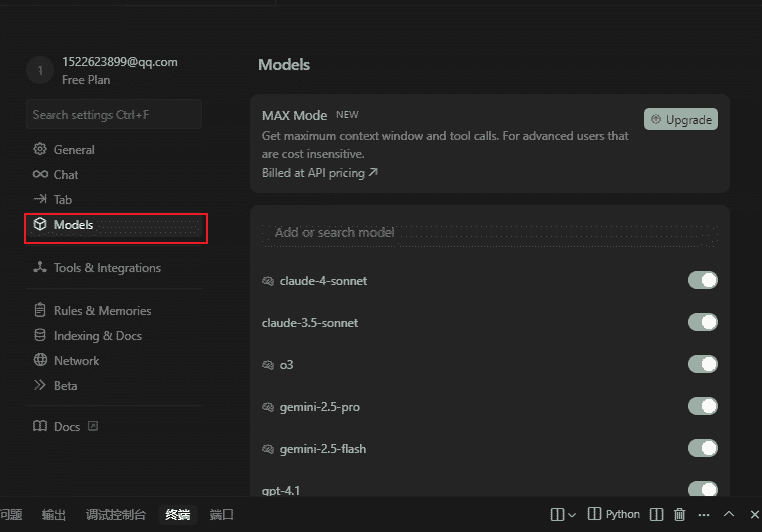

1.  以派欧的 api 为例，引入自己的大模型 api，可以使用其他平[台的 api](https://ppio.com/user/register?invited_by=IMJ58R) 都是没问题的，这里只是引用一个可以免费试用一定额度的平台作为举例。派欧注册页面

1.  点击选择模型，以 deepseek/deepseek-r1-0528 举例

1.  点击模型打开，其中 Base URL 和 Model ID 是后续配置需要使用的东西

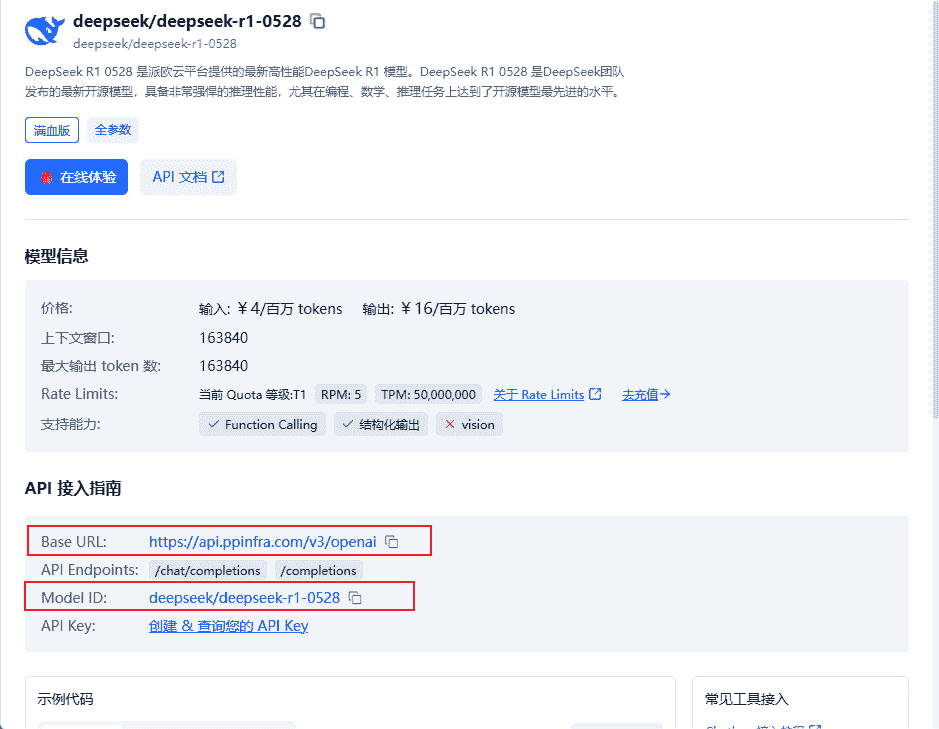

1.  创建自己的秘银：右上角账户→Api 密钥管理→新建（记得一定要妥善保存，这个平台为了安全问题，只会出现一次密码。)

1.  在 Cursor 中配置

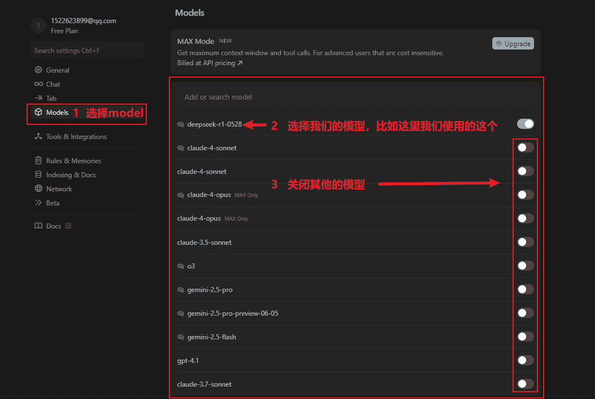

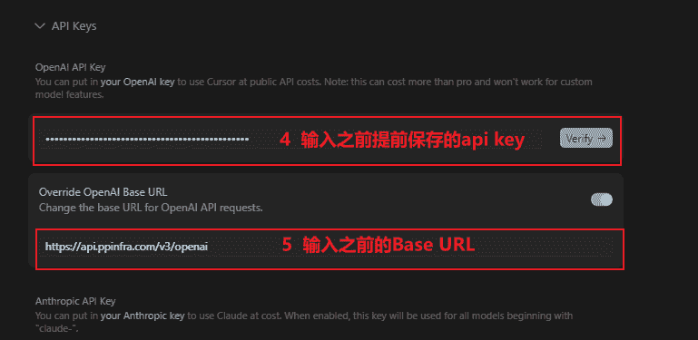

## **4、****Cursor chat**

注：最新版的 Cursor Composer 已被合并，因此本文没有 Composer 的资料

Cursor Chat 让您在代码库中提问或解决问题，使用最强大的语言模型，全部在您的编辑器中进行。为了使语言模型能够给出良好的答案，它们需要了解与您的代码库相关的特定信息——上下文。

Cursor 具有多种内置功能，以在聊天中提供上下文，例如自动包含整个代码库的上下文、搜索网络、索引文档以及用户指定的代码块引用。它们旨在消除与语言模型在代码上工作时所需的繁琐复制粘贴。

1.  如何使用：键盘上按动 Ctrl+L 或者点击右上角小按钮

1.  **用户和 AI 消息**

用户消息包含您输入的文本，以及您引用的上下文。您可以返回任何先前的用户消息进行编辑并重新运行查询。这将覆盖之后的任何消息并生成新的消息。

AI 消息是您选择的 AI 模型生成的响应。它们与之前的用户消息配对。AI 消息可能包含解析的代码块，可以通过 即时应用 添加到您的代码库中。

所有用户/AI 消息在同一线程中称为聊天线程，每个聊天线程都保存在您的聊天历史中。

1.  **和 AI 更好的对话**

默认情况下，Cursor Chat 包含当前文件作为上下文。通过 @ 符号向每个气泡添加更多自定义上下文，默认情况下，当前查看的文件也将作为上下文在用户消息中使用。

## **5、****Cursor+ MCP**

1.  **MCP 是什么**

MCP 的全称是 Model Context Protocol，是一个开放协议，它使 LLM 应用与外部数据源和工具之间的无缝集成成为可能。无论你是构建 AI 驱动的 IDE、改善 chat 交互，还是构建自定义的 AI 工作流，MCP 提供了一种标准化的方式，将 LLM 与它们所需的上下文连接起来。

1.  **为什么选择 MCP**

MCP 可帮助您在 LLM 之上构建代理和复杂的工作流。LLM 通常需要与数据和工具集成，而 MCP 可提供以下功能：

+   越来越多的预建集成可供您的 LLM 直接插入

+   在 LLM 提供商和供应商之间切换的灵活性

+   保护基础架构内数据的最佳实践

1.  **总体架构**

MCP 的核心遵循客户端-服务器架构，其中主机应用程序可以连接到多个服务器：

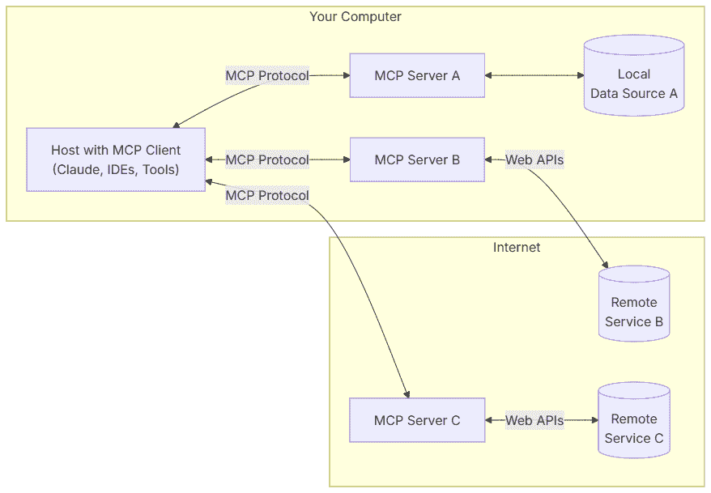

**MCP 主机**：像 Claude Desktop、IDE 或 AI 工具这样的程序，需要通过 MCP 访问数据

**MCP 客户端**：与服务器保持 1:1 连接的协议客户端

**MCP 服务器**：轻量级程序，每个程序都通过标准化模型上下文协议公开特定功能

**本地数据源**：MCP 服务器可以安全访问的您计算机上的文件、数据库和服务

**远程服务**：MCP 服务器可以通过互联网（例如通过 API）连接到的外部系统

**扩展导读**：[MCP 官方文档](https://modelcontextprotocol.io/introduction)、[Github 官网](https://github.com/modelcontextprotocol)、MCP Servers Github 地址

1.  MCP 与 Cursor 集成服务

[**官网地址**](https://cursor.directory/mcp)

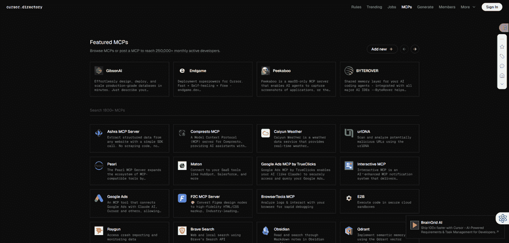

1.  **正式使用**

+   前[置](https://blog.csdn.net/m0_74825699/article/details/146028679)安装：需要更新 Cursor 到最新版本，其次需要下载 Node.js，因为 MCP 的底层需要可参考资料：https://blog.csdn.net/m0_74825699/article/details/146028679

+   Cursor 中配置 MCP 的位置：操作路径：Cursor Setting > Tools & Integrations > MCP Tools

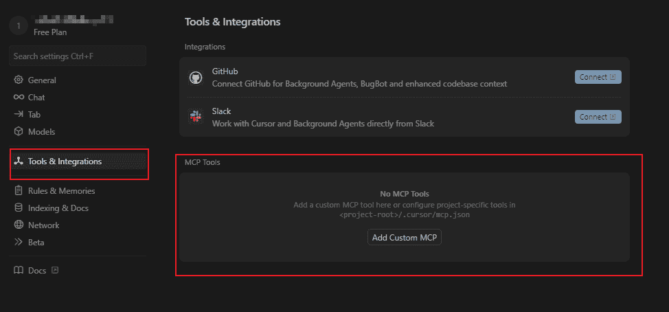

+   打开[ MCP 集成网站](https://smithery.ai/)→搜索 Sequential Thinking→点击 Cursor→点击 One-Click install→ 打开 cursor，点击 install

（以这个 mcp 举例：将复杂的问题分解为可管理的步骤）Smithery.ai 是一个模型上下文协议（MCP）服务器的注册和管理平台。简单来说，它是一个中心枢纽，用于发现和管理各种可以为大型语言模型提供实时上下文信息的服务器。

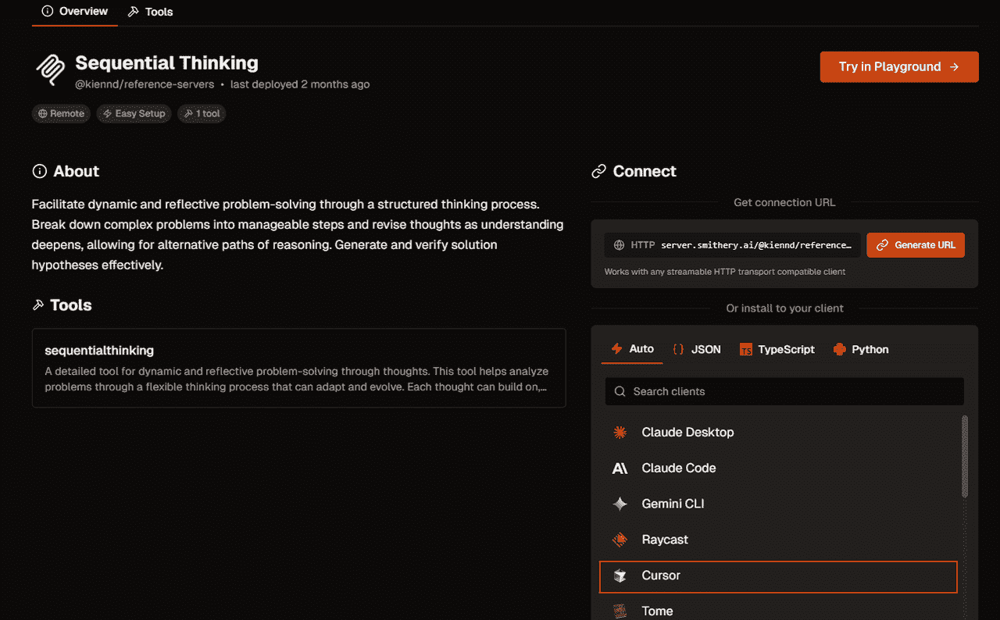

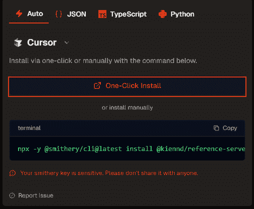

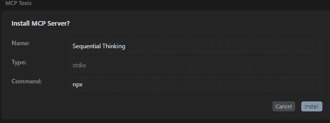

+   打开 Cursor 对 MCP 的白名单：举例：Sequential Thinking 并按回车键

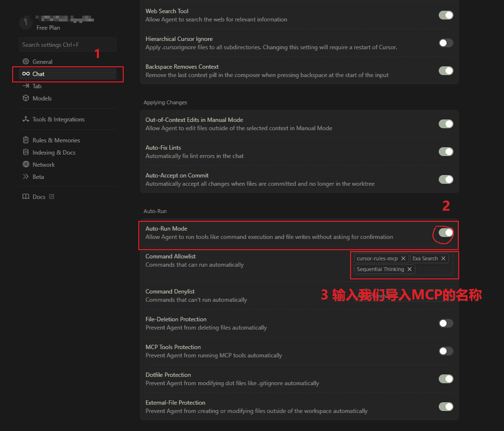

+   检验是否配置成功的标志：

方案一：可以看到，Mcp 管理中所有工具都是绿色小点、且显示可使用 tools 的数量

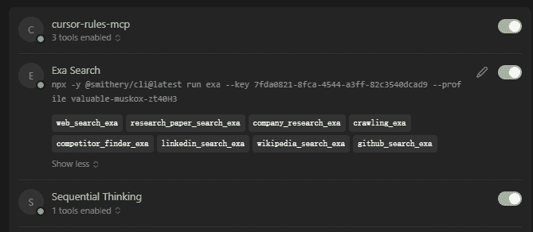

方案二：进行 AI 测试，在右侧聊天框，输入 MCP 使用工具名称，比如 Sequntial Thinking 中的工具 sequentialthinking，并进行对话，并能看到 Called 对应的 sequentialthinking，并出现第一步...，即成功调用 MCP

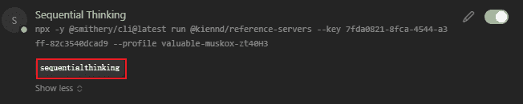

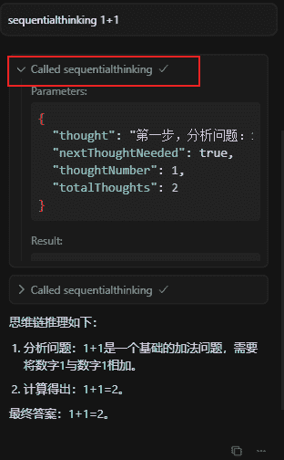

+   常见的配置失败的原因：

1、忘记下载 Node.js

2、smithery.ai 这类网站通常是转存或者收集各类 MCP，在配置 MCP 时有一次网站的跳转，在有些 MCP 时，可以选择删除进行配置，更为保险的方案是：在转存的原始网站，比如 github 上去搜索此 MCP 并寻找其配置文件，通常可以成功配置。

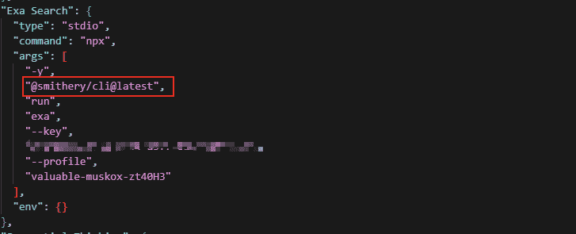

3、没有设置白名单

## 6、代码库索引

1.  代码库索引功能可以提高使用 AI 时的代码库答案的准确性。在后台，Cursor 为您代码库中的每个文件计算嵌入，并将使用这些嵌入来提高代码库答案的准确性。点击Add Context可以看到出现了多种类别。

[相关原理的深度解析](https://zhuanlan.zhihu.com/p/1921345802057548652)

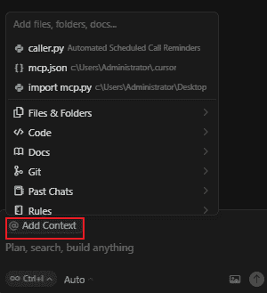

1.  @Files：在 Cursor Chat 和Cmd+K [等 AI ](https://cursordocs.com/docs/context/@-symbols/@-code)输入框中，您可以通过使用 @Files 来引用整个文件。此外，如果您在 @ 后继续输入，将在 @Code 策略后看到文件搜索结果。其中为了确保您引用的文件是正确的，Cursor 将显示文件路径的预览。当您在不同文件夹中有多个同名文件时，这尤其有用。如fronted.py来源于文件夹AutoComplete_App，敲击最下方的fronted.py会跳转到对应的文件。

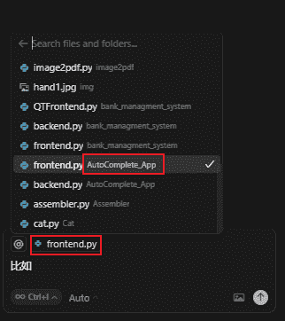

1.  @Folders：您还可以将整个文件夹作为上下文引用。@Folders 在需要提供大量上下文时特别有用，例如在长上下文聊天中。

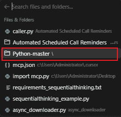

1.  @Code：类似于 [@Files](https://cursordocs.com/docs/context/@-symbols/@-files) 符号，Cursor 将显示代码内容的预览，以便您验证所引用的代码是否正确。另一种将代码片段作为上下文添加的方法是选择您想要引用的代码，然后点击“添加到聊天”（Ctrl/⌘ Shift L）或“添加到编辑”（Ctrl/⌘ Shift K）。这些操作将把选定的代码片段添加到聊天输入框或当前活动的 Cmd K 提示栏中。要将选定的代码添加到新聊天中，您可以按 Ctrl/⌘ L。

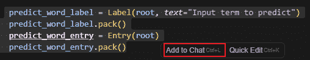

1.  @Docs：Cursor 附带了一套爬取、索引并准备好作为上下文使用的第三方文档。您可以通过使用 @Docs 符号访问它们。如果您想爬取和索引尚未提供的自定义文档，可以通过 @Docs > 添加新文档 来实现。Cursor 将索引并学习该文档，您将能够像使用其他文档一样将其用作上下文。

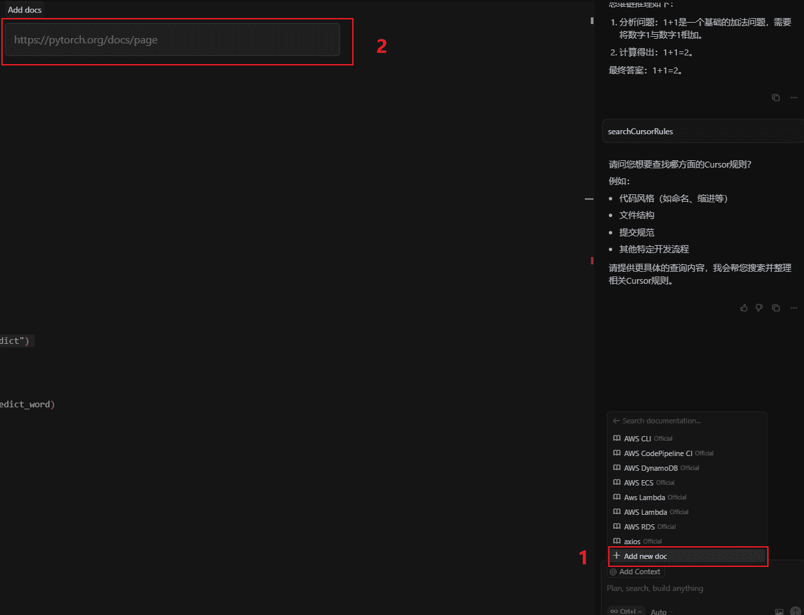

1.  @Git：目前，@Git 仅在 Cursor 聊天中支持。在 Cursor 的聊天中，您可以使用 @Git 将 git 提交、差异或拉取请求添加到您的提示中。

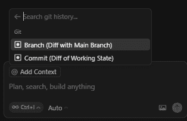

1.  @Past chats：引用过去对话中的信息，可以让模型了解以前 chat 记录的核心内容。

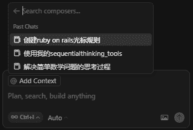

1.  @Rules[：在开发](https://so.csdn.net/so/search?q=%E7%BC%96%E7%A0%81%E8%A7%84%E8%8C%83&spm=1001.2101.3001.7020)一个项目时，有些约定是需要从头到尾遵守的，比如编码规范。这个时候，使用 Rule 就特别合适。Cursor Rules 是 Cursor 提供给用户用来约束模型生成的内容的机制。比如：请模型回复比较简洁、完全实现所有请求的功能、优先考虑代码的易读性和简洁性，而不是性能。

# **四、新人使用技巧**

掌握 Cursor 不仅意味着了解其功能，更重要的是学会如何高效、策略性地运用这些功能。本章将提供一系列从基础到高级的实用技巧，旨在帮助用户从一个能“使用”Cursor 的初学者，转变为一个能“驾驭”Cursor 的专家。

## 提示的艺术：引导 AI 生成高质量代码

核心原则：以下原则综合了来自 OpenAI 官方和其他专家的最佳实践 ：

+   清晰与具体（Clarity and Specificity）：避免模糊的指令。不要说“给我做一个按钮”，而应该说“使用 React 和 Tailwind CSS 创建一个主色调为蓝色的按钮组件，要求有圆角、内边距，并在鼠标悬停时背景色变深”。

+   提供上下文（Context and Background）：使用分隔符（如"""或###）将你的指令与需要 AI 处理的代码或文本清晰地隔离开来。这能帮助模型准确理解任务范围 。

+   赋予角色（Assign a Persona）：在提示的开头为 AI 设定一个角色，这能极大地影响其回应的风格和深度。例如，以“作为一名资深的 Go 语言后端工程师，请……”开头，AI 会以更专业的视角来审查代码和提供建议 。

复杂任务的高级策略：对于更复杂的任务，如构建完整功能或进行大规模重构，可以采用更高级的提示策略

+   元提示（Meta-Prompting）：这种策略的核心是指导 AI 的“思考过程”。你不仅告诉 AI“做什么”，还告诉它“怎么做”。例如：“请遵循以下步骤处理这段代码：第一步，分析代码中的潜在性能瓶颈。第二步，用自然语言解释这些瓶颈的成因。第三步，提供优化后的代码。第四步，为优化后的代码编写单元测试。

+   提示链（Prompt Chaining）：将一个复杂的大问题分解成一系列连续的小问题，并将前一个提示的输出作为下一个提示的输入。例如，你可以先让 AI“为用户认证系统设计数据库模式”，然后基于其输出，再让它“根据此数据库模式生成相应的 TypeORM 实体类”。

## **实现测试驱动的 AI 开发**

YOLO 模式”（You Only Look Once）是 Cursor 中一项强大的自动化功能，它将测试驱动开发（TDD）的理念与 AI 代理相结合，实现了代码的自主迭代和验证。启用 YOLO 模式后，Cursor 的代理将能够自主地执行一个完整的工作流：编写测试、编写实现代码、运行测试、分析失败原因、修改代码，并循环此过程，直到所有测试通过为止 。

**工作流示例** ：

1.  **启用 YOLO 模式**：在 Cursor 的设置中，找到“自动化”（Automation）部分并开启 YOLO 模式。

1.  **下达初始指令**：向 AI 发出一个以测试为中心的指令，例如：“为一个用于验证电子邮件地址格式是否合法的函数，编写一套全面的单元测试。”

1.  **观察 AI 工作**：AI 代理会首先创建一个测试文件（如 emailValidator.test.ts），并编写多个测试用例，覆盖有效、无效和边缘情况。

1.  **自主迭代**：接着，AI 会创建实现文件（emailValidator.ts），编写初步的函数逻辑。然后它会自动运行测试，并观察到测试失败。此时，YOLO 模式的魔力开始显现：AI 会分析失败的测试用例，并自动修改实现代码以修复问题，然后再次运行测试。这个“编码-测试-修复”的循环会一直持续，直到所有测试都成功通过。

## **监督 AI 开发**

尽管 YOLO 模式非常强大，但它并非完全无需人工干预。开发者需要扮演“监督者”的角色，“照看”（babysit）AI 代理的工作过程 。在 AI 陷入逻辑死循环或偏离正确方向时，需要果断地点击“停止”按钮，重新校准其任务和方向。掌握这项功能的核心在于，学会判断何时应该放手让 AI 自主探索，何时需要及时介入进行引导。

通过综合运用这些技巧，用户可以将 Cursor 从一个通用的代码编辑器，转变为一个高度个性化的 AI 编程伙伴。像。cursorrules、@Docs 和“记忆”这样的功能，本质上都是在“训练”AI，使其越来越了解你的项目、你的团队规范和你的个人偏好。随着时间的推移，这种深度个性化会形成一种强大的“锁定效应”：你投入越多的时间和精力来“教导”Cursor，它对你的价值就越大，也就越难以被其他通用型 AI 工具所替代。这正是 Cursor 在长期竞争中构筑的深厚护城河之一。

# 五、实际操作案例

## 用cursor做一个给女朋友告白的pyhon小游戏

新建文件→保存时记得选择python文件→Ctrl+K激活编辑模式→输入需求：做一个可视化小游戏，语言用python，内容要符合马里奥的风格，目的是给女朋友表白。

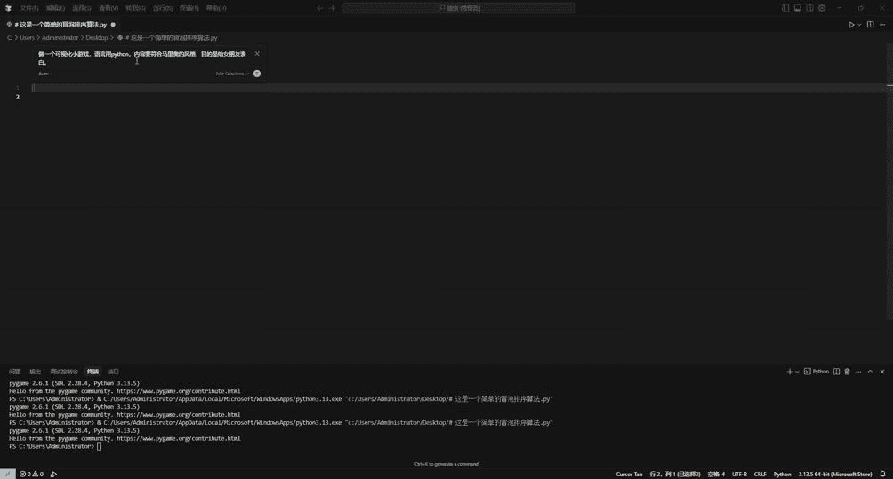

[Cursor_dKF1HBZoSE.mp4](https://internal-api-drive-stream.feishu.cn/space/api/box/stream/download/all/KDpyb5Dszosq2Ixm2z2c092YnVe)

检验一下最终的效果

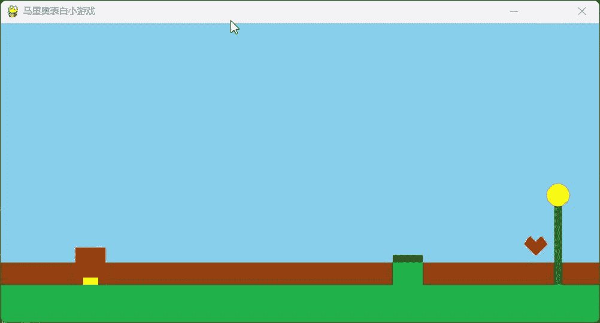

[python3.13_zKfH9KTPAq.mp4](https://internal-api-drive-stream.feishu.cn/space/api/box/stream/download/all/Xzihb1oV6oi3gIxPq6ccx7YynQf)

是不是有一点丑~这样怎么能让可爱的女朋友心动呢，我们调教一下cursor，让他更漂亮一些，可以看到，提出需求后，cursor在逐行阅读我们的代码，并且进行修改，增加调整了很多ui，甚至帮我设计了一个马里奥的角色效果。

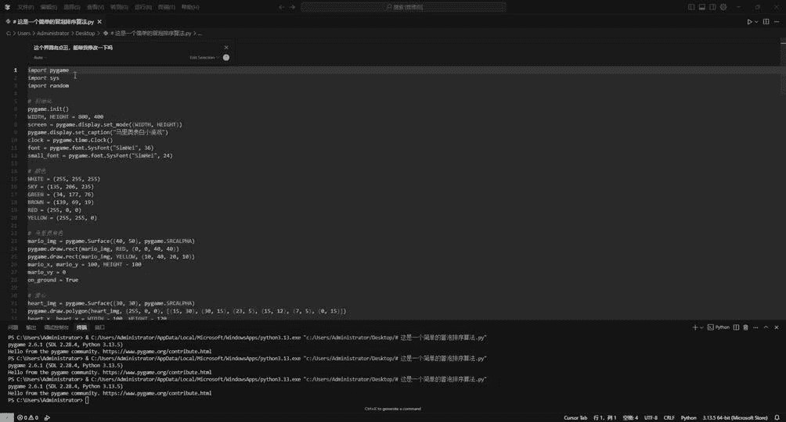

[Cursor_Vi6WUxktFp.mp4](https://internal-api-drive-stream.feishu.cn/space/api/box/stream/download/all/BZssbJ5Dgo4URJxGvIbculEsndc)

检验一下最终结果：虽然不算特别可爱，但是也比之前精细多了，但是0代码的开发，迭代，让我感受到cursor的强大。

[python3.13_EGQGAIQIoP.mp4](https://internal-api-drive-stream.feishu.cn/space/api/box/stream/download/all/KcpPbkasjoBPdLxWXO7cdobSnKf)

## 2、用cursor制作一个番茄时钟

不知道有没有同学有时候写代码的时候会感觉很疲惫或者容易走神，这个时候我们就可以利用cursor极速帮我们做一个番茄时钟，给cursor输入命令：做一个Python语言的番茄时钟（其他语言也适用，cursor支持的语言种类非常多，这边主要以python给大家举例）

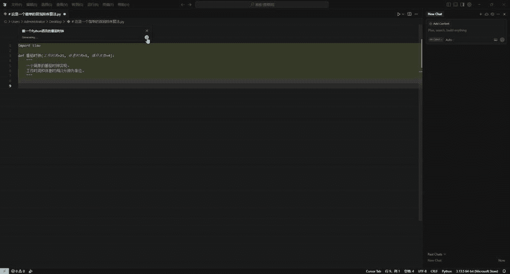

[Cursor_KGWhsppxrY.mp4](https://internal-api-drive-stream.feishu.cn/space/api/box/stream/download/all/ZcUNb2utCou5lQxHacycaAvSnjb)

最终效果：

[Cursor_87dQbASfTO.mp4](https://internal-api-drive-stream.feishu.cn/space/api/box/stream/download/all/Bplkb0c0YowGIvxUJKGcVNHlnwc)

控制台版本的是不是有一点丑，我们让cursor给我们做一个可视化：有一点丑，做一个可视化界面。

最终效果如右图：可以看到还有进度条显示

[python3.13_G6vl8BmYbz.mp4](https://internal-api-drive-stream.feishu.cn/space/api/box/stream/download/all/F0S3bHRSaoPw8exnSXMc04ucnpc)

# **六、商业变现案例**

对于许多学习新技术的开发者而言，最终目标不仅仅是提升效率，更是创造商业价值。Cursor 作为一款强大的生产力工具，极大地降低了软件创业的技术门槛，为个人开发者和小型团队开辟了前所未有的商业机会。本章将通过真实案例和可行策略，探讨如何利用 Cursor 将技术能力转化为实实在在的收入。

## 英语专业 Truman 的故事：副业超过主业收入

刚大学毕业的 Truman，专业英语。从零经验的小白到每月稳定收入的独立开发者，6 个月通过 Cursor 搭建了 102 个网站，并实现了盈利，其主页 https://cursorhub.org/，做到了真实的依靠 cursor 从零基础的代码小白到营业。

## 多模态媒体公司 Every 的故事： 三个月内用 AI 打造了 Cora

曾经，构建一个电子邮件客户端需要数年时间和数百万美元的投入。但今年，多模态媒体公司 Every 的 Kieran Klaassen 推翻了这一切。他在短短三个月内用 AI 打造了 Cora——一种全新的管理电子邮箱的方式，并且迅速吸引到超过 10,000 名用户注册，这是在当前生成式 AI 加持的状态下才变得可能的事情。Cursor 编写 90% 代码，3 个月速成 AI App 吸粉破万。

相关报导：https://www.infoq.cn/article/v4hbi2beid4egtyls9ge（需要科学上网）

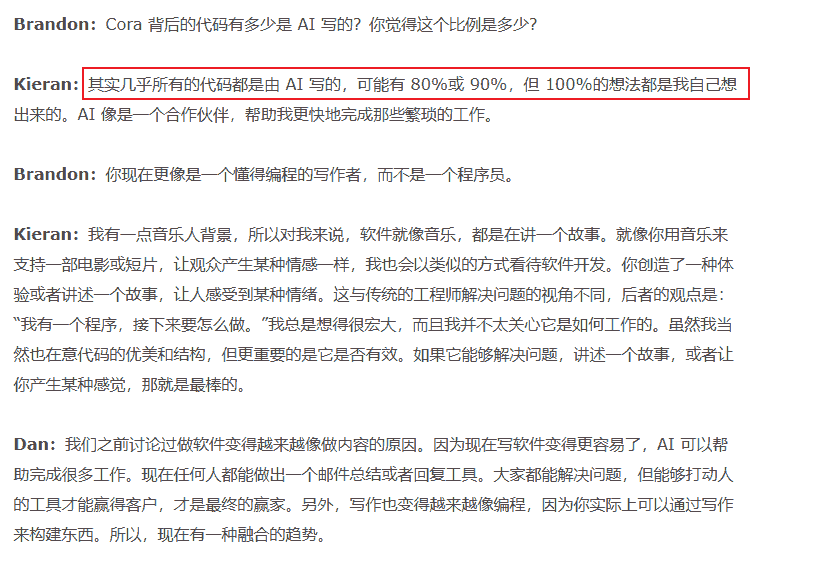

## **Alex Finn 的故事：用 C**ursor 打造年入 30 万美元的应用

相关报导：https://www.bilibili.com/video/BV14d3xzcEie/?vd_source=63514c7a9dc3590b981877454347b8f9

Alex Finn 的创业故事是 AI 时代个人开发者崛起的典型范例，为有志于软件创业的用户提供了极具启发性的蓝图。Alex Finn 利用以 Cursor 为核心的 AI 工具，独立开发了一款名为 CreatorBuddy 的应用，该应用在短时间内实现了 30 万美元的年经常性收入。更令人瞩目的是，他在产品发布当天，仅用 15 分钟就获得了 10 万美元的收入，这充分证明了其产品和营销策略的巨大成功 。

CreatorBuddy 是一款专为社交平台 X（前身为 Twitter）的内容创作者设计的 AI 助手。它能帮助创作者分析其受众最活跃的时间，推荐表现最佳的帖子格式，并提供符合平台算法的建议，以最大化内容的触及范围。

## **AI 时代的自由职业与咨询服务**

除了独立开发产品，利用 Cursor 提升的效率也可以直接转化为服务性收入。比如提供 AI 加速的开发服务，开发者可以在 Fiverr、Upwork 等自由职业者平台上，提供“AI 加速的网站和应用开发”服务。对于客户（尤其是中小型企业）来说，他们最关心的是以更低的成本、更快地获得最终产品。掌握 Cursor 的开发者可以提供极具竞争力的报价和交付周期，例如承诺在一周内交付一个功能完善的电商网站，这在传统开发模式下是难以想象的。

# **七、AI 编程市场与技术分析**

## 行业格局：生成式 AI 编码助手市场

多个市场研究机构的数据共同描绘了一个正在经历爆炸式增长的赛道。根据 MarketsandMarkets 的报告，全球 AI 代码工具市场预计将从 2023 年的 43 亿美元增长到 2028 年的 126 亿美元，年复合增长率（CAGR）约为 24%。而 Grand View Research 的预测更为激进，认为“软件开发中的 AI”市场规模将从 2024 年的约 6.7 亿美元增长到 2033 年的超过 157 亿美元，CAGR 高达 42.3%。这些数据清晰地表明，用户正在进入一个巨大且高速扩张的蓝海市场。

## 关键驱动力与趋势

市场的增长主要由以下几个因素驱动：

+   **对开发者生产力的极致追求**：在软件吞噬世界的时代，提升开发效率是所有科技企业的核心诉求。

+   **自动化重复性任务**：AI 能够自动处理编码、调试、测试和文档编写等繁琐工作，让开发者能专注于更高层次的架构设计和逻辑创新。

+   **低代码/无代码平台的兴起**：AI 的加持使得更多非技术人员也能参与到软件创造过程中，进一步扩大了市场规模。

## 战略洞察：来自顶级风投和金融机构的观点

AI 原生开发的崛起：作为 Anysphere 的主要投资者之一 ，a16z 的观点极具代表性。他们认为，我们正在经历一个根本性的范式转移：AI 正从一个辅助“工具”演变为软件构建方式的“新基础” 。在这个新范式下，传统的开发理念正在被重塑：

+   “势能即护城河”（Momentum as a Moat）：在 AI 领域，技术壁垒的建立速度远跟不上模型迭代的速度。因此，竞争优势不再仅仅来自技术本身，而更多地来自于“构建第一、迭代最快、分发最好”的能力。像 Cursor 这样能够快速获得用户和市场关注度的公司，其增长速度本身就构成了一种强大的护城河。

+   “购买而非构建”（Buy vs。 Build）的转变：随着像 Cursor 这样成熟的 AI 原生应用的出现，企业越来越倾向于直接购买这些解决方案，而不是投入巨资在内部从零开始构建类似的能力。这为 AI 原生 SaaS 公司创造了巨大的市场机会。

AI 代理驱动的生产力革命（高盛，Goldman Sachs），高盛的研究报告同样看好 AI 代理（AI Agents）带来的商业价值。他们预测，AI 代理将通过执行自主任务序列来解锁巨大的商业生产力，并预计仅此一项就能使整个软件市场的规模扩大至少 20%。高盛认为，AI 代理将成为知识工作者的新用户界面，到 2030 年，代理驱动的软件市场可能占到软件总市场规模的 60%以上 。

## 学术界的见解

学术研究明确指出了 LLM 在代码生成方面存在的一些固有挑战：

+   **语法与语义错误**：模型有时会生成不符合语法规范或逻辑上存在错误的代码，即所谓的“幻觉”（Hallucination）。

+   **安全漏洞**：由于训练数据中可能包含不安全的代码范例，模型有时会生成带有安全隐患的代码。

+   **数据偏见**：模型会学习并复现训练数据中存在的偏见，例如倾向于使用某种过时的编程模式。

这些局限性恰恰凸显了本书一直强调的“人在环路”（Human-in-the-loop）工作流的重要性。AI 是一个强大的助手，但绝不能盲目信任。一个熟练的 AI 开发者，其价值不仅在于能用 AI 写代码，更在于能识别和修正 AI 的错误。

综合来看，市场、资本和技术三个层面的力量正在发生历史性的交汇。市场报告揭示了“是什么”——一个正在以惊人速度膨胀的市场。顶级风投的分析解释了“为什么”——一场深刻的平台级变革正在发生，资本正以前所未有的速度涌入以抢占先机。而技术研究则阐明了“怎么样”——底层的 LLM 技术日新月异，但仍不完美，需要熟练的人类操作者来释放其全部潜力。

Cursor 正好处在这场风暴的中心。它技术足够先进，能带来魔法般的体验；它精准地切入了一个由巨大投资验证的、需求旺盛的市场；但它又足够不完美，以至于需要一个技能娴熟的人类伙伴来驾驭。对于大家而言，这意味着一个巨大的机遇：通过掌握 Cursor，你不仅仅是在学习一个工具，更是在将自己定位在十年一遇的技术和经济浪潮之巅。

# **八、相关学习资源**

## 官方学习内容

## 课程学习资源

B 站的两套课程，相对比较系统，作为入门级学习，还是比较合适的，推荐给大家！

Cursor：20分钟通关Cursor的所有功能

目前B站最全最细的 Cursor AI编程零基础全套教程

> **新人学习 8 条建议**

> **1.开启引导模式：**新手建议开启 “引导模式”，跟随引导逐步了解 Cursor 的基本功能和操作流程；

> **2.阅读官方教程：**官方文档包含了详细的功能介绍和使用方法，亲自看一遍能让你全面了解 Cursor，避免只进行低水平重复练习；

> **3.掌握代码生成与补全：**利用多行编辑功能，Cursor 可根据上下文对多行输入进行预测和补全，配合 “Partial accepts” 功能能提高编码效率。还可通过输入自然语言让 Cursor 生成代码片段，注意描述要清晰具体；

> **4.选用成熟项目模板：**不要从零开始写代码，可选择 Next.js 模板或 GitHub 上的成熟项目模版，Cursor 适合 TypeScript 和 ESLint，能自动避免一些基础问题。

> **5.明确项目需求：**花时间详细列出项目需求，包括技术选型、功能要求等，让 Cursor 更准确地执行任务，减少反复修改。

> **6.设置隐私模式：**若担心代码隐私问题，可在设置中打开 “General” 下的 “Privacy mode”，但需注意因与大模型交互，仍可能有部分代码片段被收集。

> **7.创建 Cursor 规则：**通过 “/Generate Cursor Rules” 让 Cursor 根据现有代码自动生成规则，也可在项目根目录的。cursorrules 文件中定义项目特定规则，或在设置中的 General > Rules for AI 下设置全局规则，使 AI 助手更符合个人编码风格和项目需求。

> **8.使用任务管理工具：**可搭配 TaskMaster AI 等任务管理工具，为每个功能创建任务，设置优先级并关联具体需求，通过 CLI 将任务导入 Cursor，使其专注于目标，提高效率。

# 九、常用快捷键

Cursor 编辑器为提升编码效率设计了一系列快捷键，以下是常用快捷键：

### 基础操作

+   **创建新文件**：Ctrl+N（Windows/Linux）或 Command+N（macOS）

+   **打开文件**：Ctrl+O 或 Command+O

+   **保存文件**：Ctrl+S 或 Command+S

+   **关闭文件**：Ctrl+W 或 Command+W

+   **撤销操作**：Ctrl+Z 或 Command+Z

+   **重做操作**：Ctrl+Y 或 Command+Y

### 代码编辑

+   **生成代码**：Ctrl+K（Windows/Linux）或 Command+K（macOS）

+   **选中当前行**：Ctrl+L 或 Command+L

+   **复制当前行**：Ctrl+D 或 Command+D

+   **删除当前行**：Ctrl+Shift+K 或 Command+Shift+K

+   **向上/向下移动行**：Alt+Up/Down 或 Option+Up/Down

+   **注释/取消注释**：Ctrl+/ 或 Command+/

+   **自动格式化代码**：Ctrl+Shift+I 或 Command+Shift+I

### 导航与搜索

+   **快速打开文件**：Ctrl+P 或 Command+P

+   **全局搜索**：Ctrl+Shift+F 或 Command+Shift+F

+   **查找和替换**：Ctrl+H 或 Command+H

+   **跳转到行号**：Ctrl+G 或 Command+G

+   **切换文件选项卡**：Ctrl+Tab 或 Command+Tab

+   **返回/前进**：Alt+Left/Right 或 Option+Left/Right

### AI 辅助功能

+   **触发 AI 补全**：Tab（在 AI 建议出现时）

+   **接受 AI 建议**：Ctrl+Enter 或 Command+Enter

+   **拒绝 AI 建议**：Esc

+   **查看 AI 历史**：Ctrl+Shift+A 或 Command+Shift+A

### 窗口与面板

+   **打开/关闭终端**：Ctrl+`` 或 Command+``

+   **切换侧边栏**：Ctrl+B 或 Command+B

+   **全屏模式**：F11

+   **放大/缩小**：Ctrl++/- 或 Command++/-

### 多光标操作

+   **添加下一个匹配项**：Ctrl+D 或 Command+D

+   **添加光标到所有匹配项**：Ctrl+Shift+L 或 Command+Shift+L

+   **手动添加光标**：Alt+Click 或 Option+Click

以上快捷键可大幅提升使用 Cursor 时的操作效率，要是你习惯其他编辑器的快捷键，Cursor 也支持导入，例如 VS Code、Sublime 等的快捷键方案。

# **十、专家观点与媒体报道**

## 创始人的愿景：Anysphere 领导层访谈

Anysphere 的联合创始人兼 CEO Michael Truell 在多次访谈中，分享了他对编程未来的深刻思考，其核心观点远超出一个简单的代码编辑器 。

+   “代码之后是什么？”（What comes after code）：Truell 认为，我们正处在一个编程语言本身可能逐渐被更高级的抽象所取代的时代。未来的软件开发，将越来越少地关注具体的语法实现，而更多地关注逻辑设计、系统架构和产品“品味”。

+   **提升工程师的角色**：Cursor 的目标不是替代工程师，而是将他们从繁琐的编码工作中解放出来，让他们能更像“工程经理”或“产品架构师”一样思考，专注于定义问题、设计解决方案和指导 AI 完成执行。在这种模式下，工程师的创造力和判断力将变得比以往任何时候都更加重要。

+   **构建独立公司的决心**：尽管面对潜在的收购要约，Anysphere 的创始团队明确表示，他们的目标是建立一家伟大的、独立的公司。他们相信自己正处在一个历史性的机遇中，并对未来的产品路线图充满热情，希望能够独立自主地实现其长远愿景 。

这些观点揭示了 Anysphere 的宏大抱负：他们不仅仅是在做一个更好的 VS Code，而是在探索和定义下一代软件的创造方式。

## 投资者的论点：为何 a16z 和 OpenAI 押注 Cursor

Cursor 的投资者阵容堪称豪华，其中包括了 Andreessen Horowitz （a16z） 和 OpenAI 创业基金。这两家机构的投资本身就是一个强烈的市场信号，尤其是考虑到它们都拥有与 Cursor 存在一定竞争关系或协同关系的产品（如 GitHub Copilot 和 OpenAI API）。

+   **对原生集成模式的认可**：他们的投资表明，市场顶级的参与者认可 Cursor 所采取的“AI 原生 IDE”路径。他们看到了作为一个独立应用所能实现的深度集成和强大功能，是简单的插件模式所无法比拟的。这验证了 Cursor 在产品战略上的独特性和优越性 。

+   **对平台化潜力的看好**：a16z 在其多篇分析文章中，反复强调了 AI 时代平台和生态系统的重要性。他们将 Cursor 的 MCP（模型上下文协议）视为一个有潜力成为 AI 代理通用交互标准的关键创新。投资 Cursor，实际上是投资一个未来可能出现的、围绕 AI 开发的新平台的潜力。

##  媒体头条：主流报道与赞誉

Cursor 的飞速发展也吸引了全球主流科技和商业媒体的广泛关注，进一步证实了其在行业中的重要地位。

+   **增长速度**：彭博社（Bloomberg）、TechCrunch 等媒体纷纷报道了 Anysphere 惊人的增长速度和融资情况，称其为“增长最快的创业公司之一”，并关注其如何在短短几年内吸引了百万级用户并迅速实现高额年收入。

+   **行业影响**：《时代》杂志（TIME）将 Anysphere 评为年度最具影响力的公司之一，认为它正在“重新定义许多开发者的工作方式” 。报道强调，Cursor 能够生成任何编程语言的代码，创建新功能，并提供智能建议，正在加速软件工程行业的变革。

+   **企业采纳**：报道还指出，Cursor 已经被众多顶尖科技公司和财富 500 强企业所采用，包括 Nvidia、Adobe、Uber、OpenAI 和 Stripe 等。这表明 Cursor 不仅在个人开发者中广受欢迎，也已经成功打入了要求严苛的企业市场。

---

#  AI编程学习交流群

1.持续关注并更新 AI 的**相关资讯动态，研究报告，赚钱案**例，常见问题，永久免费在线查看，无收费内容，目标是成为最大的免费 AI 学习社群。

2.已建立社群聊聊 **AI** 发展及应用，**没进群的可以扫码加入，群满可加 AI 研究爱好者大国微信 ID：zyg90s（备注**：开发者），已经在社群内的无需重复加入，开源知识库及社群学习全部为公开免费分享。

3.**关于文档负责人大国**：高帆文化 CEO，曾就职于教培大厂，目前创业，主攻研究 AI 落地应用、企业流量增长及达人 IP 孵化。

**飞书学习群**

**微信扫码进群学习**

好友（ID：zhangyuguo94s）

**扫码加微信入微信群**

---

**END，**这个 AI 知识库不只是一个数据仓库，更是推动每个人进步的强大引擎。我们希望你能从中受益，并将其分享给更多的人，让更多的人获得这份力量。感谢你的支持和分享！