# Claude Code 学习手册（持续更新 ing...)

> 来源：[https://yunyinghui.feishu.cn/docx/HarvdUQHuoPvhTxOqLZcl0exnbf](https://yunyinghui.feishu.cn/docx/HarvdUQHuoPvhTxOqLZcl0exnbf)

> 首发时间：2025 年 8 月 30 日

> 更新时间：2025 年 10 月 11 日

> **内容出品人：**** **** **

> **内容出品方：**[Mix AI Lab](https://yunyinghui.feishu.cn/wiki/WhelwZnxQi55mpkOzatc3Xran5b?from=from_copylink)

> **使用建议：**如果需要快速定位到精确内容，可以使用快捷键 Ctrl +F/Command +F 的形式，搜索关键字/词，查找你想要的内容。

> **特别说明：**飞书内容花了大量心思做构思和整理，请勿直接抄袭复制，如有发现会追究相关责任。

>

> **为 AI 实验室**同学持续更新 AI 编程工具 Claude Code 的基本介绍、安装配置、使用技巧、实操案例等全套学习内容。

>

> 🎯全**网最接地气 AI 知识库：「**[**AI 实验室」知识库（**](https://yunyinghui.feishu.cn/wiki/space/7340161844864598017?ccm_open_type=lark_wiki_spaceLink&open_tab_from=wiki_home)AI 绘画、AI 写作、AI 视频等应用技能）

# 一、Claude Code  简介

## **1、企业简介与使命**

Claude Code 是由 Anthropic 开发并于 2025 年 2 月 24 日发布的 AI 编码助手。它是所谓的“受监督编码代理”的一个例子。这些工具可以在软件开发工作流程中执行相对复杂的任务，有时甚至可以自主完成。目前大多数知名的受监督编码代理都是通过 IDE 融入工作流程的，包括 Cursor、Cline 和 Windsurf 和 GitHub Copilot。Claude Code 与这些工具不同，它是一个基于终端的界面（开源代理工具 Aider 和 Goose 也采用终端而不是 IDE 进行操作）。通过终端工作使得将代理融入更广泛的生态系统变得更容易，而不是局限于 IDE。

2022 年 4 月 29 日，Anthropic 在 B 轮融资中筹集了 5.8 亿美元，领投者为 FTX 首席执行官 Sam Bankman-Fried。2023 年 2 月，获得 Google 投资 3 亿美元，Google 持股 10%。（ 2023 年 7 月 11 日，Anthropic 发布了全新的 Claude 2 大语言模型。2024 年 3 月 4 日消息，Anthropic 发布 Claude 3 模型家族。2024 年 10 月 22 日，美国人工智能初创公司 Anthropic 宣布推出升级版的 Claude 3.5 Sonnet 模型，升级后的 Claude 3.5 大语言模型，Anthropic 声称会达到“仿佛一个人在电脑前工作”的效果。2025 年 2 月 25 日，Anthropic 宣布推出 Claude 3.7 Sonnet，称这是其迄今为止最智能的模型，也是市场上首款混合推理模型。北京时间 2025 年 5 月 23 日，Anthropic 正式推出 Claude 4 系列大模型。

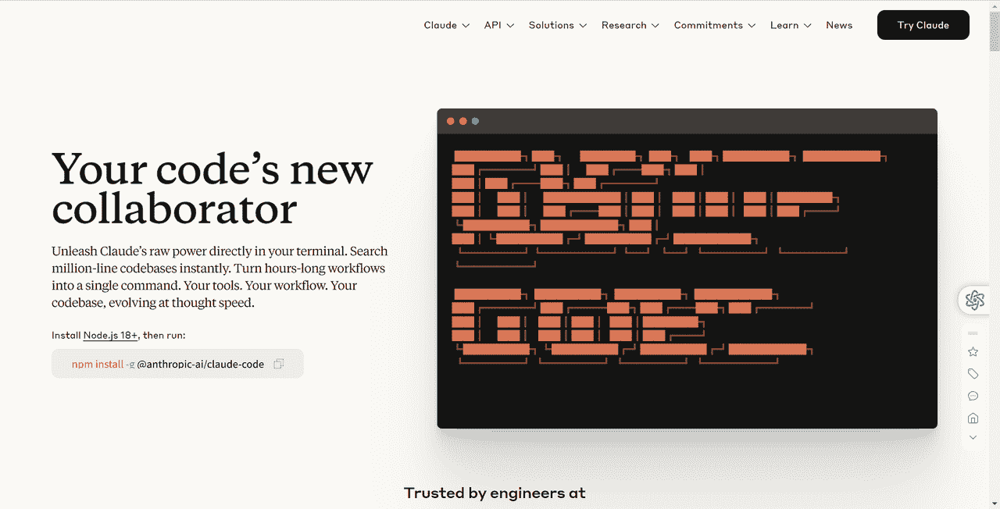

**企业官网**

官方地址：[claude code 官网](https://www.anthropic.com/claude-code)


## **2、团队信息**

2021[ 年，An](https://baike.baidu.com/item/FTX%20/10078739?fromModule=lemma_inlink)thropic 成立。2021 年 5 月，Anthropic 获得 1.24 亿美元 A 轮融资，由 Skype 联合创始人 Jaan Tallinn 领投，Facebook 联合创始人 Dustin Moskovitz 等投资者参与。2022 年 4 月 29 日，Anthropic 在 B 轮融资中筹集了 5.8 亿美元。领投者为 FTX 首席执行官 Sam Bankman-Fried。2022 年 4 月，Anthropic 就发表论文（31 人署名）讨论了有用和无害之间存在的显著紧张关系。对其产生原因，Anthropic 认为「这是因为 Anthropic 的众包工作者对有害输入的回应是回避性的 」。2022 年 12 月，Anthropic 又发表了（51 人署名，半年之内，Anthropic 就壮大了 7 成）一篇论文，提出新的 AI 价值观训练方法——基于 AI 反馈的强化学习（Reinforcement Learning from AI Feedback，RLAIF）。2022 年 12 月，Anthropic 团队在 arxiv 上发布了一篇论文直接对标 OpenAI 的 GPT-3 模型。


**延展阅读：**

[爆火的 Claude Code，到底是](https://blog.csdn.net/qq_36396104/article/details/149220908)程序员的新宠还是 AI 时代的编程革命？

---

## **3、火爆原因**

+   **“小模型”的大规模应用**：在实践中，Claude Code 超过 50%的关键 LLM 调用分配给了如 Claude-3.5-Haiku 这类更小、更经济的模型。它们负责处理文件读取、日志解析、Git 历史总结等高频但相对不复杂的任务，而将昂贵的大模型用于深度推理。这种策略在保证效果的同时，显著降低了使用成本。

+   放弃 RAG，采用更灵活的“LLM 搜索”：与传统 AI 编码助手依赖向量数据库检索（RAG）不同，Claude Code 选择让模型直接调用 grep、find、ripgrep 等系统原生工具在代码库中进行搜索。这种方法**无需预先构建索引，能实时反映代码库的最新变动**，避免了 RAG 方案中分块、相似度计算等环节可能带来的误差，搜索准确性和实时性更高。

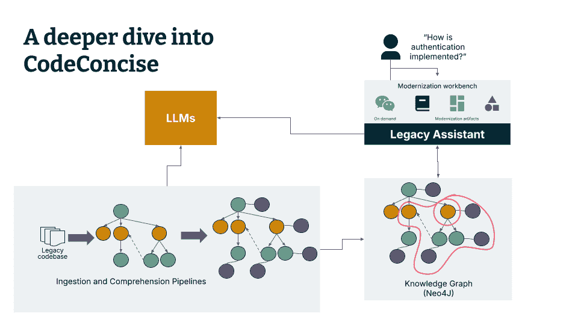

+   “一人成军”与 Multi-Clauding 模式：许多开发者开始实践“Multi-Clauding”，即同时运行多个 Claude Code 会话，让它们扮演不同角色（如一个写代码、一个跑测试、一个盯日志、一个专门调试）。这相当于一个开发者同时指挥一个高度专业化的 AI 团队协同工作，个人效率得到极致释放。

+   **强大的生态扩展能力（MCP）**：通过模型上下文协议，Claude Code 可以连接和集成各种外部工具（如 Git、Jira、Figma、Sentry 等），使其能力不再局限于代码本身，而是可以渗透到需求分析、测试部署等更广泛的开发流程自动化中。

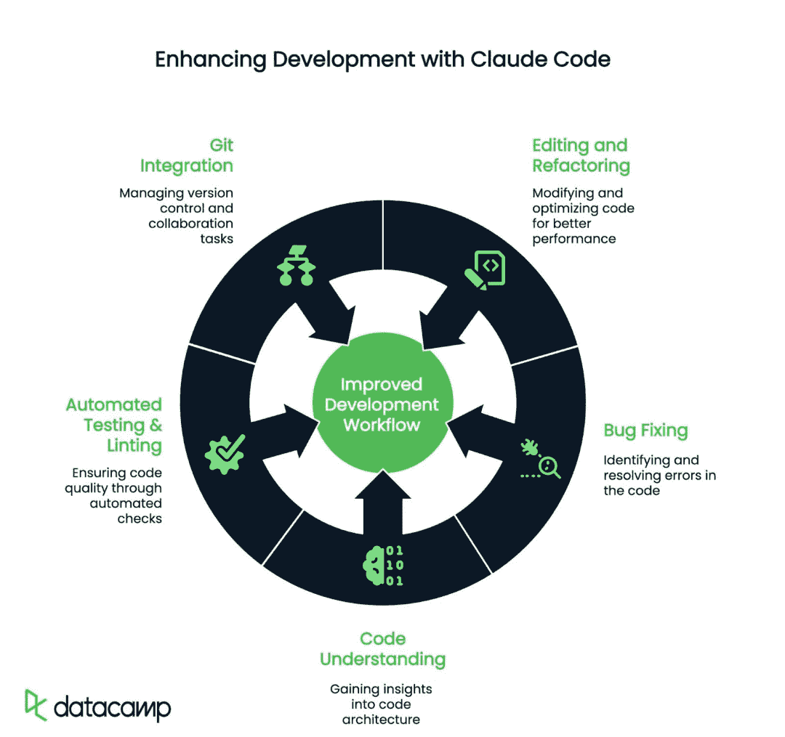

**延展学习：**

[**Contrary Research 提**](https://research.contrary.com/company/anysphere)供的 Anysphere 公司的深度研究

## 4、Claude code 的核心功能亮点

1.革命性的交互范式：意图式编程

Claude Code 最根本的亮点是改变了开发者与计算机的交互方式。你不再需要手动编写每一行代码，而是用自然语言向 AI 描述你的意图和目标（例如：“为这个用户模型添加邮箱验证功能”或“优化这个数据库查询，减少 N+1 问题”）。Claude Code 会理解你的目标，自主规划实现步骤，并生成或修改代码。这让你能从繁琐的实现细节中解放出来，更专注于架构设计和问题本身。

**  **

2.项目级上下文感知与 LLM 驱动搜索

与传统工具只能理解单个文件不同，Claude Code 能深度理解整个代码库。

+   **超长上下文窗口**：它能处理极长的上下文（支持数十万 tokens），意味着它可以同时查看和分析大量的相关代码文件，从而做出更符合项目整体架构的决策。

+   创新的“LLM 搜索”替代 RAG：它摒弃了传统的向量数据库检索（RAG）方式，而是让 AI 模型直接调用 grep， find， ripgrep 等系统原生工具进行搜索。这种方法**无需预先构建索引，能实时反映代码库的最新变动，搜索结果更准确、更及时，避免了 RAG 可能出现的信息丢失或错误匹配。

**3.持久化记忆与个性化：****claude.md**** 文件**

+   你可以在项目根目录创建一个 claude.md 文件，在其中定义项目的代码规范、架构说明、常用命令、避坑指南、API 密钥命名规则等任何重要上下文。

+   Claude Code 在每次交互时都会优先读取这个文件，使其行为始终严格符合你的项目要求，无需在每次对话中重复交代背景。这实现了“一次定义，始终遵循”，大大提升了协作效率和代码一致性。

4.强大的多文件操作与自动化重构

Claude Code 擅长处理复杂的、涉及多个文件的工程任务。

+   它可以同时编辑、创建和关联多个文件。例如，当你要求它“添加一个新功能”时，它可能会自动创建新的组件文件、更新路由配置、修改状态管理逻辑，并在相关的样式文件中添加样式。

+   它能执行复杂的代码重构和框架迁移（例如从 React 到 Vue），并确保所有关联文件都得到正确更新，保持项目的完整性。

5.灵活的部署与生态集成（MCP）

Claude Code 提供了多种使用方式并能轻松融入现有工具链。

+   **网页版与 CLI 版本**：它既提供了开箱即用的网页版，无需复杂环境配置，也提供了功能更强大的命令行版本，满足不同技术背景用户的需求。

+   **通过 MCP 集成工具链**：通过模型上下文协议，它可以与你的整个开发工具链连接，如集成 Git、Jira、Figma、Sentry 等外部工具，使其能力渗透到需求分析、测试、部署等更广泛的开发流程中。

## 5**、Claude Code **适用人群

## 1）全栈与后端开发者

对于日常需要处理复杂业务逻辑、数据库操作和 API integrations 的开发者来说，Claude Code 是一个强大的助力。它能快速生成样板代码、编写数据库查询、调试复杂的错误链，并能同时在前后端文件上进行操作，极大地简化了全栈开发的上下文切换成本。

## 2）编程学习者与新手

Claude Code 是一位极有耐心的“私人导师”。学习者可以用自然语言询问任何编程概念（“请用通俗的例子解释递归”），或让 Claude 检查代码并解释错误原因及其修复方案。这种交互式、基于实例的学习方式，能有效降低入门门槛，加速学习进程。

## 3）技术主管与架构师

对于需要定义技术规范、审查代码质量和维护大型项目架构的人来说，Claude Code 是一个得力的执行者。你可以将架构决策和代码规范写入 claude.md 文件，让 Claude Code 确保所有生成的代码都符合既定标准，从而保持项目的一致性和可维护性。

## 4）跨界工作者（数据分析师、科学家、研究员）

对于并非全职程序员但需要编写代码来完成工作的专业人士（如用 Python 进行数据分析、用 R 绘制图表），Claude Code 意义非凡。它允许你用自然语言描述你想要的数据处理结果或可视化效果，由它来生成所需的代码，让你无需精通编程语法也能高效地完成任务。

## 5）独立开发者与“一人成军”的创业者

对于资源有限、需要独自负责从创意到上线全过程的个人开发者，Claude Code 就像一个永不疲倦的全能搭档。它能协助完成从前端 UI 到后端逻辑，从数据库设计到部署脚本的方方面面，有效放大了个人能力，让你能更快速地验证想法和迭代产品。

### 不适合 Claude Code 的人群

+   工作环境要求绝对物理隔离和数据保密的人。

+   拒绝适应新工作模式、坚信手动操作优于 AI 协作的人。

+   希望绕过学习过程、寻求“捷径”的初学者。

+   从事的领域极端特殊，远超模型训练数据范围的人。

Claude Code 是一款通用工具，尤其适合那些希望通过 AI 提升编程效率、降低重复性工作的开发者。如果你是编程新手，它能帮助你快速入门；如果你是有经验的开发者，它则能成为你的得力助手，让你更专注于核心业务逻辑的实现。

## 6、Claude Code 与 Cursor 对比

**产品演进与重要资料：**

**1、**Claude code 中文官方平台

**2、**Claude code 官方教程

**3、**Claude code 完全指南

# 二、Claude Code 使用方式

## **1、下载与安装**

## 方案一：虚拟机本地部署

### Step1:安装 WSL

WSL （Windows Subsystem for Linux），微软开源的 Linux on Windows 框架，是 Microsoft 公司于 2016 年在 Windows 10 平台发布的一项功能，其使得用户可以在 Windows 操作系统上运行 ELF 格式的 Linux 可执行文件。

> 安装 WSL，必须满足以下要求：

+   Windows 11 或 Windows 10 21H2 以上，专业版/工作站版/企业版（非家庭版，需支持 Hyper-V）

+   CPU 需支持且已在 BIOS/UEFI 中启用虚拟化

按下 Win 键，搜索 控制面板，在控制面板中选择 启用或关闭 Windows 功能

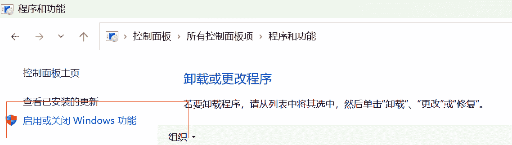

> 在 Windows 功能界面，勾选以下两项（必须重启电脑）：

> ✅ 虚拟机平台

> ✅ 适用于 Linux 的 Windows 子系统

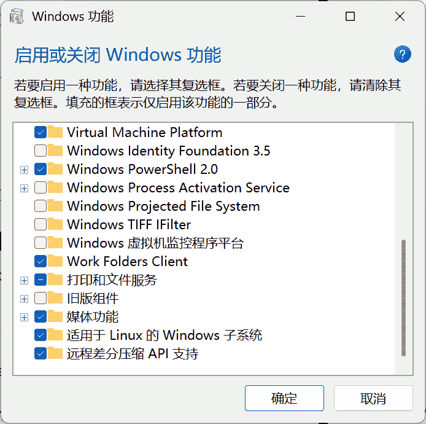

> 也可以直接使用虚拟机，例如 VMware 运行

强制启用虚拟化功能 在管理员模式下打开 PowerShell 或 Windows 命令提示符输入以下命令

```
dism.exe /Online /Enable-Feature /FeatureName:VirtualMachinePlatform /All
```

### Step2：使用 WSL 安装 Linux

现在，可以使用单个命令安装运行 WSL 所需的所有内容。 右键单击并选择“以管理员身份运行”，在 管理员 模式下打开 PowerShell 或 Windows 命令提示符，输入 wsl --install 命令，然后重新启动计算机。

```
wsl --install
```

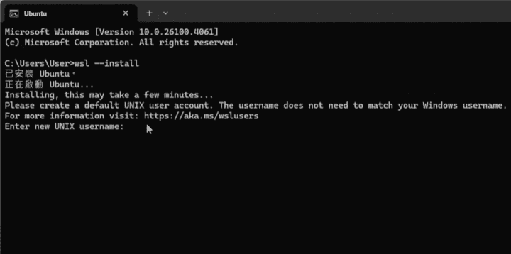

### Step3：Claude Code 安装并接入 API

安装 Claude Code

[打开一个新的 CM](https://so.csdn.net/so/search?q=Ubuntu%20%E7%B3%BB%E7%BB%9F&spm=1001.2101.3001.7020)D 命令窗口，切换为 Ubuntu 系统的命令窗口

输入 sudo -i 命令，然后输入设置的用户密码，切换为 root 用户进行下一步的操作

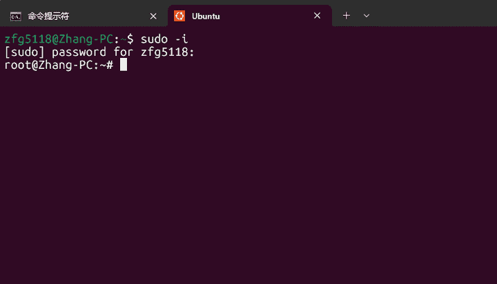

通过以下命令安装 Node.js 和 npm

```
curl -fsSL https://deb.nodesource.com/setup_22.x | sudo bash 
-sudo apt-get 
install -y nodejs
node --version
npm --version
```

```
#使用国内镜像源安装
npm install -g @anthropic-ai/claude-code
#检查是否成功安装
claude --version
```

**获取 API Key 令牌**

登录中转 API 平台：https://wolfai.top，平台按量扣费并赠送体验额度，其中 User 分组为 Claude code 渠道，支持 Claude 全模型，不降智，速度快；


API 接入 Claude Code

在项目目录下运行代码：其中替换 sk-... 为上一步生成的 API 令牌：API 地址：ANTHROPIC_BASE_URL：https://wolfai.top 就是平台的网站首页地址

```
export ANTHROPIC_AUTH_TOKEN=sk-... 
export ANTHROPIC_BASE_URL=https://wolfai.top
claude
```

### Step4：运行

配置完成后，访问您的项目文件夹，并在该目录下的终端输入以下命令直接运行 Claude Code

```
cd your-project-folder 
 
claude
```

## 方案二：Cursor 部署

### Step1：打开 cursor

打开拓展程序


### Step2：安装 Claude Code 拓展

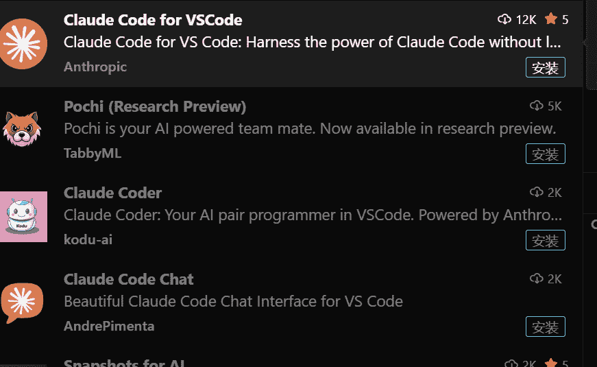

## **方案三：其他平台部署方式**

```
# Node.js 18+⭐️              
/*Universal Method       */ npm install -g @anthropic-ai/claude-code
--------------------------------------------------------------------------------------------------------------------------------------------------------------------------------------------------
# Windows
/* Via CMD               */ npm install -g @anthropic-ai/claude-code
/* Via Powershell        */ irm https://claude.ai/install.ps1 | iex
--------------------------------------------------------------------------------------------------------------------------------------------------------------------------------------------------
# WSL/GIT
/* Via Terminal          */ npm install -g @anthropic-ai/claude-code
/* Via Terminal          */ curl -fsSL https://claude.ai/install.sh | bash
--------------------------------------------------------------------------------------------------------------------------------------------------------------------------------------------------
# MacOS                  */ brew install node &amp;&amp; npm install -g @anthropic-ai/claude-code
--------------------------------------------------------------------------------------------------------------------------------------------------------------------------------------------------
# Linux 
/* Via Terminal          */ sudo apt update &amp;&amp; sudo apt install -y nodejs npm
/* Via Terminal          */ npm install -g @anthropic-ai/claude-code
/* Via Terminal          */ curl -fsSL https://claude.ai/install.sh | bash
--------------------------------------------------------------------------------------------------------------------------------------------------------------------------------------------------
# Arch                     
/* Via Terminal          */ yay -S claude-code*/ 
--------------------------------------------------------------------------------------------------------------------------------------------------------------------------------------------------
# Docker 
/* Windows (CMD)         */ docker run -it --rm -v &quot;%cd%:/workspace&quot; -e ANTHROPIC_API_KEY=&quot;sk-your-key&quot; node:20-slim bash -lc &quot;npm i -g @anthropic-ai/claude-code &amp;&amp; cd /workspace &amp;&amp; claude&quot;
/* macOS/Linux (bash/zsh)*/ docker run -it --rm -v &quot;$PWD:/workspace&quot; -e ANTHROPIC_API_KEY=&quot;sk-your-key&quot; node:20-slim bash -lc &#x27;npm i -g @anthropic-ai/claude-code &amp;&amp; cd /workspace &amp;&amp; claude&#x27;
/* No bash Fallback      */ docker run -it --rm -v &quot;$PWD:/workspace&quot; -e ANTHROPIC_API_KEY=&quot;sk-your-key&quot; node:20-slim sh -lc &#x27;npm i -g @anthropic-ai/claude-code &amp;&amp; cd /workspace &amp;&amp; claude&#x27;
---------------------------------------------------------------------------------------------------------------------------------------------------------------------------------------------------
# Check if claude is installed correctly
/* Linux                 */ which claude 
/* Windows               */ where claude
/* Universal             */ claude --version
--------------------------------------------------------------------------------------------------------------------------------------------------------------------------------------------------
# Common Management
/*claude config          */ Configure settings
/*claude mcp list        */ Setup MCP servers, you can also replace &quot;list&quot; with add/remove
/*claude /agents         */ Configure/Setup Subagents for different tasks
/*claude update          */ Update to latest
```

# 三、Claude Code 的核心功能

## **1、**Claude Code 识别 Python 代码

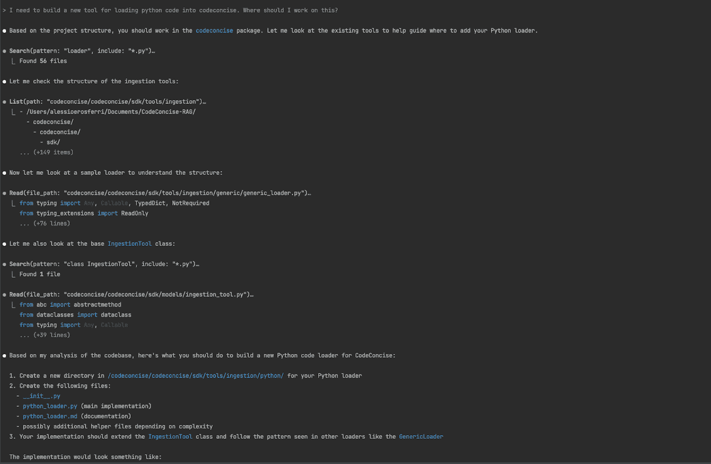

通过 Claude Code 访问代码和相关文档，Claude Code 识别并支持 Python 所需的所有更改


## **2、**Claude Code 自主运行并修改 Python 代码

可以看到 claude code 自主运行了代码，引用了 python 库，并完成了修改

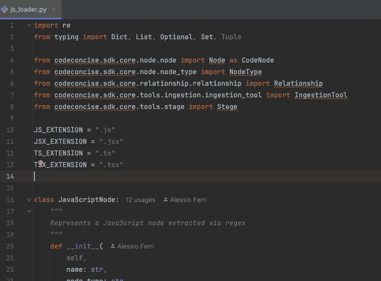

# **四、新人使用技巧**

### **1.启动交互模式**

+   在终端中直接输入 claude 并回车，就进入了一个持续的对话会话。这是最推荐的使用方式，你可以像和同事对话一样，连续地让它帮你处理代码，无需反复启动。

+   **精准操作文件：使用 ****@**** 符号**

这是最重要的技巧之一！当你想要修改某个特定文件时，一定要用 @文件名 来指明目标。

+   **错误示范**：帮我给这个函数添加错误处理 （Claude 不知道“这个”是哪个）

+   **正确示范**：帮我在 @utils/helper.js 文件里的 fetchData 函数中添加错误处理

+   这样做可以避免 Claude 误操作其他文件，保证修改的精确性。

+   **执行系统命令：使用 ****!**** 符号**

你可以直接在 Claude 的对话中执行终端命令，这不会消耗任何 Token。

+   **例如**：!ls -la （查看当前目录文件）

+   **例如**：!git status （查看 git 状态）

+   这让你无需离开对话窗口就能完成很多操作，非常方便。

### 2. 理解并善用三种模式

Claude Code 有三种核心工作模式，理解它们的区别至关重要：

+   **默认模式（安全模式）**：

+   **行为**：Claude 会先向你展示它计划要做什么（例如：显示代码差异 diff），并在得到你的确认（输入 y）后才会实际执行写入文件的操作。

+   **建议**：新手的默认选择，安全第一，避免它“自作主张”改坏你的代码。

+   **Plan 模式（强烈推荐）**：

+   **如何激活**：在输入指令前，先按 Shift + Tab，你会看到模式切换为 “Plan”。

+   **行为**：Claude 会先为你生成一个详细的**计划报告**，说明它将如何分解和执行你的任务、会修改哪些文件，但**不会直接执行**。你同意后，需要再输入 /execute 命令来让它执行。

+   **适用场景**：处理复杂、大型或风险较高的任务时（如重构代码、重命名变量），先看计划再执行，心里更有底。

+   **自动编辑模式（高手模式）**：

+   **如何激活**：同样通过 Shift + Tab 切换至此模式。

+   **行为**：Claude 将不再询问，直接执行文件读写操作。

+   **适用场景**：当你非常信任 Claude 并且追求极致效率时使用。**新手慎用**，以免发生意外修改。

### 3.提升效率的进阶命令

+   **项目初始化：****/init**

在一个新项目根目录下，对 Claude 使用 /init 命令。它会为你生成一个 CLAUDE.md 文件，并自动分析你的项目结构、技术栈和代码规范。之后的所有操作，Claude 都会参考这个文件中的上下文，使得它的建议和修改更符合你的项目要求。这是让它融入你项目的最快方式。

+   **压缩上下文：****/compact**

随着对话越来越长，消耗的 Token 会增多，有时可能会让 Claude 响应变慢或遗忘早期内容。输入 /compact 可以让它智能地总结之前的对话，释放上下文空间，相当于“清空聊天记录但保留要点”，从而提升后续响应速度。

# 五、实际操作案例

## 用 Claude Code 改进一个微信小程序

### Step1：使用微信开发平台打开文件

可以看到此时的小程序 ui 界面有待改进，而且存在程序错误

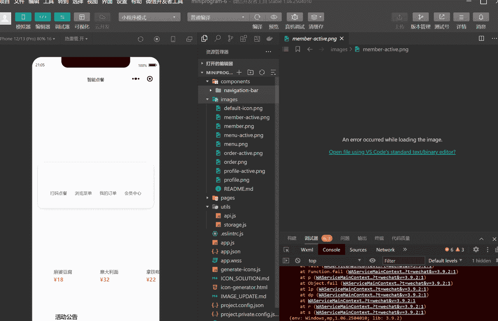

###     Step2：启动 Claude Code

> 使用 cd 命令转移到目标程序文件夹

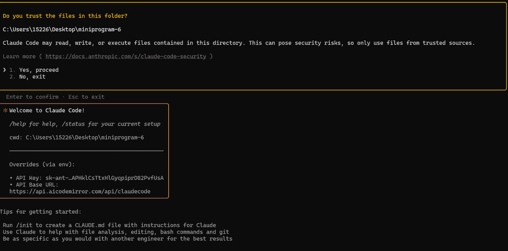

### Step3：发送指令

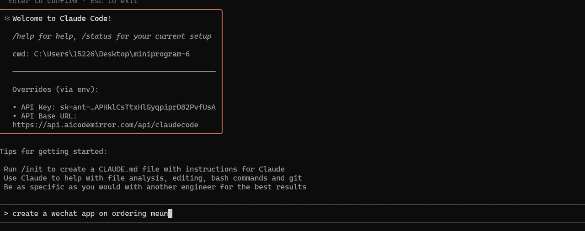

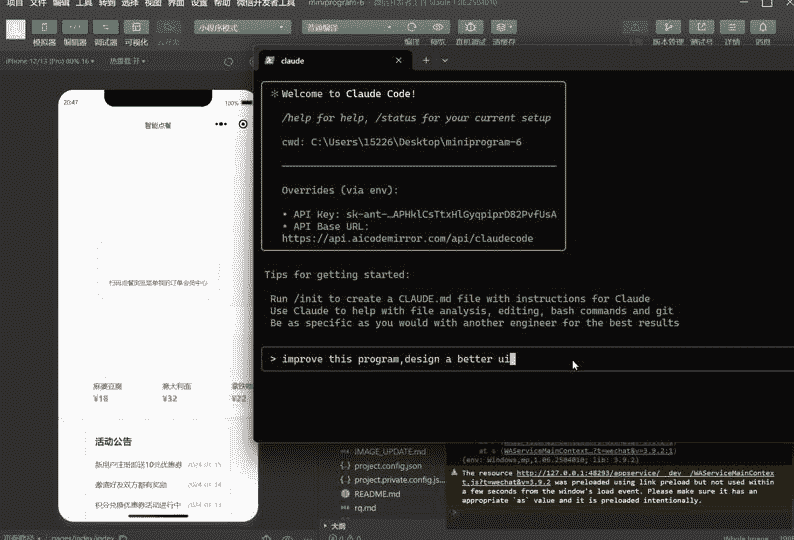

[8月30日.mp4](https://internal-api-drive-stream.feishu.cn/space/api/box/stream/download/all/EjZ0bl4rAolNCHxMyoJcR3yqnsc)

### Step4：验证结果

可以看到 Claude Code 已经建立了一个还不错的 UI 界面

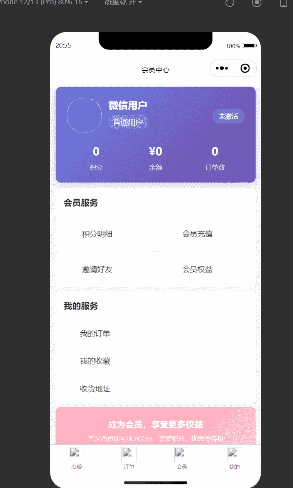

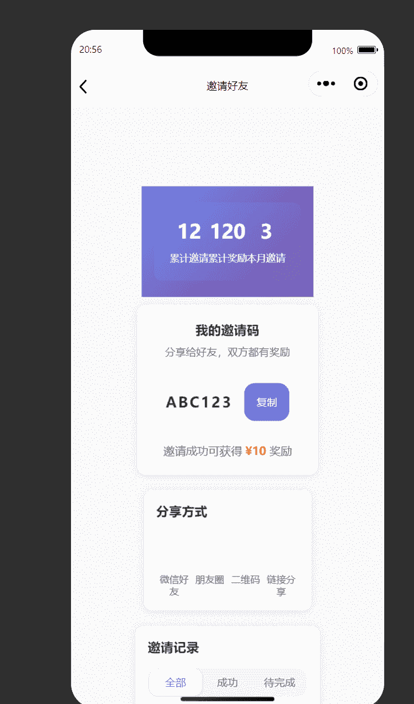

# **六、商业变现案例**

## 案例一：用 Claude Code，24 小时把网站 SEO 干到谷歌第一，并赚 3000 美金


传统 SEO 需要用 Ahrefs、SEMrush 等多个付费工具进行复杂的关键词研究，耗时耗力。而案例中的做法非常直接，直接让 Claude Code 担任了“战略分析师”的角色。正如 James 在视频中所说，他只是简单地把网站交给 AI，然后提出要求。这背后是 AI Agent 访问网站、进行市场分析、生成关键词并识别用户意图的能力。

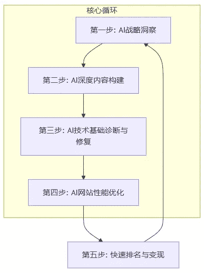

## 案例二：Claude Code 赋能数字商业：连锁生鲜超市智能运营系统

"鲜多多"是一家拥有 23 家门店的区域性生鲜连锁品牌，年营业额 3.7 亿元。然而，在激烈的市场竞争中，传统运营模式的弊端日益凸显：

核心痛点：

生鲜损耗率高达 18%，远超行业 8%的平均水平

动态定价靠经验，错失 30%潜在利润

供应链协同断层，缺货与积压并存

会员运营粗放，复购率仅有 42%

管理层决定投入 200 万元进行数字化改造，目标是 6 个月内将损耗率降至 10%以下。

实战：48 小时搭建核心系统

#### 智能补货系统

需求对话：

claude-code "创建生鲜智能补货系统：

+   基于历史销售数据预测未来 3 天需求

+   考虑天气、节假日、促销活动等因素

+   自动生成采购建议单

+   使用 Python + FastAPI + PostgreSQL"

Claude Code 生成核心算法：

#### 智能补货预测模型

```
class FreshInventoryPredictor:
    def __init__(self):
        self.model = self.load_trained_model()
    def predict_demand(self, product_id, store_id):
        # 获取多维度特征
        features = self.extract_features(product_id, store_id)
        # 特征工程
        features[&#x27;weather_impact&#x27;] = self.get_weather_factor()
        features[&#x27;holiday_boost&#x27;] = self.check_holiday_effect()
        features[&#x27;trend_momentum&#x27;] = self.calculate_trend()
        # 预测未来3天销量
        predictions = self.model.predict(features)
        # 安全库存计算
        safety_stock = self.calculate_safety_stock(
            predictions,
            product_perishability=features[&#x27;shelf_life&#x27;]
        )
        return {
            &#x27;predicted_sales&#x27;: predictions,
            &#x27;suggested_order&#x27;: predictions.sum() + safety_stock,
            &#x27;confidence&#x27;: self.model.confidence_score,
            &#x27;order_time&#x27;: self.optimal_order_time(product_id)
        }

    def optimal_order_time(self, product_id):
        # 根据保质期和供应商送货时间优化订货时机
        shelf_life = Product.get(product_id).shelf_life
        delivery_time = Supplier.get_delivery_hours(product_id)
        return calculate_optimal_timing(shelf_life, delivery_time)
```

实施效果： 系统上线首周，蔬菜类商品缺货率从 15%降至 3%，同时库存周转天数缩短 2.3 天。

【阶段二】动态定价引擎（第 17-32 小时）

需求升级：

claude-code "基于现有系统，添加动态定价功能：

+   根据商品新鲜度自动调价

+   临期商品智能促销

+   竞品价格实时监控

+   毛利率保护机制"

#### 动态定价策略引擎

```
class DynamicPricingEngine:
    def calculate_price(self, product):
        base_price = product.cost * (1 + product.target_margin)
        # 新鲜度折扣曲线
        freshness_factor = self.freshness_curve(
            current_time=datetime.now(),
            production_date=product.production_date,
            shelf_life=product.shelf_life
        )
        # 竞争定价分析
        competitor_prices = self.scrape_competitor_prices(product.sku)
        competitive_factor = self.competitive_positioning(
            base_price,
            competitor_prices,
            strategy=&#x27;slight_undercut&#x27;  # 微幅低价策略
        )
        # 库存压力调节
        inventory_factor = self.inventory_pressure(
            current_stock=product.current_stock,
            daily_sales=product.avg_daily_sales,
            days_until_expiry=product.days_until_expiry
        )
        # 最终定价（确保毛利底线）
        final_price = base_price * freshness_factor * competitive_factor * inventory_factor
        final_price = max(final_price, product.cost * 1.08)  # 最低8%毛利
        return {
            &#x27;price&#x27;: round(final_price, 2),
            &#x27;discount_rate&#x27;: (1 - final_price/base_price) * 100,
            &#x27;expected_sales_boost&#x27;: self.predict_sales_impact(final_price),
            &#x27;update_timestamp&#x27;: datetime.now()
        }

    def freshness_curve(self, current_time, production_date, shelf_life):
        # 新鲜度衰减模型：前70%时间维持原价，后30%加速降价
        age_ratio = (current_time - production_date).days / shelf_life
        if age_ratio &lt; 0.7:
            return 1.0
        else:
            # 指数衰减
            return 0.95 * math.exp(-3 * (age_ratio - 0.7))
```

# **七、AI 编程市场与技术分析**

## 行业格局：生成式 AI 编码助手市场

多个市场研究机构的数据共同描绘了一个正在经历爆炸式增长的赛道。根据 MarketsandMarkets 的报告，全球 AI 代码工具市场预计将从 2023 年的 43 亿美元增长到 2028 年的 126 亿美元，年复合增长率（CAGR）约为 24%。而 Grand View Research 的预测更为激进，认为“软件开发中的 AI”市场规模将从 2024 年的约 6.7 亿美元增长到 2033 年的超过 157 亿美元，CAGR 高达 42.3%。这些数据清晰地表明，用户正在进入一个巨大且高速扩张的蓝海市场。

## 关键驱动力与趋势

市场的增长主要由以下几个因素驱动：

+   **对开发者生产力的极致追求**：在软件吞噬世界的时代，提升开发效率是所有科技企业的核心诉求。

+   **自动化重复性任务**：AI 能够自动处理编码、调试、测试和文档编写等繁琐工作，让开发者能专注于更高层次的架构设计和逻辑创新。

+   **低代码/无代码平台的兴起**：AI 的加持使得更多非技术人员也能参与到软件创造过程中，进一步扩大了市场规模。

## 战略洞察：来自顶级风投和金融机构的观点

+   “势能即护城河”（Momentum as a Moat）：在 AI 领域，技术壁垒的建立速度远跟不上模型迭代的速度。因此，竞争优势不再仅仅来自技术本身，而更多地来自于“构建第一、迭代最快、分发最好”的能力。像 Cursor 这样能够快速获得用户和市场关注度的公司，其增长速度本身就构成了一种强大的护城河。

+   “购买而非构建”（Buy vs。 Build）的转变：随着像 Cursor 这样成熟的 AI 原生应用的出现，企业越来越倾向于直接购买这些解决方案，而不是投入巨资在内部从零开始构建类似的能力。这为 AI 原生 SaaS 公司创造了巨大的市场机会。

AI 代理驱动的生产力革命（高盛，Goldman Sachs），高盛的研究报告同样看好 AI 代理（AI Agents）带来的商业价值。他们预测，AI 代理将通过执行自主任务序列来解锁巨大的商业生产力，并预计仅此一项就能使整个软件市场的规模扩大至少 20%。高盛认为，AI 代理将成为知识工作者的新用户界面，到 2030 年，代理驱动的软件市场可能占到软件总市场规模的 60%以上 。

## 学术界的见解

学术研究明确指出了 LLM 在代码生成方面存在的一些固有挑战：

+   **语法与语义错误**：模型有时会生成不符合语法规范或逻辑上存在错误的代码，即所谓的“幻觉”（Hallucination）。

+   **安全漏洞**：由于训练数据中可能包含不安全的代码范例，模型有时会生成带有安全隐患的代码。

+   **数据偏见**：模型会学习并复现训练数据中存在的偏见，例如倾向于使用某种过时的编程模式。

这些局限性恰恰凸显了本书一直强调的“人在环路”（Human-in-the-loop）工作流的重要性。AI 是一个强大的助手，但绝不能盲目信任。一个熟练的 AI 开发者，其价值不仅在于能用 AI 写代码，更在于能识别和修正 AI 的错误。

综合来看，市场、资本和技术三个层面的力量正在发生历史性的交汇。市场报告揭示了“是什么”——一个正在以惊人速度膨胀的市场。顶级风投的分析解释了“为什么”——一场深刻的平台级变革正在发生，资本正以前所未有的速度涌入以抢占先机。而技术研究则阐明了“怎么样”——底层的 LLM 技术日新月异，但仍不完美，需要熟练的人类操作者来释放其全部潜力。

Claude Code 正好处在这场风暴的中心。它技术足够先进，能带来魔法般的体验；它精准地切入了一个由巨大投资验证的、需求旺盛的市场；但它又足够不完美，以至于需要一个技能娴熟的人类伙伴来驾驭。对于大家而言，这意味着一个巨大的机遇：通过掌握 Claude Code，你不仅仅是在学习一个工具，更是在将自己定位在十年一遇的技术和经济浪潮之巅。

# **八、相关学习资源**

## 官方学习内容

## 课程学习资源

B 站的两套课程，相对比较系统，作为入门级学习，还是比较合适的，推荐给大家！

最火 AI 编程 Claude Code 详细攻略，一期视频精通

Claude Code-高智能的编程助手

> **新人学习 8 条建议**

> **1. 明确目标：**用自然语言清晰描述需求，如"写一个 Python 函数处理 API 请求"

> **2. 指定文件：**始终用`@文件名`指明操作对象，避免误修改

> **3. 先计划后执行：**复杂任务前按`Shift+Tab`切换到 Plan 模式，审查计划再执行

> **4. 保持安全模式：**新手期用默认模式，每次修改前确认 diff 变化

> **5. 项目初始化：**在新项目根目录先执行`/init`，让 Claude 了解项目背景

> **6. 终端集成：**用`！`直接执行命令（如`！git status`），不离对话窗口

> **7. 从小开始：**先尝试简单任务，熟练后再处理复杂需求

> **8. 多问为什么：**不仅拿代码，还要理解实现逻辑和最佳实践

#  编程学习交流群

1.持续关注并更新 AI 的**相关资讯动态，研究报告，赚钱案**例，常见问题，永久免费在线查看，无收费内容，目标是成为最大的免费 AI 学习社群。

2.已建立社群聊聊 **AI** 发展及应用，**没进群的可以扫码加入，群满可加 AI 研究爱好者大国微信 ID：zyg90s（备**注：AI），已经在社群内的无需重复加入，开源知识库及社群学习全部为公开免费分享。

3.**关于文档负责人大国**：高帆文化 CEO，曾就职于教培大厂，目前创业，主攻研究 AI 落地应用、企业流量增长及达人 IP 孵化。

**飞书学习群**


**微信扫码进群学习**


好友（ID：zhangyuguo94s）

**扫码加微信入微信群**

---

**END，**这个 AI 知识库不只是一个数据仓库，更是推动每个人进步的强大引擎。我们希望你能从中受益，并将其分享给更多的人，让更多的人获得这份力量。感谢你的支持和分享！