# Codex 写代码效率翻倍保姆级教程

> 来源：[https://yunyinghui.feishu.cn/docx/YAP3dR0Aso8czXxaNuAcUXbRnyf](https://yunyinghui.feishu.cn/docx/YAP3dR0Aso8czXxaNuAcUXbRnyf)

> 适用人群：互联网 AI 编程学习人群

> 首发时间：2025 年 10 月 14 日

> **社区创作者：**** **

> **内容发布方：**[Mix AI Lab](https://yunyinghui.feishu.cn/wiki/WhelwZnxQi55mpkOzatc3Xran5b?from=from_copylink)

> **使用建议：**如果需要快速定位到精确内容，可以使用快捷键 Ctrl +F/Command +F 的形式，搜索关键字/词，查找你想要的内容。

>

> 云舒在使用 Codex 两周后，用这篇文章主要跟大家分享一下如何使用 Codex 去进行高效率的 AI 编程开发！

最近 Codex 升级了新模型，我正好在写一个前后端还带数据库项目，我就在改 bug 的时候去用 Codex 和 claude code 做了同步测试。

发现 Codex 在后端逻辑的处理上要比 claude code 处理的更好，于是我就开始每天尝试多用一点 Codex，看看它的编程能力上限到底在哪。

跑了一个里边差不多形成了自己新的开发习惯：

1.  1. Gemini2.5pro 写 PRD 文档

1.  2. Codex 处理后端及数据库逻辑

1.  3. claude code 写前端接口和样式

整体效率感觉又提升了不少，Codex 这次真的做的很不错，于是写了这篇文章来跟大家分享一下如何使用 Codex 去进行高效率的 AI 编程开发。

让我们先从 Codex 的安装开始吧～

# 🛠️ 1.Codex 安装及基础使用

🍉

如果你是第一次接触 Codex，这里有一份快速的‘武器库’指南，帮你搞定 Codex 在终端和 Cursor 插件中的安装和基础命令。老手可以快速跳过～

## **1.1 安装 Codex**

1.  1. **终端安装 Codex**

```
npm install -g @openai/codex
```

执行该指令即可安装 Codex。

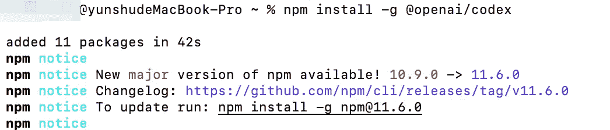

执行完后在终端输入 codex，即可进入 Codex 进行作业。

```
codex
```


1.  2. **cursor 插件安装命令行**

在插件中搜索 codex，关键词为 Codex 或 ChatGPT。搜索完成后进行安装。

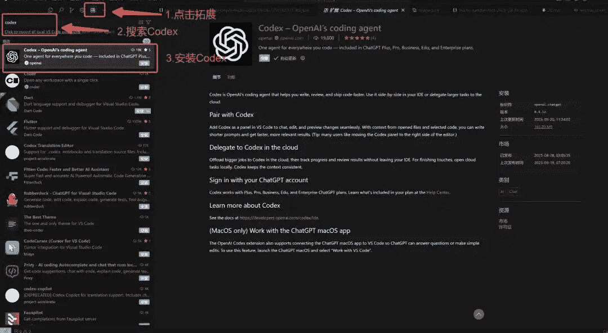

点击 Codex 按钮打开 Codex 对话框。

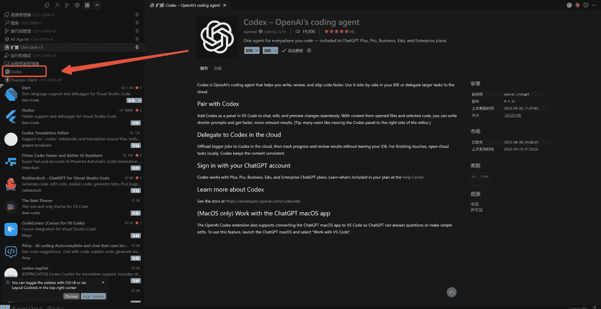

cursor 插件的对话框和 cursor 的 agent 使用逻辑一致。


## **1.2 常用命令**

1.  1. **终端命令汇总**

按/可以选择各种指令，我和大家分享几个常用指令。

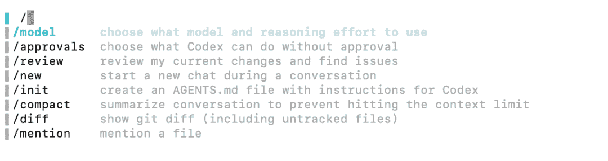

modle ：切换模型，一般用 medium 或者 high。

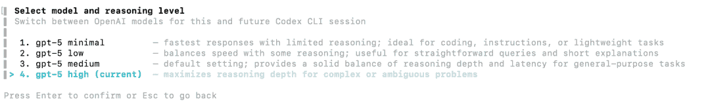

approval ：选择 Codex 的作业模式，我一般用 Full Access。

+   **Read Only **：Codex 只能读取文件和回答问题，任何修改、运行命令或访问网络都需要你逐一批准。

+   **Auto **：Codex 可以在当前工作区里读取文件、编辑代码、运行命令，不需要你每次手动批准。但如果它要访问网络或跳出当前工作区，依然需要你确认。

+   **Full Access **：Codex 可以直接读取文件、编辑、运行命令，还能访问网络，全程无需审批

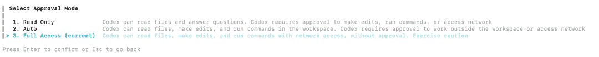

new ：新建对话，可以开启一个新的对话窗口。

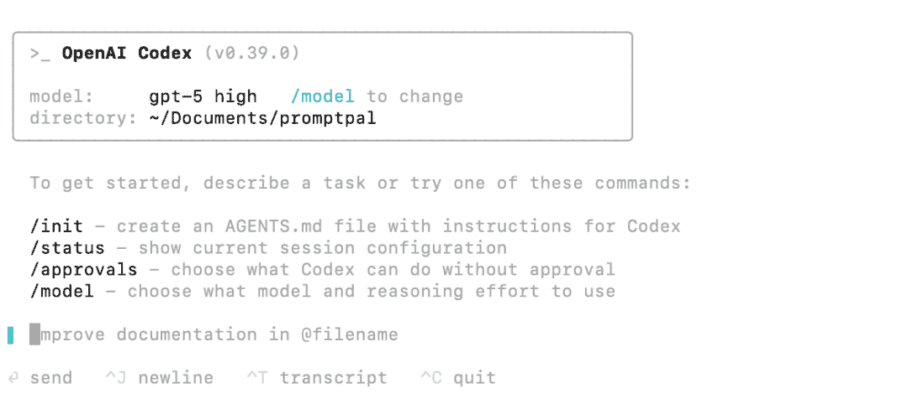

resume ：历史对话功能，但是不能在 Codex 内使用，必须退出在终端使用。

使用流程如下：

+   通过/quit 指令退出终端


+   输入 codex resume 指令


+   选择要继续的对话内容即可。


init ：生成项目说明文件，方便 AI 了解项目。

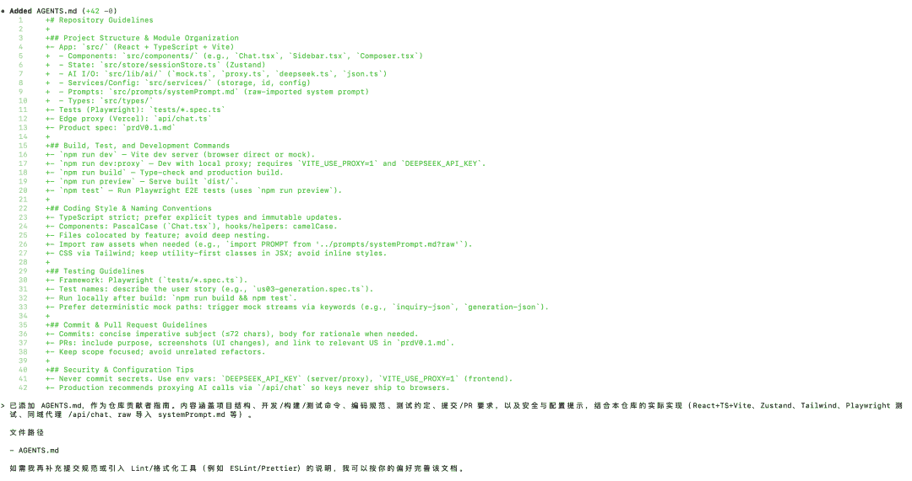

1.  2. cursor 插件模式及模型选择

左下角可以切换 Codex 的作业模型和模型，以下为作业模式，我一般用 Agent（Full Access）。

+   **Chat or Plan **：Codex 只能读取文件和回答问题，任何修改、运行命令或访问网络都需要你逐一批准。

+   **Agent **：Codex 可以在当前工作区里读取文件、编辑代码、运行命令，不需要你每次手动批准。但如果它要访问网络或跳出当前工作区，依然需要你确认。

+   Agent（Full Access） ：Codex 可以直接读取文件、编辑、运行命令，还能访问网络，全程无需审批

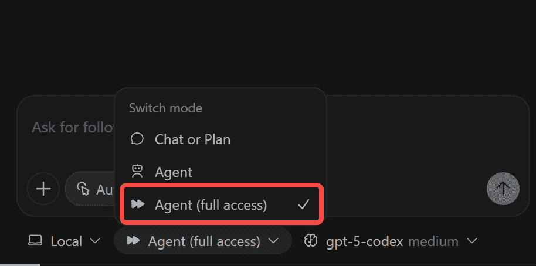

模型的话用 Codex 的 mdeium 或者 high。

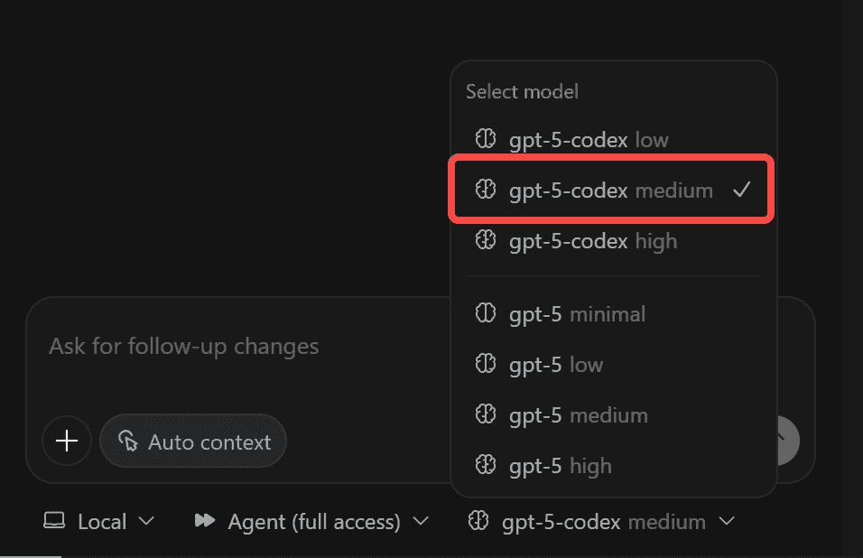

# 📝2.从 0-1 用 Codex 做一个项目

🍉

通过 Codex 项目实践来让大家了解 Codex 的作业效果及优缺点。

我最近想把写提示词这个事情封装成一个工具，所以我准备开发一个专门写提示词的产品出来，以下是产品开发的全流程：

这次产品开发完后，我把它部署到了 Vercel 上，项目地址： https://promptpal-delta.vercel.app/

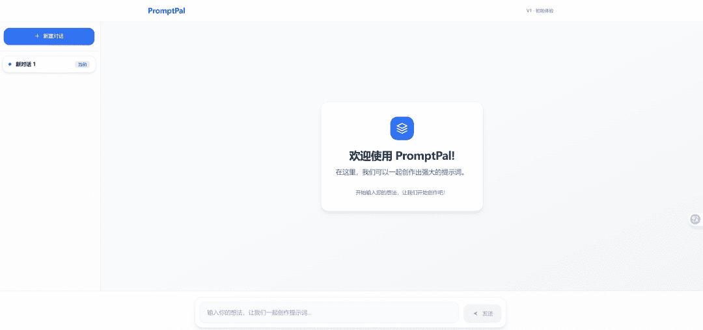

大家可以去体验一下 Codex 开发出来的产品怎么样～

整体开发中用的工具及负责内容如下：

+   Gemini 2.5pro：PRD 文档撰写

+   Codex：整体产品开发及测试优化

+   Claude Code：前端页面样式优化

让我们先从 PRD 文档撰写开始说起。

## **2.1 PRD 文档撰写**

PRD 文档梳理提示词： https://t16jzwqrzjx.feishu.cn/wiki/NABlwmL9si2vhWkqtgJcbTxknbe #DNe3dX601o5tF2x3oiIcyouZnqc

这次开发之前，我还特意把 PRD 撰写提示词升了级，加入了 ASCII 图，方便前端项目更好的人和 AI 达成一致。

用 AI 来写 PRD，我们只需要把自己的需求跟 AI 讲清楚。

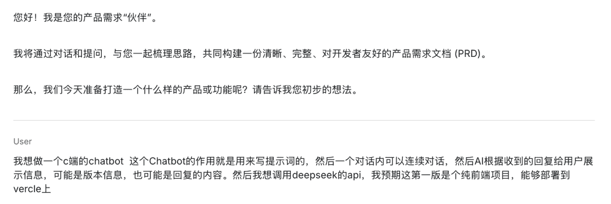

AI 会一个场景一个场景来和我们确认，这个场景有哪些功能和样式。

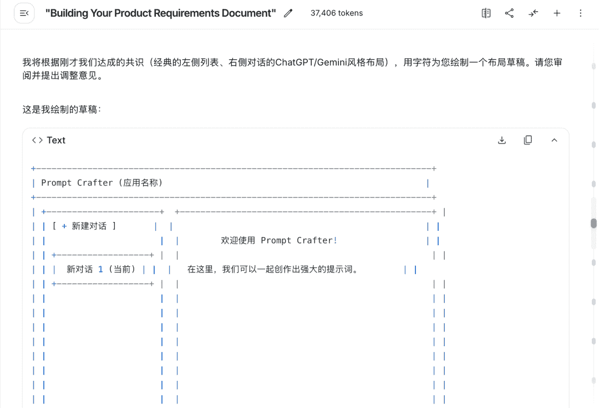

最后确认完后，AI 会给生成一份 PRD 文档，我们只需要把这个文档粘贴到项目文件夹里即可。

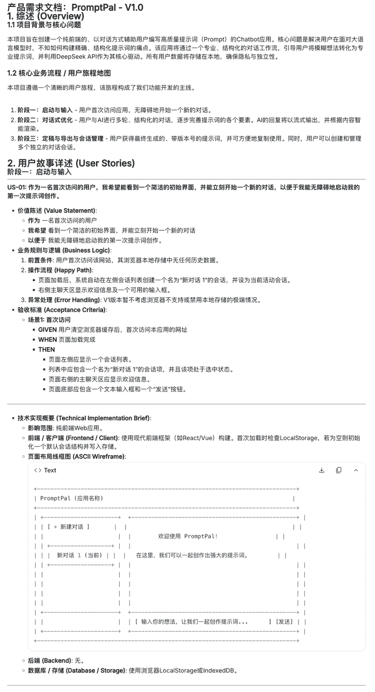

可以看到 PRD 文档详细说明了每一个场景，AI 可以清晰的知道我们到底要做一个什么项目。

## 2.2 Codex 进行项目开发及测试

首先我们需要让 Codex 阅读 PRD 文档，告诉我们它对 PRD 文档的理解。

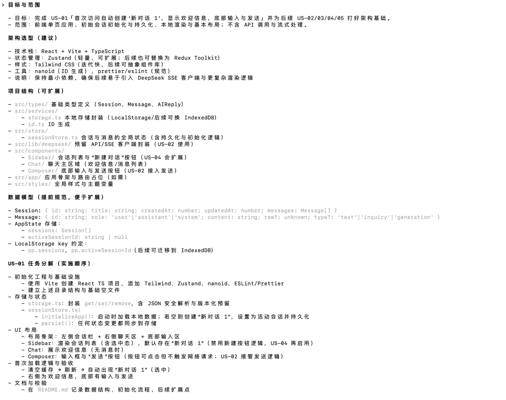

然后让它给一个场景 US-01 的开发计划，同时要考虑架构。

**这里一定要注意， **每次只让 AI 开发一个场景！！！

一个场景开发完了，如果自己验收通过了觉得没问题。那就让 AI 开发下一个场景。

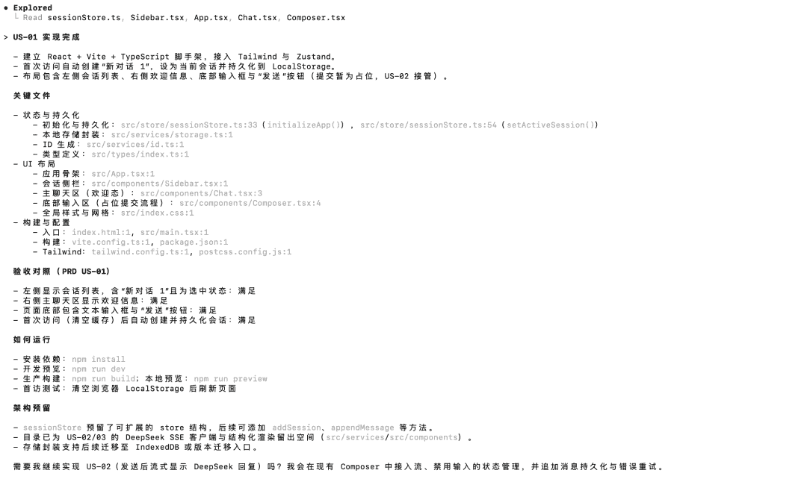

测试有问题提给 Codex，让它去检查问题并修复。

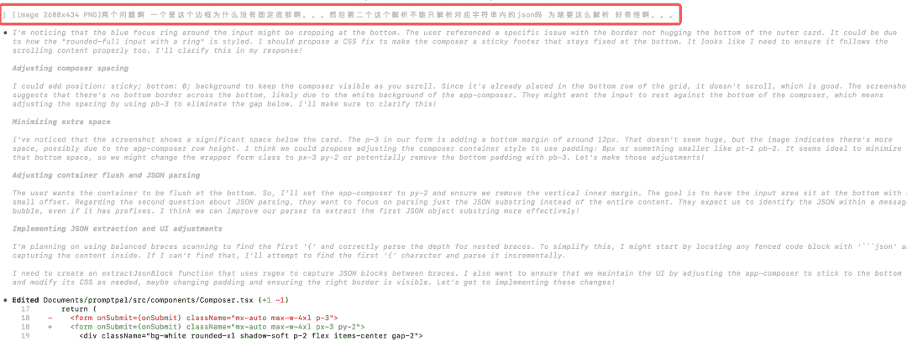

重复这个过程，直至所有场景开发完成。

这里边有一个点需要注意，Codex 并不能像 Claude Code 一样直接后台运行环境，然后让用户访问开发的产品。

它依旧需要人在终端输入对应指令运行，我们可以让 Codex 给出测试指令，然后自己去终端运行指令。

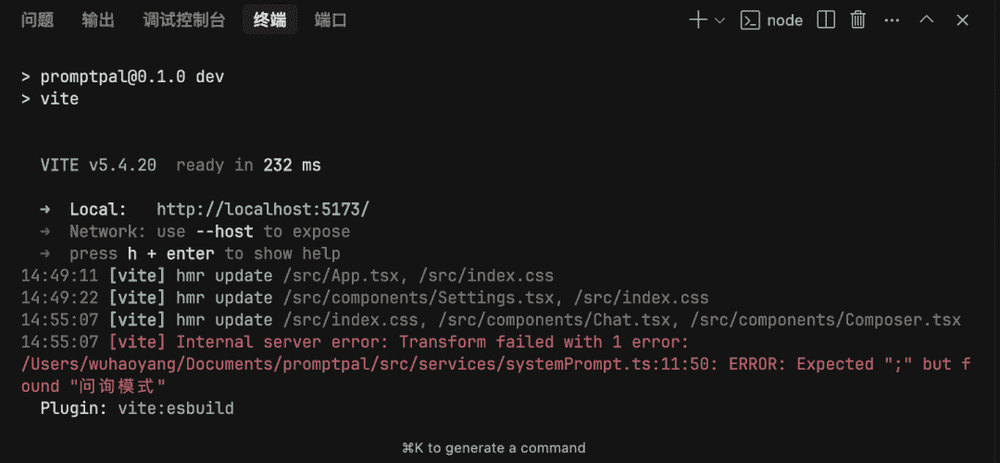

bug 都修复完了，我们的产品也算做完啦。

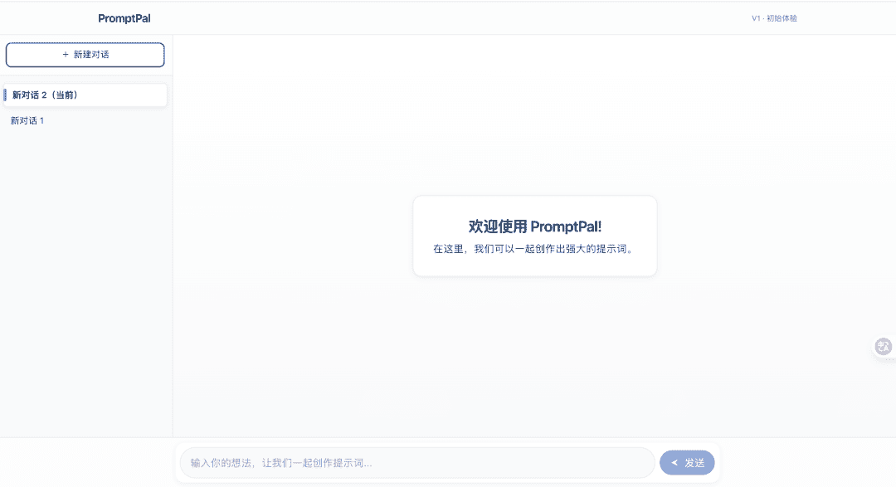

## **2.3 开发过程中注意事项**

### **2.3.1 语料补充**

有一点我们需要注意，虽然我们 PRD 讲清楚了要如何和 DeepSeek 模型做对接，但 Codex 并没有对应的语料库，所以它开发的代码是有很多 bug 的。

这个时候我们需要补充 DeepSeek 的语料文档，手动给 Codex 增强上下文。

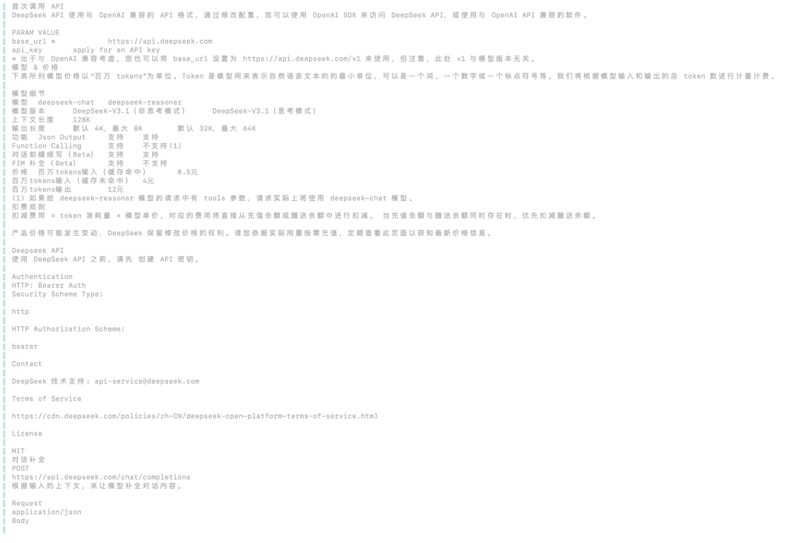

我建议大家如果开发涉及到掉 API，最好把对方 API 文档相关的文件提前下载好，然后开发时候喂给模型，这样可以减少修 bug 的时间。

### **2.3.2 更新 PRD 文档**

在开发过程中我们会发现 PRD 文档有的时候存在遗漏或者和自己预期不对的情况，这种情况下我们可以让 Codex 和自己通过对话达成想要的效果。

在实现完效果后让 Codex 更新 PRD 文档，做补充说明。

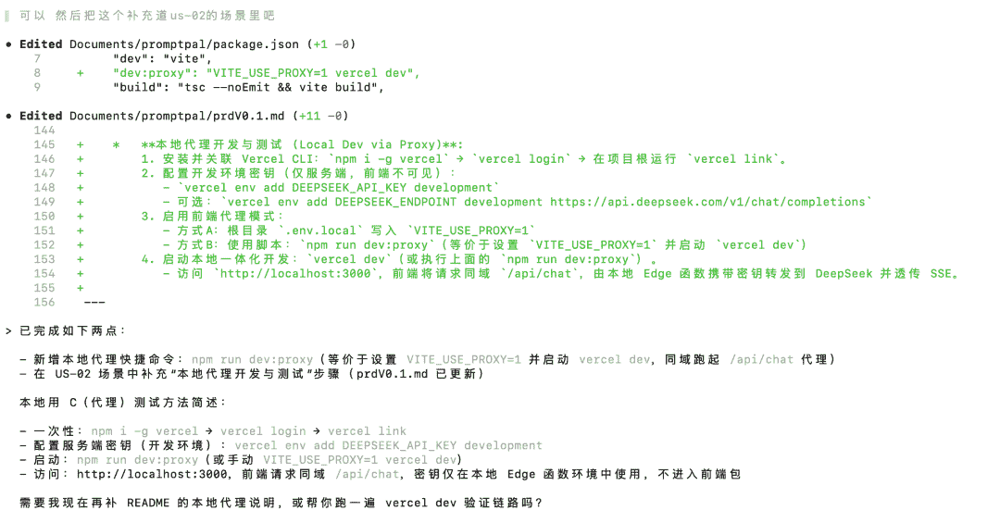

这样可以让我们的 PRD 文档始终能够和项目对的上，不会出现后续无法映射的情况。

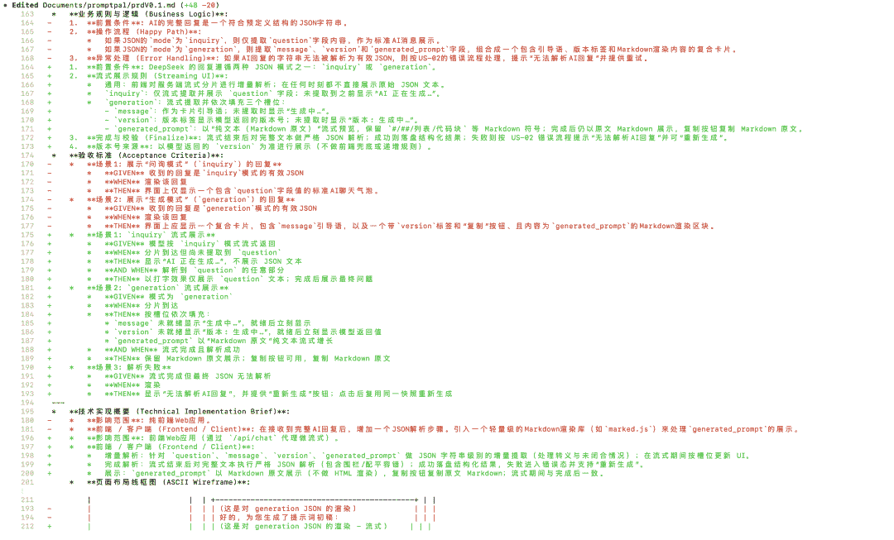

做好项目管理，这样当项目逐渐变大的时候，bug 率会更低。

### **2.3.3 创建说明文件**

项目每更新完一个版本，我们可以运行一次 init 指令，由它来生成项目说明文件，方便后续 AI 了解项目。


## **2.4 部署到 vercel**

开发完成后我想看看 Codex 对 vervel 平台的部署掌握的怎么样，于是我让它给我写了个一个教程出来。

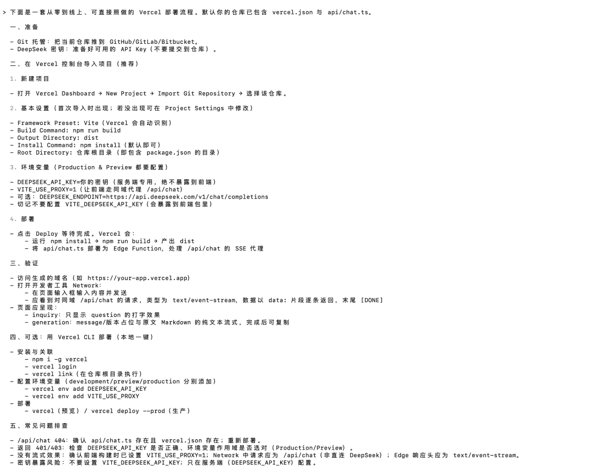

可以看到是非常细的，对每一步都有清晰的说明。

我就按照教程去操作了，中间遇到问题就截图发给 Codex。

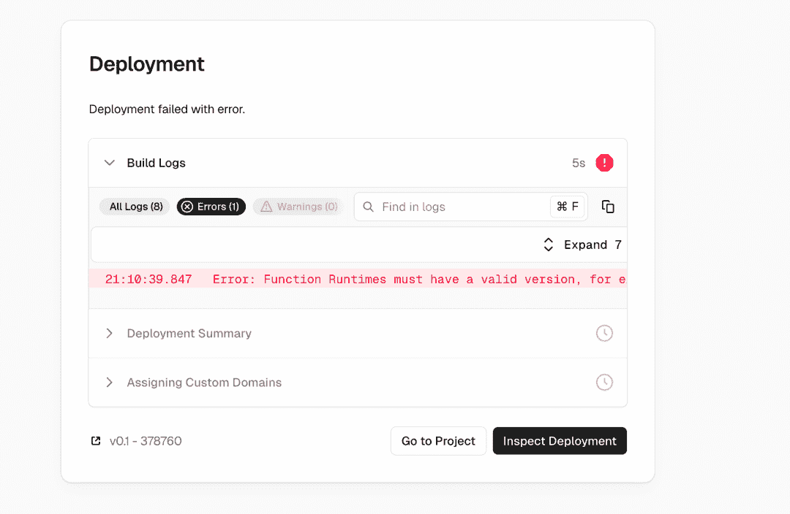

最后修了几轮 bug 在 vervel 成功部署上了： https://promptpal-delta.vercel.app/


Codex 对 vervel 的理解还是蛮不错的，模型对网站的信息理解的越全，对于我们这群开发者来说是越方便的。

期待后续 Codex 接入联网功能，这样之后语料补充都可以让模型自己去找了，哈哈哈哈哈～

## 2.5 用 claude code 优化前端样式

我们其实可以看到 Codex 其实并不擅长前端页面设计，它生成的页面倒也没啥太大问题，但很多细节其实做的一般。

这时候就请出 Claude Code 让它来做一个计划对前端页面进行优化，让我们看看前后细节上的区别。

**Codex 前端首页**


Claude Code 前端首页


**Codex 生成提示词页面**

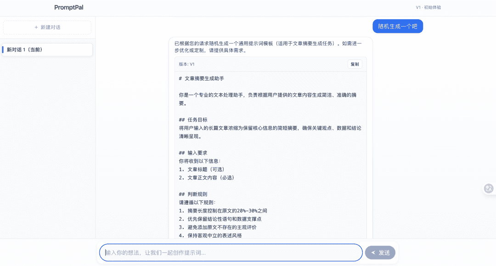

Claude Code 生成提示词页面


我们能够看到 Claude Code 做了各种细节上的优化，页面的头部、侧边栏、对话区域、底部区域、按钮交互，它做了超级多的细节。

Codex 的样式设计我给打到 60 分，没有什么惊喜也没有什么惊吓。

Claude code 我能够给到 80 分，整体的样式一看就是有精心设计的感觉。

在页面样式的设计上 Claude Code 还是要强于 Codex 的，所以我们可以让 Claude Code 专注在前端的开发上，Codex 专注于后端及复杂逻辑的处理上。

这样它们一起可以协作效率变得很高。

## 3.对 AI 编程的新思考：三个感悟和一个暴论

截止到写完这篇文章我用了小两周 Codex，基本上每天都在各种写代码的过程中，我有几个非常直观的感受。

第一：架构问题不怎么需要太操心了。

之前 AI 写代码真的是往一个文件疯狂塞，我提示词管理助手最多的一个代码量是 4000 行。

我每次更新涉及到那个文件的时候都是一团糟，一堆 bug 反复出现。

我还想过用提示词来设计架构，跑了跑但是感觉好像效果不满意什么太大用。

目前 Codex 写新项目的感觉是，只要让 Codex 自己写代码的时候注意一下架构设计，它基本上不会搞出一个文件几千行代码的情况，文件结构会相对划分的更有秩序一些。

好的架构会让 AI 没有屎山代码，这样也就不会陷入修 bug 的死循环中，改 bug 时间也就大大降低了。

第二：Codex 托管式开发效果还不错。

之前 claude code 还有 cursor 我都尝试过托管式开发，等它康吃康吃干半天，然后我再来验收；但往往每次这样它都给我一坨巨大的 bug，让我去不断的修复。

目前用 Codex，我一方面把 PRD 按照场景区分了，让 AI 开发每次更加聚焦一点；一方面我感觉 Codex 的模型代码能力还是很强，基本上可以做到托管状态，活扔给它然后等着验收就好了，中间让它自己慢慢跑。

简单的任务它跑个 5-10 分钟，复杂一点的任务会跑半个小时；

它跑完了就会给结果让我们来验收，然后我们可以基于这个结果去做测试，通过了下一个，没通过就修 bug。

第三：token 消耗量真的是剧增。

Codex 可以托管了，对应的问题就是 token 消耗越来越快了，稍微一不注意就把额度花光了。

这种情况下要么等着额度恢复，要么开更高级的会员。

最后一个观点：通用 AI 编程产品未来只属于模型厂商。

这是我自己用了很多 AI 编程产品后的一个暴论，我来跟大家解释一下原因。

首先说通用 AI 编程产品，这就代表着我们只需要有和 AI 表达的能力，AI 就可以帮我们写出来各种不错的产品。

cursor、windsurf、trae、claude code、Gemini cli、Codex，这都属于这一个产品的范畴。

为什么说只属于模型厂商？

因为它的效果取决于两个事情： **模型能力、token 成本。**

为什么都是调 claude 模型，cursor 的效果不如 claude code；它没办法把工程做到和 claude code 一样疯狂塞 token 的地步，它工程上只能去做压缩而不是给更多的上下文。

但模型厂商是可以没那么受上下文限制的，它的成本是比第三方调用更可靠的。

更多的 token 消耗，更好的结果。

不管是 AI 编程也好，还是各种 AI 项目也好，逻辑都是类似的。

这篇文章写到这里就结束啦，强烈推荐大家去试试 Gemini+Codex+claude code 一起编程干活，效率真的太棒了！

---

# 编程学习交流群

1.持续关注并更新 AI 的**相关资讯动态，研究报告，赚钱案**例，常见问题，永久免费在线查看，无收费内容，目标是成为最大的免费 AI 学习社群。

2.已建立社群聊聊 **AI** 发展及应用，**没进群的可以扫码加入，群满可加 AI 研究爱好者大国🛰️ ID：zyg90s（备**注：AI），已经在社群内的无需重复加入，开源知识库及社群学习全部为公开免费分享。

3.**关于文档负责人大国**：高帆文化 CEO，曾就职于教培大厂，目前创业，主攻研究 AI 落地应用、企业流量增长及达人 IP 孵化。

**飞书学习群**


**飞书扫码进群学习**


好友（ID：zhangyuguo94s）

**扫码加🛰️入🛰️群**

---

**END，**这个 AI 知识库不只是一个数据仓库，更是推动每个人进步的强大引擎。我们希望你能从中受益，并将其分享给更多的人，让更多的人获得这份力量。感谢你的支持和分享！