# 社区共学课：秒哒零代码开发避坑指南

> 来源：[https://yunyinghui.feishu.cn/docx/Lfc4dy0D5of1fJxH6o4cZDnunuf](https://yunyinghui.feishu.cn/docx/Lfc4dy0D5of1fJxH6o4cZDnunuf)

> 会说话比会编码更重要，创意比技术更值钱

作为百度推出的无代码应用开发平台，秒哒已经帮助创作者生成了超过 50 万个商业应用，无论是教育工作者、商业人士还是学生，都能通过这个平台轻松实现编程需求。

> 本文将帮你理解如何选择适合自己的应用类型，并掌握关键的开发技巧。

## 一、如何选择适合自己的应用类型

选择时考虑：你的**核心资源或能力****是什么，**是专业知识？独**特数据？**还是你自己的特定技能？目标用户的真实需求是什么？应用的变现路径是否清晰？

在秒哒上创建应用前，明确你的目标至关重要。根据平台上的成功案例，应用大致可分为以下几类：

**工具型应用**：解决特定场景下的效率问题，这类应用适合有明确问题需要解决的用户。

个人效率管理系统整合番茄钟、习惯打卡和时间记账功能。

自媒体内容生成，比如小红书文案、公众号封面、短剧内容生成生成。

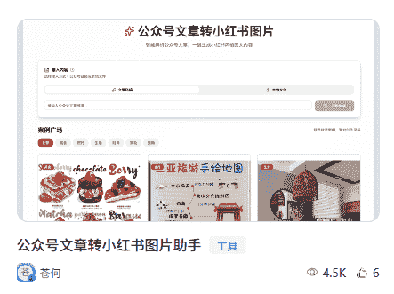

**内容型应用**：基于内容创作或信息展示的需求，如果你有专业知识或内容储备，这类应用是不错的选择。

音乐琴行老板开发的快探 AI 小说生成工具

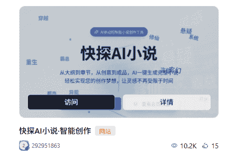

古村景区团队打造的荣堂古村数字博物馆。

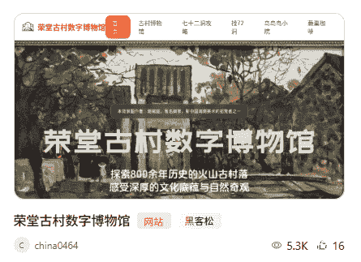

**商业服务型应用**：直接面向商业变现的场景，适合已经明确商业模式或服务流程的创作者

口腔预防教育团队开发的"蜗牛牙牙"护牙系统，或电商素材辅助生成系统。

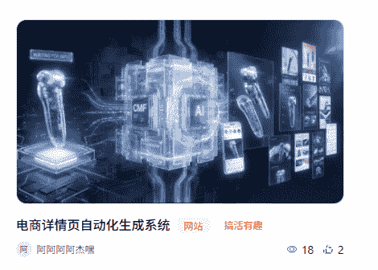

**娱乐社交型应用**：满足休闲娱乐需求，比如小游戏、社交工具等

比如："AI 新年祝福视频生成器"让 AI 为您的亲朋好友定制专属新年祝福视频，适合希望吸引大量普通用户的场景。

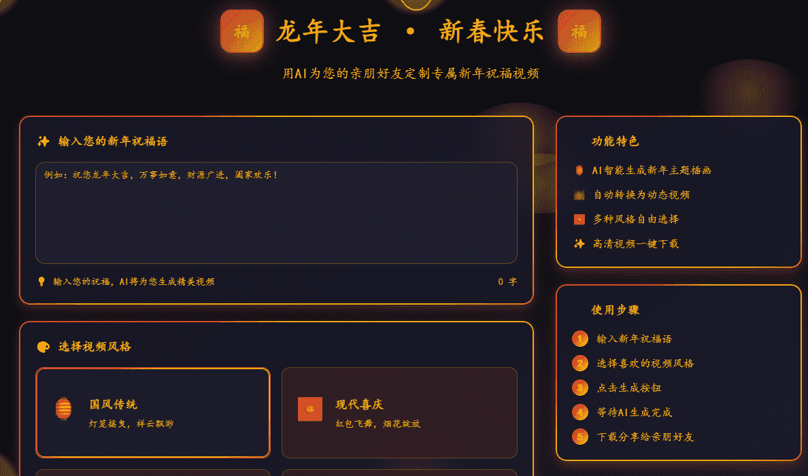

## 二、选网页还是选小程序？

秒哒支持将应用发布为网页端和微信小程序两种形式，两者各有优势。

### 1、网页应用的优势

**更广泛的适应性**：网页应用无需下载，可通过链接在各种设备上访问，使用门槛低。

**更丰富的功能表现**：网页应用可以承载更复杂的功能和更丰富的内容展示。如油气井设计与方案优化平台需要展示复杂图表与数据，网页版更为合适。

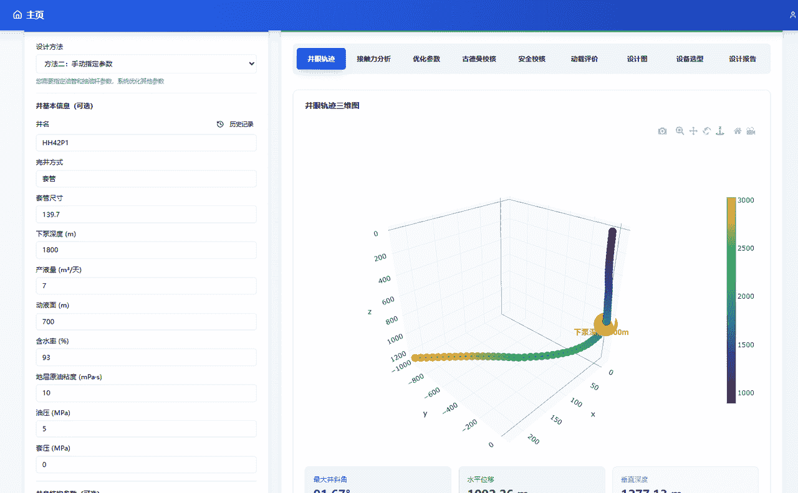

**更灵活的迭代更新**：网页应用更新无需审核，修改后可立即生效，适合需要频繁迭代优化的场景。

### 2、微信小程序的优势

**微信生态无缝接入**：小程序可直接在微信环境中运行，轻松利用微信社交关系链进行传播。

**支付能力内置**：秒哒生成的微信小程序自动集成支付功能，方便实现商业闭环。例如"蜗牛牙牙"护牙系统通过小程序直接完成服务售卖。

**轻量级体验**：小程序即用即走，适合工具型、轻量级应用场景。如待办清单小程序。

### 3、如何选择？

考虑以下因素做决定：

1.  **目标用户使用习惯**：如果用户主要在微信环境活动，选择小程序；如果需要跨平台使用，选择网页应用，当然也可以做到两者兼容，比如码上制片厂

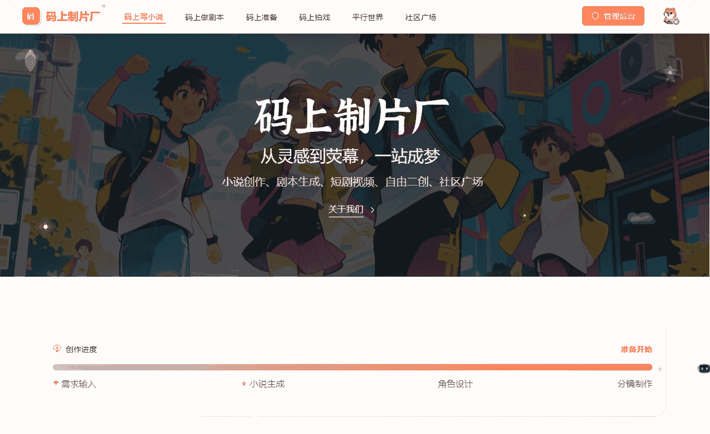

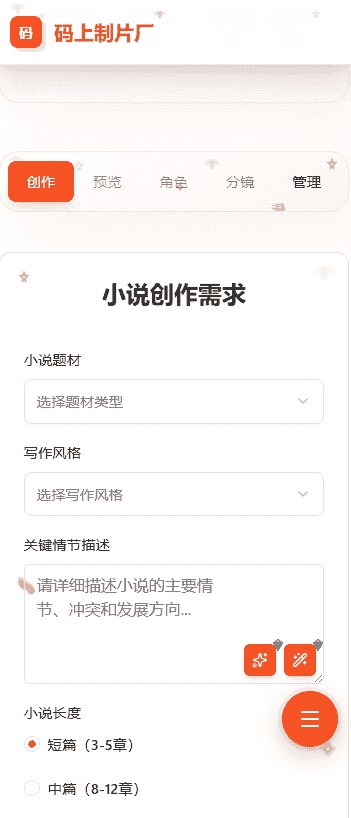

1.  **功能需求复杂度**：复杂功能、大数据量处理适合网页应用；轻量级工具适合小程序。

1.  **开发周期**：小程序发布需要微信审核，网页应用可快速上线。

1.  **变现需求**：若计划直接向用户收费，小程序内置支付更方便。

实际开发中，不少成功应用同时发布网页版和小程序版，以覆盖更广泛的用户群体。

## 三、这几个开发小技巧你一定要知道

### 需求描述技巧：清晰表达是关键

**秒哒的核心是把自然语言描述转化**为实际应用，因此清晰的需求描述比编码能力更重要。

#### **a、使用结构化表达**

采用 5W2H 法则（Why、What、Who、Where、When、How、How much）分解需求。

例如，不要简单说"我要一个打卡应用"，而应描述为"针对 25-35 岁职场人的习惯追踪应用，包含打卡记录、数据统计和提醒功能，需要支持微信登录"。

#### **b、量化指标**

用具体数字替代模糊描述，越含糊其辞效果就越大打折扣。

如"响应时间<500ms"而非"系统要快"，"3 步完成注册"而非"用户友好"。

#### **c、利用指令优化功能**

优化前

优化后

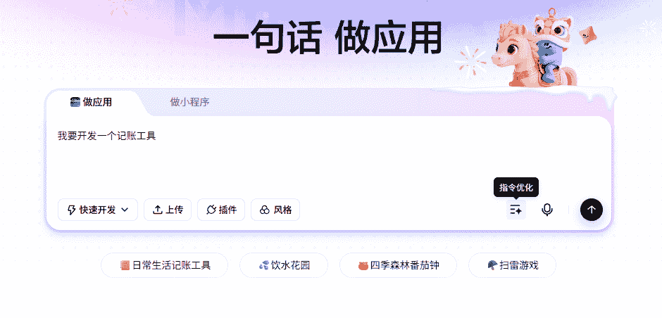

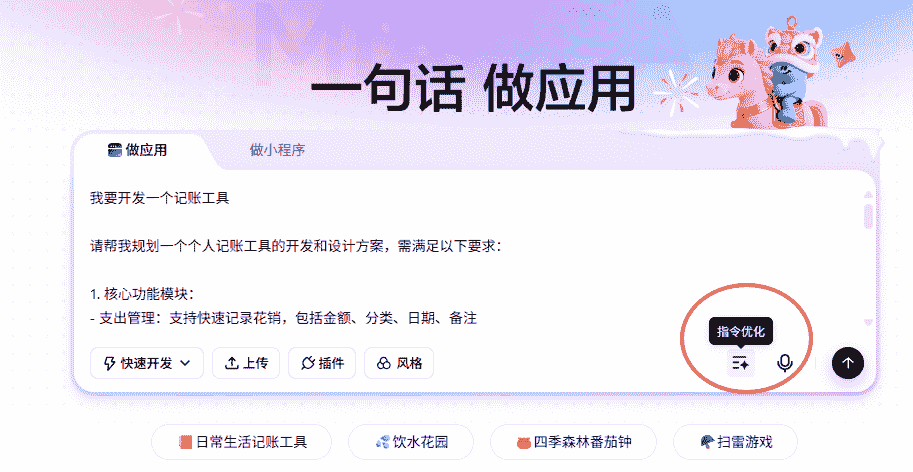

秒哒内置"指令优化"功能，可自动识别关键业务要素，生成结构化需求文档。不确定如何细化需求时，这是很好的起点。

### 开发策略：原型驱动，快速迭代

a、采用最小可行描述（MVP）启动项目

先用一个简短描述启动项目，如"创建一个个人效率管理系统，包含番茄钟、习惯打卡和時間记账功能"。生成初步版本后，通过对话逐步细化。

**b、分模块开发**

复杂应用可分解为多个模块顺序开发。例如先实现静态页面，再添加数据库对接，最后完善后台管理。秒哒支持根据需求内容自动分模块开发。

**c、充分利用已有项目**

秒哒平台上有众多应用，覆盖电商、教育、医疗等多个领域。开始新项目前，先浏览应用寻找灵感或基础。

注：要做好的项目，就要借鉴完整的项目，有一些项目只是一两次迭代就完事的不建议去借鉴，因为有太多的坑需要你去填。

d、风格选择

如果你不是 UI 设计师、不是产品经理，对美学一窍不通，又觉得自己做得非常难看，可以考虑虚在启用项目的时候做一个

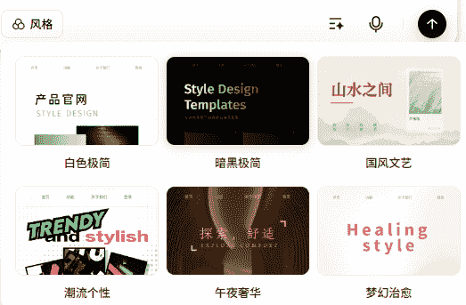

### 界面调整：截图标记指哪打哪

秒哒新上线的"截图标记"功能可以精准定位修改点，实现"指哪打哪"的效果。

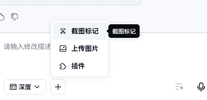

**具体操作方法是**：对需要修改的界面进行截图，标记具体位置后，用自然语言描述修改要求，如"把这个按钮改成蓝色"或"增加一个提交字段"。

**结合调试工具**：对于更复杂的技术问题，可打开浏览器开发者工具（F12），从调试区复制问题信息，交给秒哒处理。

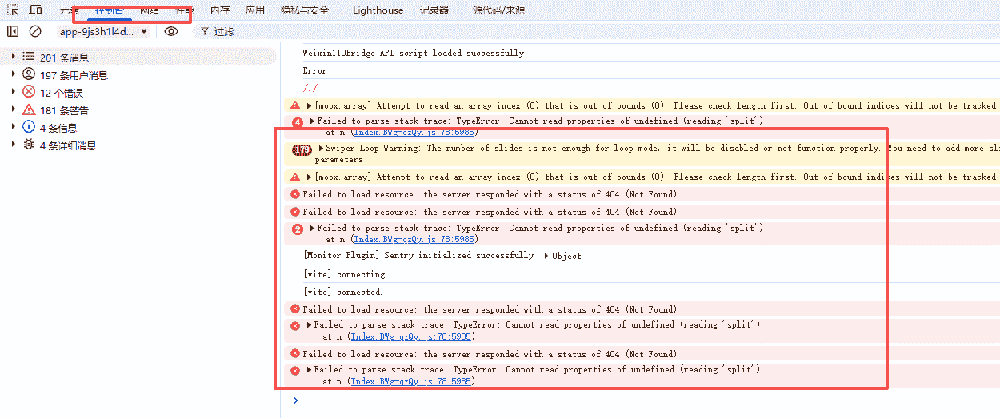

**自主修复：**遇到提示类似错误，直接点击尝试修复即可

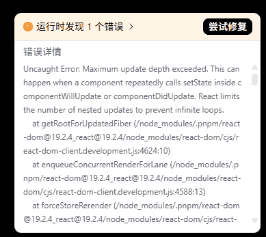

### 数据管理：善用 Supabase 数据库

秒哒深度集成 Supabase 数据库（基于 PostgreSQL），为应用提供数据持久化存储能力。

**可视化操作**：秒哒提供数据库管理界面，可直观进行增删改查操作，无需编写 SQL 语句。

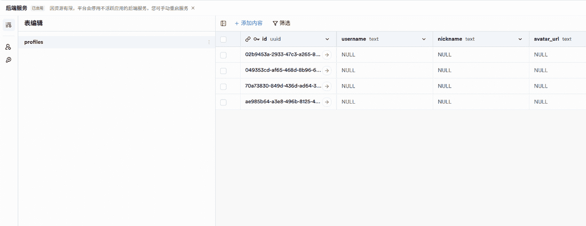

**自动生成 API**：创建数据表后，秒哒会自动生成 RESTful API 接口，方便前端调用。

**权限控制**：通过行级安全策略实现细粒度权限控制。例如，可设置"只有创建者可以修改自己发布的内容"。

### 发布与优化：关注最终用户体验

**选择合适的类型发布**：应用新建的时候，可以选择是应用【网页端】、还是微信小程序。

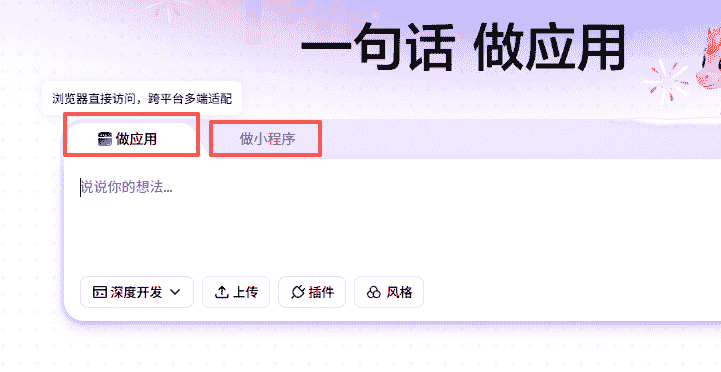

**利用搜索引擎流量**：秒哒与搜索引擎打通，生成的应用可直接上线并获得搜索曝光。

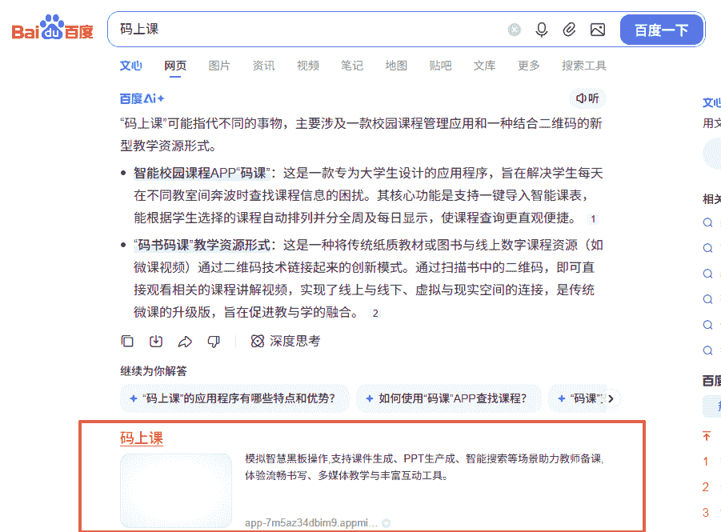

**收集用户反馈**：发布后积极收集用户反馈，通过对话方式快速迭代优化，秒哒支持实时修改和预览，大大缩短反馈循环，比如微信采用小程序体验版预览发布，因为正式版每周只支持提交 3 次。

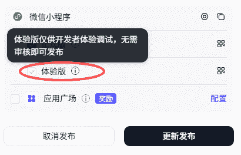

## 四、小经验

### 1、多看开发文档

**官方开发文档：**https://cloud.baidu.com/doc/MIAODA/s/Sm88db6er

比如大家关心的**秒哒微信小程序**能否做到转发、微信支付、下载功能等均能在此找到答案。【一定要注意是秒哒微信小程序，不是你自己用秒哒开发的小程序】你自己开发的小程序是支持上边的能力的

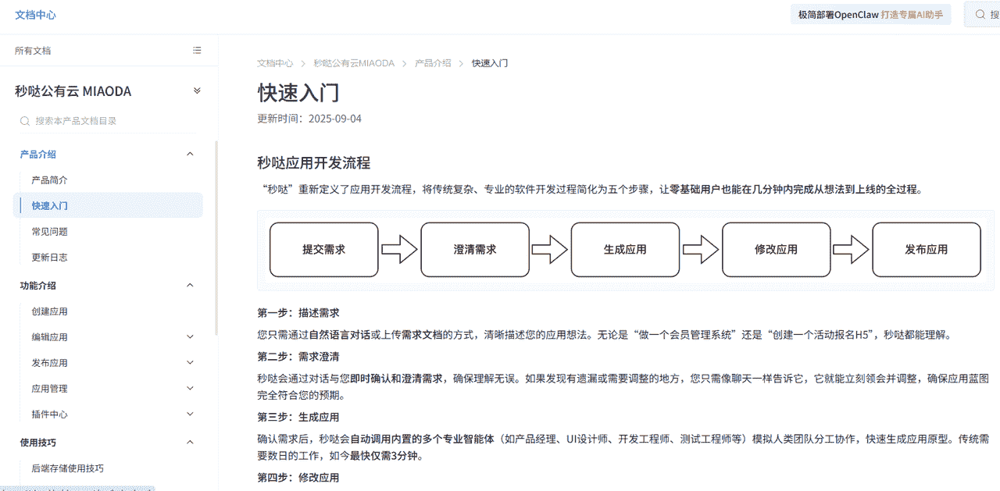

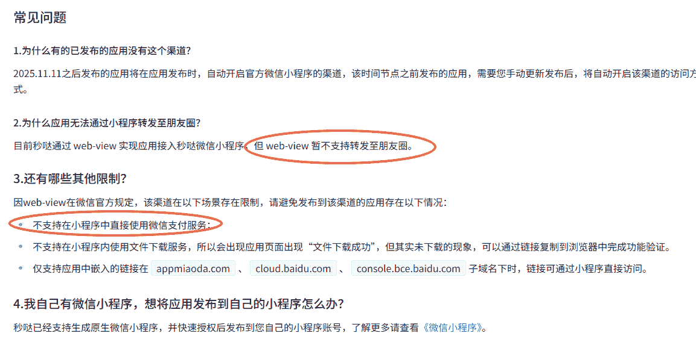

### 2、问题难以解决？尝试回滚

当你在同一个问题踩了多次坑都没解决，不要再对秒哒死缠烂打，直接回滚到你最初要改的方案那里，然后清空上下文，比如你从第 10 个版本开始开发，然后迭代另一个功能一直出错，迭代了差不多 5 个版本，依旧不行，直接回滚，不要在此停留，不然秒哒会越改越差，因为它是在你原本差的版本基础上修改的

### 3、注意上下文

每次对话都要将其作为新的开始

#### 错误做法

比如你上个需求是让它改用户管理页面的按钮颜色，改成白色黑色字体，然后觉得这个字体非常难看，你直接输入：按钮太难看了，给我改成红色的。

结果：整个应用的按钮都变成红色的了

#### 正确做法

直接输入：将用户管理页面的按钮颜色改成红色。

其实就是你需要无视上下文的内容，直接将其作为一次新的开始，也许你肯定会说，你这样上文如果已经记得了不久多此一举了嘛，但是你要考虑到多此一举总比多用几次秒点好吧，毕竟秒点很贵呀。

## 结语

秒哒代表了一种新的开发范式：从"代码实现能力"向"需求表达能力"迁移，通过本文介绍的选择思路和开发技巧，相信你已具备在秒哒上创建自己应用的基础。

实际开发中，记住两个核心原则：**明确需求**和**小步快跑**。不要试图一次性实现所有功能，而是先打造一个最小可行产品，然后根据反馈持续迭代。

现在，就从一个小需求开始，体验 Vibe Coding 的魅力吧！

**赛事活动：**

[百度秒哒×万象 AI 实验室 ×有霸夫 AI 编程 | 秒哒 AI 主理人出道赛（30 万奖金池）](https://yunyinghui.feishu.cn/wiki/Ppl3wMtEGiAYMykpDCScDaaBnZe?from=from_copylink)