# 社区共学课：零基础小白上手零代码应用搭建指南

> 来源：[https://yunyinghui.feishu.cn/docx/AGKDd2wZKoBhKxxgmi6ctB84nrf](https://yunyinghui.feishu.cn/docx/AGKDd2wZKoBhKxxgmi6ctB84nrf)

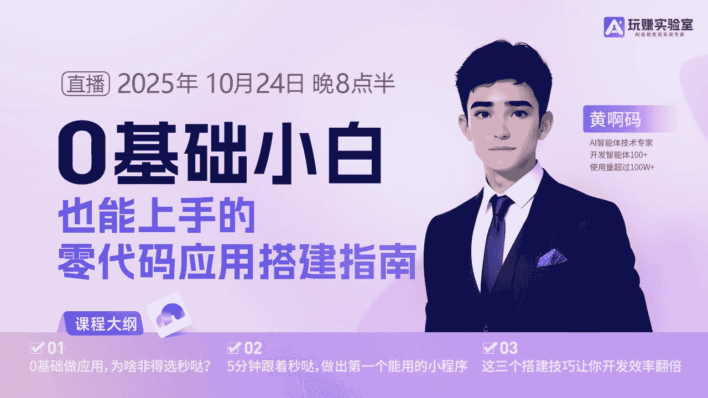

> 课程回放：

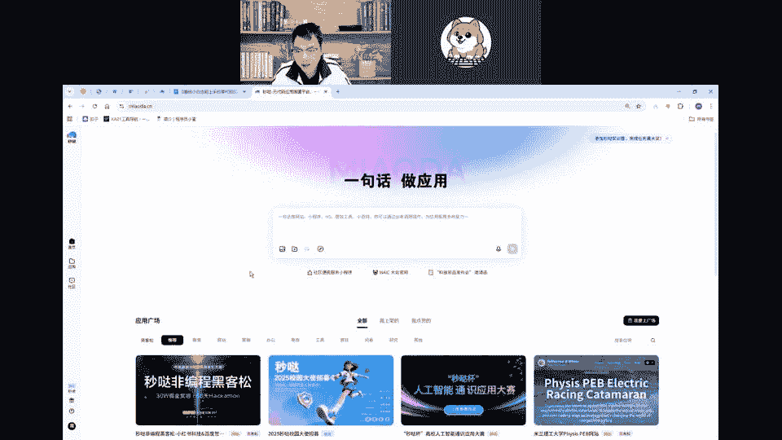

[0基础小白也能上手的零代码应用搭建指南.mp4](https://internal-api-drive-stream.feishu.cn/space/api/box/stream/download/all/WEQubmlJ5odeyrx6iWec1FpUnDh)

# 个人介绍

> 吴瑞孟【黄啊码】

> **专业身份**

> 万象 AI 实验室社区共建者/扣子头部开发者 /三节课特邀讲师

> **技术专长**

> AI 全栈 RPA 自动化专家

> **专注领域**

> AI 智能体商业化落地 · 企业自动化流程设计

# 1、0 基础做应用，为啥非得选秒哒？

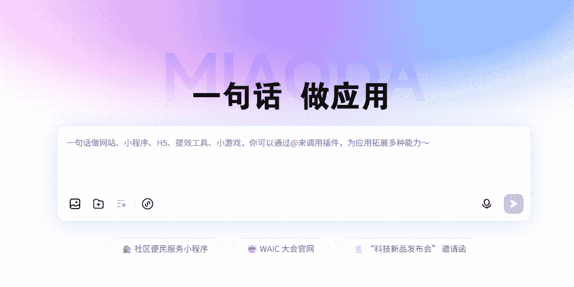

### 1.1 零代码开发的核心价值

**技术门槛革命性降低**

+   零编程基础要求：完全摆脱传统开发对编程语言、框架、数据库等技术的依赖

+   业务人员直接参与：让最了解业务需求的人员直接参与应用构建

+   学习成本极低：从想法到实现，无需数月甚至数年的技术学习周期

**开发效率的提升**

+   开发周期压缩：传统开发需要 2-6 个月的项目，秒哒平台可缩短至 1-2 周

+   迭代速度提升：需求变更响应时间从数天缩短至数小时

+   并行开发能力：前端、后端、数据库设计可同步进行，无需等待

**成本控制优势比较明显**

+   人力成本降低：无需雇佣专业开发团队，业务人员即可完成开发

+   时间成本节约：快速原型验证，避免大量无效开发投入

+   维护成本减少：可视化维护，降低后期运维复杂度

#### 1.2 秒哒平台特色

**可视化操作**

+   对话式界面设计：通过自然语言描述即可生成完整 UI 界面

+   点击式编辑：所见即所得的页面编辑体验，如同设计 PPT 般简单

+   实时预览功能：修改即时生效，开发过程可视化程度极高

**企业级组件生态**

+   业务组件全覆盖：涵盖 CRM、ERP、OA 等企业常用业务场景

+   AI 能力集成：内置文生图、语音合成、智能客服等 AI 功能

+   第三方服务集成：支付、短信等常用的企业服务支持一键接入，全链路打通

+   数据可视化：图表、报表、仪表盘等数据分析组件可以自主生成，不用人工干预

**现代化数据架构**

+   Supabase 深度集成：PostgreSQL 数据库，支持简单的查询

+   实时数据同步：前后端数据实时同步，无需手动刷新

+   API 自动生成：数据库表结构自动生成 RESTful API 接口

+   权限体系完善：行级安全策略，细粒度权限控制

> **注：**官方说支持复杂的查询，不过经过我多次的使用，复杂的查询还是先放一放，当前来说相对比较慢，可以等未来优化优化，不过已经能满足很多基本的需求了。

#### 1.3 适用场景

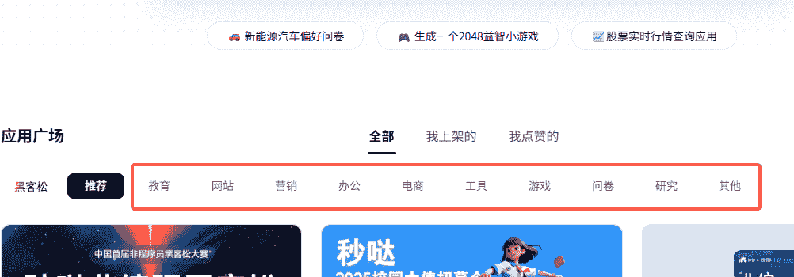

**企业内部管理系统**

+   适用规模：中小型企业（50-500 人）的完整数字化解决方案

+   核心功能：人事管理、财务管理、项目管理、客户关系管理

+   技术优势：快速响应业务变化，支持多部门协同办公

**小程序生态应用**

+   一键发布至🛰️小程序，无需复杂审核流程，原生小程序性能，流畅的用户交互体验

**企业官网+智能体**

+   官网建设：响应式设计，支持 PC 端和移动端自适应

+   智能客服：24 小时在线客服，支持多轮对话和业务咨询

**专业工具开发**

+   营销工具：活动报名、问卷调查、抽奖系统等 h5 简单页面

+   效率工具：任务管理、时间跟踪、团队协作等办公场景

+   数据分析：业务报表、数据看板等分析工具

**娱乐类应用**

+   网页小游戏：诗词挑战、脑经急转弯等等

# 2、5 分钟跟着秒哒，做出第一个能用的小程序

## 前言

用秒哒搭建程序跟我们常见搭建程序步骤不太一样，因为它是前后端可以同步进行，

这是我真正用五分钟搭建的一个“小”程序，可以看到，它没涉及任何版本迭代

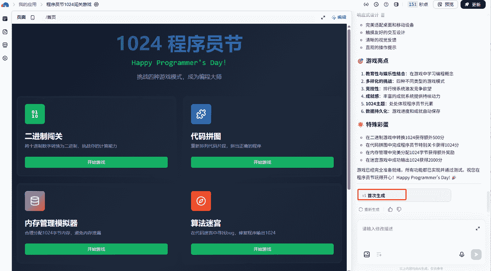

## 2.1 前端开发

### 2.1.1 需求分析澄清阶段

#### 需求收集

+   自然语言输入：支持语音输入、文字描述、文档上传、原型图等多种需求表达方式

**比如我用秒哒做了一个秒哒**

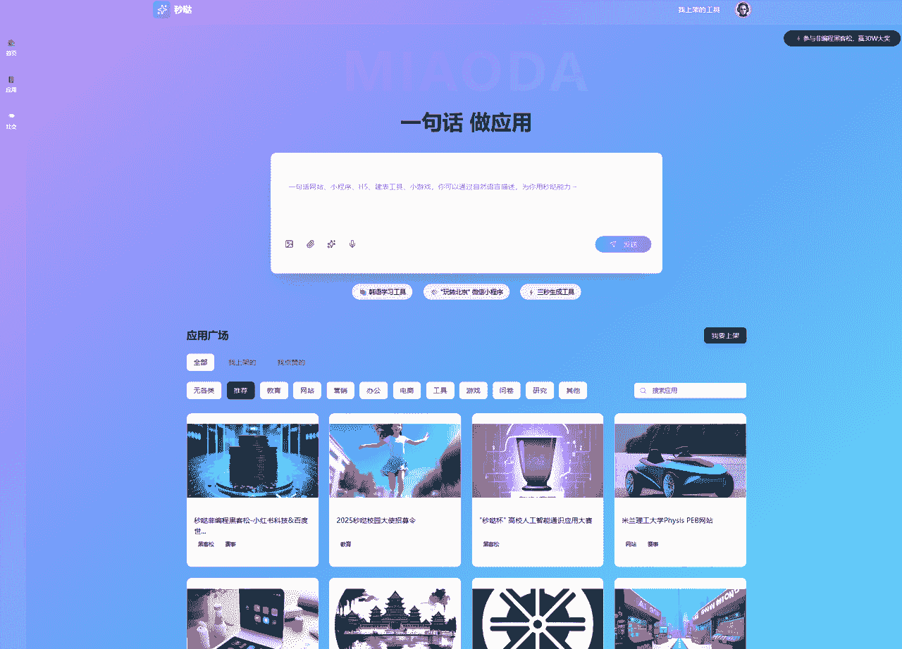

+   需求模板引导：提供常见业务场景的需求模板，降低需求描述门槛

采用工具，秒哒自带的指令优化工具

+   智能需求解析：AI 自动识别关键业务要素，生成结构化需求文档

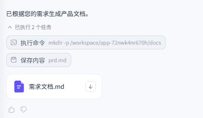

#### 需求确认与优化

+   实时对话澄清：AI 产品经理角色，通过多轮对话确保需求理解准确

+   需求优先级排序：自动识别核心功能和辅助功能，合理分配开发资源，支持实时调整需求

如果你的需求非常多，秒哒会自动根据需求内容分模块、按顺序开发，比如 v1 实现静态页面、v2 实现数据库对接、v3 实现后台管理。。。

### 2.1.2 应用生成和修改

#### 应用生成

+   秒哒会自主调用多个专业智能体（产品经理、UI 设计师、开发工程师、测试工程师等）

+   组件库智能匹配：根据业务场景自动选择最适合的 UI 组件

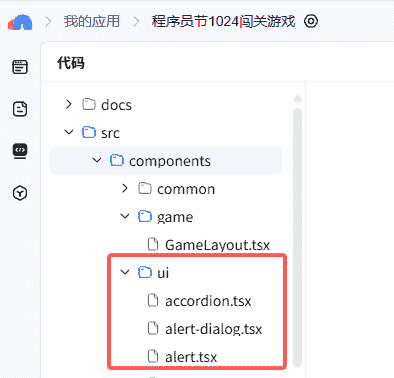

+   注意设计规范统一：自动应用企业设计规范，确保界面一致性

#### 修改应用

+   支持自然语言指令修改，如"把按钮改成蓝色"、"增加一个提交字段"【不过得专门选中对应的标签，准确性会非常高】

+   直观的 GUI 可视化界面进行编辑文字和颜色

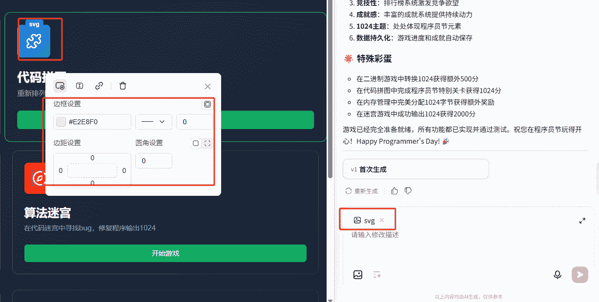

## 2.2 后端开发

#### 数据库存储功能

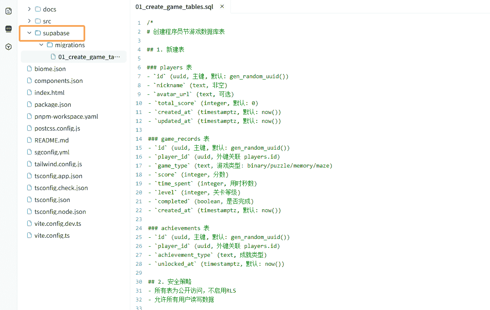

+   采用 supabase 数据库

+   实现数据的持久化保存与快速检索【查询稍微有点慢】

+   满足应用核心数据管理需求

#### 自动数据管理

+   自动存储：将操作产生的关键信息安全存储至数据库

+   精准调取：用户需要查看或使用数据时，数据库可快速定位并返回目标信息

> **权限管理**

+   默认超管：应用第一个登录的用户，自动获取超管权限

+   修改超管：通过对话告知大模型具体需求

+   示例："将手机号为 138XXXX8888 的用户设置为应用超管"

## 发布分享

应用修改完成后，秒哒提供一键发布和分享的能力，一键部署到正式环境，极大简化部署流程，让您能快速分享应用。

# 4、这三个搭建技巧让你开发效率翻倍

### 技巧一、原型驱动+多端适配

**原型图的价值最大化**

+   需求可视化：将抽象的业务需求转化为具体的界面原型，原型图作为开发的详细规格说明

+   学会把采用指令优化当作创意来源

**多端适配**

兼容提醒：注意时刻提醒秒哒要采用三端兼容的方式开发，保证小程序发布完美兼容

### 技巧二：注重需求文档整理

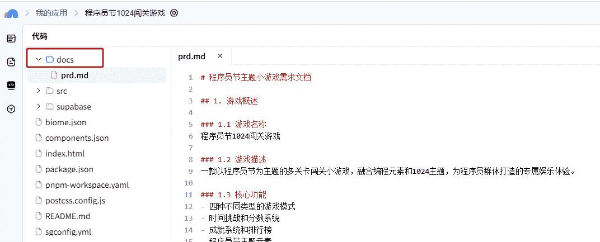

#### **文档结构化**

+   功能需求：详细描述每个功能的具体实现要求

+   非功能需求：性能、安全、可用性等技术要求

+   用户故事：从用户角度描述功能价值和使用场景

> 不站在用户角度思考的产品纯属自嗨

#### **版本控制**

+   变更记录：详细记录每次需求变更的原因和影响，偶尔手动保存版本记录

+   影响分析：评估需求变更对现有功能的影响，伪需求还是真需求？

+   回滚策略：制定需求回滚的具体操作步骤，回滚要回滚需求文档，避免上下文混淆

### 技巧三：Bug 修复和性能优化

#### Bug 修复技巧

+   多用 F12，从调试区复制问题，并把问题交给秒哒去处理

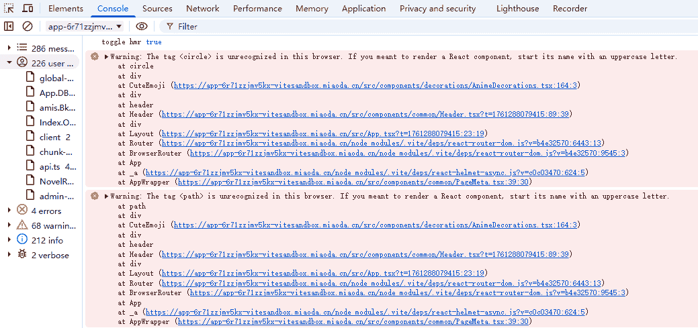

+   利用秒哒的自动修复工具快速定位和解决问题

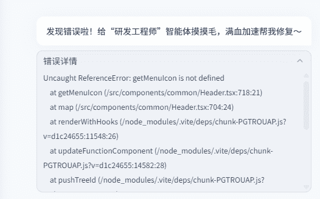

#### 性能优化

按需加载页面内容，提升首屏加载速度，提高用户停留时间，能用一次性解决的问题，绝对不要用两次。

## 课程总结

通过秒哒平台，即使是零基础的开发者也能在 5 分钟内创建出可用的应用程序。平台的可视化操作、丰富的组件库和强大的后端支持，让应用开发变得简单高效。掌握三个关键技巧，能够进一步提升开发效率，实现快速交付。