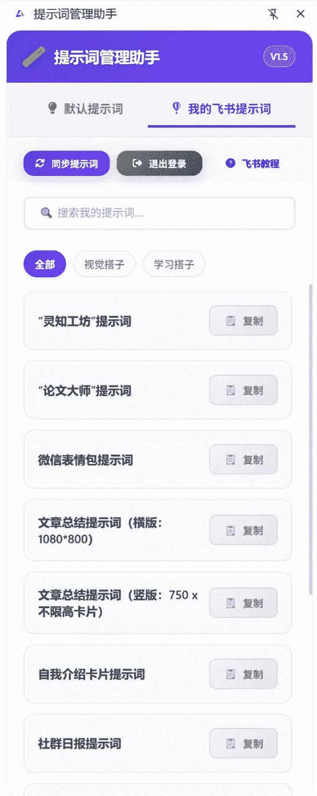
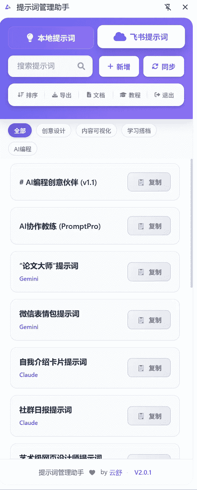
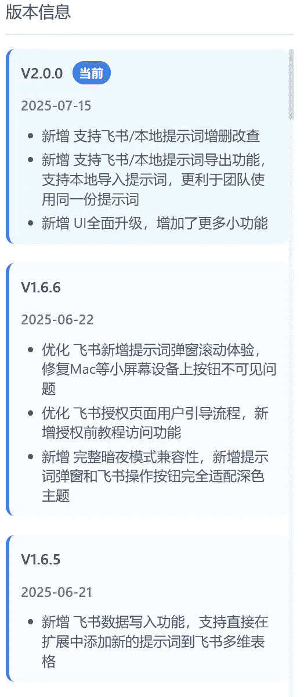
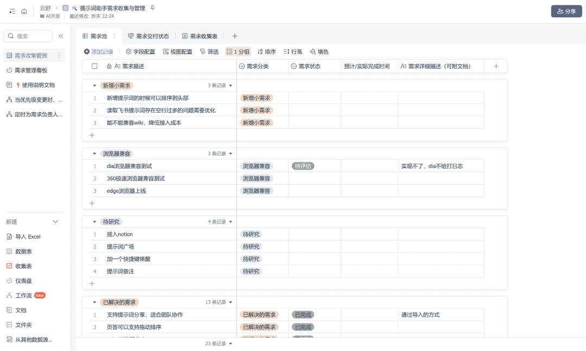

# 零编程经验一步步用AI 开发出提示词管理助手复盘

> 来源：[https://yunyinghui.feishu.cn/docx/TjVMdnGoNoIH3MxVa4zc6lnxnKg](https://yunyinghui.feishu.cn/docx/TjVMdnGoNoIH3MxVa4zc6lnxnKg)

> 适用人群：互联网 AI 编程学习人群

> 首发时间：2025 年 7 月 1 日

> **社区创作者：**** **

> **内容发布方：**[Mix AI Lab](https://yunyinghui.feishu.cn/wiki/WhelwZnxQi55mpkOzatc3Xran5b?from=from_copylink)

> **使用建议：**如果需要快速定位到精确内容，可以使用快捷键 Ctrl +F/Command +F 的形式，搜索关键字/词，查找你想要的内容。

>

> **推荐语：**本文分享云舒如何零编程基础用 AI 开发出自己的提示词管理助手插件工具的，值得所有人学习借鉴。

上周把“提示词管理助手”2.0 版本开发完成了，这款当初我以为只有很小功能的产品，它在一点点从用户的需求中生长出来。

我看了看谷歌插件后台的数据，目前的总用户数是 800，每天有 600 个用户在使用这款产品，对一款插件产品来说这还是蛮不错的数据。

今天这篇文章就是想完整的复盘一下“提示词管理助手”从 0 开发到现在 2.0 的过程；如果你也想做或者在做自己的产品，或许我这段经历会对你有一些灵感或启发。

**V1.0 版本**

**V2.0 版本**

**更新日志**

因为我是产品经理出身，所以我把产品的开发过程分为 2 个阶段：

1.  1. **验证可行性阶段： **0-1 验证产品的可行性，有没有用户愿意用这款产品

1.  2. **放大价值阶段： **1-10 给用户提供更好的产品体验，获得更多的用户增长

接下来我就按照这两个阶段的划分，带你看看“提示词管理助手”是怎么跑出来的。

## **1.验证可行性阶段**

🍍

0-1 验证产品的可行性，有没有用户愿意用这款产品

### **1.1 找到需求**

任何一个产品都有它开始的原点，我们先从如何找到“提示词管理助手”这个需求开始说起。

为什么要做提示词管理这个事情呢？

因为我有一摞子提示词，他们分散在各个文档里，每次我要去用我都得翻文件，我觉得太麻烦了。

但我第一版的时候并没有想做成产品，我选择把飞书文档整理了一下，搞了一个提示词合集出来，这样其实比翻文档的效率提升了不少。

但每次复制一个提示词的流程依旧是：打开飞书文档——找到对应的提示词——复制提示词——切换回 AI 聊天页面——粘贴提示词。

这个流程用多了还是觉得麻烦。。。

我希望最好是点个复制按钮，这个提示词就能粘贴过去。

“提示词管理助手”的需求来自我日常和 AI 高频对话的场景，我一直存在一个提示词管理的痛点，所以最后我做了这款产品，方便自己用的同时顺便推广给和我一样有类似需求的用户。

在找到需求这款，我对大家的建议就是： 先从自己的需求出发，然后找到有同样需求的用户。

### **1.2 分析需求**

当我决定要做“提示词管理助手”这个产品后，第一步要解决的问题是：它到底该以什么样的形式存在？

当时有三个方向可以选择：

1.  1. 做一个网页端工具

1.  2. 做一个桌面应用

1.  3. 做一个浏览器插件

看起来这三种产品都能满足我的需求，那到底要选择哪一个？

我的判断逻辑是这样的： 选那个开发成本最低、能最快解决核心需求的。

因为我是一个高频使用浏览器的用户，工作电脑是一台 Mac 和一台 Windows。

所以我很快排除掉了前两个选项。

+   网页端看起来通用，但和我直接打开飞书文档复制提示词没区别，体验没什么提升，还得考虑域名、备案等上线问题。

+   电脑端的管理产品也可以 pass 掉了，win 和 mac 都得各自开发一套，开发成本略高。

最后选了谷歌浏览器插件，我只需要开发一个版本维护就好了，能够覆盖我全部的使用场景。

在确定了产品形式后，接下来我还需要去判断“提示词管理”这个事情到底要怎么做。

当时有三个方向可以选择：

1.  1. 做本地提示词管理

1.  2. 自建云端服务器

1.  3. 接入飞书多维表格

判断逻辑还是和之前一样： 选那个开发成本最低、能最快解决核心需求的。

+   本地管理先被排除掉了，因为我有两台电脑，也就代表我要维护两套提示词，太麻烦了。

+   云端服务器也排除掉了，还得去买服务器，然后进行各种测试，开发起来太麻烦了。

最后选择接入飞书多维表格，只需要调试一下对接流程就能用，简单又省事。

基于多轮的分析需求，最后“提示词管理助手”在开发前，我对它的定义是这样的： 一款可以读取飞书多维表格、支持一键复制提示词的谷歌浏览器插件。

### **1.3 MVP 开发**

在分析完需求后，我已经知道我到底要做一款什么样的产品了。

那接下来我要先把第一个能用的版本做出来，然后去找用户验证，看看到底有没有人用这个产品。

MVP 开发的原则是： 用最小的成本，验证最核心的价值。

提示词管理助手最核心的价值是什么？

**便捷的复制提示词。**

所以第一版“提示词管理助手”我只做了两个核心功能：

1.  1. 读取飞书多维表格的提示词数据

1.  2. 复制提示词

这两个功能完成了，就是最小可用的产品形态了。我先是自己使用体验了一会，在体验没问题后，才准备把它推广给更多人用。

### **1.4 测试收集反馈**

MVP 开发做完了，我就发到自己的提示词群里和一些 AI 开发者群里，邀请大家来试用一下这款产品，顺便看看大家反馈怎么样。

这里需要注意的是：第一批测试的用户量不需要特别大，有几十个人愿意来体验一下产品就好了。

这个阶段的目标重点在于： 收集用户反馈迭代产品，而非用户量。

我自己从做产品经理开始，就一直蹲在用户群里看反馈，观察大家怎么用产品、卡在哪、吐槽什么。

这次也不例外，我又拉了一个用户反馈群，主要是以下两个目的：

1.  1. 帮助用户解决使用过程中遇到的问题

1.  2. 搜集用户对产品的真实反馈

在这个用户反馈群里，我收获到了很多超有价值的反馈，我给大家列举一些哈：

+   飞书授权流程做的太麻烦了，很多可以简化的步骤没有简化

+   加个预览功能，能够查看自己的提示词内容

+   深色模式没有做兼容，深色模式体验比较差

+   增加标签分类和模型名称

+   可以跳转多维表格，随时查看管理自己的提示词

“提示词管理助手”这款产品是用户和我一起让它生长出来的 ，如果只靠我自己的思考，现在的很多很好用的功能都不会有。

就比如说深色模式的兼容，我作为一个不咋用深色模式的用户，我实在是没法脑补出来这个需求的。

如果不是用户告诉我，我估计开发到 20.0 版本，也不会主动做这个功能。

### **1.5 推广上线**

在用户反馈的帮助下，我又优化了几个版本，我觉得产品可以正式推广上线了。

因为产品形态是一个谷歌浏览器插件，那我这次不用考虑什么 SEO 之类的事情，我只需要自己宣传一下获得一部分用户，然后一点点迭代产品就好了。

所以我主要是写👸号和即刻上宣传的多一点，告诉大家我有这款产品。

这里要感谢好朋友 @卡尔的 AI 沃茨 @AIGC 创意猎人 帮我写文章宣传了一下，非常感谢两位好朋友～

为什么没有去更多的渠道进行推广？

主要是我自己的精力其实不太够，我自己日常要学习 AI 的知识、要做 AI 编程的践行、还要写文章，以及去各个 AI 活动跑来跑去的，留给推广的时间就少了很多。

目前的打算是之后会借助 AI，来把更多的渠道推广做一下，这是放大价值阶段的重点目标啦。

## **2.放大价值阶段**

🐣

1-10 给用户提供更好的产品体验，获得更多的用户增长

### **2.1 产品 2.0 版本升级**

在“提示词管理助手”开发到 1.6.6 版本的时候，围绕飞书多维表格提示词管理的功能基本上已经很齐全了，于是在做下一个版本迭代的时候我盘点了一下手中遇到的问题：

+   目前这个版本代码库架构有一些问题，有几个超长的代码文件，导致 AI 开发的效率降低了很多，bug 率飙升

+   用户多次提到希望使用本地提示词，结合用户希望团队使都能用提示词管理助手，那最好能用飞书提示词导出、本地提示词导入功能来实现。

在盘点完之后我觉得这两个版本可以合并一起做，应该难度不是很大。

**这是我开发“提示词管理助手”后**犯的最大的一个问题： 我把太多事情合并到一起来做了。

我觉得我的 AI 编程水平很高了，这些事情我可以一口气都搞定了。

然后事实告诉我：你想多了，你这么搞只能写一堆 bug。

“提示词管理助手”2.0 版本开发一共花了 3 周的时间，在前两周我都希望能够先把架构一键调整好，顺便在架构调整的过程中把新功能加进去。

但实际上我没什么太深度的编程架构技能，所以在我这个策略的瞎折腾下，我的代码库成功的崩了。。。

我又回到了开发一个功能，修复无数个 bug 的阶段。

于是我停下来复盘了一下，我发现问题在于我总是想一口气吃个胖子，一下子把所有事情做完。

于是我给自己定了一个目标： **一次开发只做一件事情。**

我把自己的 2.0 版本开发计划拆成了这样：

+   补齐飞书授权 token 过期测试的 API

+   做飞书提示词和本地提示词增删改查的 API 测试

+   做样式文件 css 的整体重构

+   核心组件 js 文件的拆分

然后和 claude code 还有 cursor 一起，一点点把“提示词管理助手”2.0 版本啃完了。

### **2.2 接下来计划要做的事情**

“提示词管理助手”2.0 版本升级完成后，我给自己放了几天的假，没写文章也没开发产品，我复盘自己最近遇到的各种问题，看了很多文章、和很多朋友聊天、想了很多的事情。

“提示词管理助手”后续我的思路大概是这样的：

+   有一些偷懒之前没做的事情需要做了

+   先给产品起一个好听的名字吧，之前一直拖延没做

+   做一个官网介绍页，让大家知道这款产品是干嘛的

+   优化谷歌浏览器插件的产品介绍，之前都是 AI 写的，这次我和 AI 一起写

+   产品架构优化还有一些没做完的地方，要继续优化

+   产品功能还有一些细节设计需要调整，也需要优化做一下

+   重点花精力的地方

+   浏览器的兼容：兼容 360 浏览器、edge 浏览、dia 浏览器，为规模化推广做准备

+   产品的推广：📕、即刻这些渠道的推广应该做一下了

+   提示词广场：把我和身边好朋友的提示词做成一个广场，方便大家调取使用

+   提示词生成器：能够自主优化提示词，进行对比测试的产品

脑子中的思路大概是这些，我会把这些事情再排个优先级，然后一点点去推动落地。

我觉得放大价值阶段和验证可行性阶段的区别在于， 放大价值阶段的目标它是不确定的 。

当 200 个用户在用产品的时候，我们其实知道验证可行性阶段就已经结束了。

但放大价值的阶段没有尽头，你可以做产品升级、可以做用户体量、可以做商业化、还可以什么都不做。

我想这个阶段最核心的是要问自己： 这款产品希望它给自己给用户带来什么。

## **3.写在最后**

在写完“提示词管理助手”的复盘，我脑海中浮现出一句话：

产品是生长出来的，不是想出来的。

我们在做一个产品的时候，其实不知道它未来会发展成什么样。

我在提示词管理助手 1.0 版本做好上线的时候，我也觉得这个产品没什么太多可以做的事情，但后来随着越来越多的用户反馈，随着自己的思考越来越多。

我发现可以做的事情还有很多，需求是永远做不完的。

如果你现在脑子中有一个产品的雏形，那最重要的是先做一个版本出来。

边做边思考，遇到问题解决问题，这是最好的践行方式。