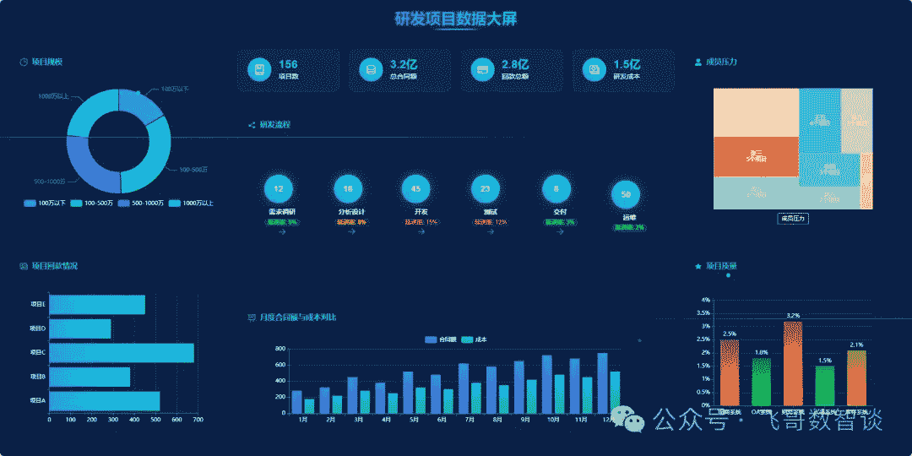
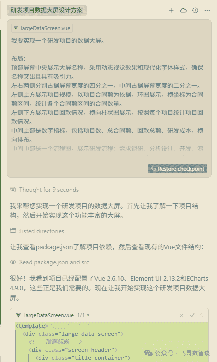
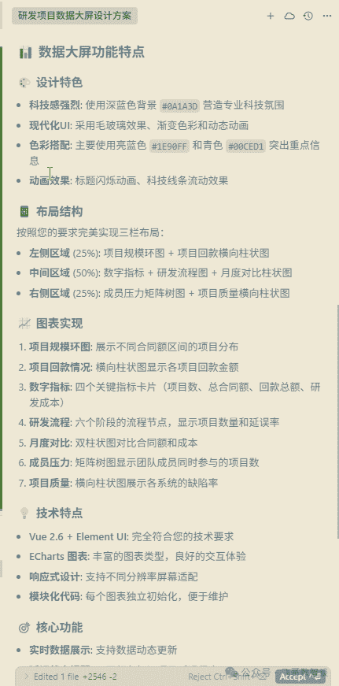
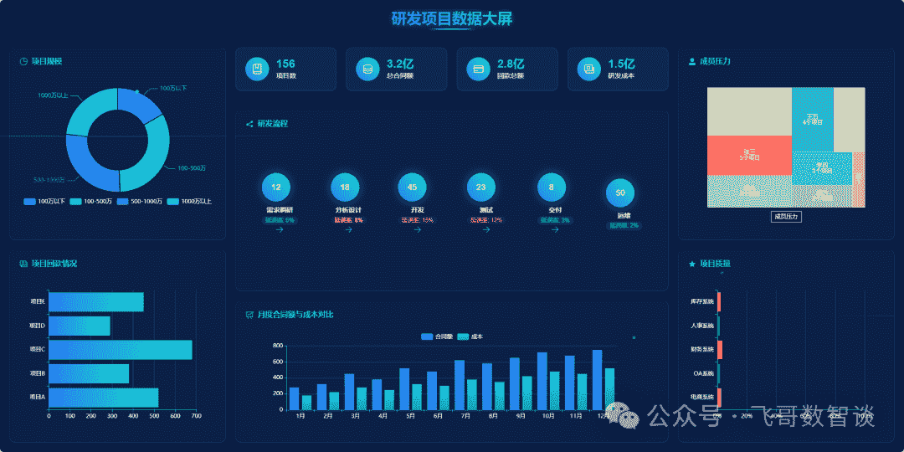
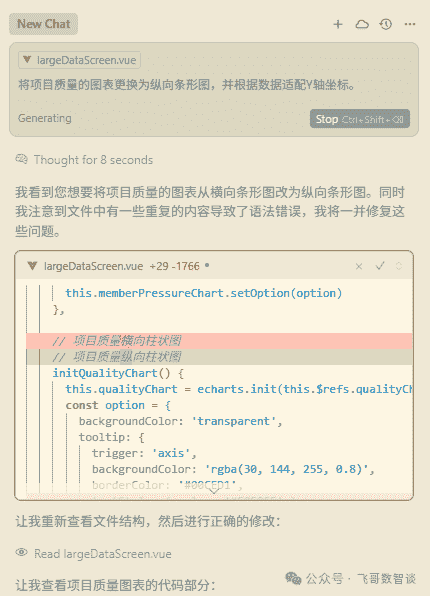
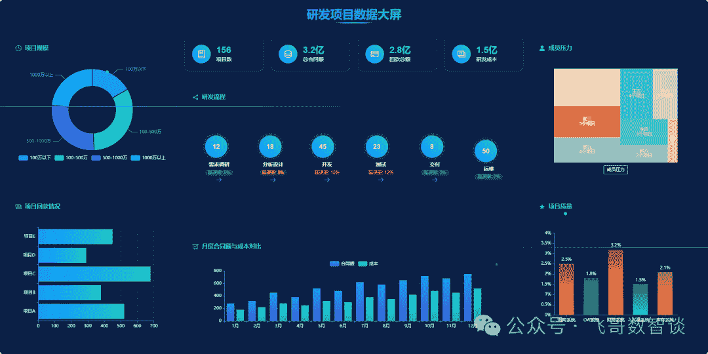
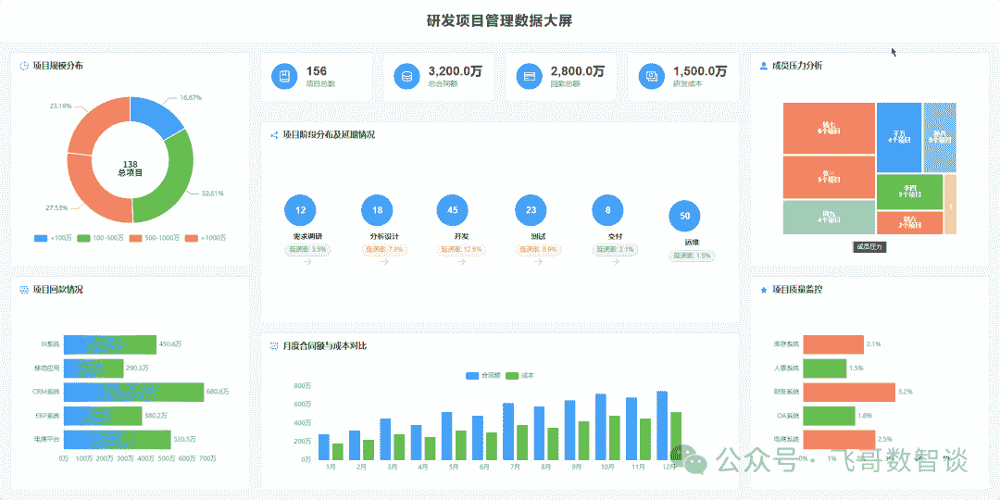
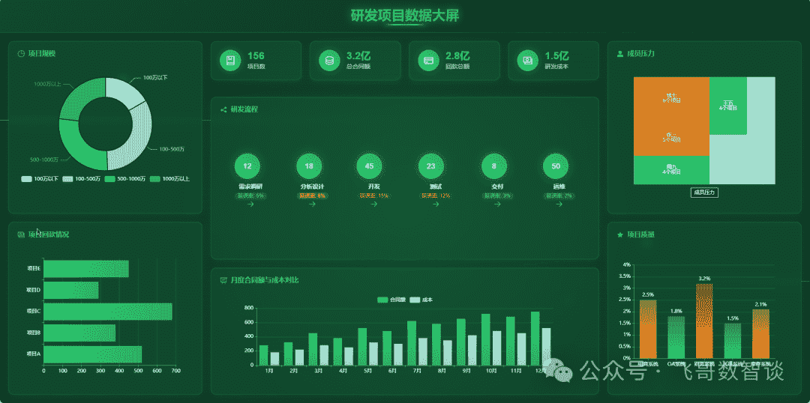

# AI 编程实战：Cursor+Claude4 完成大屏开发​​

> 来源：[https://yunyinghui.feishu.cn/docx/NuRZdAdckongFgxVDGrcNLwtnbe](https://yunyinghui.feishu.cn/docx/NuRZdAdckongFgxVDGrcNLwtnbe)

---

# **前言 **

“大屏需求又变了！” —— 这是每一个开发团队都不可避免的难题。

传统数据大屏开发需要经历需求确认、UI 设计、前端编码、联调测试等环节，耗时至少 3-5 天。如果客户临时调整指标或布局，开发周期还会再度拉长。

2 个月前，我们用 Claude 3.7 试水 AI 辅助大屏开发，效率提升不少，但总觉得还差点意思。

今天，借助 Claude 4，我们再次挑战数据大屏开发场景，看看能不能把效率提升到新高度。

先展示下 Claude 4 生成的最终效果：



# **背景及任务 **

**背景 **

项目依然是我们内部的协同办公平台，整个项目前端采用 Vue2+Element UI 实现。

**任务 **

在实际开发各种软件系统时，除了日常的数据维护，往往还需要为领导层提供一个更宏观、直观的展示界面。

这样，他们可以一目了然地把握业务全局和关键指标，这正是数据大屏存在的核心价值。

本次实战任务，就是基于我们协同平台的现有模块，快速搭建一个研发业务的数据大屏，方便领导高效掌握团队整体研发情况。

#  **实操过程 **

本次分享采用 Cursor + Claude 4 Sonnet 实现。

## **功能分析 **

场景是针对研发管理使用的，根据业务要求，界面需要包含以下元素：

+   左

+   左上：项目规模分布

+   左下：项目回款情况

+   中

+   数字指标

+   项目阶段分布及延期情况

+   月度合同额及成本对比

+   右

+   成员压力：并行参加项目数

+   项目质量：项目缺陷率

## **生成初稿 **

有了需求，接下来就是最为关键的提示词编写。

大家可以直接复制“参考提示词”自行修改使用，也可以直接将简单需求发给 DeepSeek 等 AI 助手，让其丰富成完善的提示词再进行使用。

**参考提示词**

```
我要实现一个研发项目的数据大屏。

布局：
顶部屏幕中央展示大屏名称，采用动态视觉效果和现代化字体样式，确保名称突出且具有吸引力。
左右两侧分别占据屏幕宽度的四分之一，中间占据屏幕宽度的二分之一。
左侧上方展示项目规模，以项目合同额为依据，环图展示，横坐标为合同额区间，统计各个合同额区间的合同数量。
左侧下方展示项目回款情况，横向柱状图展示，按照每个项目统计项目回款情况。
中间上部是数字指标，包括项目数、总合同额、回款总额、研发成本，横向排布。
中间中部是一个流程图，展示研发流程：需求调研、分析设计、开发、测试、交付、运维，每一个节点上显示处于该阶段的项目个数以及项目延误程度，项目延误程度指超期天数除以原有合同天数的百分比。
中间下部是本年各月度合同额和成本对比，通过柱状图展示，横坐标为月份，纵坐标为合同额和成本，分为双柱表示。
右侧上方展示成员压力，统计团队成员同时参与项目个数，通过矩阵树图展示，颜色越重代表同时参与项目个数越多。
右侧下方展示项目质量，通过横向柱状图展示，横坐标为项目名称，纵坐标为项目质量，通过缺陷率代表。

技术实现：
1. 基于vue+element+javascript，非element plus。
2. 图片通过upsplash api选择适合的图片。
3. 图标使用element ui自带图标。

设计要求：
1. 按照以上“布局”内容，分析主要功能和用户需求，确定界面布局。
2. 参考主流大屏设计效果，设计效果精致，科技感强，使用现代化的 UI 元素，使其具有良好的视觉体验。
3. 整体色彩风格保持一致。
  主要色调
  深蓝色背景：#0A1A3D 作为整体背景色，营造科技感和专业性
  亮蓝色：#1E90FF 用于图表、数据线条和重点元素
  青色/湖蓝色：#00CED1 用于高亮部分和交互元素
  白色/浅蓝色：#F0F8FF 用于文字和数据展示
4. 各部分尽量避免使用边框，可采用浅色背景和科技线点缀，减少视觉疲劳，提高信息的清晰度和易读性。
5. 适配界面，避免出现大片空白，不同区域高度尽量对齐
```

提示词主要包括四部分：

+   **目标**

+   帮 AI 明确好最终目标，避免随意发散。

+   **布局**

+   大屏和普通界面最大的区别就是元素较多，因此，我们需要条理化的描述需要展示的内容。

+   当然，你可以用手稿图片辅助布局。

+   **技术实现**

+   这部分主要是为了和项目内保持统一的技术栈，方便生成的代码直接运行。

+   **设计要求**

+   这里就是我们期望的大屏样式了。

+   如果你对设计比较擅长，可以直接通过专有名词进行描述。

+   如果不太擅长，可以寻找一个意向大屏图片，通过 AI 助手提取设计要求的提示词。

**结果**

直接使用上述“参考提示词”进行生成。



可以看到，Claude 4 会针对项目进行扫描，并尽量保持技术一致性，这个比 3.7 的效果要好很多。



Claude 4 在每次执行完成后，都会对本次任务进行总结，你可以通过这部分总结快速确认生成内容是否符合预期。

**效果**



一版大屏就这么生成了。

但这并不是 AI 助力数据大屏开发的全部优势。

## **优化 **

我们经常会碰到以下类似的场景：“把这个项目质量换成竖着的柱”。

很多时候，需求可能不大， 但是需要产品经理、UI 设计、前端工程师一套流程合作才能更新给用户看，这太不敏捷了。

我们直接 AI 搞定。

**提示词**

```
将项目质量的图表更换为纵向条形图，并根据数据适配Y轴坐标。
```

**结果**



**效果**



## **更多模板 **

为了体验生成的效果，我另外调了两套界面，给大家参考一下。

### **浅色风格 **



### **绿色风格 **



# **结语 **

今天，我们基于 Claude 4 再次尝试了 AI 辅助数据大屏开发的场景。

像本文中的大屏，传统方式下怎么着也得 1-3 人天，但在 Claude 4 的加持下，15 分钟就能搞定一版，后续优化也极其丝滑。并且，越多优化，效率提升越明显。

虽然，设计效果可能还比不上专业 UI 人员，但性价比和敏捷度已经远超传统方式。并且，在专业 UI 人员的加持下，我们可以进一步优化提示词，以便实现更加优秀的效果。

今天分享就到这里，大家如果有什么 AI 协同开发的痛点，欢迎随时交流。

---

# AI 编程学习交流群

1.持续关注并更新 AI 的**相关资讯动态，研究报告，赚钱案**例，常见问题，永久免费在线查看，无收费内容，目标是成为最大的免费 AI 学习社群。

3.**关于文档负责人大国**：高帆文化 CEO，曾就职于教培大厂，目前创业，主攻研究 AI 落地应用、企业流量增长及达人 IP 孵化

**AI 编程学习交流群**


**公众号：飞哥数智谈**


好友（ID：zhangyuguo94s）

**扫码加微信入微信群   **