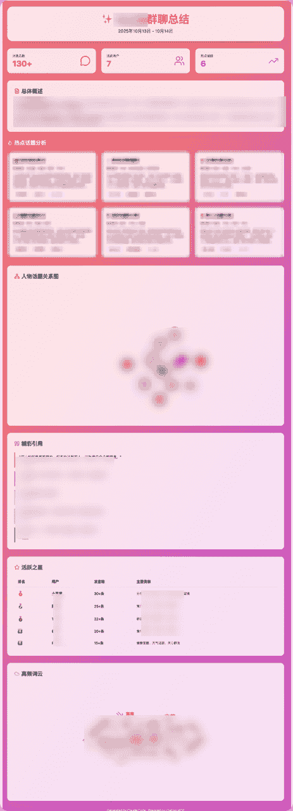
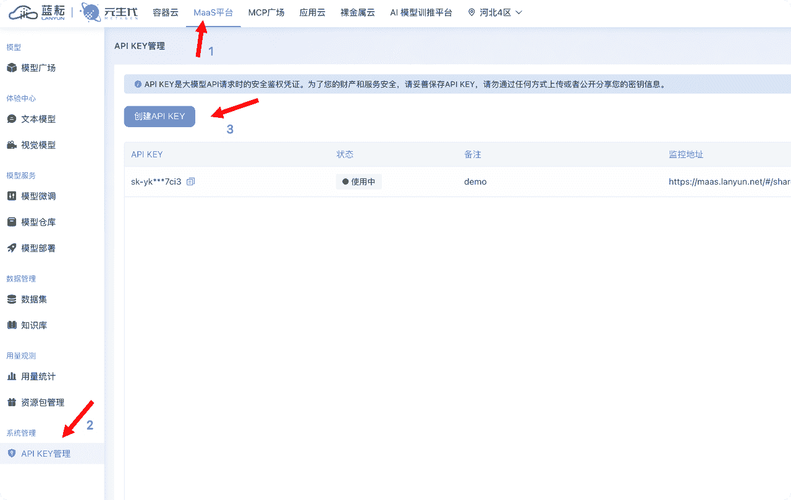
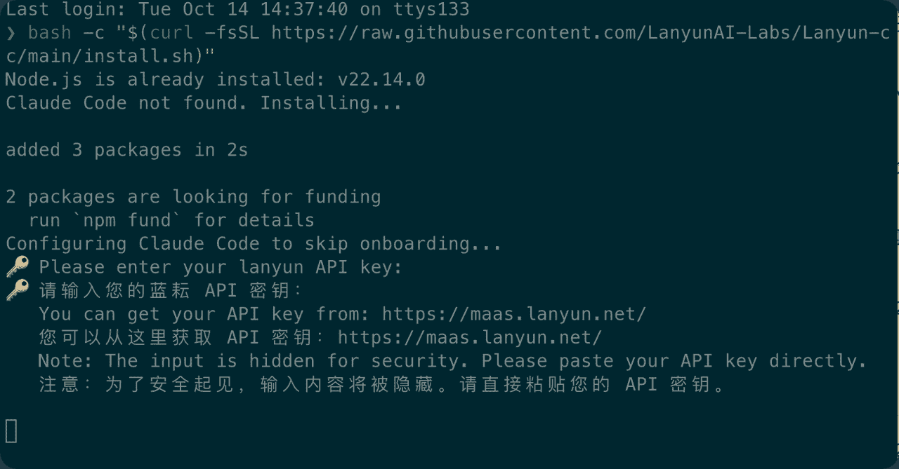
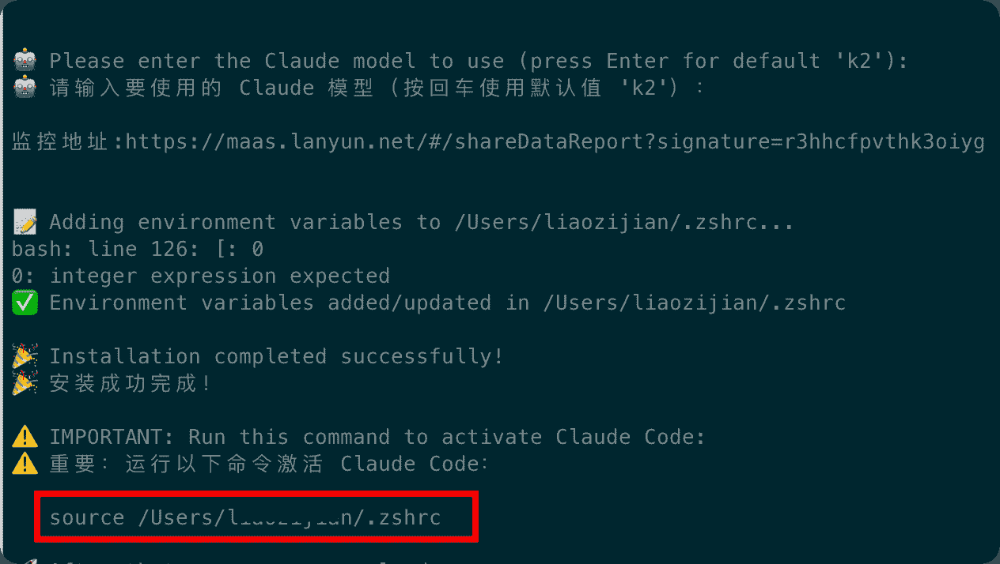
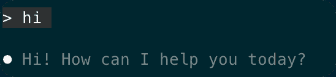

# 零基础开发🛰️群聊精华总结工具

> 来源：[https://yunyinghui.feishu.cn/docx/ULb2dQuVYohIHJxHlvgcV64SnRh](https://yunyinghui.feishu.cn/docx/ULb2dQuVYohIHJxHlvgcV64SnRh)

---

## 效果展示



## 安装 Claude Code

1、获取 API_KEY

https://maas.lanyun.net/



2、一键安装 Claude Code

```
bash -c &quot;$(curl -fsSL https://raw.githubusercontent.com/LanyunAI-Labs/Lanyun-cc/main/install.sh)&quot;
```





复制上面的命令激活即可。

运行测试

```
cladue
```



### 常见问题

如果提示 Unsupported platform: xx

那么需要手动安装一下nodejs,  再执行一遍脚本

1.  打开浏览器访问 https://nodejs.org/

1.  点击 "LTS" 版本进行下载（推荐长期支持版本）

1.  下载完成后双击 .msi 文件

1.  按照安装向导完成安装，保持默认设置即可

## 2. 安装和配置 chatlog 工具

chatlog 是一个🛰️聊天记录提取工具，主要功能：

+   从本地🛰️数据库提取聊天记录

+   支持解密🛰️数据

+   导出群聊消息内容

### 2.1 确认电脑芯片类型

Mac

1.  点击屏幕左上角苹果图标

1.  选择"关于本机"

1.  查看"芯片"或"处理器"信息

+   Apple 芯片：M1/M2/M3 等（2020 年后的 Mac）

+   Intel 芯片：Intel Core 系列（2020 年前的 Mac）

Windows

使用系统信息工具：

+   按下** ****Win + R**** **快捷键，打开“运行”对话框。

+   输入 **msinfo32**，然后按 Enter 键。

+   **在系统信息窗口中，查找****“系统类型”字段。如果**显示“x64 基于 PC”，则你的操作系统是64位的，通常对应的是AMD架构；如果显示“ARM 基于 PC”，则你的操作系统是ARM架构的

### 2.2 下载安装包

访问 https://github.com/sjzar/chatlog/releases

根据芯片类型下载对应文件：

+   Apple 芯片：chatlog_x.x.x_darwin_arm64.tar.gz

+   Intel 芯片：chatlog_x.x.x_darwin_amd64.tar.gz

当前最新版本：v0.0.31

### 2.3 解压并安装

1.  在"下载"文件夹找到下载的文件

1.  双击解压，得到 chatlog 文件

1.  将 chatlog 文件移动到项目文件夹

### 2.4 验证安装

1.  打开"终端"应用（在"启动台"搜索"终端"）

1.  进入存放 chatlog 的文件夹

1.  执行命令：

```
./chatlog version
```

1.  显示版本号即安装成功

### 2.5 处理安全提示

Mac 可能提示"无法打开，因为无法验证开发者"。

解决方法：

1.  在 Finder 中找到 chatlog 文件

1.  按住 Control 键点击文件

1.  选择"打开"

1.  在弹窗中点击"打开"

### 2.6 使用前准备

+   在电脑上保持🛰️登录状态

+   提取数据期间不要关闭🛰️

### 2.7 获取🛰️数据密钥

🛰️的聊天数据库是加密的，需要先获取密钥才能解密。

macOS 用户：关闭系统完整性保护（SIP）

macOS 系统需要临时关闭 SIP 才能获取密钥。

1.  重启 Mac 并进入恢复模式

+   Apple 芯片：重启时长按电源键，直到看到"载入启动选项"

+   Intel 芯片：重启时按住 Command + R 键

1.  在恢复模式中打开"终端"

1.  执行以下命令：

```
csrutil disable
```

1.  重启电脑

1.  安装必要工具：

```
xcode-select --install
```

**获取密钥**

1.  打开终端，进入 chatlog 所在文件夹

1.  执行命令：

```
./chatlog key
```

1.  记录显示的密钥信息：

+   Data Key（数据密钥）

+   Image Key（图片密钥）

示例输出：

```
Data Key: [c0163e***ac3dc6]
Image Key: [38636***653361]
```

**重新启用 SIP（可选）**

获取密钥后，可以重新启用系统保护（不影响后续使用）。

1.  重启进入恢复模式

1.  打开终端执行：

```
csrutil enable
```

1.  重启电脑

### 2.8 解密🛰️数据库

获取密钥后，需要解密🛰️的聊天数据库。

在终端中执行：

```
./chatlog decrypt
```

程序会自动：

1.  定位🛰️数据库文件

1.  使用获取的密钥解密数据

1.  生成可读取的数据库文件

解密完成后会显示成功提示。

### 2.9 启动 HTTP 服务

解密数据后，启动服务来访问聊天记录。

执行命令：

```
./chatlog server
```

服务启动后，可通过浏览器访问：

```
http://127.0.0.1:5030
```

主要 API 接口：

+   查询聊天记录：/api/v1/chatlog

+   联系人列表：/api/v1/contact

+   群聊列表：/api/v1/chatroom

+   会话列表：/api/v1/session

示例：查询特定时间和对象的聊天记录

```
http://127.0.0.1:5030/api/v1/chatlog?time=2024-01-01&amp;talker=群聊名称
```

### 3.0 常见问题

1、获取密钥失败及解密失败等问题。

查看文档：https://github.com/sjzar/chatlog/issues/197

## 3. 配置 MCP 让 AI 访问聊天记录

MCP（Model Context Protocol）可以让 AI 助手直接访问和分析🛰️聊天记录。

### 3.1 添加 MCP 服务器

在终端中执行以下命令来添加 chatlog MCP 服务器：

```
claude mcp add --transport sse chatlog http://127.0.0.1:5030/sse
```

参数说明：

+   --transport sse： 指定使用 SSE （Server-Sent Events） 传输协议

+   chatlog： MCP 服务器的名称

+   http://127.0.0.1:5030/sse： chatlog 的 MCP 端点地址

### 3.2 重启 Claude Code

添加 MCP 服务器后，需要重启 Claude Code 才能加载配置。

1.  退出 Claude Code

1.  重新打开 Claude Code

1.  打开当前项目

### 3.3 验证配置

重启后，可以直接向 AI 提问：

+   "帮我查看有哪些🛰️群聊"

+   "总结某个群昨天的聊天内容"

+   "找出最近一周提到某个关键词的消息"

AI 现在可以直接访问你的🛰️聊天记录进行分析。

## 4. 生成群聊可视化总结报告

配置好 MCP 后，你可以让 AI 自动分析群聊内容，并生成一个精美的可视化 HTML 报告。

效果图


### 4.1 使用提示词生成总结报告

直接向 AI 发送以下提示词（将 [群聊名称] 和 [时间范围] 替换为实际值）：

```
请帮我总结一下 [群聊名称] 群聊在 [时间范围] 的聊天内容。

总结要求：

1. **基础统计**
   - 消息总数
   - 活跃用户数量
   - 热点话题数量

2. **总体概述**
   - 用1-2段话概括这段时间群聊的整体情况
   - 突出重要事件和讨论重点

3. **热点话题分析**
   - 识别并列出 3-6 个主要话题
   - 每个话题需要包含：
     - 话题标题
     - 参与人员
     - 核心内容摘要
     - 关键标签（2-4个）

4. **精彩引用**
   - 摘录 3-5 条有趣、有价值或有代表性的发言
   - 注明发言人

5. **活跃之星**
   - 列出发言最多的 3-5 位用户及其发言数量
   - 简要描述他们的主要话题贡献

6. **核心概念关系图数据**
   - 提取话题之间的关联关系
   - 识别关键人物和他们参与的话题

7. **词云关键词**
   - 提取 15-20 个高频关键词
   - 标注词频权重（用于词云展示）

请使用以下技术生成一个精美的可视化 HTML 页面：

**技术栈要求：**
- 使用 Tailwind CSS（通过 CDN）实现响应式布局和现代化样式
- 使用 ECharts（通过 CDN）绘制关系图和词云
- 使用 Lucide Icons（通过 CDN）提供图标
- 页面配色使用渐变背景，卡片使用半透明毛玻璃效果
- 确保页面完全自包含，所有资源使用 CDN

**页面结构：**
1. 顶部标题区：群聊名称 + 日期范围
2. 统计卡片区：消息数/活跃用户数/热点话题数（横向排列）
3. 总体概述卡片
4. 热点话题卡片（网格布局，每个话题一个卡片）
5. 关系图可视化（使用 ECharts 力导向图）
6. 精彩引用区（带引用样式）
7. 活跃之星排行（表格或卡片形式）
8. 词云可视化（使用 ECharts 词云）

**样式要求：**
- 整体背景使用渐变色（从橙色到粉色系）
- 卡片使用白色半透明背景 + backdrop-blur 毛玻璃效果
- 圆角、阴影、悬停动画效果
- 响应式设计，移动端友好
- 图标使用 lucide-icons 库
- 字体使用系统默认中文字体栈

请生成完整的 HTML 代码。
```

AI 会自动：

1.  查询该群聊的 ID

1.  获取指定时间范围的所有聊天记录

1.  分析聊天内容，识别话题、统计数据、提取关键信息

1.  在项目目录下生成一个完整的 HTML 文件

1.  你可以直接用浏览器打开查看精美的可视化报告

### 4.2 使用示例

假设你想总结"技术交流群"最近两天的聊天内容：

```
请帮我总结一下 技术交流群 群聊在 最近两天 的聊天内容。

总结要求：
[按照上面的完整要求...]
```

生成的报告会包含：

+   📊 数据统计卡片

+   💡 热点话题分析

+   🕸️ 人物话题关系图

+   💬 精彩发言引用

+   ⭐ 活跃用户排行

+   ☁️ 高频词云

### 4.3 快速提示词（简化版）

如果你只需要快速总结，可以使用这个简化版提示词：

```
帮我总结 [群聊名称] 在 [时间范围] 的聊天记录，包括：
- 消息统计
- 主要话题（3-5个）
- 活跃用户
- 精彩发言

用 Tailwind CSS + ECharts 生成一个精美的 HTML 可视化页面。
```

## 5. 开发产品化 Web 界面

前面的方法需要每次手动编写提示词，如果你想做成一个产品，让用户通过 Web 界面来使用，可以让 AI 帮你开发一个完整的 Web 应用。

### 5.1 开发提示词

复制以下提示词发送给 AI（Claude Code），AI 会自动帮你生成整个项目：

```
我想把微信群聊总结功能做成一个Web产品。

## 产品需求

### 核心功能
我需要一个Web界面，用户可以：
1. 在页面顶部选择要分析的群聊（支持关键词搜索）
2. 选择日期区间（开始日期和结束日期，默认都是今天）
3. 点击&quot;生成总结&quot;按钮
4. 等待AI分析后，在页面上展示可视化的群聊总结报告

### 交互细节
- **群聊选择**：下拉选择框，支持输入关键词实时搜索过滤群聊列表，显示群聊名称和人数
- **日期选择**：两个日期输入框（开始日期、结束日期），都默认为今天
- **生成按钮**：点击后显示加载状态，禁用按钮防止重复点击
- **错误处理**：如果出错，显示友好的错误提示
- **结果展示**：生成成功后滚动到结果区域，展示精美的可视化报告

### 报告内容
参考我之前生成的HTML报告样式，包含以下内容：
- 📊 统计卡片：消息数、活跃用户数、热点话题数
- 📝 总体概述：1-2段话概括群聊情况
- 🔥 热点话题：3-6个主要话题卡片，包含标题、参与者、摘要、标签
- 🕸️ 人物话题关系图：使用ECharts力导向图展示用户和话题的关系
- 💬 精彩引用：3-5条有代表性的发言
- ⭐ 活跃用户排行：前5名活跃用户及其贡献
- ☁️ 高频词云：15-20个关键词的词云展示

## 技术要求

### 后端架构
使用 **Node.js + Express** 开发后端服务：
- 创建Web服务器，端口从环境变量读取（默认3000）
- 提供两个API接口：
  - `GET /api/chatrooms?keyword=xxx`：获取群聊列表
  - `POST /api/generate-summary`：生成群聊总结
- 调用chatlog服务获取聊天记录（chatlog服务地址：`http://127.0.0.1:5030`）
- 使用AI分析聊天记录并生成结构化数据

### AI集成 - 重要！
使用 **Vercel AI SDK** 调用 OpenAI API：

**参考文档：**
- OpenAI Provider: https://ai-sdk.dev/providers/ai-sdk-providers/openai
- 生成结构化数据: https://ai-sdk.dev/docs/ai-sdk-core/generating-structured-data

**具体要求：**
1. 安装依赖：`@ai-sdk/openai` 和 `ai`
2. 使用 `gpt-5` 模型
3. 使用 `generateObject` 方法生成结构化数据
4. 使用 Zod 定义数据 schema，确保返回格式正确

**示例代码结构：**
```javascript
import { generateObject } from &#x27;ai&#x27;;
import { createOpenAI } from &#x27;@ai-sdk/openai&#x27;;
import { z } from &#x27;zod&#x27;;

const openai = createOpenAI({
  apiKey: process.env.OPENAI_API_KEY,
  baseURL: process.env.OPENAI_BASE_URL
});

const { object } = await generateObject({
  model: openai(&#x27;gpt-5&#x27;),
  schema: z.object({
    // 定义返回数据结构
  }),
  prompt: &#x27;分析聊天记录...&#x27;
});
```


**返回数据结构（参考）：**
需要包含：statistics（统计信息）、overview（总体概述）、topics（热点话题数组）、quotes（精彩引用数组）、activeUsers（活跃用户数组）、relations（关系图数据：nodes和links）、keywords（词云关键词数组）

### 前端实现
使用纯静态HTML + JavaScript：
- **样式**：Tailwind CSS（CDN）
- **图表**：ECharts（CDN），用于绘制关系图和词云
- **图标**：Lucide Icons（CDN）
- **设计风格**：渐变背景（橙色到粉色），毛玻璃卡片效果，参考我之前生成的HTML报告样式

### 环境变量
创建 `.env.example` 文件，包含：
- `OPENAI_API_KEY`：OpenAI API密钥
- `OPENAI_BASE_URL`：OpenAI API地址（支持自定义）
- `CHATLOG_API_URL`：chatlog服务地址
- `PORT`：Web服务端口

## Chatlog服务接口说明

你需要调用以下chatlog服务接口：
- `GET /api/v1/chatroom`：获取群聊列表（返回CSV格式，需要解析）
- `GET /api/v1/chatlog?time=时间范围&amp;talker=群聊名称`：获取聊天记录

## AI分析提示词要点

在调用AI分析时，提示词应该包含：
1. 群聊名称和时间范围
2. 完整的聊天记录内容
3. 分析要求：提取7个维度的信息（基础统计、总体概述、热点话题、精彩引用、活跃用户、关系图数据、词云关键词）
4. 强调所有数据必须从实际聊天记录中提取，不要编造

## 实现指南

请使用 Node.js ES Modules（package.json中设置 `&quot;type&quot;: &quot;module&quot;`），自由组织代码结构，确保代码清晰易维护。前端和后端分离，便于后续扩展。

生成完整可运行的代码，让我能直接 `npm install` 后启动服务。
```

### 5.2 配置和启动

AI 生成代码后，按以下步骤配置和启动：

1.  **安装依赖**：

```
npm install
```

1.  **配置环境变量**：

```
cp .env.example .env
```

编辑 。env 文件，填入你的 API 密钥和配置

环境变量说明：

+   OPENAI_API_KEY： 蓝耘 API 密钥

+   OPENAI_BASE_URL： 蓝耘 api 地址

+   CHATLOG_API_URL： chatlog 服务地址（默认 http://127.0.0.1:5030）

+   PORT： Web 服务端口（默认 3000）

1.  确保 chatlog 服务已启动：

```
./chatlog server
```

1.  **启动 Web 服务**：

```
npm run dev
```

1.  **启动 Web 服务**：

```
npm run dev
```

1.  **访问界面**：

打开浏览器访问 http://localhost:3000

### 5.3 使用 Web 界面

1.  在搜索框输入关键词，找到想要分析的群聊

1.  从下拉列表中选择群聊

1.  选择要分析的日期（默认今天）

1.  点击"🚀 生成总结"按钮

1.  等待 20-60 秒，AI 会自动分析并展示结果

生成的报告包含：

+   📊 数据统计卡片

+   📝 总体概述

+   🔥 热点话题分析

+   🕸️ 人物话题关系图

+   💬 精彩引用

+   ⭐ 活跃用户排行

+   ☁️ 高频词云

### 5.4 常见问题

问：AI 生成的代码有错误怎么办？

答：可以向 AI 描述具体的错误信息，让 AI 帮你修复。例如：

```
运行时出现错误：[错误信息]
请帮我修复这个问题。
```

**问：想修改某个功能怎么办？**

答：直接向 AI 描述你的需求，例如：

```
我想在页面上添加一个&quot;导出PDF&quot;按钮，点击后可以将报告导出为PDF文件。
```

**问：可以自定义样式吗？**

答：可以！向 AI 描述你想要的样式，例如：

```
请把背景色改为蓝色渐变，卡片改为深色主题。
```