# 零基础手搓浏览器插件

> 来源：[https://yunyinghui.feishu.cn/docx/THXmdsvXgoiHULxR13Lc4dxQnyf](https://yunyinghui.feishu.cn/docx/THXmdsvXgoiHULxR13Lc4dxQnyf)

> **适用场景：**

> 零基础手搓浏览器插件

> **适用人群：**

1.  无研发经验的小白；

1.  无研发时间的大牛；

> **你将获得：**

1.  熟悉 Claude Code 的基本用法；

1.  熟悉 Vibe Coding 的基本方法论；

1.  制作自己的浏览器插件；

> **适用场景：**

1.  获取 cookie、下载抖音视频保存到本地、保存数据到其他平台等；

> **使用平台：**

1.  蓝耘 MAAS https://maas.lanyun.net/#/model/modelSquare

1.  飞书多维表格 https://www.feishu.cn/marketing/base_ai?from=base_website

# 我是谁

夏夏

+   爱唠嗑、懂技术 AI 智能体行业教练

+   10 年大厂 toB 数字化转型专家

+   AI+ 应用资深讲师

# 一、了解并安装开发环境

## 获取 API_KEY

前往 https://maas.lanyun.net/#/system/apiKey

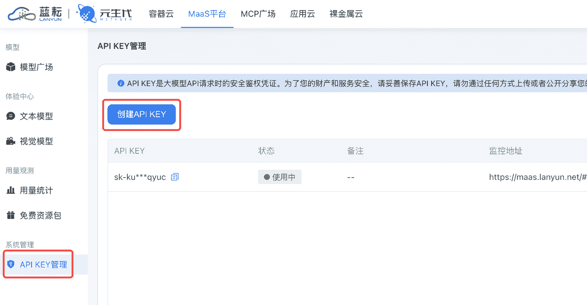

## 安装 Claude Code 客户端

省略安装的复杂步骤（准备 node 环境 +配置环境变量+配置 API_KEY 等），执行以下脚本，一键搞定💡：

```
bash -c &quot;$(curl -fsSL https://raw.githubusercontent.com/LanyunAI-labs/lanyun-cc/main/install.sh)&quot;
```

出现以下界面后，粘贴第一步中的 API KEY :

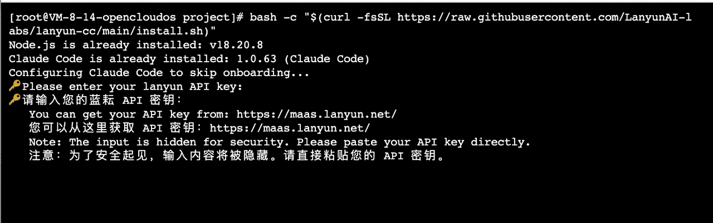

脚本跑完之后，执行结果中的 source 命令，重新加载配置文件：

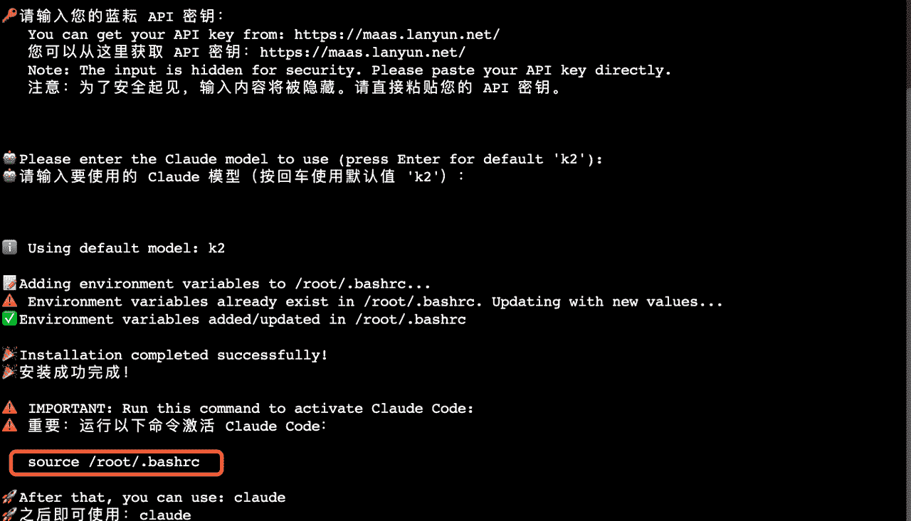

创建项目目录，进入项目根目录后执行：

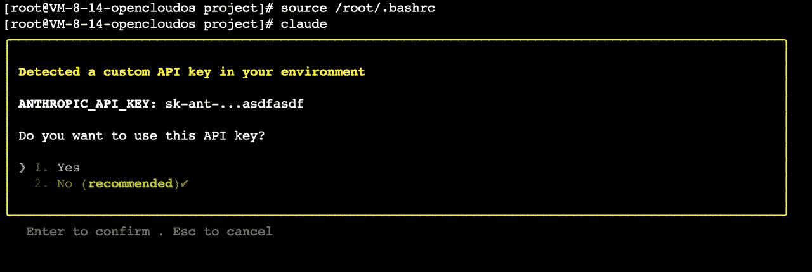

无脑 Say Yes 就可以进入正常开发了，so easy～

## 熟悉开发环境

#### 界面

+   命令行界面

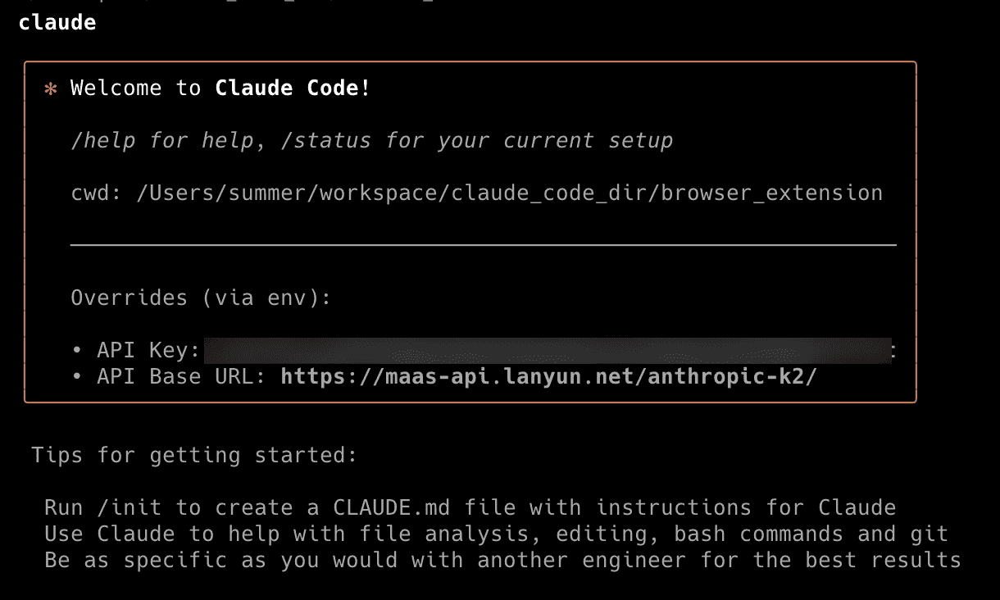

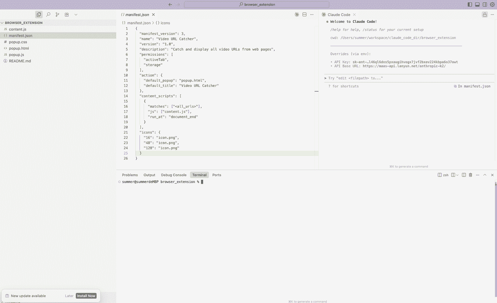

+   GUI 界面

```
npm install -g lanyuncodingui
```

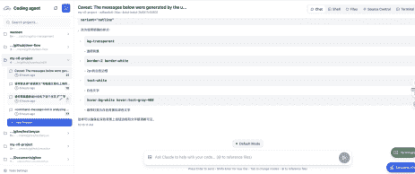

#### 命令行工具

+   CLI

```
claude --version
claude -p &quot;&quot;
claude mcp list
claude mcp add
claude -c
claude -r
claude --help
```

+   REPL（交互式）

关键快捷键

+   @（引用文件 context）

+   #（补充 Claude.md 系统提示词）

+   /（命令）

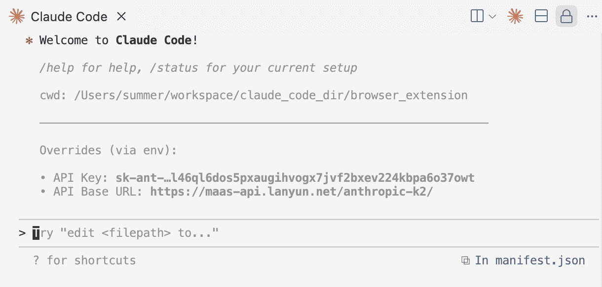

#### 作用上下文

#### 交互式使用技巧【核心：省钱、安全、稳定】

1.  巧用 Plan Mode：先规划，后执行

1.  用 Github 记录 Checkpoints：帮我提交当前进度、帮我回退到上一个进度

1.  使用 Image ：

1.  场景：UI 复刻、Fix Bugs

1.  如何使用：粘贴（ctrl+V）、拖拽

1.  时常清理上下文：减少幻觉

1.  如何使用：/clear

1.  安全检查：请检查代码，确保没有敏感信息（用户名密码）在前端代码中，也无代码漏洞（注入）在代码中

1.  检查时机：在发布之前

1.  充分了解你的代码：请 Claude 生成注释，每次结束后解释代码，确保了解每个模块

1.  整体步骤：规划 -> 实现 -> 检查

1.  保存需求文档、技术文档、引用 api 文档

# 二、浏览器插件核心功能开发


[extension-20250923-135043.zip](https://internal-api-drive-stream.feishu.cn/space/api/box/stream/download/all/Fpkxb4bMEoMb3Nxx2Qzc5ot9nTf)

体验包，打开 chrome://extensions，拖拽到页面中 👆

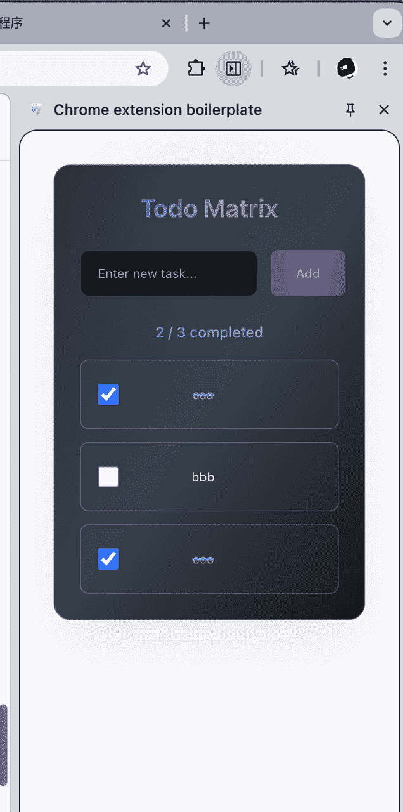

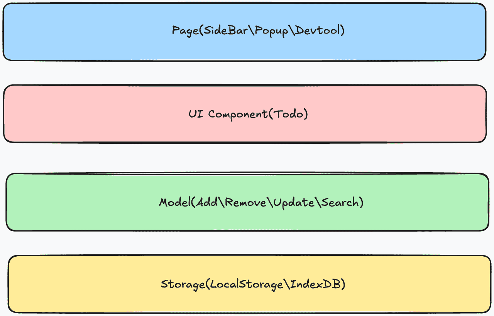

## 创建

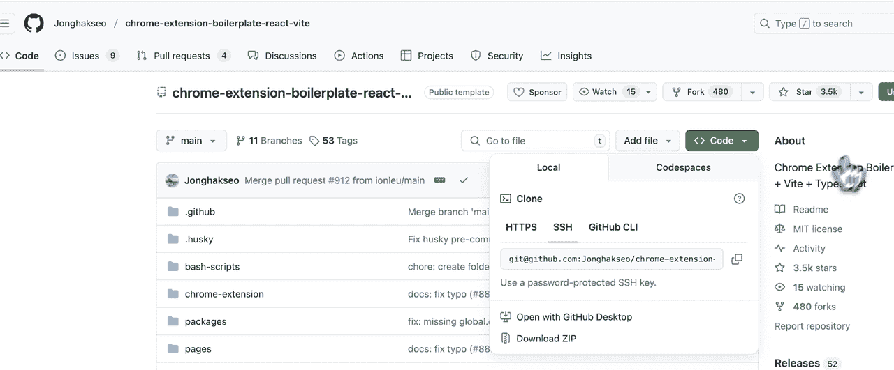

```
git clone git@github.com:Jonghakseo/chrome-extension-boilerplate-react-vite.git
```

拉取模板脚手架后，请让 AI 帮助你学习这个工程💡，并生成初始化系统提示词 claude.md

```
/init
```

进入交互式命令行

```
claude --allowedTools &quot;Edit,View,Bash,MultiEdit,Write,WebFetch,WebSearch&quot;
```

## 规划

1.  生成 UI 稿；

1.  创建需求文档 prd.md

1.  创建表设计文档 table.md

1.  创建技术文档 tech.md

1.  说明打开文档

## 执行

1.  参考 @tech.md 实现：

```
&gt; 帮我生成一个酷炫的 TODOList // =Plan Mode
```

1.  提交进度

```
&gt; 帮我提交当前进度
```

## 检查

1.  调试插件 pnpm run dev

```
&gt; 帮我启动开发模式
```

1.  浏览器地址栏输入： chrome://extensions/并打开「开发者模式」

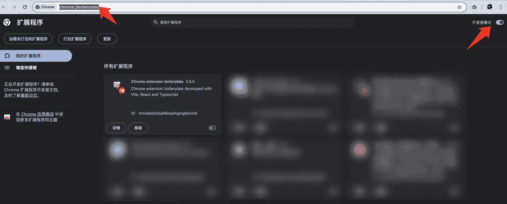

1.  加载插件

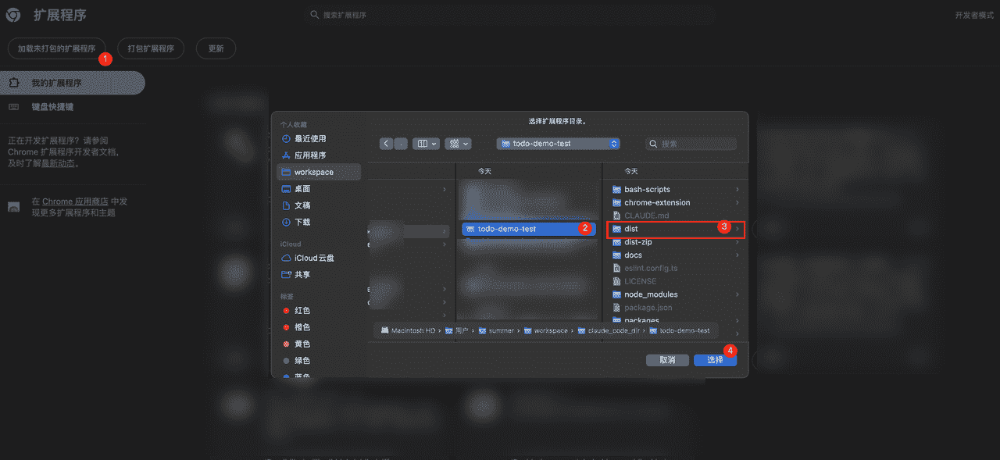

1.  调试插件

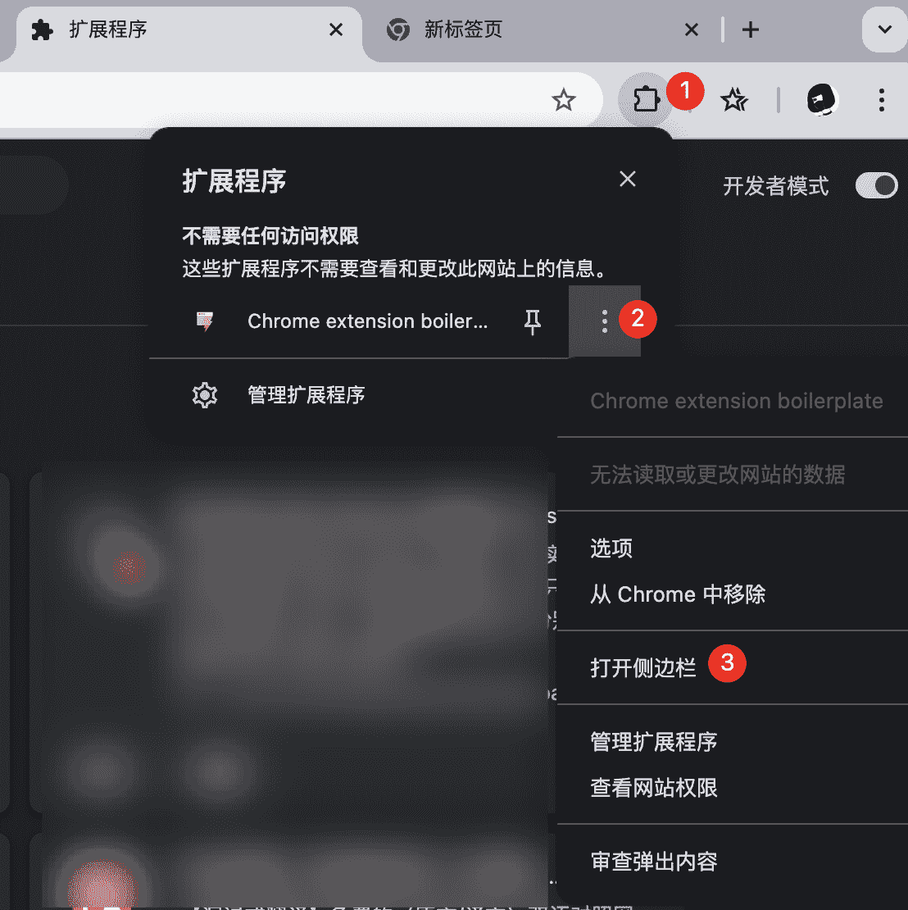

## 发布

```
&gt; 帮我打包
```

> 将下面的压缩包拖放到浏览器扩展程序的界面，或者发送给其他人

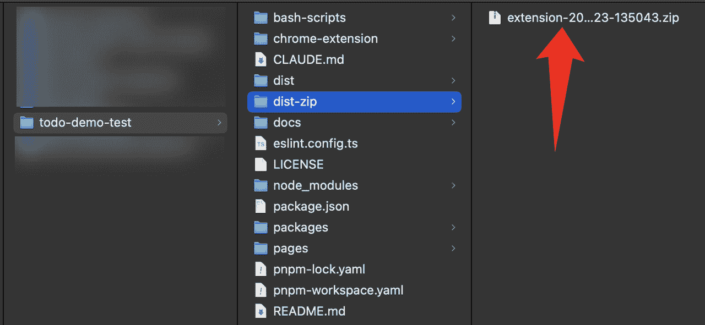

# 三、优化浏览器插件体验

> 对接「飞书文档」，将飞书文档的 API 地址复制并保存到本地的 docs/ 文件夹下

> 飞书文档：https://open.feishu.cn/document/server-docs/docs/bitable-v1/app-table-record/create

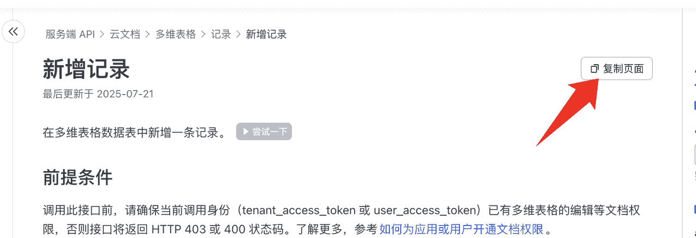

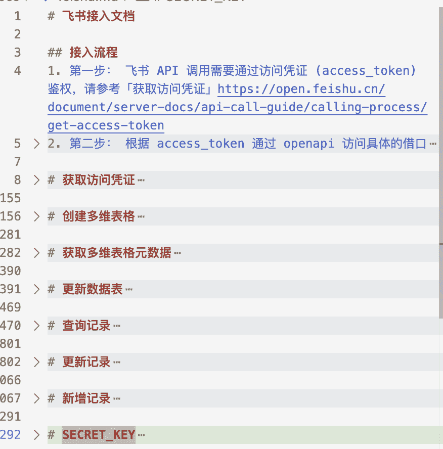

```
&gt; 帮我改造存储功能，在 packages 下增加 feishu 模块，存储的同时保存到飞书文档中，接口参考 @docs/feishu.md
=plan Mode
```

# 四、AI 辅助开发的 3 个（省钱）关键

+   用 AI 学习：对工程和代码不懂之处，多问 AI 是什么、为什么、还能不能更好；

+   精准对话：常用 @、# 带着上下文与 AI 对话，准确地描述需求；

+   拆分任务：多用 Plan Mode 先计划，后拆分任务，再执行，减少无效做工；

# 常见问题

1.  安装 lanyuncodingui 后一直 Test 失败。安装了两个 claude-code

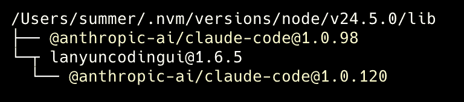

# 福利链接

[如何使用蓝耘claude code UI](https://ia0969wpr2.feishu.cn/wiki/RdoUw3ONSikNPxkKqGEciYHLnXg)

https://console.lanyun.net/#/register?promoterCode=0167


# 课件


[零基础手搓浏览器插件.pptx](https://internal-api-drive-stream.feishu.cn/space/api/box/stream/download/all/BdJtbby7eo747Uxh6jgcT8mCnKe)