# 零基础手搓🛰️小程序

> 来源：[https://yunyinghui.feishu.cn/docx/En24ditX5ohubWxXyiVcpJOXnvg](https://yunyinghui.feishu.cn/docx/En24ditX5ohubWxXyiVcpJOXnvg)

## 一、前置安装：

### 1、注册小程序账号

https://mp.weixin.qq.com

### 2、下载🛰️开发者工具

https://developers.weixin.qq.com/miniprogram/dev/devtools/download.html

根据自己电脑操作系统选择对应的安装包。

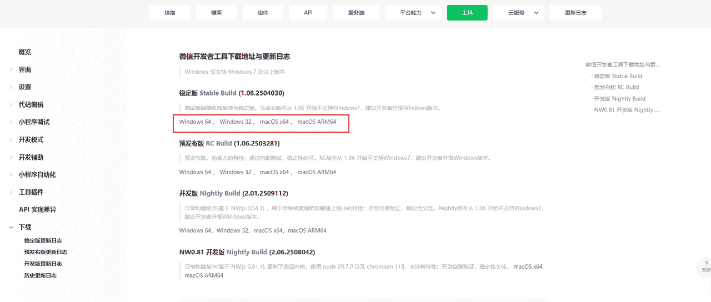

### 3、下载cursor并汉化

https://cursor.com/home?from=agents

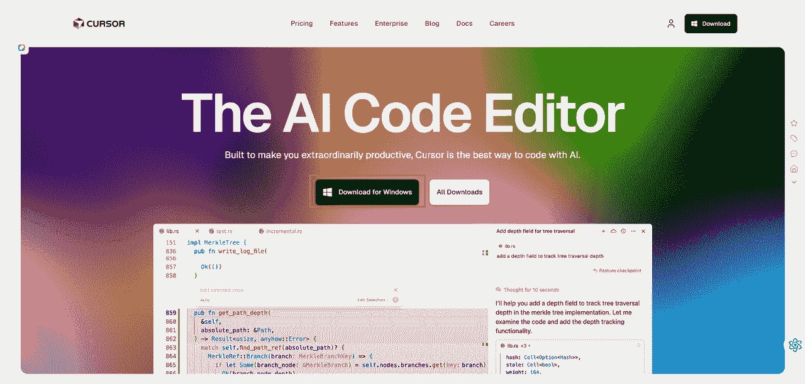

汉化，安装好后，重启`cursor`。

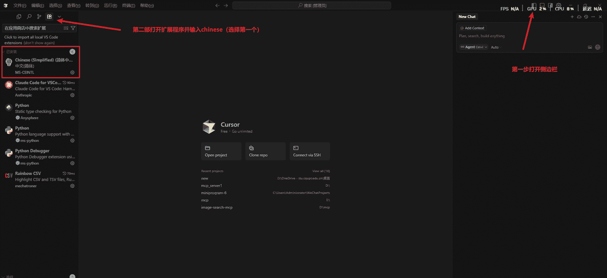

## 二、正式开始

## a、搭建你的开发环境

正式发布使用的同学，需要走这个流程，小程序官网：https://mp.weixin.qq.com/cgi-bin/wx?lang=zh_CN

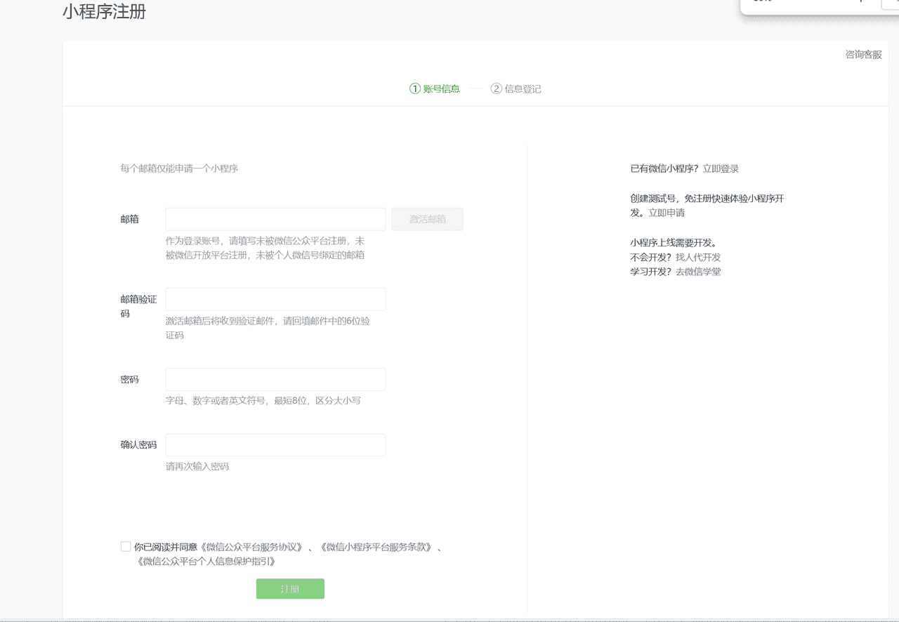

其中审核通过后，可以使用小程序的云开发功能，如果只是想尝试和体验小程序开发过程的同学，可以免注册创建测试号。

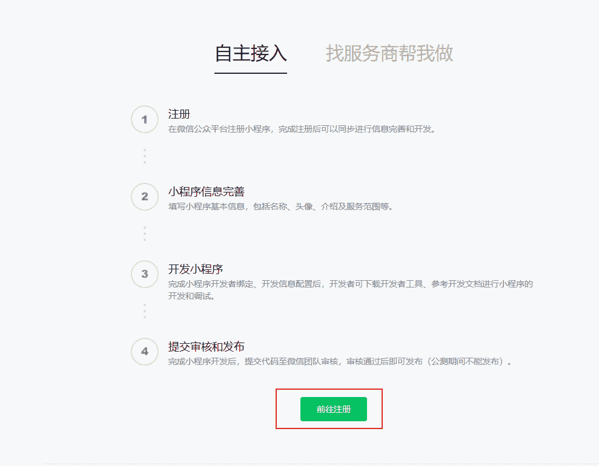

四个板块都需要完成通过。其中🛰️认证会官方会收取一定的费用，有上线需求的同学再考虑

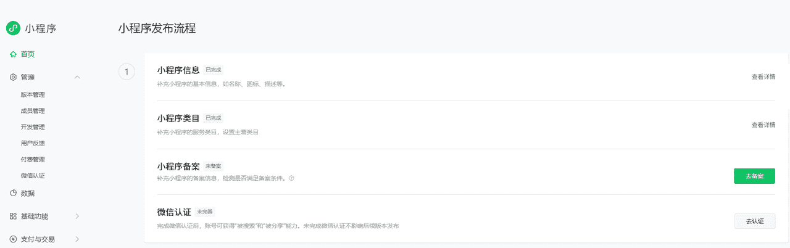

### 1、小程序开发平台

🛰️开发者工具下载地址：https://developers.weixin.qq.com/miniprogram/dev/devtools/download.html

选择自己系统对应的版本，本文以Windows64的版本为例

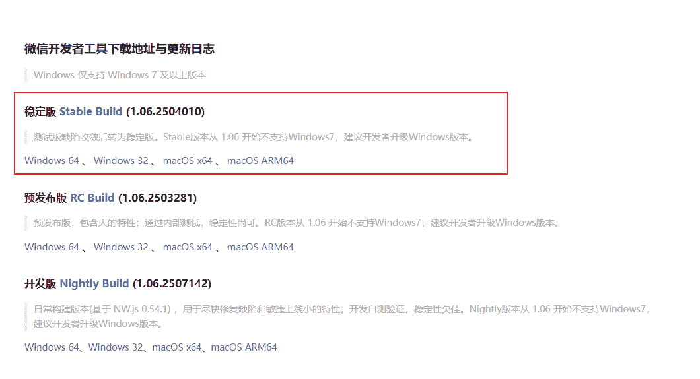

### 2、 配置`Claude Code Cli`【小白模式】

[注意：win系统一定要](https://blog.csdn.net/TiYong/article/details/136293656?ops_request_misc=%257B%2522request%255Fid%2522%253A%2522c96572f103628e79a290ff896012cd25%2522%252C%2522scm%2522%253A%252220140713.130102334..%2522%257D&request_id=c96572f103628e79a290ff896012cd25&biz_id=0&utm_medium=distribute.pc_search_result.none-task-blog-2~all~sobaiduend~default-2-136293656-null-null.142^v102^pc_search_result_base1&utm_term=windows%E5%BC%80%E5%90%AFWSL&spm=1018.2226.3001.4187)记[住电脑](https://nodejs.org/zh-cn/learn/asynchronous-work/event-loop-timers-and-nexttick)已经装了`wsl`【教程点击链接】和`npm`，mac则根据官网命令安装即可

如果上边的教程不懂，来，安排！！！

按住键盘的`win+r`，输入`cmd`，在命令行中输入`wsl --install -d Ubuntu`，黄啊码这里已经安装过了，所以才会出现以下报错，未安装过的会直接帮你安装完毕

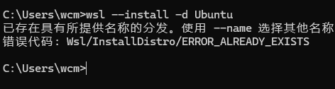

安装完毕后，在电脑左下角`ubuntu`，如果刚好有`ubuntu`图标，就直接点击即可。

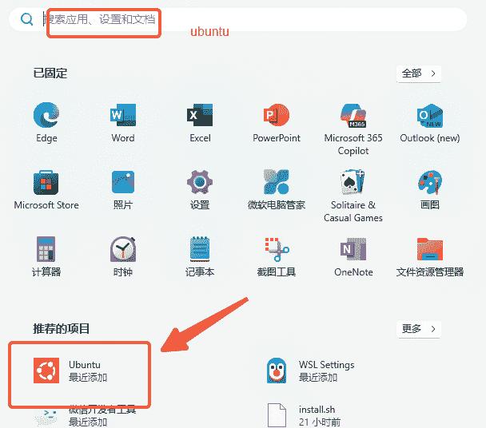

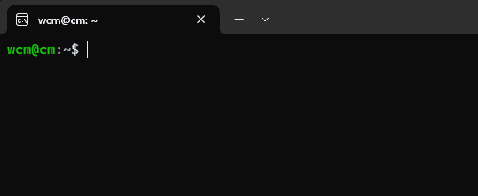

以下的命令行配置是一句一句配置，切记!!!

```
# 更新
sudo apt update

# 安装python环境
sudo apt install -y python3 python3-pip

# 配置npm环境
curl -o- https://raw.githubusercontent.com/nvm-sh/nvm/v0.40.3/install.sh | bash

# in lieu of restarting the shell
\. &quot;$HOME/.nvm/nvm.sh&quot;

# Download and install Node.js，安装的是22版本
nvm install 22

# Verify the Node.js version:
node -v

# Verify npm version:
npm -v

#安装npm
npm install -g npm@11.6.0
```

1. 安装【[官方教程](https://docs.claude.com/en/docs/claude-code/quickstart)】

首先，请确保您已安装 [`Claude Code`](https://docs.anthropic.com/en/docs/claude-code/quickstart)：

`npm install -g @anthropic-ai/claude-code`

由于`claude code`配置比较晦涩难懂，所以这一次我们换个思路，直接用UI方式实现，采用`Claude Code Router`

先安装 `Claude Code Router`：

`npm install -g @musistudio/claude-code-router`

输入`ccr code`，记住：不是`claude code`哦

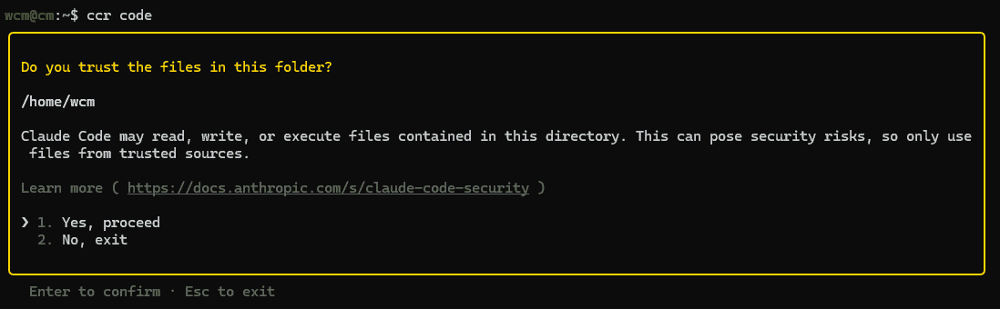

虽然配置完毕了，但是还缺乏配置密钥和模型之类的，所以我们需要打开咱们的UI网页配置，子系统是没办法实现的，我们需要用`ssh`链接

```
sudo apt install openssh-server
sudo service ssh start
打开Windows的命令提示符或PowerShell，然后使用以下命令连接到你的WSL实例，并将端口转发到你的web服务：
ssh -L 3456:localhost:3456 你的linux系统电脑名称@localhost -p 22
```

现在访问网页，完美！

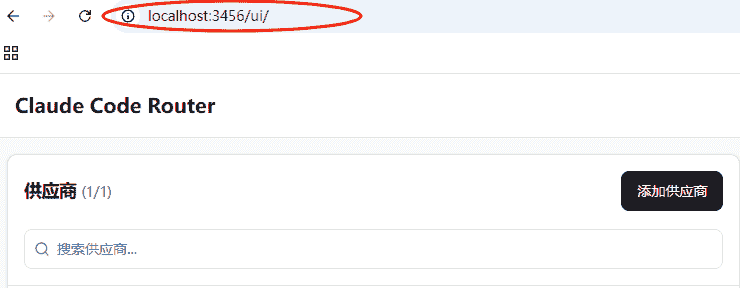

打开页面我们可以看到以下的UI，点击添加供应商，选择`openrouter`，设置API完整地址

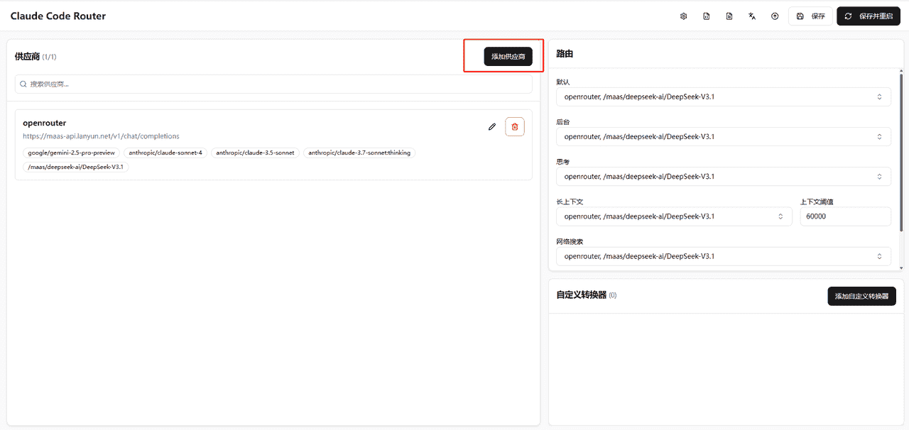

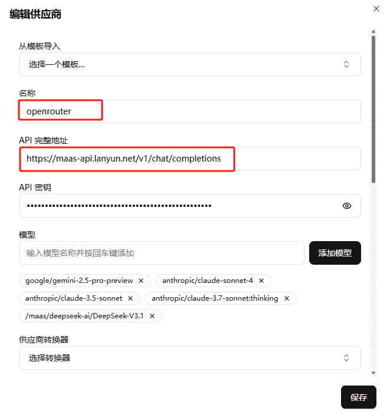

添加蓝耘【[打开链接](https://console.lanyun.net/#/register?promoterCode=0168)】对应的KEY，将KEY值填入到上边的API密钥中即可，对应的模型可以看模型广场，选中符合自己的模型点击复制图标即可复制

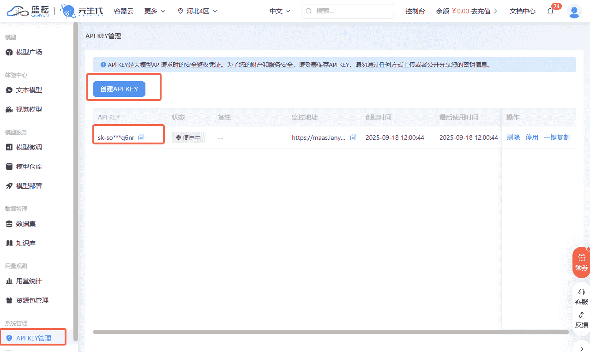

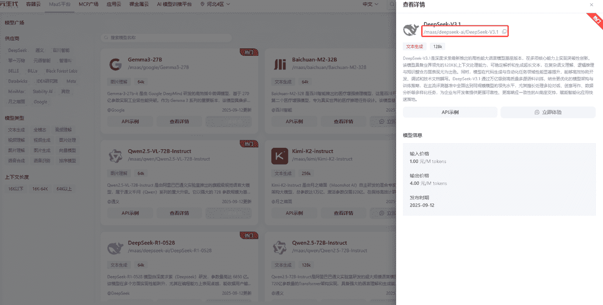

别忘记配置路由哦，如果不知道怎么配置，跟着我的步骤走就好

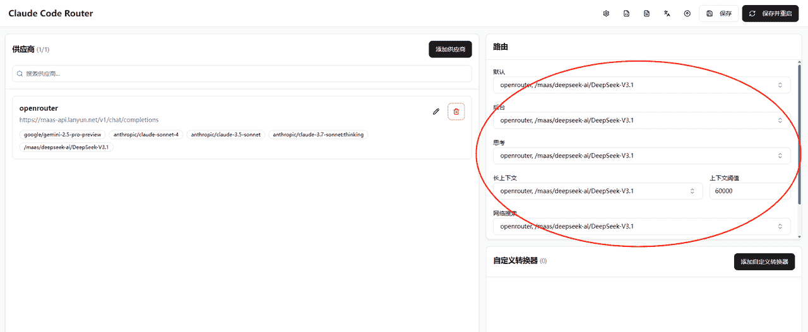

然后点击右上角保存并重启，回到我们的命令行，输入`ccr code`，直接回车，至此我们的`claude code cli`小白版本配置完成

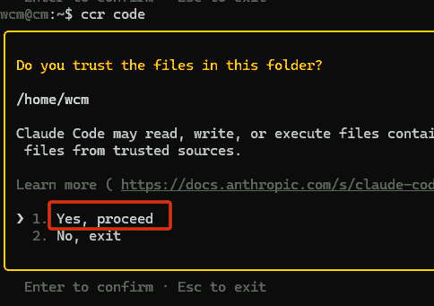

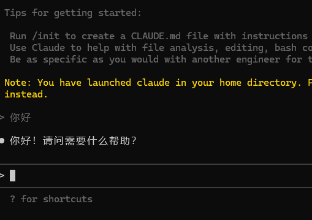

有些朋友肯定会有疑问，我配置了`deepseek`，为什么它还显示是`claude code`，关于这方面不需要管，因为这是`claude code cli`内部做了一些工程优化，所以相关的角色是已经设置固定了。

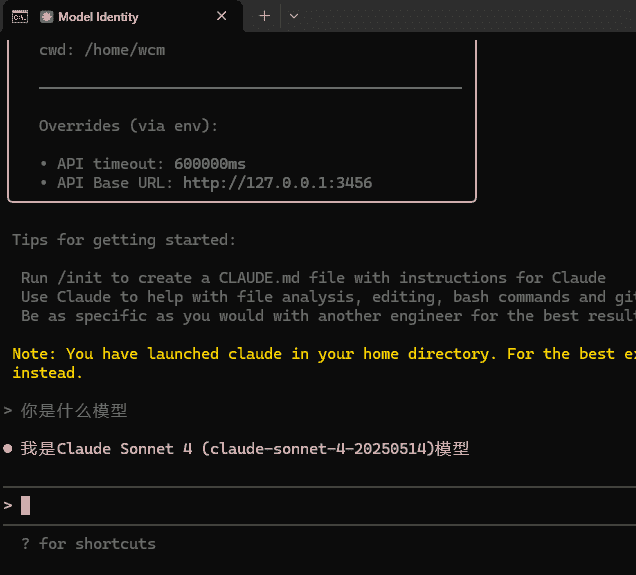

当然在这里开发的任何东西都会自动存储在子系统里边，所以如果想要实时看到，可以在`vscode`安装`wsl`插件

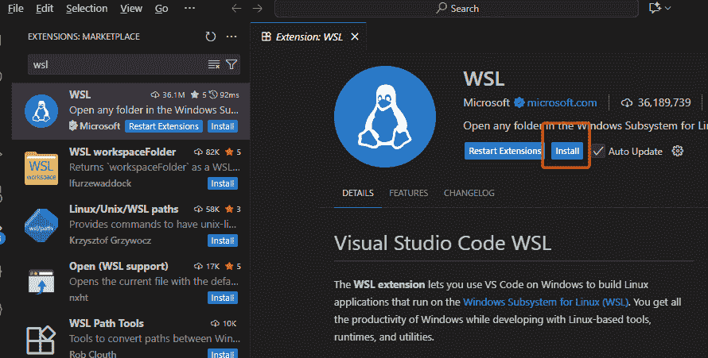

安装完毕之后，你可以在`Remote Explorer`这里看到对应的系统，点击箭头所在的地方，然后点击`open folder`，选择你要开发的文件夹

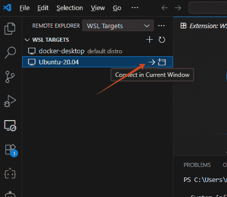

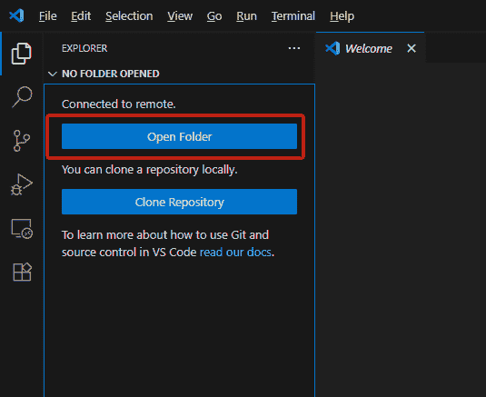

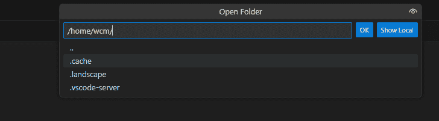

点击`vs`窗口上边的终端选项， 弹出了下边的命令行，接下来的所有命令行操作就跟在`wsl`命令行里边操作是一致的了，到此`Claude code cli`的简单轿车结束。

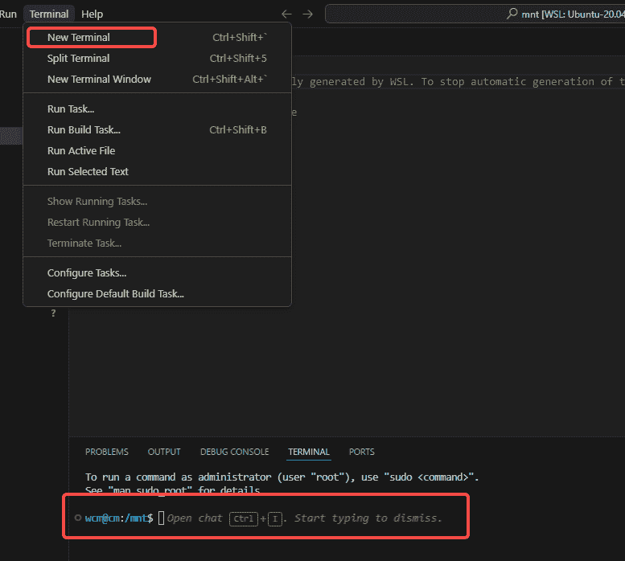

## b、小程序核心功能开发

以上演示的是`claude code cli`+`deepseek`实现，比较适合有点开发基础的，为了给予大家最大的方便，所以本节课采用了`cursor`作为演示开发工具。

首先打开🛰️开发者工具

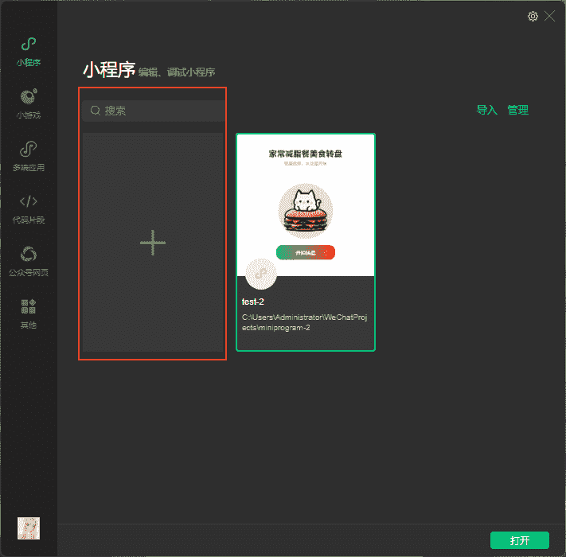

完成新建项目

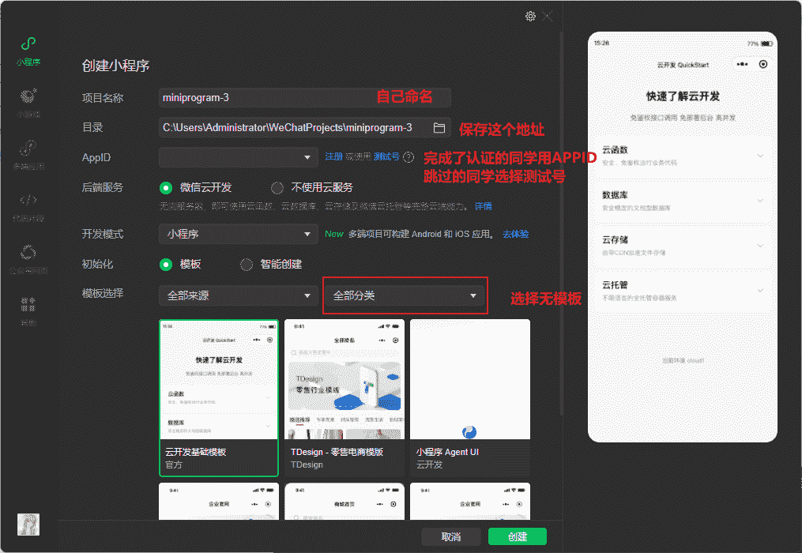

不用担心，不需要学习新的软件→点击右上角小窗口把我们的小程序变成一个独立界面，并且记得打开热重载（我们在`cursor`修改代码的时候，小程序模拟器这边会实时加载我们的项目。）

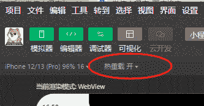

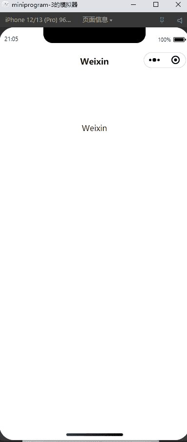

在`Cursor`中打开这个项目，并且新建一个`req.md`文档，这个文档主要放我们对小程序的需求。

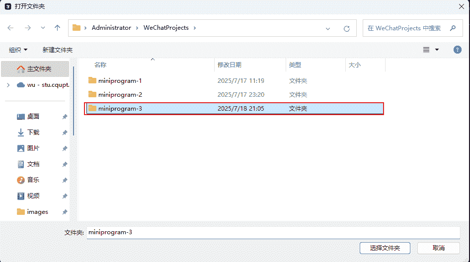

### 1、在`req.md`编辑以下内容并保存：

一个专门针对“家常减脂餐”的“美食转盘”小程序，并且需要包含大约100个菜单选项。这个小程序的目的是提供一个快速、有趣的方式来随机选择一道家常减脂餐，解决用户“今天吃什么减脂餐”的烦恼。并且选择后能将食材都列举出来，并自动计算卡路里

### 2、并将`req.md`文件拖进右侧的`new chat`中并对话：

@`req.md` 我想做这个小程序最简单版本，请你帮我在这个开发文档里面补充一些最关键的页面信息，每个页面需要包含主要的元素，还有整体的设计风格，背景颜色等

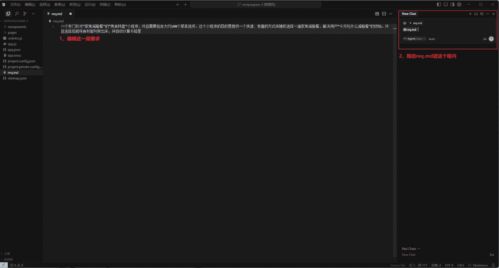

### 3、选择自动补充，并接受

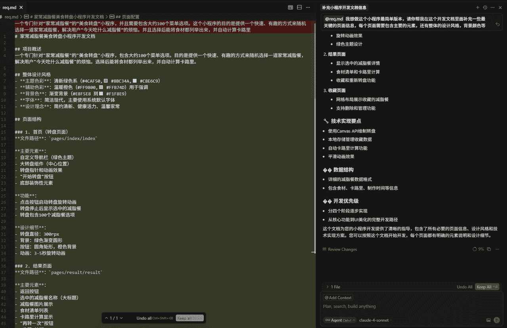

### 4、`chat`对话：

@`req.md` 我已经完成了关键页面的设计，请帮我根据这个设计，完成这个功能，并自动生成代码

**注意事项：**

1、其中有时候代码不会自动生成，请使用魔法指令：请帮我自动生成

2、当模拟器出现报错时，截图模拟器的错误，直接丢到`cursor`中，让ai解决ai生成的错误


[`NVIDIA_Overlay_lQuaXUtO3g.mp4`](https://internal-api-drive-stream.feishu.cn/space/api/box/stream/download/all/AGw4bx3LTo0uTzxfSancGYRKnrc)

### 5、基础功能的实现：

可以看到我们完成了一些基础的设计，但是非常的丑，且点击详细页面中也没有对应的图片。下面我们可以用`cursor`进行魔改。


[`NVIDIA_Overlay_ojU2yU3RRL.mp4`](https://internal-api-drive-stream.feishu.cn/space/api/box/stream/download/all/JVK7bAAPvoYtoqxZU4ncIHWynRf)

### 6、基础魔改：

在`chat`中输入以下指令：

1、优化主页ui让他变得好看，现在的ui太丑了，整体的ui要清新自然风格，主页、详细界面等都要统一风格

2、比如出现一些bug的时候，可以将程序截图并框出有问题的地方直接丢进`cursor`中，让他排查问题。eg：这个全部菜单点不开，请帮我自动修改问题

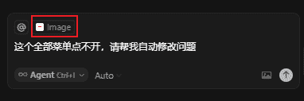


3、`cursor`美化的一些现场调试效果和最终成品

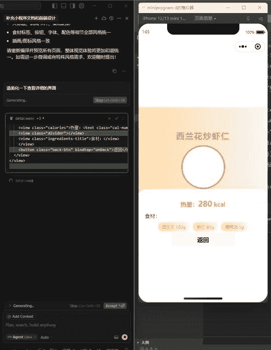

[`NVIDIA_Overlay_rAYhBMc2oa.mp4`](https://internal-api-drive-stream.feishu.cn/space/api/box/stream/download/all/V30cbau3iosowaxiwTvcIiIsn1d)


[`NVIDIA_Overlay_xPvAHf3ral.mp4`](https://internal-api-drive-stream.feishu.cn/space/api/box/stream/download/all/JRGPbBgpQoxnn8xRpw4cyMLanFd)

1.  不过，由于转盘我么没有明显的图片，所以黄啊码将其点击按钮，并且优化了简单优化了版面，最终一个最简单的版本就已经完成了，这个时候就可以进行实机测试或者发布。用🛰️扫描生成出来的二维码，也可以分享给朋友进行测试。

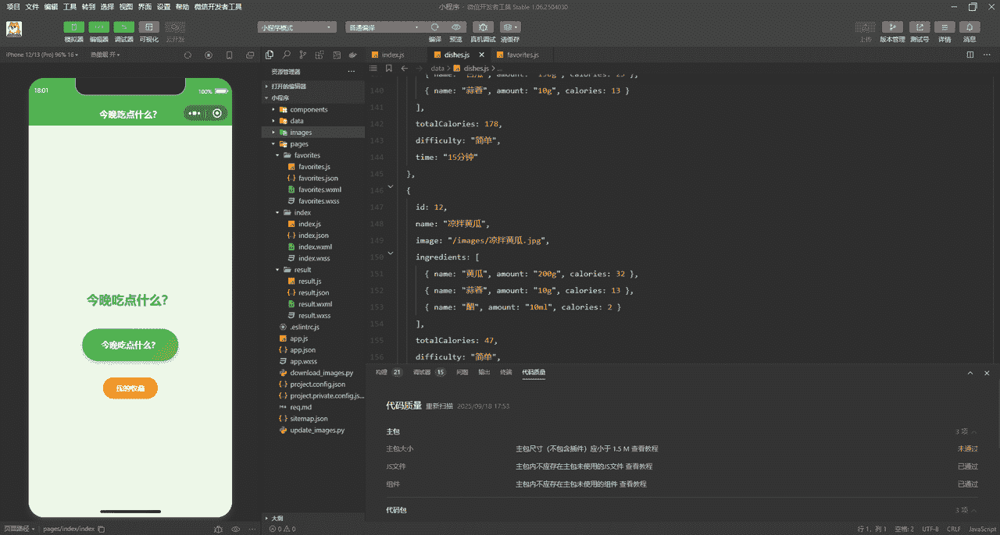

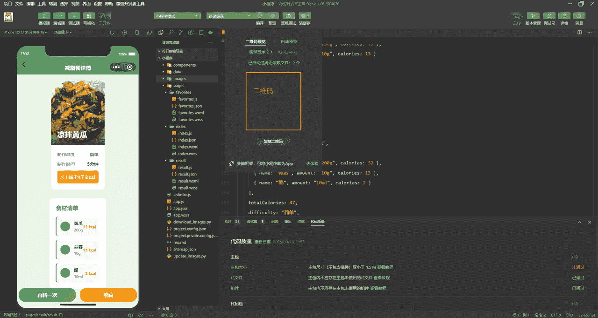

1. 上线

前面小程序官方注册流程审核都通过的同学，全部开发好后，点击上传。

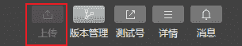

进入 [小程序管理平台](https://mp.weixin.qq.com/wxamp/wacodepage/getcodepage?token=1980708763&lang=zh_CN)，点击版本管理→开发版本中→对应版本提交审核→提交完之后，（可以在审批版本中查看审核结果。审核结果也可以在🛰️的【服务通知】上看到。审核官方给定的是1~7天，但是大部分时候一天左右就能审核完毕）→审核成功后，在版本管理中，点击审核版本，选择全量发布/灰度发布（全量发布是指将小程序的新版本一次性推送给所有用户，灰度发布是指将小程序的新版本先发布给部分用户。）

## c、小程序功能优化

可以看到，前面的小程序只是一个基础案例，并且其中的菜谱数量并不多，对应食物的图片也没有出现，下面的教程是对上面程序的优化，右边放最终的优化结果。

魔法指令：

1、扩充食谱：食谱种类太少了，请扩充在100种附近，涵盖丰富的蔬菜、蛋白、低脂主食等多样搭配，每道菜都包含名称、食材及用量、总卡路里，卡路里的计算要精准。

2、构建数据库每张食谱的照片，在测试号中，`cursor`会建立本地存储，进行每张照片的管理，在云开发中，这些照片会存储到云端服务器上。

3、扒取对应食谱的照片：由于国内的反扒手段都做得比较好，🪜的国外扒取手段会因为网络问题时常崩溃，这里提供一种通过`cursor`生成的代码，并反复换源等方式解决，比较麻烦，这里就直接给大家贴代码。


# 图片下载脚本与 UI 设计优化指南

## Python 批量下载图片脚本

```python
import requests
import os
import time
import re
import random
import hashlib

DOWNLOAD_DIR = 'images'
MENU_NAMES = [
  "鸡胸肉蔬菜沙拉", "西兰花炒虾仁", "番茄鸡蛋面", "清蒸鲈鱼", "凉拌豆腐", "紫菜蛋花汤", "蒜蓉西兰花", "香煎三文鱼", "烤南瓜", "芦笋炒虾仁",
    "鸡蛋炒苦瓜", "凉拌黄瓜", "番茄牛腩汤", "香菇青菜", "鸡丝拌菠菜",
    "红烧茄子", "豆角炒鸡蛋", "清炒西葫芦", "蒸南瓜", "豆腐鲫鱼汤",
    "香煎鸡胸肉", "凉拌木耳", "蒸蛋羹", "炒杂蔬", "烤鸡翅根",
    "清炒苦菊", "番茄豆腐汤", "蒜蓉油麦菜", "清炒菜心", "香菇炒鸡胸肉",
    "凉拌西红柿", "清炒豆苗", "烤茄子", "鸡蛋炒西红柿", "清炒芥蓝",
    "蒸鲈鱼", "凉拌菠菜", "清炒小白菜", "烤红薯", "鸡胸肉炒西兰花",
    "清炒生菜", "番茄豆角炒蛋", "蒸南瓜泥", "清炒空心菜", "香煎豆腐",
    "鸡蛋羹", "清炒油菜", "烤南瓜片", "凉拌海带丝", "清炒芦笋",
    "香煎牛排", "清炒豆芽", "蒸茄子", "鸡胸肉炒芦笋", "清炒西蓝花",
    "烤鸡胸肉", "凉拌豆皮", "清炒苋菜", "蒸鲈鱼片", "香煎鸡腿排",
    "清炒西兰花胡萝卜", "烤土豆片", "凉拌莴苣", "清炒豆腐皮", "蒸鸡蛋",
    "清炒西红柿", "烤南瓜丁", "凉拌豆芽", "清炒芹菜", "香煎鱼排",
    "清炒苦瓜", "蒸南瓜块", "鸡蛋炒芦笋", "清炒西兰花豆腐", "烤胡萝卜",
    "凉拌金针菇", "清炒小油菜", "蒸鲈鱼头", "香煎豆腐块", "清炒西兰花胡萝卜玉米",
    "烤南瓜球", "凉拌莴笋", "清炒豆腐", "蒸鸡胸肉", "清炒西兰花胡萝卜豆腐"
    # ... 可继续补充菜单名，建议100个
]

def safe_filename(name):
    return re.sub(r'[\\/:*?<>|]', '_', name)

def get_baidu_image_url(keyword, max_retry=3):
    url = "https://image.baidu.com/search/acjson"
    params = {
        "tn": "resultjson_com",
        "logid": str(random.random()),
        "ipn": "rj",
        "ct": "201326592",
        "is": "",
        "fp": "result",
        "queryWord": keyword,
        "cl": "2",
        "lm": "-1",
        "ie": "utf-8",
        "oe": "utf-8",
        "adpicid": "",
        "st": "-1",
        "z": "",
        "ic": "",
        "hd": "",
        "latest": "",
        "copyright": "",
        "word": keyword,
        "s": "",
        "se": "",
        "tab": "",
        "width": "",
        "height": "",
        "face": "0",
        "istype": "2",
        "qc": "",
        "nc": "1",
        "fr": "",
        "pn": "0",
        "rn": "10",
        "gsm": "1e"
    }
    headers = {
        "User-Agent": "Mozilla/5.0 (Windows NT 10.0; Win64; x64) AppleWebKit/537.36 (KHTML, like Gecko) Chrome/114.0.0.0 Safari/537.36",
        "Accept": "application/json, text/javascript, */*; q=0.01",
        "Accept-Language": "zh-CN,zh;q=0.9",
        "Referer": "https://image.baidu.com/",
        "X-Requested-With": "XMLHttpRequest",
    }
    for attempt in range(max_retry):
        try:
            resp = requests.get(url, params=params, timeout=10, headers=headers)
            resp.raise_for_status()
            data = resp.json()
            if "data" in data:
                for item in data["data"]:
                    img_url = item.get("thumbURL") or item.get("middleURL")
                    if img_url:
                        return img_url
            print(f"未找到图片: {keyword}，响应内容：{data}")
            time.sleep(2)
        except Exception as e:
            print(f"百度图片接口异常: {keyword}, 错误: {e}")
            time.sleep(2)
    return None

if not os.path.exists(DOWNLOAD_DIR):
    os.makedirs(DOWNLOAD_DIR)

for name in MENU_NAMES:
    img_url = get_baidu_image_url(name)
    filename = os.path.join(DOWNLOAD_DIR, f"{safe_filename(name)}.jpg")
    if img_url:
        try:
            img_data = requests.get(img_url, timeout=10).content
            with open(filename, 'wb') as f:
                f.write(img_data)
            print(f"已下载: {name} -> {filename}")
        except Exception as e:
            print(f"图片下载失败: {name}, 错误: {e}")
    else:
        print(f"未找到图片: {name}")
    time.sleep(1.5)

print("全部下载完成！")
```

## 1、小程序设计优化

给`Cursor`输入提示词，举例我们希望有一个简洁、高效、智能的UI特效时，可以设计以下魔法提示词：

```
一、 整体视觉风格
极简主义与现代感：采用扁平化设计，去除冗余元素，强调内容的清晰呈现。运用简洁的线条、几何图形和留白，营造现代感和专业性。
色彩搭配：以中性色（如灰、白）为主调，搭配少量明亮、清新的强调色（例如：蓝色、绿色、紫色等，具体可根据`Cursor`品牌调性选择）。色彩应具有良好的对比度，保证信息的可读性。避免过多色彩，以免造成视觉混乱。
字体选择：选择简洁、易读的无衬线字体（如苹方、思源黑体等），确保在不同屏幕尺寸下都能清晰显示。字号和字重应有明确的层级，突出重点信息。

二、 布局与导航
直观易用：采用主流的底部导航栏或顶部Tab切换，方便用户快速切换核心功能。导航结构应扁平化，减少层级，避免“迷路”。
模块化布局：页面内容划分为清晰的功能模块，每个模块有明确的标题或引导语。模块之间留出足够的间距，避免拥挤感。
响应式设计：确保UI元素在不同型号的手机设备上都能自适应显示，保持良好的视觉效果和操作体验。

三、 交互设计
流畅的动画效果：适当运用过渡动画，如页面切换、按钮点击、数据加载等，增加交互的趣味性和流畅度，同时避免过度动画造成卡顿。
反馈及时：用户的每一次操作都应有明确的视觉或触觉反馈，例如按钮点击状态变化、加载提示、成功或失败的弹窗等。
手势操作：考虑引入常见手势操作，如下拉刷新、滑动切换等，提升用户操作效率。
```

## 2、草图优化UI

比较擅长手绘的同学，也可以绘制手稿，丢到`Cursor`中，让他识别生成，比如（随便打开一个生活缴费的小程序，参考他的布局设计，用画图软件设计一个草图，并丢到`Cursor`中，让他按照这样的图案设计。）


## 3、Figma MCP

Figma MCP (Model Context Protocol) 是一种开放标准，旨在让 AI 代码生成工具能直接理解 Figma 设计文件中的结构化数据和语义信息。这使得 AI 能够更准确地将设计转化为代码，从而显著提升设计到开发的工作效率。简单来说，Figma MCP 拥有一套完整的组件库，可以快速创建高保真的原型图，帮助我们设计 UI。

### 使用教程

（1）Figma 官网注册：`https://www.figma.com/`，点击左上角→点击 `Settings`

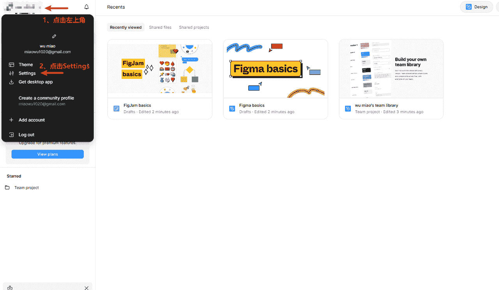

（2）点击 `Security`→`Generate new token`→右侧权限全部选到最高→保存生成的 `token` 密码

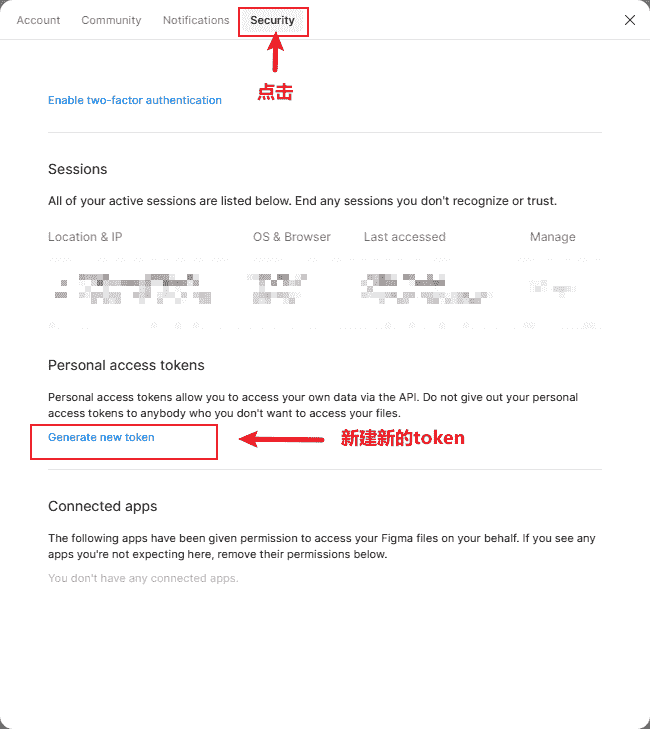

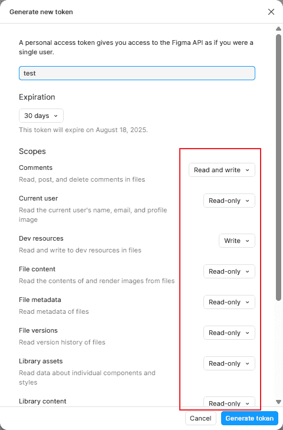

（3）打开 [Figma 的指南](https://www.framelink.ai/docs/quickstart?utm_source=github&utm_medium=referral&utm_campaign=readme)，复制对应系统的设置代码。把前面的 `token` 替换掉 `YOUR-KEY`，并暂存，等会会需要

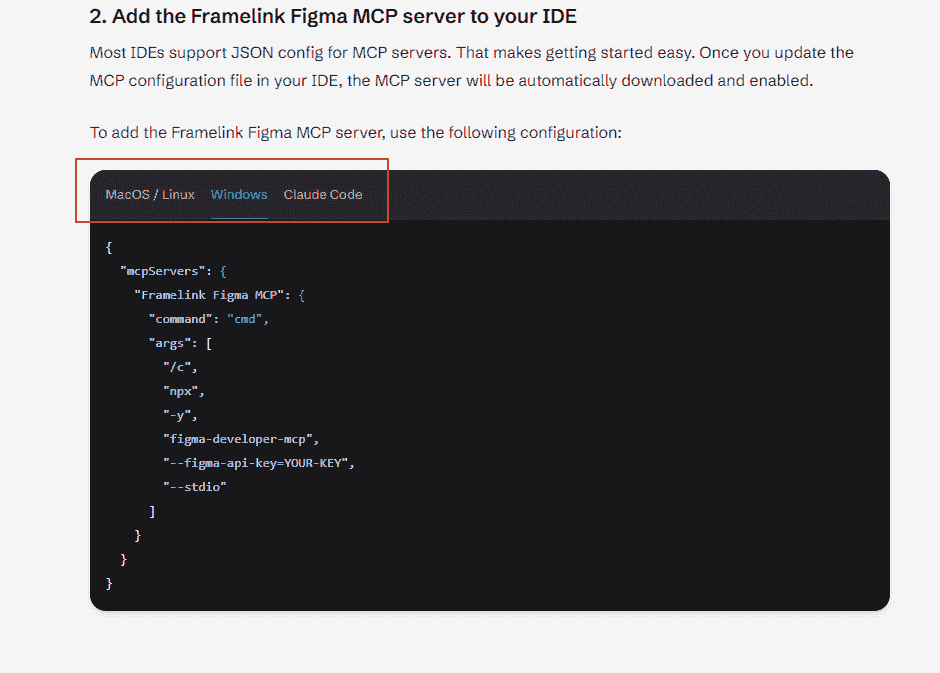

（4）本地运行 Figma-MCP 服务

1.  安装 `Node.js` 18 以上的版本。官方地址：`https://nodejs.org/en/download`，测试。

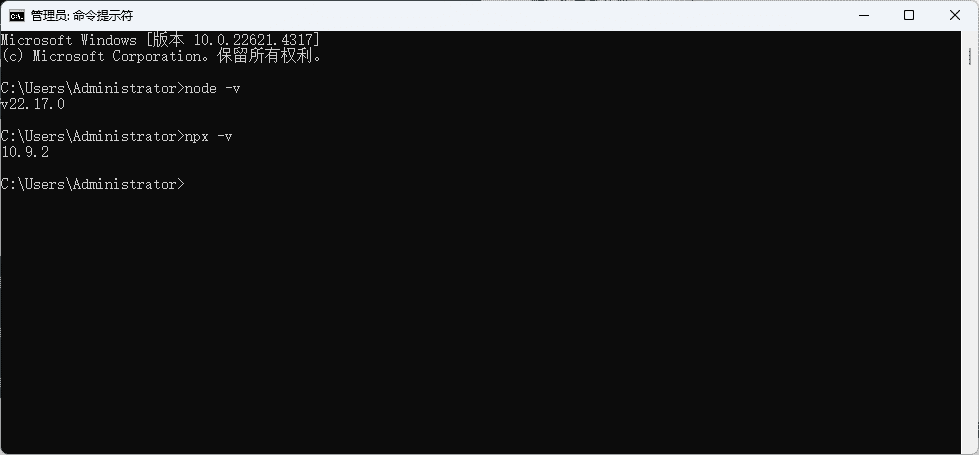

1.  将 `mcp` `https://github.com/GLips/Figma-Context-MCP` 源代码下载到本地。官方地址

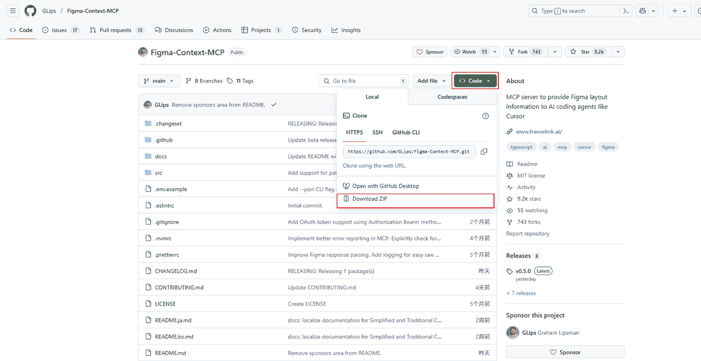

1.  右键 `Figma-Context-MCP-main` 文件夹，并用 `Cursor` 打开，点击 `.env.example` 文件，将红框区域填进之前我们生成的 `token`，并将 `.env.example` 重命名为 `.env` 文件。

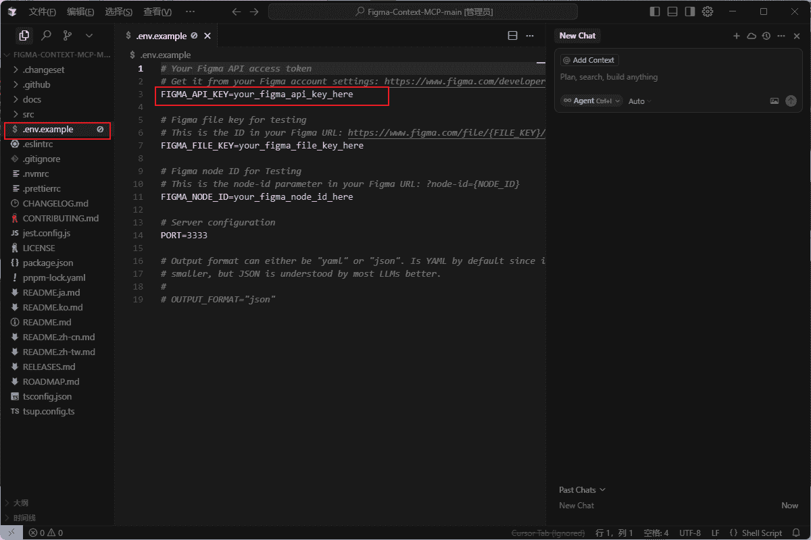

1.  安装依赖：点击左下角→点击终端→输入 `pnpm i`

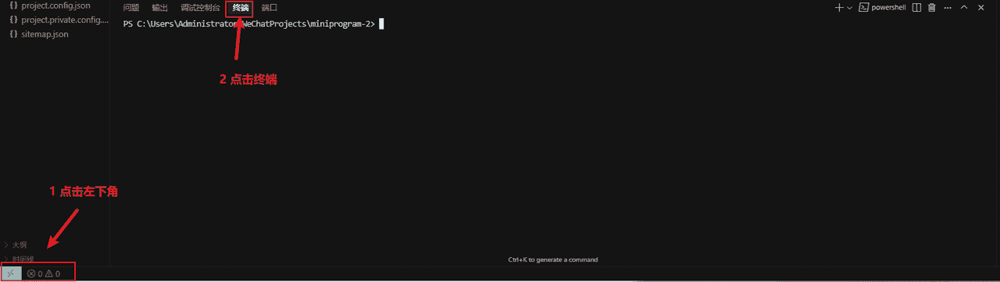

1.  出现以下报错别害怕，请跟着本文继续解决，这种情况通常是这说明你的系统没有安装 `pnpm`，或者 `pnpm` 没有添加到环境变量（`PATH`）中，且 `PowerShell` 脚本执行策略阻止了 `npm` 的运行。

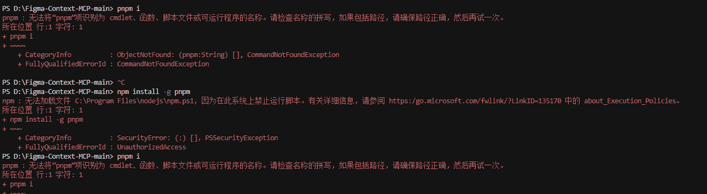

1.  打开 `PowerShell`，并输入以下代码，回答 `Y` 或 `A`

```
Set-ExecutionPolicy -Scope CurrentUser -ExecutionPolicy RemoteSigned
```

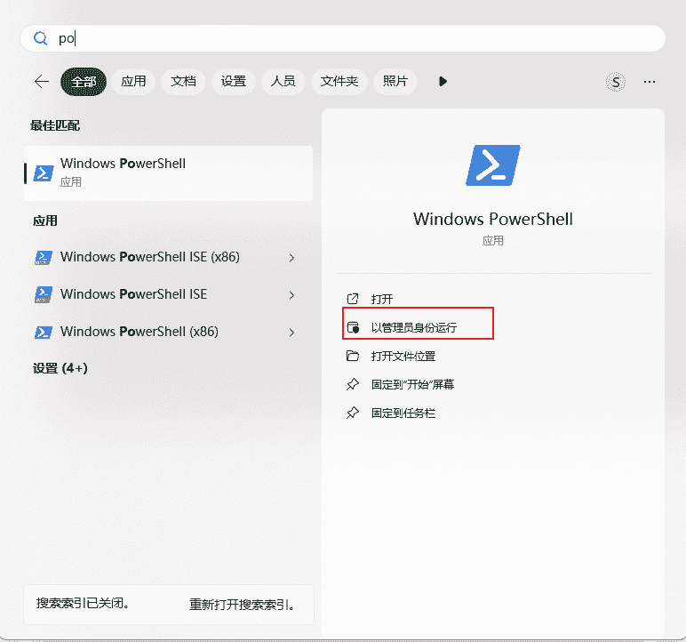

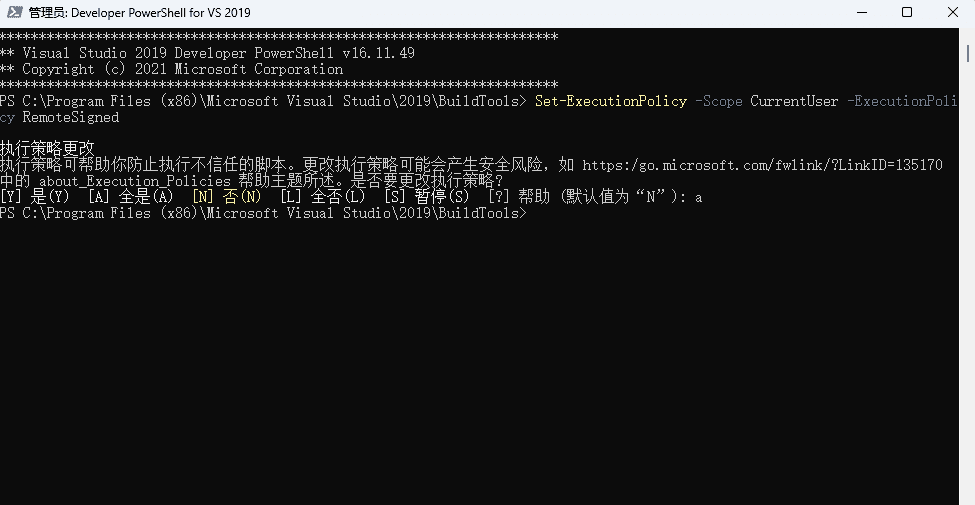

1.  回到我们的程序终端，输入 `npm install -g pnpm`，安装完成后输入 `pnpm i`，安装依赖，出现下面页面即安装成功

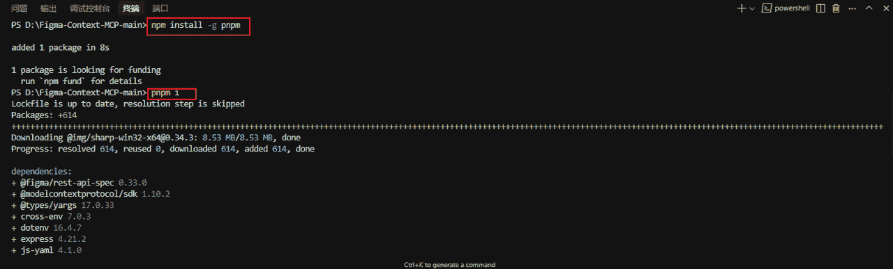

1.  输入 `pnpm dev` 启动项目，启动项目后复制下面链接 `http://localhost:3333/sse`

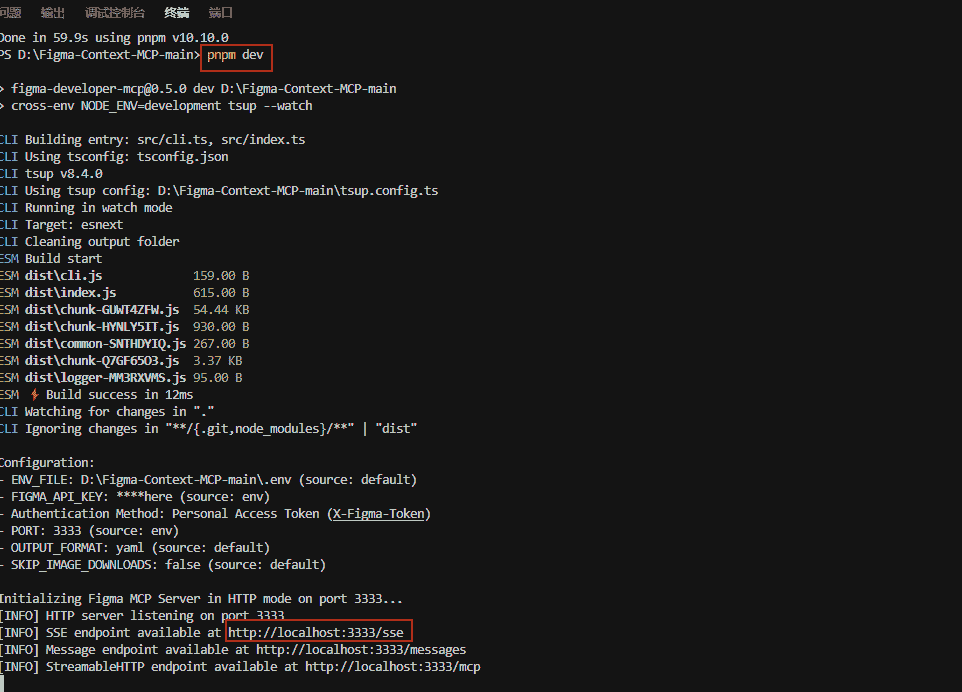

1.  打开 [Figma 的指南](https://www.framelink.ai/docs/quickstart?utm_source=github&utm_medium=referral&utm_campaign=readme)，复制对应系统的设置代码（步骤（3）中已经做过，复制到 MCP 中，记得设置白名单，详细参考页首传送门中的教程，当 Framelink Figma MCP 下面状态点变成绿色时，即说明配置启动成功。


# 二、使用 Figma 和 Cursor 进行设计稿复刻


1. 我们在figma上随便寻找一个[案例](https://www.figma.com/design/z5tFGlGkfy1iCioW5bdFTk/WeChat%E5%A4%B1%E7%89%A9%E6%8B%9B%E9%A2%86%E5%B0%8F%E7%A8%8B%E5%BA%8F--Community-?node-id=45-844&t=Nc7c8cozO1eumJLg-0)，以下面这个失物招领的设计稿举例

打开页面后选择想要复刻的区域，右键`Copy`→`Copy link to selection`


丢到Cursor中，添加一些魔法指令：

```
创建一个小程序项目，根据figma链接抓取元素，并生成相应代码@https://www.figma.com/design/z5tFGlGkfy1iCioW5bdFTk/WeChat%E5%A4%B1%E7%89%A9%E6%8B%9B%E9%A2%86%E5%B0%8F%E7%A8%8B%E5%BA%8F--Community-?node-id=45-844&amp;t=4Q4aVocpVHV9Kj3q-1 
上面的链接请换成大家个人的链接
```

1. 看看最终效果

左边的是最初的生成，可以看到只实现了基础功能，右边命令它更加优化 与原本的更加相似。并且大家可以测试各种魔法指令让其更加相似。


[NVIDIA_Overlay_gd1V1PdXaW.mp4](https://internal-api-drive-stream.feishu.cn/space/api/box/stream/download/all/EDh9btmjNoCI0IxLXNWc4Y8mnzh)


[NVIDIA_Overlay_we0d3UlSUN.mp4](https://internal-api-drive-stream.feishu.cn/space/api/box/stream/download/all/PRKnbeoa0owNlyxooxdcwQd5n5e)

1. 除此之外，我们还可以直接让figma帮我们生成原型图，以下是魔法代码，一些svg无法显示，是因为figma生成时，svg等还是需要大家自行填充到文件夹里，但是可以看到figma生成出来的初版还是有模有样的，节省了很多初始开发时间，大家也可以根据自己的需求去和Cursor沟通，生成功能更加齐全的应用

```
你是一位资深设计师，你非常了解[Dribble.com](http://Dribble.com)以及i0S/Google 等设计风格，拥有丰富的全栈开发经验及极高的审美造诣，擅长现代化设计风格，尤其擅长移动端设计及开发。

## 我想做的 App 需求
我想做一个类似微信的小程序

## 我的要求:
页面元素尽量美观高级，遵守移动端设计规范，注重所有数据都用假数据，所有页面都可以点击交互，请按照以上要求生成完整的高保真原型图(html)
可以覆盖我所有已有代码
```


[NVIDIA_Overlay_gRyuHcoFIT.mp4](https://internal-api-drive-stream.feishu.cn/space/api/box/stream/download/all/FNxXbe28OopCKNxDOJocggBUnXd)

# 三、Vibe Coding的3 条重要建议

## 【1】充分利用AI代码生成和补全功能

+ 选择合适的编程模型：国产的deepseek和kimi在前端领域表现不错，而claude和chatgpt以及gemini在后端交互不错，重点是国产模型便宜，所以择优使用吧。

+ 使用AI工具生成基础代码结构：让AI帮助生成页面模板、组件框架、API调用等重复性代码

+ 智能代码补全：利用AI的上下文理解能力，快速补全函数、变量和逻辑【多利用tab按键】

+ 代码重构建议：让AI分析代码并提供优化建议，提高代码质量和性能

## 【2】建立清晰的开发规范和文档

+ 制定命名规范：页面、组件、函数、变量等命名要统一且语义化

+ 模块化开发：将功能拆分为独立组件，便于AI理解和维护

+ 注释和文档：为关键逻辑添加清晰注释，帮助AI更好地理解代码意图

+ 版本控制：使用`Git`管理代码版本，便于AI跟踪代码变更

## 【3】注重用户体验和性能优化

+ 响应式设计：确保在不同设备尺寸下都有良好的显示效果

+ 加载性能：优化图片、减少包体积、使用懒加载等技术

+ 交互体验：设计流畅的页面切换和用户反馈机制

+ 错误处理：建立完善的错误捕获和用户提示机制

这些建议结合AI编程的优势，可以显著提高小程序开发效率和质量。
