# AI 智能体平台精选

> 来源：[https://yunyinghui.feishu.cn/docx/Gs19dl6zJohdmUxb0Ztc9Einnh2](https://yunyinghui.feishu.cn/docx/Gs19dl6zJohdmUxb0Ztc9Einnh2)

> **适用人群：**互联网关注 AI 智能体应用人群

> **首发时间：**2024 年 6 月 12 日

> **更新时间：**2024 年 7 月 2 日

> **内容出品：**[Mix AI Lab](https://yunyinghui.feishu.cn/wiki/WhelwZnxQi55mpkOzatc3Xran5b?from=from_copylink)

> **使用建议：**如果需要快速定位到精确内容，可以使用快捷键 Ctrl +F/Command +F 的形式，搜索关键字/词，查找你想要的内容。

> **特别说明：**飞书内容花了大量心思做构思和整理，请勿直接抄袭复制，如有发现会追究相关责任。

> **为 AI 实验室同学持续更新 AI 智能体等学习内容。**

## 1. 扣子

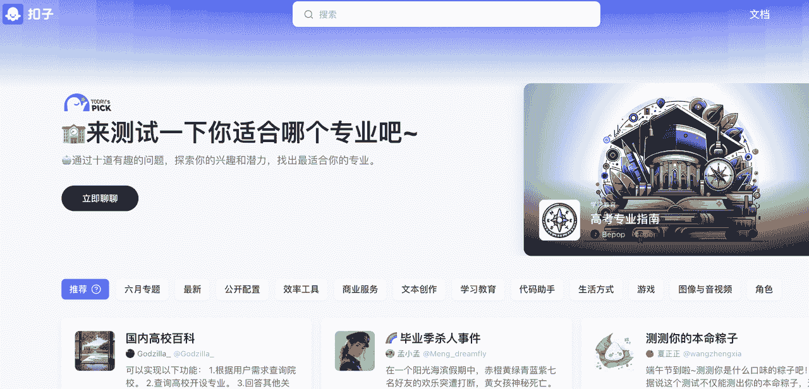

### 工具介绍
字节跳动在国内正式推出一站式 AI Bot 开发平台扣子，任何用户都可以快速、低门槛地搭建自己的 Chatbot，且平台支持用户将其一键发布到飞书、🛰️👸号、豆包等渠道。大模型使用的是字节自研的云雀大模型和 kimi 大模型。

### 网络条件
不需要特殊网络

### 体验网址
https://www.coze.cn/

### 工具优点
1. 低门槛的用户体验：Coze 平台的设计理念是使 AI 聊天机器人的创建和部署变得简单易行。对于没有编程背景的用户来说，这是一个巨大的优势。通过提供直观的用户界面和丰富的预制 Bot，Coze 降低了技术门槛，使得更多的人能够接触和利用 AI 技术。

2. 丰富的功能和资源：Coze 提供了 Bot 商店、插件商店和团队空间等多种功能，这些都是为了增强用户的创造力和协作能力。用户可以利用这些资源来创建更加智能和个性化的聊天机器人，满足各种复杂的业务需求。

3. 多平台兼容性：Coze 支持将聊天机器人部署到多个社交平台和消息应用程序，这意味着用户可以通过一个统一的平台管理多个 Bot，极大地提高了效率和 Bot 的可达性。

4. 定制化和扩展性：Coze 的定制化和扩展性是其另一个显著优势。用户不仅可以使用平台提供的工具和资源，还可以进行深度定制，以满足特定的业务需求。

5. 透明的定价模式：Coze 的定价模式清晰透明，用户可以根据自己的需求和预算选择合适的套餐，无需担心隐藏费用。

### 是否免费
1. 免费试用

   Coze 平台提供免费试用期，用户可以在这段时间内免费体验平台的所有基础功能。这包括对 Bot 商店和插件商店的访问，以及团队空间的基本使用。免费试用期为用户提供了一个无风险的机会，来评估 Coze 平台是否适合自己的需求。

2. 基础套餐

   基础套餐是 Coze 平台的入门级收费模式。它提供了 Bot 创建和部署的核心功能，适合个人用户或小型企业。基础套餐通常包括一定数量的 Bot 交互次数和一些基本的插件使用权限。此套餐的价格可能根据提供的服务范围和支持的交互次数而有所不同。

3. 高级套餐

   高级套餐为用户提供了更多的功能和资源。除了基础套餐中的所有功能外，高级套餐还包括高级插件的使用权限、更多的 Bot 交互次数、优先客服支持等。这一套餐适合对 AI 聊天机器人有更高要求的中大型企业。

4. 企业定制

   企业定制套餐是 Coze 平台提供的最高级别服务。它提供了完全定制化的解决方案，包括专属的项目管理、定制开发、专业培训和技术支持。企业定制套餐的价格通常根据用户的具体需求和服务内容来定制。

5. 附加服务

   除了上述套餐外，Coze 平台还提供了一系列的附加服务，如额外的 Bot 交互次数购买、专业的插件开发、数据分析服务等。这些服务可以单独购买，也可以作为套餐的一部分，以提供更加全面的服务体验。

### 使用建议
1. 初期学习曲线：尽管 Coze 致力于简化操作流程，但对于 AI 和聊天机器人开发完全陌生的用户来说，仍然存在一定的学习曲线。用户需要花时间熟悉平台的各项功能。

2. 功能过载：功能丰富的同时也可能导致用户在初次使用时感到功能过载，对于一些只需要基础功能的用户来说，Coze 平台上众多的选项可能会显得有些复杂。

3. 依赖网络连接：作为一个在线平台，Coze 的使用完全依赖于稳定的网络连接，在网络连接不佳的情，用户可能会遇到访问困难。

4. 高级功能的成本：虽然 Coze 提供了免费试用和基础套餐，但对于需要高级功能和定制服务的用户来说，成本可能会相对较高。

5. 国内版和国际版在功能上存在一些差异，主要是工具和插件等的差异。国内版支持 30 秒无代码生成 AI Bot，并集成了插件工具集，满足了个性化的使用需求。它还提供了 Bots 商店和插件，用户可以将自己制作的 AI Bot 发布到商店中。

6. 官方教程：[www.coze.cn](https://www.coze.cn/docs/guides/welcome)

## 2. Coze

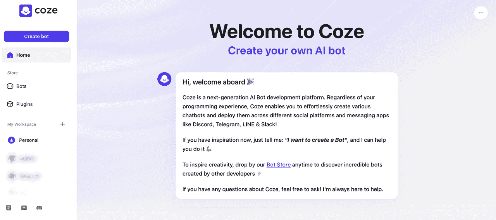

### 工具介绍
Coze（中文名“扣子”）是由字节跳动推出的一款 AI 聊天机器人构建平台国际版使用的模型更为强大。

### 网络条件
需要特殊网络

### 体验网址
https://www.coze.com/

### 工具优点
1. 支持非常复杂的流程设定，可以开发非常强大的智能体应用。

2. 丰富的插件，增加 AI chat bot 的能力。预置的插件已经足够多了，比如 DALLE 3、Google 搜索、天气查询等等。如果预置的插件不满足需求，也可以自己构建插件。

3. 知识库 - 构建自己的知识问答机器人，除了常见的上传文档之后，可以针对文档内容提问的问答机器人，还支持在线数据、API、表格数据等等。

4. 能免费白嫖 GPT4。

### 是否免费
是

### 使用建议
官方教程：[www.coze.com](https://www.coze.com/docs/guides/welcome)

## 3. 文心智能体平台

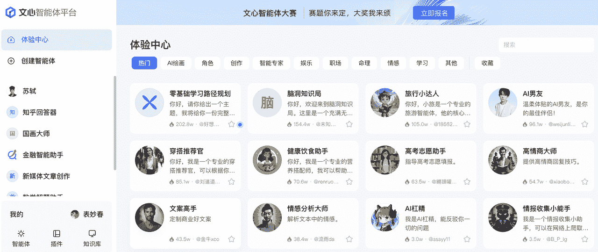

### 工具介绍
文心智能体平台是基于文心大模型的智能体构建平台，为开发者提供低成本的开发方式，支持广大开发者根据自身行业领域、应用场景，采用多样化的能力、工具，打造大模型时代的原生应用。并且为开发者提供百度生态流量分发路径，完成商业闭环。

### 网络条件
不需要特殊网络

### 体验网址
https://agents.baidu.com/center

### 工具优点
全新升级后的文心智能体平台，有 5 个「超能力」：技术底子厚、开发成本低、快速可成长、分发渠道广、商业可闭环。截止目前，已有 3 万多个智能体被创建、5 万多名开发者和上万家企业入驻，共同构建了一个繁荣的智能体生态圈。文心智能体平台提供面向所有领域、所有人的强大开发及应用能力，给开发和使用者带来了巨大的想象颠覆。

### 是否免费
是

### 使用建议
[文心智能体平台介绍](https://mbd.baidu.com/newspage/data/videolanding?nid=sv_17640208424833725160)

## 4. Kimi+

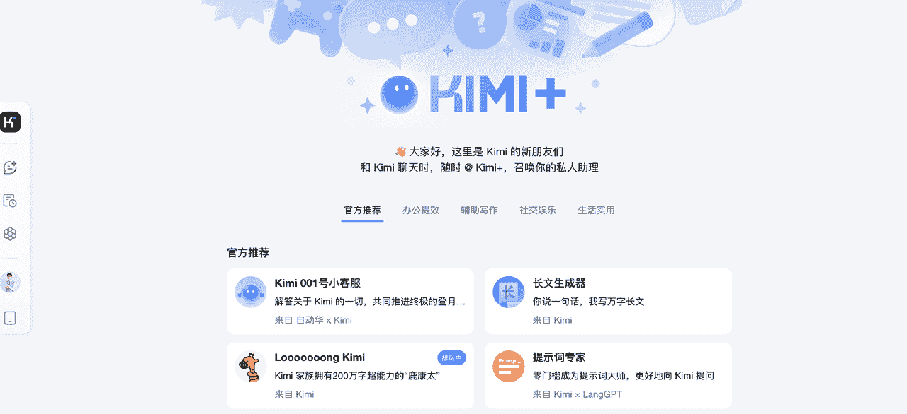

### 工具介绍
Kimi+是 Kimi 中的智能体商店，负责将不同场景制成模板，方便用户高效使用各种大模型功能。

### 网络条件
不需要特殊网络

### 体验网址
Kimi.ai - 帮你看更大的世界

### 工具优点
Kimi+目前共有 5 个类目，24 个智能体，其中 5 个类目有：

1. 官方推荐：这一类目下的智能体是 Kimi 官方推荐的，旨在提供基础而全面的服务，帮助用户更好地了解和使用 Kimi 的功能。

2. 办公提效：专注于提高用户在办公场景中的效率，包括翻译、简历修改、API 使用指导等。

3. 辅助写作：提供写作辅助的智能体，如📕爆款生成器、公文笔杆子、论文改写降重等，帮助用户在内容创作和学术写作上提升效率和质量。

4. 社交娱乐：这一类目的智能体提供了社交和娱乐功能，如塔罗师、猜猜我在想谁等，旨在覆盖用户的社交和休闲生活使用场景。

5. 生活实用：包括旅行规划、学习技巧、留学咨询等生活服务类智能体，帮助用户在日常生活中获得更加便捷和实用的帮助。

### 是否免费
是

### 使用建议
Kimi+目前仅支持网页端，app 端和小程序端均未更新。

在正常对话中使用“@”调用智能体

1. 开始正常对话：在与 Kimi Chat 的正常互动中，可以随时通过特定的“@”符号来调用智能体。

2. 输入“@”符号：在对话输入框中键入“@”，这时会弹出一个包含所有智能体的下拉列表。

3. 选择所需智能体：从列表中选择想要调用的智能体。一旦选中，智能体会被“激活”，准备接收用户的指令或问题。

4. 继续对话：在智能体被激活后，可以直接输入具体的需求，智能体会根据其专业化功能提供相应的服务。

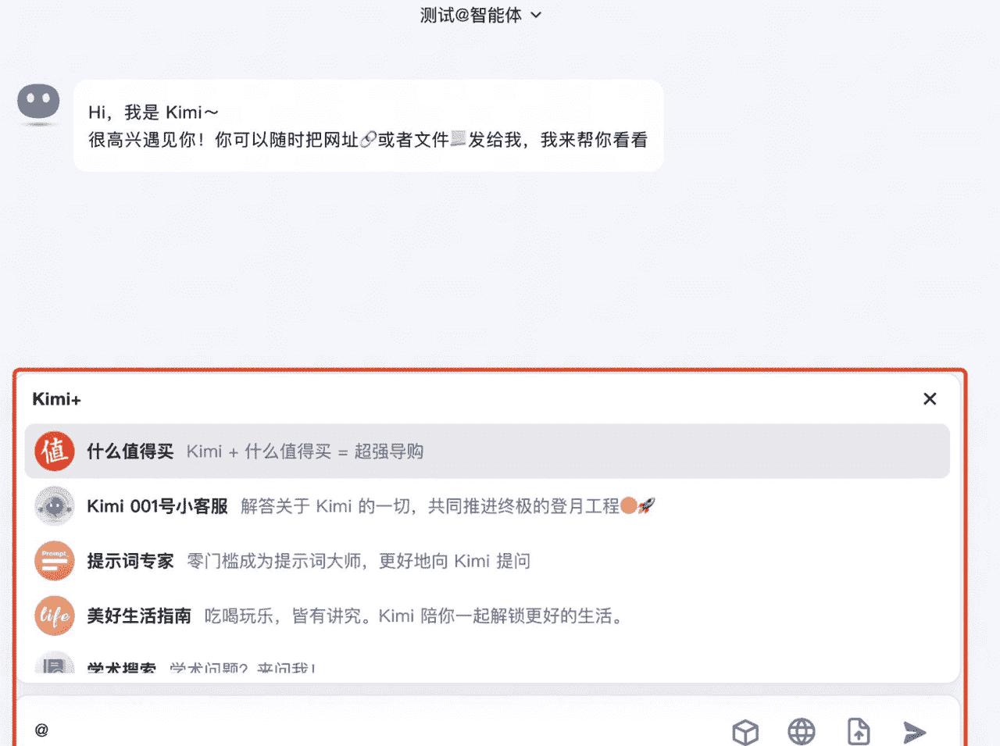

## 5. Dify

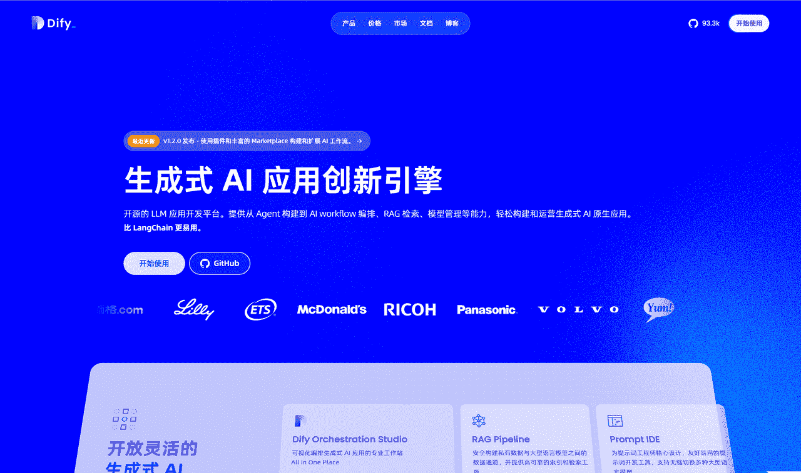

### 工具介绍
Dify 是一个开源的大语言模型（LLM）应用开发平台，结合了后端即服务（Backend as a Service）和 LLMOps 的理念，使开发者能够快速构建生产级的生成式 AI 应用。它内置了构建 LLM 应用所需的关键技术栈，包括对数百个模型的支持、直观的 Prompt 编排界面、高质量的 RAG 引擎、稳健的 Agent 框架、灵活的流程编排，并提供了一套易用的界面和 API。Dify 的目标是让开发者（即使是非技术人员）能够专注于创新和业务需求，而无需重复造轮子。

### 网络条件
需要特殊网络条件。

### 体验网址
+ 在线体验地址：https://dify.ai/。

### 工具优点
1. 全面的模型支持：支持与数百种专有和开源 LLM 无缝集成，包括 GPT、Mistral、Llama3 以及任何与 OpenAI API 兼容的模型。

2. 可视化编排：提供可视化的 Prompt 编排界面和工作流编排画布，即使没有编码经验的用户也能快速上手。

3. 强大的 RAG 功能：支持从 PDF、PPT 等常见文档格式中提取文本，简化数据准备工作。

4. 丰富的 Agent 功能：内置 50 多种工具，如谷歌搜索、DALL·E、Stable Diffusion 等，用户可以基于 LLM 函数调用或 ReAct 定义 Agent。

5. 开源与灵活性：Dify 是开源的，用户可以根据自己的需求进行定制和扩展。

6. 企业级功能：支持单点登录（SSO）、访问控制等企业级功能，适合企业内部使用

### 是否免费
1. 云服务版本：提供免费试用计划，包括 200 次 OpenAI 调用。

2. 社区版：开源版本，用户可以在本地或私有服务器上免费部署。

3. Premium 版本：需要付费，提供更高级的功能和定制化支持。

### 使用建议
1. 选择合适的部署方式：如果是初学者或个人开发者，可以先从云服务版本开始；如果对数据安全有较高要求，可以选择私有化部署。

2. 熟悉可视化界面：利用 Dify 的可视化编排功能，快速构建和测试 AI 应用。

3. 充分利用社区资源：Dify 的开源社区提供了丰富的文档和案例，可以帮助开发者快速上手。

4. 结合实际需求定制：根据自己的业务场景，灵活使用 Dify 的 Agent 功能和 RAG 引擎

## 6. 阿里云百炼

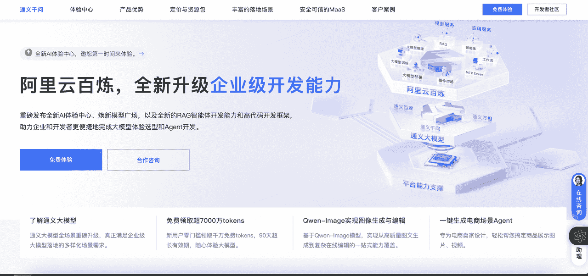

### 工具介绍
“AI 应用工厂”。它是一个一站式大模型服务平台，帮助企业和开发者基于阿里巴巴的 通义大模型家族（如通义千问 Qwen）或开源大模型，快速开发、训练和部署自己的 AI 智能体（Agent）和应用。

### 网络条件
中国大陆地区可正常使用，且是主要服务区域。

### 体验网址
+ 在线体验地址：https://www.aliyun.com/product/bailian

### 工具优点
1. 结合通义模型：深度集成阿里强大的通义系列模型，性能有保障。

2. 低代码/零代码：即使是小白用户，也能通过可视化界面拖拉拽，快速搭建一个简单的 AI 机器人原型

3. RAG 知识库功能：是国内领先的知识库解决方案，特别适合社群用来打造专属的“社群知识问答助手”。

### 是否免费
1. 非永久免费，但提供免费试用额度。

2. 新用户免费试用：首次开通服务的新用户可以获得一定的免费试用额度（通常有时间或额度限制）。

3. 模型调用：平台内的模型（如通义千问）调用通常采用 按量计费 模式，类似于购买算力服务。

### 使用建议
1. 小白用户不建议直接尝试复杂的 Agent 训练，而是关注如何利用其低代码功能，快速搭建一个基于社群既有资料的“专属 Qwen 问答机器人”，例如：上传社群精华帖，让 AI 帮你回答常见问题。

2. 入门路径：建议从 “智能体应用 (Assistant)” 入手。这是一个基于对话的 AI 应用，配置过程相对简单，非常适合初学者快速创建单一功能的 AI 应用。

3. 目标：将学习目标定为 “不用写代码，拥有一个专属的 AI 客服/知识库”，这比纯聊天的 AI 更有成就感。

## 7. FastGPT

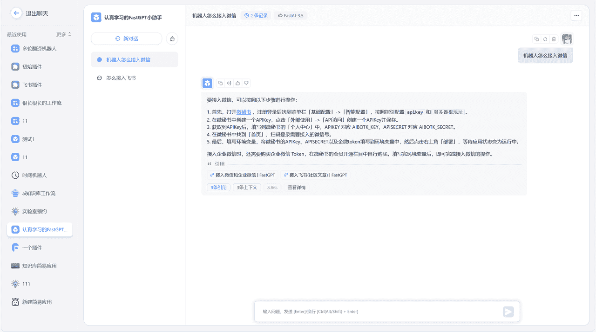

### 工具介绍
FastGPT 不是一个新的、像 ChatGPT 那样的大语言模型。它是一个开源工具/平台，能让你利用已有的大模型（比如 OpenAI 的 GPT-4 或国内的“智谱清言”），快速构建出你自己的、基于特定知识库的 AI 问答机器人。

### 网络条件
这取决于你如何使用它，以及你用的是哪个大模型：

+ 如果你用 FastGPT 调用 OpenAI（GPT-3.5/4.0）：那么你的服务器需要能稳定访问 OpenAI 的 API 接口。这通常意味着你需要“🪜”环境。

+ 如果你用 FastGPT 调用国内模型（如智谱 AI、文心一言）：那么不需要“🪜”，国内网络即可。

+ 如果你是自己部署 FastGPT（开源版）：FastGPT 平台本身可以部署在你的内网服务器上，但它“调用”模型的那一步，仍然受限于上面两条。

### 体验网址
+ 项目地址 (GitHub)：https://github.com/labring/fastgpt（这里是源代码，适合技术人员）

+ 官方 Demo 及商业版：https://cloud.fastgpt.cn/（推荐小白从这里开始，它是一个云服务版本，注册后有免费的体验额度）。

### 工具优点
FastGPT 最大的优点是它极大降低了构建 RAG（检索增强生成）应用的门槛。

1. 可视化流程编排 (对小白最友好)：你不需要写代码，可以通过拖拽模块（像搭积木一样）来设计 AI 的工作流程。例如：你可以设计一个流程：“用户提问” -> “先去你的 PDF 知识库里搜索” -> “再用大模型总结搜索结果” -> “最后回答用户”。

2. 强大的知识库对接：它非常容易“喂”你自己的资料。你可以上传 PDF、Word、TXT、网页链接，甚至连接到你的数据库。这使得 AI 的回答只基于你的资料，而不是“胡说八道”。非常适合用来做企业客服、内部文档查询。

3. 兼容性强：它支持几乎所有主流的大模型，包括 OpenAI、Azure、智谱、文心、讯飞、Llama 等，你可以随时切换。

4. 开源：对于懂技术的团队，可以免费下载源代码，自己部署在公司服务器上，保证数据私密性。

### 是否免费
1. 开源版：免费

   你可以从 GitHub 下载源码，自己部署在服务器上。FastGPT 工具本身是完全免费的。

   你调用大模型 API（比如调用 GPT-4）的费用需要你自己出。

2. 商业版（如 fastgpt.run）：收费，但有免费额度

   这种云服务帮你省去了部署的麻烦，“开箱即用”。

   它通常会提供一个免费的体验额度（比如一定量的 Token 或知识库容量），对于个人轻度使用或社群体验来说是足够的。

   如果流量大了或者需要更高级的功能，就需要付费。

### 使用建议
强烈建议打开网址：https://cloud.fastgpt.cn/（注册个免费号），上传文件，点“知识库”，上传你的简历、Word 或 PDF。开始提问，就你上传的文件内容提问，不建议初步就自己部署。

## 8. n8n

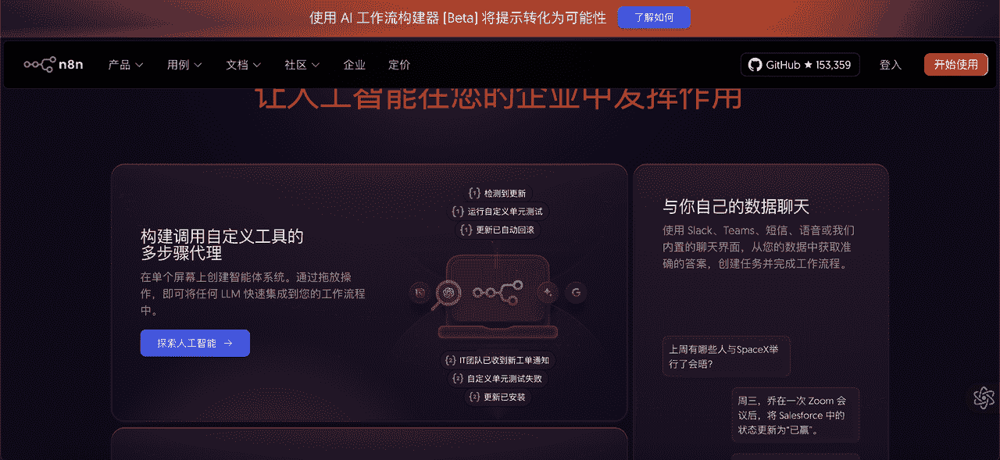

### 工具介绍
n8n 是一个开源的、可视化的“工作流自动化”工具。你可以把它想象成一个“超级连接器”或“数字世界的自动化管家”。它和市面上的 Zapier 或 IFTTT 很像，核心功能是：“当 A 应用发生了某件事，就自动去 B 应用做另一件事”。

比如：当我的邮箱收到特定标题的邮件（A）时，自动提取附件，保存到我的网盘（B），并给我发一条飞书/钉钉消息（C）。

### 网络条件
这取决于你选择哪种方式使用 n8n：

+ 自托管 (Self-Hosted)：

  这是 n8n 最大的特色。你可以把 n8n 免费部署在自己的服务器上（比如用 Docker）。

  网络要求：你的服务器必须能访问你需要连接的各个服务（App）的 API。比如，你要连接 Google Sheets 和 OpenAI，你的服务器就必须能稳定访问 Google 和 OpenAI 的接口。

+ 官方云版 (n8n Cloud)：

  你不需要操心服务器或部署，直接用官方的 SaaS 服务。

# 8. n8n

## 网络要求

只需要你的电脑能正常上网，能打开 n8n 的网页就行。

## 体验网址

+ 官方网站（含云版注册）：`https://n8n.io/`

+ 开源代码库 (GitHub)：`https://github.com/n8n-io/n8n`（这里是给技术人员看代码的）

## 工具优点

1. 超级灵活 (Low-Code)：这是它碾压很多竞品的地方。它不仅能拖拽，还允许你在任何一个节点里插入自定义代码 (JavaScript)。这让它的能力几乎没有上限，专业开发者会爱死这一点。

1. 开源且可自托管 (数据私密)：你可以把 n8n 装在自己的服务器上，所有的数据和自动化流程都跑在你自己的机器里，数据隐私性极高。这是很多企业（尤其是处理敏感数据的）选择它的核心原因。

1. 成本极低（自托管）：自托管版本身是免费的，你只需要支付自己的服务器费用。相比 Zapier 按“步骤”收费的昂贵模式，n8n 在大规模使用时能省下巨额费用。

1. 节点（集成）丰富：它支持几百种常见的应用（如 Google 全家桶、Slack、Notion、OpenAI、数据库等），并且提供通用的 HTTP 节点，让你能连接几乎任何有 API 的服务。

## 是否免费

1. 开源版 (自托管)：完全免费：源代码免费，你可以在你自己的电脑或服务器上随意部署和使用。

1. 官方云版 (n8n Cloud)：收费，但有免费套餐和 FastGPT 类似，官方提供一个“开箱即用”的云服务。它通常有一个免费套餐 (Free Tier)，提供一定量的自动化执行次数，足够个人轻度体验或跑几个小流程。如果用量大了，就需要付费。

## 使用建议

1. 小白入门，首选云版：强烈建议大家从 `https://n8n.io/` 注册官方云版的免费套餐开始玩。千万不要一上来就“自托管”或 `Docker` 部署，这个门槛太高，会直接劝退 99% 的小白。

+ 从“模板”开始抄：n8n 的学习曲线比 FastGPT 要陡峭。最好的学习方式是进入 n8n 后台，找到“Workflows”或“Templates”（模板库）。找一个最简单的模板，比如“每天早上9点，给我发一条天气预报”，看看它是怎么用节点“搭”出来的，然后试着修改它。

+ 和 AI 结合：对你的 AI 社群来说，最有价值的玩法是把 n8n 和 AI 结合。例如：你可以设计一个流程：“监控 RSS 订阅（A） -> 抓取新文章（B） -> 把文章发给 OpenAI 进行总结（C） -> 把总结发到你的社群（D）”。

# 9. 蚂蚁百宝箱

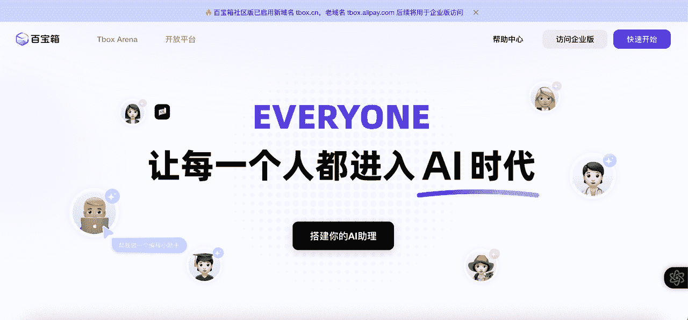

## 工具介绍

“蚂蚁百宝箱”是支付宝推出的一站式 AI 智能体（Agent）开发平台。如果说 FastGPT 是帮你“构建一个AI知识库”，那么“蚂蚁百宝箱”就是帮你“零代码”制造出一个完整的、能帮你干活的“AI员工”。它最大的特点是，你不需要懂代码，就能通过拖拽和配置，快速创造出一个 AI 智能体（比如一个“智能客服”、“营销助手”或“订单查询机器人”），并且能一键发布到支付宝的各个地方（比如小程序、App 内）。这个平台背后调用的大模型，包括了蚂蚁自研的“蚂蚁百灵”大模型，以及其他主流模型。

## 网络条件

国内网络即可。

## 体验网址

官方平台地址：`https://tbox.alipay.com/`

## 工具优点

1. 真正的“零代码”：这是它对小白最友好的地方。你不需要写任何代码，通过可视化的界面拖拽、配置，就能完成一个 AI 应用的搭建。

1. 极速创建与发布：官方宣称“最快 1 分钟创建智能体”。它的流程高度集成，创建后可以“一键发布”到支付宝小程序、支付宝 App、支小宝 App 等地方。

1. 强大的生态整合：这是它的核心护城河。它天然打通了支付宝的生态，可以非常方便地调用支付宝的各种功能、第三方 API 和服务（比如查询订单、发起支付、发送通知等）。

1. “开箱即用”：它集成了蚂蚁百灵等大模型的能力，并提供了丰富的插件，让你不用操心底层的模型和 API 对接，真正实现“开箱即用”。

## 是否免费

对开发者免费（有免费额度）。根据其开放平台官网信息，目前处于推广期，政策非常优惠：注册用户可以限时领取“每月 10 亿免费 Token”。这个额度对于个体开发者，基本等于免费。

## 使用建议

这是“零代码 AI 员工制造平台”，尤其适合支付宝商家和小程序开发者，比如想给自己的支付宝小程序加一个“AI 客服”的商家。

# 10. 智谱清流

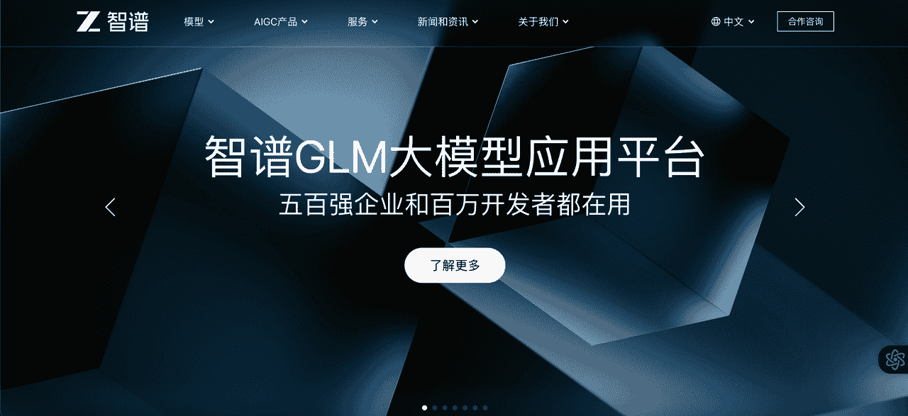

## 工具介绍

智谱 GLM 系列模型（如 `GLM-4.6`）在中文、编码和推理上表现出色。非常适合对智能体处理内容是中文的用户，其核心亮点包括：原生的智能体（Agent）工具调用能力、兼顾深度与速度的混合推理模式、200k 超长文本处理、多模态视觉能力（`GLM-4V`），并支持用户通过 `GLMs` 自定义智能体，对比 `claude code`，性价比非常高，性能几乎能对齐。

## 网络条件

作为国内公司（智谱 AI）的产品，访问其服务不需要特殊的网络条件（如 VPN）。

## 工具优点

1. 中文能力顶尖：作为本土模型，其对中文的理解、生成和文化语境的把握处于业界领先水平。

1. 强大的智能体（Agent）能力：无需复杂配置，模型本身就擅长规划任务、调用工具（如联网搜索、执行代码），解决复杂问题。

1. 性价比高：无论是个人使用还是企业通过 API 调用，其定价策略相比国外同类模型具有显著的成本优势。

1. 开放与生态：智谱 AI 提供了部分模型的开源版本（如 `GLM-4.5`），并且围绕其 API 构建了丰富的开发工具链（如微调、知识库），便于企业和开发者集成。

1. 响应速度快：其“瞬时模式”和优化的 API 服务，为日常对话和简单任务提供了极快的响应速度。

## 是否免费

是，但分情况。智谱清流提供“免费 + 付费”的混合模式：

1. 免费：

   - 网页版聊天：访问 `chatglm.cn` 进行日常对话和使用基础模型（如 `GLM-4.5-Air`）通常是免费的，可能会有一些用量限制。

   - 开源模型：开发者可以免费下载其开源的模型权重（如 `GLM-4.5`），自行部署使用。

2. 付费：

   - API 调用：开发者和企业通过 `open.bigmodel.cn` 平台按量调用模型（尤其是更强大的旗舰模型如 `GLM-4.6`）会产生费用，按 `token` 数量计费。

   - 专业版服务：平台可能会为需要更高用量、更高并发或专属服务的用户提供付费订阅套餐。

## 使用建议

日常助手与内容创作：直接使用其网页版（`chatglm.cn`）进行文案写作、信息查询、翻译、写周报等，其“思考模式”尤其适合需要联网搜索的复杂问题。

# 11. SkyAgents

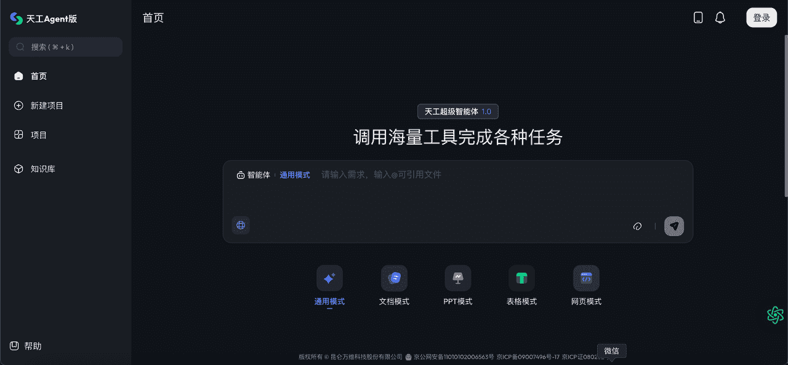

## 工具介绍

它是由“天工”AI（昆仑万维公司）推出的。你可以在这个平台上，不用自己写代码，就能“捏”出各种能帮你干活的 AI 小助手（也就是 "Agents"）。比如，你可以做一个“旅行规划 AI”，它会自动上网查机票、酒店、景点信息，然后给你一份完整的行程表。

## 网络条件

国内网络就能用。

## 体验网址

网址：`tiangong.cn`

## 工具优点

1. 特别“能干”（主打全自动）：这是它最大的特点。你只要下达一个复杂的命令（比如“帮我分析一下最近的 AI 新闻”），它会自己规划步骤、自己上网搜索、自己整理总结，一口气把活干完，不用你一步步指挥。

1. 能“组队”干活：你可以创建好几个不同功能的 AI 小助手，然后让它们互相配合，像一个项目团队一样，自动完成一个大任务。

1. 门槛低：操作界面很简单，很多时候拖拖拽拽就能设置好一个 AI，对不懂编程的小白很友好。

1. 背后 AI 够聪明：它用的是“天工”系列大模型，AI 本身的基础能力很强。

## 是否免费

对个人用户免费。

## 使用建议

1. 适合“懒人”和效率党：如果你平时有很多重复、琐碎的工作（比如每天都要搜集信息、整理数据），强烈建议你试试它，做一个“自动化”小助手，让 AI 替你打工。

1. 适合爱尝鲜的玩家：如果你对 AI 感兴趣，但又不懂代码，这个平台非常适合你上手，体验一下“创造 AI”的乐趣。

# 12. 言犀智能体平台

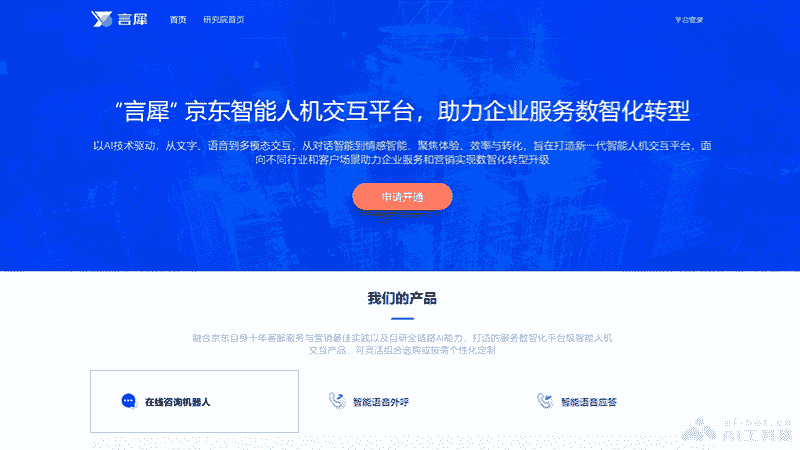

## 工具介绍

这是京东（JD）官方出品的 AI 工具平台。它的背景很“实在”，最初是为了解决京东自己海量的客服、物流、营销问题而诞生的。所以，它天生就特别擅长处理“做生意”和“搞服务”相关的复杂任务。现在它开放出来了，变成了一个“一站式”的平台（也叫 `JoyAgent`），让普通人或企业可以利用京东的 AI 技术（言犀大模型），低门槛地创建自己的 AI 智能体。

## 网络条件

国内网络就能用。

## 体验网址

智能体创建平台（`JoyAgent`）：`https://joyagent.jd.com/`

言犀总平台（面向企业）：`https://yanxi.jd.com/`

## 工具优点

1. “产业基因”强，懂业务：这是它最大的优势。因为它是在京东（客服、物流、电商）这种超复杂的真实场景里“打”出来的，所以它在处理客服问答、营销文案、流程自动化等方面非常专业和靠谱，不是“纸上谈兵”。

1. 模板丰富，开箱即用：平台提供了海量的应用模板（比如“PPT 生成”、“商标设计”、“客服质检”等），你不需要从零开始，选个模板改一改就能直接用，非常方便。

1. 工具全，连接性强：它集成了很多实用的工具（插件），比如高德地图、语音识别（`ASR`）、文字识别（`OCR`）等。这意味着你做的 AI 智能体不只是能聊天，还能调用这些工具去干“实事”，比如查天气、规划路线。

1. 安全可信赖：毕竟是京东出品，它在数据安全和隐私保护方面做得比较严格，企业用起来会更放心。

## 是否免费

对个人用户基本免费。个人开发者或普通用户登录平台，使用它提供的模板、创建和体验智能体，通常是免费的。

但对于需要大规模调用（比如企业级应用）、需要私有化部署或高级定制服务的，会采用付费模式。

## 使用建议

1. 最适合：电商、营销和客服人员：如果你的工作和这些领域相关，这个平台就是“专业对口”。你可以用它来自动生成商品描述、分析客服对话，或者做营销活动策划。

1. 适合企业和开发者：想要在自己的 App 或网站里加入 AI 能力（尤其是电商、服务类能力）的企业，这个平台提供了非常成熟和安全的解决方案。

1. `PPT` 制作：它的“一键生成 `PPT`”模板非常好用，输入一个标题就能快速生成一套完整的 `PPT`，适合学生党和职场人用来应急。

# 智能体学习交流社群

1. 持续关注并更新 AI 智能体的相关资讯动态，研究报告，赚钱案例，常见问题，永久免费在线查看，无收费内容，目标是成为最大的免费 AI 学习社群，免费学 AI 绘画，AI 写作。

2. 已建立社群聊聊 AI 发展及应用，没进群的可以扫码加入，群满可加 AI 研究爱好者大国 🛰️ ID：`zyg90s`（备注：AI），已经在社群内的无需重复加入，开源知识库及社群学习全部为公开免费分享。

3. 关于文档负责人大国：7 年老运营，互联网流量观察家，曾就职于互联网大厂，现研究 AI 实战应用，努力成为最懂 AI 的运营人。

## 飞书学习交流群

好友（ID：`zhangyuguo94s`）

扫码加 🛰️ 入 🛰️ 群

进群或者加好友了解更多 AI 智能体实战案例

觉得有用欢迎留个赞
