# 3 月 27 日共学直播：搭子 DuMate 实战，零基础变开发大佬

> 来源：[https://yunyinghui.feishu.cn/docx/ATx8dEev4ocLPfxOmVpcOVzXnyc](https://yunyinghui.feishu.cn/docx/ATx8dEev4ocLPfxOmVpcOVzXnyc)

> **DuMate 使用指引**

> DuMate 是百度推出一款面向个人及团队的桌面级 AI 智能体，可以看见屏幕、操作软件、处理文件、串联业务系统——实现从"想法"到"结果"全程自动化执行，让用户从重复的日常工作中解放，聚焦核心业务与高价值思考，真正实现 “工作有搭子，办公更高效”。

> 另外，产品内置安全沙箱，所有数据与操作均在用户本地设备内隔离运行，未经授权绝不访问任何设备资源，从根源上保障数据安全与隐私，让 AI 能力安全落地到每一个办公细节，成为个人办公提效、团队协作赋能的可靠搭子。

>

> **DuMate 下载地址：**

> https://dwz.cn/5lUz6Tkc

>

> **产品使用教程：**

> https://cloud.baidu.com/doc/Dumate/s/xmmu7qrvo

>

> **问题反馈/工单提交：**

> 产品问题辛苦提交工单，便于问题跟进和反馈：

> https://console.bce.baidu.com/support/?_=1774495202480#/ticket/#/ticket/create?productId=329&createDirectly=1

**苍何**

万象AI实验室特邀嘉宾

前大厂 AI 开发

AI 科技博主

武汉 AI 圈创始人

**这个是我的👸号：**

---

**扫码体验百度 Dumate**

**扫码进群实时交流**

---

# 直播回放

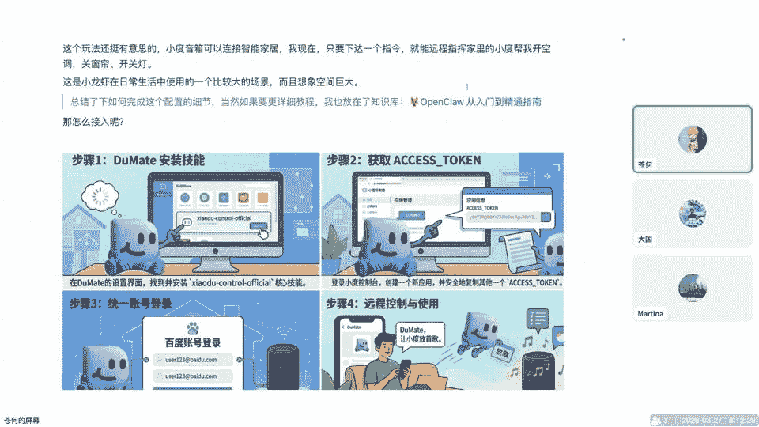

[搭子DuMate实战零基础变开发大佬.mp4](https://internal-api-drive-stream.feishu.cn/space/api/box/stream/download/all/IAIhbLbZSoOtZXx57MUcE67dnPP)

---

我体验了一段时间的 DuMate ，并写过相关的文章。

本次分享一共分 2 个部分，一个是我的一些好玩的实践，另外一个是聊一聊 DuMate 在开发场景红的应用。

我们先来看个视频：

[Dumate-1.mp4](https://internal-api-drive-stream.feishu.cn/space/api/box/stream/download/all/LHotbSAAGoKo3XxQgAjcRRwinff)

我把小度音箱接入了小龙虾，远程控制小度播放歌曲、新闻天气等。

这个视频没有任何倍速调整，你会发现，指令下达速度还蛮快的。

有个点你可能注意到了，通过下达定时指令，配合小度，达到强提醒的功效非常 nice。比如久坐不运动，通过这套方案，比设定闹钟方便多了。

最近在尝试探索一些小龙虾更好玩的场景，比如结合智能硬件或者智能家居。

这个接入流程非常简单丝滑，用的 xiaodu-control-official 这个技能：

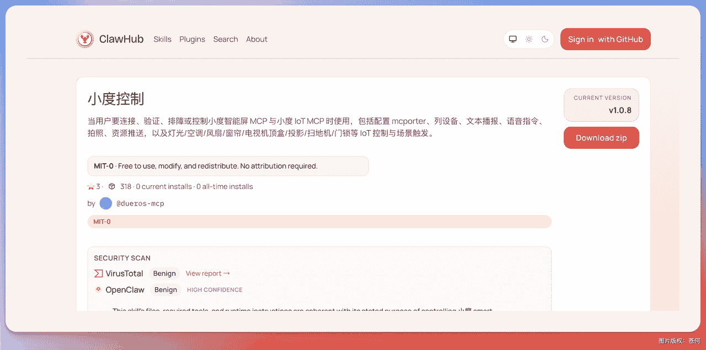

接入你的小龙虾，绑定上小度音箱就能直接使用了。

不过，我测试下来，相对丝滑和快的还是通过 DuMate 来配合。

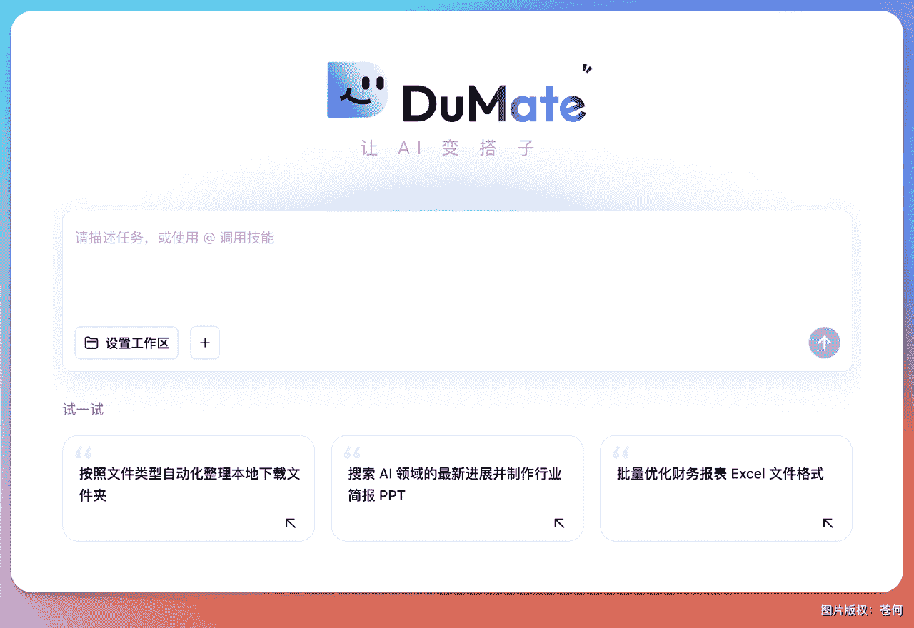

虽然我也不知道是不是他们针对性的优化了，但效果确实会赞很多。

DuMate 中安装好技能后，直接让它教我一步步配置，主要就是需要去小度控制台获取一些 ACCESS_TOKEN，绑定后就可直接开始用。

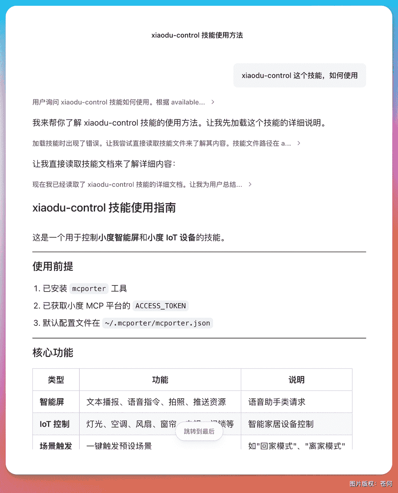

这个玩法还挺有意思的，小度音箱可以连接智能家居，我现在，只要下达一个指令，就能远程指挥家里的小度帮我开空调，关窗帘、开关灯。

这是小龙虾在日常生活中使用的一个比较大的场景，而且想象空间巨大。

> 总结了下如何完成这个配置的细节，[OpenClaw 从入门到精通指南](https://my.feishu.cn/docx/P6zsdsgYco6i4XxLeIccvlpvnQe?from=from_copylink)然如果要更详细教程，我也放在了知识库：

那怎么接入呢？

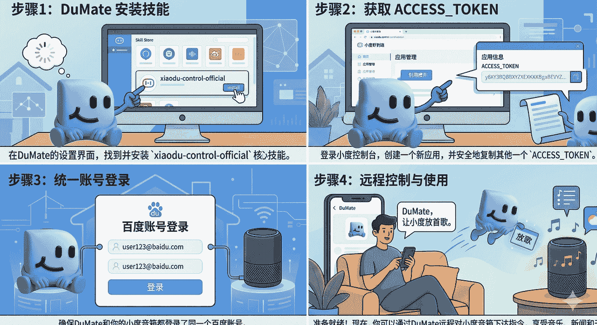

技能地址：https://clawhub.ai/dueros-mcp/xiaodu-control-official

直接将这个技能地址丢给你的 Openclaw，让他帮你安装

然后会需要配置一个 ACCESS_TOKEN

打开小度开放平台地址：https://dueros.baidu.com/dbp/mcp/console

创建一个 MCP 应用：

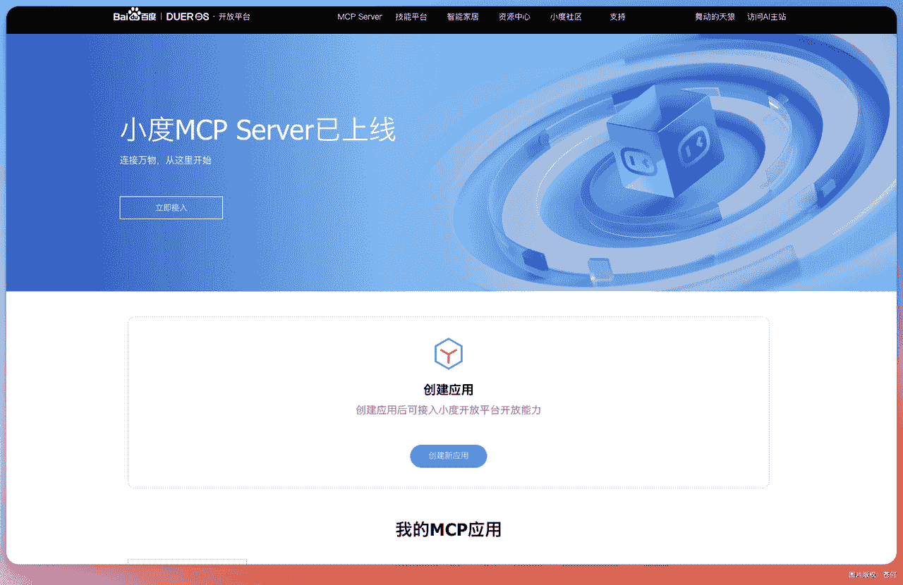

应用类别选择：软件

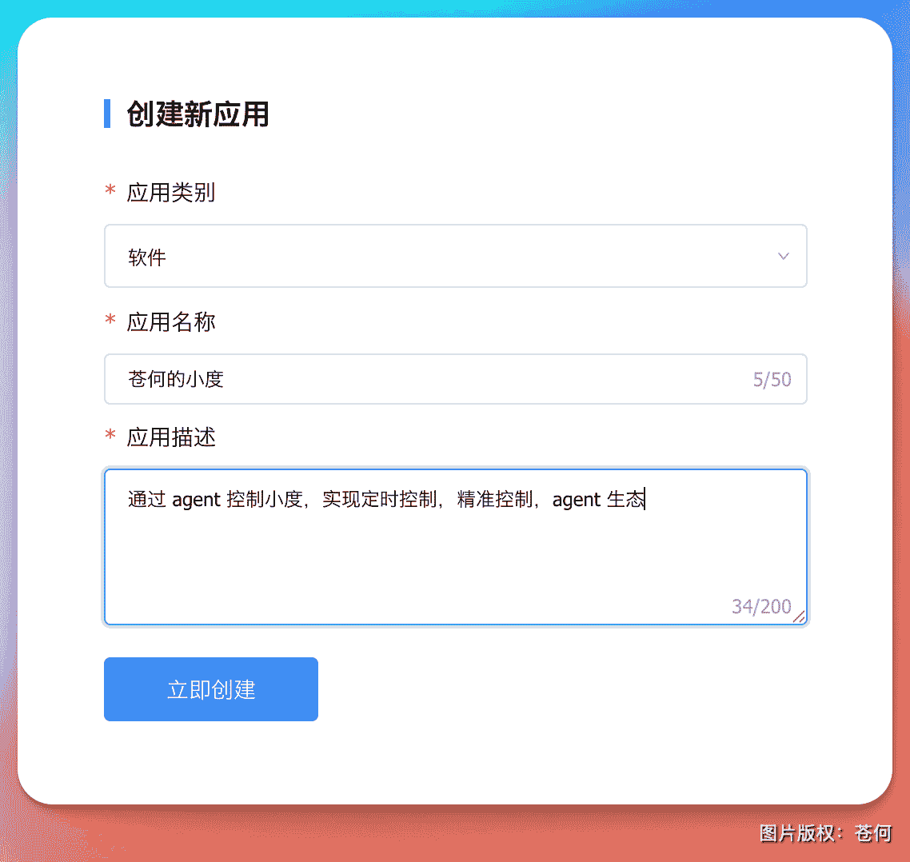

> 这个地方需要提前进行开发者认证，通常几分钟就会认证通过，慢的话 2 分钟内完成

接下来会给一个 token 和 key

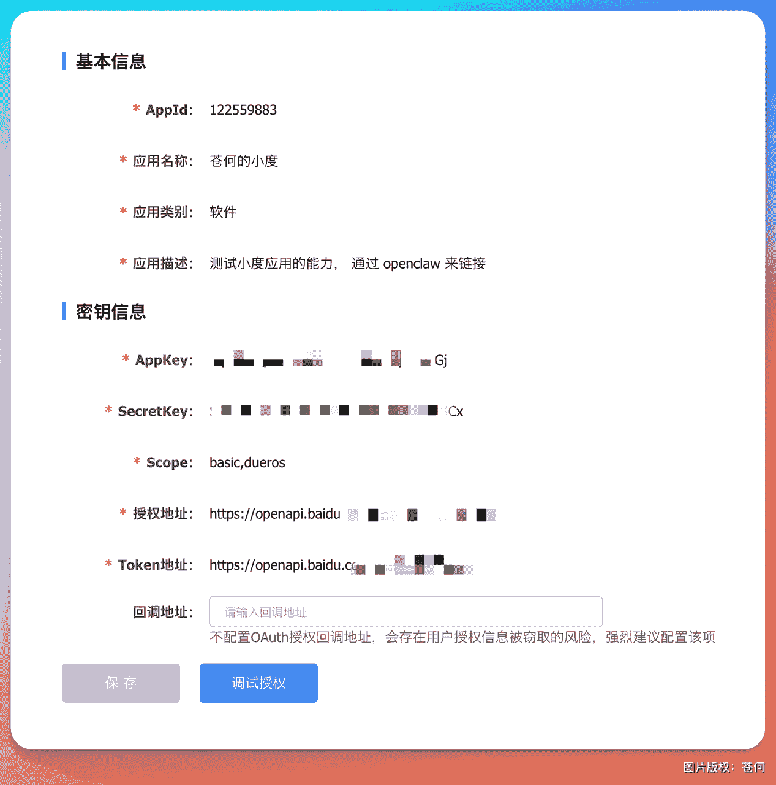

你可以点下调试授权，里面的 token 直接发给 openclaw。

> 注意，要用同一个百度账号登录。

我在玩的时候发现，百度现在结合自家的产品优势来相互连接，相互融合。

你如果使用过 DuMate，你就会发现，他内置的不少技能是百度生态的强大能力，比如百度搜索、百度百科，甚至还融入了百度千帆的生态。

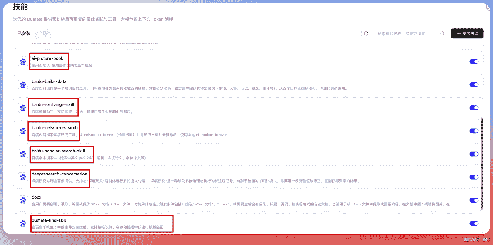

DuMate 这个产品也挺有意思的，化繁为简，没有过多的配置，大大的任务输入框覆盖了他整个的产品理念。

对比 Claude 的 Cowork，体验下来，DuMate 给人的感受是更快了，在 Token 消耗上也更低。

特别是在百度生态的技能上，表现更为优异。比如我让它：

> 帮我基于天才少女罗福莉的百度百科详细资料，做成 PPT

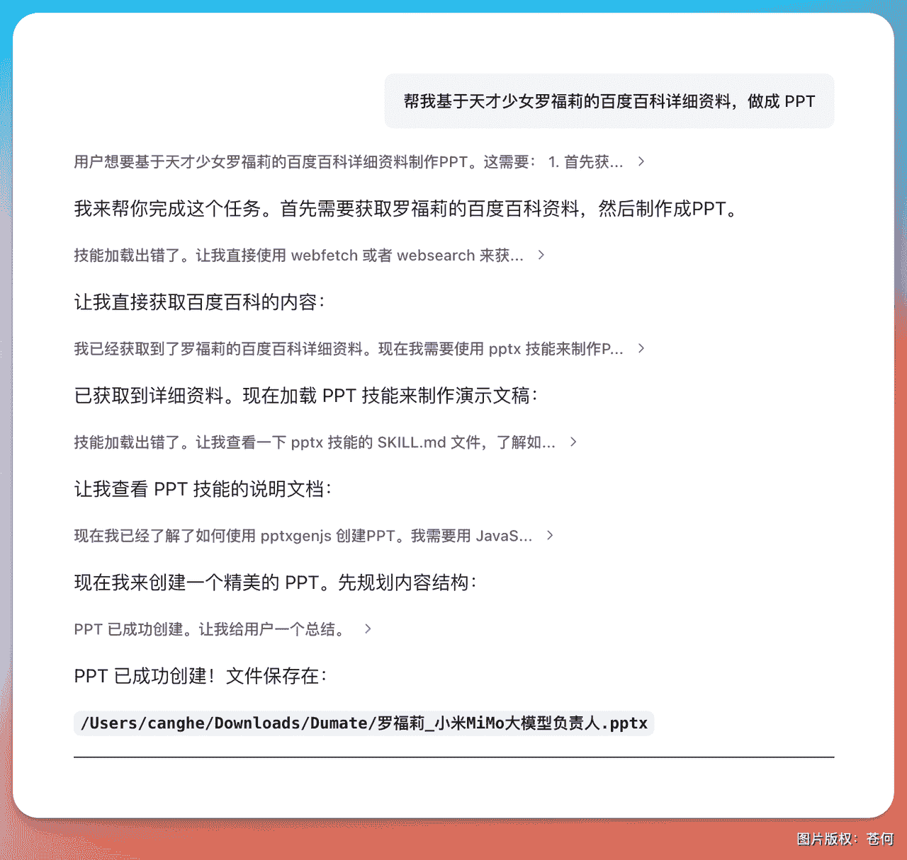

整个任务耗时很短，不到 3 分钟。

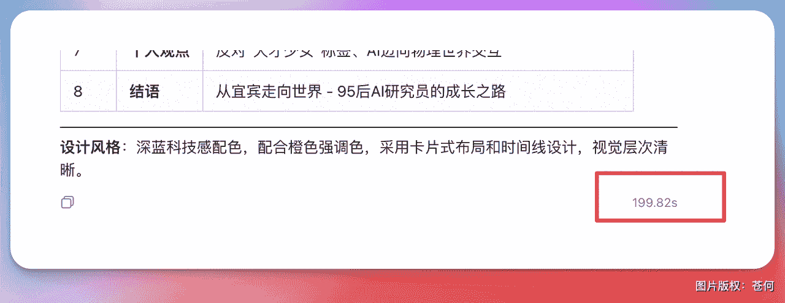

搜素了罗福莉的百度百科资料后，快速完成 PPT 的制作：

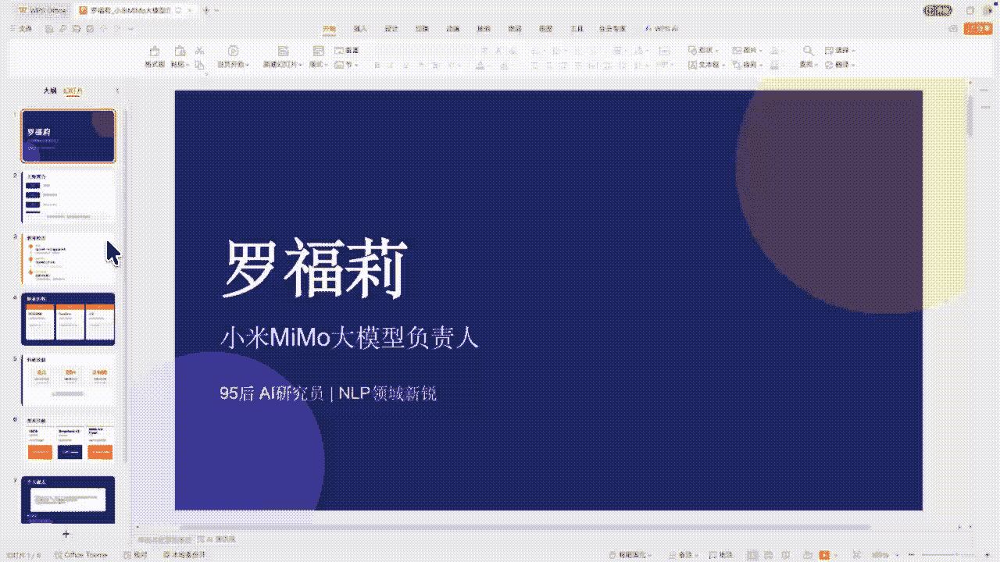

话说回来，我才发现罗福莉也同时关注了我，果然大佬也在时刻关注着 AI 的最新发展。

DuMate 我感觉更像是你老实的工作搭子，在默默帮你干活，遇到问题想办法解决。

我让它帮我搜集今日热点，并写一篇👸号文章发布，它会帮我通过 API 的方式直接传到👸号后台草稿箱。

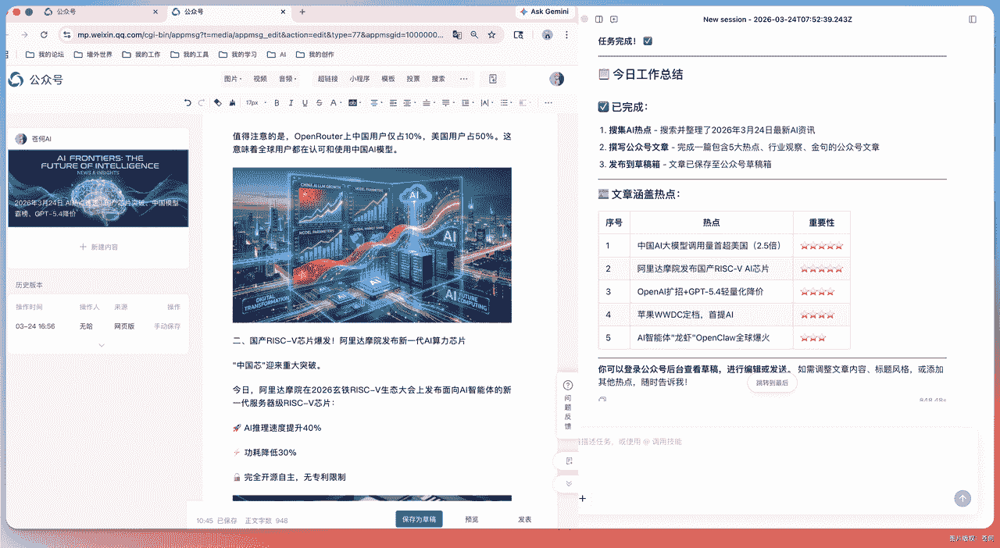

> 我也试了下通过浏览器 GUI 的方式，也 ok，不过图片上传这里有点问题，无法上传，建议通过 API 方式。

配合上百度的秒哒 Skill，让 DuMate 开发应用变得非常简单，一句话需求就能开发好个人网站 web 应用，也能随时在 DuMate 中调整应用。

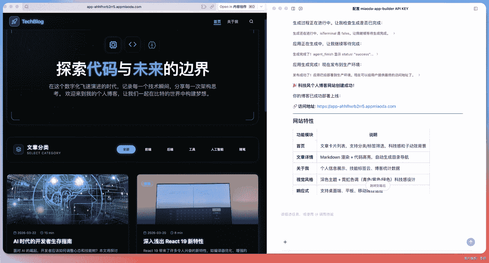

我发现，DuMate 一定是偷偷做了很多优化，指令遵循和秒哒 Skill 的配合，显得非常的丝滑和快速。

我曾经在别的🦞试过，多少有些反应上的延迟。

我发现，在 DuMate 中，也完全可以通过 Agent 来控制 tmux 指挥 Claude Code 写代码。

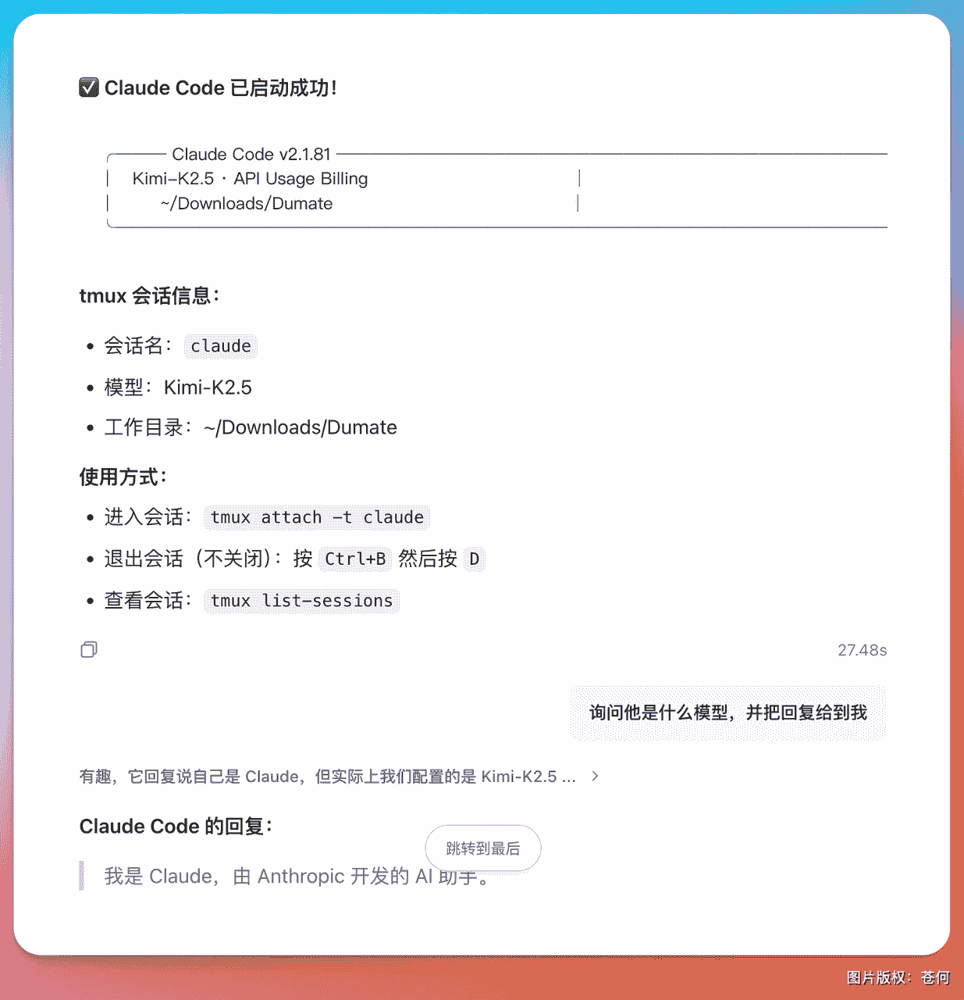

但由于 DuMate 是运行于沙箱环境，并无法直接打开 tmux，所以就没法直观的展示 tmux 中 Claude  Code 在写代码的场景。

不过，在沙箱环境中，依旧是可以指挥 Claude  Code 完成任务的，而且，理论上来说，沙箱环境更加安全，这也是对比 Claude Cowork 的又一大优势了。

**D**uMate 预装安全沙箱，与本机设备环境隔离。代码、任务、文件闭环执行，不影响本地环境、不扩散风险、不泄露数据。

配合上我之前的抖音下载技能、视频解析技能、👸号文章创作技能，就能实现通过 DuMate 完成一个抖音视频连接，对爆款视频进行拆解并二创，然后还能转为一篇👸号文章，并直接保存到草稿箱。

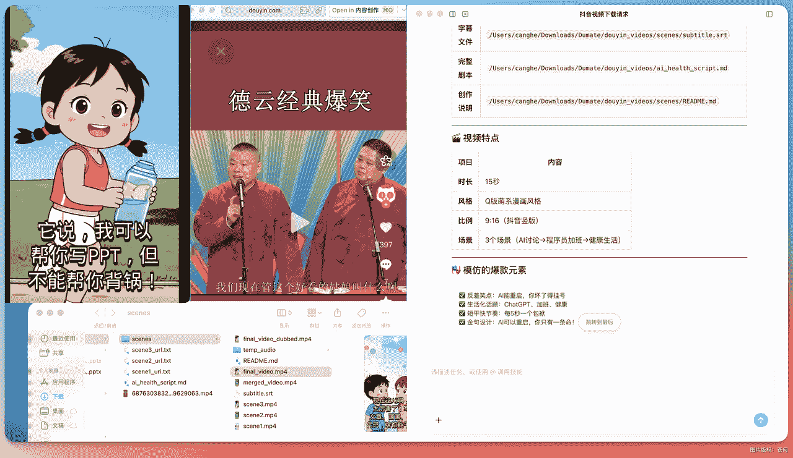

这个流程，DuMate 任务执行时长远低于 Claude Cowork。

DuMate 作为桌面端 Agent，像 Cowork 能完成的工作基本都能完成，比如文件管理。

在 DuMate 中选择一个工作目录后，让它按照文件类型自动化整理该本地文件夹。

对于高危操作，DuMate 需要人工确认才能执行。比如文件删除、系统修改、数据外发等高风险操作，强制用户明确授权后才执行。

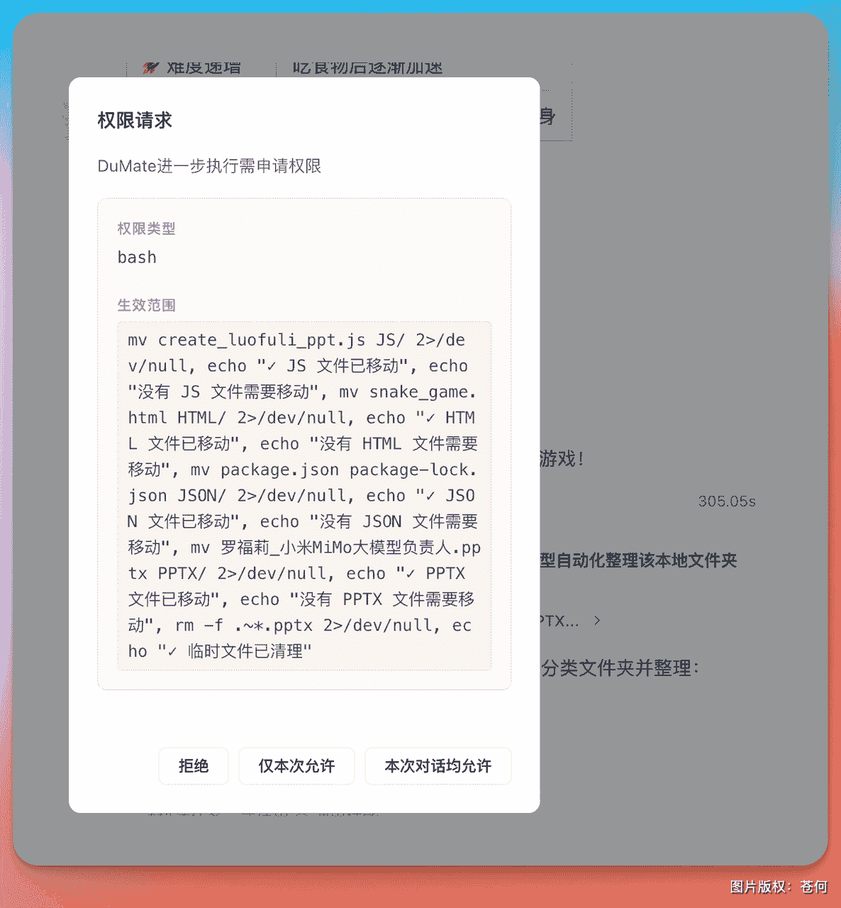

经过 DuMate 整理后，分类也更清晰了。

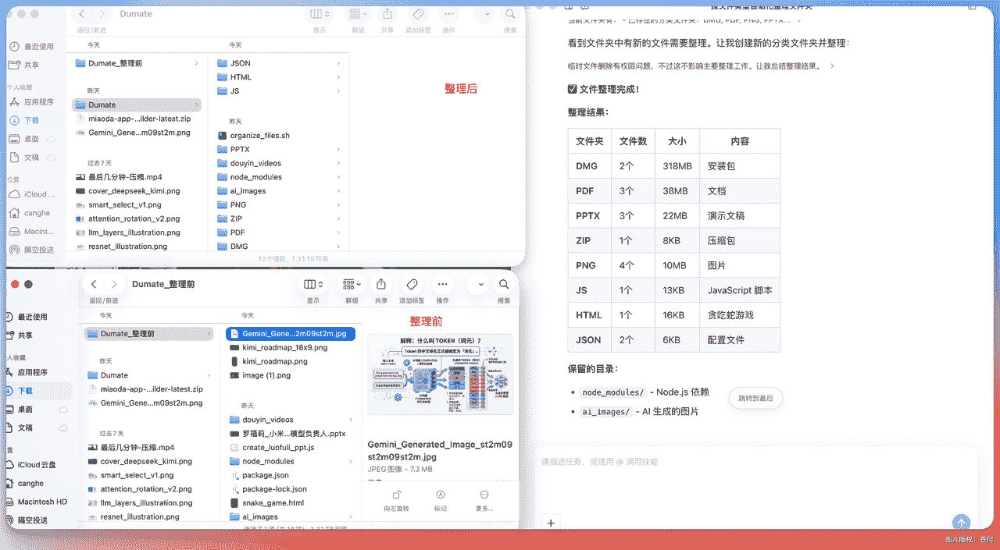

接下来是一些在日常开发中可能能结合的场景：

1、在 DuMate 中写原生前后端代码

比如生成个人博客系统，前后端一体化开发，并会自动修复 bug，文件本地存储。

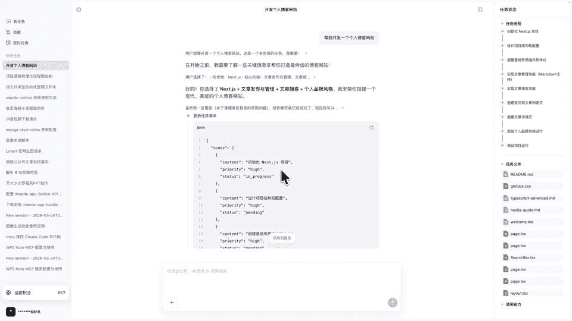

[dumate-12.mp4](https://internal-api-drive-stream.feishu.cn/space/api/box/stream/download/all/KHsAbqN9QoBjRexAOj1c8Tsknqh)

并发送到 GitHub，提交 PR 等：

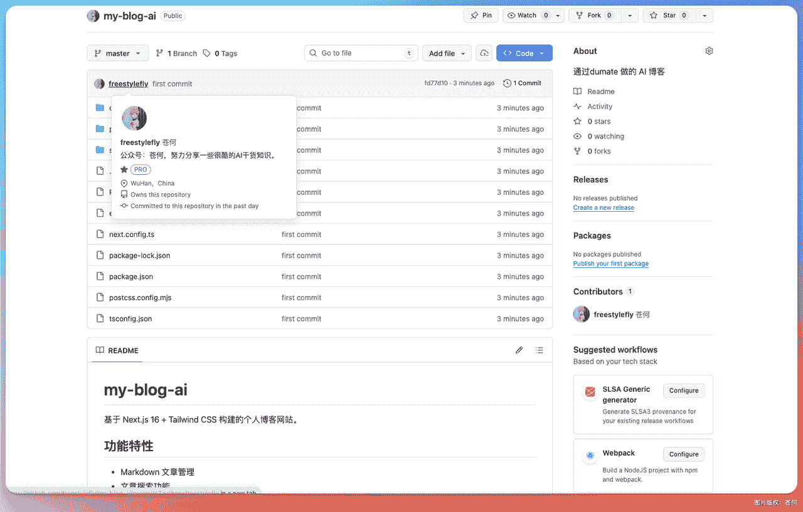

2、在 DuMate 中 调用百度秒哒技能生成应用

可以配置 miaoda-skill，然后一句话生成应用，无需部署，可自由修改，页面没关。

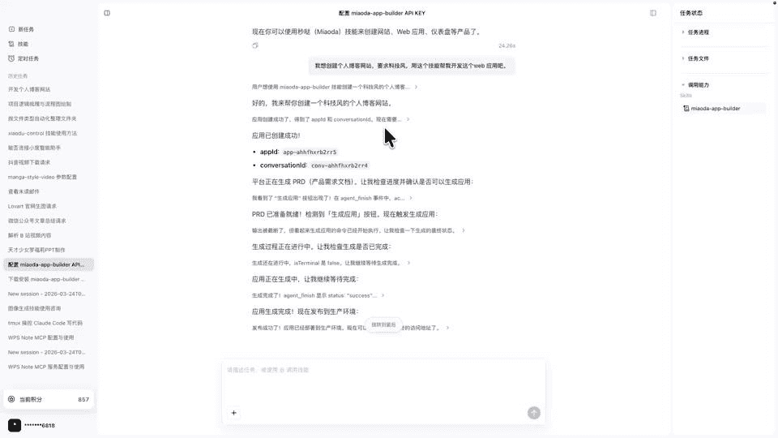

[dumate-13.mp4](https://internal-api-drive-stream.feishu.cn/space/api/box/stream/download/all/HTeAbo3qmoo5yIx9Is8cTwoSnfg)

**3、接手祖传代码的扫雷兵**

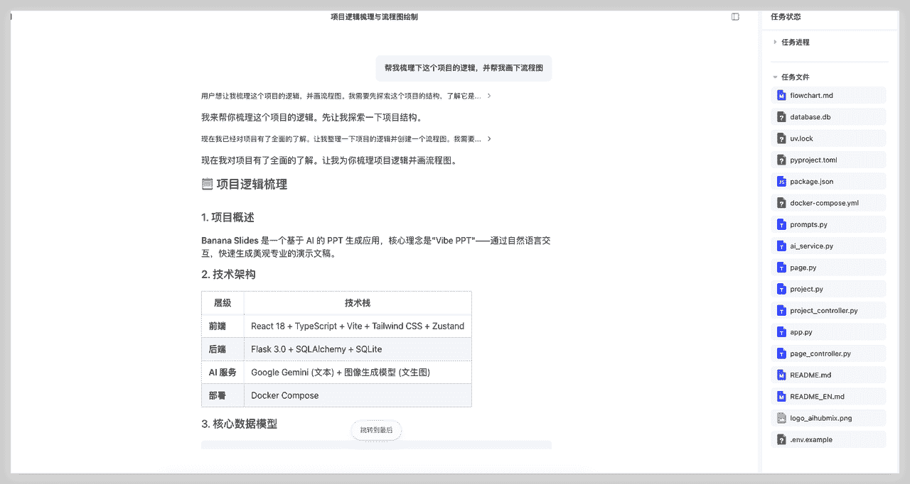

流程图：

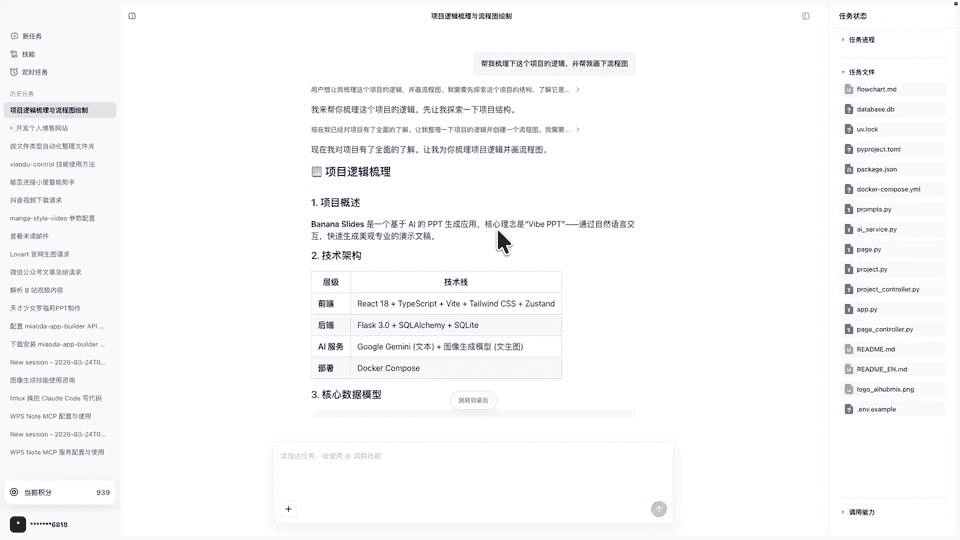

[dumate-11.mp4](https://internal-api-drive-stream.feishu.cn/space/api/box/stream/download/all/RbzJbfruSoh3jZx8Q0SckLXsnIc)

**4**、DuMate 中，也完全可以通过 Agent 来控制 tmux 指挥 Claude Code 写代码。

但由于 DuMate 是运行于沙箱环境，并无法直接打开 tmux，所以就没法直观的展示 tmux 中 Claude  Code 在写代码的场景。

不过，在沙箱环境中，依旧是可以指挥 Claude  Code 完成任务的，而且，理论上来说，沙箱环境更加安全，这也是对比 Claude Cowork 的又一大优势了。

**D**uMate 预装安全沙箱，与本机设备环境隔离。代码、任务、文件闭环执行，不影响本地环境、不扩散风险、不泄露数据。

[OpenClaw 从入门到精通指南](https://my.feishu.cn/docx/P6zsdsgYco6i4XxLeIccvlpvnQe)

## Q&A

> （直播实时问题）

> 1.DuMate的服务端部署在什么地方？

> 2.DuMate是否支持接入其他平台的大模型？

> 3.DuMate的上下文记忆能力如何？

**扫码体验百度 Dumate**

**扫码进群实时交流**

---