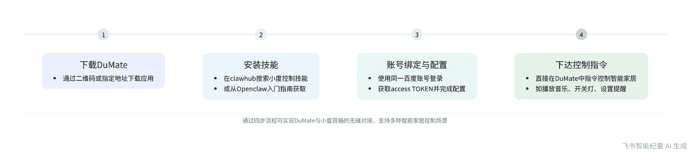
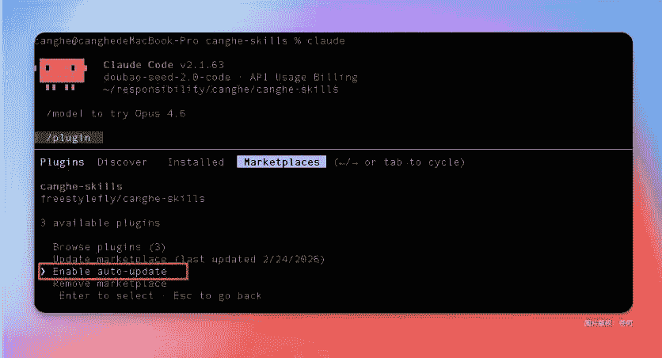
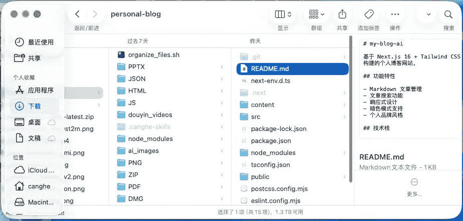
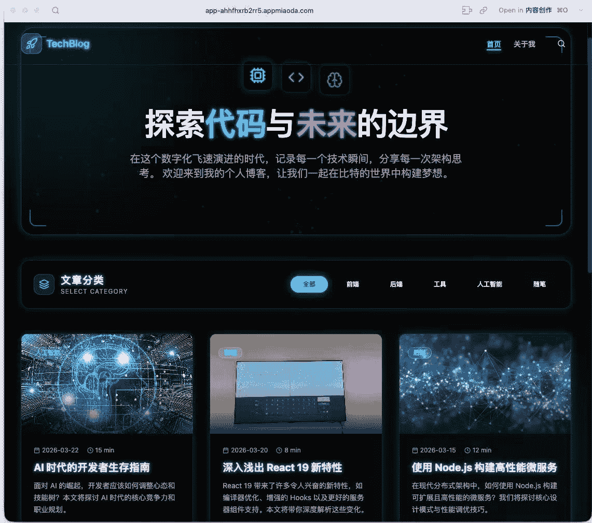
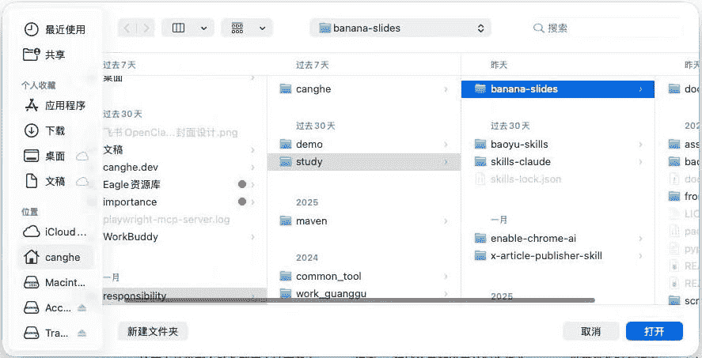
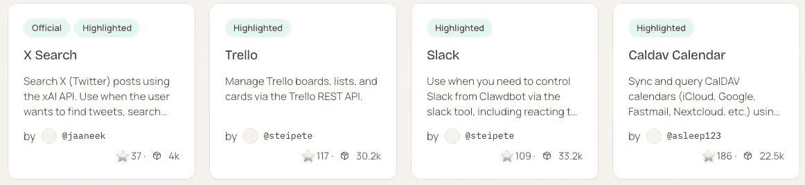

# 智能纪要：搭子DuMate实战： 零基础变开发大佬 2026年3月27日

> 来源：[https://yunyinghui.feishu.cn/docx/QwvadfvGXoIlvDxuL4iclhhUnfc](https://yunyinghui.feishu.cn/docx/QwvadfvGXoIlvDxuL4iclhhUnfc)

> 会议主题：搭子DuMate实战： 零基础变开发大佬

> 会议时间：2026年3月27日（周五） 17:53 - 19:02 （GMT+08）

> 参会人：  @苍何 @Martina

> 智能会议纪要由 AI 生成，可能不准确，请谨慎甄别后使用

# 总结

本次会议是 “3 月 27 日共学直播：搭子 DuMate 实战，零基础变开发大佬”，AI 知名博主仓河老师分享了使用 DuMate 的经验，介绍其功能、应用场景及使用方法等，还解答了观众关于 DuMate 的疑问，内容如下：

+   **DuMate 介绍**

+   **直播开场**

+   直播主题引入：大国（Roy）介绍当天是 Daas Mate 实战第五天，邀请仓河老师分享如何用 DuMate 进行开发工作，让零基础者也能实现全流程开发。

+   资料准备：仓河老师准备了可对照实操的案例，方便大家尝试并根据自身情况进行开发。

+   **个人介绍**

+   个人背景：仓河老师介绍自己有👸号 “昌河”，分享 AI 前沿资讯、应用和案例，还在武汉创建了 AI 圈，可扫码体验百度 DuMate 并进群交流。

+   经验分享：他分享了 25 号用 DuMate 做的实践，包括接入小度音箱等。

+   DuMate 与小度音箱结合应用

+   **功能演示**

+   音乐播放：仓河老师展示在 DuMate 下达指令，让其连接小度音箱播放周杰伦的《稻香》，响应快速，与直接给小度下达指令流畅度相近，还可随机播放 🐧 音乐收藏列表里的音乐。

+   远程控制：可在其他电脑或远程控制小度音箱，小度音箱连接智能家居，如灯、空调等，还能设置定时任务，通过小度音箱外放提醒。

+   信息查询：可让 DuMate 连接小度音箱查询天气、新闻等并进行播报。

+   **接入流程**

+   技能获取：使用小度 control option 技能，可在 clawhub 技能广场找到，也可在 Openclaw 入门指南中获取。

+   账号绑定：小度开放平台和 DuMate 账号使用同一个百度账号，体验更丝滑。

+   配置使用：安装技能后，DuMate 会指导获取 access TOKEN 并进行配置，配置完成后即可下达指令控制智能家居。

+   **DuMate 其他非开发类应用**

+   **PPT 制作**

+   任务完成：仓河老师以基于天才少女罗芙丽的百度百科资料制作 PPT 为例，DuMate 调用百度百科技能获取资料，再调用 PPT skill 完成制作，耗时 199.82 秒。

+   数据优势：百度百科数据源权威，避免了 AI 制作 PPT 时数据源不可靠的问题，且制作完成后会注明数据来源。

+   **👸号文章创作与发布**

+   API 方式：通过 API 形式将文章传到👸号后台草稿箱，体验丝滑，图片和文字上传通过👸号后台 API 进行，但需在👸号后台传递 TOKEN 和 key。

+   GUI 方式：通过浏览器 GUI 方式控制，DuMate 能识别特定关键元素进行简单排版，但图片上传受沙箱环境限制，建议使用 API 方式。

+   **DuMate 开发类应用**

+   **结合秒搭 skill 开发应用**

+   个人网站开发：仓河老师在 DuMate 中下达开发个人网站 Web 应用的指令，DuMate 配合秒搭 skill 完成网站开发、PRD 编写和部署上线，还会给出访问地址。

+   体验优势：在百度自家技能和生态融合上，DuMate 做了优化，延迟和响应表现更优异。

+   控制 Claude code 写代码

+   沙箱环境：DuMate 在沙箱环境中控制 t Max 指挥 Claude code 写代码，沙箱环境安全，与本地电脑逻辑隔离，不会影响其他文件和数据隐私。

+   实际操作：虽无法直观展示 Tmax 里 Claude code 写代码的场景，但能完成任务。

+   **其他开发场景**

+   原生前后端代码开发：可生成个人博客前后端一体开发，并自动修复 bug，本地文件可本地存储，还能将项目自动发送到 GitHub，完成代码提交和 PR。

+   应用开发：非开发者可通过 DuMate 调用秒搭 skill 开发应用，如开发个人网站，会生成可编辑画布模板，完成需求文档和项目创建，还可配置自定义域名。

+   **DuMate 产品理念及优势**

+   **产品理念**：DuMate 的产品理念是让 AI 成为搭子，像工作伙伴和学习伙伴，帮助解决研发中的苦活、累活和脏活。

+   **积分优势**：每天有赠送的 1000 积分，可免费使用，且消耗慢，适合普通人使用。

+   **祖传代码处理**

+   逻辑梳理：可选择项目文件夹作为工作区，让 DuMate 梳理项目核心逻辑并画流程图，如对开源项目进行梳理。

+   代码编写：可在 DuMate 中控制 Claude code 创建开发团队 agent team 完成代码编写。

+   OpenClaw 从入门到精通指南

+   **文档分享**：仓河老师分享了《OpenClaw 从入门到精通》文档，包含好用的 OpenClaw 及桌面端 agent 工具，还介绍了百度 DuMate 的使用教程。

+   **应用场景**

+   定时任务：可在 DuMate 中设置定时任务，如每隔 20 分钟提醒运动。

+   数字人制作：可在 DuMate 中安装数字人插件制作数字人，也可通过 URL 导入技能或让 DuMate 配置 key 完成。

+   **QA 环节**

+   **数据服务端部署**：仓河老师表示 DuMate 更像本地桌面端 agent，数据服务端部署在本地电脑的沙箱环境中，使用云上大模型。

+   **接入其他平台大模型**：目前 DuMate 不支持接入其他平台大模型，其产品理念是让用户专注于场景开发应用，减少配置。

+   **上下文记忆能力**：DuMate 在上下文记忆方面做了优化，但仍存在受限问题，建议安装解决上下文记忆问题的技能或工具辅助使用，如 Evernote 等。

+   **直播总结**

+   **下载体验**：大国（Roy）鼓励未下载百度 DuMate 的观众扫码下载，有 1000 多积分可用，消耗少，使用场景多，可作为学习、工作和开发搭子。

+   **交流群**：观众可扫码加入产品交流群，分享使用问题和建议。

# 相关链接

+   妙记：搭子DuMate实战： 零基础变开发大佬

+   文字记录

+   搭子DuMate实战： 零基础变开发大佬 2026年3月27日