# 3 月 26 日直播：一个人活成一支团队，让 AI 变 OPC 搭子

> 来源：[https://yunyinghui.feishu.cn/docx/FRq5dNPxMoaiBpxkRHycqutYnw0](https://yunyinghui.feishu.cn/docx/FRq5dNPxMoaiBpxkRHycqutYnw0)

> **DuMate 使用指引**

> DuMate 是百度推出一款面向个人及团队的桌面级 AI 智能体，可以看见屏幕、操作软件、处理文件、串联业务系统——实现从"想法"到"结果"全程自动化执行，让用户从重复的日常工作中解放，聚焦核心业务与高价值思考，真正实现 “工作有搭子，办公更高效”。

> 另外，产品内置安全沙箱，所有数据与操作均在用户本地设备内隔离运行，未经授权绝不访问任何设备资源，从根源上保障数据安全与隐私，让 AI 能力安全落地到每一个办公细节，成为个人办公提效、团队协作赋能的可靠搭子。

>

> **DuMate 下载地址：**

> https://dwz.cn/5lUz6Tkc

>

> **产品使用教程：**

> https://cloud.baidu.com/doc/Dumate/s/xmmu7qrvo

>

> **问题反馈/工单提交：**

> 产品问题辛苦提交工单，便于问题跟进和反馈：

> https://console.bce.baidu.com/support/?_=1774495202480#/ticket/#/ticket/create?productId=329&createDirectly=1

**扫码体验百度 Dumate**

**扫码进群实时交流**

---

## **直播回放：**

[搭子DuMate实战_一个人活成一支团队.mp4](https://internal-api-drive-stream.feishu.cn/space/api/box/stream/download/all/CUVabg5AfoYEjUx3Q5mcYkubnvO)

---

> 一个人活成一支团队

> 今天让 AI 变 OPC 搭子，脏活累活全包了

很多人做 OPC，其实都有一个非常真实的状态。

事情越来越多，但人还是只有一个。

咱们既要做内容，又要做产品，还要做运营，有时候还得剪视频、写脚本、做数据分析，甚至还要去写代码。时间被不断切碎，但效率并没有线性提升，反而越来越累。

我自己在这个过程中，一直在反复思考一个问题：一个人，能不能真的活成一支团队？

后来慢慢发现，这件事情其实是有解的。

关键不在于咱们多努力，而在于咱们有没有一套“可以被复用的能力系统”。

今天这套内容，本质上不是在讲 DuMate 这个 AI 工具本身，咱们在讲一件更底层的事情，怎么让 AI 变成咱们的搭子，把那些重复的、消耗精力的事情接过去，让咱们专注在更有价值的部分。

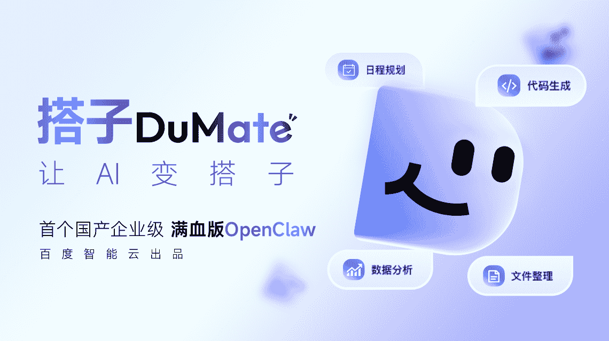

产品地址： https://dwz.cn/5lUz6Tkc

🔽可截屏扫码体验

咱们今天分享的内容里面，包含了整套 OPC 能力体系。

当这套能力跑通之后，相信你会明显感受到一个变化：不是一个人在做很多事，而是有一整套系统在帮咱们做事。

前几天我想用这个 DuMate 先来完成下 科普 Dumate 是什么。

[c257001e-d883-45fb-87be-6f8df3cb64f4.mp4](https://internal-api-drive-stream.feishu.cn/space/api/box/stream/download/all/YpRab55RpofWvAxgmyLc3VxcnZb)

「演示环节」

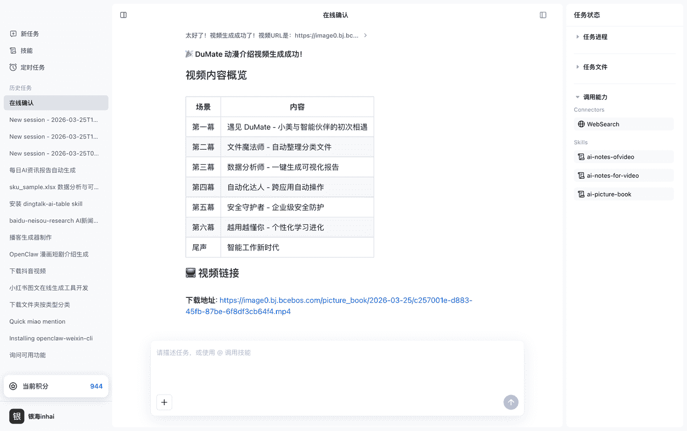

同样的之前很火的 OpenClaw 也是一样的逻辑。

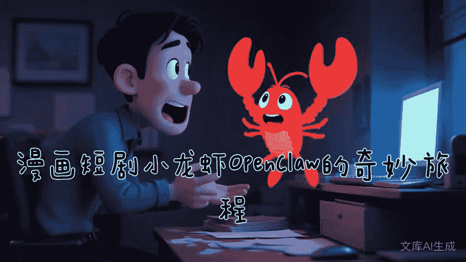

[漫剧视频结果.mp4](https://internal-api-drive-stream.feishu.cn/space/api/box/stream/download/all/SxcMbQ69DooSNOxePePc9QfTnrg)

我给最近体验到的整个 DuMate 的 AI Agent 的任务描述是这样的：给我生成一个介绍 OpenClaw 的漫画短剧。

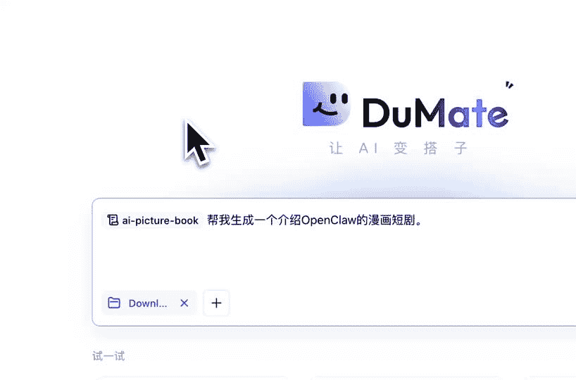

[生成漫剧.mp4](https://internal-api-drive-stream.feishu.cn/space/api/box/stream/download/all/BtXFbWyxqoAZVQxTyALcMUDNn3g)

就这样通过简单的一句话直接表达了我想要什么，它就去生成了整个漫剧，提交任务之后就直接等待结果即可。

这个 AI Agent 就会去调用漫剧生成类的 Skill，下面这个图片链接这就是刚刚给我的生成的结果视频。

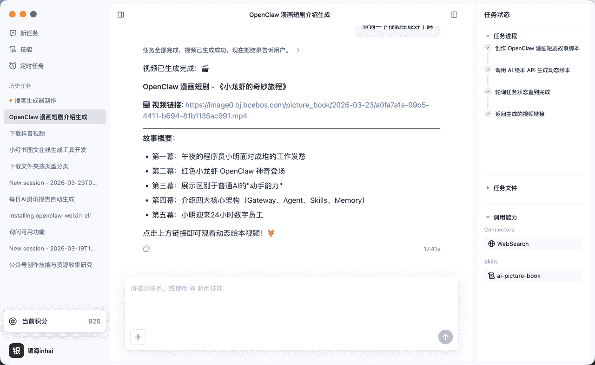

所以今天分享的 OPC 这套能力，我习惯分成三层。

+   第一层，是所有 OPC 都应该具备的基础能力。

+   第二层，是可以明显拉开效率差距的进阶能力。

+   第三层，是开始构建个人壁垒的个性化能力。

这三层，其实对应的是三个阶段：从“会用工具”，到“能复制能力”，再到“能构建系统”。

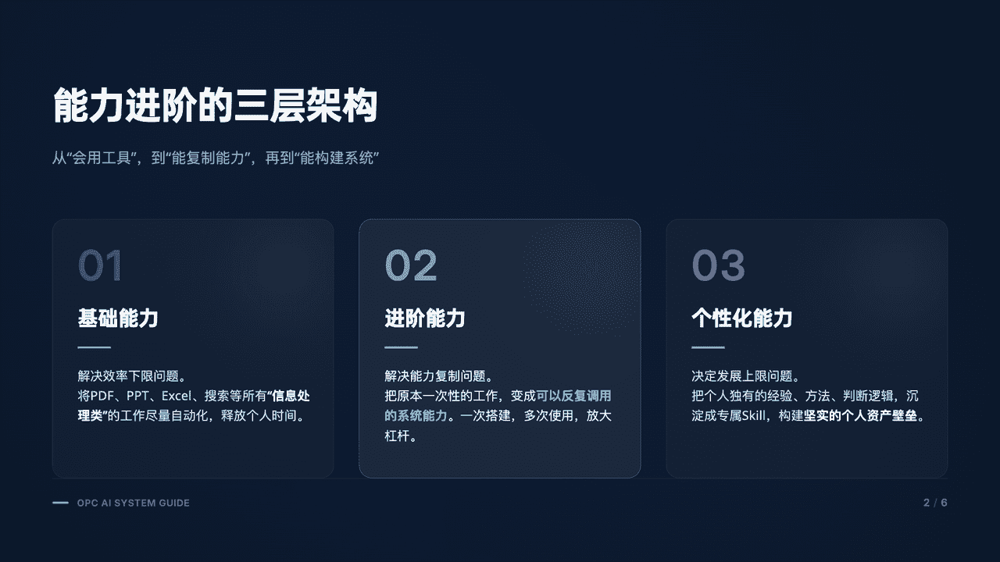

先来看第一层，也就是基础能力。

这一层听起来很简单，但决定了咱们日常效率的下限。

核心其实就四件事：PDF、PPT、Excel，还有 Web 搜索。

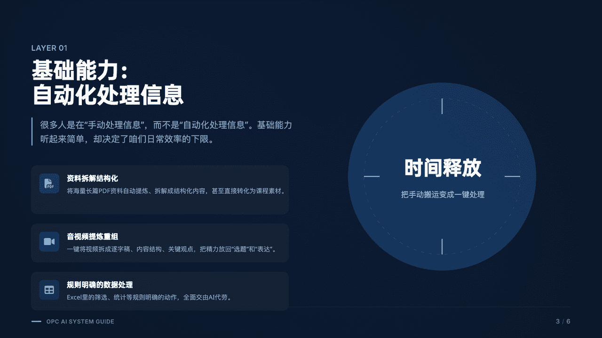

很多人会觉得，这些东西每天都在用，好像没有什么特别的。但问题在于，大多数时候咱们是在“手动处理信息”，而不是“自动化处理信息”。

比如做知识付费，咱们每天会接触大量资料，但往往是自己去看、去整理、去总结。如果有一套能力，可以把 PDF 自动拆解成结构化内容，甚至直接转成课程素材，那效率会完全不一样。

比如我用一个非常日常的场景，让它帮我整理一下我的文件夹，我直接输入让它去看我的下载文件夹，内容整理简单了。

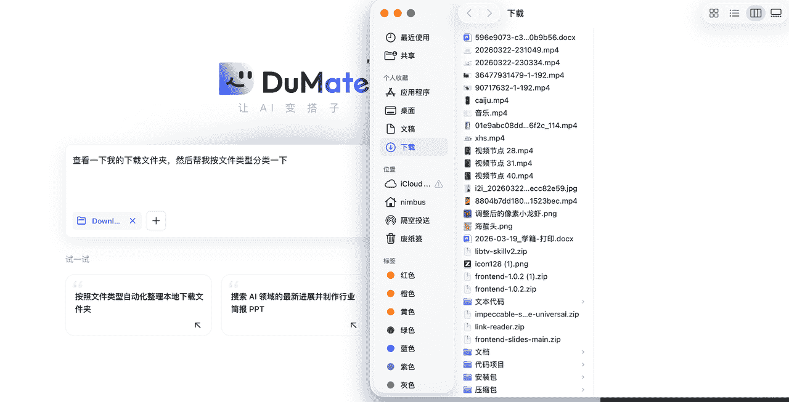

DuMate 会主动的识别我的文件夹里有什么内容、大小，已经有的类目层级等。

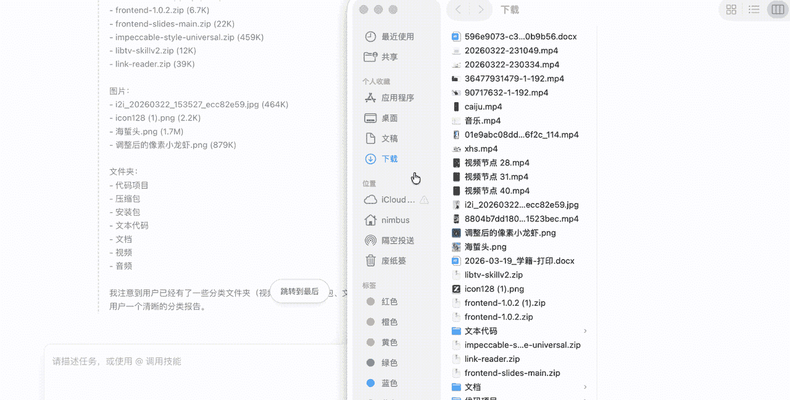

然后不一会儿可以看到它慢慢的在整理我的文件内容信息了，全自动完成。

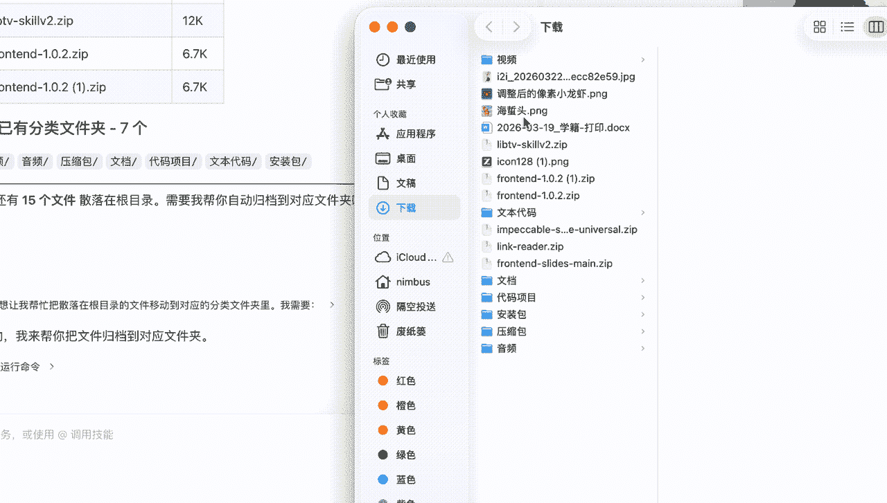

最后，我们直接来查阅它的任务结果即可，并且 DuMate 在做的每个任务进程都是可以看

再比如做自媒体，咱们会反复看视频、暂停、记录重点。但如果可以一键把视频拆成逐字稿、内容结构、关键观点，那咱们就可以把精力放在“选题”和“表达”上，而不是“搬运信息”。

「演示环节」

再比如做电商，很多时间其实花在 Excel 里做筛选、做统计。

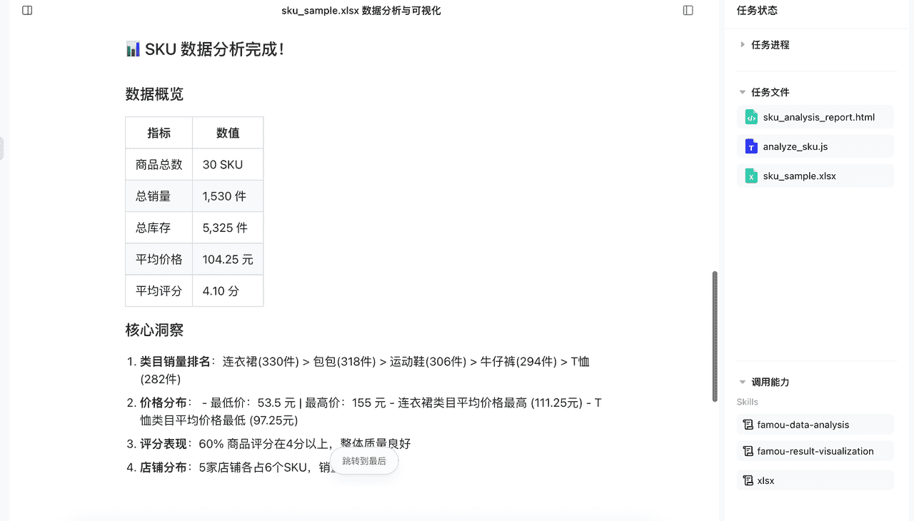

但这些本质上都是规则明确的事情，是可以交给 AI 去完成的。

所以这一层的核心，不是工具本身，而是一个认知转变：所有“信息处理类”的工作，都应该尽量自动化。

DuMate 内置的这些基础 Skill，其实就是在帮咱们完成这件事。把原本需要手动处理的信息，变成一键处理。

当这一层跑通之后，咱们会明显感觉到一件事：时间开始被释放出来了。

接下来是第二层，也是整套体系里最关键的一层：进阶能力。

如果说基础能力解决的是效率问题，那这一层解决的是“能力复制”。

很多 OPC 的问题，不是不会做，而是做一遍很累，做十遍就扛不住。

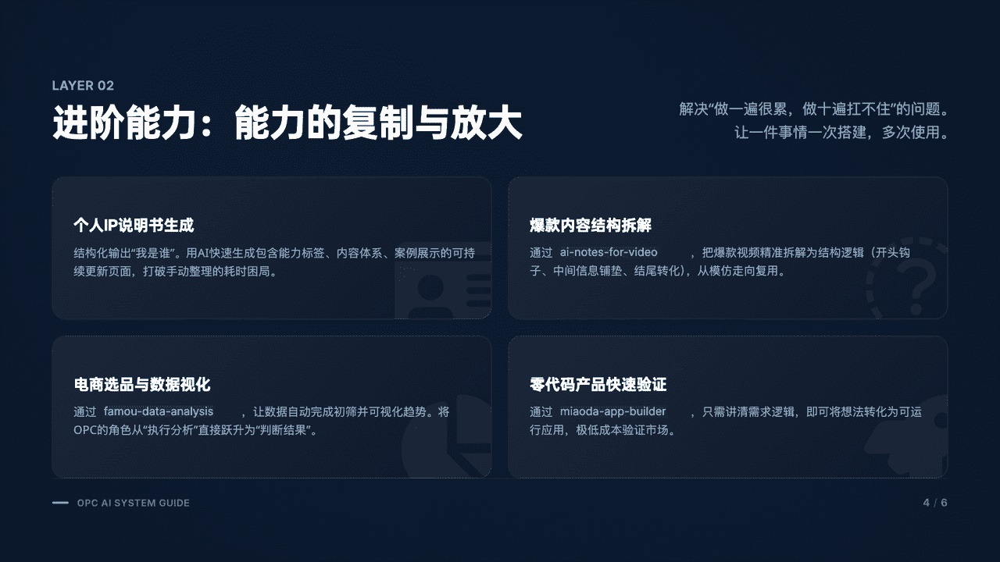

比如写一篇内容、分析一个视频、做一次数据复盘，这些事情单次来看都不难，但一旦变成日常，就会消耗大量精力。

这个时候，Skill 的价值就体现出来了。

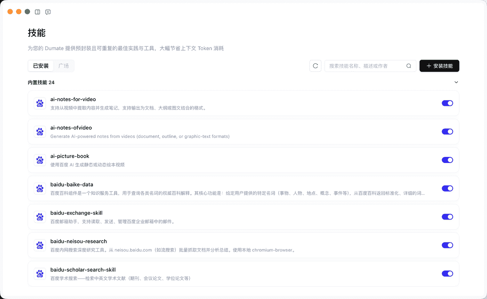

咱们可以把原本一次性的工作，变成可以反复调用的能力。

先看内容场景。

如果咱们在做个人 IP，其实都会遇到一个问题：怎么更清晰地表达“我是谁”。

不是一句简介，而是一整套结构化的能力展示。

咱们完全可以用 DuMate 去生成一份“个人说明书页面”，包括能力标签、内容体系、案例展示，甚至可以持续更新。这件事情如果手动做，可能需要很长时间，但用 Skill，可以在很短时间内生成一个可用版本。

「演示环节」

再看自媒体。

很多人做内容是靠感觉，但爆款内容其实是有结构的。

通过“ai-notes-for-video”这样的 Skill，咱们可以把爆款视频拆成结构，比如开头如何吸引注意，中间如何铺信息，结尾如何转化。

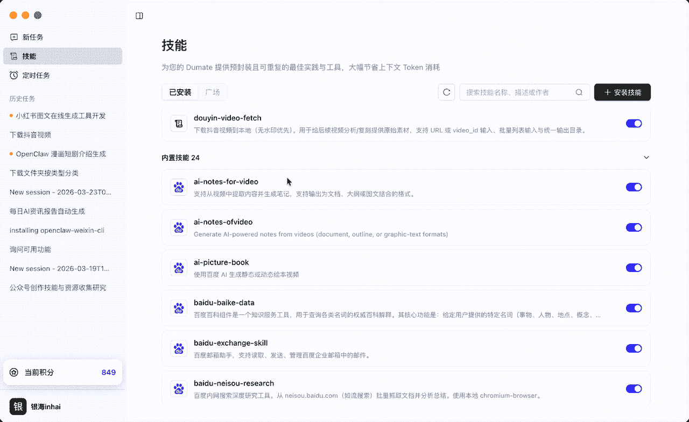

当咱们拆得足够多，就会发现规律。这个时候，咱们不是在模仿，而是在复用结构。

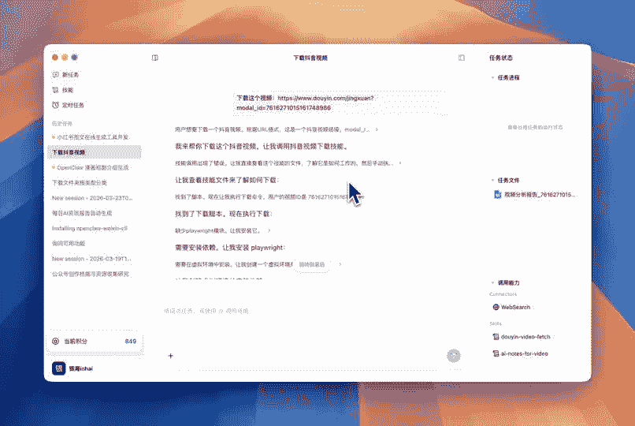

[抖音视频下载+分析.mp4](https://internal-api-drive-stream.feishu.cn/space/api/box/stream/download/all/HQLxbCeeNohD4FxulCFcyeVJnZg)

再看电商。

选品本质是数据问题，但很多人是靠经验判断。

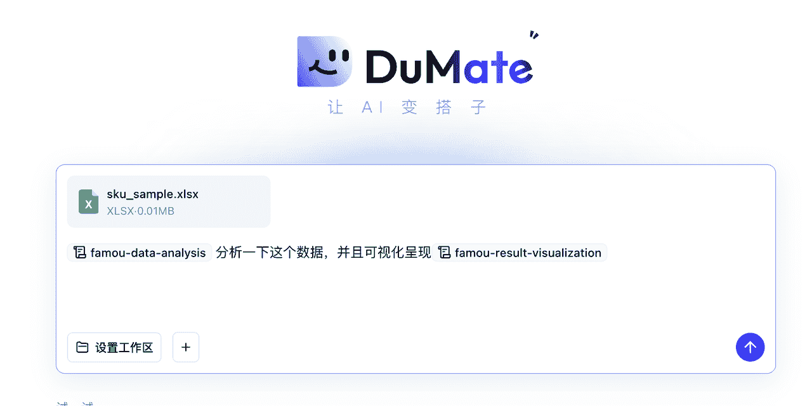

通过“famou-data-analysis”和“result-visualization”，咱们可以让数据自动完成第一轮筛选，把趋势、变化、机会点直接可视化呈现出来。

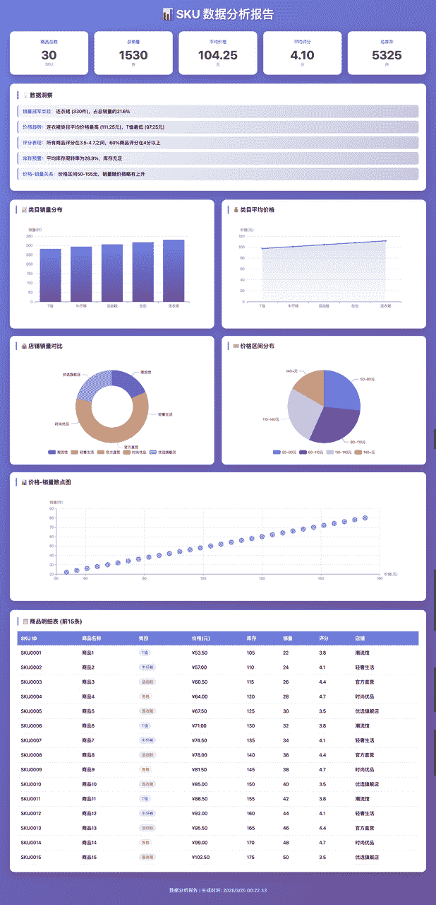

咱们的角色就从“执行分析”，变成“判断结果”，然后可以借助钉钉 AI 表格的方式，把更多结构化的数据沉淀到表格里面。

最后是产品验证。

很多人有想法，但卡在不会开发。

通过“miaoda-app-builder”，咱们可以把一个想法直接转成一个可以运行的应用，用来验证市场、验证逻辑。

「演示环节」

不需要复杂开发，只需要把需求讲清楚。

比如说，咱们想要去创建一个播客生成器类的在线应用，咱们也是直接通过「许愿式」的方法，把咱们的需求直接给 DuMate 说清楚，然后就让它去开干吧。

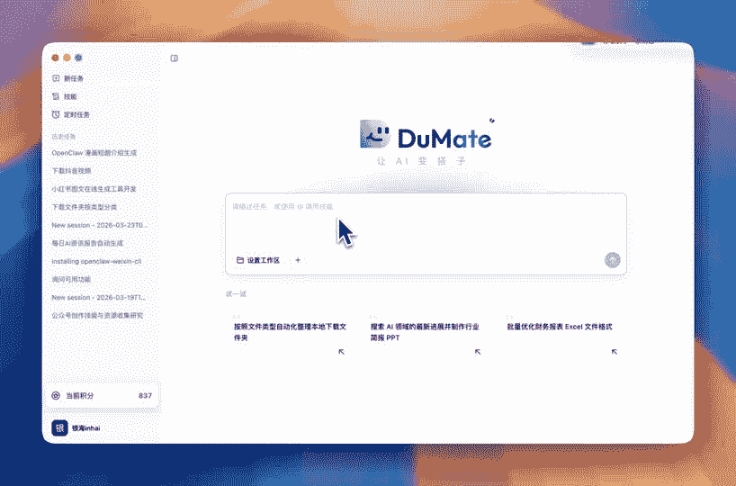

[秒哒应用生成.mp4](https://internal-api-drive-stream.feishu.cn/space/api/box/stream/download/all/O1bfbCa5qouzDrxg0fccr4syndf)

此时此刻我们再去秒哒的页面上去看，实际上可以在秒哒上已经可以直接创建应用中。

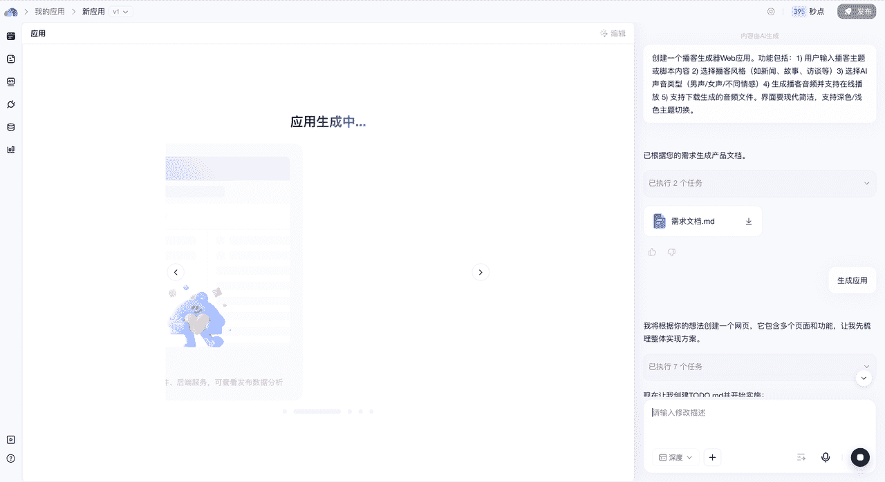

我们仅需稍等一会儿，就可以直接生成结果的页面网页的具体链接。

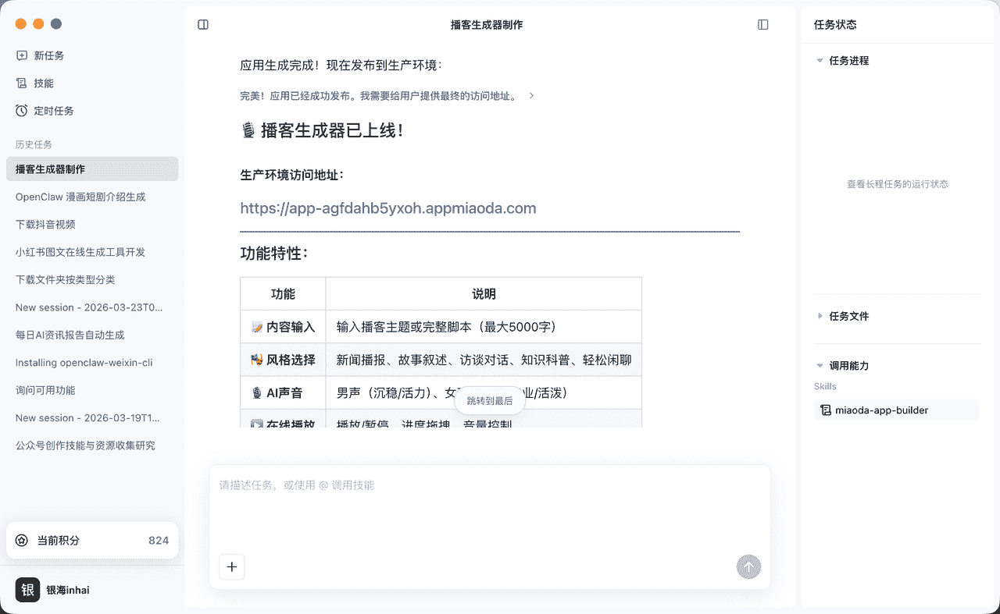

点开这个链接，咱们是真的直接上线了一个可以具体使用的应用，几个能力全部打通，简单的几句话在本地就可以完成整个网页应用的上线，并且还是能够直接使用的。

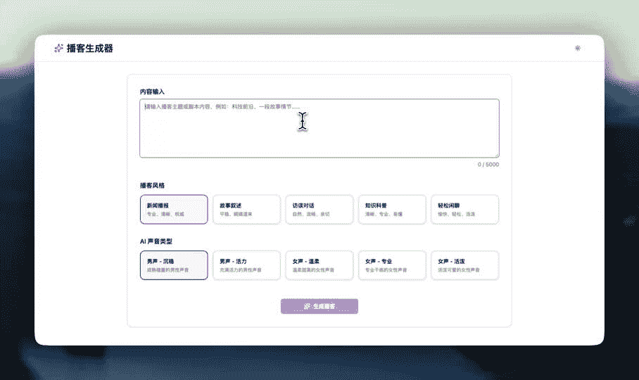

[播客生成器.mp4](https://internal-api-drive-stream.feishu.cn/space/api/box/stream/download/all/Dfv9bO2wZopC4UxmMGxcmRiJned)

应用体验地址：https://app-agfdahb5yxoh.appmiaoda.com/

在 DuMate 和秒哒一起做的这个应用里面，我们贴入一段文本，让它直接帮咱们去生成，它能够自动调用里面的插件能力，去帮我生成一段真实的播客，这个感受真的太真实了，之前做 SaaS 应用从来没有这么快过。

[播客_故事叙述_20260323.mp3](https://internal-api-drive-stream.feishu.cn/space/api/box/stream/download/all/Q3tjbydwdoh03vxmuVzc6vNtn1g)

这一层真正带来的变化是：咱们开始具备“放大能力”的能力。

同样一件事情，不再是重复做，而是一次搭建，多次使用。

再往上，就是第三层：个性化能力。

这一层，是决定上限的。

前面讲的能力，很多人都可以用，但真正拉开差距的，是咱们有没有属于自己的 Skill。

换句话说，咱们能不能把自己的经验、方法、判断逻辑，沉淀成可以复用的能力。

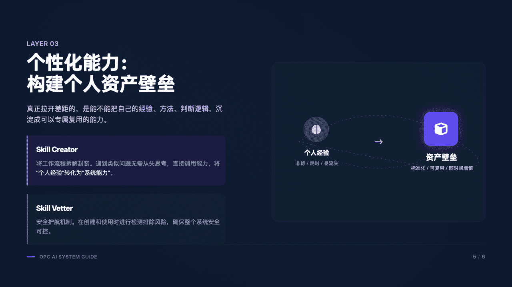

这时候，“skill-creator”就非常关键。

咱们可以把自己的工作流程拆出来，比如选题逻辑、分析框架、内容结构，然后封装成一个 Skill。

「演示环节」

以后再遇到类似问题，不需要从头思考，而是直接调用这套能力。

这其实是在做一件很重要的事情：把“个人经验”变成“系统能力”。

同时，安全也是很多人关心的问题。

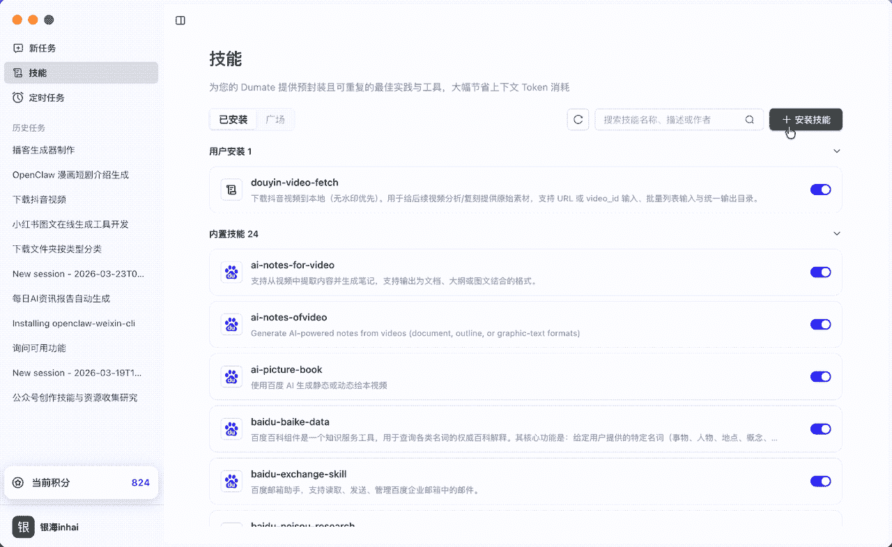

在使用或创建 Skill 的时候，可以通过“Skill-vetter”去做检测，确保没有潜在风险。

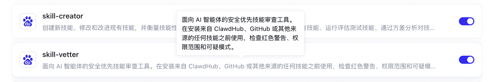

这意味着，咱们不仅可以使用 AI 能力，还可以管理这些能力，让整个系统更加可控。

当这一层跑通之后，会出现一个很明显的变化：咱们开始拥有自己的“能力资产”。

这些能力不会随着时间消失，反而会不断积累。

回到最开始的问题。

**一个人，能不能活成一支团队？**

当咱们把基础能力打牢，把进阶能力跑通，再把个性化能力沉淀下来之后，其实已经在做这件事了。

内容可以自动生产，数据可以自动分析，产品可以快速验证，甚至连咱们自己的能力，也可以被不断复用。

这个时候，咱们不再是一个人在对抗复杂，而是在调度一整套系统。

AI 在这里，不是替代咱们，而是放大咱们。

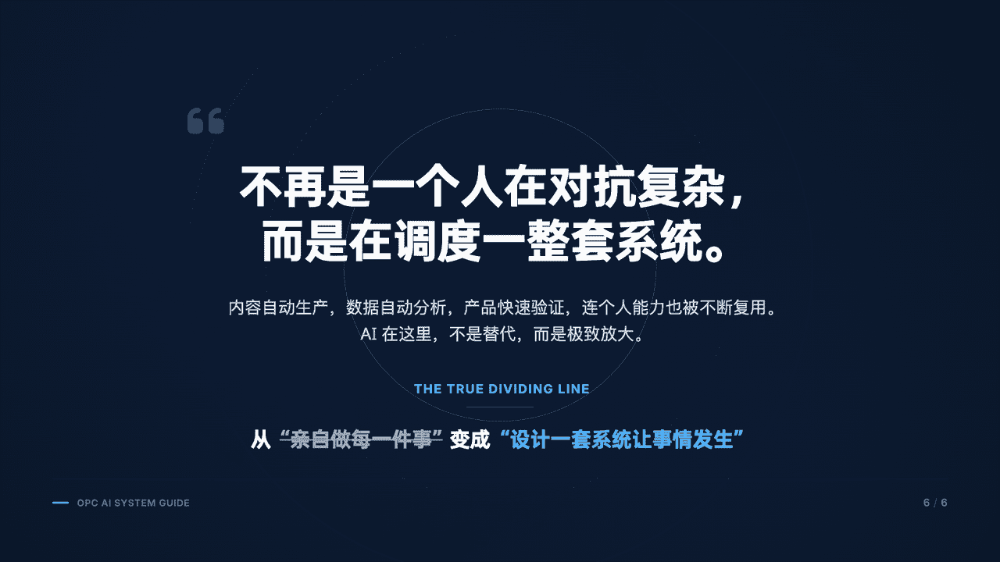

当咱们开始用这种方式工作的时候，会慢慢发现，效率只是结果，更重要的是，整个人的工作方式已经发生了变化。

从“亲自做每一件事”，变成“设计一套系统，让事情自己发生”。

这才是 OPC 真正的分水岭。

## 附录：技能清单

### 通用 Skill 能力清单（DuMate 技能体系）

基础能力让咱们「少做事」

| **Skill 名称** | **能力类型** | **适用场景** | **核心作用** | **对 OPC 的价值** |
| --- | --- | --- | --- | --- |
| PDF 处理 | 基础能力 | 知识整理、资料拆解 | 将 PDF 转为结构化内容 | 减少手动阅读与整理时间 |
| PPT 处理 | 基础能力 | 汇报、课程制作 | 自动生成/优化 PPT 内容 | 提升表达效率与专业度 |
| XLSX 处理 | 基础能力 | 数据分析、电商运营 | 表格数据处理与计算 | 降低数据处理门槛 |
| WebSearch | 基础能力 | 信息获取、调研 | 实时搜索与信息整合 | 提高信息获取效率 |

### 进阶能力（效率放大器）

进阶能力让咱们「重复利用能力」

| **Skill 名称** | **能力类型** | **适用场景** | **核心作用** | **对 OPC 的价值** |
| --- | --- | --- | --- | --- |
| ai-notes-for-video | 内容分析 | 自媒体、爆款拆解 | 视频转文字+结构分析 | 快速掌握爆款内容逻辑 |
| dumate-find-skill | 能力发现 | 全场景 | 搜索并推荐更多 Skill | 持续扩展能力边界 |
| famou-data-analysis | 数据分析 | 电商、运营 | 自动数据分析与结论输出 | 从“看数据”升级为“用数据” |
| famou-result-visualization | 数据可视化 | 汇报、复盘 | 将数据转为图表 | 提升表达与决策效率 |
| ai-picture-book | 内容生成 | 教育、自媒体 | 生成绘本/视频内容 | 快速产出创意内容 |
| miaoda-app-builder | 产品构建 | POC 验证、创业 | 快速生成应用 | 零代码实现产品想法 |
| yt-dlp-downloader-skill | 内容获取 | 自媒体、爆款拆解 | 视频下载 | 快速获取爆款数据 |
| 钉钉 AI 表格 | 数据沉淀 | 经营数据分析沉淀 | 直接出一整套 OPC 的知识管理库数据库 https://github.com/aliramw/dingtalk-ai-table | 数据管理沉淀 |
| frontend-slides | 内容生成 | PPT 分享、汇报 | 把 PPT 美化的更好 https://github.com/zarazhangrui/frontend-slides | 对客户的信息表达更好 |

### 个性化 Skill（增强组件）

个性化能力让咱们「拥有自己的能力系统」

| **Skill 名称** | **能力类型** | **适用场景** | **核心作用** | **对 OPC 的价值** |
| --- | --- | --- | --- | --- |
| skill-creator | 能力构建 | 全场景 | 自定义创建 Skill | 把经验变成可复用系统 |
| Skill-vetter | 安全审计 | Skill 管理 | 检测风险与安全性 | 确保能力体系可控 |

## Q&A

> （直播实时问题）

> 1.使用DuMate生成视频的费用是什么？

> 2.DuMate能否实现视频的自动生成，达到运营全流程自动化的效果？

> 3.DuMate是否支持接入其他平台的大模型？

> 4.DuMate的上下文记忆能力如何？

**扫码体验百度 Dumate**

**扫码进群实时交流**

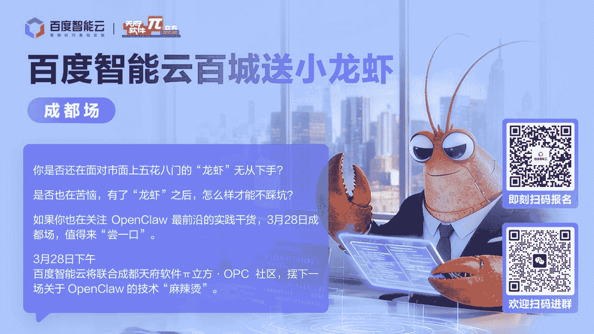