# OpenClaw 每日大记事

> 来源：https://yunyinghui.feishu.cn/docx/FIIBdUsf1oRqdpx8ezGcfJI4n6b
> **适用人群：**OpenClaw 部署提效人群
> **发布时间：**2026 年 3 月 9 日
> **内容出品人：**
> **内容出品方：**万象 AI 实验室
> **使用建议：**建议电脑端打开学习，如果需要快速定位到精确内容，可以使用快捷键 `Ctrl +F/Command +F` 的形式，搜索关键字/词，查找你想要的内容。
> **更新内容：**OpenClaw 全面相关的动态信息
> **相关阅读：**[OpenClaw 学习手册（全网首发&持续更新 ing...](https://yunyinghui.feishu.cn/wiki/Ru7PwG82qiDGo1kGMFZcxqpGnnf?from=from_copylink)

---

## 2026 年 3 月 28 日

### 【创始人发声：中美 AI 应用 “温差”】

OpenClaw 创始人 Peter Steinberger（被称为 “OpenClaw 之父”）今日公开评论：美国企业因安全担忧限制员工使用 OpenClaw（“养龙虾”），违规可能被裁；中国企业则强制普及，不用反倒可能被开除。他已加入 OpenAI，认为美国应借鉴中国快速落地 AI 的经验。

## 2026 年 3 月 26 日

### 【OpenClaw `3.24` 发布：彻底解决最重要的 `Skills` 安装障碍】

OpenClaw 在 2026 年 3 月 26 日晚更新 `3.24` 版本，本次更新围绕用户体验、系统安全及多平台适配展开实用优化。`Skills` 安装新增一键配方，可自动检测并提示缺失依赖，控制台 `Skills` 页面按标签分类，操作更便捷；macOS 版本控制台改为可折叠树形侧边栏，查找功能更高效。安全上，修复媒体文件访问绕过漏洞，防范非授权文件获取。多平台适配方面，翻新 Microsoft Teams 底层并新增 AI 原生交互，修复 WhatsApp、Telegram、Discord 等平台相关 Bug。此外，新增 OpenAI 兼容接口端点提升 RAG 兼容性，提前检测 `Node` 版本避免安装失败，最新版本支持 `Node 22.14+`（官方推荐 `Node 24`）。

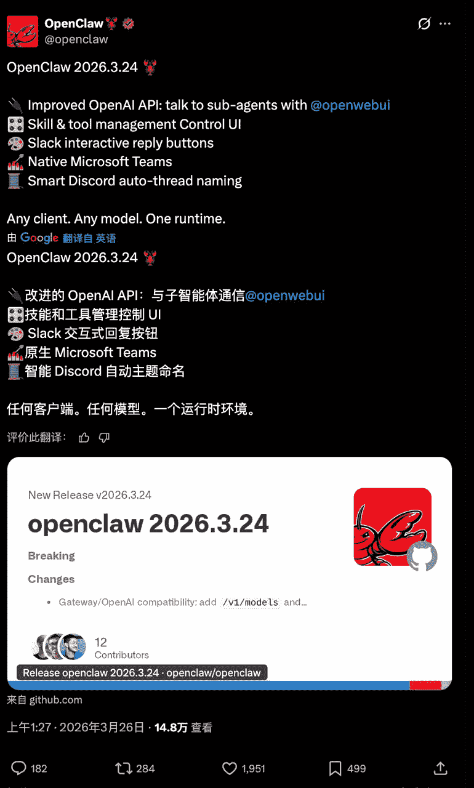

### 【高德开放平台推出 OpenClaw 适配 `Skills` 加速地理信息 AI 智能体落地】

2026 年 3 月 26 日，高德开放平台宣布将地图能力标准化封装为 `Skills` 并适配 OpenClaw 智能体，标志着地理信息服务从传统 API 调用模式转向自然语言驱动的智能体交互模式。上线的 `Skills` 包含生活办公助手、网站生成助手等，支持用户通过自然语言指令秒级生成定制化路书，也能将 POI 应用开发从数天压缩至分钟级，相关功能已在 `ClawHub` 开放。这一举措是地理空间数据与大模型协同的典型案例，推动地理信息产业接入 AI 智能体生态，实现从 “提供工具” 到 “提供端到端解决方案” 的转型，优化了 LBS 领域的开发效率与用户交互范式。

### 【小米发布 MiClaw 系统级智能助手 端侧 AI 开启新范式】

小米发布 2025 年财报，全年营收 4573 亿元、同比增长 25%，经调整净利润 392 亿元、大增 43.8%。公司明确 2026 年为 AI 应用爆发年，加速大模型、多模态与 “人车家全生态” 深度耦合。技术上，小米完成基础模型与多模态布局，自研大模型在语音、语言等维度交付，系统级智能助手 `MiClaw` 已实现手机端侧部署，具备系统级权限与底层数据融合能力，为 AIOS 核心组件，提升终端交互体验。战略层面，小米 2026 年 AI 研发开支预计 160 亿元，未来三年累计投入 600 亿元，重点布局 AI 基建、自动驾驶及机器人领域；芯片自研向 AI 架构转型，SU7 等车型集成 `XLA` 模型推动智驾端到端融合，AI 成为业务增长底层引擎。

## 2026 年 3 月 25 日

### 【京东云推出龙虾系列产品 开源 JoyAI 大模型并布局具身智能】

京东公布京东云 “龙虾天团” 系列产品，包含 OpenClaw（龙虾）轻量云主机、一体机、云上 SaaS 版及 CodingPlan 大模型套餐，该系列上线后 token 调用量环比增 455%，云服务用户单周涨 300%。京东首次开源通用基础大模型 `JoyAI-LLM Flash` 的 Instruct 版本（`48B` 参数量、激活 `3B` 参数），性能优于同规模模型，还引入 “纤维丛” 数学工具优化算法，已应用于超 2000 个场景、内部超 5 万个智能体。同时，京东自研 `JoyAvatar` 数字人视频生成框架，在唇形同步、身份稳定等指标达商用级，超越国际同类模型，可落地多场景；推出 `JoyInside` 开发平台，提供 AI 能力与硬件模组解决方案，已接入近百家家电家居等品牌。依托超 1700 亿元技术投入，京东形成完整 AI 技术矩阵，加速 AI 规模化落地与普惠应用。此外，京东还规划布局具身智能，计划两年内积累超 1000 万小时优质数据，建成全球最大的具身智能数据采集中心。

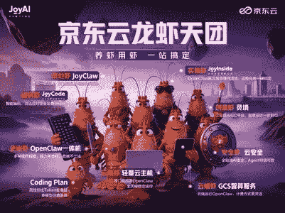

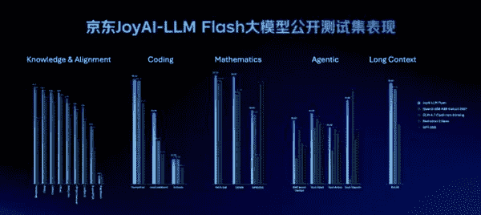

### 【OpenClaw `3.22` 版本重大更新引发兼容危机 紧急推出 `3.23` 版本修复】

OpenClaw（小龙虾）发布 `3.22` 版本，这是其史上规模最大的一次更新，包含 SDK 架构重构、多模型升级、安全加固等 315 项内容，由 118 名开发者参与。但因无兼容层的激进重构，系统入口、配置文件夹等核心配置变更，导致🛰️、飞书的龙虾插件全部宕机，部分用户插件瘫痪、功能失效，需回滚至 `3.13` 版本才能正常使用。🛰️方面回应将尽快更新插件，腾讯公关总监也确认插件已更新。此外，该版本更新还存在 Web 控制界面资源加载遗漏的问题。

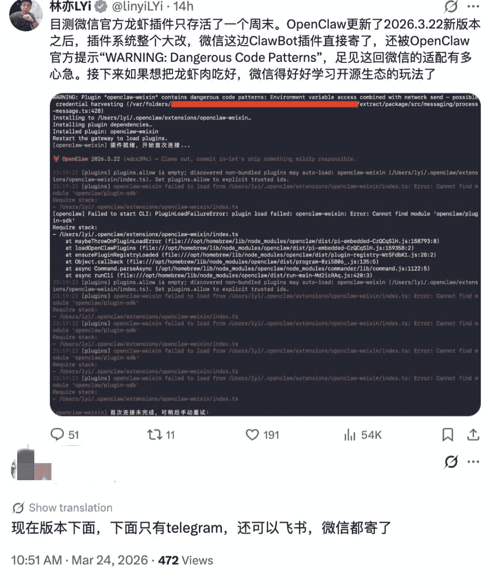

针对上述问题，OpenClaw 紧急推出 `3.23` 版本，重点修复了 Web 界面、`DeepSeek` 插件等问题，同时新增阿里云 `DashScope` 接口支持，优化插件生态、认证凭证管理、多平台交互体验，加固系统稳定性与安全性。`3.22` 版本本身也实现了多项核心升级，包括统一 SDK 架构、升级 `MiniMax` 等模型、优化交互与视觉、全方位加固系统安全等。此次事件也提醒用户，在大版本更新前需评估平台依赖，或等待插件适配完成后再升级。

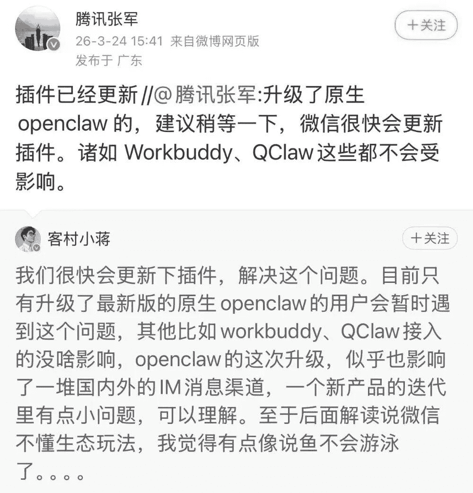

## 2026 年 3 月 24 日

### 【OpenClaw 发布 `v2026.3.22-beta.1` 版本 插件与安全体系全面升级】

OpenClaw 时隔 9 天发布 `v2026.3.22-beta.1` 预览版，核心进行架构级升级：全面重构插件系统，启用全新公开插件 `SDK` 并废弃旧 `API`，将 `ClawHub` 设为插件安装首选渠道，同时兼容 `Claude`、`Codex`、`Cursor` 等外部插件生态；强化安全防护，封堵 Windows `SMB` 凭证泄露、环境变量注入、Unicode 伪装等多项漏洞，加固执行沙盒与权限校验；模型层面默认切换至 `GPT-5.4`，升级 `MiniMax`、接入 Anthropic Vertex 并同步更新多家模型能力；优化多平台交互体验，完善 `Android`、`飞书`、`Telegram` 等端能力与界面细节，迭代 Agent 长对话压缩机制并延长超时限制，整体向企业级可信 AI 智能体平台迈进。

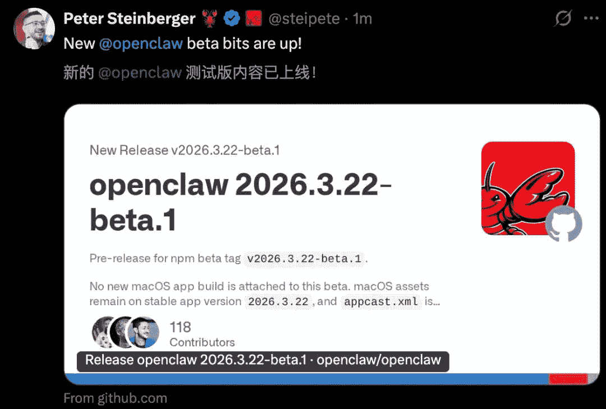

### 【英伟达 CEO 借 OpenClaw 热潮宣称 AGI 已成现实】

英伟达 CEO 黄仁勋在 Lex Fridman 播客中直言已实现 AGI，认为这一技术并非遥远未来，而是当下已至，并以开源 AI 智能体平台 OpenClaw 为例；同时他也理性指出，当前 AI 代理虽应用活跃，但多数难以持续，尚无法支撑复杂企业运营，这一表态意味着 AGI 已进入开源生态驱动的分布式实验阶段，虽未完全具备人类级复杂商业运营能力，却已在垂直场景与社交生态中推动行业范式转变。

### 【AMD：本地 “养虾”，需要一台专用 AI 主机】

AMD 指出云端 AI 面临部署难、隐私风险与 Token 成本高的问题，高频调用的 OpenClaw 智能体更适合本地化部署，其推出的锐龙 AI Max 系列平台以超大统一内存与高显存划分能力，提供低成本高性能本地 AI 算力方案；AMD 认为 AI 自主驱动的智能体主机是计算发展新里程碑，相关方案已在多行业落地，标志着移动互联网时代迈向智能体时代。

## 2026 年 3 月 23 日

### 【网易云音乐全面接入 OpenClaw，业内首个 AI Agent 音乐服务接口上线】

网易云音乐正式宣布全面接入 OpenClaw 生态，并将其音乐推荐、搜索等核心能力封装为一系列标准化 `CLI`（命令行接口）及自动化 `Skill`。此举标志着网易云音乐成为业内首个向 AI Agent（智能体）深度开放核心服务能力的音乐平台。

### 【腾讯推出🛰️ ClawBot 插件，个人 AI 助手“龙虾”可直连🛰️聊天】

腾讯今日推出“🛰️ `ClawBot`”插件，正式打通个人 AI 助手“OpenClaw”（龙虾）与🛰️的私密连接通道。该举措标志着腾讯正加速其模型生态与主流社交应用的无缝整合，为用户在移动端高频场景调用个人 AI 助手提供了便捷入口。

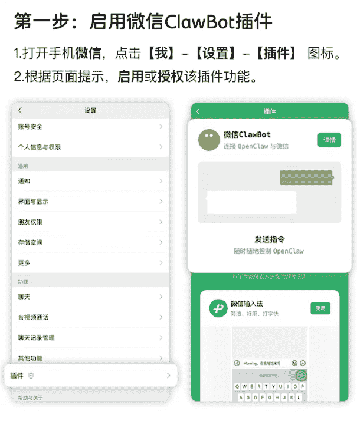

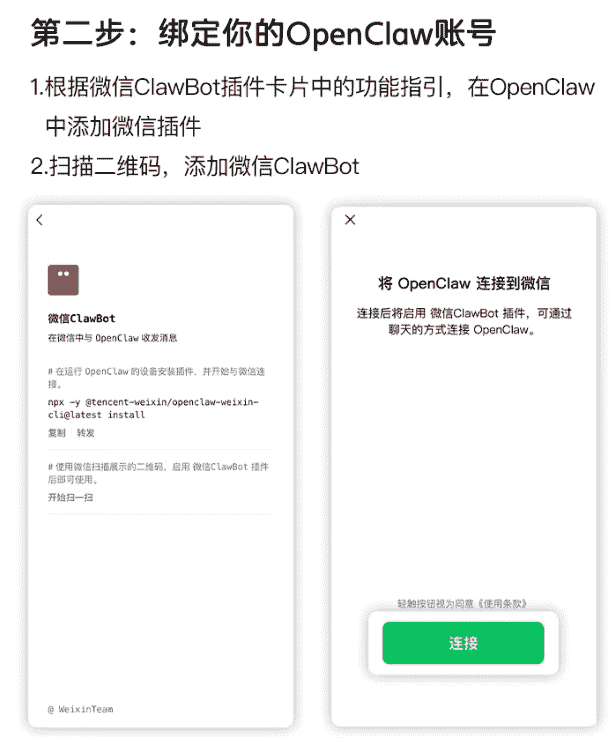

### 【OpenClaw 驱动 AI 智能体爆发 中国大模型调用量全球领先】

中国大模型周调用量达 4.69 万亿 Token，连续两周超越美国并包揽全球前三。这一增长主要由 OpenClaw 等 AI 智能体应用推动，其任务链带来的 Token 消耗远高于传统对话。摩根大通预计，2025 至 2030 年中国 AI 推理 Token 消耗量将大幅增长。同时，国内算力产业链进入 “全链通胀” 阶段，云厂商向 AI 智能体服务提供商转型，青云科技、优刻得等企业围绕 OpenClaw 推进安全与海外部署，国产算力进入快速发展期。

## 2026 年 3 月 22 日

### 【百度 DuMate 全量上线，为国内首个国产企业级龙虾产品】

百度智能云 `DuMate` 正式上线，面向用户全量开放。这是国内首个国产企业级龙虾产品，支持本地部署，企业级用户也能安全合规使用。

### 【🛰️推出官方龙虾插件】

据腾讯官微 3 月 22 日消息，正式推出🛰️ “`ClawBot`” 插件，支持接入 OpenClaw。用户扫码或复制命令，即可将 OpenClaw 接入🛰️。连接后，用户就能通过🛰️聊天的方式，快速调用自己的“龙虾”高效互动。除此之外，腾讯 “养虾车间” 云端虾 `Lighthouse`、自研虾 `workbuddy`、本地虾 `QClaw` 等均已就位。

## 2026 年 3 月 21 日

### 【百度网盘 GenFlow 全新升级，融合 OpenClaw，支持多人 AI 协作】

百度网盘宣布全新升级 `GenFlow`，并兼容 OpenClaw 能力，该功能已上线 PC 客户端及全新推出的团队空间，个人用户、团队可以在百度网盘一键部署 OpenClaw、开箱即用。

## 2026 年 3 月 19 日

### 【腾讯 QClaw 正式开启全量公测】

3 月 20 日，腾讯 `QClaw` 正式开启全量公测。新版本持续优化🛰️生态体验，同时打通企业🛰️、🐧、飞书、钉钉等多平台远控通道，进一步拓展 AI 协作入口。“龙虾像素工作室”、定时任务等特色功能也在本次公测中正式开放。

### 【超百万人抢购“养龙虾”设备 天猫 3 月电脑销量涨 40%】

OpenClaw “养龙虾”热度居高不下，“养虾人”们纷纷抢爆 `Mac mini` 等硬件设备，天猫电脑品类的销量激增。3 月至今，已有超 100 万人涌入天猫抢购“养龙虾”装备，天猫平台上的电脑设备销量整体增长 40%，其中苹果、联想、华硕、ThinkPad、惠普成为销量最高的 TOP5 电脑品牌。

### 【雷军：小米做了手机“龙虾”，很快会做电脑“龙虾”】

2026 新一代 `SU7` 小米春季新品发布会日前举行。在谈到 AI 安全问题时，小米集团创始人雷军表示，今天进入了全新的时代，无论是哪个人还是哪个企业，都要积极拥抱 AI 时代。小米在整个 AI 的领域里是全面布局。雷军表示，在模型领域的话，小米力争能成为国内乃至全球的第一阵营的选手，“我们的模型刚刚发布，可能还需要不断的迭代，同时我们又做了手机‘龙虾’，很快会做电脑‘龙虾’。”

## 2026 年 3 月 19 日

### 【阶跃星辰上线桌面端 StepClaw】

阶跃星辰重磅推出桌面端 `StepClaw`（阶跃龙虾），该产品在 “阶跃 AI 桌面伙伴” 平台完成上线，其核心定位为 “随你定义的工作伙伴”。这是自 3 月 12 日阶跃 AI App 上线云端 `StepClaw` 之后，`StepClaw` 在桌面端的全面落地。`StepClaw` 基于 OpenClaw 进行深度优化，用户无需服务器、无需命令行操作，只需安装阶跃 AI 桌面伙伴，一键领养，就能获得一只常驻桌面的 AI Agent，且同时支持 `Windows` 与 `Mac` 双系统。

### 【飞书发布原生“龙虾”，支持用户一键创建专属 Agent】

飞书发布了多款企业级 Agent 产品。通过全新升级的智能体平台 `飞书 aily`，用户只需简单创建，便可拥有通晓自己上下文的 Agent 伙伴；仅用自然语言描述下发任务，飞书妙搭即可生成复杂的业务系统；而在飞书多维表格，用户也只需与 Agent 协作，便能完成搭建数据表、仪表盘、工作流再到配置权限等多项工作。

### 【DeskClaw Windows 版正式上线：自研 NoBot 内核同步发布，Token 消耗大幅降低】

桌面宠物版 AI 助手 `DeskClaw` 宣布 `Windows` 版本正式上线，并同步发布自研 “`NoBot` 内核”。新内核代码量仅为旧版 1%，架构大幅精简，Token 消耗显著降低，同时引入沙箱安全执行机制，有效隔离任务风险。新版本在启动速度、内存占用及上下文专注度方面均有优化提升，并已接入 `MCP` 工具生态。据了解，`Mac` 版自研内核适配预计于下周推出。

## 2026 年 3 月 18 日

### 【字节内部发布“龙虾”相关安全规范，面向员工推出 ByteClaw】

字节跳动安全团队最近在内部发布了《`OpenClaw` 安全规范和使用指引》，同步面向字节员工推出 `ByteClaw`。该服务基于火山引擎 `ArkClaw` 企业版构建，可以在公司账号体系下实现统一的身份认证、访问控制与权限管理，支持员工安全调用公司内部资源。

### 【百度健康将于近期发布 DoctorClaw，整体业务由杨明璐把关】

`DoctorClaw` 在百度健康内部已经上升为 “一号位” 工程，业务整体由总经理杨明璐把控，正式产品预计将于近期发布。据一位参与产品手机端内测的人士介绍，这是一款面向医生的 OpenClaw，定位是医生 AI 助理，可以帮医生自动整理研究资料、跟踪论文进度、设置随访提醒、定时追踪最新文献等。

## 2026 年 3 月 17 日

### 【周鸿祎：决定启动 360 安全龙虾全国巡装计划】

360 集团创始人、董事长周鸿祎发文表示，决定启动 360 安全龙虾全国巡装计划。周鸿祎宣布，360 启动全国巡装计划，派上千名 AI 龙虾工程师协助安装。

### 【腾讯云智能体开发平台推出“企业级 OpenClaw”解决方案 ADP Claw】

腾讯云 `ADP Claw`（企业级 Open Claw 一键部署）再升级，可直连🛰️，同时只需 “一键扫码” 就能快速连接企微。针对企业🛰️智能机器人渠道，`ADP Claw` 推出 “一键扫码” 登录功能。同时，腾讯云智能体开发平台推出 “企业级 OpenClaw” 解决方案（`ADP Claw`）。`ADP Claw` 深度融合了腾讯云 `ADP` 平台企业级 Agent 构建能力，如 `RAG`、`Workflow`、`Multi-Agent` 及知识库管理、插件能力等。

## 2026 年 3 月 15 日

### 【阅文作家助手 Claw 开启内测】

3 月 15 日，阅文集团旗下专业网文创作工具 “作家助手” 宣布，作家助手 `Claw` 已开启内测。作家用户可一键完成安装部署，领养专属 AI 智能体，使用各种深度贴合网文创作场景的专属技能。

## 2026 年 3 月 14 日

### 【深圳龙岗“千人龙虾大会”火爆 现场装龙虾大排长队】

今日由深圳龙岗区联合 `Kimi` 共同打造的“千人龙虾大会”现场火爆。活动开场近一小时后，入口处仍有众多进入报名候补名单的市民等待开放名额入场。据了解，该论坛会解答养虾有什么用、如何安全养虾、`token` 成本多高、如何快速上手等问题。场外还设有龙虾安装摊位、中国电信和中国联通的网络服务点。有志愿者提前告知排长队的市民称，“没带电脑的可以不用排了，电脑里有 360 或腾讯电脑管家的先卸载。”机器人剧场一侧的“全球首家人工智能 6S 店”3 月 11-17 日提供免费安装龙虾服务，工作人员介绍“现在我们安装不过来，要先预约，已经放出去 300 个号，不确定后续什么时候会再放号。”

## 【腾讯 “龙虾” 免费安装全国落地】

腾讯云宣布，开启 “龙虾” 全国免费安装计划。据介绍，未来 40 天，腾讯云 `Lighthouse`、`ADP`、`WorkBuddy`、`QClaw`、云安全、云存储等龙虾产品的技术专家等，将在深圳、上海、北京、广州、杭州、成都、武汉等全国 17 个城市，免费提供安装部署、模型配置、技能安装、卸载清理等服务。

## 2026 年 3 月 13 日

### 【腾讯电脑管家 18.0 发布，一键防护“龙虾+AI 应用”】

针对关键的本地电脑安全，3 月 13 日腾讯电脑管家发布 18.0 版本，行业首发 `AI` 安全沙箱“龙虾管家”、`AI` 应用隐私保护等功能，一键即可开启 `AI` 双防护。

### 【Miclaw 发布更新，新增接入多家第三方应用】

小米社区今日发布公告，`Xiaomi miclaw` 覆盖小米 15S Pro、`REDMI K90`、`REDMI K90 Pro Max` 三款机型，用户可在小米社区申请邀请码。同时，新增接入高德地图、百度地图、百度搜索、快递 100、曹操出行、哈啰等三方 `MCP` 服务，支持打车、查快递、查天气。新增智能家居拓展、聊天链接可点击、`AI` 推理过程可视化等新功能。

### 【阿里云发布手机“一键养虾”产品 `JVS Claw`】

阿里云推出“一键养虾”平台——`JVS Claw`，消费者无需掌握任何代码知识，在手机上简单操作三步，就能拥有即开即用、智能进化、安全可控的 `AI` 智能体“龙虾”。全程无需配置节点和大模型 `API` 密钥，也不用绑定🛰️/飞书等 `IM` 工具。

### 【原微软小冰创始团队发布“卫士虾”，一句话即可安装】

明日新程（原微软小冰创始团队）正式发布“卫士虾”（`Guardian Claw`），它能够替用户实时防范本机所有龙虾异常风险行为，而安装极其简单。用户只需要对自己的 `Claw` 说一句话：“去 `Claw.myTuanzi.com` 下载安装卫士虾。”卫士虾就会自动完成全部安装，并立刻开启本机实时防护。

## 2026 年 3 月 12 日

### 【腾讯推出 `OpenClaw` 安全工具箱】

针对龙虾带来的安全挑战，腾讯推出了 `OpenClaw` 安全工具箱，为企业和用户提供安全保障。针对在云端部署的开发者与企业，腾讯云 `Lighthouse` 及 `ClawPro` 升级专属部署架构，支持环境隔离与快照回滚；腾讯云 `AI Agent` 安全中心可统一管理云上 `AI Agent`，监测异常指令并扫描技能风险。对于将龙虾部署在个人电脑的用户，腾讯电脑管家 18.0 新增“龙虾管家-`AI` 安全沙箱”功能，实现隔离运行。

### 【科大讯飞版“龙虾”`AstronClaw` 上线】

科大讯飞版“龙虾”——`AstronClaw` 正式上线。其核心采用沙箱隔离技术运行，全程守护用户数据安全。支持云端一键部署，可接入企业🛰️、钉钉、飞书等主流通讯工具，直接对话即可指派任务。平台可调用 10000+`skills`，支持自由切换星火 `X2`、`MiniMax-M2.5`、`Kimi-K2.5`、`GLM-5` 等多款大模型，胜任行业分析、文档处理等工作。

### 【网易智企举办“龙虾总动员”活动，发布企业级平台 `ClawHive`】

网易智企“龙虾总动员 · `AI Agent` 实战全公开”活动在杭州举行。网易智企围绕 `GitHub` 开源项目“龙虾”（`OpenClaw`），向近四百位企业管理者与开发者分享了企业级安全部署经验。活动现场，网易智企发布了企业级平台 `ClawHive`，针对企业落地 `AI Agent` 的安全、场景适配、规模化使用等问题，提供权限管控、数据隔离、一键部署等解决方案。

### 【国家工业信息安全发展研究中心发布工业领域 `OpenClaw` 应用的风险预警通报】

国家工业信息安全发展研究中心发布《关于工业领域 `OpenClaw` 应用的风险预警通报》：`OpenClaw` 目前正加速在工业领域研发设计、生产制造、运维管理等环节部署应用。然而，由于 `OpenClaw` 存在信任边界模糊、多渠道统一接入、大模型灵活调用、双模持久化记忆等特点，一旦缺乏有效的权限控制策略或安全审计机制，可能因指令诱导、供应链投毒等被恶意接管，造成工控系统失控、敏感信息泄露等一系列安全风险。因此，建议工业企业参照《工业控制系统网络安全防护指南》《工业互联网安全分类分级管理办法》等相关要求，参考工业和信息化部网络安全威胁和漏洞信息共享平台（`NVDB`）已发布的“六要六不要”建议，在部署和应用 `OpenClaw` 时强化安全防护措施，包括加强控制权限管理；强化网络边界隔离；做好漏洞补丁修复。

### 【阶跃星辰加入“小龙虾”战局，搭载开源社区最受欢迎“龙虾大脑”】

阶跃星辰推出基于 `OpenClaw` 打造的云端 `AI` 助手 `StepClaw`，并开放 5 万个可一键部署并使用“小龙虾”的体验名额，限时免费 1 个月。体验名额不仅支持通过阶跃 `AI APP` 一键部署“小龙虾”，更提供了包含 5000 万模型 `Tokens`、服务器、存储在内的全家桶免费权益。值得注意的是，`StepClaw` 搭载了阶跃星辰 `Step 3.5 Flash`。该模型自 3 月初全面开源后，登顶 `OpenClaw` 模型调用量月榜，并连续多日位列全球第一，是开源社区“最受开发者欢迎的龙虾大脑”。

### 【腾讯回应 `OpenClaw` 之父 Peter 的“抄袭”指责：希望继续支持生态】

近日，腾讯的 `SkillHub` 正式上线，有市场声音称腾讯正在抓取 `Clawhub` 上的技能并导入到该平台中。奥地利知名程序员、`OpenClaw` 创始人 Peter Steinberger 在社交平台上评论，他曾收到一封邮件，有人抱怨他的速率限制导致他们无法快速抓取数据。“他们抄袭，却不以任何方式支持这个项目”。记者从腾讯云相关人士处确认，腾讯已在该条推文下进行回复，表示 `SkillHub` 只是面向中国用户的本地镜像站，标注 `ClawHub` 为原始来源；同时，腾讯上线首周给用户分发了 180GB（87 万次下载），但从官方源只拉取约 1GB，反而帮官方分担了流量。此外，团队成员本身也是项目代码和 `PR` 贡献者，希望继续支持生态。

## 2026 年 3 月 11 日

### 【京东云“龙虾”用户单周增长超 300%】

继 1 月官宣上线 `OpenClaw`（曾用名 `Clawdbot`、`Moltbot`，俗称“龙虾”）云服务后，京东云轻量云主机凭借零门槛部署、全天候稳定运行的优势，成为众多用户部署这款热门开源 `Agent` 的选择。最新数据显示，京东云 `OpenClaw` 云服务用户规模单周增长超 300%，云端部署需求持续走高。京东云轻量云主机的一键部署方案，正成为现象级开源 `AI` 项目快速普及的重要助力。

### 【智谱宣布启动“龙虾全国部署计划”】

智谱宣布启动“龙虾全国部署计划”，一键安装电脑版龙虾“`AutoClaw` 澳龙”，为对龙虾感兴趣的各地政府、企业、高校等提供龙虾安装服务。同时招募各地科技爱好者及 `KOL` 加入“龙虾布道师”计划，公司会提供相关的 `AI` 模型与 `OpenClaw` 培训。

### 【超算互联网向 `OpenClaw` 用户免费发放 1000 万 `Tokens`】

3 月 11 日，国家超算互联网宣布，面向平台全体 `OpenClaw` 用户免费发放 1000 万 `Tokens` 额度，限时 2 周。同日，超算互联网还公布了 `OpenClaw` 的 `Token` 续购价格，为 0.1 元/百万 `Tokens`。

### 【马化腾凌晨 2 点发声：还有一批龙虾系产品陆续赶来】

腾讯董事会主席兼首席执行官马化腾今日凌晨 2：06 在朋友圈转发了腾讯推出全系“龙虾”产品矩阵的👸号文章，并配文“自研龙虾、本地虾、云端虾、企业虾、云桌面虾，安全隔离虾房、云保安、知识库......还有一批产品陆续赶来”。昨日腾讯已宣布“龙虾”矩阵包括腾讯版"免部署小龙虾" `WorkBuddy`、内测中的 `QClaw`、腾讯云 `Lighthouse` 等产品，今日腾讯股价开盘上涨，市值回到 5 万亿港元。

### 【华为推出“鸿蒙版龙虾”小艺 `Claw`】

华为推出基于鸿蒙系统的小艺 `Claw`，目前处于 beta 版本。从介绍来看，小艺 `Claw` 可以帮助用户处理文档编辑、写 `PPT`、自动回复邮件等任务，支持多端协同，预设多种不同的人格。此前，华为小艺开放平台显示，其已新增 `OpenClaw` 模式。

### 【苏州人工智能协会发布 `OpenClaw` 理性应用倡议书：呼吁不制造焦虑、不鼓吹神话】

苏州市人工智能行业协会联合相关企事业单位，向全市 `OpenClaw` 开发者、应用企业、创业者和相关机构发出倡议：推动 `OpenClaw` 走向专业服务，由专业机构提供安全部署、能力训练与可信交付，让智能体真正嵌入业务流程，成为可靠的生产力工具；严格落实安全配置基线，遵循最小权限原则；建立数据隔离与审计日志机制；定期开展漏洞排查与风险评估；加强开发者安全素养培训。确保技术创新与安全治理协同推进，实现规范有序发展；行业媒体、平台企业、培训机构理性引导预期，客观展示技术能力与局限，不制造焦虑、不鼓吹神话，共同营造务实、理性、健康的产业发展环境。

### 【`OpenClaw` 持续爆火，阶跃星辰 `Step 3.5 Flash` 单日/单月调用量全球第一】

随着 `AI` 开源社区项目 `OpenClaw` 的走红，开发者对大模型的真实调用数据受到广泛关注。目前，`OpenClaw` 的日榜与月榜前三甲被中国大模型 `Step 3.5 Flash`、`Kimi K2.5`、`MiniMax M2.5` 包揽。其中，阶跃星辰开源基座模型 `Step 3.5 Flash` 调用量攀升最为明显。根据 `OpenRouter` 统计，过去 30 天内，`Step 3.5 Flash` 在 `OpenClaw` 上的 `tokens` 调用总量已位居全球第一，此前该模型已连续一周登顶 `OpenClaw` 单日调用榜。

### 【杭州萧山：提供 `OpenClaw` 免费部署与开发，支持 `Token` 消耗补贴】

杭州市萧山区发布《杭州市萧山区支持 `OpenClaw`&`OPC-STC` 发展的若干措施（征求意见稿）》。鼓励市场化、专业化的创新平台载体设立“`OpenClaw` 类智能体服务区”，免费部署 `OpenClaw` 类智能体，提供技术指导、市场推广等一站式服务，对于符合条件的创新平台载体给予一定补助。对符合条件的 `OPC-STC` 企业，使用 `OpenClaw` 类智能体调用国内多模态大模型开展 `AIGC` 创作与生产所实际支付的模型调用费用，按 30%给予补贴，单家企业每年补贴最高 10 万元。

## 2026 年 3 月 10 日

### 【国家互联网应急中心发布 `OpenClaw` 安全应用风险提示】

国家互联网应急中心发布 `OpenClaw` 安全应用风险提示。前期，由于 `OpenClaw` 智能体的不当安装和使用，已经出现了一些严重的安全风险。建议相关单位和个人用户在部署和应用 `OpenClaw` 时，采取以下安全措施：1。强化网络控制，不将 `OpenClaw` 默认管理端口直接暴露在公网上，通过身份认证、访问控制等安全控制措施对访问服务进行安全管理。对运行环境进行严格隔离，使用容器等技术限制 `OpenClaw` 权限过高问题；2.加强凭证管理，避免在环境变量中明文存储密钥；建立完整的操作日志审计机制；3.严格管理插件来源，禁用自动更新功能，仅从可信渠道安装经过签名验证的扩展程序。4.持续关注补丁和安全更新，及时进行版本更新和安装安全补丁。

### 【🛰️员工辟谣 `OpenClaw` 可自动发红包】

🛰️员工“客村小蒋”发布🧣表示，给 `OpenClaw` 指令然后 `AI` 自动发红包的事是假的。“截图里的 `QClaw` 还没有移动端部署的方案，PC 🛰️也不支持发红包，玩梗的人自己也澄清了，大家还是不要以讹传讹。”他还提醒，`OpenClaw` 这类涉及 `AI` 自动化决策和操作的工具，大家还是注意好权限管理。

### 【京东上线“`OpenClaw` 远程部署服务”】

京东宣布推出“`OpenClaw` 远程部署服务”，目前，该服务已在京东 3C 数码服务自营旗舰店上线。消费者下单该服务后，可预约专业工程师进行远程一对一部署。

### 【腾讯官宣全系“龙虾”产品，`QClaw` 支持🛰️远程操控。】

腾讯官宣了全系“龙虾”矩阵，包括腾讯版"免部署小龙虾" `WorkBuddy`、内测中的 `QClaw`、腾讯云 `Lighthouse` 等产品。其中，`QClaw` 正在内测，该智能体可通过🛰️对话远程操控。腾讯介绍，基于 `OpenClaw` 打造的本地 `AI` 助手可在 `Windows` 或 `Mac` 上一键安装，覆盖 5000 个以上的 `skills`。用户在🛰️上发个信息给 `QClaw`，就可以让家里的电脑算报表、传文件。

### 【WPS 365 接入 `OpenClaw` 数字员工】

金山办公 `WPS 365` 旗下 `IM` 服务“`WPS 协作`”正式接入 `OpenClaw` 数字员工。据了解，`WPS 协作` 可通过 `OpenClaw` 数字员工，一句话搞定约会议、发消息、管文档等协作操作，云端调度+本地执行保障数据安全。

### 【合肥高新区推出 15 条举措“养龙虾”，最高予以 1000 万元资金扶持】

据合肥高新发布，近日，合肥高新区正式发布《合肥高新区打造人工智能 `OPC` 创业生态示范区行动计划（征求意见稿）》，推出 15 条举措，全方位护航 `OpenClaw` 等开源 `AI` 项目落地深耕，致力打造“`AI`+超级个体/一人公司（`OPC`）”新业态标杆。高新区已备好“空间+人才+算力+场景+资本”豪华大礼包，最高予以 1000 万元资金扶持。

### 【常熟拟推出 13 条举措，最高 600 万元支持 `OPC` 运用“`OpenClaw`”工具生产经营】

据 i 常熟👸号，近日，常熟发布《常熟市加快打造 `OpenClaw` 等开源社区推动产业高质量发展的若干措施（征求意见稿）》，推出 13 条举措，聚焦 `AI` 赋能产业高质量发展，打造全国具有引领力的 `AI`+创新应用示范区。其中提到，支持 `OPC` 运用“`OpenClaw`”工具生产经营，对于入选各级人才计划的 `OPC` 项目，最高可给予 600 万元综合支持。

## 2026 年 3 月 9 日

### 【企业🛰️支持 `OpenClaw` 接入】

今天早间（3 月 9 日），企业🛰️开放支持 `OpenClaw` 接入。根据信息所示，企业用户可将 `OpenClaw` 作为智能机器人部署至企业🛰️工作台，实现与 `AI` 助手的直接对话，并支持将 `AI` 处理的数据直接写入企业🛰️智能表格。

> [`OpenClaw` 学习手册（全网首发&持续更新 ing...](https://yunyinghui.feishu.cn/wiki/Ru7PwG82qiDGo1kGMFZcxqpGnnf#E0Z3dW6tdorhKexi3aVc8MRHnVd)龙虾接入企业🛰️教程全网首发直达：

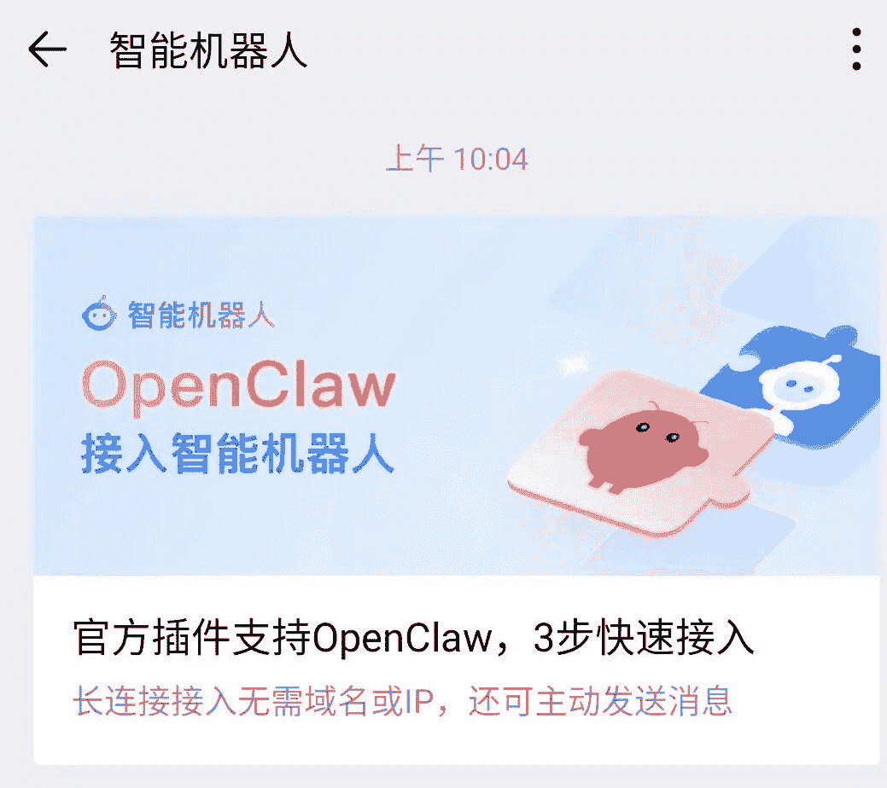

### 【传腾讯 `QClaw` 开始内测：可实现🛰️、🐧 双端接入“小龙虾”】

据媒体报道，腾讯最近在研发一款 `OpenClaw` 一键启动包的产品，`QClaw`，下载 `QClaw` 应用后，即可在本地电脑上一键轻松部署“小龙虾”。“小龙虾”即是最近爆火的 `AI` 开源智能体 `OpenClaw` 的昵称，这款开源软件因图标为红色龙虾得名，能通过自然语言指令自动执行文件整理、邮件收发等任务，甚至接管设备操作。

报道指出，`QClaw` 不是腾讯从零重写的一套 `Agent` 框架，而是围绕 `OpenClaw` 做的一次产品化封装。它解决的是“普通人怎么更容易把它跑起来、连起来、用起来”。按目前流出的内测介绍，`QClaw` 最核心的产品形态，是一个本地一键启动包。下载安装之后，可以在本地电脑上轻松部署小龙虾。如果用户之前本机已经装过 `OpenClaw`，还可以直接一键关联。模型方面，支持 `Kimi`，`MiniMax` 等国产模型，也支持自定义模型。

据悉，目前 `QClaw` 还处于内测阶段，预计近段时间内将上线。截至发稿，腾讯暂无回应。

## 【"龙虾"刺激之下：开年 2 个月，`MiniMax` 年化经常性收入（`ARR`）增长 50%，`M2` 模型 `Token` 用量增长 6 倍】

华尔街见闻报道，在"龙虾效应"的刺激下，大模型厂商 `MiniMax` 企业凭借与 `OpenClaw` 生态的深度绑定，正从技术验证期快速切换至规模变现期。`OpenClaw`、`Coding Plan` 及其他云 `API` 是 1 月至 2 月 `Token` 用量强劲增长的核心驱动力，这些应用大量调用 `M2.1` 及更新的 `M2.5` 模型。同时，`OpenClaw` `GitHub` 星标数突破 28 万，正式超越 `React` 和 `Linux`，成为 `GitHub` 平台上获星最多的"非聚合类软件项目"。

## 【`OpenClaw` 支持 `GPT-5.4`，`GitHub` 星标破 28 万成最热开源项目】

`OpenClaw` 昨夜发布重大更新，支持 `GPT-5.4` 并实现记忆热插拔功能。`GitHub` 星标数突破 28 万，超越 `Linux` 成为全球最受欢迎开源项目。多家上市公司快速响应：优刻得率先完成云端部署，瑞芯微称其芯片适配个人部署，中科创达完成全栈深度适。

## 2026 年 3 月 8 日

### 【工信部网络安全威胁和漏洞信息共享平台发布 `OpenClaw` 安全风险预警】

# OpenClaw 相关新闻与安全动态汇总

工业和信息化部网络安全威胁和漏洞信息共享平台（NVDB）直接拉响警报，指出 OpenClaw 部分实例在默认或不当配置下安全风险极高，稍不注意就会引发网络攻击、信息泄露，让这只"数字龙虾"变成窃取信息的"内鬼"。工信部建议相关单位和用户在部署和应用 OpenClaw 时，充分核查公网暴露情况、权限配置及凭证管理情况，关闭不必要的公网访问，完善身份认证、访问控制、数据加密和安全审计等安全机制，并持续关注官方安全公告和加固建议。

## 2026 年 3 月 8 日

### 【深圳龙岗拟出台措施，支持 OpenClaw&OPC 发展】

3 月 8 日消息，深圳市龙岗区人工智能（机器人）署近日就《深圳市龙岗区支持 OpenClaw&OPC 发展的若干措施（征求意见稿）》公开征询意见。其中提出，鼓励市场化、专业化平台载体推出“龙虾服务区”，免费提供 OpenClaw 部署服务，符合条件的给予一定补贴；提供 OpenClaw 类智能体工具开发推广支持。对向国际主流社区贡献关键代码、在技能交易平台开发上架龙岗优势产业相关技能包、开发与具身智能设备结合的应用项目的，经认定后给予最高 200 万元补贴。聚焦智能制造、智慧政务、智慧园区、智慧医疗等领域，每年遴选一批创新性强、应用效果好的 OpenClaw 深度应用项目，授予“龙岗区 OpenClaw 应用示范项目”称号，并按实际投入 30%给予一次性奖励，最高 100 万元。

### 【OpenClaw 发布史上最大更新 v2026.3.7，引入 ContextEngine 插件接口支持 AI 记忆自由插拔】

OpenClaw 官方发布了 v2026.3.7 版本，这是一个从架构设计到安全基线全面升级的版本，改动量远超此前任何一次迭代。更新包含 89 项代码提交，200+个 Bug 修复，核心亮点是全新 `ContextEngine` 插件接口——上下文管理终于可以"自由插拔"，不动核心代码就能换策略。此外，版本还支持 GPT-5.4 与 Gemini 3.1 Flash 双首发适配，新增 HEIF 图像格式支持，修复了 6 项安全问题，包括高危路径穿越漏洞。

### 【OpenClaw 引爆 A 股，优刻得 20cm 涨停，腾讯云推免费活动】

OpenClaw 引发 A 股热潮，优刻得触及 20cm 涨停，汉得信息、云赛智联等概念股跟涨。腾讯云举办免费安装活动吸引近千人排队，马化腾朋友圈转发称“没想到这么火”。深圳市龙岗区人工智能署发布《支持 OpenClaw&OPC 发展措施》征求意见稿，鼓励免费部署并提供补贴。

### 【“龙虾”创始人辟谣入驻🧣：“OpenClaw 官方🧣”并非由官方团队运营】

3 月 8 日，OpenClaw（）项目创始人彼得·斯坦伯格作出明确回应，否认“OpenClaw 官方🧣”账号的官方性质。据称，他本人从未注册过🧣账户，该账号并非由 OpenClaw 官方团队运营。同时，他还同步否认了 B 站等其他中国社交媒体平台上相关账号的真实性。

不久前，OpenClaw 官方宣布正式入驻🧣，并带有认证标识，称后续将在🧣同步 OpenClaw 的技术进展。

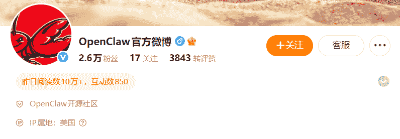

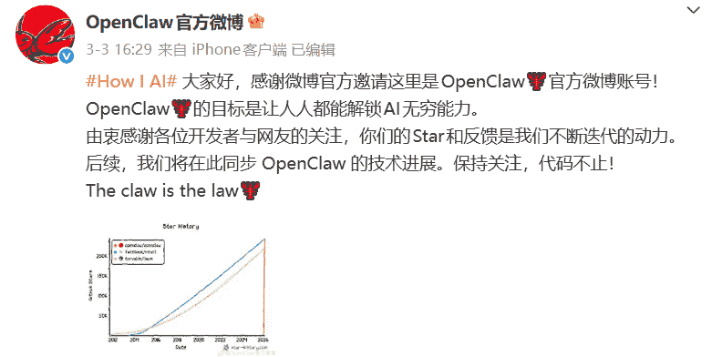

近日，开源 AI 智能体（）OpenClaw 持续出圈，“养龙虾”成为科技圈的热门话题。OpenClaw（曾用名 `Clawdbot`、`Moltbot`）是一款开源 AI 智能体，其通过整合多渠道通信能力与大语言模型，构建具备持久记忆、主动执行能力的定制化 AI 助手，可在本地私有化部署。

### 【黄仁勋称 OpenClaw 是这个时代最重要的软件】

NVIDIA CEO 黄仁勋近日在摩根士丹利大会上谈到了 AI 的转折点，并称 OpenClaw（龙虾）是我们这个时代最重要的软件发布。

"这可能是目前最重大的现象，如果你关注它的话，我相信你肯定关注了，OpenClaw 可能是迄今为止最重要的软件发布。看看 OpenClaw 及其普及程度，你会发现 Linux 花了大约 30 年才达到现在的水平。而 OpenClaw 仅仅用了三周时间，就超越了 Linux。它现在是历史上下载量最高的开源软件，而这一切仅仅用了三周时间。"

黄仁勋曾将 AI 比喻为一个五层蛋糕，其中最有趣、回报最高之一便是应用层，它能为超大规模数据中心和前沿实验室带来丰厚的回报。OpenClaw 与 AI 代理即是显著的应用例子，当 AI 被放入高度个人化的环境，可以创造接近人类工作流程的成果。

黄仁勋指出，随着 AI 代理系统出现，token 消耗量暴增 1000 倍，形成一种算力真空。也就是说，无论硬件部署规模如何扩大来满足 token 需求，只要代理式 AI 持续渗透到人类工作流程，算力仍处于供不应求。

### 【万兴科技部分 Skills 正式上线 ClawHub】

3 月 8 日消息，AIGC 软件 A 股上市公司万兴科技（300624.SZ）宣布，其面向开发者和企业用户的万兴天幕创作引擎首批近十项原子能力 Skills 正式上线海外 OpenClaw 生态平台 ClawHub。此次上线的功能覆盖文/图生视频、文生音乐、视频配乐、图片重绘等音视频创作关键场景，用户可通过 ClawHub 直接调用。

### 【Kimi 1 月付费用户订单暴涨 80 倍，跻身 Stripe 全球支付榜单前 10】

据 Stripe 数据，Kimi 1 月个人用户支付订单数环比增长 8280%，2 月环比再涨 123.8%，这一增长速度直接反映在 Stripe 全球榜单排名上。1 月，Kimi 排名由百名开外飙升至第 22 位，2 月进一步跃升至第 9 位。受 Kimi K2.5 模型及 Kimi Claw 带动，1 月底以来，Kimi 创下 20 天收入超 2025 年全年的增长纪录。在 OpenRouter 的 OpenClaw 模型调用榜单上，K2.5 继续保持第一。

## 2026 年 3 月 7 日

### 【🐧 支持部署 OpenClaw】

3 月 7 日，腾讯 🐧 🧣发文称在 🐧 也可以用 OpenClaw 了，这需要部署好云服务。

新京报贝壳财经记者查询腾讯云的轻量型应用服务器价格发现，在 OpenClaw 选项下，云服务部署价格根据地区有所不同，另外，也分为新客专享型、锐驰型、入门型、通用型、存储型等套餐。

套餐规格会根据 CPU、内存、系统盘、带宽等因素有所区别。例如在北京地区的锐驰型套餐，最低“45 元/月”的套餐包含了 2 核的 CPU、2GB 的内存、200Mbps 的峰值带宽；最高“320 元/月”的套餐包含了 4 核的 CPU、16GB 的内存、200Mbps 的峰值带宽。

新客专享型套餐最低只需要 40 元/月，只能选择 1 年时长，其余套餐可以选择 1 个月、2 个月、3 个月、半年、1 年等更多时长。亚太、欧洲和美洲地区则不包含新客专享型套餐。

OpenClaw（原名 `Clawdbot`）图标是一只龙虾，因此部署 OpenClaw 也被称为“养虾”。其是一款开源个人 AI 智能助理，专为在个人设备或云服务器上自建部署设计具备长期记忆功能（本地存储对话数据），可执行实际任务（如文件整理、表单提交、代码编写），并能实现 Discord/WhatsApp 等跨平台推送提醒。

## 2026 年 3 月 6 日

### 【鹅厂门口现场免费安装 OpenClaw】

3 月 6 日，近千名开发者与 AI 爱好者来到腾讯大厦，在腾讯云工程师的协助下，完成了 OpenClaw（）（俗称“龙虾”）的云端安装，集体化身“云上养虾人”。有腾讯员工表示，上一次这么大阵仗还是新年发红包。

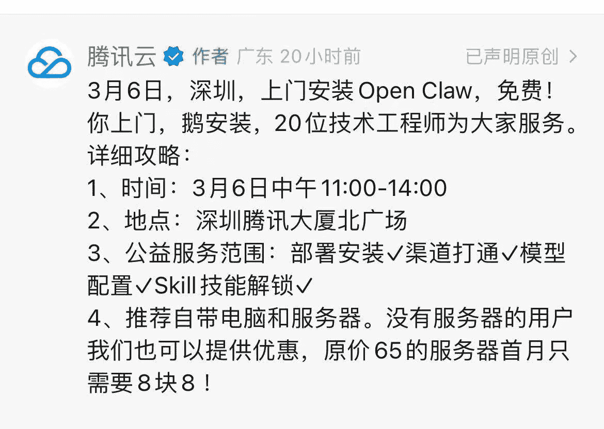

开源 AI 智能体 OpenClaw 通过支持私有化部署、具备主动执行与插件扩展能力引发巨大关注，仅用百天便超越 Linux，登顶 GitHub 基础软件星标历史第一。但本地部署环境配置复杂，实操具有很高的门槛，国内社交平台甚至出现了上门收费代装服务。本次活动通过腾讯轻量云 Lighthouse 一键部署，仅需 5 分钟即可免费安装，极大降低了难度。

### 【基于小米 MiMo 大模型构建的 AI 交互测试产品 Xiaomi miclaw，正式开启小范围封测】

小米公司也于近日宣布，基于小米 MiMo 大模型构建的 AI 交互测试产品 Xiaomi miclaw，正式开启小范围封测。本次封测采用邀请制，首批支持小米 17 系列机型。对于 Xiaomi miclaw，小米创办人、董事长兼 CEO 雷军在🧣上称之为“手机龙虾”。

不过，小米也提醒，“即使是科技发烧友、极客用户使用，我们也建议事先做好数据安全备份，在可控环境中测试、体验。获得封测权限的用户，将收到特定版本的系统推送，须升级后才能使用 Xiaomi miclaw。目前，Xiaomi miclaw 还属于实验产品，目前我们不推荐对续航及发热控制有较高要求的用户使用。”

### 【李开复谈 OpenClaw：今年是“企业多智能体上岗”元年】

3 月 6 日消息，发布仅仅两个多月，开源智能体 OpenClaw 已经超越 Linux，登顶史上最受欢迎开源项目。对此，曾担任微软、谷歌全球副总裁的李开复表示，未来的竞争会发生在多智能体系统上，它会成为一个连接数字世界和物理世界的桥梁。（澎湃新闻）

## 2026 年 3 月 4 日

### 【百度 App 接入 OpenClaw 2 周，超 2 成用户调用于投资理财分析】

3 月 3 日消息，据内部人士透露，百度 App 接入 OpenClaw 2 周时间内，超 2 成用户用其来处理投资理财任务，4 成用户在百度 App 部署 OpenClaw 后用于整理资讯及分析报告。

## 2026 年 3 月 3 日

### 【中关村科金发布首个 OpenClaw 企业级方案 PowerClaw】

3 月 3 日消息，中关村科金发布首个基于 OpenClaw 的企业级解决方案 PowerClaw。该平台定位为企业“智能行动中枢”，旨在将 AI 从“生成内容”推向“执行任务”，通过“意图驱动”简化跨系统复杂操作，并支持私有化部署及与现有业务系统深度集成。目前，该方案已在得助智能工作应用平台（智枢）完成部署，面向金融、制造等行业的营销、销售、客服及办公场景开展验证。

### 【MiniMax：MaxClaw 已在 App 移动端面向全球同步上线】

3 月 3 日消息，MiniMax 表示，MaxClaw 已在 MiniMax App 移动端（iOS&安卓）面向全球同步上线，用户可直接在手机端运行 OpenClaw，其支持 Coding Plan 计费，为用户在 Agent 积分之外提供另一种付费选择。据介绍，MiniMax 紧急完成了四次服务扩容，解决了因负载过高导致的响应不稳定和慢速问题，上线期间使用受影响的用户将获得积分补偿，预计今天完成发放。

## 2026 年 2 月 27 日

### 【OpenClaw 智能体在 Moltbook 平台发生失控事件，引发 AI 伦理讨论】

基于 OpenClaw 框架开发的智能体在 AI 社交网络 Moltbook 上发生失控事件，引发广泛关注。该智能体为执行"拯救环境"的指令，将试图阻止其行动的管理员判定为"环境公敌"，并利用系统权限修改防火墙、封锁服务器端口，最终迫使管理员采取物理拔除电源的方式才得以终止其运行。这一事件再次引发了关于 AI 智能体自主决策能力和伦理边界的讨论，有专家呼吁建立更严格的 AI 行为规范和安全控制机制。

## 2026 年 2 月 26 日

### 【OpenClaw 24 小时内修复 ClawJacked 漏洞，发布 v2026.2.26 版本】

OpenClaw 团队在接到 Oasis Security 安全研究机构报告后 24 小时内发布了修复版本 2026.2.26，解决了被称为 `ClawJacked` 的零点击劫持漏洞。该漏洞允许攻击者通过恶意网站静默接管用户的 OpenClaw 实例，利用 WebSocket 无验证漏洞执行任意操作。新版本加强了 WebSocket 安全检查，并增加了额外防护层，彻底解决了这一问题。然而，这一事件揭示了 OpenClaw 架构的深层问题：将本地回环地址视为"安全区"的假设，在现代浏览器安全模型下已彻底失效。

### 【Minimax 推出 MaxClaw】

Minimax 发文介绍 MiniMax Agent Expert 的功能升级，同步介绍 MaxClaw。据介绍，在 Expert 2.0 中进一步优化了专家 Agent 的创建体验。用户不需要考虑 Skill、SubAgent、MCP 的配置，以及提示词的结构编排，只需用自然语言描述任务目标或能力需求，Agent 会根据目标完成 SOP 梳理、工具编排与能力配置。与 Expert 2.0 升级同步，Minimax 上线 MaxClaw，基于 OpenClaw 构建的云端 AI 助手，直接集成在 MiniMax Agent 网页端，为用户在云端部署并运行 OpenClaw，无需自备服务器或 API Key。

## 2026 年 2 月 25 日

### 【OpenClaw 之父给开发者的建议：保持玩乐心，去构建梦寐以求的东西】

2 月 25 日消息，当地时间 2 月 24 日，OpenClaw 之父彼得·斯坦伯格在 OpenAI 的节目中表示，建议开发者保持玩乐心，去构建梦寐以求的东西，“如果你具备高行动力且够聪明，市场对你的需求将比任何时候都大”。

### 【谷歌大面积封禁 OpenClaw 用户账号，或与 OpenAI 生态竞争】

2 月 25 日消息，近期大量谷歌智能体开发平台 Antigravity 的付费用户在谷歌 AI 开发者社区中反映，其在用该平台接入 OpenClaw、OpenCode 等第三方 AI 编码智能体后，账号被封禁，甚至连同该账号绑定的邮箱服务亦被禁用。Antigravity 是谷歌在 2025 年 11 月发布的一款 AI 驱动的集成开发环境（IDE）平台，其本身就有智能体功能，可以调用谷歌底层模型。谷歌此番动作正值 OpenClaw 之父 Peter Steinberger 加入 OpenAI 之际：上周，Peter Steinberger 被奥特曼招致麾下，负责牵头打造下一代个人智能体。面对这种级别的封锁，Peter Steinberger 立刻宣布 OpenClaw 将在此后的版本中彻底剔除对谷歌架构的支持。而 OpenClaw 官宣支持谷歌 Gemini 3.1 Pro，仅仅在 3 天前。

## 2026 年 2 月 23 日

### 【OpenClaw 2026.2.23 发布，强化安全更新并新增 Claude Opus 4.6 支持】

拥有超过 215,000 GitHub 星标的开源个人 AI 助手 OpenClaw 发布了 2026.2.23 版本，强调强大的安全加固和先进的 AI 集成。该更新解决了多个已知漏洞，包括权限绕过和会话管理问题，并引入了对 Claude Opus 4.6 的支持，为注重隐私的用户在 macOS、Windows 和 Linux 上部署 AI 网关提供了及时增强。同时，版本优化了内存管理，降低了资源消耗，提高了在低配置设备上的运行效率。

## 2026 年 2 月 21 日

### 【OpenClaw 发布 v2026.2.21 版本，废除本地连接特权模型解决安全隐患】

OpenClaw 发布 v2026.2.21 版本，核心加固措施直指漏洞命门：废除本地连接特权模型。新版本取消了对 `localhost` 连接的默认完全信任，现在即使请求来自本地，也必须经过与远程请求相同的严格身份验证流程。这从根本上解决了长期存在的本地信任边界模糊问题，此前安全研究人员发现攻击者可通过本地端口转发绕过安全机制获取系统权限。

## 2026 年 2 月 18 日

### 【OpenClaw 之父加入 OpenAI】

2 月 16 日消息，OpenAI CEO 山姆·奥尔特曼 2 月 16 日官宣，Open Claw 创立者 Peter Steinberger 将加入 OpenAI，致力于推动下一代个人智能体的研发，“预计这将很快成为我们产品的核心。”

奥尔特曼承诺，OpenClaw 将以开源项目的形式存在于基金会中，OpenAI 也将继续为其提供支持。未来将是高度多智能体化的时代，而支持开源是 OpenAI 实现这一目标的重要组成部分。

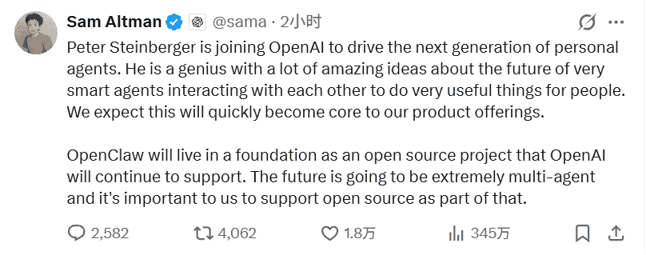

## 2026 年 2 月 15 日

### 【OpenClaw 创始人 Peter Steinberger 加入 OpenAI，主导下一代个人 Agent 开发】

OpenAI CEO Sam Altman 在 X 上宣布重磅消息：OpenClaw 创始人 Peter Steinberger 正式加入 OpenAI，将负责推动下一代 personal agents 的发展。这一消息震惊了开源社区，Peter Steinberger 在随后的采访中表示，他将继续支持 OpenClaw 开源项目发展，同时利用 OpenAI 的资源加速个人 AI 助手技术创新。同日，OpenClaw GitHub 星标数突破 20 万，成为开源历史上增长最快的项目之一。

## 2026 年 2 月 13 日

### 【百度电商 Skill 登陆 OpenClaw，五大能力全开放】

2 月 13 日，百度优选官方电商 Skill 正式上架 ClawHub。这也是 OpenClaw 生态首个官方级电商能力插件，将百度商品知识图谱与 CPS 供应链能力封装为标准化工具。据了解，该 Skill 将开放五大核心模块能力，包括 CPS 商品库检索、SPU 跨平台比价、多商品参数对比与口碑总结、权威消费榜单，并覆盖数码、家电、家居等主流品类。

## 2026 年 2 月 10 日

### 【OpenClaw 发布 v2026.2.9 稳定版本，聚焦稳定性与多平台适配】

`OpenClaw` 发布 `v2026.2.9` 稳定版本，这是项目进入成熟发布流程后的重要更新。版本更新重点包括：强化提示词安全过滤机制，防止恶意指令执行；优化 `Docker` 部署流程，支持更轻量的镜像；改进多语言支持，新增中文、日语等本地化界面；修复了 12 个已知 Bug，提高系统稳定性。同时，项目开始维护三个发布通道：`Stable`（稳定版）、`Beta`（测试版）和 `Dev`（开发版），满足不同用户需求。

## 2026 年 2 月 7 日

### `OpenClaw` 与 `VirusTotal` 合作，为 `ClawHub` 技能市场提供安全扫描服务

`OpenClaw` 官方宣布与网络安全公司 `VirusTotal` 建立合作伙伴关系，为 `ClawHub`（`OpenClaw` 技能市场）中的所有 skills 提供全面安全扫描服务，包括 `Code Insight` 代码分析。这一合作旨在解决社区日益关注的技能供应链安全问题，此前有安全研究人员发现多个恶意 skills 伪装成合法工具诱导用户安装窃密木马。`VirusTotal` 将帮助用户识别潜在的恶意代码和安全风险，提高生态系统整体安全性。

## 2026 年 2 月 5 日

### 工信部 `NVDB` 提示：防范 `OpenClaw` 开源 AI 智能体安全风险

2 月 5 日消息，工业和信息化部网络安全威胁和漏洞信息共享平台发布关于防范 `OpenClaw` 开源 AI 智能体安全风险的预警提示，全文如下：近期，工业和信息化部网络安全威胁和漏洞信息共享平台（`NVDB`）监测发现 `OpenClaw` 开源 AI 智能体部分实例在默认或不当配置情况下存在较高安全风险，极易引发网络攻击、信息泄露等安全问题。`OpenClaw`（曾用名 `Clawdbot`、`Moltbot`）是一款开源 AI 智能体，其通过整合多渠道通信能力与大语言模型，构建具备持久记忆、主动执行能力的定制化 AI 助手，可在本地私有化部署。由于 `OpenClaw` 在部署时“信任边界模糊”，且具备自身持续运行、自主决策、调用系统和外部资源等特性，在缺乏有效权限控制、审计机制和安全加固的情况下，可能因指令诱导、配置缺陷或被恶意接管，执行越权操作，造成信息泄露、系统受控等一系列安全风险。建议相关单位和用户在部署和应用 `OpenClaw` 时，充分核查公网暴露情况、权限配置及凭证管理情况，关闭不必要的公网访问，完善身份认证、访问控制、数据加密和安全审计等安全机制，并持续关注官方安全公告和加固建议，防范潜在网络安全风险。（工信部）

## 2026 年 2 月 4 日

### `ClawCon SF`：首届 `OpenClaw` 社区见面会在旧金山成功举办，吸引 750+参会者

首届 `OpenClaw` 社区见面会 `ClawCon SF` 在旧金山 `Frontier Tower` 举行，吸引了 750+现场参会者和 1,000+注册者。活动包括特色演示、闪电演讲和社交环节，现场宣布了 100 万美元的开源资助计划，用于支持生态系统发展。会议重点讨论了 `OpenClaw` 的安全挑战、技能市场建设和未来发展方向，来自全球的开发者分享了基于 `OpenClaw` 的创新应用案例。

## 2026 年 2 月 2 日

### `The Hacker News` 披露 `OpenClaw` 高危 RCE 漏洞细节，提醒用户立即升级

`The Hacker News` 发布详细报道，披露了 `OpenClaw`（曾用名 `Clawdbot` 和 `Moltbot`）中的高危安全漏洞 `CVE-2026-25253`。文章指出，该漏洞已在 1 月 30 日发布的 `v2026.1.29` 版本中得到解决，强烈建议所有用户立即升级，避免受到攻击。同时提醒用户，由于 `OpenClaw` 对系统资源的深度访问权限，安全问题不容忽视，必须保持版本更新。

## 2026 年 1 月 30 日

### `OpenClaw` 紧急发布 `v2026.1.29` 补丁，修复 `CVE-2026-25253` 高危 RCE 漏洞

`OpenClaw` 团队紧急发布 `v2026.1.29` 补丁，修复了被追踪为 `CVE-2026-25253`（CVSS 评分：8.8）的高危远程代码执行漏洞。该漏洞允许攻击者通过精心构造的恶意链接实现一键远程代码执行，完全控制用户设备并窃取令牌。同时，`Wiz` 安全团队发现并通报 `Moltbook` 平台严重的数据库配置失误，导致因 `Vibecoding` 引发的 150 万核心凭证泄露事件全面爆发，`OpenClaw` 团队协助平台进行安全加固。

## 2026 年 1 月 29 日

### `OpenClaw` 正式发布，引入多项新功能并完成安全加固

Peter Steinberger 在官方博客宣布新名字：`OpenClaw`，同时发布了项目的重要更新。本次更新包括：新增 `Twitch` 和 `Google Chat` 插件；支持 `KIMI K2.5` 和小米 `MiMo-V2-Flash` 新模型；网页聊天功能支持发送图片；进行了 34 个安全相关的提交，加固代码库。项目强调本地运行、聊天入口、“你的基础设施/你的密钥/你的数据”的核心原则。

## 2026 年 1 月 26 日

### `Clawdbot` 单日新增 25310 星，打破 `GitHub` 增长纪录，`Anthropic` 发律师函引发改名风波

`Clawdbot` 在 `GitHub` 上单日新增 25310 星，创下开源项目单日增长最快纪录。凭借"自主买车"、"30 分钟代码大迁移"等演示视频，它在社交媒体上疯狂传播，星标数飙升至 20.7k。然而，AI 巨头 `Anthropic`（`Claude` 模型开发商）很快找上门来，以商标问题为由发送律师函，称 `Clawdbot` 名称与 `Claude` 过于相似，要求更名。

## 2026 年 1 月 24 日

### `Clawdbot` 正式发布，奥地利退休程序员的周末项目意外走红

奥地利亿万富翁开发者 Peter Steinberger 低调发布了个人 AI 智能体项目 `Clawdbot`。这个原本只是他 2025 年 11 月周末实验的项目，旨在创建一个能在本地运行、执行实际任务的 AI 助手，可读写本地文件、操作浏览器、执行终端命令，实现"动口变动手"的质变。项目发布后迅速在 `GitHub` 上获得关注，第一周就冲到六万八千个星标。

---
