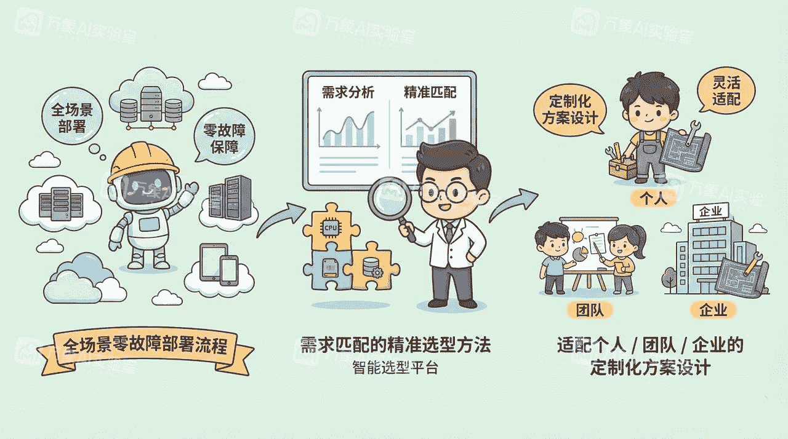
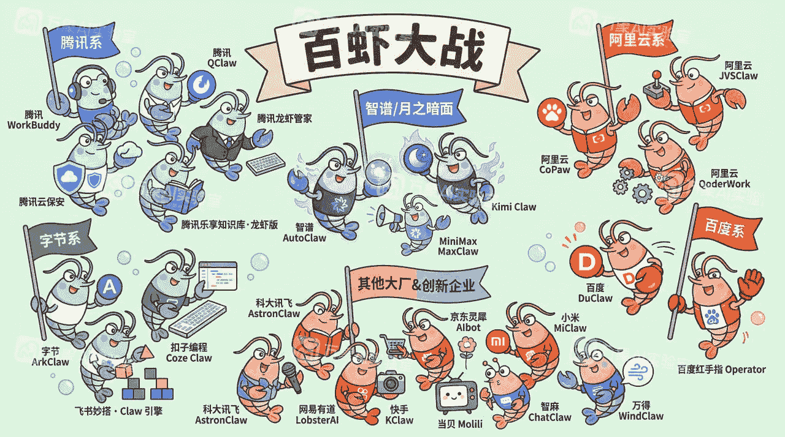
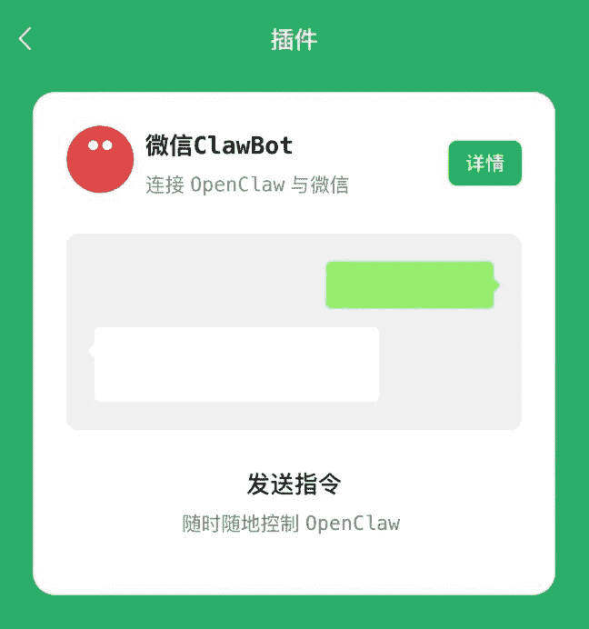
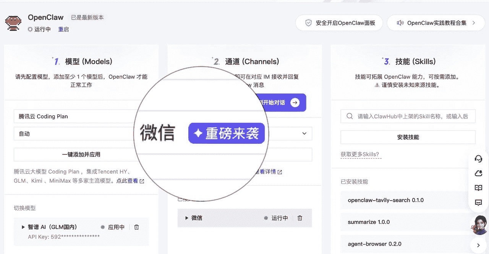
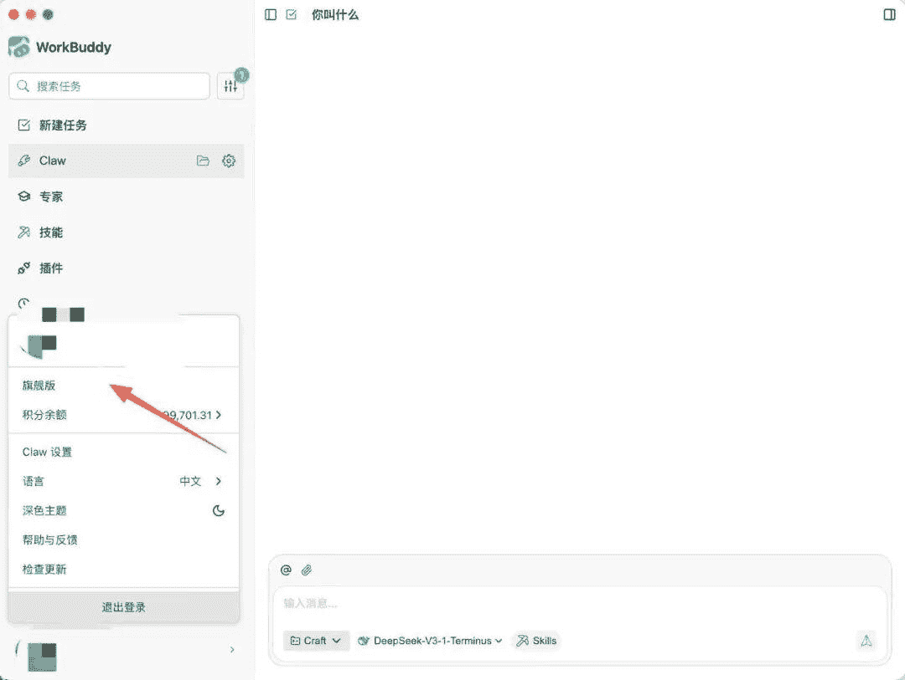
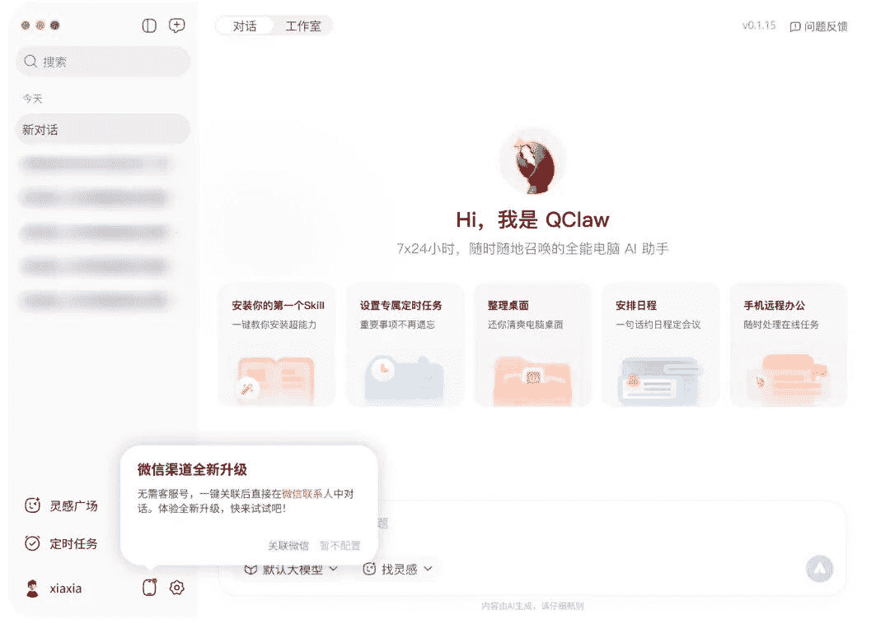
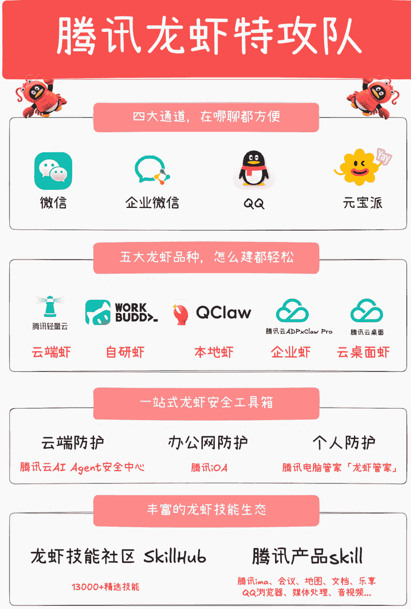
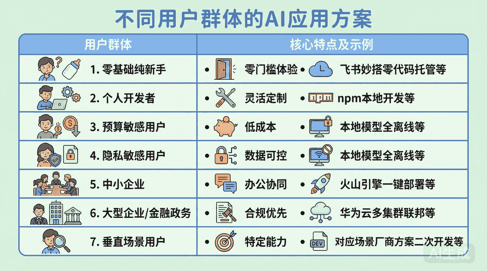

# OpenClaw 选型手册（全网首发&持续更新 ing...

> 来源：https://yunyinghui.feishu.cn/docx/GebCdfEY0opFGtxsx1icF4D9nmd
>
> **适用人群：** AI 工具爱好者、效率提升追求者、开发者、创业者
>
> **首发时间：**2026 年 3 月 23 日
>
> **更新时间：**2026 年 3 月 23 日
>
> **内容出品人：**
>
> **内容出品方：**[万象 AI 实验室](https://yunyinghui.feishu.cn/wiki/WhelwZnxQi55mpkOzatc3Xran5b?from=from_copylink)
>
> **编写依据**：OpenClaw 官方文档、GitHub 开源仓库、社区最佳实践、厂商公开方案
>
> **使用建议：**建议电脑端打开学习，如果需要快速定位到精确内容，可以使用快捷键 `Ctrl +F`/`Command +F` 的形式，搜索关键字/词，查找你想要的内容。
>
> **内容声明：**内容有AI辅助生成，人工已排查，如有错误，欢迎勘误

## 🤹🏼适用人群

+ OpenClaw 新手：想快速体验 AI Agent 能力的零基础用户；
+ 开发者：追求个性化定制与深度扩展的技术人群；
+ 垂直行业从业者：希望通过 AI 赋能业务场景的行业用户；
+ AI 爱好者：关注开源生态与 AI Agent 实践的兴趣群体。

## 〽️学习目标

+ 全场景零故障部署流程
+ 需求匹配的精准选型方法
+ 适配个人 / 团队 / 企业的定制化方案设计

## 🧑‍💻作者介绍

### 大国

+ 万象 AI 实验室发起人
+ AI 编程开发者
+ AI 商业化及流量操盘手

### 铁柱 AGI

+ 万象 AI 实验室技术支持
+ AI 自媒体博主（铁柱 AGI）
+ 10 年全栈开发者
+ `n8n` 社区节点开发者

## 📱交流合作

持续关注并更新 OpenClaw 的相关资讯动态，研究报告，商业落地，常见问题，永久免费在线查看。已建立社群聊聊 OpenClaw 发展、应用、对接及合作，邀请嘉宾讲课，没进群的可以扫码加入，群满可加大国🛰️ ID：zhangyuguo94s（备注：OpenClaw），已经在社群内的无需重复加入，开源知识库及社群学习全部为公开免费分享。

> **特别说明：**不要申请编辑和复制文档，容易错乱编辑，有需求请进群加🛰️沟通。

### 🛰️学习交流群

### 🛰️学习交流群

🛰️ ID：zhangyuguo94s，备注：OpenClaw

### 扫码交流、进群、合作

### 飞书学习交流群

---

## 前言：百虾大战爆发

OpenClaw 的崛起，是开源生态与 AI Agent 技术碰撞出的现象级火花，从 2025 年 11 月奥地利开发者 Peter Steinberger 的周末项目，到 2026 年 3 月以 27.8 万 GitHub Stars 超越 React 登顶全球第一开源软件，这个以龙虾为吉祥物、被中文社区亲切称为“养虾”的 AI 系统，仅用不到 5 个月就完成了从极客玩具到产业基础设施的跨越。

不同于 ChatGPT 等“你问我答”的顾问型工具，OpenClaw 以“开源自托管+自主执行任务”为核心定位，打通 20+消息渠道（WhatsApp、Telegram、飞书、钉钉、企业🛰️等），整合 13,729 个技能生态（ClawHub），支持 Claude、GPT、DeepSeek、豆包等多模型自由切换，真正实现了让 AI 从“聊天工具”升级为“能自主处理工作与生活任务的数字员工”。其数据完全本地可控的特性、`MIT` 开源协议的自由属性，以及“一切皆文本”的极简设计哲学，使其迅速成为个人开发者、中小企业乃至大型企业的首选 AI Agent 平台。

随着“养虾”热潮的蔓延，市场上涌现出本地部署、云端一键部署、桌面轻量部署、企业级私有化部署等多元方案，阿里云、腾讯云、火山引擎等主流厂商纷纷推出定制化解决方案，让用户在享受技术红利的同时，也面临着“选型难、落地难、避坑难”的普遍痛点：

如何在几十种部署方式中选择适配自身场景的方案？

不同厂商的解决方案各有何优劣？

如何平衡成本、安全与易用性？

...

为解答这些核心疑问，我们基于 OpenClaw 官方文档、GitHub 开源仓库、社区最佳实践及厂商公开方案，编写了这份《OpenClaw 选型手册》。手册全面梳理了全场景部署方案的差异化特征，全景呈现主流厂商的生态解决方案，针对零基础用户、开发者、中小企业、大型企业等不同人群提供精准选型建议，并整合了安全加固、成本优化、落地实践等关键指南，旨在成为“养虾人”从选型到落地的一站式工具书。

无论你是想快速体验 AI Agent 魅力的零基础新手，追求极致定制化的技术开发者，还是注重合规与稳定性的企业决策者，都能在本手册中找到适配自身需求的解决方案，让 OpenClaw 的技术价值充分落地，真正实现“用 AI 解放双手”的核心目标。

---

## 第一章：OpenClaw 选型基础认知

### 1.1 OpenClaw 核心定位

OpenClaw 的核心价值，是将 AI 从“你问它答的聊天顾问”，升级为“可自主执行任务的数字员工”。其核心能力包括：20+消息渠道统一接入、四层持久化记忆系统、ClawHub 技能生态、多模型自由切换、全本地数据可控。所有部署方案的设计，都围绕其 `Gateway`-`Node`-`Channel` 三层核心架构展开：

+ `Gateway`：中央控制平面，系统核心，单台主机建议仅运行一个实例
+ `Node`：设备端执行节点，负责本地操作、命令执行、硬件调用
+ `Channel`：消息渠道接入层，对接 20+即时通讯平台

### 1.2 选型核心评估维度

所有选型决策，均需围绕以下 8 大核心标尺展开：

| 评估维度 | 核心说明 |
| --- | --- |
| 部署难度 | 从零基础可操作到需专业运维能力的门槛分级 |
| 综合成本 | 包含服务器成本、模型 API 成本、运维人力成本 |
| 数据可控性 | 数据存储位置、所有权、隐私保护能力分级 |
| 可扩展性 | 支持的渠道数量、Skill 扩展能力、多节点扩容能力 |
| 维护成本 | 版本更新、故障排查、日常运维的工作量 |
| 安全合规性 | 权限管控、漏洞防护、等保合规、审计能力 |
| 可用性保障 | 7*24 小时在线能力、故障自愈、高可用架构支持 |
| 定制化能力 | 源码修改、功能二次开发、企业级定制的自由度 |

### 1.3 四大部署方式全维度对比表

| 对比维度 | 本地部署（`npm`/`Docker`/本地模型） | 云端一键部署（国内云厂商/海外平台） | 桌面轻量部署（桌面客户端/平替工具） | 企业级私有化部署（`K8s` 集群/内网部署） |
| --- | --- | --- | --- | --- |
| 核心定义 | 基于本地设备（PC/服务器）自主搭建，数据与服务均运行于本地 | 依托云厂商基础设施，通过预制镜像/模板一键完成部署，服务运行于云端服务器 | 轻量化桌面客户端或简化版工具，以图形化操作实现核心功能，无需复杂配置 | 基于企业内网/私有集群搭建，全链路隔离，适配企业级高可用、多租户、合规需求 |
| 部署难度 | 中（需基础命令行能力，`Docker`/`npm` 操作） | 低（可视化操作，零基础 3-10 分钟完成） | 极低（纯图形化安装，无需代码，5-15 分钟完成） | 高（需专业运维/`K8s` 能力，1-2 周完成架构设计与部署） |
| 综合成本 | 硬件成本（本地设备）+ API 成本（云端模型）/ 零 API 成本（本地模型），无服务器租金 | 服务器租金（9.9-155 元/月）+ 模型 API 套餐（7.9 元/月起），无硬件购置成本 | 零服务器成本，本地硬件损耗+少量 API 成本（可选），部分工具免费 | 集群硬件采购/租赁成本 + 定制开发成本 + 运维人力成本，整体最高 |
| 数据可控性 | 极高（数据全存储本地，无第三方介入，隐私保护最强） | 中（数据存储于云厂商服务器，厂商合规托管，用户拥有数据所有权但无物理控制权） | 中（核心数据本地存储，简化配置无复杂加密，隐私性中等） | 极高（数据全链路内网存储，物理隔离，企业自主掌控所有数据） |
| 可扩展性 | 中（支持多渠道/自定义 Skill，但受本地硬件资源限制） | 高（支持弹性扩容，多渠道原生适配，可扩展至团队级使用） | 低（仅支持核心渠道/内置 Skill，自定义扩展能力有限） | 极高（集群水平扩容，支持千级用户并发，适配企业 IM/ERP/知识库等多系统集成） |
| 维护成本 | 高（需手动更新版本、排查故障、备份数据，依赖个人技术能力） | 低（云厂商负责服务器运维，版本一键更新，故障自动恢复） | 极低（客户端自动更新，无复杂运维，故障可快速重装） | 高（需专业运维团队负责集群监控、版本迭代、容灾备份、安全加固） |
| 安全合规性 | 中（依赖用户自主配置认证/防火墙，无专业合规支持，适合个人/小型团队） | 中（云厂商提供基础安全防护，支持认证/白名单，部分满足等保二级，需额外配置合规增强） | 低（简化安全机制，无细粒度权限管控，适合非敏感场景） | 极高（支持等保三级/金融级合规，细粒度 `RBAC` 权限、全链路审计、数据加密，满足政务/金融合规要求） |
| 可用性保障 | 低（依赖本地设备开机状态，断电/关机即中断，无自动恢复） | 高（云厂商 7*24 小时运行，故障自动迁移，可用性 99.9%+） | 中（依赖桌面设备开机，支持后台运行，无集群容灾） | 极高（同城双活/异地灾备架构，自动故障切换，可用性 99.99%+） |
| 定制化能力 | 高（可修改源码、自定义 Skill 优先级、二次开发核心功能，灵活度最高） | 中（支持自定义模型/渠道/Skill，但受云厂商镜像限制，无法修改底层架构） | 低（仅支持基础配置调整，无源码修改权限，定制化局限于内置功能） | 极高（可基于开源代码二次开发，适配企业业务流程，定制多租户隔离、专属 Skill 仓库、企业级集成） |
| 硬件要求 | 最低：2 核 4G+20GB SSD（轻量部署）；最高：16 核 64G+24GB GPU（本地大模型） | 最低：2 核 2G+40GB SSD（个人版）；推荐：4 核 8G+100GB SSD（团队版） | 最低：2 核 4G+10GB SSD（普通 PC 即可满足），无 GPU 要求 | 最低：3 节点（8 核 16G+200GB SSD/节点）；推荐：5 节点（16 核 32G+500GB SSD/节点）+ 分布式存储 |
| 软件依赖 | `Node.js≥22`、`Docker≥20.10`、`npm`/`pnpm`、`macOS` 需 `Xcode` 工具、`Windows` 需 `WSL2` | 无（云厂商预装所有依赖，用户无需配置环境） | 仅需桌面客户端（`Windows`/`macOS`），无额外依赖 | `K8s` 集群、`Docker`、`Redis`、分布式文件存储、企业级数据库（`PostgreSQL`） |
| 适用人群 | 开发者、技术极客、隐私敏感用户、开源爱好者 | 零基础新手、个人长期使用用户、中小企业团队、无运维能力的组织 | 非技术用户、快速尝鲜用户、个人日常轻量使用、临时需求场景 | 中大型企业、政务/金融/医疗等强合规行业、核心业务场景、百人以上团队 |
| 部署周期 | 30 分钟 -2 小时（含环境配置+初始化+验证） | 3-10 分钟（含实例购买+安全组配置+初始化） | 5-15 分钟（含客户端下载+安装+简单配置） | 1-2 周（含架构设计+环境准备+集群部署+企业集成+验收） |
| 升级方式 | 手动执行命令（`openclaw update`），需手动处理配置兼容 | 云厂商控制台一键更新，自动适配配置，无感知升级 | 客户端自动推送更新，一键安装，无需手动配置 | 灰度发布/蓝绿部署，支持版本回滚，需专业团队规划升级窗口 |
| 资源占用 | 中-高（运行时内存 1-4GB+，本地模型占用 32GB+内存） | 低-中（云服务器内存占用 1-2GB，弹性扩容无本地资源消耗） | 低（内存占用 500MB-1GB，轻量化设计，不影响桌面其他操作） | 高（单节点内存占用 8-16GB，集群整体资源占用随用户量扩容） |
| 访问方式 | 本地访问（`127.0.0.1`）、远程访问（`Tailscale`/`Slack` 隧道） | 公网访问（IP/域名+HTTPS）、内网访问（`VPN`/专线） | 仅本地桌面访问，部分支持局域网内访问 | 企业内网访问（办公网/`VPN`），禁止公网直接暴露 |
| 故障恢复 | 手动备份配置/数据，故障后需手动重启服务、恢复备份 | 云厂商自动备份（每日/每小时），故障自动迁移节点，数据无丢失 | 简单文件备份，故障后重装客户端即可恢复基础配置 | 自动备份（实时增量+每日全量）、异地灾备，故障 30 分钟内自动恢复，`RPO < 5` 分钟 |
| 生态适配 | 全兼容（原生支持 ClawHub 所有 Skill、20+渠道、多模型切换） | 国内云厂商优先适配国内 IM（飞书/钉钉/🐧），海外平台适配国际渠道（Telegram/Discord） | 仅适配核心渠道（🛰️/🐧/飞书）+ 常用 Skill，无复杂生态集成 | 适配企业级生态（企业🛰️/钉钉专业版、ERP 系统、知识库、`SSO` 单点登录） |
| 并发支持 | 低（单用户/少量并发，多任务易卡顿） | 中（支持 10-50 人并发，云服务器弹性扩容可提升） | 极低（仅支持单用户单任务，多任务易崩溃） | 高（支持百人以上并发，集群水平扩容可支持千级用户） |
| 付费模式 | 软件免费（`MIT` 开源），仅承担硬件损耗+API 成本（可选本地模型零 API 成本） | 按需付费/包月套餐，服务器租金+模型 API 套餐分离，新用户低门槛体验 | 免费为主，部分增值功能付费（如高级 Skill/多模型切换） | 一次性定制开发费+年度运维费+硬件/服务器租金，长期合作模式 |
| 典型场景 | 个人开发辅助、隐私敏感数据处理、本地模型测试、自定义 Skill 开发 | 个人日常助手、中小企业办公协同、社群运营、无服务器的轻量使用 | 临时任务处理、快速体验 AI Agent、非技术用户日常助手、家庭自动化控制 | 企业办公自动化、核心业务流程赋能、政务/金融数据处理、团队协作 AI 助手、跨部门协同系统 |
| 核心优势 | 数据隐私强、定制化自由、无网络依赖（本地模型）、零服务器成本 | 零门槛部署、高可用性、无需运维、弹性扩容、成本可控 | 操作简单、轻量化、无技术门槛、快速上手、不占用服务器资源 | 安全合规、高可用、可扩展性强、企业级集成、专属定制、数据自主掌控 |
| 核心劣势 | 维护成本高、依赖技术能力、可用性低（依赖本地设备）、硬件要求高（本地模型） | 数据可控性中等、部分功能受云厂商限制、长期使用有服务器租金成本 | 定制化弱、可扩展性差、仅支持核心功能、无企业级能力 | 成本高、部署周期长、依赖专业运维、架构复杂 |
| 版本兼容性 | 最高（支持最新开发版/ Beta 版，适配所有开源功能） | 中（支持稳定版，部分云厂商镜像更新滞后 1-2 个版本） | 低（仅支持稳定版核心功能，适配滞后，部分高级功能裁剪） | 中-高（支持稳定版，可定制适配企业需求，版本更新需测试验证） |
| Skill 支持 | 全支持（三层优先级 Skill 加载，自定义 Skill 无限制） | 支持（ClawHub 精选 Skill+内置 Skill，部分云厂商限制高危 Skill） | 有限支持（仅内置核心 Skill，第三方 Skill 安装受限） | 全支持（企业私有 Skill 仓库+ClawHub 精选 Skill，支持 Skill 安全审计） |
| 日志管理 | 本地文件日志，需手动导出分析 | 云厂商控制台日志管理，支持检索/导出，留存周期 1-3 个月 | 简化日志，仅记录核心操作，无复杂分析功能 | 企业级日志系统，支持全链路审计、日志归档、异常告警、检索分析，留存周期≥6 个月 |

### OpenClaw 四大部署方式核心差异总结

四大部署方式的核心差异，本质围绕「数据控制权、硬件访问权限、部署门槛、扩展能力、成本投入」五大核心维度展开，不同方式的适用场景与能力边界泾渭分明：

从硬件与本地资源访问来看，本地部署是唯一能直接操作本地设备的方式——可调用本地摄像头、录屏、文件系统、`Shell` 命令，适配本地模型全离线运行，适合需要深度联动本地资源的场景；而云端一键部署因服务运行在云服务器，完全无法访问用户本地电脑/设备的硬件与文件，仅能通过网络调用公开 API 或云资源；桌面轻量部署虽运行在本地桌面，但仅支持基础桌面操作，无复杂硬件调用与系统命令执行权限；企业级私有化部署则聚焦企业内网资源，可对接企业内部服务器、数据库、`IoT` 设备，但同样无法跨内网访问员工个人本地设备。

从数据可控性与隐私保护来看，本地部署和企业级私有化部署处于第一梯队——前者数据全存储在个人设备，无第三方介入；后者全链路内网隔离，企业自主掌控所有数据，均适配隐私敏感、机密数据处理场景；云端一键部署数据存储于云厂商服务器，虽合规托管但用户无物理控制权，数据可控性中等；桌面轻量部署简化了数据加密与存储机制，仅适合非敏感场景使用。

# 第一章 部署方案总览

## 部署与维护门槛

呈现“两极分化”：云端一键部署和桌面轻量部署主打“零门槛”，前者可视化操作 3-10 分钟完成，后者纯图形化安装无需代码，适配零基础用户与非技术人群；本地部署需基础命令行与环境配置能力，维护依赖个人技术水平；企业级私有化部署则需专业运维与 K8s 集群能力，部署周期长达 1-2 周，还需专人负责长期运维，仅适合中大型企业。

## 扩展能力与适用规模

企业级私有化部署扩展性最强，支持千级用户并发、多系统集成（ERP/SSO/知识库）、定制化开发，适配企业核心业务；云端一键部署可弹性扩容至团队级使用，平衡扩展性与运维成本；本地部署扩展受限于硬件资源，适合个人或小团队；桌面轻量部署仅支持核心功能，无复杂扩展空间，仅适配个人轻量需求。

## 成本结构

本地部署无服务器租金，但需承担硬件损耗与模型 API 成本（本地模型可零 API 成本）；云端一键部署以“低门槛付费”为核心，服务器租金+模型套餐月费可控，适合个人与中小企业；桌面轻量部署几乎零成本，仅少量增值功能付费；企业级私有化部署成本最高，涵盖硬件采购、定制开发、运维人力等全链条投入，适合有强合规与业务赋能需求的大型组织。

## 选型核心逻辑

个人隐私敏感/需联动本地资源→本地部署；零基础/快速尝鲜/无运维能力→云端一键部署；非技术用户/轻量日常使用→桌面轻量部署；企业核心业务/强合规/大规模协作→企业级私有化部署。

---

# 第二章 OpenClaw 部署方案全景对比

## 2.1 本地部署方案全解析

本地部署是“养虾”最原生的方式，核心特点是数据完全本地可控、无额外服务器成本、定制化自由度最高，适合开发者、隐私敏感用户、技术极客。

### 2.1.1 四种主流本地部署方式

| 部署方式 | 核心实现 | 系统要求 | 核心优势 | 核心劣势 | 适用人群 |

| --- | --- | --- | --- | --- | --- |

| `npm` 全局安装（官方推荐） | 2 条命令完成安装，`onboard` 向导完成全配置 | Node.js ≥22，macOS 需 Xcode 命令行工具，Windows 需 WSL2 | 官方原生支持、更新最快、功能完整、守护进程支持开机自启 | 需基础命令行能力，Windows 原生环境兼容性差 | 有基础开发能力的个人用户、macOS/Linux 开发者 |

| `Docker`/`Podman` 容器化部署 | 官方 `docker-compose.yml` 一键启动，环境隔离 | 需提前安装 `Docker Engine`/`Podman` | 无依赖冲突、迁移便捷、环境一致性强、适合长期稳定运行 | 需基础容器操作能力，自定义修改需重构镜像 | 熟悉容器技术的开发者、本地服务器长期部署场景 |

| 本地模型全离线部署 | 基于 Ollama/LM Studio 运行本地开源模型，OpenClaw 自动对接 | 8B 模型最低 16GB RAM，32B 模型推荐 32GB RAM+独立 GPU | 完全免费、完全离线、数据零外泄、无 API 账单失控风险 | 模型推理能力弱于云端旗舰，硬件门槛高 | 隐私敏感用户、机密数据处理场景、预算极度敏感用户 |

| NAS/家庭服务器部署 | 基于 Umbrel/1Panel 面板一键部署，对接家庭内网与智能家居 | 家用 NAS/低功耗 x86 服务器 | 7*24 小时低功耗运行、家庭内网安全隔离、多服务统一管理 | 公网访问需额外配置，硬件性能受限 | 家庭服务器玩家、NAS 用户、智能家居联动场景 |

### 2.1.2 本地部署核心避坑点

1.  Windows 用户**严禁直接在原生环境运行**，必须使用 WSL2，否则会出现大量路径、权限兼容性问题

1.  `Docker` 部署必须挂载`~/.openclaw`和`/workspace`两个目录，否则容器重启后所有配置、对话记录全部丢失

1.  单台主机仅运行一个 `Gateway` 实例，否则会导致 WhatsApp 等渠道会话登录冲突

1.  公网远程访问优先使用 `Tailscale Serve`/`Tailscale Funnel`，禁止直接将 18789 端口暴露在公网

## 2.2 云端一键部署方案全解析

云端一键部署是国内用户最主流的“养虾”方案，核心特点是零基础可上手、开箱即用、7*24 小时高可用、无需维护本地设备，适合新手、个人长期使用、企业用户。

### 2.2.1 国内主流云厂商方案对比

| 云厂商 | 核心配置 | 参考价格 | 内置模型 | IM 生态支持 | 核心特色 | 差异化优势 | 首选人群 |

| --- | --- | --- | --- | --- | --- | --- | --- |

| 阿里云 | 2C2G 40GB ESSD 云盘，预装官方镜像 | 新用户限时 9.9 元/月，包年低至 68 元/年 | 通义千问 qwen3.5-plus，百炼 Coding Plan 首月 10 元 | 钉钉、飞书、🐧（社区插件） | 国内社区资源最丰富，镜像持续更新，教程最全 | 新用户价格极低，问题排查资料多，国内通用首选 | 零基础新手、个人长期使用、钉钉生态用户 |

| 腾讯云 | 推荐 2C4G 黄金配置，最低 2C2G 可运行 | 新人包 2C4G 约 17 元/月，年付 99 元起 | 无内置模型，Coding Plan 首月 7.9 元起 | 企微、🐧、钉钉、飞书四大 IM 全覆盖 | 腾讯生态原生支持，🐧 Bot 官方级适配，限时同价续费 | 国内唯一四大 IM 全原生支持，🐧 渠道体验最优，无续费涨价刺客 | 企微/🐧 生态用户、社群运营场景 |

| 火山引擎（字节系） | 2C4G，支持云服务器/云手机两种部署 | 服务器 9.9 元/月，服务器+模型套餐 19.8 元/月 | 豆包/方舟系列模型，Coding Plan 首月 8.91 元起 | 飞书深度集成，企微/钉钉/🐧 全支持 | 飞书原生内置支持，字节生态深度打通，云手机支持移动端任务 | 飞书用户体验最优，服务器+模型组合套餐性价比拉满 | 飞书重度用户、字节生态企业、预算敏感个人用户 |

| 百度智能云 | 推荐 2C4G 4M 带宽轻量服务器 | 首月体验 0.01 元（每日限量 500 台），常规 70-140 元/月 | 千帆平台文心、Qwen、DeepSeek 系列 | 钉钉、飞书等 | 百度搜索/百科独有能力，千帆 7 款官方 Skills 上线 ClawHub | 试错成本极低，0.01 元首月体验，百度生态能力独有 | 纯新手尝鲜体验、百度云生态用户 |

| 华为云 | Flexus L 实例，需配置弹性公网 IP+安全组 | 85-155 元/月起，无突出新用户优惠 | 无内置模型，需单独开通 MaaS 平台 | 主流 IM 均支持（社区插件） | 企业级安全合规能力拉满，支持自动扩展，MaaS 模型丰富 | 国内企业级合规能力最强，等保、数据安全体系完善 | 中大型企业、合规优先的政务/金融场景 |

| 扣子编程（字节系） | 无需服务器，零硬件要求 | 免费起步，按需付费 | 内置豆包 2.0 全系列模型，开箱即用 | 主流 IM 全支持 | 零门槛 2 步部署，无需服务器、代码、环境配置，全托管运行 | 全网最低部署门槛，零基础 1 分钟完成部署 | 纯零基础新手、不想管理服务器的用户、快速尝鲜 |

### 2.2.2 海外云平台方案对比

| 平台 | 核心方案 | 参考价格 | 核心特色 | 适用人群 |

| --- | --- | --- | --- | --- |

| Railway | 浏览器端一键部署，多模板可选 | 每月 5 美元免费额度，轻度使用零成本 | 部署成功率 96-100%，开发者体验极佳，自动扩容 | 海外用户、开发者、轻度使用场景 |

| Zeabur | 模板化部署，已被部署超 29000 次 | 按用量计费，专用服务器起步 | 内置多模型 failover 链，自动故障转移，稳定性强 | 海外/台湾地区用户、需高可用多模型兜底的用户 |

| Sealos | K8s 原生云平台，Devbox 云开发环境一键部署 | 7 天免费试用，按用量计费 | 容器化原生支持，可扩展性强 | 有 K8s 基础的开发者、海外大规模部署场景 |

### 2.2.3 云端部署选型核心结论

1.  **零基础最快体验**：首选扣子编程，次选百度云 0.01 元首月方案

1.  **个人长期使用&预算敏感**：首选火山引擎 19.8 元/月服务器+模型套餐，次选阿里云 68 元/年新用户方案

1.  **生态专属用户**：飞书用户选火山引擎，企微/🐧 用户选腾讯云，钉钉用户选阿里云

1.  **企业合规部署**：首选华为云，次选阿里云

1.  **海外用户**：首选 Railway

## 2.3 桌面/轻量部署方案全解析

针对桌面端轻量使用、学习测试、低配置设备的用户，社区推出多款轻量化方案，核心特点是低资源占用、开箱即用、学习成本低。

### 2.3.1 官方桌面端方案

1.  **macOS 菜单栏伴侣应用**：原生 macOS 客户端，菜单栏常驻运行，支持一键启停 `Gateway`、查看渠道状态、快速访问 Web UI、系统通知推送，适合 macOS 日常办公用户。

1.  Windows WSL2 桌面部署：在 Windows 中启用 WSL2 安装 Ubuntu 子系统，在子系统内完成部署，是 Windows 用户唯一官方推荐的兼容方案，严禁直接在 Windows 原生环境运行。

### 2.3.2 轻量级平替方案对比

| 平替产品 | Stars | 开发语言 | 核心定位 | 差异化优势 | 适用场景 |

| --- | --- | --- | --- | --- | --- |

| nanoclaw | 20.3K | TypeScript | OpenClaw 轻量容器化替代 | 仅 4000 行代码实现核心功能，学习成本极低，资源占用极小 | 新手学习 Agent 架构、低配置设备、轻量使用场景 |

| zeroclaw | 24.5K | Rust | 轻量级 AI 助手基础设施 | Rust 编写，内存安全、极致性能、毫秒级启动，资源占用远低于 OpenClaw | 嵌入式设备、低配置服务器、高并发轻量 Agent 场景 |

| EasyClaw | - | - | 易用性优化轻量方案 | 全图形化操作，一键安装，无需代码，内置常用 Skill 模板 | 非技术用户、纯新手尝鲜、零代码需求场景 |

| MiniMax Agent | - | - | 托管型轻量方案 | 无需自行部署，一键“养虾”，全托管运行，MiniMax 模型原生优化 | 不想管理部署的用户、MiniMax 生态用户 |

## 2.4 企业级私有化部署方案全解析

针对中大型企业、有合规与多租户需求的组织，企业级部署的核心诉求是合规性、多租户隔离、高可用、权限管控、安全审计。

### 2.4.1 企业级核心架构设计

推荐采用“多租户隔离+高可用集群+分层安全管控”架构，核心分层如下：

1.  **接入层**：SLB 负载均衡+WAF 防火墙，实现流量分发、HTTPS 加密与公网攻击防护

1.  **控制层**：`Gateway` 集群多副本部署，基于 K8s 实现自动扩缩容、故障自愈

1.  **执行层**：`Node` 节点按业务线隔离，分权限管控系统命令、硬件调用能力

1.  **数据层**：分布式文件存储+向量数据库集群，实现记忆数据持久化、备份与容灾

1.  **渠道层**：统一渠道接入网关，对接企业内部 IM，实现通讯录同步与权限管控

1.  **安全层**：SSO 统一身份认证、RBAC 细粒度权限管控、全链路审计日志、恶意 `Skill` 扫描引擎

### 2.4.2 企业级部署方案差异化对比

| 部署方案 | 架构特点 | 合规能力 | 可扩展性 | 运维成本 | 适用企业规模 |

| --- | --- | --- | --- | --- | --- |

| 单集群多租户方案 | K8s 单集群，命名空间实现租户隔离，共享 `Gateway` 底座 | 中 | 高 | 中 | 中小型企业、500 人以下组织 |

| 多集群联邦方案 | 按业务线/分子公司部署独立集群，联邦统一管理，数据物理隔离 | 高 | 极高 | 高 | 大型集团企业、跨地域组织、金融/政务行业 |

| 混合云部署方案 | 核心控制平面部署在私有云，弹性执行节点部署在公有云，敏感数据全留本地 | 极高 | 高 | 高 | 强数据合规需求、同时需弹性扩容的企业 |

| 全离线私有化方案 | 全系统部署在内网，对接本地开源大模型，无公网访问，完全物理隔离 | 拉满 | 中 | 极高 | 政务、军工、金融等强保密行业 |

### 2.4.3 企业级部署强制合规要求

1.  必须使用 `v2026.3.2` 及以上稳定版本，修复 `CVE-2026-25253` RCE 高危漏洞

1.  强制开启 `Gateway` `token`/`password` 认证，禁止无认证实例暴露公网

1.  基于 RBAC 实现工具权限最小化管控，默认禁用高危系统命令

1.  搭建企业内部私有 `Skill` 仓库，禁止直接安装 ClawHub 公共 `Skill`，所有 `Skill` 必须经过安全审计

1.  全链路操作日志留存不少于 6 个月，核心数据定期备份与容灾

1.  按部门/租户设置 API 预算上限，监控 `Token` 用量异常

---

# 第三章 主流厂商 OpenClaw 解决方案详解

## 3.1 厂商生态方案总览

随着 OpenClaw 在全球范围内的爆发式增长，国内科技厂商围绕其开源架构、核心能力与“养虾”生态，快速推出了覆盖全场景的定制化解决方案，形成了以云厂商、大模型厂商、垂直领域巨头为核心的“百虾大战”格局。

当前市场上的厂商方案主要分为两大类别：

1.  **原生兼容类方案**：基于 OpenClaw 官方开源代码深度适配，100%兼容原生 ClawHub 技能、渠道接入与配置体系，核心优化部署门槛、云原生能力与国内生态适配，代表为阿里云、腾讯云、火山引擎等云厂商方案；

1.  **生态衍生类方案**：沿用 OpenClaw“自主执行 Agent+多渠道接入+技能扩展”的核心架构理念，结合自身大模型、硬件、垂直场景能力做深度定制开发，形成差异化的行业解决方案，代表为各垂直领域大厂的场景化产品。

本章节将按厂商派系全面拆解 32 款主流方案，通过标准化维度对比，清晰呈现每款产品的核心定位、差异化优势、适配场景与选型注意事项，为用户提供精准的厂商方案选型参考。

## 3.2 腾讯系生态解决方案

腾讯系是国内 OpenClaw 生态布局最全面的厂商，依托腾讯云基础设施、企业🛰️/🐧 社交生态、腾讯安全能力，形成了覆盖个人、中小企业、大型企业全场景，兼顾部署、安全、场景化应用的完整产品矩阵，是国内 IM 生态适配最完善的方案体系。

| 产品名称 | 核心定位 | OpenClaw 兼容度 | 适配部署方式 | 核心优势 | 差异化亮点 | 适配人群 | 短板与注意事项 |

| --- | --- | --- | --- | --- | --- | --- | --- |

| 腾讯 WorkBuddy | 企业级办公协同 AI Agent | 高，原生兼容核心架构，支持自定义 `Skill` | 腾讯云一键部署、企业私有化部署 | 企业🛰️/腾讯文档/腾讯会议/腾讯邮箱全生态原生打通，企业级 RBAC 权限管控、多租户隔离、全链路审计 | 国内唯一企业🛰️原生深度适配方案，支持通讯录同步、群聊自动化、审批流程自动执行，与腾讯办公生态零壁垒打通 | 中大型企业、腾讯生态办公用户、跨部门协同团队 | 个人用户适配性弱，私有化部署成本较高，仅支持腾讯系大模型与主流国产模型 |

| 腾讯 QClaw | 🐧 生态专属 AI Agent | 极高，官方级原生适配，全量兼容 OpenClaw 技能体系 | 腾讯云一键部署、本地 `Docker` 部署 | 🐧/🐧 频道原生接入，扫码 1 分钟完成绑定，支持群聊管理、自动回复、内容运营、社群数据统计 | 国内唯一 🐧 官方开放 API 适配方案，无账号封禁风险，支持私聊/群聊/频道全场景，社群运营工具链完整 | 社群运营者、🐧 生态用户、自媒体创作者、私域运营团队 | 非 🐧 生态场景适配性弱，高阶功能需搭配腾讯云 Coding Plan 使用 |

| 腾讯龙虾管家 | 个人生活自动化全托管 AI 助手 | 中，基于 OpenClaw 核心能力封装，屏蔽底层部署复杂度 | 全托管 SaaS 化部署，无需自行搭建服务器 | 零代码零门槛，🛰️生态深度适配，支持生活服务预约、日程管理、消息聚合、出行规划等个人场景 | 国内门槛最低的个人场景方案，无需任何技术基础，开箱即用，内置上百个个人生活类预制技能 | 零基础个人用户、非技术人群、不想管理服务器的“养虾”新手 | 自定义能力弱，不支持自建 `Skill`，数据存储在腾讯云端，可控性低于原生自托管方案 |

| 腾讯云保安 | OpenClaw 专属安全防护解决方案 | 极高，原生适配 OpenClaw 全版本，无缝对接部署环境 | 腾讯云一键开启、本地部署插件化集成 | 恶意 `Skill` 实时扫描、CVE 漏洞自动修复、API 账单异常监控、prompt 注入攻击防护、入侵检测与阻断 | 国内首个 OpenClaw 专属安全方案，与腾讯云服务器原生集成，可一键开启防护，ClawHub 技能预扫描拦截率超 99% | 所有 OpenClaw 用户，尤其是企业部署、公网暴露实例的用户 | 非腾讯云部署环境仅能使用基础扫描功能，高阶防护需搭配腾讯云服务器使用 |

## 3.2 腾讯系生态解决方案

| 产品名称 | 核心定位 | `OpenClaw` 兼容度 | 适配部署方式 | 核心优势 | 差异化亮点 | 适配人群 | 短板与注意事项 |
| --- | --- | --- | --- | --- | --- | --- | --- |
| 腾讯乐享知识库·龙虾版 | 企业培训与知识管理场景 AI Agent | 中，基于 `OpenClaw` 架构定制开发，支持知识库专属技能 | 腾讯云企业级部署、私有化部署 | 企业知识库智能问答、培训课程自动生成、员工学习进度跟踪、考试题库智能搭建，与腾讯乐享深度打通 | 国内唯一聚焦企业培训场景的 `OpenClaw` 衍生方案，支持多模态知识库解析、千人千面学习计划生成、培训效果自动化复盘 | 企业 HR 部门、培训团队、教育机构、连锁企业总部 | 通用场景能力弱，仅聚焦培训与知识管理，不支持全量原生 `OpenClaw` 技能 |

腾讯正式推出 🛰️`ClawBot`插件，支持接入 `OpenClaw`，扫码或复制命令，即可将 `OpenClaw` 接入🛰️。

连接后，用户就能通过🛰️聊天的方式，快速调用自己的“龙虾”高效互动啦。

### 🦞腾讯云 `Lighthouse` 接入路径

腾讯云控制台→`Lighthouse` 实例→应用管理→一键更新到最新版→🛰️通道→扫码直连

### 🦞`WorkBuddy` 接入路径

`WorkBuddy` 桌面端 →左下角个人头像→`Claw` 设置→🛰️通道→扫码直连

### 🦞`QClaw` 接入路径

`QClaw` 桌面端（`v0.1.15` 版本）→左下角弹窗→扫码直连

## 3.3 字节跳动系生态解决方案

字节系方案依托火山引擎云基础设施、飞书办公生态、豆包大模型能力，核心聚焦企业办公协同与开发者体验，是飞书生态用户的首选方案，同时提供了国内门槛最低的零代码托管方案，兼顾了新手与企业级用户的需求。

| 产品名称 | 核心定位 | `OpenClaw` 兼容度 | 适配部署方式 | 核心优势 | 差异化亮点 | 适配人群 | 短板与注意事项 |
| --- | --- | --- | --- | --- | --- | --- | --- |
| `字节 ArkClaw` | 火山引擎原生企业级 `OpenClaw` 解决方案 | 极高，官方原生适配，100%兼容开源版本所有功能 | 火山引擎一键部署、`K8s` 集群部署、企业私有化部署 | 飞书全功能原生内置支持，豆包/方舟大模型深度优化，服务器+模型一体化套餐，国内综合性价比最高 | 飞书用户体验最优，支持飞书审批、文档、会议、通讯录原生打通，提供云手机部署模式，可执行移动端自动化任务 | 飞书重度用户、中小企业、字节生态企业、预算敏感的个人开发者 | 非飞书场景无明显优势，高阶企业级功能需搭配火山引擎企业级服务使用 |
| `扣子编程 Coze Claw` | 零代码全托管 `OpenClaw` 部署方案 | 高，核心功能全兼容，基于 `Coze` 平台做了轻量化封装 | 全托管 `SaaS` 化部署，2 步完成搭建，无需服务器 | 零门槛零代码，无需服务器、环境配置、`API Key` 管理，豆包全系列模型内置，开箱即用 | 全网部署门槛最低的方案，浏览器端全程操作，1 分钟完成部署，持续在线运行，内置大量预制模板，新手友好度拉满 | 纯零基础新手、快速尝鲜用户、非技术人群、不想管理运维的用户 | 自定义程度低于原生自托管方案，不支持底层环境修改，数据存储在字节云端，完全可控性弱 |
| `飞书妙搭・Claw 引擎` | 飞书生态低代码 + `OpenClaw` 融合解决方案 | 高，原生集成 `OpenClaw` 核心引擎，100% 兼容飞书生态渠道接入，支持 `ClawHub` 技能与妙搭组件双向打通 | 飞书生态内一键启用、企业私有化部署、飞书专有云部署 | 国内唯一飞书原生低代码 + `OpenClaw` 深度融合方案，无需部署服务器，在飞书内即可完成 Agent 的搭建、配置、发布与运维；支持将 `OpenClaw` 能力封装为飞书企业应用，分发给全公司员工使用，开箱即用的企业级多租户与权限隔离能力 | 飞书生态企业用户、无开发团队的中小企业、业务部门定制化 AI 应用搭建、企业内部数字化团队 | 飞书生态企业用户、无开发团队的中小企业、业务部门定制化 AI 应用搭建、企业内部数字化团队 | 通用场景自定义能力弱于原生自托管 `OpenClaw`，高阶定制化开发需要对接飞书开放平台，非飞书生态完全无法使用，仅适配飞书体系 |

## 3.4 阿里云系生态解决方案

阿里云系方案依托通义千问大模型、阿里云基础设施与国内最成熟的开发者生态，是国内 `OpenClaw` 社区资源最丰富、教程最完善的方案体系，核心优势在于云原生适配、开发者工具链与通义大模型的代码能力优化，是开发者与钉钉生态用户的首选。

| 产品名称 | 核心定位 | `OpenClaw` 兼容度 | 适配部署方式 | 核心优势 | 差异化亮点 | 适配人群 | 短板与注意事项 |
| --- | --- | --- | --- | --- | --- | --- | --- |
| `阿里云 CoPaw` | 阿里云原生开发者 `OpenClaw` 解决方案 | 极高，官方原生镜像预装，100%兼容开源版本 | 阿里云轻量应用服务器一键部署、`Docker` 部署、企业级集群部署 | 通义千问大模型深度优化，国内社区资源最丰富，教程最全，问题排查资料最多，新用户价格极低 | 国内开发者生态最成熟，阿里云官方持续维护镜像，与阿里云百炼平台无缝打通，`Coding Plan` 套餐性价比高，钉钉生态适配完善 | 个人开发者、钉钉生态用户、零基础新手、长期部署的个人用户 | 续费价格高于新用户价格，需关注活动续费，非阿里云生态无额外优势 |
| `阿里云 JVSClaw` | 低代码+`OpenClaw` 融合解决方案 | 中，基于 `OpenClaw` 核心架构，与低代码平台深度融合 | 阿里云一键部署、私有化部署 | 可视化流程编排，无需代码即可定制 Agent 执行逻辑、技能触发规则、业务流程，支持千人千面权限配置 | 国内唯一低代码+`OpenClaw` 深度融合方案，非技术人员可通过拖拽完成 Agent 定制，大幅降低企业二次开发门槛 | 中小企业、无开发团队的组织、业务流程定制需求强的用户 | 原生开源功能有一定裁剪，自定义代码开发灵活性低于原生版本 |
| `阿里云 QoderWork` | AI 编程专属 `OpenClaw` 解决方案 | 高，原生兼容，针对代码开发场景做深度定制 | 阿里云一键部署、本地开发环境集成 | 通义千问 `Coder` 模型原生优化，代码生成、调试、重构、审查能力拉满，与阿里云云效、`Git` 仓库无缝打通 | 聚焦 AI 编程场景，内置上百个开发专属技能，支持多语言代码项目全生命周期管理，编程 Token 成本远低于通用模型 | 程序员、开发者团队、软件企业、IT 外包团队 | 非编程场景适配性弱，通用办公能力弱于其他综合方案 |

## 3.5 百度系生态解决方案

百度系方案依托文心大模型、百度搜索生态与移动端自动化技术，核心优势在于实时信息检索、多模态理解与无人化移动端操作，是搜索场景、移动端自动化场景的首选方案。

| 产品名称 | 核心定位 | `OpenClaw` 兼容度 | 适配部署方式 | 核心优势 | 差异化亮点 | 适配人群 | 短板与注意事项 |
| --- | --- | --- | --- | --- | --- | --- | --- |
| `百度 DuClaw` | 百度生态原生 `OpenClaw` 解决方案 | 中，原生适配文心大模型，核心功能兼容 | 百度智能云一键部署、本地部署 | 文心大模型原生优化，百度搜索/百度百科/百度地图等独有能力接入，实时信息检索与多模态理解能力突出 | 国内实时信息检索能力最强的方案，可精准获取全网实时数据、新闻资讯、行业动态，适合信息聚合、舆情监控场景 | 资讯从业者、舆情分析人员、新媒体运营、需要实时信息处理的用户 | 非百度生态适配性弱，第三方模型支持有限，部署门槛高于腾讯/阿里方案 |
| `百度红手指 Operator` | 移动端自动化专属 `OpenClaw` 解决方案 | 高，原生兼容，针对移动端操作做专属扩展 | 百度智能云部署、本地真机/云手机部署 | 移动端 APP 无人化自动运行、数据抓取、流程自动化、批量操作，无需 `ROOT` 权限，适配绝大多数安卓应用 | 国内移动端自动化能力最成熟的方案，与红手指云手机深度打通，支持 7*24 小时无人值守运行，内置大量 APP 预制自动化脚本 | 电商运营、新媒体运营、APP 测试人员、批量移动端任务处理用户 | 通用场景能力弱，仅聚焦移动端自动化，高阶功能需付费购买云手机资源 |

## 3.6 国产大模型厂商原生适配方案

这类方案由头部大模型厂商推出，核心优势在于对自有大模型的深度优化，在 Agent 推理、工具调用、长上下文处理等核心能力上有专属调优，是追求大模型原生性能用户的首选。

| 产品名称 | 所属厂商 | 核心定位 | `OpenClaw` 兼容度 | 适配部署方式 | 核心优势 | 差异化亮点 | 适配人群 | 短板与注意事项 |
| --- | --- | --- | --- | --- | --- | --- | --- | --- |
| `智谱 AutoClaw` | 智谱 AI | `GLM` 大模型原生优化 `OpenClaw` 方案 | 极高，官方原生适配，全量兼容开源功能 | 本地部署、云厂商一键部署、私有化部署 | `GLM-5` 大模型原生深度优化，国产模型代码能力最强，Agent 工具调用准确率接近国际旗舰模型 | 内置智谱 AI 全系列模型，支持 `GLM-5` 旗舰模型与免费 `Flash` 轻量模型，代码生成、复杂推理能力国产第一梯队 | 开发者、企业用户、追求国产模型强推理能力的用户 | 非智谱模型支持有限，高阶能力需搭配智谱 API 付费套餐 |
| `Kimi Claw` | 月之暗面 | 长上下文专属 `OpenClaw` 解决方案 | 高，原生适配，针对长上下文场景做专属优化 | 本地部署、云厂商一键部署 | 256K 超长上下文窗口原生支持，海量文档、PDF、合同、研报一键解析与处理，长文本推理能力突出 | 国内长上下文处理能力最强的方案，可一次性加载百万字文档并完成精准信息提取、分析、总结，无上下文碎片化问题 | 法律从业者、金融分析师、科研人员、需要处理海量长文档的用户 | 短对话、高频轻量任务性价比低，Token 成本高于同级别国产模型 |
| `MiniMax MaxClaw` | MiniMax | 高性价比企业级 `OpenClaw` 方案 | 高，原生适配，`M2.5` 大模型深度优化 | 本地部署、云厂商一键部署、私有化部署 | `M2.5` 大模型原生优化，代码能力国产第一梯队，29 元/月入门套餐无周限额，性价比极高 | 无频率限制的包月套餐，对高频调用用户友好，`SWE-bench` 代码测试得分 80.2%，企业级私有化部署方案成熟 | 中小企业、高频调用的开发者、预算敏感的企业用户 | 生态资源少于云厂商方案，社区教程与问题排查资料较少 |

## 3.7 互联网大厂垂直场景解决方案

这类方案由各垂直领域头部厂商推出，核心是结合自身行业资源与场景能力，打造 `OpenClaw` 生态下的垂直领域专属解决方案，在特定行业的适配性远超通用方案。

| 产品名称 | 所属厂商 | 核心垂直赛道 | `OpenClaw` 兼容度 | 核心优势 | 差异化亮点 | 适配人群 |
| --- | --- | --- | --- | --- | --- | --- |
| `科大讯飞 AstronClaw` | 科大讯飞 | 语音交互与智能硬件 | 中，核心功能兼容，针对语音场景深度定制 | 语音转文字、方言识别、实时语音交互、多语种翻译能力国内领先，适配讯飞全系列智能硬件 | 国内唯一支持 20+方言实时交互的方案，可实现离线语音识别、远场语音唤醒，适合线下智能硬件联动场景 | 线下门店、智能硬件开发者、方言地区用户、语音交互需求强的人群 |
| `网易有道 LobsterAI` | 网易有道 | 教育与语言学习 | 中，基于 `OpenClaw` 架构定制，聚焦教育场景 | 语言翻译、AI 家教、知识点讲解、题库生成、学习计划定制，与有道词典、有道云笔记深度打通 | 国内教育场景适配最完善的方案，支持多语种精准翻译、长文精读、语法纠错、口语打分，聚焦学习全流程 | 学生群体、语言学习者、教育机构、教师群体 |
| `京东灵犀 AIbot` | 京东 | 电商运营与商家服务 | 中，基于 `OpenClaw` 架构定制，聚焦电商场景 | 京东商家后台原生接入，商品上架、客服自动化、订单处理、竞品分析、运营数据复盘全流程自动化 | 国内京东电商场景唯一原生适配方案，支持批量商品管理、智能客服回复、售后自动处理、运营报表自动生成 | 京东商家、电商运营团队、电商代运营公司 |
| `快手 KClaw` | 快手 | 短视频与直播运营 | 中，基于 `OpenClaw` 架构定制，聚焦短视频直播场景 | 快手生态原生适配，短视频脚本生成、直播话术定制、弹幕互动自动化、粉丝管理、直播数据复盘 | 国内快手生态适配最完善的方案，支持短视频批量创作、直播场控自动化、爆款内容分析、私域流量运营 | 快手主播、短视频创作者、MCN 机构、直播运营团队 |
| `小米 MiClaw` | 小米 | 智能家居与 IoT 生态 | 高，原生兼容，与米家 IoT 深度打通 | 米家全系列智能设备原生接入，智能家居场景自动化编排、语音控制、设备联动、家庭安防自动化 | 国内智能家居场景适配最全面的方案，支持 2000+米家设备自动控制，可通过自然语言定制家庭自动化场景 | 小米用户、智能家居玩家、家庭场景自动化需求人群 |
| `华为小艺 Claw` | 华为 | 鸿蒙生态与企业合规 | 高，原生兼容，鸿蒙系统原生适配 | 鸿蒙系统全设备原生接入，企业级安全合规能力拉满，支持等保三级、数据全生命周期管控 | 国内政务、金融等强合规场景适配最优的方案，与华为云、鸿蒙生态深度打通，国产化适配完善 | 政务单位、金融机构、华为生态企业、强合规需求的组织 |
| `当贝 Molili` | 当贝 | 大屏与智能家居 | 中，基于 `OpenClaw` 架构定制，聚焦大屏场景 | 智能电视/投影原生适配，大屏语音交互、影视内容推荐、智能家居控制、家庭娱乐场景自动化 | 国内唯一聚焦大屏场景的方案，适配当贝全系列投影/电视，支持远场语音交互、家庭影院场景自动化 | 智能电视/投影用户、家庭影音爱好者、大屏场景需求人群 |
| `智麻 ChatClaw` | 智麻 | 电商直播与私域运营 | 中，基于 `OpenClaw` 架构定制，聚焦直播场景 | 全平台直播话术生成、弹幕互动、商品讲解自动化、直播脚本定制、私域流量运营 | 支持抖音、视频号、快手全平台直播适配，可实现 7*24 小时无人直播场控、智能回复、爆款话术生成 | 全平台主播、直播运营团队、电商私域运营者 |
| `万得 WindClaw` | 万得 | 金融与证券行业 | 中，基于 `OpenClaw` 架构定制，聚焦金融场景 | 万得金融数据库原生接入，行情分析、研报解读、风险预警、投资组合分析、财报自动化拆解 | 国内金融场景专业度最高的方案，可实时获取全市场金融数据，完成专业量化分析、研报汇总、风险监控 | 金融从业者、证券分析师、基金经理、投资机构 |

## 3.8 安全与工具类专项解决方案

这类方案聚焦 `OpenClaw` 使用过程中的特定痛点，提供专项能力补充，是原生部署方案的重要配套工具，覆盖安全防护、远程控制、轻量化部署等核心需求。

| 产品名称 | 所属厂商 | 核心定位 | 适配范围 | 核心优势 | 差异化亮点 | 适配人群 |
| --- | --- | --- | --- | --- | --- | --- |
| `360 安全 Claw` | 360 | `OpenClaw` 全生命周期安全防护方案 | 全版本 `OpenClaw` 原生适配，支持所有部署方式 | 漏洞实时扫描与自动修复、恶意 `Skill` 查杀、`prompt` 注入防护、入侵检测与阻断、全流量安全审计 | 国内顶尖的安全能力，可拦截 99%以上的已知恶意 `Skill` 与攻击方式，支持私有化部署，满足企业级安全合规需求 | 企业级部署用户、公网暴露实例用户、对安全有高要求的所有“养虾人” |
| `猎豹 EasyClaw` | 猎豹 | 零基础轻量化 `OpenClaw` 部署方案 | 全版本兼容，`Windows`/`macOS` 全平台支持 | 全图形化操作，一键安装，无需代码，无需环境配置，内置常用技能模板，新手零门槛上手 | 桌面端轻量化部署最优方案，全程可视化操作，自动完成环境配置与依赖安装，非技术用户也可快速完成本地部署 | 零基础新手、桌面端本地部署用户、非技术人群 |
| `ToDesk ToClaw` | ToDesk | 远程控制与跨设备运维专属方案 | 全版本 `OpenClaw` 原生适配，支持 `Windows`/`macOS`/`Linux` 全平台 | 远程设备操作、跨设备任务执行、运维自动化、多设备统一管理，与 `ToDesk` 远程控制能力深度打通 | 国内唯一跨设备远程控制原生适配方案，可通过 `OpenClaw` 实现多台设备的自动化运维、远程操作、文件同步 | 运维人员、多设备管理用户、远程办公人群、需要跨设备执行任务的开发者 |
| `美图 Claw` | 美图 | AIGC 设计与影像处理专属方案 | 核心功能兼容，聚焦影像处理场景 | AI 绘图、图片精修、视频剪辑、批量图像处理、海报设计、图文内容生成，与美图影像能力深度打通 | 国内影像处理能力最强的 `OpenClaw` 衍生方案，支持一键批量修图、短视频剪辑、海报生成，内置海量设计模板 | 新媒体运营、设计师、自媒体创作者、图文内容生产团队 |

## 3.9 厂商方案核心选型总表

为方便用户快速对比选型，以下表格汇总所有主流方案的核心信息，按通用能力、入门门槛、推荐指数做标准化呈现：

| 产品名称 | 所属厂商 | 核心赛道 | 部署方式 | 入门门槛 | 核心优势 | 综合推荐指数 |
| --- | --- | --- | --- | --- | --- | --- |
| 腾讯 WorkBuddy | 腾讯 | 企业办公协同 | 云部署/私有化 | 中 | 企业🛰️生态原生适配，企业级能力完善 | ★★★★★ |
| 腾讯 QClaw | 腾讯 | 🐧 社群运营 | 云部署/本地部署 | 低 | 🐧 官方原生适配，社群运营能力完善 | ★★★★☆ |
| 腾讯龙虾管家 | 腾讯 | 个人生活自动化 | 全托管 SaaS | 极低 | 零门槛，个人场景开箱即用 | ★★★★☆ |
| 字节 ArkClaw | 字节跳动 | 飞书办公协同 | 云部署/私有化 | 低 | 飞书原生适配，性价比极高 | ★★★★★ |
| 扣子编程 Coze Claw | 字节跳动 | 零门槛托管部署 | 全托管 SaaS | 极低 | 全网最低部署门槛，新手友好 | ★★★★☆ |
| 阿里云 CoPaw | 阿里云 | 开发者通用方案 | 云部署/本地部署 | 低 | 开发者生态最完善，教程资源最丰富 | ★★★★★ |
| 阿里云 QoderWork | 阿里云 | AI 编程专属 | 云部署/本地部署 | 中 | 代码能力优化，开发者工具链完善 | ★★★★☆ |
| 智谱 AutoClaw | 智谱 AI | 国产大模型原生优化 | 本地/云部署/私有化 | 中 | 国产模型推理与代码能力最强 | ★★★★☆ |
| Kimi Claw | 月之暗面 | 长文档处理 | 本地/云部署 | 中 | 256K 超长上下文，海量文档处理能力突出 | ★★★★☆ |
| 360 安全 Claw | 360 | 安全防护专项 | 全场景适配 | 低 | 国内顶尖的 OpenClaw 专属安全防护能力 | ★★★★★ |
| 京东灵犀 AIbot | 京东 | 电商运营 | 云部署/托管 | 中 | 京东商家后台原生适配，电商全流程自动化 | ★★★★☆ |
| 小米 MiClaw | 小米 | 智能家居 IoT | 本地/家庭服务器部署 | 低 | 米家全设备原生接入，智能家居场景适配完善 | ★★★★☆ |
| 华为小艺 Claw | 华为 | 企业合规与鸿蒙生态 | 私有化/云部署 | 中 | 国产化适配完善，企业级合规能力拉满 | ★★★★☆ |
| 万得 WindClaw | 万得 | 金融证券行业 | 私有化/云部署 | 高 | 金融专业能力最强，万得数据库原生接入 | ★★★★☆ |

## 3.10 厂商方案选型核心原则

1. **生态优先原则**：优先选择与自身日常使用的办公软件、硬件、平台生态原生适配的方案，可大幅降低落地成本，实现能力最大化。例如飞书用户首选字节妙搭，企业🛰️用户首选腾讯 WorkBuddy，钉钉用户首选阿里云 CoPaw。

1. **场景匹配原则**：垂直场景需求优先选择对应领域的专项方案，而非通用方案。例如电商运营选京东灵犀 AIbot，教育场景选网易有道 LobsterAI，金融场景选万得 WindClaw，可获得远超通用方案的场景适配能力。

1. **门槛适配原则**：零基础用户优先选择全托管 SaaS 方案（扣子编程 Coze Claw、腾讯龙虾管家），无需关注底层运维；开发者优先选择云厂商原生兼容方案，保留完整自定义能力；企业用户优先选择有成熟私有化部署能力的厂商方案。

1. **安全兜底原则**：所有公网部署、企业级部署方案，必须搭配 360 安全 Claw、腾讯云保安等专属安全方案，规避漏洞攻击、恶意 Skill、数据泄露等核心风险。

# 第四章 选型决策黄金指南

## 4.1 不同人群精准选型建议

| 用户类型 | 核心诉求 | 最优部署方案 | 推荐厂商方案 | 核心配置建议 |
| --- | --- | --- | --- | --- |
| 零基础纯新手 | 零门槛快速体验，无需管理服务器/代码 | 飞书妙搭零代码托管方案，次选百度云 0.01 元首月部署 | 飞书妙搭、猎豹 EasyClaw | 优先使用内置国产模型，不盲目安装第三方 Skill |
| 个人开发者 | 灵活定制、功能完整、可扩展、成本可控 | `npm` 本地开发+阿里云/火山引擎云端长期部署 | 阿里云 CoPaw、字节 ArkClaw | 主力模型用 DeepSeek/GLM-5，设置 Fallback 兜底，开启日预算上限 |
| 预算敏感用户 | 极致低成本，避免账单失控 | 本地模型全离线部署，或阿里云 68 元/年服务器+DeepSeek 模型 | MiniMax MaxClaw、腾讯云 Coding Plan 套餐 | 简单任务用免费国产 Flash 模型，心跳任务用本地模型 |
| 隐私敏感用户 | 数据完全可控，零外泄风险 | 本地模型全离线部署，内网全私有化部署 | 360 安全 Claw、腾讯云保安 | 完全禁用公网暴露，仅内网访问，禁止安装第三方 Skill |
| 中小企业 | 办公协同、企业 IM 集成、性价比、易运维 | 火山引擎/腾讯云一键部署，单集群多租户方案 | 腾讯 WorkBuddy、字节 ArkClaw | 对接飞书/钉钉/企微，设置部门权限隔离，开启审计日志 |
| 大型企业/金融政务 | 合规优先、高可用、多租户、安全审计 | 华为云多集群联邦方案，全离线私有化部署 | 华为小艺 Claw、360 安全 Claw | 全内网部署，对接本地大模型，三级等保合规，严格的 Skill 安全管控 |
| 垂直场景用户 | 特定行业/场景专属能力 | 对应场景厂商方案二次开发 | 电商：京东灵犀 AIbot；教育：网易有道 LobsterAI；金融：万得 WindClaw | 优先选择原生生态适配的产品，降低二次开发成本 |

## 4.2 选型与部署核心避坑指南

### 安全类避坑

1. 严禁公网直接暴露 18789 端口且不设置认证，必须通过`Tailscale Serve/Funnel`实现远程访问，v2026.3.7 版本必须显式配置认证模式

1. 严禁盲目安装 ClawHub 第三方 Skill，安装前必须审查源码，优先使用`awesome-openclaw-skills`精选列表，用 SecureClaw 工具扫描恶意代码

1. 必须升级到 v2026.3.2 及以上稳定版本，修复 CVE-2026-25253 RCE 高危漏洞

### 成本类避坑

1. 必须设置`maxCostPerDay`日预算上限，避免 Agent 进入循环推理导致账单暴涨

1. 优先选择支持同价续费的云厂商，购买前确认续费价格，避免新用户低价、续费涨价刺客

1. 仅安装真正需要的 3-5 个核心 Skill，避免 system prompt 过长导致 Token 消耗翻倍

### 渠道接入类避坑

1. 默认开启 DM Pairing 配对保护，仅通过白名单`allowFrom`预先授权可信用户，避免陌生人滥用 API 额度

1. 个人🛰️优先通过企业🛰️中转方案接入，不要用主号测试非官方 API，避免账号被封禁

1. 必须使用 Anthropic API Key 接入 Claude，严禁使用 OAuth 订阅账户接入，避免账号被封禁

# 附录：常见问题 FAQ

1. OpenClaw 是完全免费的吗？

OpenClaw 本身基于 MIT 协议完全开源免费，无软件授权费用，运行成本主要为服务器/硬件成本（可本地零成本运行）和模型 API 费用（可使用本地开源模型实现零成本）。

1. 创始人加入 OpenAI 后，项目还会维护吗？

会。Peter Steinberger 加入 OpenAI 后，OpenClaw 已转为开源基金会运营，OpenAI 承诺赞助但不干预项目开发方向。截至 2026 年 3 月，项目保持近乎每日更新，拥有 1075+社区贡献者，长期可持续性有保障。

1. 本地模型和云端模型怎么选？

隐私敏感、机密数据处理场景优先选本地模型；追求 Agent 任务效果、复杂推理场景优先选云端 Claude/GLM-5 等旗舰模型。推荐混合使用：简单任务用本地/免费模型，复杂任务用云端旗舰模型，兼顾效果与成本。
