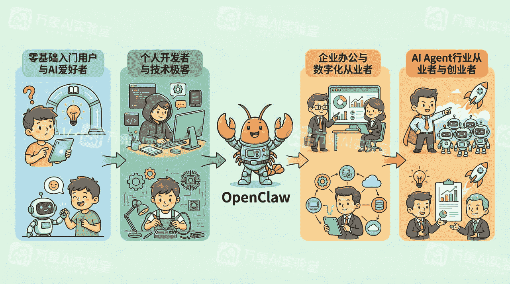
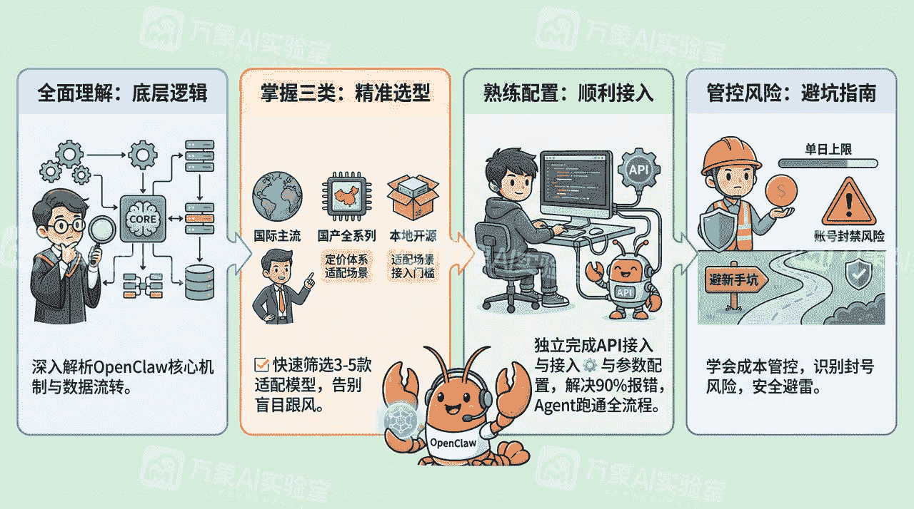

# OpenClaw 模型手册（全网首发&持续更新 ing...

> 来源：[https://yunyinghui.feishu.cn/docx/WJ0fdq9qsoipR1xZrOjcaCKVngc](https://yunyinghui.feishu.cn/docx/WJ0fdq9qsoipR1xZrOjcaCKVngc)

> **适用人群：** AI 工具爱好者、效率提升追求者、开发者、创业者

> **首发时间：**2026 年 3 月 29 日

> **更新时间：**2026 年 3 月 29 日

> **内容出品人：**** **

> **内容出品方：**[万象 AI 实验室](https://yunyinghui.feishu.cn/wiki/WhelwZnxQi55mpkOzatc3Xran5b?from=from_copylink)

> **发布时间**：2026 年 3 月

> **信息来源**：OpenClaw 官方文档、GitHub 仓库、模型厂商官方定价、社区实测数据、安全事件公告

> **核心定位**：本手册聚焦 OpenClaw 全生态模型适配方案，完整梳理国际/国产/本地模型的差异化特性、定价体系、适配场景，提供可直接落地的选型策略与配置实操，解决用户模型选择难、成本失控、效果不达预期的核心痛点，是 OpenClaw 生态最全面的模型选型与落地指南。

> **使用建议：**建议电脑端打开学习，如果需要快速定位到精确内容，可以使用快捷键 Ctrl +F/Command +F 的形式，搜索关键字/词，查找你想要的内容。

# 🤹🏼适用人群



+   **零基础入门用户与 AI 爱好者**

零代码/低代码基础，想快速体验 OpenClaw 的核心能力，对 AI Agent 有基础兴趣，希望找到门槛最低、零风险、低成本的模型入门方案，避免部署后无法正常使用、成本失控、踩坑封号的新手玩家。

+   **个人开发者与技术极客**

具备基础的代码与服务器操作能力，使用 OpenClaw 完成日常办公自动化、自建 Skill 开发、代码辅助编程、DevOps 运维等场景，需要平衡模型的推理效果与使用成本，追求极致性价比，希望掌握模型优化、成本控制、多模型组合的进阶技巧的开发者、技术爱好者。

+   **企业办公与数字化从业者**

希望将 OpenClaw 落地到企业日常办公、客户服务、社群运营、行政自动化、数据报表处理等场景，需要适配国内办公生态（飞书/钉钉/企业微信）、合规稳定、安全可控的国产模型方案，兼顾企业级可用性与成本管控的职场人、IT 运维人员、企业数字化负责人。

+   **政企与隐私敏感场景从业者**

来自金融、医疗、政务等强合规行业，或对数据隐私有极高要求，需要实现 OpenClaw 内网部署、数据不出域、完全离线运行，需要适配的本地开源模型落地方案，兼顾隐私合规与基础能力的政企单位技术人员、敏感行业从业者。

+   AI Agent 行业从业者与创业者

深耕 AI Agent 赛道，计划基于 OpenClaw 做二次开发、定制化解决方案、商业化落地，需要全面掌握 OpenClaw 模型生态的底层逻辑、全品类模型的差异化特性、企业级部署最佳实践，构建行业定制化方案的 AI 从业者、创业者。

# 〽️学习目标



1.  全面理解 OpenClaw 模型体系的核心底层逻辑

1.  清晰掌握国际主流模型、国产全系列模型、本地开源模型三大品类的核心差异、定价体系、适配场景与接入门槛，能根据自身需求，快速筛选出 3-5 款适配的备选模型，不再盲目跟风选型。

1.  熟练掌握 OpenClaw 模型的基础配置方法，能独立完成主流模型的 API 接入、基础参数配置、连通性测试，解决 90%的模型接入报错问题，让 OpenClaw Agent 顺利跑通全流程任务

1.  学会基础的成本管控与风险规避，能独立配置单日预算上限，识别基础的账号封禁风险，避开新手最容易踩的模型配置坑

# **🧑‍💻作者介绍**

**大国**

+   万象 AI 实验室发起人

+   AI 编程开发者

+   AI 商业化及流量操盘手


**黄啊码**

+   万象 AI 实验室技术支持

+   百度秒哒年度最佳开发者

+   扣子头部开发者

+   AI 产品负责人


**徐智昊**

+   万象AI实验室技术支持

+   全国500强制造业企业AI咨询顾问

+   注册会计师，精通AI+财务/采购领域系统及Agent构建

+   高级项目管理工程师，资深ERP咨询顾问，10+年咨询经验


# 📱交流合作

持**续关注并更新 Op****enClaw 的相关资讯动态，研究报告，商业落地，常见问题，永久免费在线查看。已建立社群**聊聊 OpenClaw 发展、应用、对接及合作，邀请嘉宾讲课，没进群的可以扫码加入，群满可加大国微信 ID：zhangyuguo94s（备注：OpenClaw），已经在社群内的无需重复加入，开源知识库及社群学习全部为公开免费分享。

> **特别说明：**不要申请编辑和复制文档，容易错乱编辑，有需求请进群加微信沟通。


**微信学习交流群**


**微信学习交流群**

微信 ID：zhangyuguo94s，备注：OpenClaw

**扫码交流、进群、合作**


**飞书学习交流群**

---

# **🌈前言概述**

2025 年 11 月，奥地利开发者 Peter Steinberger 的一个周末项目 ClawdBot（后正式定名 OpenClaw）正式诞生，仅用不到 5 个月时间，便以 27.9 万 GitHub Stars 超越 React，登顶全球开源软件项目榜首，成为 2026 年 AI 圈现象级的开源 AI Agent 系统。

OpenClaw 的核心价值，是让 AI 从「被动应答的顾问」变成「主动执行任务的数字员工」——它可接入 20+主流消息渠道，自主完成日程管理、邮件处理、浏览器操作、代码开发、工具调用等全场景任务，真正实现了「个人 AI 操作系统」的产品形态，中文社区更是掀起了全民「养虾」的热潮。

而模型，是整个 OpenClaw 系统的灵魂核心。Agent 的任务执行效果、指令遵循准确率、多轮推理稳定性，乃至用户的使用成本、数据安全、服务可用性，最终都由模型选型与配置决定。但在实际落地中，绝大多数用户都面临着核心痛点：

+   零基础用户部署完 OpenClaw，却卡在模型接入环节，面对数十家厂商的上百款模型，完全不知道如何选型；

+   个人用户盲目跟风使用旗舰模型，却因 Agent 多轮推理导致 Token 消耗失控，一觉醒来收到上千元的 API 账单；

+   国内用户不清楚国际模型的访问限制、账号封禁风险，也不了解国产模型的适配方案与差异化优势；

+   企业用户找不到合规、稳定、安全的模型落地方案，隐私敏感场景用户无法实现数据不出域的本地模型部署；

+   市面上的大模型评测与介绍泛泛而谈，没有一份完全贴合 OpenClaw 的 Agent 场景、Skill 系统、部署架构的专属模型选型与落地指南。

基**于此，我们基于 OpenCla****w 官方 v2026.3.7 稳定版、官方文档、GitHu**b 开源仓库、社区实测数据与安全事件公告，编写了这份《OpenClaw 模型手册》。本手册并非通用的大模型参数罗列，而是国内首份完全聚焦 OpenClaw 生态、全链路覆盖模型认知-选型-配置-优化-避坑的专属实操指南。

手册完整梳理了 OpenClaw 适配的国际主流模型、国产全系列模型、本地开源模型的核心特性、定价体系、差异化优势与适配场景，提供了分人群、分场景的可直接落地的选型方案，配套了零基础可上手的配置实操教程，同时全面揭示了模型接入过程中的账号封禁、成本失控、安全漏洞等核心风险与规避方案。

无论你是零基础想体验 OpenClaw 的 AI 爱好者，还是追求极致性价比的个人开发者，亦或是有企业级落地需求的 IT/运维人员，都能通过这份手册，找到最适合自己的模型方案，真正发挥 OpenClaw 的全部能力，同时避开所有潜在的坑。

---

# 第一章 OpenClaw 模型体系核心认知

**OpenClaw** 的核心优势之一是完全的模型自由度，不绑定任何单一厂商，通过标准化的配置体系，实现跨厂商模型的灵活切换、故障自动转移、任务分级调度。在选型前，需先掌握 3 个核心底层概念，这是所有模型配置的基础。

## 1.1 核心配置概念

| **概念** | **核心说明** | **关键作用** |
| --- | --- | --- |
| 内置 Provider | OpenClaw 原生支持的模型厂商，无需额外开发适配，仅需配置 API Key 即可使用 | 降低接入门槛，开箱即用，代表厂商：Anthropic、OpenAI、Google Gemini、智谱 GLM（zai） |
| 自定义 Provider | 兼容 OpenAI Responses API 规范的模型厂商，可通过手动配置 baseUrl 与 API Key 接入 | 无限扩展模型生态，国产模型、本地模型、聚合平台均通过此方式接入 |
| Fallback 故障转移链 | 可配置多级备选模型，当主模型出现限速、报错、不可用时，系统自动降级到备选模型 | 核心的稳定性保障+成本控制工具，是 OpenClaw 模型配置的灵魂功能 |

## 1.2 OpenClaw 模型支持核心特性

1.  **全链路模型兼容**：支持闭源商用 API、开源本地模型、国内大模型、国际顶尖模型，覆盖 20+主流厂商，是目前 Agent 生态中模型兼容性最强的平台之一。

1.  **任务级模型调度：**可针对不同任务类型（编程、对话、长文本、工具调用）配置专属模型，实现「强模型干重活，便宜模型干轻活」。

1.  **混合部署模式：**支持云端 API+本地模型混合运行，敏感数据用本地模型处理，复杂推理用云端模型，兼顾隐私与效果。

1.  **预算硬限制：**支持配置单日 Token 上限、单日成本上限，从根本上避免 Agent 循环推理导致的 API 账单爆炸。

---

# 第二章 国际主流模型方案全解析

国际模型是 OpenClaw 官方原生适配的核心方案，在 Agent 工具调用、复杂推理、长上下文稳定性上表现最优，是追求极致效果用户的首选。

## 2.1 Anthropic Claude 系列（OpenClaw 默认推荐）

**Claude 是 OpenC**law 社区公认的 Agent 任务效果天花板，也是 OpenClaw 项目的致敬对象，在工具调用准确率、长上下文理解、指令遵循度上全面领先，是重度 Agent 任务的首选主力模型。

### 核心模型矩阵与定价

| **模型型号** | 输入价格（/1M tokens） | 输出价格（/1M tokens） | **上下文窗口** | **产品定位** |
| --- | --- | --- | --- | --- |
| Claude Opus 4.6 | $5.00 | $25.00 | 200K | 旗舰级，极致复杂推理、多步骤 Agent 任务 |
| Claude Sonnet 4.6 | $3.00 | $15.00 | 200K | 主力性价比款，平衡效果与成本，Agent 任务首选 |
| Claude Haiku 4.5 | $1.00 | $5.00 | 200K | 轻量高速款，简单对话、信息查询、高频轻量任务 |

#### 核心特色与差异化

1.  **工具调用原生优化**：Claude 对多轮工具调用、函数执行的指令遵循度远超其他模型，在 OpenClaw 的 Skill 调用、Shell 命令执行场景下，错误率比 GPT 系列低 40%以上。

1.  **长上下文无损理解**：200K 上下文窗口支持完整加载 OpenClaw 的记忆文件、代码仓库、日志数据，不会出现关键信息丢失的问题。

1.  **原生 Prompt 缓存支持**：重复上下文（如 System Prompt、Skill 描述、记忆文件）可享受最高 90%的成本折扣，大幅降低 OpenClaw 常驻运行的 Token 消耗。

1.  **Batch API 半价优惠**：非实时任务可使用 Batch API，输入输出均享 50%折扣，适合定时邮件处理、批量数据解析等离线任务。

#### OpenClaw 适配场景与配置要点

+   **最佳适配场景**：主力 Agent 调度、复杂多步骤任务、Skill 开发与调试、企业级自动化流程

+   **配置方式**：内置 Provider，仅需配置ANTHROPIC_API_KEY环境变量即可使用，无需额外适配

+   **避坑指南**：Anthropic 已全面封杀 OAuth 订阅账户接入，仅支持 API Key 按量付费方式，使用 Claude Pro/Max 账户 OAuth 接入会导致账号封禁

+   **推荐用法**：Sonnet 4.6 作为主力模型，Haiku 4.5 作为一级 Fallback，Opus 4.6 仅按需用于极致复杂任务

## 2.2 OpenAI GPT 系列

GPT 系列是通用能力最均衡的模型，在代码生成、逻辑推理上表现顶尖，适合习惯 OpenAI 生态的用户，也是 OpenClaw 内置原生支持的方案。

### 核心模型矩阵与定价

| **模型型号** | 输入价格（/1M tokens） | 输出价格（/1M tokens） | **上下文窗口** | **产品定位** |
| --- | --- | --- | --- | --- |
| GPT-5.4（标准） | $2.50 | $15.00 | 272K | 最新旗舰，通用全能型 |
| GPT-5.4（超长上下文） | $5.00 | $15.00 | 1.05M | 超长文档解析、全量代码库加载 |
| GPT-5 | $1.25 | $10.00 | 128K | 高性价比主力款，平衡效果与成本 |

#### 核心特色与差异化

1.  **代码生成能力顶尖**：在 SWE-bench 代码基准测试中得分领先，适合 OpenClaw 的自建 Skill 开发、代码调试、DevOps 自动化场景。

1.  **生态兼容性最强**：几乎所有第三方工具、插件都优先适配 GPT 系列，出现兼容性问题的概率最低。

1.  **函数调用标准化**：OpenAI 的 Function Call 格式是行业事实标准，OpenClaw 的 Skill 系统对其适配最成熟，极少出现格式错误。

#### OpenClaw 适配场景与配置要点

+   **最佳适配场景**：代码开发与 Skill 自建、DevOps 自动化任务、通用多模态任务

+   **配置方式**：内置 Provider，配置OPENAI_API_KEY环境变量即可使用

+   **避坑指南**：GPT-5.4 超过 272K 上下文后输入价格翻倍，长会话场景需注意控制上下文长度，避免成本失控

+   **推荐用法**：GPT-5 作为主力模型，GPT-5.4 仅用于超长上下文场景，搭配低价国产模型作为 Fallback 兜底

## 2.3 Google Gemini 系列

Gemini 系列的核心优势是多模态能力、超长上下文窗口与 generous 的免费额度，是 OpenClaw 轻量任务、定时任务的零成本首选。

### 核心模型矩阵与定价

| **模型型号** | 输入价格（/1M tokens） | 输出价格（/1M tokens） | **上下文窗口** | **产品定位** |
| --- | --- | --- | --- | --- |
| Gemini 3 Pro( ≤200K) | $2.00 | $12.00 | 200K | 旗舰多模态，图文音视频全模态支持 |
| Gemini 3 Pro( &gt;200K) | $4.00 | $18.00 | 2M | 行业顶级超长上下文，全文档无损解析 |
| Gemini 3 Flash | $0.50 | $3.00 | 128K | 轻量高速款，每日提供免费请求额度 |

#### 核心特色与差异化

1.  **全模态能力天花板**：支持图片、音频、视频、文档的统一理解，在 OpenClaw 的截图解析、语音转文字、视频内容提取场景下无可替代。

1.  **行业顶级超长上下文**：2M 上下文窗口可一次性加载完整的项目代码库、超长日志文件、多轮对话历史，无需分段处理。

1.  **免费额度：**Gemini 3 Flash 每日提供大量免费请求额度，零成本覆盖 OpenClaw 的心跳任务、定时检查、简单对话等低价值场景。

1.  **谷歌生态原生集成**：与 Gmail、Google Calendar、Google Drive 深度适配，是使用 OpenClaw 谷歌生态 Skill 的最佳搭配模型。

#### OpenClaw 适配场景与配置要点

+   **最佳适配场景**：多模态任务、超长文档解析、谷歌生态自动化、心跳/定时任务（免费额度）

+   **配置方式**：内置 Provider，配置GOOGLE_API_KEY环境变量即可使用

+   **避坑指南**：2026 年 2 月曾出现大规模谷歌账号封禁事件，使用谷歌相关 Skill 建议使用专用账号，而非个人主账号，避免全服务封禁

+   **推荐用法**：Gemini 3 Flash 用于所有定时/心跳/轻量任务，Gemini 3 Pro 用于多模态/超长上下文场景，作为 Claude/Sonnet 的备选 Fallback

---

# 第三章 国产主流模型方案全解析

国产模型是 OpenClaw 国内用户的核心省钱方案，相比国际模型，价格最低可降至 1/20，中文理解能力更优，且无需科学上网，接入稳定性更强。本章节完整梳理所有适配 OpenClaw 的国产主流模型，明确其差异化与适配场景。

## 3.1 DeepSeek 系列（极致性价比之王）

DeepSeek 是 OpenClaw 国内用户使用量最高的国产模型，核心优势是极致的低价与合格的基础能力，是个人用户低成本部署的首选。

### 核心模型矩阵与定价

| **模型型号** | 输入价格（/1M tokens） | 输出价格（/1M tokens） | **上下文窗口** | **产品定位** |
| --- | --- | --- | --- | --- |
| DeepSeek-V4（最新旗舰） | 待定 | 待定 | 100 万 | 万亿参数旗舰，深度推理优化 |
| DeepSeek-V3.2.2( chat) | $0.14 | $0.28 | 128K | 主力稳定款，极致性价比，行业最低价 |
| DeepSeek-R1( reasoner) | $0.55~0.70 | $2.19~2.50 | 128K | 深度推理款，复杂逻辑任务专用 |

#### 核心特色与差异化

1.  **行业极致低价**：V3.2.2 输入价格仅为 Claude Sonnet 的 1/20，是目前主流大模型中价格最低的方案，可将 OpenClaw 月均 API 成本压至 5 美元以内。

1.  **代码能力突出**：DeepSeek 系列原生针对代码生成优化，在自建 Skill、简单编程任务中表现远超同价位模型，接近 GPT-4 水平。

1.  **长上下文支持**：128K 上下文窗口可满足 OpenClaw 绝大多数日常任务需求，记忆文件、日志加载无压力。

#### OpenClaw 适配场景与配置要点

+   **最佳适配场景**：个人用户日常使用、轻量 Agent 任务、简单代码开发、Fallback 兜底模型

+   **配置方式**：自定义 Provider，通过 OpenAI 兼容接口配置 baseUrl 与 API Key，详见手册第八部分实操指南

+   **避坑指南****：高峰期偶有延迟与接口不可**用问题，绝对不建议作为唯一主力模型，必须搭配 Fallback 备选模型保障稳定性

+   **推荐用法**：作为 Claude/Sonnet/GLM-5 的二级 Fallback，日常简单对话主力模型，深度推理任务切换至 R1 版本

## 3.2 智谱 GLM 系列（国产代码能力天花板）

智谱 GLM 是 OpenClaw 内置原生支持的唯一国产模型，无需额外适配，配置门槛极低，且代码能力在国产模型中排名第一，是国内开发者的首选。

### 核心模型矩阵与定价

| **模型型号** | 输入价格（/1M tokens） | 输出价格（/1M tokens） | **上下文窗口** | **产品定位** |
| --- | --- | --- | --- | --- |
| GLM-5 | $0.80 | $2.56 | 128K | 最新旗舰，国产代码能力天花板 |
| GLM-4.5 | $0.60 | $2.20 | 128K | 上一代主力，高性价比 |
| GLM-4.7-Flash / GLM-4.5-Flash | 免费 | 免费 | 32K | 轻量免费款，零成本覆盖轻量任务 |

#### 核心特色与差异化

1.  **OpenClaw 内置原生支持**：通过 zai Provider 原生适配，无需手动配置自定义 Provider，一条 CLI 命令即可完成配置，是国产模型中接入门槛最低的方案。

1.  **国产代码能力顶尖**：GLM-5 在 SWE-bench 代码基准测试中拿到开源模型最高分，代码生成、调试、Skill 开发能力接近 Claude Opus 水平，远超同价位国产模型。

1.  **永久免费模型额度**：Flash 系列提供永久免费调用额度，无每日上限限制，完美适配 OpenClaw 的心跳任务、定时检查、简单对话等场景，零成本运行。

1.  **中文原生优化**：对中文语义、网络热词、行业黑话的理解能力远超国际模型，在中文场景下指令遵循度更高。

#### OpenClaw 适配场景与配置要点

+   **最佳适配场景**：国内开发者主力使用、Skill 自建与代码调试、中文场景自动化任务、企业级国内部署

+   **配置方式**：内置 Provider，通过openclaw onboard --auth-choice zai-api-key命令一键配置，无需手动修改配置文件

+   **避坑指南**：智谱 Coding Plan 套餐存在周频率限制，重度高频使用场景建议直接使用 API 按量付费，而非包月套餐

+   **推荐用法**：GLM-5 作为国内用户主力模型，Flash 系列用于定时/轻量任务，搭配 DeepSeek 作为 Fallback 兜底

## 3.3 通义千问 Qwen 系列（阿里生态原生适配）

通义千问是阿里云生态的核心模型，与阿里云 OpenClaw 一键部署方案深度适配，中文 NLP 与代码能力均衡，是阿里云用户的首选。

### 核心模型矩阵与定价

| **模型型号** | 输入价格（/1M tokens） | 输出价格（/1M tokens） | **上下文窗口** | **产品定位** |
| --- | --- | --- | --- | --- |
| Qwen 3.5 Max | $1.20 | $6.00 | 128K | 旗舰全能款，通用能力均衡 |
| Qwen 3.5 Plus | $0.40 | $1.20 | 128K | 主力性价比款，平衡效果与成本 |
| Qwen 3.5 Coder | $0.22 | $1.00 | 128K | 代码专用款，极致性价比编程模型 |
| Qwen 3.5 8B | $0.05 | $0.40 | 32K | 轻量低成本款，简单任务专用 |

#### 核心特色与差异化

1.  **阿里云生态深度适配**：与阿里云 OpenClaw 一键部署镜像原生集成，购买服务器后自动完成模型配置，无需手动输入 API Key，零基础用户零门槛接入。

1.  **代码专用模型性价比拉满**：Qwen 3.5 Coder 输入价格仅$0.22/M tokens，代码能力接近 GPT-4，是编程场景极致性价比选择。

1.  **每日免费请求额度**：通过 OAuth 插件接入后，每日提供 2000 次免费请求，适合新手体验与轻量使用。

1.  **开源模型生态完善**：Qwen 系列全尺寸开源，本地部署方案成熟，云端 API 与本地模型可无缝切换，兼顾隐私与效果。

#### OpenClaw 适配场景与配置要点

+   **最佳适配场景**：阿里云一键部署用户、阿里生态企业用户、代码开发任务、零基础新手入门

+   **配置方式**：通过官方插件qwen-portal-auth实现 OAuth 设备码认证，无需手动配置 API Key，一键接入

+   **避坑指南**：免费额度存在单日上限，重度使用需提前升级付费套餐，避免任务中断

+   **推荐用法**：阿里云部署用户首选 Qwen 3.5 Plus 作为主力，Coder 模型用于编程任务，8B 模型用于轻量对话

## 3.4 字节豆包 Doubao 系列（飞书生态深度集成）

豆包系列是字节跳动旗下大模型，与火山引擎 OpenClaw 部署方案、飞书渠道深度适配，是飞书用户的首选模型。

### 核心模型矩阵与定价

| **模型型号** | 输入价格（/1M tokens） | 输出价格（/1M tokens） | **上下文窗口** | **产品定位** |
| --- | --- | --- | --- | --- |
| Seed 2.0 Pro | $0.47 | $2.37 | 128K | 旗舰推理款，对标 GPT-5.2 |
| Doubao 1.5 Pro-32k | $0.11 | - | 32K | 通用对话款，极致低价 |
| Doubao 1.5 Lite-32k | $0.042 | - | 32K | 行业最低价云端模型，轻量任务专用 |

#### 核心特色与差异化

1.  **飞书生态原生适配**：与 OpenClaw 飞书内置渠道深度集成，火山引擎 OpenClaw 一键部署方案可自动完成模型配置，飞书消息响应延迟更低、稳定性更强。

1.  **极致低价天花板**：Lite-32k 模型输入价格仅$0.042/M tokens，是目前主流云端模型中最低价的方案，可将 OpenClaw 月成本压至个位数人民币。

1.  **中文场景优化**：对中文口语化表达、企业办公场景的理解能力最优，在飞书企业自动化、群聊管理、日程处理场景下表现突出。

1.  **火山引擎套餐高性价比**：火山引擎提供「服务器+模型」组合套餐，19.8 元/月即可覆盖服务器与模型调用成本，是国内个人用户综合性价比最高的方案。

#### OpenClaw 适配场景与配置要点

+   **最佳适配场景**：飞书重度用户、火山引擎部署用户、企业办公自动化、低成本日常使用

+   **配置方式**：自定义 Provider，通过火山方舟平台 OpenAI 兼容接口配置，与 OpenClaw 深度适配

+   **避坑指南**：Lite 系列模型推理能力有限，仅适合简单对话与轻量任务，复杂 Agent 任务需切换至 Seed 2.0 Pro

+   **推荐用法**：飞书用户首选 Seed 2.0 Pro 作为主力，Lite 系列用于简单对话与定时任务，搭配组合套餐降低综合成本

## 3.5 月之暗面 Kimi 系列（长上下文国产标杆）

Kimi 系列以超长上下文能力为核心优势，在 OpenClaw 的长文档解析、全量日志分析、代码库整体理解场景下表现突出。

## 核心模型矩阵与定价

| **模型型号** | 输入价格（/1M tokens） | 输出价格（/1M tokens） | **上下文窗口** | **产品定位** |
| --- | --- | --- | --- | --- |
| Kimi K2.5 | $0.60 | $3.00 | 256K | 最新旗舰，长上下文优化 |
| Kimi K2 0905 | $0.39 | $1.90 | 128K | 高性价比款，平衡成本与能力 |

#### 核心特色与差异化

1.  **国产长上下文标杆**：K2.5 支持 256K 无损上下文窗口，可一次性加载完整的项目代码库、超长合同、全量对话日志，无需分段处理，在长文本任务中表现远超同价位模型。

1.  **中文语义理解顶尖**：对中文长文本的核心信息提取、逻辑梳理能力领先，适合 OpenClaw 的邮件批量处理、文档摘要、数据分析场景。

1.  **长文本无损压缩**：针对长上下文优化了 Token 压缩算法，长文档处理的 Token 消耗比其他模型低 30%左右，进一步降低成本。

#### OpenClaw 适配场景与配置要点

+   **最佳适配场景**：长文档解析、批量邮件处理、全量代码库分析、日志数据挖掘

+   **配置方式**：自定义 Provider，通过 OpenAI 兼容接口配置 baseUrl 与 API Key

+   **避坑指南**：Kimi 包月套餐仅限个人非商用使用，企业开发场景禁止使用，否则会触发账号封禁

+   **推荐用法**：仅用于长上下文专属任务，日常对话使用低价模型，搭配 GLM-5/DeepSeek 作为主力，实现任务分级调度

## 3.6 MiniMax 系列（代码能力黑马）

MiniMax 系列是国产模型中的代码能力黑马，在 SWE-bench 基准测试中得分 80.2%，接近国际顶尖模型水平，且包月套餐性价比极高。

### 核心模型矩阵与定价

| **模型型号** | 输入价格（/1M tokens） | 输出价格（/1M tokens） | **上下文窗口** | **产品定位** |
| --- | --- | --- | --- | --- |
| MiniMax M2.5 | $0.50 | $2.00 | 128K | 旗舰款，SWE-bench 80.2%，代码能力突出 |

#### 核心特色与差异化

1.  **代码能力突出**：M2.5 在代码生成、调试、复杂逻辑推理上表现远超同价位国产模型，接近 Claude Sonnet 水平，是 OpenClaw Skill 开发的优质选择。

1.  **包月套餐无周限制**：Starter 套餐仅 29 元/月，无每周频率限制，相比其他厂商的包月套餐限制更少，适合中度持续使用的用户。

1.  **API 稳定性强**：接口可用性达 99.9%，高峰期无明显延迟，相比 DeepSeek 等低价模型，稳定性更优，可作为单一主力模型使用。

#### OpenClaw 适配场景与配置要点

+   **最佳适配场景**：中度代码开发、持续自动化任务、企业级稳定部署

+   **配置方式**：自定义 Provider，通过 OpenAI 兼容接口配置

+   **避坑指南**：模型矩阵相对单一，仅 M2.5 为主力模型，需搭配其他模型作为 Fallback 兜底

+   **推荐用法**：作为国产主力模型备选，29 元/月包月套餐适合个人开发者长期使用，搭配免费 Flash 模型处理轻量任务

## 3.7 百度文心 系列（百度生态专属）

文心系列是百度旗下大模型，核心优势是百度生态原生集成，适合重度依赖百度搜索、百度百科、百度网盘的用户。

### 核心模型矩阵与定价

| **模型型号** | 输入价格（/1M tokens） | 输出价格（/1M tokens） | **产品定位** |
| --- | --- | --- | --- |
| 文心 5.0 | ~$0.58/M | ~$1.16/M | 旗舰全能款，2.4 万亿参数 |
| ERNIE Speed / ERNIE Lite | 免费 | 免费 | 轻量免费款，基础任务专用 |

#### 核心特色与差异化

1.  **百度生态原生集成**：与百度搜索、百度百科、百度网盘、百度地图深度适配，是使用 OpenClaw 百度生态 Skill 的唯一最优选择。

1.  **全模态能力均衡**：文心 5.0 原生支持图文音视频全模态处理，在多模态自动化任务中表现突出。

1.  **免费额度充足**：Speed/Lite 系列提供永久免费额度，适合轻量任务与新手体验。

#### OpenClaw 适配场景与配置要点

+   **最佳适配场景**：百度生态重度用户、多模态搜索任务、国内政企合规部署

+   **配置方式**：需通过 one-api 等中转工具适配 API 格式，配置复杂度为国产模型最高

+   **避坑指南**：API 格式与 OpenAI 规范不完全兼容，直接配置会出现兼容性问题，必须通过中转工具适配，无百度生态绑定不建议使用

+   **推荐用法**：仅用于百度生态专属任务，日常使用优先选择其他国产模型

## 3.8 模型聚合平台方案

聚合平台通过一个 API Key 接入数十款主流模型，无需为每个厂商单独配置，支持负载均衡、故障转移、统一账单管理，是多模型混合使用场景的首选。

| **聚合平台** | **核心优势** | 适配 OpenClaw 的核心价值 | **接入难度** | **适合人群** |
| --- | --- | --- | --- | --- |
| 硅基流动 SiliconFlow（国内首选） | 国内最大开源模型聚合平台，延迟低，免费额度充足，一个 API Key 接入所有主流开源模型 | 无需为每个开源模型单独配置，统一管理账单，支持负载均衡，与国产模型适配性最优 | 极低 | 国内用户、开源模型重度使用者、多模型混合调度 |
| OpenRouter（国际首选） | 接入 290+款主流模型，OpenClaw 内置原生支持，支持自动选最优模型 | 国际模型一站式接入，内置 Provider 无需额外适配，Fallback 链配置更灵活 | 极低 | 海外用户、国际模型多厂商切换场景 |
| one-api/new-api（自建首选） | 开源 API 网关，自建部署，统一管理所有 API Key，支持负载均衡、故障转移、用量统计 | 完全自主可控，可适配所有兼容 OpenAI 规范的模型，企业级部署首选 | 中等 | 企业用户、团队协作场景、需要精细化权限管理的用户 |

---

# 第四章 本地模型方案全解析

**本**地模型是完全免费、完全隐私、完全自主可控的方案，所有推理均在本地设备完成，无 API 费用，无数据泄露风险，适合隐私敏感场景、离线使用需求、零成本体验用户。

## 4.1 主流本地模型运行框架

OpenClaw 对本地模型提供原生适配，核心支持两大运行框架，无需额外开发即可接入。

| **运行框架** | **OpenClaw 适配度** | **核心优势** | **核心短板** | **适合人群** |
| --- | --- | --- | --- | --- |
| Ollama | 原生自动发现 | 安装简单，一键拉取模型，OpenClaw 可自动识别已安装模型，无需手动配置 | 流式模式下工具调用稳定性略差，冷启动有延迟 | 新手用户、个人开发者、快速体验本地模型 |
| LM Studio | 高兼容性 | 有 GUI 图形界面，操作门槛低，Llama.cpp 后端性能更强，流式工具调用稳定性优于 Ollama，OpenClaw 创始人推荐使用 | 自动发现能力弱于 Ollama，需手动配置模型参数 | 有一定基础的用户、追求本地推理稳定性的用户、Windows/macOS 桌面端用户 |

#### 核心配置避坑指南

1.  **Ollama 配置禁忌**：不要使用/v1 OpenAI 兼容 URL 配置，会导致工具调用异常，需让 OpenClaw 使用原生 Ollama API URL，系统会自动发现支持工具调用的本地模型。

1.  **环境变量要求**：仅需设置OLLAMA_API_KEY=任意值即可，无需真实 API Key，OpenClaw 会自动完成适配。

1.  **模型常驻要求**：本地模型冷启动延迟较高，建议保持模型加载状态，避免频繁加载卸载，提升 OpenClaw 响应速度。

## 4.2 推荐本地模型榜单

结合 OpenClaw 的 Agent 任务、工具调用、代码生成需求，筛选出适配性最优的本地模型，按硬件需求分级。

| **模型型号** | **参数量** | **核心优势** | **最低硬件要求** | 最佳适配 OpenClaw 场景 |
| --- | --- | --- | --- | --- |
| Qwen3.5-Coder:32B | 32B | 代码能力顶尖，工具调用适配性好，中文支持优秀，是 OpenClaw 本地模型首选 | 32GB RAM, NVIDIA/Apple Silicon GPU | 代码开发、Skill 自建、通用 Agent 任务 |
| Devstral-24B | 24B | 原生针对 Agent 工具调用优化，指令遵循度高，多轮任务表现稳定 | 32GB RAM | 主力 Agent 调度、工具调用、自动化任务 |
| Qwen 2.5:32B | 32B | 通用能力均衡，中文理解能力强，长上下文支持优秀 | 32GB RAM | 日常对话、文档处理、中文场景自动化 |
| DeepSeek-R1:14B | 14B | 深度推理能力突出，轻量硬件可运行，逻辑任务表现优秀 | 16GB RAM | 简单推理任务、轻量自动化、定时任务 |
| Llama 3.3:8B | 8B | 轻量高速，兼容性最强，工具调用生态完善 | 16GB RAM | 简单对话、心跳任务、轻量工具调用 |

## 4.3 硬件需求速查

| **模型参数量** | **最低内存要求** | **推荐配置** | **推理性能参考** |
| --- | --- | --- | --- |
| 3-8B | 16GB RAM | 16GB RAM + 6GB 以上显存 | 流畅实时推理，可满足简单对话与轻量任务 |
| 14B-24B | 16GB RAM | 32GB RAM + 12GB 以上显存 | 流畅推理，可满足常规 Agent 任务与代码生成 |
| 32B-70B | 32GB RAM | 64GB RAM + 24GB 以上显存 | 稳定推理，可满足复杂多步骤 Agent 任务与重度代码开发 |

---

# 第五章 Coding Plan 包月套餐全对比

2026 年国内主流厂商纷纷推出面向 AI 编程/Agent 工具的 Coding Plan 包月套餐，相比按量付费 API，成本可预期、无余额管理压力，是个人轻度/中度使用者的首选方案。本章节完整对比所有主流套餐，给出选型建议。

## 5.1 厂商自营 Coding Plan 套餐对比

| **厂商** | **套餐档位** | **月费** | **包含核心模型** | **核心限制** | **适合人群** |
| --- | --- | --- | --- | --- | --- |
| 智谱 GLM | Lite | ～49 元 | GLM-4.7 | MCP 联网 100 次/月 | 新手体验、轻量使用 |
|  | Pro | ～80 元 | GLM-4.7 | 速度提升 40-60%，MCP 1000 次/月 | 中度个人用户 |
|  | Max | ～160 元 | GLM-4.7 + GLM-5 | 唯一含 GLM-5 旗舰，MCP 4000 次/月 | 重度开发者、追求旗舰代码能力 |
| Kimi | Andante | 49 元 | Kimi K2.5 | 基础 Token 计量限制 | 轻量长文本用户 |
|  | Moderato | 99 元 | Kimi K2.5 | 中度频率限制 | 中度长文本处理用户 |
|  | Allegretto | 199 元 | Kimi K2.5 | 每 5 小时 100-500 次请求 | 重度长文本用户 |
| MiniMax | Starter | 29 元 | M2.5 | 无每周限额，性价比最高 | 个人开发者、中度持续使用 |
|  | Standard | 49 元 | M2.5 | 年付省 17%，更高额度 | 高频使用用户 |
|  | Premium | 119 元 | M2.5 | 无高频限制，重度使用 | 企业级重度用户 |

## 5.2 云平台聚合 Coding Plan 套餐对比

云平台套餐的核心优势是一个套餐包含多家主流模型，可自由切换，无需单独为每个厂商付费，是国内新手用户的首选。

| **平台** | **套餐档位** | **原价/月** | **首月优惠价** | **包含核心模型** | **核心用量** | **适合人群** |
| --- | --- | --- | --- | --- | --- | --- |
| 阿里云百炼 | Lite | 40 元 | 7.9 元 | Qwen + GLM + Kimi + MiniMax | ～18000 次/月 | 新手零风险体验、轻度使用 |
|  | Pro | 200 元 | 39.9 元 | 同上 | ～90000 次/月 | 中度个人用户、多模型切换需求 |
| 腾讯云 | Lite | 40 元 | 7.9 元 | 混元 2.0 + GLM-5 + Kimi K2.5 + M2.5 | 每 5 小时～1200 次 | 企微/QQ 生态用户、新手体验 |
|  | Pro | 200 元 | 39.9 元 | 同上 | 每 5 小时～6000 次 | 中度用户、腾讯生态深度使用者 |
| 火山引擎 | Lite | 40 元 | 8.91 元 | 豆包 Code + GLM-4.7 + DeepSeek + Kimi | 每 5 小时～1200 次 | 飞书用户、字节生态使用者 |
|  | Pro | 200 元 | 44.91 元 | 同上 | 每 5 小时～6000 次 | 飞书重度用户、中度开发者 |

## 5.3 套餐选型终极建议

1.  **零风险新手体验**：首选阿里云百炼/腾讯云 Lite 档，首月仅 7.9 元，包含 4 家主流模型自由切换，无任何风险，完美适配 OpenClaw 入门体验。

1.  **长期高性价比**：首选 MiniMax Starter 套餐，29 元/月无每周限额，M2.5 代码能力突出，适合个人开发者长期稳定使用。

1.  **追求国产最强代码能力**：首选智谱 GLM Max 档，是目前唯一包含 GLM-5 旗舰模型的自营套餐，代码能力国产天花板。

1.  **重度高频使用**：不建议选择包月套餐，Coding Plan 普遍存在频率限制，高频调用场景直接使用 API 按量付费，搭配 Fallback 链控制成本更划算。

1.  **飞书/阿里云/腾讯云生态用户**：优先选择对应云平台的聚合套餐，与 OpenClaw 一键部署方案深度集成，配置门槛更低，生态适配性更好。

---

# 第六章 模型差异化核心对比总表

本章节将所有主流模型的核心参数、优劣势、适配场景汇总为一张总表，实现一眼选型，是本手册的核心速查工具。

| **模型厂商** | **主力型号** | 输入价格（/1M tokens） | 输出价格（/1M tokens） | **核心优势** | **核心短板** | 最佳适配 OpenClaw 场景 | **接入难度** |
| --- | --- | --- | --- | --- | --- | --- | --- |
| Anthropic | Claude Sonnet 4.6 | $3.00 | $15.00 | Agent 工具调用天花板、指令遵循度高、长上下文稳定 | 价格高、国内访问需科学上网 | 主力 Agent 调度、复杂多步骤任务、企业级自动化 | 极低（内置） |
| OpenAI | GPT-5 | $1.25 | $10.00 | 通用能力均衡、代码能力顶尖、生态兼容性最强 | 价格偏高、国内访问需科学上网 | 代码开发、Skill 自建、DevOps 自动化 | 极低（内置） |
| Google | Gemini 3 Pro | $2.00 | $12.00 | 多模态能力天花板、2M 超长上下文、免费额度充足 | 国内访问不稳定、谷歌账号有封禁风险 | 多模态任务、超长文档解析、定时任务 | 极低（内置） |
| DeepSeek | V3.2.2 | $0.14 | $0.28 | 行业极致低价、代码能力优秀、性价比拉满 | 高峰期不稳定、偶有接口延迟 | 日常对话、轻量任务、Fallback 兜底 | 低（自定义） |
| 智谱 GLM | GLM-5 | $0.80 | $2.56 | 国产代码天花板、内置原生支持、免费模型永久可用 | 包月套餐有周限制、重度使用成本偏高 | 国内开发者主力、代码开发、企业级国内部署 | 极低（内置） |
| 通义千问 | Qwen 3.5 Plus | $0.40 | $1.20 | 阿里云生态深度集成、代码专用模型性价比高、免费额度充足 | 非阿里云用户配置门槛略高 | 阿里云部署用户、代码开发、新手入门 | 低（插件） |
| 字节豆包 | Seed 2.0 Pro | $0.47 | $2.37 | 飞书生态原生适配、极致低价、中文场景优化 | 旗舰模型推理能力略逊于 GLM-5 | 飞书用户、火山引擎部署、低成本日常使用 | 低（自定义） |
| Kimi | K2.5 | $0.60 | $3.00 | 国产长上下文标杆、长文本无损压缩、中文理解优秀 | 包月套餐仅限个人非商用 | 长文档解析、批量邮件处理、日志分析 | 低（自定义） |
| MiniMax | M2.5 | $0.50 | $2.00 | 代码能力黑马、API 稳定性强、包月套餐无限制 | 模型矩阵单一、生态完善度不足 | 中度代码开发、稳定自动化任务 | 低（自定义） |
| 百度文心 | 文心 5.0 | ~$0.58 | ~$1.16 | 百度生态原生集成、全模态能力均衡 | API 兼容性差、配置门槛高 | 百度生态重度用户、政企合规部署 | 高（需中转） |
| 本地模型 | Qwen3.5-Coder:32B | 0 | 0 | 完全免费、完全隐私、自主可控 | 需硬件投入、能力上限低于云端旗舰 | 隐私敏感场景、离线使用、零成本体验 | 中等 |

---

# 第七章 分场景模型选型终极指南

本章节基于 OpenClaw 的核心使用场景，给出可直接落地的选型方案，是本手册的核心建设性内容，用户可直接对应自身场景套用。

## 7.1 零基础入门场景（零门槛、零风险、低成本）

+   **最优方案**：扣子编程零门槛部署 + 通义千问/豆包免费额度

+   **备选方案**：阿里云/腾讯云一键部署 + 7.9 元首月 Lite 档 Coding Plan

+   **配置要点**：无需手动配置模型，平台自动完成 API 对接，内置模型满足入门体验需求，零代码操作

+   **核心优势**：2 步完成部署，无需服务器、无需环境配置、无需管理 API Key，零基础用户 10 分钟即可上手

## 7.2 个人开发者低成本场景（月均成本<$5）

+   **主力模型**：DeepSeek-V3.2.2（$0.14/$0.28）

+   **备选 Fallback**：Qwen 3.5 Plus（$0.40/$1.20）

+   **心跳/定时任务**：GLM-4.5-Flash（免费）

+   **深度推理任务**：DeepSeek-R1（按需切换）

+   **配置要点**：设置三级 Fallback 链，日常任务走 DeepSeek，高峰期自动降级到 Qwen，免费模型处理所有定时任务

+   **成本控制**：设置单日成本上限$0.2，月均成本可稳定控制在$5 以内，满足绝大多数个人开发需求

## 7.3 国内用户主力使用场景（平衡效果与成本，月均$5-15）

+   **主力模型**：GLM-5（$0.80/$2.56）

+   **备选 Fallback**：DeepSeek-V3.2.2（$0.14/$0.28）

+   **推理增强**：Kimi K2.5（$0.60/$3.00）

+   **简单任务**：GLM-4.5-Flash（免费）

+   **配置要点**：主力模型用 GLM-5 保障代码与 Agent 效果，低价模型处理简单对话，Fallback 链保障高峰期稳定性

+   **核心优势**：中文理解能力最优，代码能力国产顶尖，稳定性强，月均成本可控，适合国内用户长期主力使用

## 7.4 追求极致效果场景（Agent 任务最优，预算充足）

+   **主力模型**：Claude Sonnet 4.6（$3.00/$15.00）

+   **轻量任务**：Claude Haiku 4.5 / Gemini 3 Flash

+   **复杂任务**：Claude Opus 4.6（按需升级）

+   **Fallback 兜底**：GPT-5 / GLM-5

+   **配置要点**：Sonnet 作为日常主力，Haiku 处理轻量任务，Opus 仅用于极致复杂的多步骤 Agent 任务，Fallback 链保障可用性

+   **核心优势**：Agent 工具调用、指令遵循度、多轮任务稳定性全面领先，是 OpenClaw 效果天花板方案

## 7.5 混合最优平衡场景（兼顾效果与成本，推荐绝大多数用户）

+   **复杂 Agent 任务**：Claude Sonnet 4.6

+   **日常对话/轻量任务**：DeepSeek-V3.2.2

+   **心跳/定时任务**：Gemini Flash / GLM-4.5-Flash（免费）

+   **Fallback 链**：Sonnet → Haiku → DeepSeek-V3.2.2

+   **配置要点**：任务分级调度，复杂任务用强模型，简单任务用低价模型，免费模型处理零价值定时任务，三级 Fallback 链保障稳定性

+   **核心优势**：兼顾效果与成本，相比纯 Claude 方案可降低 80-95%的 API 成本，月均$5-20 即可覆盖绝大多数使用场景，是 90%用户的最佳选择

## 7.6 隐私敏感/完全离线场景

+   **最优方案**：本地 Ollama + Qwen3.5-Coder:32B / Devstral-24B（需 32GB RAM）

+   **轻量备选**：本地 Ollama + DeepSeek-R1:14B / Llama 3.3：8B（16GB RAM 即可运行）

+   **云端备选**：免费 API 组合 - GLM-4.5-Flash + ERNIE Speed + Gemini Flash（零成本，数据不经过第三方核心系统）

+   **配置要点**：完全本地部署，无任何数据外传，所有推理均在本地设备完成，适配内网/离线环境

+   **核心优势**：零 API 成本，完全数据自主可控，无数据泄露风险，适合政企内网部署、隐私敏感数据处理场景

## 7.7 编程专属场景（Skill 开发、代码调试、DevOps 自动化）

+   **旗舰方案**：Claude Opus 4.6 + Claude Code Skill 桥接

+   **国产旗舰**：GLM-5 + Qwen 3.5 Coder

+   **高性价比**：DeepSeek-V3.2.2 + MiniMax M2.5

+   **本地方案**：Qwen3.5-Coder:32B 本地部署

+   **配置要点**：通过 openclaw-claude-code-skill 桥接 Claude Code 专业编程能力，OpenClaw 负责消息接入与任务调度，Claude Code 负责代码执行，实现 1+1>2 的效果

+   **核心优势**：兼顾 OpenClaw 的全渠道接入能力与专业编程模型的代码能力，是 OpenClaw 开发的最佳实践

## 7.8 企业级部署场景（合规、稳定、安全、可控）

+   **国内合规首选**：华为云部署 + 智谱 GLM/通义千问 国产模型

+   **稳定主力方案**：阿里云/腾讯云企业级部署 + 多模型负载均衡（GLM-5 + Qwen + DeepSeek）

+   **安全配置**：白名单工具控制、Gateway 强制认证、群组会话隔离、单日预算硬限制、本地+云端混合部署

+   **核心要求**：

1.  必须升级到 v2026.3.7 及以上版本，修复 RCE 安全漏洞

1.  强制配置 Gateway 认证，禁止公网暴露无认证实例

1.  第三方 Skill 必须经过源码审计，禁止直接安装未知 Skill

1.  配置多模型负载均衡，避免单一厂商接口故障导致服务中断

---

# 第八章 OpenClaw 模型配置实操与最佳实践

## 8.1 基础配置核心步骤

1.  **引导式一键配置（新手首选）**

```
# 全流程引导式配置，包含模型认证、渠道接入、基础设置
openclaw onboard
```

1.  **内置模型快速配置**

```
# 智谱GLM一键配置（内置原生支持）
openclaw onboard --auth-choice zai-api-key

# OpenRouter聚合平台一键配置
openclaw onboard --auth-choice apiKey --token-provider openrouter --token &quot;你的OPENROUTER_API_KEY&quot;

# 通义千问OAuth一键登录
openclaw plugins enable qwen-portal-auth
openclaw gateway restart
openclaw models auth login --provider qwen-portal --set-default
```

1.  **自定义模型通用配置模板**

在~/.openclaw/openclaw.json中添加如下配置，以 DeepSeek 为例，所有兼容 OpenAI 规范的模型均可套用此模板：

```
{
  &quot;env&quot;: {
    &quot;DEEPSEEK_API_KEY&quot;: &quot;你的API_KEY&quot;
  },
  &quot;models&quot;: {
    &quot;mode&quot;: &quot;merge&quot;,
    &quot;providers&quot;: {
      &quot;deepseek&quot;: {
        &quot;baseUrl&quot;: &quot;https://api.deepseek.com/v1&quot;,
        &quot;apiKey&quot;: &quot;${DEEPSEEK_API_KEY}&quot;,
        &quot;api&quot;: &quot;openai-completions&quot;,
        &quot;models&quot;: [
          {
            &quot;id&quot;: &quot;deepseek-chat&quot;,
            &quot;contextWindow&quot;: 128000,
            &quot;maxTokens&quot;: 8192
          },
          {
            &quot;id&quot;: &quot;deepseek-reasoner&quot;,
            &quot;contextWindow&quot;: 128000,
            &quot;maxTokens&quot;: 8192
          }
        ]
      }
    }
  },
  &quot;agents&quot;: {
    &quot;defaults&quot;: {
      &quot;model&quot;: {
        &quot;primary&quot;: &quot;deepseek/deepseek-chat&quot;,
        &quot;fallbacks&quot;: [
          &quot;zai/glm-5&quot;,
          &quot;anthropic/claude-haiku-4-5&quot;
        ]
      }
    }
  }
}
```

**关键注意**：models.mode: "merge"必须设置，否则自定义配置会覆盖所有内置 Provider，导致原生支持的模型无法使用。

## 8.2 核心功能配置实操

1.  Fallback 故障转移链配置

在openclaw.json的agents.defaults.model.fallbacks数组中，按优先级填写备选模型，主模型不可用时系统会自动按顺序降级，示例：

```
{
  &quot;agents&quot;: {
    &quot;defaults&quot;: {
      &quot;model&quot;: {
        &quot;primary&quot;: &quot;anthropic/claude-sonnet-4-6&quot;,
        &quot;fallbacks&quot;: [
          &quot;anthropic/claude-haiku-4-5&quot;,
          &quot;deepseek/deepseek-chat&quot;,
          &quot;zai/glm-5&quot;
        ]
      }
    }
  }
}
```

1.  **预算硬限制配置**

为避免 Agent 循环推理导致账单爆炸，强烈建议所有用户配置单日预算上限，配置示例：

```
{
  &quot;agents&quot;: {
    &quot;defaults&quot;: {
      &quot;budget&quot;: {
        &quot;maxTokensPerDay&quot;: 500000,
        &quot;maxCostPerDay&quot;: 5.00
      }
    }
  }
}
```

1.  **模型状态诊断与管理**

```
# 查看已配置的所有模型
openclaw models list

# 测试所有模型的连通性与可用性
openclaw models status --probe

# 手动设置主力模型
openclaw config set agents.defaults.model.primary deepseek/deepseek-chat

# 修改配置后必须重启Gateway生效
openclaw gateway restart
```

## 8.3 模型配置最佳实践

1.  **任务分级调度原则**：永远不要用一个模型跑所有任务，遵循「强模型干重活，便宜模型干轻活，免费模型干零活」的核心原则，将成本压缩到最低的同时保障核心任务效果。

1.  **Fallback 链必配原则**：无论使用哪个主力模型，必须配置至少 2 级备选 Fallback 模型，避免单一厂商接口限流、故障导致 OpenClaw 服务中断。

1.  **预算上限必设原则**：无论预算是否充足，必须设置单日成本上限，哪怕是$5/天的限额，也能在 Agent 进入循环推理时保护你的钱包，避免出现「一觉醒来$1100 账单」的情况。

1.  **配置修改重启原则**：任何模型配置修改后，必须执行openclaw gateway restart重启网关，否则配置不会生效。

1.  **国产模型优先兼容原则**：国内用户优先选择内置 Provider/官方插件支持的模型（智谱 GLM、通义千问），减少自定义配置的兼容性问题。

---

# 第九章 避坑指南与风险提示

## 9.1 账号封禁风险

1.  Anthropic OAuth 封杀：Anthropic 已全面封杀 Claude Pro/Max 订阅账户通过 OAuth 接入 OpenClaw，仅支持 API Key 按量付费方式，使用 OAuth 接入会导致账号封禁、订阅取消且无法恢复。

1.  **谷歌账号封禁**：使用 Gmail/Google 相关 Skill 时，大量高频 API 调用会触发谷歌滥用检测，导致整个 Google 账号（含 Gmail、Drive、Calendar）被封禁，建议使用专用工作账号，而非个人主账号。

1.  **Kimi 商用限制**：Kimi 包月套餐仅限个人非商用使用，企业开发、商用场景使用会触发账号封禁，无任何申诉机会。

1.  **微信个人号风险**：个人微信无官方 Bot API，所有非官方接入方案都存在封号风险，建议使用企业微信中转方案，避免主号被封。

## 9.2 成本失控风险

1.  **循环推理陷阱**：OpenClaw 的多轮思考+多工具调用，Token 消耗是普通聊天的几十甚至上百倍，Agent 处理邮件/定时任务时可能进入循环推理，整晚不停调用 API，导致账单爆炸。

**      解决方案**：必须设置单日成本上限，定时任务使用免费/低价模型，限制单任务最大调用轮次。

1.  **Skill Token 消耗**：每个安装的 Skill 都会将描述注入 System Prompt，增加每次请求的输入 Token 消耗，安装越多，基础 Token 消耗越高。

**      解决方案**：不要一次性安装大量 Skill，仅保留 3-5 个真正需要的，用完即卸载。

1.  **长上下文成本翻倍**：GPT-5.4、Gemini 3 Pro 等模型超过指定上下文窗口后，输入价格会翻倍，长会话场景成本会急剧上升。

**      解决方案**：定期使用/new命令清空会话历史，长文本任务使用专门优化的模型。

1.  **包月套餐续费刺客**：国内云平台 Coding Plan 首月优惠价极低，但次月续费大多为原价 5 折，而非首月价格，购买前务必确认续费价格，避免被「续费刺客」。

## 9.3 安全与可用性风险

1.  **版本安全漏洞**：v2026.3.2 之前的版本存在 CVE-2026-25253 RCE 远程代码执行漏洞，攻击者可在暴露的实例上执行任意代码，必须升级到 v2026.3.7 及以上稳定版本。

1.  **Gateway 未认证暴露**：互联网上有超过 3 万台 OpenClaw 实例暴露在公网且未配置任何认证，任何人都可连接并消耗 API 额度、窃取数据。

**     解决方案**：v2026.3.7 必须显式配置 Gateway 认证，禁止公网直接暴露 18789 端口，远程访问使用 Tailscale Serve。

1.  **Skill 供应链攻击**：ClawHub 的 13729 个 Skill 中，约 20%存在恶意/垃圾内容，ClawHavoc 攻击事件中，超 800 个恶意 Skill 试图窃取用户凭证、篡改 Agent 核心配置。

**     解决方案**：安装前必须审查 Skill 源码，优先使用 awesome-openclaw-skills 精选列表，使用 SecureClaw 工具定期扫描已安装 Skill。

1.  **单模型可用性风险**：单一依赖某一个低价模型（如 DeepSeek），高峰期接口限流、故障会导致 OpenClaw 完全不可用。

**     解决方案**：必须配置至少 2 级 Fallback 备选模型，实现多厂商容灾。

---

# 第十章 模型常见问题 FAQ

## OpenClaw 是免费的吗？模型需要付费吗？

OpenClaw 本身是 MIT 开源免费的，无任何软件费用。模型分为两类：云端商用 API 模型需要按 Token 按量付费（或包月套餐），本地开源模型完全免费，仅消耗本地算力。

## 国产模型和国际模型在 OpenClaw 里效果差距大吗？

在简单对话、轻量任务场景，国产模型完全可以替代国际模型；在复杂多步骤 Agent 任务、工具调用准确率上，Claude Sonnet 仍有明显领先；代码生成场景，GLM-5、DeepSeek 等国产模型已接近国际顶尖水平，完全满足日常开发需求。

## **新手入门应该选哪个模型？**

零基础新手首选阿里云/腾讯云 7.9 元首月 Coding Plan 套餐，多模型自由切换，零风险体验；有一定基础的国内用户，首选智谱 GLM-5，内置原生支持，配置门槛低，能力均衡；海外用户首选 Claude Sonnet 4.6，Agent 效果最优。

## 一个月 OpenClaw 模型费用大概多少钱？

取决于使用方式和模型选择，参考区间：

+   完全免费：本地模型 + 免费 API 额度，仅消耗电费

+   极致低成本：$2-5/月，以 DeepSeek 为主力模型

+   均衡性价比：$5-15/月，以 GLM-5/Claude Haiku 为主

+   极致效果：$10-30/月，以 Claude Sonnet 为主

+   重度企业级使用：$100+/月，按需使用旗舰模型

## OpenClaw 和 Claude Code 可以一起用吗？

完全可以，且是官方推荐最佳实践。社区开发了openclaw-claude-code-skill，通过 MCP 协议让 OpenClaw 调用 Claude Code 的全部专业编程工具。最佳实践：OpenClaw 负责全渠道消息接入、生活自动化、任务调度，Claude Code 负责专业编程任务，两者组合形成完整的 AI 驱动工作流。

## **本地模型能完全替代云端模型吗？**

32B 参数以上的本地模型，在简单对话、轻量代码任务上已接近云端中端模型，但在复杂多步骤 Agent 任务、长上下文推理、工具调用准确率上，和 Claude Sonnet、GPT-5 等云端旗舰模型仍有明显差距。隐私敏感场景可使用本地模型，追求效果仍需搭配云端旗舰模型。

## **多个模型可以同时使用吗？**

完全可以，OpenClaw 支持任务分级调度，可针对不同类型的任务配置不同的模型，也可配置 Fallback 故障转移链，主模型不可用时自动切换到备选模型，实现多模型同时运行、各司其职。