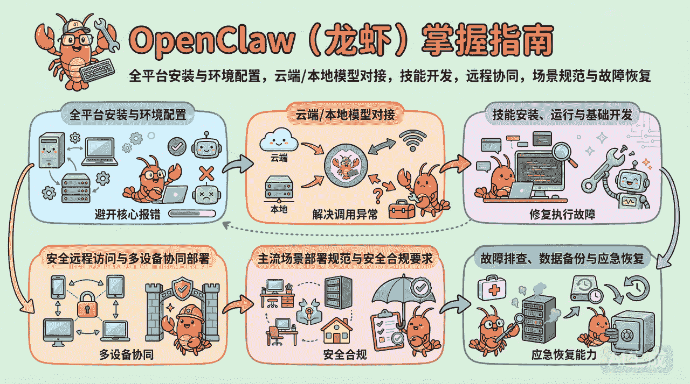
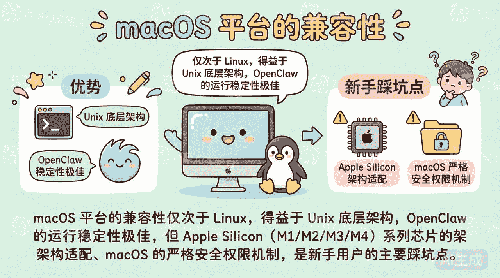
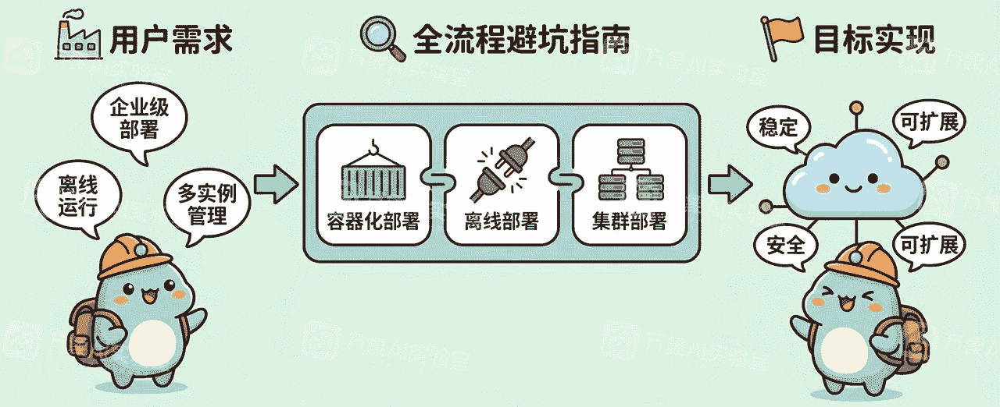
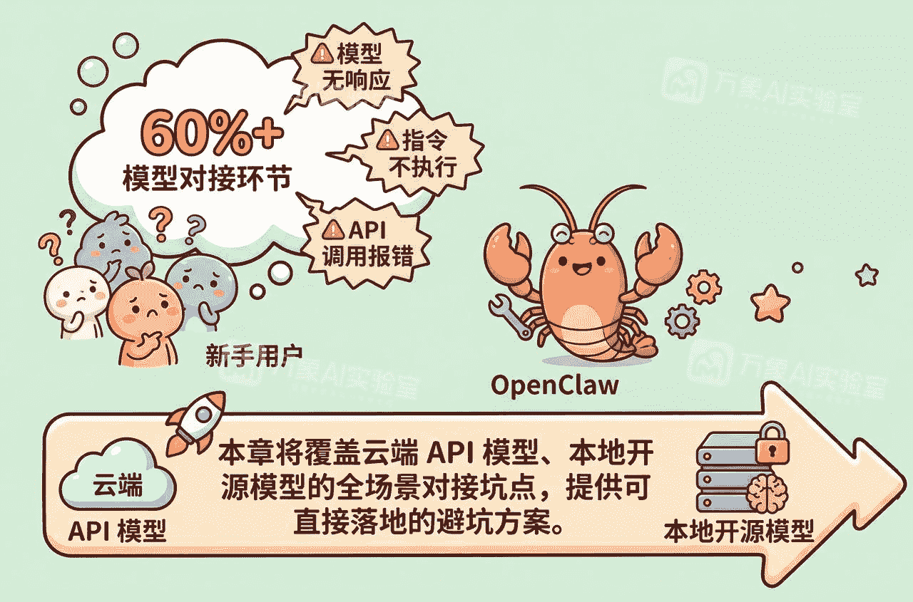
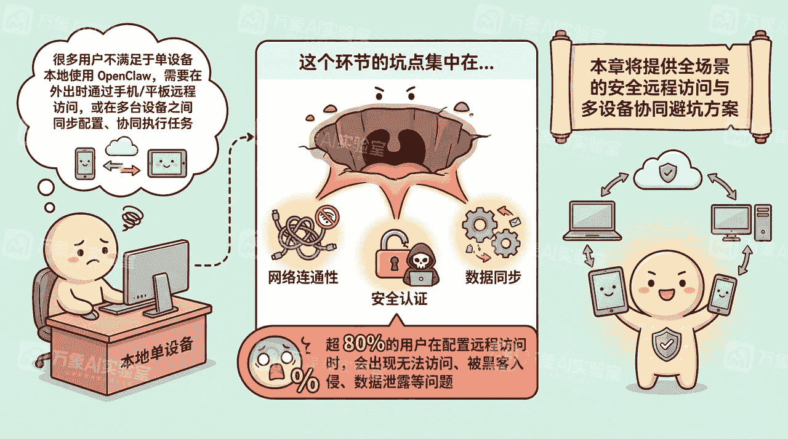
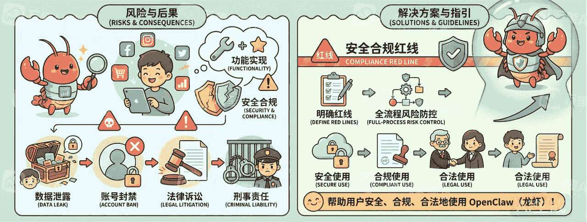
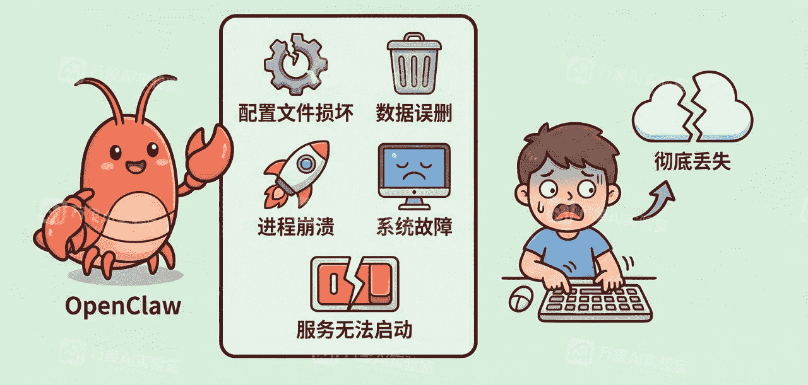

# OpenClaw 避坑手册（全网首发&持续更新 ing...

> 来源：[https://yunyinghui.feishu.cn/docx/WRQFd0PEdo1Gk6x0uydcvRPNngd](https://yunyinghui.feishu.cn/docx/WRQFd0PEdo1Gk6x0uydcvRPNngd)

> **适用人群：** OpenClaw安装及使用人群

> **首发时间：**2026 年 3 月 16 日

> **更新时间：**2026 年 3 月 18 日

> **内容出品人：**** **

> **内容出品方：**[万象 AI 实验室](https://yunyinghui.feishu.cn/wiki/WhelwZnxQi55mpkOzatc3Xran5b?from=from_copylink)

> **使用建议：**建议电脑端打开学习，如果需要快速定位到精确内容，可以使用快捷键 Ctrl +F/Command +F 的形式，搜索关键字/词，查找你想要的内容。

>

> **持续更新 OpenClaw 的**安装问题，运行问题，故障问题等内容，超 3 万字，永久免费在线查看，欢迎收藏、转发和支持。

# 🤹🏼适用人群

本手册适用于所有使用 OpenClaw 的用户，涵盖新手入门者、进阶使用者及开发者。包括想快速避坑完成 OpenClaw 安装部署、模型对接、技能使用的新手；需要远程访问、多设备协同的进阶用户；开发自定义技能的开发者；以及在个人、电商、企业办公等场景部署使用的各类用户，助力各类人群安全合规、高效使用 OpenClaw。


# 〽️学习目标

+   掌握 OpenClaw 全平台安装与环境配置，避开核心报错

+   熟练完成云端/本地模型对接，解决调用异常

+   学会技能安装、运行与基础开发，修复执行故障

+   实现安全远程访问与多设备协同部署

+   掌握主流场景部署规范与安全合规要求

+   具备故障排查、数据备份与应急恢复能力



# **🧑‍💻作者介绍**

**大国**

+   万象 AI 实验室发起人

+   AI 编程开发者

+   AI 商业化及流量操盘手


**黄啊码**

+   万象 AI 实验室技术支持

+   百度秒哒年度最佳开发者

+   扣子头部开发者

+   AI 产品负责人


**铁柱 AGI**

+   万象 AI 实验室技术支持

+   AI 自媒体博主（铁柱 AGI）

+   10 年全栈开发者

+   n8n 社区节点开发者


# 📱交流合作

持**续关注并更新 Op****enClaw 的相关资讯动态，研究报告，商业落地，常见问题，永久免费在线查看。已建立社群**聊聊 OpenClaw 发展、应用、对接及合作，邀请嘉宾讲课，没进群的可以扫码加入，群满可加大国🛰️ ID：zhangyuguo94s（备注：OpenClaw），已经在社群内的无需重复加入，开源知识库及社群学习全部为公开免费分享。

> **特别说明：**不要申请编辑和复制文档，容易错乱编辑，有需求请进群加🛰️沟通。


**🛰️学习交流群**


**🛰️学习交流群**

🛰️ ID：zhangyuguo94s，备注：OpenClaw

**扫码交流、进群、合作**


**飞书学习交流群**

---

# 前言

**OpenClaw **作为** 2026 年全球爆火的开源**项目，凭借“能真正动手执行任务”的核心能力，登顶 GitHub 历史星标增长最快的开源项目。但截至 2026 年 3 月的社区数据显示，超 75%的新手用户在首次安装时会遭遇各类报错，其中 90%的安装失败并非程序本身问题，而是环境配置、权限设置、网络适配等可提前规避的基础坑点。


根据社区反馈和实际操作经验，安装过程中常见的"坑"包括但不限于：

1.  **依赖库版本不兼容**：OpenClaw 依赖多个第三方库，不同版本之间可能存在 API 变化，导致编译失败。

1.  **构建系统配置复杂**：项目使用 CMake 作为构建系统，对于不熟悉 CMake 的开发者来说，配置过程可能会遇到各种路径、变量设置问题。

1.  **跨平台差异**：在 Windows、Linux 和 macOS 上编译安装的步骤和注意事项各不相同。

1.  **文档更新滞后**：开源项目的文档有时无法及时跟上代码的变化，导致按照文档操作反而出错。

本手册旨在系统性地梳理所有可能遇到的问题，并提供详细的解决方案，让你少走弯路，顺利完成 OpenClaw 的安装、运行与使用。

---

# 第一章 OpenClaw 安装前准备与避坑

绝大多数安装失败的根源，都源于安装前的认知偏差与环境预检不到位，本章将明确所有不可触碰的安装红线，帮你在执行第一条安装命令前，就排除 80%的潜在故障。

## 1.1 先搞懂 OpenClaw 的核心逻辑，避开认知误区导致的无效安装

很多新手用户安装完成后发现“**无法对话、不能干活**”，本质是对 OpenClaw 的定位存在认知偏差，这是安装后的第一大“隐形坑”。

+   **核心定位****：OpenClaw **是 AI Agent 的运行时与执行网关，本身不自带大模型能力。它的作用是把大语言模型（Claude、GPT、DeepSeek、本地 Ollama 模型等）转化为能操作本地设备、执行自动化任务的“数字员工”。安装完成后，必须对接模型 API 或本地模型，才能正常使用。

+   **成本边界**：OpenClaw 本体基于 MIT 开源协议，完全免费，可商用无限制。但使用第三方云端大模型时，需要自行承担 API Token 费用，普通个人用户日常使用月均成本从几十块到几千块不等；使用本地开源模型则无额外费用。

+   **核心组件**：安装过程会部署四大核心模块，缺一不可：

1.  CLI 命令行工具：负责安装、配置、管理 OpenClaw 全生命周期

1.  Gateway 本地网关：OpenClaw 的核心进程，负责模型对接、任务调度、技能执行

1.  Web 管理面板：默认端口 18789，可视化配置模型、安装技能、查看任务日志

1.  Skills 技能系统：OpenClaw 的执行能力插件，可扩展文件管理、浏览器控制等数百种功能


## 1.2 官方硬性系统与硬件要求，踩中直接安装失败

OpenClaw 对运行环境有明确的硬性要求，不符合要求的环境会直接出现依赖编译失败、进程无法启动等不可逆问题，无任何绕过方案。

| **配置类型** | **最低要求（仅能启动）** | **推荐配置（流畅运行）** | **绝对禁止的环境** |
| --- | --- | --- | --- |
| 操作系统 | Windows 10 64 位、macOS 12.0、Ubuntu 20.04、Debian 11、CentOS 8 | Windows 11 64 位、macOS 14+、Ubuntu 22.04 LTS | Windows 7 及以下、32 位系统、macOS 11 及以下、CentOS 7 及以下 |
| CPU | 2 核 4 线程 | 4 核 8 线程 | 单核 CPU、ARM32 架构 |
| 内存 | 2GB RAM | 8GB RAM（运行本地模型需 16GB+） | 1GB 及以下内存（安装过程会直接被 OOM 终止） |
| 磁盘空间 | 2GB 可用空间 | 10GB 可用空间（含依赖缓存、技能包、日志） | 剩余空间不足 1GB（安装过程会因磁盘满中断） |
| 核心依赖 | Node.js 22.0.0 LTS 版本 | Node.js 22.11.x LTS、Python 3.10+、Git 2.30+ | Node.js &lt;22.0.0 或&gt;24.x.x、Python &lt;3.8 |

> **核心避坑提醒**：

1.  Node.js 版本是第一大硬性红线，OpenClaw 核心代码基于 ESModule 规范编写，仅兼容 22.x LTS 版本，低于 22.0.0 会直接报错Unsupported engine，高于 24.x.x 的 Current 版本会出现依赖兼容问题，无稳定解决方案。

1.  运行本地大模型时，内存要求翻倍，7B 模型至少需要 16GB 内存，13B 模型需要 32GB 内存，否则会出现模型加载失败、进程崩溃。

1.  OpenClaw 的安装思路不能只是“下载—解压—双击”，而要变成：

> 确认来源 → 明确版本 → 准备资源 → 检查依赖 → 放对目录 → 首次启动测试 → 修复兼容问题 → 做稳定化设置

## 1.3 安装前必做的环境预检与 5 条不可触碰的红线

以下 5 条红线是新手用户最高频的踩坑点，每一条都可能导致安装过程中断、安装后功能异常，必须在安装前完成预检。

### 红线 1：系统用户名/安装路径含中文、空格或特殊字符

**坑点现象**：安装过程无报错，但启动时提示配置文件写入失败、技能加载失败，或执行任务时出现路径不存在报错。

**核心原因**：OpenClaw 的核心依赖（如 sharp、node-pty）对非 ASCII 字符路径兼容性极差，Windows 系统中文用户名、macOS 带空格的安装路径，都会导致依赖无法正常加载，配置文件无法写入。

**避坑方案**：

1.  安装前检查系统用户名，Windows 用户必须使用纯英文用户名，若当前用户名为中文，需新建一个纯英文的管理员用户，在新用户环境下安装。

1.  手动指定安装路径时，必须使用纯英文、无空格、无特殊字符的路径，禁止使用桌面、下载等含中文的系统目录。

1.  预检命令：Windows PowerShell 执行echo $env:USERNAME，macOS/Linux 终端执行whoami，确保输出为纯英文。

### 红线 2：终端权限不足，无法写入系统目录

**坑点现象**：安装过程中提示Permission denied、权限被拒绝、文件写入失败，安装中断。

**核心原因**：OpenClaw 安装过程需要写入全局 npm 目录、创建系统服务、修改环境变量，普通权限的终端无法完成这些操作。

**避坑方案**：

1.  Windows 用户：必须以**管理员身份****运行 Powe**rShell 或终端，右键开始菜单选择“终端（管理员）”，而非普通用户打开的终端。

1.  macOS/Linux 用户：执行安装脚本时，必须使用 sudo 权限，输入用户密码时终端不显示字符为正常现象，输入完成后回车即可。

1.  禁止使用 root 用户直接安装 Linux 版本，会导致后续非 root 用户无法操作，出现权限混乱。

### 红线 3：网络环境无法访问海外仓库，国内用户必踩的超时坑

**坑点现象**：安装过程长时间卡在fetch metadata，最终提示network timeout、下载失败，或 sharp 等依赖安装失败。

**核心原因**：OpenClaw 的核心包、依赖库默认托管在 npm 官方仓库、GitHub、S3 等海外服务器，国内直连速度极慢，甚至被网络运营商阻断，导致下载超时。

**避坑方案**：

1.  国内用户安装前必须配置国内镜像源，提前执行以下命令配置 npm 淘宝镜像：

```
# 配置npm国内镜像
npm config set registry https://registry.npmmirror.com
# 配置sharp库预构建二进制文件国内镜像
npm config set sharp_binary_host https://npmmirror.com/mirrors/sharp
npm config set sharp_libvips_binary_host https://npmmirror.com/mirrors/sharp-libvips
```

1.  一键脚本安装时，优先使用国内社区提供的镜像脚本，而非官方海外脚本，避免下载超时。

1.  确保网络环境稳定，禁止使用频繁切换节点的代理，否则会出现 TCP 连接中断、下载文件损坏。

### 红线 4：已安装的 Node.js 多版本冲突

**坑点现象**：明明已经安装了 Node.js 22.x，执行安装命令时仍提示Node.js version is too low，或安装完成后重启终端，版本自动回退。

**核心原因**：系统中存在多个 Node.js 版本（如系统自带版本、nvm 安装的多个版本、Visual Studio 自带的 Node.js），导致终端调用的版本与安装的版本不一致。

**避坑方案**：

1.  安装前必须预检当前终端的 Node.js 版本，执行node -v，确保输出为 v22.x.x，若版本不符，先卸载所有不兼容的版本。

1.  Windows 用户：通过控制面板→程序和功能，卸载所有非 22.x LTS 的 Node.js 版本，重启终端后再次验证。

1.  macOS/Linux 用户：推荐使用 nvm 管理 Node.js 版本，避免系统自带 Node.js 的权限问题，执行以下命令安装并切换到 22.x LTS：

```
# 安装nvm
curl -o- https://raw.githubusercontent.com/nvm-sh/nvm/v0.40.0/install.sh | bash
# 重启终端后，安装Node.js 22 LTS
nvm install --lts 22
# 切换为默认版本
nvm use 22
# 验证版本
node -v
```

1.  禁止同时使用 nvm、n、brew 等多个 Node.js 版本管理工具，会导致版本冲突加剧。

### 红线 5：杀毒软件/防火墙拦截安装脚本与核心文件

**坑点现象**：安装过程突然中断，提示文件不存在、install.cmd被删除，或安装完成后核心组件缺失，启动报错模块未找到。

**核心原因**：Windows Defender、360 安全卫士、Mac 防火墙等安全软件，会将 OpenClaw 的安装脚本、CLI 工具误判为恶意程序，直接隔离或删除核心文件。

**避坑方案**：

1.  安装前，暂时关闭杀毒软件的实时防护功能，将 OpenClaw 的安装目录加入安全软件的白名单。

1.  Windows Defender 用户：打开设置→隐私和安全性→Windows 安全中心→病毒和威胁防护→管理设置，关闭实时保护，安装完成后再重新开启。

1.  macOS 用户：打开系统设置→隐私与安全性→防火墙，暂时关闭防火墙，安装完成后重新开启，并在开发者工具中允许 OpenClaw 的运行权限。

## 1.4 三种安装方式的选型避坑，选错直接增加踩坑概率

OpenClaw 官方提供了三种安装方式，分别适配不同人群，选错安装方式会直接导致安装难度翻倍，踩坑概率大幅提升。

| **安装方式** | **适合人群** | **核心优点** | **核心缺点** | **避坑提醒** |
| --- | --- | --- | --- | --- |
| 一键脚本安装 | 零代码基础的新手用户、快速体验用户 | 操作最简单，自动安装 Node.js、配置环境变量、处理依赖，一行命令完成安装 | 自定义程度低，国内用户需使用镜像脚本，否则易超时 | 新手首选，**禁止新手直接使用源码安装**，官方脚本会自动处理 90%的环境问题 |
| npm/pnpm 全局安装 | 有 Node.js 使用基础的普通用户、日常使用用户 | 版本管理方便，可随时升级/降级，自定义程度高，适配性强 | 需要提前安装符合要求的 Node.js，对环境有基础要求 | 推荐有基础的用户使用，pnpm 安装速度更快，占用磁盘空间更少，优先选择 pnpm |
| 源码编译安装 | 开发者、需要二次修改源码、参与贡献的用户 | 可自定义修改源码，使用最新开发版功能，可深度定制 | 安装步骤复杂，需要配置构建环境，依赖编译易失败，新手完全不适用 | 仅推荐开发者使用，必须提前安装 Git、Python、build-essential 等构建工具，国内用户需配置镜像加速源码拉取 |

---

# 第二章 Windows 安装 OpenClaw 高频坑点排查

Windows 是新手用户占比最高的平台，同**时**也是安装坑点最多的平台。官方明确说明：OpenClaw 在 Windows 上推荐通过 WSL2 Ubuntu 环境安装，原生 Windows 未经完整测试，存在大量兼容性问题，这是 Windows 平台安装的第一核心原则。


## 2.1 Windows 平台安装的核心前提

很**多 Window**s 用户安装失败的核心原因，是直接在原生 PowerShell 中安装，而没有使用官方推荐的 WSL2 环境。WSL2 是 Windows 内置的 Linux 子系统，能提供完整的 Linux 运行环境，完美兼容 OpenClaw 的所有依赖，避免原生 Windows 的路径、权限、编译问题。

### WSL2 安装的正确步骤与避坑指南

> **前置预检**：你的** Windows 系统必须是 **Windows 10 2004 版本及以上，或 Windows 11 所有版本，低于该版本无法安装 WSL2，只能升级系统。

1.  步骤 1：开启 Windows 必需功能

以管理员身份打开 PowerShell，执行以下两条命令，开启虚拟机平台和 WSL 功能：

```
wsl --install
```

**高频避坑点**：

+   执行命令后提示“需要重启”，必须重启电脑完成功能启用，重启后会自动继续 Ubuntu 的安装，不要手动关闭窗口。

+   若重启后提示“虚拟化未启用”，需要进入电脑 BIOS，开启 Intel VT-x（Intel CPU）或 AMD-V（AMD CPU）虚拟化功能，不同品牌主板的开启方式不同，可参考对应品牌的官方教程。

+   若已安装 WSL1，必须升级到 WSL2，执行wsl --set-default-version 2，将默认版本设置为 WSL2，否则会出现网络、文件系统兼容性问题。

1.  步骤 2：配置 Ubuntu 系统

安装完成后，会自动弹出 Ubuntu 终端，提示设置用户名和密码，必须设置纯英文用户名，禁止使用中文，密码输入时不显示字符，输入完成后回车即可。

**高频避坑点**：

+   用户名必须为纯英文，否则会触发中文路径的坑，后续安装 OpenClaw 必然失败。

+   设置完成后，执行sudo apt update && sudo apt upgrade -y，更新系统源和软件包，避免因源老旧导致依赖安装失败。

+   提前安装必需的系统依赖：sudo apt install curl git build-essential python3 python3-pip -y，这些依赖是 OpenClaw 源码编译、技能运行的必需组件，新手极易遗漏。

## 2.2 方案一：WSL2 环境下 OpenClaw 一键脚本安装（官方推荐，新手首选）

WSL2 环境配置完成后，在 Ubuntu 终端中执行安装命令，这是 Windows 平台成功率最高的安装方式，避坑后安装成功率接近 100%。

### 分步安装流程与每步避坑

1.  步骤 1：配置国内镜像源（国内用户必做，否则必超时）

在 Ubuntu 终端中执行以下命令，配置 npm 国内镜像和 sharp 依赖镜像：

```
# 配置npm淘宝镜像
npm config set registry https://registry.npmmirror.com
# 配置sharp库国内镜像
npm config set sharp_binary_host https://npmmirror.com/mirrors/sharp
npm config set sharp_libvips_binary_host https://npmmirror.com/mirrors/sharp-libvips
```

1.  **步骤 2：执行一键安装脚本**

国内用户优先使用国内镜像脚本，执行以下命令：

```
curl -fsSL https://open-claw.org.cn/install.sh | bash
```

```
curl -fsSL https://openclaw.ai/install.sh | bash
```

+   执行命令时，若提示需要 sudo 权限，输入你的 Ubuntu 用户密码，回车即可。

+   安装过程会自动检测并安装 Node.js 22 LTS 版本，无需手动安装，全程等待即可，不要手动关闭终端。

+   安装时长取决于网络速度，通常 3-8 分钟，若长时间卡在依赖安装，检查网络是否稳定，镜像是否配置正确。

1.  **步骤 3：完成初始化引导**

安装完成后，脚本会自动启动初始化引导，执行openclaw onboard命令，按照引导完成以下配置：

1.  设置管理员账号和密码，用于登录 Web 管理面板

1.  配置大模型 API Key（可先跳过，后续在 Web 面板中配置）

1.  安装系统必备的基础技能包

1.  配置开机自启的守护进程

**避坑提醒**：

+   初始化引导必须完成，否则 Gateway 服务不会自动启动，Web 面板无法访问。

+   若不小心跳过了引导，手动执行openclaw onboard --install-daemon即可重新启动引导。

1.  **步骤 4：验证安装成功**

执行以下命令，验证安装是否成功：

```
# 验证CLI命令是否正常
openclaw --version
# 验证Gateway服务是否正常运行
openclaw gateway status
```

**避坑提醒**：WSL2 环境下，Windows 主机可直接通过 127.0.0.1 访问 Web 面板，无需额外配置 IP，若无法访问，检查 Ubuntu 防火墙是否关闭，Gateway 服务是否正常启动。

## 2.3 方案二：Windows 原生 PowerShell 安装（不推荐，仅适合无法使用 WSL2 的用户）

若你的 Windows 系统无法启用 WSL2，只能使用原生 PowerShell 安装，必须严格按照以下步骤操作，否则极易出现兼容性问题。

### 前置必做准备（缺一不可）

1.  必须以管理员身份运行 PowerShell，否则权限不足会导致安装失败。

1.  必须修改 PowerShell 执行策略，否则无法运行安装脚本，执行以下命令：

```
Set-ExecutionPolicy -ExecutionPolicy RemoteSigned -Scope CurrentUser
```

1.  必须提前安装 Node.js 22.x LTS 版本，从 Node.js 官网下载 64 位安装包，安装时必须勾选“Automatically install the necessary tools”和“Add to PATH”，安装完成后重启终端，执行node -v验证版本。

1.  必须提前配置 npm 国内镜像，执行 1.3 节中的镜像配置命令，否则依赖下载必超时。

### 分步安装流程

1.  **步骤 1：执行一键安装脚本**

国内用户使用镜像脚本：

```
iwr -useb https://open-claw.org.cn/install-cn.ps1 | iex
```

```
iwr -useb https://openclaw.ai/install.ps1 | iex
```

1.  **步骤 2：完成初始化引导**

安装完成后，执行openclaw onboard命令，按照引导完成配置，步骤与 WSL2 环境一致。

1.  **步骤 3：验证安装成功**

执行openclaw --version验证 CLI 命令，执行openclaw gateway start启动服务，浏览器访问http://127.0.0.1:18789，能正常打开面板即为安装成功。

## 2.4 Windows 平台安装高频报错与秒解方案

以下是 Windows 平台安装过程中出现频率最高的 20+报错，均提供实测有效的解决方案。

| **报错现象** | **核心原因** | **秒解方案** | **预防措施** |
| --- | --- | --- | --- |
| PowerShell 提示“无法运行脚本，因为在此系统上禁止运行脚本” | PowerShell 默认执行策略禁止运行外部脚本 | 以管理员身份执行Set-ExecutionPolicy -ExecutionPolicy RemoteSigned -Scope CurrentUser，输入 Y 确认 | 安装前先修改执行策略，再执行安装命令 |
| 执行 openclaw 命令提示“无法将&#x27;openclaw&#x27;识别为 cmdlet、函数、脚本文件或可运行程序的名称” | 环境变量未配置，或安装未完成，npm 全局目录未加入系统 PATH | 1. 执行npm config get prefix查看 npm 全局目录，将该目录路径加入系统环境变量 PATH；2. 重启终端，重新执行安装命令；3. 若使用 nvm，确保当前终端使用的 Node.js 版本与安装时一致 | 安装 Node.js 时勾选“Add to PATH”，安装完成后重启终端 |
| 安装过程中提示“network timeout”“下载失败”“fetchMetadata 卡住” | 网络无法访问海外 npm 仓库，下载超时 | 1. 配置 npm 淘宝镜像和 sharp 镜像；2. 切换稳定的网络环境；3. 使用国内镜像安装脚本 | 国内用户安装前必须先配置镜像源 |
| 明明安装了 Node.js 22.x，仍提示“Node.js version is too low” | 系统存在多版本 Node.js 冲突，终端调用的版本不对 | 1. 执行$env:NODE_PATH查看当前 Node.js 路径；2. 控制面板卸载所有非 22.x 版本；3. 重启终端，重新验证node -v | 安装前卸载所有不兼容的 Node.js 版本，使用 nvm 管理单一版本 |
| 启动服务提示“Address already in use: 127.0.0.1：18789” | 默认端口 18789 被其他程序占用 | 方式 1：关闭占用端口的进程，执行`netstat -ano | findstr :18789`查看 PID，在任务管理器中结束该进程；方式 2：修改配置文件，更换为其他未占用端口 |
| 安装过程中提示“Permission denied”“权限被拒绝”“文件写入失败” | 终端没有管理员权限，或杀毒软件拦截了文件写入 | 1. 以管理员身份重新运行 PowerShell；2. 暂时关闭杀毒软件实时防护，将安装目录加入白名单；3. 检查安装路径是否有写入权限 | 必须以管理员身份运行终端，安装前关闭杀毒软件实时防护 |
| sharp 库安装失败，提示“prebuilt binary download failed” | sharp 库的预构建二进制文件无法从海外服务器下载 | 1. 配置 sharp 库国内镜像源；2. 执行npm install --platform=win32 --arch=x64 sharp手动安装对应架构的版本 | 安装前先配置 sharp 镜像源 |
| WSL2 环境下，Windows 浏览器无法访问 Web 面板 | WSL2 网络桥接异常，或 Ubuntu 防火墙拦截了端口 | 1. 执行sudo ufw disable关闭 Ubuntu 防火墙；2. 重启 WSL 服务，执行wsl --shutdown，重新打开 Ubuntu 终端；3. 检查 Gateway 服务是否正常启动openclaw gateway status | WSL2 安装完成后先关闭防火墙，避免端口拦截 |
| 中文用户名导致的“配置文件写入失败”“ENOENT: no such file or directory” | 系统用户名为中文，配置文件路径含非 ASCII 字符 | 1. 新建一个纯英文的 Windows 管理员用户；2. 在新用户环境下重新安装；3. 手动指定纯英文的配置文件路径，设置环境变量OPENCLAW_HOME=C:\openclaw | 安装前检查系统用户名，必须为纯英文 |
| 安装完成后重启电脑，openclaw 命令失效 | 环境变量在重启后丢失，或 Node.js 版本回退 | 1. 检查系统 PATH 环境变量，确认 npm 全局目录已加入；2. 若使用 nvm，执行nvm alias default 22设置默认版本；3. 重新执行安装命令，修复环境变量 | 安装完成后不要修改 Node.js 版本，使用 nvm 设置默认版本 |
| WSL2 安装时提示“WSL 2 需要更新其内核组件” | 缺少 WSL2 Linux 内核更新包 | 1. 从微软官网下载 WSL2 内核更新包并安装；2. 重启电脑，重新执行wsl --install命令 | 安装 WSL2 前先完成 Windows 系统更新，安装所有可选更新 |

---

# 第三章 Linux 安装 OpenClaw 问题避坑指南

Linux 是 OpenClaw 服务器部署、生产环境运行的首选平台，兼容性最好，性能最优。但不同发行版的包管理器、系统依赖、安全策略差异较大，新手极易在环境配置、权限管理、防火墙设置上踩坑。


## 3.1 Linux 平台安装的核心前提：发行版适配与环境准备

#### 官方支持的发行版与适配优先级

1.  一级适配（官方优先支持，无兼容问题）：Ubuntu 20.04+/22.04+/24.04 LTS、Debian 11+/12+

1.  二级适配（社区支持，需手动配置依赖）：CentOS Stream 8+/9+、RHEL 8+/9+、Fedora 38+

1.  不推荐适配（兼容性差，易出现依赖问题）：Arch Linux、OpenSUSE、Alpine Linux（Alpine 需使用 musl 编译的依赖，官方无预构建包）

#### 安装前必装的系统依赖

无论哪个发行版，都必须提前安装以下系统依赖，否则会出现依赖编译失败、技能无法运行的问题，新手极易遗漏：

```
# Ubuntu/Debian系列
sudo apt update &amp;&amp; sudo apt install -y curl git build-essential python3 python3-pip libvips-dev
# CentOS/RHEL系列
sudo dnf update -y &amp;&amp; sudo dnf install -y curl git gcc gcc-c++ make python3 python3-pip vips-devel
# Fedora系列
sudo dnf update -y &amp;&amp; sudo dnf install -y curl git @development-tools python3 python3-pip vips-devel
```

**核心避坑提醒**：build-essential（开发工具链）和libvips-dev（sharp 库的系统依赖）是必装组件，缺少这两个包，sharp 库必然安装失败，OpenClaw 无法正常启动。

## 3.2 主流发行版分步安装流程与专属避坑

### 3.2.1 Ubuntu/Debian 系列安装（官方首选，新手推荐）

Ubuntu/Debian 是官方适配最完善的发行版，安装流程最简单，踩坑概率最低，推荐所有新手用户使用。

1.  **步骤 1：环境预检与镜像配置**

执行node -v检查 Node.js 版本，若未安装或版本不符，使用 nvm 安装 Node.js 22 LTS，步骤参考 1.3 节。

国内用户必须配置 npm 国内镜像和 sharp 镜像，避免下载超时。

1.  **步骤 2：执行一键安装脚本**

国内用户使用镜像脚本：

```
curl -fsSL https://open-claw.org.cn/install.sh | bash
```

```
curl -fsSL https://openclaw.ai/install.sh | bash
```

1.  **步骤 3：完成初始化与验证**

安装完成后，自动执行初始化引导，按照提示完成配置，执行openclaw --version和openclaw gateway status验证安装，浏览器访问http://服务器IP:18789即可打开 Web 面板。

### 3.2.2 CentOS/RHEL 系列安装专属避坑

CentOS/RHEL 系列的核心坑点集中在 yum 源老旧、SELinux 权限拦截、防火墙规则三个方面，必须提前处理，否则安装后无法访问。

1.  **前置避坑处理**

+   关闭 SELinux（临时关闭，重启后恢复，可永久关闭）：执行sudo setenforce 0，永久关闭需修改/etc/selinux/config文件，将SELINUX=enforcing改为SELINUX=disabled，重启系统生效。

+   配置防火墙放行端口：执行以下命令，放行默认端口 18789，否则公网无法访问：

```
sudo firewall-cmd --zone=public --add-port=18789/tcp --permanent
sudo firewall-cmd --reload
```

+   升级系统源：CentOS 8 已停止官方维护，需更换为阿里云或腾讯云的 Vault 源，否则无法安装依赖，参考国内镜像站的 CentOS 源配置教程。

1.  **安装流程**

与 Ubuntu 系列一致，先安装系统依赖，再执行一键安装脚本，完成初始化引导。

### 3.2.3 云服务器部署专属避坑指南

绝大多数 Linux 用户会在云服务器（阿里云、腾讯云、华为云等）上部署 OpenClaw，90%的公网无法访问问题，都源于云服务器的安全组配置，这是云服务器部署的第一大坑。

**核心避坑步骤**：

1.  **安全组端口放行**：登录云服务器控制台，进入安全组配置，添加入方向规则，放行 TCP 端口 18789，授权对象为 0.0.0.0/0（全网可访问）或指定 IP 段，否则防火墙会直接拦截公网访问请求。

1.  **公网 IP 绑定**：确保云服务器已绑定弹性公网 IP，否则无法通过公网访问。

1.  **带宽配置**：云服务器带宽至少 1M，否则依赖下载会超时，模型 API 调用会卡顿。

1.  **内存配置**：云服务器内存至少 2GB，推荐 4GB 以上，否则安装过程会因内存不足被系统 OOM 终止。

1.  禁止使用轻量应用服务器的封禁端口：部分云厂商的轻量应用服务器会封禁高危端口，若 18789 无法访问，可更换为其他端口，如 8080、9090 等。

## 3.3 Linux 平台安装高频坑点与解决方案

| **坑点现象** | **核心原因** | **解决方案** |
| --- | --- | --- |
| apt/yum 源老旧，无法安装符合要求的 Node.js 版本 | 系统默认源中的 Node.js 版本过低，无法满足≥22.0.0 的要求 | 1. 不要使用 apt/yum 直接安装 Node.js，使用 nvm 管理版本；2. 配置 NodeSource 官方源，安装 22.x 版本；3. 更换国内镜像源，更新系统软件包 |
| 非 root 用户安装，提示“npm 权限不足”“无法写入全局目录” | npm 全局目录默认归属 root 用户，非 root 用户无写入权限 | 1. 配置 npm 全局目录到用户目录，执行npm config set prefix ~/.npm-global；2. 将该目录加入环境变量，执行echo &#x27;export PATH=~/.npm-global/bin:$PATH&#x27; &gt;&gt; ~/.bashrc &amp;&amp; source ~/.bashrc；3. 重新执行安装命令，无需 sudo 权限 |
| 安装完成后，关闭终端服务就停止，无法后台运行 | Gateway 服务未配置守护进程，终端关闭后进程被终止 | 1. 初始化时执行openclaw onboard --install-daemon，自动安装 systemd 守护进程，实现开机自启、后台运行；2. 使用 PM2 管理进程，执行npm install -g pm2，再执行pm2 start openclaw -- gateway start，设置pm2 startup实现开机自启 |
| 服务启动正常，但公网无法访问 Web 面板 | 防火墙/安全组未放行端口，或 IP 绑定错误 | 1. 检查云服务器安全组，放行 18789 端口；2. 检查系统防火墙，放行端口；3. 检查 Gateway 配置文件，是否绑定了 127.0.0.1，改为 0.0.0.0 允许全网访问；4. 检查服务器是否有公网 IP，端口是否被运营商封禁 |
| 安装过程中提示“Out of memory”，进程被杀死 | 服务器内存不足，安装时依赖编译占用大量内存，被系统 OOM 终止 | 1. 增加服务器内存，至少 2GB，推荐 4GB 以上；2. 临时增加 swap 分区，缓解内存压力；3. 关闭服务器上其他占用内存的进程，再执行安装 |
| 执行 sudo 命令后，Node.js 版本回退，提示版本过低 | nvm 安装的 Node.js 版本仅对当前用户生效，sudo 调用的是系统 root 用户的 Node.js | 1. 配置 sudo 保留用户环境变量，修改sudoers文件，添加Defaults env_keep += &quot;PATH&quot;；2. 使用 nvm 的 root 用户安装相同版本的 Node.js；3. 避免使用 sudo 执行 npm 和 openclaw 命令，提前配置好用户目录权限 |
| libvips 依赖缺失，sharp 库编译失败 | 系统未安装 libvips-dev/vips-devel 包，sharp 库无法编译 | 1. 按照 3.1 节的命令，安装对应发行版的 libvips 开发包；2. 配置 sharp 镜像源，使用预构建的二进制文件，无需本地编译；3. 执行sudo ldconfig更新系统库缓存，重新安装 sharp |

> Linux 生产环境部署的最佳实践与避坑红线

1.  禁止使用 root 用户运行 OpenClaw：root 用户权限过高，若 OpenClaw 被恶意利用，会导致整个服务器被入侵，必须创建专用的普通用户运行 OpenClaw，仅分配必要的权限。

1.  **配置反向代理与 HTTPS**：公网部署时，禁止直接将 18789 端口暴露在公网，使用 Nginx 反向代理，配置 HTTPS 证书，添加身份认证，避免未授权访问。

1.  **数据目录持久化备份**：OpenClaw 的配置文件、技能数据、日志默认存储在~/.openclaw目录，必须定期备份，避免重装系统、误操作导致数据丢失。

1.  **限制资源占用**：使用 systemd 或 cgroup 限制 OpenClaw 的 CPU、内存占用，避免进程异常占用大量资源，导致服务器卡顿、其他服务无法运行。

1.  **开启日志审计**：配置 OpenClaw 的日志输出到系统日志，开启审计功能，记录所有任务执行、API 调用、用户登录操作，便于故障排查和安全审计。

---

# 第四章 macOS 按照 OpenClaw 适配避坑全解

macOS 平台的兼容性仅次于 Linux，得益于 Unix 底层架构，OpenClaw 的运行稳定性极佳，但 Apple Silicon（M1/M2/M3/M4）系列芯片的架构适配、macOS 的严格安全权限机制，是新手用户的主要踩坑点。



## 4.1 macOS 平台安装的核心前提：架构适配与系统要求

### 架构适配避坑指南

macOS 平台分为两种 CPU 架构，必须提前确认，否则会出现依赖编译失败、进程无法启动的问题：

1.  Apple Silicon 架构（M 系列芯片）：M1/M2/M3/M4 等芯片，采用 arm64 架构，是目前 macOS 的主流架构，OpenClaw 原生支持，无需额外配置，但部分老旧依赖需要 Rosetta2 转译。

1.  **Intel x86_64 架构**：2020 年之前的 Mac 电脑，采用 Intel 芯片，OpenClaw 原生支持，无架构兼容问题。

**核心避坑提醒**：M 系列芯片用户，必须提前安装 Rosetta2，否则部分 x86 架构的依赖包无法运行，安装时会报错“架构不兼容”，执行以下命令安装 Rosetta2：

```
softwareupdate --install-rosetta --agree-to-license
```

### 系统版本与前置依赖要求

1.  **系统版本**：必须是 macOS 12.0 Monterey 及以上版本，低于该版本会出现系统 API 不兼容，无法安装 Node.js 22.x，OpenClaw 启动失败。

1.  **必装前置依赖**：

+   Xcode Command Line Tools（CLT）：OpenClaw 的依赖编译、Git 操作都需要该工具链，是必装组件，新手极易遗漏。

+   Homebrew：macOS 的包管理器，用于安装系统依赖、Node.js 等，推荐所有用户安装。

**CLT 安装命令**：打开终端，执行以下命令，按照提示完成安装：

```
xcode-select --install
```

**避坑提醒**：若执行命令提示“已安装”，但安装依赖时仍报错，执行sudo xcode-select --reset重置工具链路径，避免 Xcode.app 与 CLT 的路径冲突。

**Homebrew 安装命令**：国内用户使用镜像安装脚本，避免下载超时：

```
/bin/bash -c &quot;$(curl -fsSL https://gitee.com/cunkai/HomebrewCN/raw/master/Homebrew.sh)&quot;
```

安装完成后，执行brew --version验证安装是否成功。

## 4.2 macOS 平台分步安装流程与避坑

### 4.2.1 前置环境配置（必做，缺一不可）

1.  步骤 1：安装 Node.js 22 LTS

推荐使用 nvm 管理 Node.js 版本，避免系统自带 Node.js 的权限问题，执行以下命令安装：

```
# 安装nvm
curl -o- https://raw.githubusercontent.com/nvm-sh/nvm/v0.40.0/install.sh | bash
# 重启终端后，安装Node.js 22 LTS
nvm install --lts 22
# 设置为默认版本
nvm use 22
# 验证版本
node -v
```

1.  **步骤 2：配置国内镜像源**

国内用户必须配置 npm、sharp、Homebrew 的国内镜像，否则下载必超时：

```
# npm镜像配置
npm config set registry https://registry.npmmirror.com
# sharp库镜像配置
npm config set sharp_binary_host https://npmmirror.com/mirrors/sharp
npm config set sharp_libvips_binary_host https://npmmirror.com/mirrors/sharp-libvips
# Homebrew镜像配置，参考安装脚本的提示完成
```

1.  步骤 3：配置终端完全磁盘访问权限

macOS 的安全机制会限制终端的文件访问权限，若不开启，OpenClaw 无法操作本地文件、访问桌面、下载等目录，执行任务时会提示“权限被拒绝”。

**开启步骤**：

1.  打开系统设置→隐私与安全性→完全磁盘访问权限

1.  点击左下角的锁图标，输入密码解锁

1.  在右侧列表中，找到你使用的终端（Terminal、iTerm2、Warp 等），打开开关

1.  重启终端，权限即可生效

**避坑提醒**：这是 macOS 平台安装后功能异常的第一大坑，90%的“文件操作失败”问题，都源于终端没有完全磁盘访问权限，必须提前开启。

### 4.2.2 一键脚本安装（新手首选）

环境配置完成后，执行一键安装脚本，国内用户使用镜像脚本：

```
curl -fsSL https://open-claw.org.cn/install.sh | bash
```

海外用户使用官方脚本：

```
curl -fsSL https://openclaw.ai/install.sh | bash
```

**避坑提醒**：

+   执行脚本时，若提示需要 sudo 权限，输入你的 Mac 用户密码，输入时终端不显示字符为正常现象，输入完成后回车即可。

+   安装过程中，若弹出 macOS 防火墙提示，点击“允许”，否则 Gateway 服务会被拦截，局域网其他设备无法访问。

+   安装时长取决于网络速度，通常 2-5 分钟，安装完成后会自动启动初始化引导。

### 4.2.3 npm/pnpm 安装（推荐有基础的用户使用）

```
# 使用npm安装
npm install -g openclaw@beta
# 或使用pnpm安装（推荐，速度更快）
pnpm add -g openclaw@beta
# 完成后执行初始化引导
openclaw onboard --install-daemon
```

> **避坑提醒**：安装完成后，必须执行openclaw onboard --install-daemon安装守护进程，否则重启电脑后，OpenClaw 不会自动启动，服务会停止。

## 4.3 macOS 平台专属高频坑点与解决方案

| **坑点现象** | **核心原因** | **解决方案** |
| --- | --- | --- |
| M 系列芯片下，依赖安装失败，提示“npm ERR！ code EBADPLATFORM”“不兼容的架构” | 依赖包仅提供 x86 架构的预构建文件，arm64 架构不兼容，未安装 Rosetta2 | 1. 执行softwareupdate --install-rosetta --agree-to-license安装 Rosetta2；2. 终端右键→显示简介，勾选“使用 Rosetta 打开”，重启终端后重新执行安装命令；3. 配置镜像源，下载支持 arm64 架构的依赖包 |
| 安装完成后，重启终端，openclaw 命令提示“command not found” | 环境变量未写入终端配置文件，重启后失效 | 1. 确认你使用的终端 shell 类型，执行echo $SHELL，zsh 对应~/.zshrc，bash 对应~/.bash_profile；2. 执行echo &#x27;export PATH=&quot;$HOME/.nvm/versions/node/v22.x.x/bin:$PATH&quot;&#x27; &gt;&gt; ~/.zshrc（替换为你的 Node.js 版本路径）；3. 执行source ~/.zshrc刷新环境变量，重启终端验证 |
| 执行任务时提示“无法访问文件/目录”“Operation not permitted” | 终端没有开启完全磁盘访问权限，macOS 安全机制拦截了文件操作 | 1. 打开系统设置→隐私与安全性→完全磁盘访问权限，开启终端的权限开关；2. 重启终端，重新执行任务；3. 若仍无法访问，检查文件/目录的权限，执行chmod 755 目标路径修改权限 |
| macOS 防火墙拦截，局域网其他设备无法访问 Web 面板 | macOS 防火墙默认禁止外来连接，拦截了 18789 端口 | 1. 打开系统设置→网络→防火墙，点击“选项”；2. 点击“+”号，将 Node.js 和终端加入允许列表，开启“允许传入连接”；3. 或暂时关闭防火墙，测试是否能正常访问；4. 检查 Gateway 服务是否绑定了 0.0.0.0，允许局域网访问 |
| Homebrew 安装的 Node.js，执行 sudo 命令后版本回退 | sudo 调用的是系统自带的 Node.js，而非 Homebrew 安装的版本 | 1. 避免使用 sudo 执行 npm 和 openclaw 命令，提前配置好用户目录权限；2. 执行which node查看 Homebrew 的 Node.js 路径，使用绝对路径执行 sudo 命令；3. 使用 nvm 管理 Node.js 版本，避免与 Homebrew 版本冲突 |
| 安装完成后，服务启动正常，但 Web 面板加载空白、报错 | 前端资源 CDN 无法访问，国内网络加载失败 | 1. 配置国内镜像源，重新安装 OpenClaw，使用国内 CDN 的前端资源；2. 检查网络代理是否正常，关闭系统代理后重试；3. 手动执行openclaw ui:build，在本地构建前端资源，无需依赖 CDN |
| Python 版本不兼容，部分技能无法运行，提示“Python not found” | 系统自带的 Python 版本过低，或未配置 Python 环境变量 | 1. 使用 Homebrew 安装 Python 3.10+，执行brew install python@3.10；2. 配置 Python 环境变量，将/opt/homebrew/bin/python3加入 PATH；3. 执行ln -s /opt/homebrew/bin/python3 /usr/local/bin/python创建软链接，让系统能识别 python 命令 |
| 升级 macOS 系统后，OpenClaw 无法启动，提示“依赖损坏” | 系统升级后，CLT 工具链失效，Node.js 版本被重置 | 1. 重新执行xcode-select --install安装 CLT 工具链；2. 使用 nvm 重新切换到 Node.js 22 LTS 版本；3. 重新执行安装命令，修复损坏的依赖；4. 执行openclaw repair修复安装 |

> macOS 平台安装的最佳实践

1.  使用 nvm 管理 Node.js 版本：彻底避免系统自带 Node.js 的权限问题、版本冲突问题，是 macOS 平台最稳定的 Node.js 管理方案。

1.  **提前配置所有系统权限**：安装前开启终端的完全磁盘访问权限、允许防火墙传入连接，避免安装后功能异常，无需反复修改系统设置。

1.  使用 Homebrew 管理系统依赖：所有系统级依赖（libvips、python、git 等）都通过 Homebrew 安装，避免手动编译的坑，Homebrew 会自动处理架构适配和依赖关系。

1.  **配置开机自启**：初始化时执行openclaw onboard --install-daemon，自动安装 launchd 守护进程，实现 Mac 开机后 OpenClaw 自动启动，后台稳定运行，无需手动开启。

1.  **定期备份配置**：OpenClaw 的所有配置、技能、数据都存储在~/.openclaw目录，定期备份该目录，避免重装系统、误操作导致数据丢失。

---

# 第五章 OpenClaw 安装后异常的排查与修复方案

很多用户安装过程无报错，但安装完成后出现服务无法启动、Web 面板无法访问、功能异常等问题，本章将提供全链路的排查流程，帮你精准定位故障原因，实现 100%修复。


## 5.1 安装成功的标准验证流程，避免“假安装成功”

很多用户以为执行完安装命令就是安装成功了，其实不然，必须完成以下 4 步验证，全部通过才算真正的安装成功，任何一步不通过，都说明安装存在问题，需要排查修复。

### 第一步：CLI 命令行工具验证

打开终端，执行以下命令：

```
openclaw --version
```

**验证标准**：正常输出 OpenClaw 的版本号，无任何报错，无“command not found”提示。

**异常排查**：若提示命令未找到，参考对应平台的环境变量修复方案；若输出报错，参考 5.2 节的 CLI 异常排查。

### 第二步：Gateway 核心服务启动验证

执行以下命令，启动 Gateway 服务：

```
openclaw gateway start
```

**验证标准**：终端输出“Gateway started successfully on http://0.0.0.0:18789”，无报错，进程持续运行，不会自动退出。

**异常排查**：若启动报错、进程自动退出，参考 5.3 节的 Gateway 启动失败排查。

### 第三步：Web 管理面板访问验证

打开浏览器，访问http://127.0.0.1:18789（本地安装）或http://服务器IP:18789（服务器安装）。

**验证标准**：正常打开 OpenClaw 的登录页面，页面加载完整，无空白、无报错，能正常输入账号密码登录。

**异常排查**：若无法访问、页面加载空白，参考 5.4 节的 Web 面板访问异常排查。

### 第四步：核心功能对接验证

登录 Web 面板后，配置大模型 API Key，发送一条简单的指令，如“列出当前目录的文件”。

**验证标准**：模型正常响应，指令正常执行，无报错，能返回正确的执行结果。

**异常排查**：若模型无响应、任务执行失败，参考 5.5 节的功能异常排查。

## 5.2 安装完成后，CLI 命令异常的排查与修复

CLI 命令是 OpenClaw 的核心管理工具，异常主要分为以下 4 类，均有对应的精准修复方案。

### 场景 1：执行 openclaw 命令，提示“command not found”（命令未找到）

**全链路排查流程**：

1.  第一步：确认 Node.js 安装正常，执行node -v，若同样提示未找到，说明 Node.js 未安装或环境变量未配置，重新安装 Node.js 22 LTS，配置环境变量。

1.  第二步：确认 npm 全局安装目录，执行npm config get prefix，查看全局目录路径。

1.  第三步：检查该目录是否加入了系统 PATH 环境变量，执行echo $PATH，查看是否包含该目录的 bin 路径。

1.  第四步：若未包含，将该目录加入环境变量：

+   Windows：将路径加入系统环境变量 PATH，重启终端。

+   macOS/Linux：执行echo 'export PATH="npm全局目录/bin:$PATH"' >> ~/.zshrc（替换为实际路径），执行source ~/.zshrc刷新。

1.  第五步：若已加入 PATH，检查 openclaw 可执行文件是否存在，进入 npm 全局目录的 bin 文件夹，查看是否有 openclaw 文件，若不存在，重新执行安装命令。

### 场景 2：执行 openclaw 命令，报错“Error: Cannot find module 'xxx'”（模块未找到）

**核心原因**：安装过程中依赖包下载不完整，或依赖版本冲突，导致模块缺失。

**修复方案**：

1.  执行npm uninstall -g openclaw，完全卸载全局包。

1.  执行npm cache clean --force，清理 npm 缓存。

1.  重新配置镜像源，执行npm install -g openclaw@beta，重新安装。

1.  若仍报错，使用 pnpm 安装，避免 npm 的依赖树解析问题。

### 场景 3：执行 openclaw 命令，无任何输出，长时间卡顿无响应

**核心原因**：Node.js 版本不兼容、配置文件损坏、端口被占用、进程卡死。

**修复方案**：

1.  第一步：执行node -v，确认 Node.js 版本为 22.x LTS，若版本不符，切换到正确版本。

1.  第二步：执行pkill -f openclaw，杀死所有已运行的 OpenClaw 进程，避免进程卡死。

1.  第三步：备份配置文件，执行mv ~/.openclaw ~/.openclaw.bak，重置配置文件，重新执行openclaw onboard初始化。

1.  第四步：检查端口是否被占用，关闭占用 18789 端口的进程，重新执行命令。

### 场景 4：执行 openclaw 命令，提示“配置文件加载失败”“Invalid config file”

**核心原因**：配置文件 config.yaml 语法错误、格式损坏，或配置文件路径无读取权限。

**修复方案**：

1.  第一步：检查配置文件路径权限，执行chmod 755 ~/.openclaw/config.yaml，确保有读取权限。

1.  第二步：使用 YAML 语法校验工具，检查 config.yaml 文件的语法，修复缩进、格式错误。

1.  第三步：若配置文件已损坏，备份后删除该文件，重新执行openclaw init生成默认配置文件。

## 5.3 Gateway 服务启动失败的全链路排查

Gateway 是 OpenClaw 的核心进程，启动失败的排查必须按以下步骤执行，从易到难，精准定位原因。

### 第一步：检查端口占用问题

这是 Gateway 启动失败的第一大原因，默认端口 18789 被其他程序占用，导致服务无法绑定端口。

**排查命令**：

+   Windows: netstat -ano | findstr :18789

+   macOS/Linux: lsof -i :18789

**修复方案**：

1.  方式 1：结束占用端口的进程，根据 PID 在任务管理器（Windows）或执行kill -9 PID（macOS/Linux）结束进程。

1.  方式 2：修改 OpenClaw 配置文件，更换端口。打开~/.openclaw/config.yaml，修改gateway.port为其他未占用的端口，如 18790，保存后重新启动服务。

### 第二步：检查配置文件语法错误

配置文件的 YAML 语法错误，会导致 Gateway 启动时无法加载配置，直接报错退出。

**排查方法**：

1.  执行openclaw config validate，验证配置文件语法，该命令会直接指出语法错误的位置和原因。

1.  若没有该命令，使用在线 YAML 校验工具，检查 config.yaml 文件的语法，修复缩进、冒号、空格等格式错误。

**修复方案**：删除损坏的配置文件，执行openclaw init生成默认配置文件，重新修改配置，避免语法错误。

### 第三步：检查依赖缺失与版本不兼容

Gateway 启动时会加载所有核心依赖，依赖缺失、版本不兼容会直接导致启动报错。

**排查方法**：

1.  查看启动报错日志，若报错包含“Cannot find module 'sharp'”“xxx module is not defined”等内容，说明依赖缺失。

1.  检查 Node.js 版本，确保为 22.x LTS，版本不符会导致依赖加载失败。

**修复方案**：

1.  重新安装 OpenClaw，修复缺失的依赖。

1.  切换到正确的 Node.js 版本，重新执行安装命令。

1.  若 sharp 库报错，参考对应平台的 sharp 库修复方案，配置镜像源重新安装。

### 第四步：检查权限不足问题

Gateway 服务需要绑定端口、写入日志、读取配置文件，权限不足会导致启动失败。

**排查方法**：

1.  启动报错包含“Permission denied”“EACCES: permission denied”等内容，说明权限不足。

1.  检查配置文件、日志目录的权限，确保当前用户有读写权限。

**修复方案**：

1.  Windows：以管理员身份运行终端，重新启动服务。

1.  macOS/Linux：执行sudo chown -R 你的用户名:你的用户组 ~/.openclaw，修复目录权限，重新启动服务。

1.  若绑定 1024 以下的端口，需要 sudo 权限，建议更换为 1024 以上的端口，避免权限问题。

### 第五步：通过日志精准定位报错原因

若以上步骤都无法解决，查看 Gateway 的详细日志，这是定位问题的终极方法。

**日志查看命令**：

```
# 前台启动服务，实时输出日志
openclaw gateway start --verbose
# 查看历史日志文件
cat ~/.openclaw/logs/gateway.log
```

日志中会明确标注报错的文件、函数、原因，根据报错信息即可精准修复。

## 5.4 Web 面板无法访问的排查与修复

Gateway 服务启动正常，但浏览器无法访问 Web 面板，99%的问题都源于网络、防火墙、绑定 IP 三个方面，按以下步骤排查即可解决。

### 场景 1：本地安装，127.0.0.1 无法访问

**排查流程**：

1.  第一步：确认 Gateway 服务正常运行，执行openclaw gateway status，查看服务状态为 running。

1.  第二步：确认端口是否正确，服务启动的端口是否与访问的端口一致，若修改了端口，必须在访问时指定正确的端口。

1.  第三步：检查是否绑定了正确的 IP，打开配置文件，确认gateway.host为 0.0.0.0 或 127.0.0.1，若绑定了其他 IP，会导致本地无法访问。

1.  第四步：检查本地防火墙/杀毒软件，是否拦截了端口，暂时关闭防火墙，重新测试访问。

1.  第五步：更换浏览器，清除浏览器缓存，或使用无痕模式访问，避免浏览器插件、缓存导致的访问失败。

### 场景 2：局域网其他设备无法访问

**排查流程**：

1.  第一步：确认本机 IP 地址，局域网设备必须通过本机的局域网 IP 访问，而非 127.0.0.1。

1.  第二步：确认 Gateway 服务绑定了 0.0.0.0，配置文件中gateway.host必须为 0.0.0.0，才能允许局域网其他设备访问，绑定 127.0.0.1 仅能本机访问。

1.  第三步：检查本机防火墙，是否允许局域网访问对应端口，关闭防火墙，或添加端口放行规则。

1.  第四步：确认局域网设备与本机在同一网段，能正常 ping 通本机 IP，若无法 ping 通，检查局域网网络设置。

### 场景 3：公网服务器部署，无法通过公网 IP 访问

**排查流程**：

1.  第一步：确认服务器有公网 IP，且已正确绑定，能正常 ping 通公网 IP。

1.  第二步：确认云服务器安全组已放行对应端口，添加入方向规则，允许 TCP 端口访问。

1.  第三步：确认服务器系统防火墙已放行端口，执行对应发行版的防火墙放行命令。

1.  第四步：确认 Gateway 服务绑定了 0.0.0.0，而非 127.0.0.1。

1.  第五步：检查服务器运营商是否封禁了该端口，更换为其他未被封禁的端口，重新测试。

### 场景 4：面板能打开，但加载空白、报错

**排查流程**：

1.  第一步：打开浏览器开发者工具（F12），查看 Console 控制台的报错信息，若报错为“资源加载失败”“404 Not Found”，说明前端资源加载失败。

1.  第二步：检查网络环境，是否能正常访问前端资源 CDN，国内用户配置镜像源，重新安装，使用国内 CDN。

1.  第三步：手动构建前端资源，进入 OpenClaw 源码目录，执行pnpm ui:build，构建本地前端资源，无需依赖 CDN。

1.  第四步：清除浏览器缓存，强制刷新页面（Ctrl+F5），重新访问。

## 5.5 终极修复方案：完全卸载与干净重装

若以上所有排查方案都无法解决问题，说明安装环境存在严重的残留、冲突问题，终极解决方案是完全卸载，清理所有残留文件，干净重装，这能解决 99%的疑难杂症。

### 全平台完全卸载的正确步骤

1.  第一步：停止所有 OpenClaw 进程

```
# 全平台通用命令，杀死所有OpenClaw进程
pkill -f openclaw
# Windows PowerShell命令
taskkill /F /IM node.exe /FI &quot;WINDOWTITLE eq *openclaw*&quot;
```

1.  第二步：卸载全局 OpenClaw 包

```
# npm卸载
npm uninstall -g openclaw
# pnpm卸载
pnpm remove -g openclaw
```

1.  第三步：删除所有配置文件与数据目录

这是最关键的一步，很多用户重装失败，就是因为没有删除残留的配置目录，导致旧的错误配置依然生效。

```
# macOS/Linux
rm -rf ~/.openclaw
rm -rf ~/.npm/_cacache/openclaw
# Windows PowerShell
rm -r -Force $env:USERPROFILE\.openclaw
rm -r -Force $env:APPDATA\npm-cache\_cacache\openclaw
```

1.  第四步：清理 npm/pnpm 缓存

```
# 清理npm缓存
npm cache clean --force
# 清理pnpm缓存
pnpm store prune
```

1.  **第五步：卸载不兼容的 Node.js 版本**，重新安装 Node.js 22 LTS

若存在 Node.js 版本冲突，完全卸载所有 Node.js 版本，使用 nvm 重新安装 22.x LTS 版本，确保环境纯净。

> **干净重装的前置检查**

> 重装前，必须完成以下预检，确保环境符合要求，避免再次踩坑：

1.  系统用户名/安装路径为纯英文，无中文、空格、特殊字符。

1.  终端具备管理员/sudo 权限，权限充足。

1.  已配置国内镜像源，网络稳定。

1.  Node.js 版本为 22.x LTS，无版本冲突。

1.  已关闭杀毒软件/防火墙的实时防护，避免拦截安装。

> 预检完成后，按照对应平台的安装流程，重新执行安装命令，即可实现 100%安装成功。

---

# 第六章 OpenClaw 进阶部署的避坑

**对于需要企业级部署、离线运行、**多实例管理的用户，本章将讲解容器化部署、离线部署、集群部署的全流程避坑指南，帮助你实现稳定、安全、可扩展的 OpenClaw 部署。



## 6.1 Docker 容器化部署的全流程与避坑指南

**Docker 容器化部署是企业**级部署的首选方案，能实现环境隔离、一键部署、跨平台兼容，避免不同主机的环境差异导致的坑点。

### 官方 Docker 镜像部署步骤

1.  步骤 1：安装 Docker 与 Docker Compose

参考 Docker 官方文档，安装 Docker Engine 20+版本，Docker Compose V2+版本，国内用户配置 Docker 镜像源，避免镜像拉取超时。

1.  步骤 2：编写 docker-compose.yml 配置文件

```
version: &#x27;3.8&#x27;
services:
  openclaw:
    image: openclaw/openclaw:latest
    container_name: openclaw
    restart: always
    ports:
      - &quot;18789:18789&quot;
    environment:
      - NODE_ENV=production
      - OPENCLAW_HOME=/data/openclaw
    volumes:
      - ./openclaw-data:/data/openclaw
      - /etc/localtime:/etc/localtime:ro
    network_mode: bridge
```

1.  **步骤 3：启动容器**

```
docker-compose up -d
```

1.  **步骤 4：验证部署**

执行docker ps查看容器是否正常运行，浏览器访问http://127.0.0.1:18789，正常打开面板即为部署成功。

### Docker 部署的核心避坑点

1.  **数据卷挂载避坑**：必须将/data/openclaw目录挂载到宿主机，否则容器删除后，所有配置、数据、技能都会丢失，无法恢复。

1.  **权限避坑**：容器内的用户 ID 与宿主机的用户 ID 不一致，会导致挂载的目录权限不足，无法写入数据。解决方案：在 docker-compose.yml 中指定user: "1000:1000"，替换为宿主机的用户 ID 和组 ID，确保权限一致。

1.  **端口映射避坑**：容器内的端口必须与配置文件中的端口一致，若修改了配置文件的端口，必须同步修改 docker-compose.yml 的端口映射。

1.  **网络避坑**：若容器内无法访问外部 API，检查 Docker 的网络配置，配置 DNS 服务器，或使用 host 网络模式，避免网络隔离导致的 API 调用失败。

1.  **资源限制避坑**：必须在配置文件中添加 CPU、内存限制，避免容器异常占用大量资源，导致宿主机卡顿，示例：

```
deploy:
  resources:
    limits:
      cpus: &#x27;2&#x27;
      memory: 4G
```

## 6.2 内网离线部署的避坑指南

很多企业内网环境无法访问互联网，需要离线部署 OpenClaw，离线部署的核心坑点是依赖缺失、预构建文件无法下载，必须提前做好所有准备工作。

### 离线部署的前置准备

1.  **准备一台能联网的相同架构的主机**，用于预下载所有依赖包、镜像、二进制文件，确保系统架构、Node.js 版本与内网主机完全一致。

1.  预下载 OpenClaw 安装包与所有依赖：

```
# 下载OpenClaw全局包及其所有依赖
npm pack openclaw@beta
# 下载所有依赖的tgz包，保存到本地目录
npm install --global-style --no-bin-links --ignore-scripts openclaw@beta
```

1.  预下载 Node.js 22 LTS 安装包，对应内网主机的系统和架构，避免在线安装。

1.  预构建 sharp 等需要编译的依赖包，确保在联网主机上完成编译，将编译后的二进制文件一起拷贝到内网主机，避免内网环境无法编译。

1.  **搭建本地 npm 镜像源**，在内网环境中搭建 Verdaccio 本地 npm 源，将所有预下载的依赖包上传到本地源，配置 npm 使用本地源，避免依赖缺失。

### 离线部署分步流程

1.  在内网主机上安装 Node.js 22 LTS，使用预下载的安装包，离线安装，配置环境变量，验证版本。

1.  **配置 npm 使用本地镜像源**，执行npm config set registry http://内网本地源地址，确保能正常访问本地源。

1.  拷贝预下载的 OpenClaw 安装包到内网主机，执行npm install -g openclaw-xxx.tgz，离线安装全局包。

1.  **执行****openclaw init****生成配置文件**，修改配置，适配内网环境，配置本地模型地址，无需访问公网 API。

1.  **启动 Gateway 服务**，验证安装是否成功，所有功能是否正常运行。

### 离线部署的核心避坑点

1.  **架构一致避坑**：联网预下载的主机，必须与内网主机的系统、CPU 架构完全一致，否则预编译的二进制文件无法运行，导致依赖加载失败。

1.  **依赖全量下载避坑**：必须下载所有的依赖包，包括间接依赖，否则安装时会提示依赖缺失，无法继续，推荐使用npm pack --all或pnpm fetch全量下载依赖。

1.  **本地模型避坑**：离线部署必须使用本地大模型（如 Ollama 部署的开源模型），无法使用公网云端 API，提前在内网环境中部署好本地模型，配置好 API 地址。

1.  **前端资源避坑**：离线部署必须提前构建前端资源，将前端资源打包到本地，避免依赖公网 CDN，导致面板加载空白。

## 6.3 企业级部署的安全避坑红线

企业级部署 OpenClaw，必须严格遵守以下安全避坑红线，避免数据泄露、未授权访问、系统入侵等安全事故。

1.  禁止直接将 OpenClaw 暴露在公网：公网部署必须使用 Nginx 反向代理，配置 HTTPS 证书，添加 HTTP Basic 身份认证、双因素认证，禁止直接将 18789 端口暴露在公网。

1.  **最小权限原则**：使用专用的普通用户运行 OpenClaw，禁止使用 root/管理员用户运行，仅分配必要的文件访问权限，禁止赋予系统级权限。

1.  **API 密钥安全管理**：大模型 API 密钥禁止明文写在配置文件中，使用环境变量或密钥管理工具存储，定期轮换 API 密钥，避免密钥泄露。

1.  **网络隔离**：将 OpenClaw 部署在企业内网隔离网段，禁止直接访问互联网，仅开放必要的模型 API 地址访问权限，配置防火墙白名单。

1.  **日志审计与监控**：开启全量日志审计，记录所有用户登录、任务执行、API 调用、系统操作，对接企业监控系统，监控服务运行状态、资源占用、异常操作，设置告警规则，及时发现安全事件。

1.  **定期安全更新**：及时更新 OpenClaw 到最新稳定版本，修复安全漏洞，定期更新系统依赖、Node.js 版本，修复已知的安全漏洞。

1.  **数据加密**：配置文件、用户数据、任务日志必须加密存储，敏感信息禁止明文存储，传输过程必须使用 HTTPS 加密，避免数据被窃听。

---

## 第七章 OpenClaw 长期运行的维护指南

安装成功只是第一步，长期稳定运行需要做好日常维护，避开长期运行中的高频坑点，本章将讲解版本升级、日常维护、故障预警的全流程方案。

## 7.1 版本升级的正确方式与避坑

OpenClaw 目前处于快速迭代阶段，每周都会发布新版本，修复 bug、新增功能，很多用户升级时会出现版本不兼容、数据丢失、功能异常的问题，必须按照正确的方式升级。

### 不同安装方式的正确升级步骤

1.  **一键脚本安装的升级**：直接重新执行最新的一键安装脚本，脚本会自动覆盖旧版本，保留配置文件和数据，无需额外操作。

1.  **npm/pnpm 安装的升级**：

```
# npm升级
npm install -g openclaw@latest
# pnpm升级
pnpm add -g openclaw@latest
# 升级完成后，重启Gateway服务
openclaw gateway restart
```

1.  **源码安装的升级**：

```
# 进入源码目录
cd openclaw
# 拉取最新代码
git pull
# 安装最新依赖
pnpm install
# 重新构建
pnpm build
# 重启服务
pnpm run gateway:restart
```

> **版本升级的核心避坑点**

> **升级前必须备份数据**：升级前备份~/.openclaw目录，避免跨版本升级导致配置文件不兼容、数据丢失，升级失败可随时回滚到旧版本。

> **跨大版本升级避坑**：跨大版本升级（如从 0.1.x 升级到 0.2.x），必须查看官方更新日志，确认是否有破坏性更新，是否需要手动修改配置文件，避免升级后服务无法启动。

> **升级后必须重启服务**：升级完成后，必须重启 Gateway 服务，否则运行的还是旧版本的代码，新功能无法生效，bug 无法修复。

> **依赖同步升级**：源码安装升级时，必须重新执行pnpm install，安装最新的依赖，否则会出现依赖版本不兼容，服务启动失败。

> **回滚方案**：若升级后出现严重问题，可直接安装旧版本，恢复备份的配置目录，即可快速回滚到升级前的状态，避免业务中断。

## 7.2 日常维护的核心事项

1.  **日志清理**：OpenClaw 的日志文件默认存储在~/.openclaw/logs目录，长期运行会占用大量磁盘空间，必须定期清理。可配置日志轮转，自动删除 7 天前的日志文件，避免磁盘空间占满。

1.  **依赖安全更新**：定期更新系统依赖、Node.js 版本、npm 依赖包，修复已知的安全漏洞，避免被恶意利用。

1.  **性能监控**：定期监控 OpenClaw 的 CPU、内存占用，若出现内存持续上涨，说明存在内存泄漏，重启 Gateway 服务即可修复，避免进程占用大量内存导致系统卡顿。

1.  **技能包维护**：定期更新已安装的技能包到最新版本，修复 bug，新增功能，删除不使用的技能包，减少资源占用。

1.  **配置备份**：定期备份~/.openclaw目录，尤其是 config.yaml 配置文件、技能数据、用户数据，避免误操作、系统崩溃导致数据丢失。

## 7.3 长期运行的高频坑点与解决方案

| **坑点现象** | **核心原因** | **解决方案** |
| --- | --- | --- |
| 服务运行一段时间后，内存占用持续上涨，最终进程崩溃 | Node.js 内存泄漏，长期运行未重启，或存在异常的任务进程 | 1. 配置定时任务，每天凌晨自动重启 Gateway 服务，释放内存；2. 使用 PM2 管理进程，配置内存阈值，超过阈值自动重启；3. 升级到最新版本，官方已修复大部分内存泄漏问题 |
| 磁盘空间快速占满，无法写入数据 | 日志文件、缓存文件未清理，长期积累占用大量磁盘空间 | 1. 定期清理 logs 目录下的旧日志文件，配置日志轮转；2. 清理 npm 缓存、OpenClaw 的临时缓存文件；3. 检查是否有大量的任务执行结果文件，定期清理无用的结果文件 |
| 定时任务执行失败，服务重启后恢复正常 | 进程长时间运行后，出现句柄泄漏、定时器异常，导致定时任务无法触发 | 1. 配置定期重启服务，避免进程长时间运行；2. 升级到最新版本，修复定时器相关的 bug；3. 使用系统的 crontab 定时任务，替代 OpenClaw 内置的定时任务，稳定性更高 |
| 模型 API 调用突然失败，重启服务后恢复 | 网络代理异常、API 连接池耗尽、限流导致的连接异常 | 1. 配置 API 调用超时时间、重试机制，避免连接池耗尽；2. 检查网络代理是否稳定，更换稳定的网络环境；3. 配置多个模型 API 密钥，实现负载均衡，避免单账号限流 |
| 技能执行失败，提示“依赖缺失”，之前能正常运行 | 系统更新、Node.js 版本升级，导致技能的 Python/Node.js 依赖损坏 | 1. 重新安装该技能，修复缺失的依赖；2. 为技能配置独立的 Python 虚拟环境，避免系统 Python 更新导致的依赖冲突；3. 固定依赖包的版本，避免自动升级导致的兼容问题 |

---

# 第八章 OpenClaw 核心模型对接全场景避坑指南

OpenClaw 本身不具备大语言模型能力，所有的逻辑判断、任务规划、指令生成都依赖对接的大模型，超 60%的新手用户在安装完成后，会卡在模型对接环节，出现“模型无响应”“指令不执行”“API 调用报错”等问题。本章将覆盖云端 API 模型、本地开源模型的全场景对接坑点，提供可直接落地的避坑方案。



## 8.1 模型对接的核心认知红线，90%的报错都源于认知偏差

在对接模型前，必须先明确 3 条核心红线，避免无效调试：

1.  **模型能力边界红线**：OpenClaw 的任务执行效果，完全取决于对接模型的能力。任务规划、代码生成、复杂逻辑处理，需要强推理能力的模型（Claude 3.5 Sonnet、GPT-4o、DeepSeek V3 等），7B 以下的本地小模型无法完成复杂任务，强行使用会出现“指令听不懂、步骤乱执行、代码全报错”的问题，不是 OpenClaw 安装失败，而是模型能力不匹配。

1.  **API 权限红线**：所有云端模型的 API Key，必须具备对应的模型调用权限，且账户有充足的余额/额度。很多用户申请的是测试 Key，有调用次数、模型类型限制，超出限制后会直接被拦截，OpenClaw 不会显示详细的封禁原因，只会提示“模型调用失败”。

1.  **网络连通性红线**：绝大多数海外模型 API（OpenAI、Anthropic）在国内无法直连访问，必须通过合规的网络代理访问，否则会出现“请求超时”“连接被拒绝”的报错，不是 API Key 错误，而是网络无法到达 API 服务器。

## 8.2 云端 API 模型对接高频坑点与秒解方案

云端模型是新手用户的首选，无需本地算力，开箱即用，但也是坑点最集中的环节，以下是出现频率最高的核心坑点，均提供实测有效的解决方案。

| **报错现象/坑点** | **核心原因** | **秒解方案** | **避坑红线** |
| --- | --- | --- | --- |
| 提示“API Key 无效”“Invalid API Key”，但确认 Key 是正确的 | 1. API Key 复制时带了空格、换行符；2. Key 所属的平台与配置的模型不匹配；3. Key 的权限被平台封禁/撤销；4. 配置文件中 Key 的格式错误 | 1. 手动删除 Key 前后的空格、换行符，纯文本粘贴；2. 确认模型与平台匹配（如 GPT 模型必须用 OpenAI 的 Key，Claude 模型必须用 Anthropic 的 Key）；3. 登录对应平台的控制台，查看 Key 的状态，确认未被封禁，且有调用权限；4. 检查 config.yaml 配置文件，Key 的引号必须为英文双引号，不能有中文引号、缩进错误 | 禁止将 API Key 分享给他人，禁止提交到公开的代码仓库，否则会被平台自动扫描封禁，造成财产损失 |
| 模型调用提示“请求超时”“timeout”，但 Key 和网络都正常 | 1. 代理配置错误，OpenClaw 的进程没有走代理；2. API 服务器地域与代理节点不匹配；3. 超时时间设置过短，复杂任务的生成时间超过阈值；4. 代理节点被平台封禁，无法访问 API | 1. 给 OpenClaw 配置全局代理，执行export HTTPS_PROXY=http://127.0.0.1:端口号（macOS/Linux），Windows 在系统环境变量中添加 HTTPS_PROXY 变量，重启终端生效；2. 配置与 API 服务器同地域的代理节点（如 OpenAI API 用美国节点，Anthropic API 用日本/美国节点）；3. 修改配置文件，将model.timeout从默认的 30s 改为 60-120s，适配长文本生成；4. 更换代理节点，避免使用公共节点，公共节点大多已被平台封禁 | 禁止使用免费公共代理调用付费 API，不仅稳定性极差，还可能导致 API Key 被窃取 |
| 提示“模型不存在”“model not found”，但模型名称正确 | 1. 模型名称拼写错误，大小写不匹配；2. API Key 没有该模型的调用权限；3. 平台的 API 端点配置错误；4. 模型已被平台下线/更新版本 | 1. 严格复制平台官方文档中的模型名称，注意大小写、连字符，比如gpt-4o不能写成gpt4o，claude-3-5-sonnet-20240620不能简写；2. 登录平台控制台，确认你的账户有权限调用该模型，很多新账户默认没有 GPT-4、Claude 3 Opus 的调用权限；3. 检查model.base_url配置，必须与平台的官方 API 端点一致，比如 Azure OpenAI 的端点与官方不同，必须单独配置；4. 查看平台官方文档，确认模型是否仍在服务中，更换为最新的模型版本 | 优先使用平台的稳定版模型，避免使用预览版/即将下线的模型，防止接口突然失效 |
| 模型能正常对话，但无法执行任务，只会回复文本内容 | 1. 模型不支持工具调用（Function Call）能力；2. 配置文件中未开启工具调用功能；3. 模型能力不足，无法理解任务执行指令 | 1. 必须选择支持工具调用的模型，比如 GPT-3.5 Turbo 及以上、Claude 3 系列及以上、DeepSeek V3、通义千问 Plus 等，很多轻量化模型不支持工具调用，无法执行任务；2. 打开配置文件，确认model.enable_function_call设置为 true，开启工具调用能力；3. 更换为推理能力更强的模型，7B 以下的本地小模型基本无法完成工具调用逻辑 | 工具调用能力是 OpenClaw 执行任务的核心，不支持该能力的模型，只能当聊天机器人用，无法实现自动化操作 |
| 频繁提示“限流”“rate limit exceeded”，任务执行中断 | 1. API 调用频率超过平台的限流阈值；2. 短时间内发起了大量的并发请求；3. 免费账户的限流阈值极低，无法满足连续任务执行 | 1. 修改配置文件，调整model.max_concurrent_requests，降低并发数，默认是 5，免费账户建议改为 1-2；2. 开启请求重试机制，配置model.retry.max_retries=3，model.retry.retry_delay=2000，触发限流后自动延迟重试；3. 升级为付费账户，付费账户的限流阈值会大幅提升；4. 配置多个 API Key，实现轮询调用，分摊限流压力 | 禁止短时间内发起大量并发请求，否则会被平台判定为恶意调用，直接封禁 API Key |

## 8.3 本地开源模型对接专属避坑指南

本地开源模型（通过 Ollama、LM Studio 等部署）是隐私敏感场景的首选，无需联网、无 API 费用，但对本地算力、配置适配要求极高，新手极易踩坑。

### 8.3.1 本地模型部署的前置避坑红线

1.  **算力红线**：本地模型必须满足对应的算力要求，否则会出现模型加载失败、生成速度极慢、响应超时的问题：

+   7B 模型：至少 16GB 内存，8GB 以上显存，推荐 NVIDIA 显卡，支持 CUDA 加速；

+   13B 模型：至少 32GB 内存，16GB 以上显存；

+   34B+模型：至少 64GB 内存，24GB 以上显存，无对应算力的用户，禁止使用大参数模型。

1.  **兼容性红线**：必须使用支持 OpenAI 兼容 API 接口的本地部署工具，优先选择 Ollama，OpenClaw 对 Ollama 做了原生适配，兼容性最好，LM Studio、Text Generation WebUI 需要手动开启 OpenAI 兼容 API 服务。

1.  **工具调用能力红线**：必须选择支持工具调用的开源模型，否则无法执行任务，推荐模型：DeepSeek V2/V3、Llama 3.1 8B/70B、Qwen 2.5 7B/14B、Yi 1.5 9B/34B，这些模型原生支持工具调用，适配 OpenClaw 的执行逻辑。

### 8.3.2 Ollama 模型对接高频坑点与解决方案

Ollama 是目前最主流的本地模型部署工具，一键安装、操作简单，也是新手踩坑最多的工具，以下是核心坑点：

| **坑点现象** | **核心原因** | **解决方案** |
| --- | --- | --- |
| OpenClaw 无法连接到 Ollama，提示“连接被拒绝” | 1. Ollama 服务未启动；2. Ollama 的 API 服务未绑定 0.0.0.0，仅能本机访问；3. 端口被占用，或防火墙拦截了 11434 端口；4. OpenClaw 与 Ollama 不在同一网络环境 | 1. 执行ollama serve启动 Ollama 服务，Windows 用户打开 Ollama 客户端即可自动启动服务；2. 配置 Ollama 的环境变量，开启全网访问：macOS/Linux 执行export OLLAMA_HOST=0.0.0.0:11434，Windows 在系统环境变量中添加 OLLAMA_HOST 变量，值为 0.0.0.0：11434，重启 Ollama 生效；3. 检查 11434 端口是否被占用，关闭防火墙，或放行 11434 端口；4. 确认 OpenClaw 与 Ollama 在同一局域网，能正常 ping 通主机 IP |
| 模型能正常连接，但生成速度极慢，几十秒才返回结果 | 1. 没有开启 GPU 加速，纯 CPU 运行模型；2. 显存不足，模型被加载到内存中运行；3. 模型参数过大，超出本地算力范围；4. 未开启量化，模型体积过大 | 1. 安装对应显卡的驱动，NVIDIA 显卡安装 CUDA Toolkit，AMD 显卡安装 ROCm，Ollama 会自动识别 GPU 加速；2. 执行ollama ps查看模型的显存占用，若显存不足，更换为更小参数的模型，或开启更高的量化级别；3. 按照算力红线选择对应参数的模型，不要强行运行超出算力的大模型；4. 使用量化版模型，比如 Q4_K_M 量化版，体积减少 75%，性能损失极小，推荐新手使用 |
| 模型能对话，但无法执行任务，不会调用工具 | 1. 所选的模型不支持工具调用能力；2. 配置文件中未开启工具调用；3. 提示词配置错误，模型无法理解工具调用指令 | 1. 更换为原生支持工具调用的开源模型，比如 DeepSeek V2、Llama 3.1、Qwen 2.5，禁止使用不支持工具调用的模型；2. 打开配置文件，确认model.enable_function_call=true，model.local_mode=true，开启本地模型适配；3. 在 Web 面板的模型设置中，添加本地模型工具调用专用的系统提示词，引导模型正确调用工具 |

## 8.4 多模型管理与负载均衡避坑指南

很多用户会对接多个模型，实现不同场景的适配，比如用强模型做任务规划，用轻量模型做简单对话，这个环节的核心坑点是模型切换异常、负载不均、限流叠加。

### 核心避坑方案

1.  **模型分组配置避坑**：不要将所有模型配置在同一个分组中，按照能力分为“强推理模型组”“轻量对话模型组”“本地模型组”，不同的任务场景调用对应的模型组，避免用强模型做简单对话，浪费额度和算力。

1.  **负载均衡配置避坑**：配置多个同类型模型的 API Key，开启轮询调用，避免单个 Key 触发限流，配置示例：

```
model:
  groups:
    - name: &quot;gpt-group&quot;
      models:
        - name: &quot;gpt-4o&quot;
          api_key: &quot;sk-xxx1&quot;
          base_url: &quot;https://api.openai.com/v1&quot;
          weight: 1
        - name: &quot;gpt-4o&quot;
          api_key: &quot;sk-xxx2&quot;
          base_url: &quot;https://api.openai.com/v1&quot;
          weight: 1
      load_balance_strategy: &quot;round_robin&quot;
```

1.  **故障自动切换避坑**：开启故障自动切换功能，当某个模型调用失败、触发限流时，自动切换到备用模型，避免任务中断，配置model.failover.enable=true，model.failover.max_failures=2，连续 2 次调用失败后自动切换到备用模型。

---

# 第九章 OpenClaw 技能系统安装与二次开发避坑指南

技能（Skills）是 OpenClaw 的核心执行能力，相当于 OpenClaw 的“手脚”，通过技能可以实现文件管理、浏览器控制、邮件发送、数据库操作、自动化办公等数百种功能。超 70%的用户在使用技能时会遇到安装失败、执行报错、权限不足等问题，本章将覆盖技能全生命周期的避坑指南，从安装、运行到二次开发，解决所有高频问题。


## 9.1 技能系统的核心认知红线

在使用技能前，必须先明确 4 条核心认知红线，避免无效调试和安全风险：

1.  **技能本质红线**：OpenClaw 的技能本质是可执行的代码包，具备操作本地设备、访问网络、读写文件的能力，非官方认证的第三方技能，可能存在恶意代码、窃取数据、植入病毒的风险，禁止随意安装来源不明的技能。

1.  **权限边界红线**：技能的权限与 OpenClaw 进程的权限完全一致，若 OpenClaw 以管理员/root 权限运行，技能也会具备对应的最高权限，恶意技能可以直接格式化磁盘、删除系统文件、窃取敏感数据，必须严格控制技能的权限。

1.  **依赖环境红线**：绝大多数技能都有对应的依赖环境要求，比如 Python 技能需要安装对应的 Python 库，Node.js 技能需要安装 npm 依赖，浏览器控制技能需要安装 Chrome 浏览器，依赖缺失会直接导致技能安装失败、运行报错。

1.  **版本兼容红线**：技能必须与 OpenClaw 的版本兼容，旧版本的技能可能无法在新版本的 OpenClaw 中运行，新版本的技能可能不兼容旧版本的 OpenClaw，安装前必须确认版本适配范围。

## 9.2 技能安装高频坑点与秒解方案

技能安装是新手用户的第一大踩坑环节，安装过程无报错，但技能无法加载、无法使用，以下是高频坑点的全解方案。

| **坑点现象** | **核心原因** | **秒解方案** | **避坑提醒** |
| --- | --- | --- | --- |
| 技能市场点击安装后，长时间卡在“安装中”，最终提示安装失败 | 1. 网络无法访问 GitHub 技能仓库，下载超时；2. npm/pip 镜像源配置错误，依赖下载失败；3. 磁盘空间不足，无法写入技能文件；4. 权限不足，无法写入技能目录 | 1. 国内用户配置技能仓库国内镜像，在 Web 面板→设置→技能设置中，将技能仓库地址改为国内镜像地址https://open-claw.org.cn/skills-market，避免访问 GitHub 超时；2. 配置 npm/pip 国内镜像源，确保依赖能正常下载；3. 检查磁盘剩余空间，确保至少有 2GB 可用空间；4. 修复技能目录权限，执行sudo chown -R 你的用户名 ~/.openclaw/skills，确保有读写权限 | 国内用户必须先配置技能市场国内镜像，否则 90%的概率会安装超时失败 |
| 技能安装完成后，在技能列表中找不到，无法加载 | 1. 技能包格式错误，不符合 OpenClaw 的技能规范；2. 技能与 OpenClaw 版本不兼容，无法被识别；3. 技能的 manifest.json 配置文件错误，无法被加载；4. 技能安装目录权限不足，无法读取 | 1. 仅安装官方技能市场中的认证技能，避免安装第三方非规范技能包；2. 查看技能的详情页，确认适配的 OpenClaw 版本，升级或降级 OpenClaw 到适配的版本；3. 查看技能安装目录下的 manifest.json 文件，检查是否有语法错误，必填字段是否完整；4. 修复技能目录的读取权限，确保 OpenClaw 进程能正常读取技能文件 | 安装技能前，必须确认技能的适配版本，与当前安装的 OpenClaw 版本匹配 |
| 安装技能时提示“Python not found”“pip 命令不存在” | 1. 系统中未安装 Python，或 Python 未加入系统环境变量；2. pip 工具未安装，或版本过低；3. Python 多版本冲突，OpenClaw 无法找到对应的 Python 解释器 | 1. 安装 Python 3.10+版本，安装时勾选“Add to PATH”，将 Python 加入系统环境变量；2. 安装 pip 工具，执行python -m ensurepip --upgrade升级 pip 到最新版本；3. 在 Web 面板→设置→技能设置中，手动指定 Python 解释器的绝对路径，比如/usr/bin/python3、C:\Python310\python.exe，避免多版本冲突 | 禁止使用 Python 3.8 以下的版本，很多技能的依赖不支持低版本 Python |

## 9.3 技能运行高频坑点与解决方案

技能安装成功后，运行过程中的报错，是用户最头疼的问题，以下是全场景的坑点解析与修复方案。

### 9.3.1 技能运行通用坑点（所有技能通用）

| **坑点现象** | **核心原因** | **解决方案** |
| --- | --- | --- |
| 执行技能时提示“权限不足”“Permission denied” | 1. OpenClaw 进程没有对应的操作权限，比如读写系统目录、操作硬件；2. 操作系统的安全机制拦截了技能的操作，比如 macOS 的隐私权限、Windows 的 UAC、Linux 的文件权限；3. 技能的沙箱权限配置不足，无法执行对应的操作 | 1. 给 OpenClaw 进程分配对应的操作权限，需要管理员权限的操作，以管理员身份运行 OpenClaw；2. 开启对应的系统隐私权限，比如 macOS 的完全磁盘访问、辅助功能权限，Windows 的防火墙放行；3. 在技能设置中，关闭技能沙箱限制，或给技能添加对应的权限白名单 |
| 技能执行超时，无返回结果 | 1. 技能执行的任务耗时过长，超出了默认的超时阈值；2. 技能执行过程中出现死循环，无法正常结束；3. 技能需要访问网络，网络不通导致超时；4. 本地算力不足，技能执行速度过慢 | 1. 在技能设置中，调整技能的超时时间，从默认的 60s 改为 300s，适配长耗时任务；2. 查看技能的执行日志，定位死循环的代码，修复逻辑错误；3. 检查网络连通性，配置代理，确保技能能正常访问目标地址；4. 升级本地算力，关闭其他占用资源的进程，提升技能执行速度 |

### 9.3.2 高频核心技能专属避坑指南

1.  浏览器控制技能（Playwright/Puppeteer）避坑

浏览器控制技能是最常用的自动化技能，用于网页操作、数据抓取、自动化填报等，也是坑点最多的技能：

+   坑点 1：浏览器启动失败，提示“找不到 Chrome 浏览器”

核心原因：系统中未安装 Chrome/Chromium 浏览器，或浏览器路径未被识别。

解决方案：安装 Chrome 浏览器，在技能设置中手动指定 Chrome 浏览器的可执行文件路径；或执行npx playwright install，自动安装 Playwright 配套的浏览器。

+   坑点 2：网页操作被网站反爬机制拦截，出现验证码、封禁 IP

核心原因：自动化浏览器的特征被网站识别，判定为爬虫。

解决方案：在技能配置中开启浏览器指纹伪装、无头模式伪装，添加随机延迟，避免高频操作；使用代理 IP 池，避免单 IP 频繁访问被封禁；禁止对网站发起高频恶意请求，遵守网站的 robots 协议。

+   **安**全红线：禁止使用浏览器控制技能对网站进行恶意爬虫、暴力破解、批量注册等违法操作，否则将承担相应的法律责任。

1.  **文件管理技能避坑**

文件管理技能用于本地文件的读写、复制、移动、删除、压缩等操作，核心坑点集中在权限和安全：

+   坑点 1：无法访问系统目录/外接存储设备

核心原因：系统权限拦截，OpenClaw 进程没有对应的目录访问权限。

解决方案：开启终端的完全磁盘访问权限，给 OpenClaw 进程分配对应目录的读写权限；macOS 用户需要在隐私设置中，给终端开启外接存储设备访问权限。

+   **坑点 2：误删文件，无法恢复**

核心原因：技能执行了删除操作，没有备份机制，文件被直接删除。

解决方案：在技能设置中开启文件操作备份机制，删除文件前自动备份到回收站/备份目录；禁止给技能配置系统根目录的操作权限，避免误删系统文件。

## 9.4 自定义技能开发避坑指南

很多开发者会基于 OpenClaw 开发自定义技能，适配自己的业务场景，以下是开发过程中的核心避坑红线与最佳实践。

### 9.4.1 技能开发核心避坑红线

1.  **安全红线**：禁止在技能中添加恶意代码、窃取用户数据、上传敏感信息、执行高危系统操作的代码，所有文件操作、网络请求必须有明确的用途，且告知用户。

1.  **规范红线**：必须严格遵循 OpenClaw 的技能开发规范，manifest.json 配置文件的必填字段必须完整，技能的输入输出参数必须符合规范，否则无法被 OpenClaw 加载。

1.  **兼容红线**：技能必须做好跨平台兼容，Windows、macOS、Linux 的文件路径、系统命令差异极大，必须做适配，避免在其他平台无法运行。

### 9.4.2 开发过程高频坑点与解决方案

| **坑点现象** | **核心原因** | **解决方案** |
| --- | --- | --- |
| 开发的技能无法被 OpenClaw 加载，提示“无效的技能包” | 1. manifest.json 配置文件语法错误，必填字段缺失；2. 技能目录结构不符合规范；3. 技能的入口文件路径配置错误 | 1. 严格按照官方开发文档，编写 manifest.json 文件，检查 JSON 语法，确保 name、version、main、description 等必填字段完整；2. 遵循官方的技能目录结构，入口文件必须在指定路径；3. 确认 main 字段的入口文件路径正确，相对路径不能写错 |
| 技能能加载，但模型无法调用，提示“技能参数不匹配” | 1. 技能的输入参数 schema 配置错误，不符合 JSON Schema 规范；2. 必填参数没有标注，模型调用时缺少参数；3. 参数的类型配置错误，模型传入的参数类型不匹配 | 1. 严格按照 JSON Schema 规范，编写输入输出参数的 schema，确保格式正确；2. 明确标注必填参数和选填参数，给必填参数添加默认值，避免调用失败；3. 明确参数的类型（string、number、boolean 等），确保模型传入的参数类型与配置一致 |

---

# 第十章 OpenClaw 远程访问与多设备协同部署避坑指南

很多**用户不满足于单设备本地使用 Open**Claw，需要在外出时通过手机/平板远程访问，或在多台设备之间同步配置、协同执行任务，这个环节的坑点集中在网络连通性、安全认证、数据同步三个方面，超 80%的用户在配置远程访问时，会出现无法访问、被黑客入侵、数据泄露等问题，本章将提供全场景的安全远程访问与多设备协同避坑方案。



## 10.1 远程访问的核心安全红线，触碰可能导致严重安全事故

在配置远程访问前，必须先明确 5 条不可触碰的安全红线，否则会导致你的 OpenClaw 服务被未授权访问、黑客入侵，甚至整个设备/服务器被控制，造成财产损失和数据泄露：

1.  禁止直接将 OpenClaw 的 18789 端口暴露在公网：无任何防护的公网端口，会被黑客的全网扫描工具快速发现，通过弱口令爆破、未授权访问漏洞入侵你的服务，这是最危险的操作，绝对禁止。

1.  **禁止使用弱口令/默认口令**：管理员账号的密码必须是高强度密码（大小写字母+数字+特殊字符，长度≥12 位），禁止使用 123456、admin、openclaw 等弱口令，弱口令会被黑客在几秒内爆破成功。

1.  **禁止关闭身份认证**：远程访问必须开启至少两层身份认证，比如账号密码+HTTPS 证书+IP 白名单，禁止关闭身份认证，实现无密码访问，否则任何人都能控制你的 OpenClaw 服务。

## 10.2 安全远程访问的 3 种主流方案与专属避坑指南

根据用户的使用场景，我们整理了 3 种主流的安全远程访问方案，从简单到复杂，分别适配个人用户、进阶用户、企业用户，每种方案都有对应的避坑指南。

### 10.2.1 方案一：内网穿透方案（个人用户首选，操作简单，适配家庭宽带环境）

内网穿透是个人家庭用户的首选方案，无需公网 IP、无需云服务器，通过内网穿透工具，将本地的 OpenClaw 服务暴露到公网，实现远程访问，主流工具包括：frp、花生壳、cpolar、ZeroTier。

#### 首选方案：frp 内网穿透（开源免费，安全性高，可控性强）

frp 是目前最主流的开源内网穿透工具，支持 TCP、HTTP、HTTPS 协议，可配置身份认证、加密传输，安全性极高，是个人用户的首选。

**正确配置步骤**：

1.  **前置准备**：一台有公网 IP 的云服务器（轻量应用服务器即可，1 核 2G 足够），用于部署 frp 服务端 frps；本地运行 OpenClaw 的设备，部署 frp 客户端 frpc。

1.  **服务端部署（云服务器）**：

下载对应系统架构的 frp 安装包，解压后修改 frps.toml 配置文件：

```
bindPort = 7000
# 开启身份认证
auth.method = &quot;token&quot;
auth.token = &quot;你的高强度token密码，与客户端一致&quot;
# 开启TLS加密
tls.enable = true
# 限制客户端端口范围，避免被滥用
allowPorts = [
  { start = 20000, end = 20100 }
]
```

1.  客户端部署（本地 OpenClaw 设备）：

下载对应系统的 frp 安装包，解压后修改 frpc.toml 配置文件：

```
serverAddr = &quot;你的云服务器公网IP&quot;
serverPort = 7000
# 与服务端一致的token
auth.method = &quot;token&quot;
auth.token = &quot;你的高强度token密码&quot;
tls.enable = true
# 配置OpenClaw的TCP穿透
[[proxies]]
name = &quot;openclaw&quot;
type = &quot;tcp&quot;
localIP = &quot;127.0.0.1&quot;
localPort = 18789
remotePort = 20000
```

1.  **远程访问**：在任何设备的浏览器中，访问https://你的云服务器公网IP:20000，即可远程访问 OpenClaw 的 Web 面板。

**frp 配置高频坑点与避坑方案**：

| **坑点现象** | **核心原因** | **避坑方案** |
| --- | --- | --- |
| 客户端与服务端连接失败，提示“token 验证失败” | 服务端与客户端的 token 不一致，或 token 包含特殊字符，解析错误 | 1. 确保服务端与客户端的 token 完全一致，无空格、换行符；2. token 使用大小写字母+数字的组合，避免使用中文、特殊符号；3. 重启 frps 和 frpc 服务，重新加载配置 |
| 能连接成功，但无法访问 Web 面板，提示“连接被拒绝” | 1. 本地 OpenClaw 服务未启动，或 localIP/localPort 配置错误；2. 云服务器安全组/防火墙未放行 remotePort 端口；3. OpenClaw 服务绑定了 127.0.0.1，无法被 frpc 访问 | 1. 确认 OpenClaw 服务正常启动，localIP 配置为 127.0.0.1，localPort 与 OpenClaw 的端口一致；2. 云服务器安全组和系统防火墙放行 remotePort 对应的端口；3. 修改 OpenClaw 的配置文件，将 gateway.host 改为 0.0.0.0，允许本地访问 |

### 10.2.2 方案二：Nginx 反向代理+HTTPS 方案（云服务器部署用户首选，企业级安全）

如果你的 OpenClaw 部署在云服务器上，首选的远程访问方案是 Nginx 反向代理+HTTPS 证书，实现加密传输、身份认证、访问控制，安全性极高，是企业级部署的标准方案。

**核心配置避坑**：

1.  必须配置 HTTP 强制跳转 HTTPS，禁止明文 HTTP 传输；

1.  必须开启 HTTP Basic 身份认证，作为 OpenClaw 账号密码之外的第二层防护；

1.  推荐配置 IP 白名单，仅允许指定的 IP 段访问，进一步提升安全性；

1.  必须配置 WebSocket 代理，否则面板的实时日志、任务状态更新功能会失效，配置示例：

```
proxy_http_version 1.1;
proxy_set_header Upgrade $http_upgrade;
proxy_set_header Connection &quot;upgrade&quot;;
```

## 10.3 多设备协同部署避坑指南

多设备协同是指在多台设备上部署 OpenClaw，实现配置同步、任务分发、协同执行，核心坑点集中在数据同步、任务冲突、权限管理三个方面。

### 核心避坑方案

1.  **配置同步避坑**：禁止手动复制配置文件同步，会导致设备 ID、密钥、路径配置冲突，正确的方案是使用 OpenClaw 官方的配置同步功能，通过加密的云端仓库同步配置，不同设备使用同一个账号登录，自动同步配置。

1.  **任务协同避坑**：多设备协同执行任务时，必须使用任务队列管理，避免多个设备同时执行同一个任务，导致任务冲突、数据重复，推荐使用 RabbitMQ、Redis 等消息队列，实现任务的分发和负载均衡。

1.  **权限管理避坑**：给不同的设备分配不同的权限，比如仅执行任务的设备，只分配技能执行权限，不分配配置修改、用户管理权限，避免设备被入侵后，影响整个协同系统。

---

# 第十一章 OpenClaw 行业场景化部署专属避坑指南

OpenClaw 的应用场景覆盖个人效率、电商运营、企业办公、自媒体内容生产、开发者运维等多个行业，不同场景的部署环境、需求、风险点完全不同，对应的避坑方案也有很大差异。本章将针对主流的行业场景，拆解专属的部署避坑指南，帮助用户在具体业务场景中稳定、安全、合规地使用 OpenClaw。


## 11.1 个人效率场景部署避坑指南

个人效率场景是最主流的使用场景，用户主要用 OpenClaw 实现文件批量处理、日程管理、邮件自动化、资料整理、学习辅助等个人效率提升操作，核心坑点集中在隐私安全、系统权限、跨设备同步三个方面。

### 核心场景与专属避坑方案

1.  **本地文件批量处理场景**

+   高频坑点：误删文件、隐私数据泄露、系统权限不足、批量操作出错无法回滚。

+   专属避坑方案：

1.  开启文件操作备份机制，所有批量修改、删除操作前，自动备份原文件到指定目录，设置 7 天的备份保留期，出错可随时回滚。

1.  严格限制文件管理技能的访问目录，仅允许操作指定的工作目录，禁止访问系统根目录、桌面、文档等包含隐私数据的目录，避免误操作和数据泄露。

1.  批量操作前，先执行“预览模式”，只输出将要执行的操作，不实际执行，确认无误后，再开启正式执行模式，避免批量操作出错。

1.  **邮件/日程自动化场景**

+   高频坑点：邮件账号被封禁、垃圾邮件误判、日程同步冲突、隐私邮件内容泄露。

+   专属避坑方案：

1.  使用邮箱的专用授权码登录，禁止使用账号的主密码，开启邮箱的登录保护，仅允许指定 IP 地址访问，避免账号被盗。

1.  严格限制自动回复的触发条件和频率，禁止给陌生邮件、垃圾邮件自动回复，避免被邮箱服务商判定为垃圾邮件发送者，封禁账号。

## 11.2 电商运营场景部署避坑指南

电商运营场景是 OpenClaw 商业应用最广泛的场景之一，用户主要用 OpenClaw 实现商品批量上架、订单处理、客服自动回复、数据统计分析、竞品监控、评价管理等操作，核心坑点集中在平台规则、IP 封禁、数据安全、合规经营四个方面。

### 核心场景与专属避坑方案

1.  **商品批量管理场景**

+   高频坑点：平台规则违规、商品信息错误、重复铺货、图片侵权、账号被封禁。

+   专属避坑方案：

1.  严格遵守电商平台的规则，禁止使用自动化工具批量修改商品信息的频率过高，平台通常会限制 API 调用频率，超出会被限流甚至封禁账号，设置调用间隔，单账号每分钟调用不超过 10 次。

1.  商品信息编辑前，先进行合规校验，自动检测标题、详情页中的违规词、极限词，避免违反广告法，被平台处罚。

1.  **客服自动化场景**

+   高频坑点：平台封禁、回复错误、客户投诉、泄露客户隐私、触发平台反机器人机制。

+   专属避坑方案：

1.  仅使用平台官方提供的客服 API 接口，禁止使用浏览器模拟点击、第三方非官方工具操作客服后台，否则会被平台判定为机器人，封禁账号。

1.  开启人工兜底机制，复杂问题、售后问题、客户投诉，自动转接人工客服，禁止完全自动化处理，避免回复错误导致客户投诉、平台处罚。

## 11.3 企业办公自动化场景部署避坑指南

企业办公自动化场景是 OpenClaw 企业级应用的核心场景，主要用于 OA 审批自动化、合同文档处理、财务数据统计、会议管理、客户关系管理、人事流程自动化等，核心坑点集中在企业内网安全、权限管理、数据合规、系统兼容四个方面。

### 核心避坑红线

> **数据安全红线**：企业的所有经营数据、财务数据、人事数据、商业机密，必须在内网环境中处理，使用企业私有大模型，禁止上传到公网大模型，避免数据泄露，造成企业重大损失。

> **权限管理红线**：严格遵循最小权限原则，给不同的岗位、人员分配对应的操作权限，禁止给普通用户分配管理员权限，开启双因素认证和操作日志审计，满足企业的合规审计要求。

> **系统兼容红线**：所有与企业内部系统的对接，必须使用官方提供的 API 接口，禁止使用爬虫、模拟点击、直接操作数据库等非官方方式，避免破坏企业系统的稳定性和安全性。

---

# 第十二章 OpenClaw 数据安全与风险防控红线

随着 OpenClaw 的应用场景越来越广泛，数据安全、合规使用的风险也越来越突出，很多用户只关注功能实现，忽略了安全合规问题，最终导致数据泄露、账号封禁、法律诉讼、甚至刑事责任。本章将明确 OpenClaw 使用过程中的安全合规红线，提供全流程的风险防控方案，帮助用户安全、合规、合法地使用 OpenClaw。



## 12.1 数据安全核心红线与风险防控方案

数据安全是 OpenClaw 使用的第一核心红线，尤其是个人隐私数据、企业商业数据、敏感信息，一旦泄露，会造成不可挽回的损失。

> **不可触碰的 6 条数据安全红线**

> 禁止将敏感数据上传到公网云端大模型：个人身份证号、银行卡号、手机号、家庭住址、企业商业机密、财务数据、合同文件、客户隐私信息等敏感数据，绝对禁止上传到公网的云端大模型，这些数据会被大模型服务商记录、用于模型训练，存在极大的泄露风险。

> **禁止明文存储敏感信息**：API Key、账号密码、数据库连接信息、授权码等敏感信息，绝对禁止明文写在配置文件、技能代码、脚本中，一旦配置文件泄露，会导致账号被盗、系统被入侵。

> **禁止无授权访问和处理个人信息**：禁止在未获得用户明确授权的情况下，收集、存储、处理、传播他人的个人信息，包括手机号、地址、身份证号、生物识别信息等，否则会违反《个人信息保护法》，承担相应的法律责任。

> 禁止在公共网络中传输未加密的数据：远程访问 OpenClaw 时，绝对禁止使用 HTTP 明文协议传输数据，必须使用 HTTPS 加密协议，否则账号密码、敏感数据会被网络窃听、窃取。

> 禁止给 OpenClaw 分配过高的系统权限：绝对禁止以 root/管理员权限运行 OpenClaw，禁止给 OpenClaw 分配系统根目录、敏感目录的无限制读写权限，否则一旦技能存在恶意代码、服务被入侵，会导致整个系统被控制，数据被窃取、删除。

> 禁止在公共设备、共享设备上存储敏感配置：绝对禁止在网吧、公共电脑、共享服务器上存储 OpenClaw 的配置文件、API Key、账号密码，否则会被他人窃取，造成财产损失和数据泄露。

## 12.2 合规使用核心红线与法律风险防控

OpenClaw 的自动化能力，若使用不当，很容易触犯法律法规，承担民事、行政甚至刑事责任，必须严格遵守以下合规红线，避免法律风险。

> **不可触碰的法律合规红线**

> **禁止实施网络爬虫违法违规行为**：禁止使用 OpenClaw 的浏览器控制、数据抓取技能，对网站、APP 实施违法爬虫行为，包括未经授权爬取受**版权保护**的内容、商业机密、非公开数据；违反网站的 robots 协议，对网站发起高频爬虫请求；批量爬取他人的个人信息等。法律风险：违法爬虫行为，可能构成侵犯著作权罪、非法获取计算机信息系统数据罪、侵犯公民个人信息罪，承担刑事责任。

> 禁**止实施网**络攻击、入侵等违法犯罪行为：禁止使用 OpenClaw 的网络相关技能，实施端口扫描、暴力破解、SQL 注入、DDoS 攻击、木马植入等网络攻击、入侵行为。法律风险：此类行为违反《网络安全法》《刑法》，构成非法侵入计算机信息系统罪、破坏计算机信息系统罪，最高可判处十年以上有期徒刑。

> 禁止发送垃圾信息、骚扰信息、电信网络诈骗：禁止使用 OpenClaw 的**邮件、短**信、社交平台自动化技能，批量发送垃圾邮件、营销短信、骚扰信息，更不能用于电信网络诈骗、虚假宣传、违法广告等行为。法律风险：此类行为违反《广告法》《反电信网络诈骗法》《个人信息保护法》，情节严重的，构成诈骗罪、侵犯公民个人信息罪，承担刑事责任。

> **禁止侵犯他人知识产权**：**禁止使用** OpenClaw 的内容生成、文档处理技能，实施抄袭、洗稿、盗版、盗用他人原创内容等侵犯知识产权的行为。法律风险：此类行为违反《著作权法》《商标法》《专利法》，需要承担民事赔偿责任，情节严重的，构成侵犯著作权罪，承担刑事责任。

> **禁止违反平台规则和用户协议**：禁止使用 OpenClaw 的自动化技能，违反电商平台、内容平台、社交平台、APP** 的用户**协议和平台规则，比如批量操作账号、刷量、刷赞、虚假交易、恶意评论等行为。法律风险：此类行为会导致账号被封禁、财产损失，情节严重的，可能构成非法经营罪、诈骗罪，承担刑事责任。

---

# 第十三章 OpenClaw 故障应急与数据恢复全方案

在 OpenClaw 的长期使用过程中，难免会遇到配置文件损坏、数据误删、进程崩溃、系统故障、服务无法启动等紧急情况，很多用户遇到故障后，盲目操作，导致数据彻底丢失、故障扩大，造成不可挽回的损失。本章将提供全场景的故障应急处理流程、数据恢复方案，帮助用户在遇到故障时，快速恢复服务，找回丢失的数据，将损失降到最低。



## 13.1 故障应急处理的核心原则

遇到故障时，必须严格遵守以下 5 条核心原则，避免盲目操作导致故障扩大、数据丢失：

1.  **先停止服务，再排查问题**：遇到服务崩溃、异常报错、疑似被入侵的情况，第一时间停止 OpenClaw 服务和相关进程，避免故障持续扩大、数据被进一步损坏、恶意操作持续执行。

1.  **先备份数据，再执行修复**：任何修复操作前，必须先备份当前的所有配置文件、数据目录、日志文件，即使数据已经损坏，也要先备份，避免修复操作导致数据彻底丢失，无法恢复。

1.  **先查看日志，再定位问题**：遇到故障时，第一时间查看详细的报错日志，精准定位故障原因，不要盲目尝试各种修复方案，避免越修越乱。

1.  **先恢复基础服务，再修复细节问题**：应急处理的第一目标是恢复服务的正常运行，先保证核心功能可用，再逐步修复细节问题、找回丢失的数据，不要本末倒置。

1.  **先追溯根源，再恢复上线**：故障修复后，必须追溯故障发生的根本原因，采取对应的预防措施，避免同样的故障再次发生，再将服务恢复上线。

## 13.2 核心故障应急处理流程与解决方案

### OpenClaw 服务无法启动，进程崩溃

这是最常见的紧急故障，服务突然无法启动，或启动后立即崩溃退出，应急处理流程如下：

第一步：立即停止所有相关进程，避免反复崩溃

```
# 全平台通用命令，杀死所有OpenClaw相关进程
pkill -f openclaw
# Windows PowerShell命令
taskkill /F /IM node.exe /FI &quot;WINDOWTITLE eq *openclaw*&quot;
```

**第二步：备份所有数据和配置文件**

将 OpenClaw 的主数据目录~/.openclaw（Windows 为C:\Users\用户名\.openclaw）完整复制一份，备份到其他目录，命名为openclaw-backup-故障日期，确保备份完整，任何修复操作都不会影响备份文件。

第三步：查看详细报错日志，精准定位故障原因

1.  前台启动服务，查看实时报错日志：

```
openclaw gateway start --verbose
```

1.  查看历史日志文件，定位崩溃原因：

```
# macOS/Linux
cat ~/.openclaw/logs/gateway.log | grep -i error
# Windows PowerShell
Get-Content $env:USERPROFILE\.openclaw\logs\gateway.log | Select-String -Pattern &quot;error&quot; -CaseSensitive:$false
```

1.  根据日志中的报错信息，定位故障原因，常见的原因包括：配置文件语法错误、端口被占用、Node.js 版本不兼容、权限不足、技能包损坏、内存不足。

第四步：针对性修复，恢复服务启动

根据定位的故障原因，执行对应的修复方案：

1.  **配置文件损坏导致的启动失败**：将备份的配置文件config.yaml复制出来，使用 YAML 校验工具检查语法错误，修复后替换原文件；若配置文件已彻底损坏，使用官方默认配置模板替换，重新配置。

1.  **端口被占用导致的启动失败**：结束占用端口的进程，或修改配置文件中的端口号，更换为未占用的端口。

1.  依赖损坏/Node.js 版本不兼容导致的启动失败：确认 Node.js 版本为 22.x LTS，完全卸载 OpenClaw，清理 npm 缓存，重新安装，修复损坏的依赖。

## 13.3 数据备份与灾难恢复最佳实践

最好的应急处理，是提前做好备份，避免故障发生时数据丢失，以下是 OpenClaw 全场景的数据备份与灾难恢复最佳实践。

### 13.3.1 核心备份内容

必须定期备份的核心内容包括：

1.  **配置文件目录**：~/.openclaw目录下的所有配置文件，包括config.yaml、用户配置、模型配置、权限配置。

1.  **技能目录**：~/.openclaw/skills目录，所有已安装的技能包、自定义技能。

1.  **任务数据目录**：~/.openclaw/tasks目录，所有任务的执行记录、结果数据、上下文信息。

1.  **日志目录**：~/.openclaw/logs目录，所有操作日志、审计日志、报错日志，用于故障排查和审计。

### 13.3.2 备份方案

1.  **自动定时备份方案（推荐）**：编写自动备份脚本，每天凌晨自动执行备份，将核心目录打包加密，备份到本地、外接存储设备、云盘。

备份脚本示例（macOS/Linux）：

```
#!/bin/bash
BACKUP_DATE=$(date +%Y%m%d_%H%M%S)
SOURCE_DIR=&quot;$HOME/.openclaw&quot;
BACKUP_DIR=&quot;$HOME/backups/openclaw&quot;
BACKUP_FILE=&quot;$BACKUP_DIR/openclaw_backup_$BACKUP_DATE.tar.gz&quot;
mkdir -p $BACKUP_DIR
# 加密打包备份
tar -zcvf $BACKUP_FILE $SOURCE_DIR
# 保留最近30天的备份，删除更早的备份
find $BACKUP_DIR -name &quot;openclaw_backup_*.tar.gz&quot; -mtime +30 -delete
echo &quot;备份完成，备份文件：$BACKUP_FILE&quot;
```

1.  **多副本异地备份方案**：本地备份+云端备份+异地备份，避免自然灾害、本地设备损坏导致的备份丢失。

1.  **版本化备份方案**：每次修改配置文件、安装新技能、升级版本前，手动执行一次备份，标注备份的版本、修改内容，便于出现问题时，回滚到对应的版本。

### 13.3.3 灾难恢复方案

当遇到系统崩溃、磁盘损坏、设备丢失等灾难性故障时，按照以下流程，快速恢复服务：

1.  **第一步：恢复基础环境**：在新的设备/服务器上，安装对应版本的 Node.js、Python、系统依赖，配置与之前一致的环境。

1.  **第二步：恢复备份数据**：从最近的备份文件中，解压.openclaw目录，放到对应用户的主目录下，修复目录权限。

1.  第三步：重新安装 OpenClaw：执行安装命令，重新安装 OpenClaw，安装完成后，会自动加载备份的配置文件、技能、数据，无需重新配置。

1.  **第四步：验证服务恢复正常**：启动 OpenClaw 服务，访问 Web 面板，确认所有配置、技能、任务数据都已恢复，核心功能正常，灾难恢复完成。

---

# 总结

OpenClaw 的安装与部署，核心避坑原则可以总结为 16 个字：提前预检、遵循官方、适配环境、日志优先。

90%的安装失败，都可以通过安装前的环境预检提前规避；绝大多数的兼容性问题，都可以通过官方推荐的安装方式、系统环境解决；遇到报错时，第一时间查看详细日志，就能精准定位问题原因，无需盲目尝试各种解决方案。

本指南覆盖了从新手入门到企业级部署的全流程坑点，所有方案均经过社区实测验证，能帮你彻底避开 OpenClaw 安装的所有常见问题。若遇到本指南未覆盖的疑难问题，可通过 OpenClaw 官方 GitHub 仓库的 Issues、Discord 社区、国内用户社区寻求帮助，提供完整的报错日志，就能快速获得解决方案。

---

#     附录：OpenClaw 相关手册

**    **[OpenClaw 安全手册（全网首发&持续更新 ing...](https://yunyinghui.feishu.cn/wiki/YstDwlP4ciNCKZkFGykcUcXZnnc?from=from_copylink)

[OpenClaw 避坑手册（全网首发&持续更新 ing...](https://yunyinghui.feishu.cn/wiki/QLQmwb5dxixuEpkcdpVcKexwnYf?from=from_copylink)

**    **[OpenClaw 命令手册（全网首发&持续更新 ing...](https://yunyinghui.feishu.cn/wiki/U2itwmNlriLH3ckHHWhcx84Hnwd?from=from_copylink)

**    **[OpenClaw 学习手册（全网首发&持续更新 ing...](https://yunyinghui.feishu.cn/wiki/Ru7PwG82qiDGo1kGMFZcxqpGnnf?from=from_copylink)