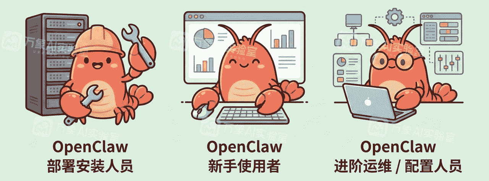

# OpenClaw 命令手册（全网首发&持续更新 ing...

> 来源：[https://yunyinghui.feishu.cn/docx/M4AMdghQWoKV8qxS9vOcmX🐧nBe](https://yunyinghui.feishu.cn/docx/M4AMdghQWoKV8qxS9vOcmX🐧nBe)

> **适用人群：** OpenClaw 部署安装人员

> **首发时间：**2026 年 3 月 18 日

> **更新时间：**2026 年 3 月 18 日

> **内容出品人：**

> **内容出品方：**[万象 AI 实验室](https://yunyinghui.feishu.cn/wiki/WhelwZnxQi55mpkOzatc3Xran5b?from=from_copylink)

> **使用建议：**建议电脑端打开学习，如果需要快速定位到精确内容，可以使用快捷键 Ctrl +F/Command +F 的形式，搜索关键字/词，查找你想要的内容。

> **手册定位：**本手册覆盖 OpenClaw 从安装初始化、日常操作、高级配置到故障排查、运维管理的全流程命令详解，兼顾新手入门与高手进阶，所有命令均配套语法规则、参数说明、实战示例、使用场景与避坑指南，是 OpenClaw 全生命周期使用的权威参考。

## 🤹🏼适用人群

+ OpenClaw 部署安装人员

+ OpenClaw 新手使用者

+ OpenClaw 进阶运维 / 配置人员



## 〽️学习目标

+ 掌握 OpenClaw 安装初始化全流程命令

+ 熟练使用 OpenClaw 日常操作命令

+ 学会 OpenClaw 高级配置方法

+ 能运用命令完成 OpenClaw 全生命周期操作


---

## 🧑‍💻作者介绍

**大国**

+ 万象 AI 实验室发起人

+ AI 编程开发者

+ AI 商业化及流量操盘手


**铁柱 AGI**

+ 万象 AI 实验室技术支持

+ AI 自媒体博主（铁柱 AGI）

+ 10 年全栈开发者

+ n8n 社区节点开发者


**夏夏**

+ 万象 AI 实验室技术支持

+ 前阿里 10 年技术专家

+ toB 数字化转型经验

+ AI+ 应用资深讲师


---

## 📱交流合作

持续关注并更新 OpenClaw 的相关资讯动态，研究报告，商业落地，常见问题，永久免费在线查看。已建立社群聊聊 OpenClaw 发展、应用、对接及合作，邀请嘉宾讲课，没进群的可以扫码加入，群满可加大国🛰️ ID：zhangyuguo94s（备注：OpenClaw），已经在社群内的无需重复加入，开源知识库及社群学习全部为公开免费分享。

> **特别说明：**不要申请编辑和复制文档，容易错乱编辑，有需求请进群加🛰️沟通。


**🛰️学习交流群**


**🛰️学习交流群**

🛰️ ID：zhangyuguo94s，备注：OpenClaw

**扫码交流、进群、合作**


**飞书学习交流群**

---

## 前言

OpenClaw 是一款开源、可本地化部署的 AI 智能体运行框架，核心价值在于通过标准化的命令体系，打通大语言模型与本地设备权限、多平台通信通道、自动化工具链、自定义技能生态，实现了从云端 AI 对话到本地可落地、可扩展、可管控的智能体能力闭环。


命令行是 OpenClaw 的核心管理入口，无论是新手快速上手的交互式操作，还是企业级的自动化集群运维，都依赖于对 OpenClaw 命令体系的全面掌握。本手册基于官方最新稳定版本，结合国内用户实战痛点与社区最佳实践，对 OpenClaw 全量命令进行体系化梳理，实现「零基础可入门、有经验可进阶、企业级可落地」的目标。

---

# 第 1 章： OpenClaw 的组成部分

## 1.1 OpenClaw 到底是什么

在使用命令之前，需先理解 OpenClaw 的核心组件逻辑，所有命令均围绕核心组件设计，理解概念后才能精准使用对应命令，避免无效操作与配置错误。


## 1.2 核心能力与定位

OpenClaw 的核心是「模型调度中枢+本地执行代理+多端通信桥梁」，相较于普通云端 AI 对话工具，其核心优势在于：

+ 本地权限可控：可安全调用本地设备的文件系统、命令行、软件程序，实现本地自动化操作；

+ 全平台打通：通过通道体系，一次部署即可在飞书、Telegram、企业🛰️、🛰️👸号等数十个平台同步使用；

+ 无限可扩展：通过 Skill 技能、Plugin 插件体系，可自定义 AI 的能力边界，适配从个人内容创作到企业自动化运维的全场景；

+ 数据隐私可控：本地化部署模式下，所有对话、配置、业务数据均存储在本地，避免云端数据泄露风险。

OpenClaw最重要的几个组成部分是：

+ `Gateway`：OpenClaw 的核心 WebSocket 服务，大多数命令最终都是在和它打交道。

+ Control UI / Dashboard：浏览器里的控制台界面，最快速的首聊入口。

+ `Agent Workspace`：智能体工作区，保存工作文件、记忆文件、身份文件等。

+ `Channels`：消息渠道，例如 WhatsApp、Telegram、Discord、Slack、Signal、iMessage、Google Chat、MS Teams 等。

+ Nodes / Device Pairing：把另一台机器或设备接入 OpenClaw，暴露 `system.run`、浏览器代理、摄像头等能力。

+ Plugins / Skills / Hooks：分别负责插件化能力、技能目录、事件驱动自动化。

+ `Memory`：以 Markdown 文件为事实来源的记忆系统，可选语义检索。

+ `ACP Bridge`：把 IDE 或 ACP 客户端桥接到 OpenClaw Gateway。

理解这个结构后，后文的命令就可以按“入口、配置、消息、智能体、运行时、运维安全”六大块来看。

## 1.3 命令行长什么样

OpenClaw 顶层调用范式是：

```
openclaw [全局选项] <一级命令> [子命令] [选项]
```

最常见的全局选项包括：

+ `--dev`：把状态目录隔离到 `~/.openclaw-dev`，并移动默认端口，适合开发测试。

+ `--profile <name>`：隔离到 `~/.openclaw-<name>`，适合多套配置并存。

+ `--no-color`：关闭 ANSI 彩色输出。

+ `--update`：等价于 `openclaw update`。

+ `-V`、`--version`、`-v`：输出版本后退出。

输出风格上还有几件事要牢记：

+ 很多命令支持 `--json`，脚本化优先用它。

+ 某些命令支持 `--plain`，适合纯文本流水线。

+ 在 TTY 下会显示颜色、进度、链接；非 TTY 或 `--json` 场景则会尽量去样式化。

## 1.4 你应该怎样理解命令分层

OpenClaw 的一级命令大致分成 8 组：

1. **初始化与配置**：`setup`、`onboard`、`configure`、`config`

2. **核心服务与 UI**：`gateway`、`dashboard`、`daemon`、`tui`

3. **状态与运维**：`status`、`health`、`logs`、`sessions`、`backup`、`update`、`doctor`

4. **渠道与消息**：`channels`、`message`、`directory`、`pairing`、`qr`

5. **智能体与模型**：`agent`、`agents`、`models`、`memory`

6. **扩展系统**：`plugins`、`skills`、`hooks`、`webhooks`、`secrets`

7. **执行与外设**：`sandbox`、`approvals`、`node`、`nodes`、`devices`、`browser`、`cron`

8. **高级桥接与兼容入口**：`acp`、`dns`、`docs`、`system`、`security`、`clawbot`、`voicecall`

> 注意两点：

+ 官方 CLI 总览页里的命令树是总览，不是每个命令族的完整子命令清单，写脚本时应以该命令自己的专页为准。

+ 某些命令是条件命令或兼容别名，例如 `voicecall` 只有在 `voice-call` 插件安装并启用后才会出现，`daemon` 和 `clawbot` 则偏向兼容旧脚本。

---

# 第 2 章：安装、首启与最短可用路径

## 2.1 官方前置要求

按照官方 Getting Started 页面，当前建议：

+ Node 24：推荐版本

+ Node 22 LTS：官方说明里写的是当前仍支持 22.16+

稳妥起见，至少使用 Node 22.16+，更推荐直接使用 Node 24。

如果你只是要快速跑起来，优先按照官方安装脚本来，不要一上来自己拼目录结构。

## 2.2 官方推荐安装方式

macOS / Linux:

```
curl -fsSL https://openclaw.ai/install.sh | bash
```

Windows PowerShell:

```
iwr -useb https://openclaw.ai/install.ps1 | iex
```

安装完成后，官方推荐紧接着执行：

```
openclaw onboard --install-daemon
```

这个动作不是“可有可无的欢迎向导”，而是最稳妥的初始化入口。它会引导你完成：

+ 网关运行方式

+ 认证方式

+ 工作区与状态目录

+ 可选渠道

+ 可选技能与后续入口

## 2.3 你也可以用哪些初始化命令

OpenClaw 在初始化阶段有三个最容易混淆的命令：

### `openclaw setup`

适合想先把基础文件建出来的人：

```
openclaw setup
openclaw setup --workspace ~/.openclaw/workspace
openclaw setup --wizard
```

它的职责比较窄，主要是初始化 `~/.openclaw/openclaw.json` 和工作区。

### `openclaw onboard`

这是官方一等入口，适合大多数人：

```
openclaw onboard
openclaw onboard --flow quickstart
openclaw onboard --flow manual
openclaw onboard --mode remote --remote-url wss://gateway-host:18789
```

它支持本地模式、远程模式、快速流和手动流，也支持非交互自动化配置。

### `openclaw configure`

这是“已经装好了，但还要继续调整”的入口：

```
openclaw configure
openclaw configure --section model --section channels
```

如果你只是要微调模型、渠道、设备、默认设置，通常用它，而不是重新跑完整 onboarding。

## 2.4 最短可用路径

如果你要把 OpenClaw 最快拉到“可聊天”的状态，官方推荐顺序就是：

```
openclaw onboard --install-daemon
openclaw gateway status
openclaw dashboard
```

`openclaw dashboard` 会打开 Control UI；如果浏览器没自动打开，也可以直接访问本机网关地址，默认通常是：

```
http://127.0.0.1:18789/
```

## 2.5 首次排错时最该记住的 5 个命令

```
openclaw gateway status
openclaw status
openclaw health
openclaw logs --follow
openclaw doctor
```

这 5 个命令组合起来，足够覆盖“服务有没有起来”“网关是否通”“渠道是否健康”“日志里到底报了什么”“有没有官方建议修复”。

## 2.6 快速关闭服务的 3 种方式

```
# 1. 常规关闭
openclaw gateway stop
# 2. 卡死强制关
openclaw gateway kill
# 3. 全部关停
openclaw stop --all
# 验证
openclaw status
```

开机自启动服务关闭

1. 停止服务

`sudo systemctl stop openclaw`

2. （可选）禁用开机自启

`sudo systemctl disable openclaw`

## 2.7 重要环境变量

官方 Getting Started 明确提到了三个高频环境变量：

+ `OPENCLAW_HOME`：设定 OpenClaw 的 home 目录

+ `OPENCLAW_STATE_DIR`：覆盖状态目录

+ `OPENCLAW_CONFIG_PATH`：覆盖配置文件路径

如果你是多实例、多环境、容器化或服务账号部署用户，这三个变量非常关键。

---

# 第 3 章：配置系统、配置文件与配置修改命令

## 3.1 配置文件在哪里，是什么格式

官方配置页给出的标准答案是：

+ 配置文件路径：`~/.openclaw/openclaw.json`

+ 格式：**JSON5**

JSON5 的意义是：

+ 可以写注释

+ 允许尾逗号

+ 比严格 JSON 更适合人工编辑

官方最小配置示例如下：

```
{
  agents: { defaults: { workspace: "~/.openclaw/workspace" } },
  channels: { whatsapp: { allowFrom: ["+15555550123"] } },
}
```

## 3.2 配置校验是严格的

这一点必须单独强调。官方配置页明确写明：

+ OpenClaw 只接受完全匹配 schema 的配置

+ 未知键、错误类型、非法值都会导致 Gateway 拒绝启动

+ 根级例外基本只有 `$schema`

因此你不能把它当成“宽松 YAML”来试错。最稳妥的动作是：

```
openclaw config validate
```

以及：

```
# 检查配置问题
openclaw doctor
```

如果确实要自动修正常见问题，可以用：

```
openclaw doctor --fix
```

## 3.3 交互式配置与非交互配置的分工

### 交互式

```
openclaw onboard
openclaw configure
openclaw config
```

注意：`openclaw config` 在不带子命令时，会打开和 `openclaw configure` 类似的交互式配置体验。

### 非交互式

```
openclaw config get agents.defaults.workspace
openclaw config set agents.defaults.heartbeat.every "2h"
openclaw config unset tools.web.search.apiKey
openclaw config file
openclaw config validate --json
```

## 3.4 `openclaw config` 的真正用法

官方文档确认 `config` 的子命令至少包括：

+ `get`

+ `set`

+ `unset`

+ `file`

+ `validate`

常用示例：

```
openclaw config file
openclaw config get browser.executablePath
openclaw config set browser.executablePath "/usr/bin/google-chrome"
openclaw config set agents.defaults.heartbeat.every "2h"
openclaw config set agents.list[0].tools.exec.node "node-id-or-name"
openclaw config unset tools.web.search.apiKey
openclaw config validate
```

路径写法支持：

+ 点号：`agents.defaults.workspace`

+ 下标：`agents.list[0].id`

值的处理规则也要记住：

+ 能按 JSON5 解析的，按 JSON5 解析

+ 不能解析的，按字符串处理

+ 要求严格 JSON5 解析时，加 `--strict-json`

例如：


```
openclaw config set gateway.port 19001 --strict-json
openclaw config set channels.whatsapp.groups '["*"]' --strict-json
```

## 3.5 你应该最先掌握的配置块

### 1. 模型配置

官方配置页的示例：

```
{
  agents: {
    defaults: {
      model: {
        primary: "anthropic/claude-sonnet-4-5",
        fallbacks: ["openai/gpt-5.2"],
      },
      models: {
        "anthropic/claude-sonnet-4-5": { alias: "Sonnet" },
        "openai/gpt-5.2": { alias: "GPT" },
      },
    },
  },
}
```

这里有三个关键认知：

+   `provider/model` 是标准模型引用格式

+   `agents.defaults.models` 不只是展示清单，它同时也是 `/model` 可选项的 allowlist

+   `fallbacks` 是默认模型降级链，不是所有 provider 都自动替你推断

### 2. 渠道访问策略

官方给出的通用 DM 策略块：

```
{
  channels: {
    telegram: {
      enabled: true,
      botToken: "123:abc",
      dmPolicy: "pairing",
      allowFrom: ["tg:123"],
    },
  },
}
```

四种 DM 策略要背熟：

+   `pairing`：默认值。未知发送者先拿配对码，等你批准

+   `allowlist`：只有 `allowFrom` 或已配对名单里的发件人可进入

+   `open`：所有私聊放开，但要配合 `allowFrom: ["*"]`

+   `disabled`：完全不收私聊

### 3. 会话配置

官方会话配置示例：

```
{
  session: {
    dmScope: "per-channel-peer",
    threadBindings: {
      enabled: true,
      idleHours: 24,
      maxAgeHours: 0,
    },
    reset: {
      mode: "daily",
      atHour: 4,
      idleMinutes: 120,
    },
  },
}
```

这块很重要，因为它直接决定“一个人、一条私聊、一个群聊、一个线程”到底是共享上下文还是隔离上下文。多人使用时，官方安全审计会明显偏向推荐：

`session.dmScope = "per-channel-peer"`

### 4. 沙箱配置

官方配置页的最小沙箱块：

```
{
  agents: {
    defaults: {
      sandbox: {
        mode: "non-main",
        scope: "agent",
      },
    },
  },
}
```

更完整的官方示例在沙箱章节里：

```
{
  agents: {
    defaults: {
      sandbox: {
        mode: "all",
        backend: "docker",
        scope: "agent",
        docker: {
          image: "openclaw-sandbox:bookworm-slim",
          containerPrefix: "openclaw-sbx-",
        },
        prune: {
          idleHours: 24,
          maxAgeDays: 7,
        },
      },
    },
  },
}
```

`mode` 的含义是：

+   `off`：完全关闭

+   `non-main`：只沙箱非主会话

+   `all`：所有会话都走沙箱

### 5. 群聊提及门控

官方配置页给出的示例：

```
{
  agents: {
    list: [
      {
        id: "main",
        groupChat: {
          mentionPatterns: ["@openclaw", "openclaw"],
        },
      },
    ],
  },
  channels: {
    whatsapp: {
      groups: { "*": { requireMention: true } },
    },
  },
}
```

如果你发现群里消息“都能触发”或者“怎么都触发不了”，优先检查这块，而不是先怀疑模型。

## 3.6 `SecretRef` 与 `openclaw secrets`

在现在的 OpenClaw 里，把密钥直接明文写进配置文件并不是最优实践。官方已经给出完整的 `SecretRef` 管理面：

```
openclaw secrets audit --check
openclaw secrets configure
openclaw secrets apply --from /tmp/openclaw-secrets-plan.json --dry-run
openclaw secrets apply --from /tmp/openclaw-secrets-plan.json
openclaw secrets reload
```

这套命令分别负责：

+   `audit`：审计明文残留、未解析引用、优先级漂移

+   `configure`：交互式生成 SecretRef 计划

+   `apply`：执行计划并清理旧明文

+   `reload`：让 `Gateway` 重新解析 `SecretRef` 并原子切换运行快照

---

# 第 4 章：服务、状态、界面与日常运维命令

## `openclaw gateway`：核心中的核心

`gateway` 是最重要的服务命令族。它既能前台运行，也能查询、探测、安装服务。

最基本的启动：

```
openclaw gateway
openclaw gateway run
```

查询健康与状态：

```
openclaw gateway health --url ws://127.0.0.1:18789
openclaw gateway status
openclaw gateway status --json
openclaw gateway status --require-rpc
openclaw gateway probe
openclaw gateway probe --json
```

安装与生命周期：

```
openclaw gateway install
openclaw gateway start
openclaw gateway stop
openclaw gateway restart
openclaw gateway uninstall
```

远程或低级调用：

```
openclaw gateway discover
openclaw gateway call status
openclaw gateway call logs.tail --params '{"sinceMs": 60000}'
```

有三条行为规则尤其关键：

+   默认情况下，如果配置里没有 `gateway.mode=local`，`Gateway` 会拒绝启动；临时开发时可以用 `--allow-unconfigured`

+   一旦你显式传了 `--url`，CLI 不会再从配置或环境里帮你回落认证，`--token` 或 `--password` 需要自己给

+   明文密码尽量别走命令行参数，官方更推荐环境变量、密码文件或 `SecretRef`

## `openclaw daemon`：旧命令，但还在

`daemon` 是 `gateway` 服务管理面的兼容别名：

```
openclaw daemon status
openclaw daemon install
openclaw daemon start
openclaw daemon stop
openclaw daemon restart
openclaw daemon uninstall
```

官方态度很明确：优先用 `openclaw gateway`，`daemon` 主要是为了照顾旧脚本。

## `openclaw dashboard` 与 `openclaw tui`

### Dashboard

```
openclaw dashboard
openclaw dashboard --no-open
```

它会基于当前认证状态打开 Control UI，是最快的可视化入口。

### TUI

```
openclaw tui
openclaw tui --url ws://127.0.0.1:18789 --token <token>
openclaw tui --session main --deliver
```

如果你喜欢在终端里用 OpenClaw，或者在远程环境里不方便开浏览器，`tui` 比 `dashboard` 更合适。

## `openclaw status`、`openclaw health`、`openclaw logs`：三件套

### `openclaw status`

```
openclaw status
openclaw status --all
openclaw status --deep
openclaw status --usage
```

用途：

+   总览渠道健康

+   看最近会话接收端

+   多智能体场景下看每个 `agent` 的会话存储

+   深度模式下跑 live probes

### `openclaw health`

```
openclaw health
openclaw health --json
openclaw health --verbose
```

用途：

+   直读 `Gateway` 健康端点

+   需要快速判断“服务起来没”时非常顺手

### `openclaw logs`

```
openclaw logs
openclaw logs --follow
openclaw logs --json
openclaw logs --limit 500
openclaw logs --local-time
```

用途：

+   不 `SSH` 也能尾随 `Gateway` 文件日志

+   远程模式下非常有用

## `openclaw sessions` 与 `openclaw system`

### 会话管理

```
openclaw sessions
openclaw sessions --agent work
openclaw sessions --all-agents
openclaw sessions --active 120
openclaw sessions --json
```

维护清理：

```
openclaw sessions cleanup --dry-run
openclaw sessions cleanup --enforce
openclaw sessions cleanup --all-agents --dry-run
```

如果你的会话历史越来越大、上下文难控、磁盘占用上升，应该先看 `sessions cleanup`，而不是盲目删状态目录。

### 系统事件与心跳

```
openclaw system event --text "Check for urgent follow-ups" --mode now
openclaw system heartbeat enable
openclaw system heartbeat disable
openclaw system heartbeat last
openclaw system presence
```

这个命令族适合做轻量运维驱动，不必每次都上 `cron`。

## `openclaw completion`、`openclaw docs`、`openclaw backup`

### Shell 补全

```
openclaw completion
openclaw completion --shell zsh
openclaw completion --install
openclaw completion --shell fish --install
openclaw completion --write-state
```

### 文档搜索

```
openclaw docs browser existing-session
openclaw docs sandbox allowHostControl
```

这不是离线 `man page`，而是官方文档索引搜索入口。

### 备份

```
openclaw backup create
openclaw backup create --output ~/Backups
openclaw backup create --verify
openclaw backup create --no-include-workspace
openclaw backup create --only-config
openclaw backup verify ./2026-03-09T00-00-00.000Z-openclaw-backup.tar.gz
```

在做 `reset` 或 `uninstall` 之前，强烈建议先跑一次 `backup create`。

## `openclaw reset` 与 `openclaw uninstall`

### 仅清状态，不删 CLI

```
openclaw reset
openclaw reset --dry-run
openclaw reset --scope config+creds+sessions --yes --non-interactive
```

### 卸载服务与本地数据

```
# 交互式卸载（保留 CLI）
openclaw uninstall
openclaw uninstall --all --yes
openclaw uninstall --dry-run
# 一键卸载（含 CLI、服务、数据）
openclaw uninstall --all --yes -non-interactive
npx -y openclaw uninstall --all --yes --non-interactive
```

两者差别很简单：

+   `reset`：保留 `CLI`，只清本地状态/配置

+   `uninstall`：服务和本地数据一起处理，但 `CLI` 仍然保留

### 卸载全局命令行

```
# npm
npm uninstall -g openclaw 
# pnpm
pnpm remove -g openclaw 
# bun 
bun remove -g openclaw
```

### 验证卸载

```
# macOS/Linux
which openclaw 
# Windows 
where openclaw
```

+   无输出即卸载成功

---

# 第 5 章：渠道、发消息、查目录、做配对

## `openclaw channels`：渠道总控

官方命令专页已经确认，`channels` 并不只是“列渠道状态”，它是一个真正的渠道管理面。常见命令有：

```
openclaw channels list
openclaw channels status
openclaw channels capabilities
openclaw channels capabilities --channel discord --target channel:123
openclaw channels resolve --channel slack "#general" "@jane"
openclaw channels logs --channel all
```

添加与移除账户：

```
openclaw channels add --channel telegram --token <bot-token>
openclaw channels add --channel nostr --private-key "$NOSTR_PRIVATE_KEY"
openclaw channels remove --channel telegram --delete
```

交互登录与登出：

```
openclaw channels login --channel whatsapp
openclaw channels logout --channel whatsapp
```

这里有三个特别实用的点：

+   `channels add --help` 会展示不同渠道的专属参数，这是配置新渠道时最直接的入口

+   `channels capabilities` 会探测 provider 级能力与权限范围，不用先盲猜“这个渠道能不能投票/发反应/读目录”

+   `channels resolve` 能把人类可读名字解析成真正要喂给 `message --target` 的 ID

## `openclaw message`：统一出站命令


# 第 5 章：OpenClaw 消息与目录命令

## 5.2 openclaw message：统一消息入口

OpenClaw 把发消息和很多渠道动作都统一收口到 `message` 下，这是最值得掌握的设计之一。

### 用法骨架

```
openclaw message <subcommand> [flags]
```

### 常用公共参数

+   `--channel <name>`
+   `--account <id>`
+   `--target <dest>`
+   `--targets <name>`，可重复，用于广播
+   `--json`
+   `--dry-run`
+   `--verbose`

### 目标格式必须看清

官方文档给出的典型格式包括：

+   WhatsApp：`E.164` 或群组 `JID`
+   Telegram：`chat id` 或 `@username`
+   Discord：`channel:<id>`、`user:<id>`、`<@id>`
+   Slack：`channel:<id>`、`user:<id>`
+   Signal：`+E.164`、`group:<id>`、`username:<name>`
+   iMessage：`handle`、`chat_id:<id>`、`chat_guid:<guid>`
+   MS Teams：会话 `id` 或 `conversation:<id>`

不知道具体 ID 时，先用 `openclaw directory` 或 `openclaw channels resolve`。

### message send

```
openclaw message send --channel discord --target channel:123 --message "hi"
openclaw message send --target +15555550123 --message "Hello from OpenClaw"
```

它支持：

+   文本消息
+   媒体
+   回复某条消息
+   某些渠道的线程参数
+   某些渠道的按钮或 GIF 播放控制

### message poll

```
openclaw message poll --channel discord \
  --target channel:123 \
  --poll-question "Snack?" \
  --poll-option Pizza --poll-option Sushi \
  --poll-multi --poll-duration-hours 48
```

官方文档确认投票动作覆盖：

+   WhatsApp
+   Telegram
+   Discord
+   Matrix
+   MS Teams

### message react / reactions

```
openclaw message react --channel slack \
  --target C123 --message-id 456 --emoji "✅"
```

### message read / edit / delete

```
openclaw message read --channel discord --target channel:123 --limit 20
openclaw message edit --channel slack --target C123 --message-id 456 --message "new text"
openclaw message delete --channel telegram --target @mychat --message-id 123
```

### 线程、贴纸、角色、事件、管理动作

message 命令还覆盖了大量 Discord 管理面动作，例如：

+   `thread create`
+   `thread list`
+   `thread reply`
+   `emoji list`
+   `emoji upload`
+   `sticker send`
+   `sticker upload`
+   `role info`
+   `role add`
+   `role remove`
+   `channel info`
+   `channel list`
+   `member info`
+   `voice status`
+   `event list`
+   `event create`
+   `timeout`
+   `kick`
+   `ban`
+   `broadcast`

这意味着 OpenClaw 在 Discord 一类平台上不是“只能聊天”，而是能做一部分治理动作。

## 5.3 openclaw directory：把名字变成 ID

常用命令：

```
openclaw directory self --channel zalouser
openclaw directory peers list --channel slack --query "U0"
openclaw directory groups list --channel zalouser
openclaw directory groups members --channel zalouser --group-id <id>
```

它的价值很直接：

+   帮你找用户 ID
+   帮你找群组/房间 ID
+   帮你查“我自己”的账号 ID

然后把结果交给 `message send --target ...`。

## 5.4 openclaw pairing：批准陌生私聊发件人

如果某渠道启用了 `dmPolicy: "pairing"`，就会出现配对流程。

查看配对申请：

```
openclaw pairing list telegram
openclaw pairing list --channel telegram --account work
openclaw pairing list telegram --json
```

批准配对：

```
openclaw pairing approve telegram <code>
openclaw pairing approve --channel telegram --account work <code> --notify
```

如果只有一个支持 pairing 的渠道，官方还允许直接：

```
openclaw pairing approve <code>
```

## 5.5 openclaw qr：iOS 配对 QR / setup code

生成配对二维码或 setup code：

```
openclaw qr
openclaw qr --setup-code-only
openclaw qr --json
openclaw qr --remote
openclaw qr --url wss://gateway.example/ws
```

这个命令还有几个关键细节：

+   `--token` 和 `--password` 互斥
+   setup code 现在承载的是短时 `bootstrapToken`，不是共享网关令牌本身
+   扫码后，仍要执行 `devices list` 和 `devices approve <requestId>` 来完成设备侧批准

## 5.6 三个常见渠道配置块

为了减少“查命令会，配置不会”的情况，这里放三个官方配置参考中的高频块。

### Telegram

```
{
  channels: {
    telegram: {
      enabled: true,
      botToken: "your-bot-token",
      dmPolicy: "pairing",
      allowFrom: ["tg:123456789"],
      historyLimit: 50,
      replyToMode: "first",
      linkPreview: true,
      streaming: "partial",
      mediaMaxMb: 100,
      proxy: "socks5://localhost:9050",
      webhookUrl: "https://example.com/telegram-webhook",
      webhookSecret: "secret",
      webhookPath: "/telegram-webhook",
    },
  },
}
```

### Discord

```
{
  channels: {
    discord: {
      enabled: true,
      token: "your-bot-token",
      mediaMaxMb: 8,
      allowBots: false,
      replyToMode: "off",
      dmPolicy: "pairing",
      allowFrom: ["1234567890", "123456789012345678"],
    },
  },
}
```

### WhatsApp

```
{
  channels: {
    whatsapp: {
      dmPolicy: "pairing",
      allowFrom: ["+15555550123", "+447700900123"],
      textChunkLimit: 4000,
      chunkMode: "length",
      mediaMaxMb: 50,
      sendReadReceipts: true,
      groups: {
        "*": { requireMention: true },
      },
      groupPolicy: "allowlist",
      groupAllowFrom: ["+15551234567"],
    },
  },
  web: {
    enabled: true,
    heartbeatSeconds: 60,
  },
}
```

国内常用渠道：

### Feishu

```
{
  "channels": {
    "feishu": {
      "enabled": true,
      "domain": "feishu",       // 国内必须写 feishu，国际写 lark
      "connectionMode": "websocket", // 长连接，无需公网
      "dmPolicy": "pairing",     // 私聊：配对模式（需先@/触发）
      "groupPolicy": "allowlist",// 群聊：仅白名单可用
      "requireMention": true,    // 群聊必须 @机器人
      "streaming": true,         // 流式输出（飞书卡片）
      "mediaMaxMb": 30,          // 文件最大 30MB
      "accounts": {
        "main": {
          "appId": "cli_你的飞书AppID",
          "appSecret": "你的飞书AppSecret",
          "botName": "AI助手",
          "verificationToken": "你的验证令牌",
          "encryptKey": "你的加密密钥"
        }
      },
      // 可选：指定群聊免@
      "groups": {
        "oc_群聊ID1": { "requireMention": false },
        "oc_群聊ID2": { "requireMention": false }
      }
    }
  }
}
```

### Dingtalk

```
{
  "channels": {
    "dingtalk": {
      "enabled": true,
      "domain": "dingtalk",  // 国内钉钉固定值
      "connectionMode": "websocket", // 推荐使用长连接，无需公网IP
      "dmPolicy": "pairing", // 私聊模式：配对（需先发起对话或被邀请）
      "groupPolicy": "allowlist", // 群聊模式：白名单
      "requireAt": true,     // 群聊中必须@机器人才能触发
      "streaming": true,     // 启用流式响应（钉钉卡片形式）
      "accounts": {
        "main": {
          "appKey": "<你的钉钉AppKey>",
          "appSecret": "<你的钉钉AppSecret>",
          "token": "<你的事件订阅令牌Token>",
          "encryptKey": "<你的事件订阅加密密钥EncodingAESKey>"
        }
      },
      // 可选：配置特定群聊无需@
      "groups": {
        "oc_你的群ID1": { "requireAt": false },
        "oc_你的群ID2": { "requireAt": false }
      }
    }
  }
}
```

---

# 第 6 章：智能体、模型、记忆、技能、插件与扩展命令

## 6.1 openclaw agent：打一回合

`agent` 是“发起一次智能体回合”的单命令入口。

```
openclaw agent --to +15555550123 --message "status update" --deliver
openclaw agent --agent ops --message "Summarize logs"
openclaw agent --session-id 1234 --message "Summarize inbox" --thinking medium
openclaw agent --agent ops --message "Generate report" --deliver --reply-channel slack --reply-to "#reports"
```

适合：

+   脚本化触发一轮智能体执行
+   指定 agent
+   指定会话
+   让回复反投递回渠道

## 6.2 openclaw agents：多智能体管理面

官方已经明确，`agents` 不只是增删条目，它还负责工作区、身份、路由绑定。

常见命令：

```
openclaw agents list
openclaw agents add work --workspace ~/.openclaw/workspace-work
openclaw agents bindings
openclaw agents bind --agent work --bind telegram:ops
openclaw agents unbind --agent work --bind telegram:ops
openclaw agents set-identity --workspace ~/.openclaw/workspace --from-identity
openclaw agents delete work
```

你可以把它理解成三项能力：

+   生命周期：`list`、`add`、`delete`
+   路由绑定：`bindings`、`bind`、`unbind`
+   身份管理：`set-identity`

### 身份文件与工作区

官方文档确认，每个 `agent` workspace 根目录都可以有：


```
IDENTITY.md
```

`set-identity --from-identity` 会从里面提取身份数据，写入：

```
agents.list[].identity
```

## 6.3 openclaw models：模型发现、切换、回退、认证

这组命令是高频命令，至少要掌握下面这些：

```
openclaw models status
openclaw models list
openclaw models set <model-or-alias>
openclaw models scan
openclaw models aliases list
openclaw models fallbacks list
openclaw models auth add
openclaw models auth login --provider <id>
openclaw models auth setup-token
openclaw models auth paste-token
```

### models status

它会显示：

+   当前解析后的默认模型
+   fallback 链
+   认证状态概览

还能用：

```
openclaw models status --probe
openclaw models status --probe-provider <name>
openclaw models status --agent <id>
```

但要注意，`--probe` 是真实请求，会消耗 token，也可能碰到速率限制。

### models set

支持：

+   直接传 `provider/model`
+   传 alias

文档特别强调了一点：

+   模型引用按第一个斜杠切分 provider
+   如果模型 ID 自己也带 /，要完整写 provider 前缀，例如 `openrouter/moonshotai/kimi-k2`

## 6.4 openclaw memory：记忆命令与记忆体系

### 记忆并不是数据库优先，而是 Markdown 优先

官方 Memory 文档说得非常清楚：OpenClaw 的记忆事实源是工作区里的 Markdown 文件。

默认两层：

+   `memory/YYYY-MM-DD.md`：日记式、追加式日志
+   `MEMORY.md`：整理过的长期记忆

记忆搜索工具来自活动中的 `memory` plugin，CLI 侧管理命令是：

```
openclaw memory status
openclaw memory status --deep
openclaw memory index --force
openclaw memory search "meeting notes"
openclaw memory search --query "deployment" --max-results 20
openclaw memory status --agent main
```

`memory` 这组命令适合做三类事情：

+   看记忆系统是否健康
+   手动触发索引
+   直接查回忆结果

### 自动记忆冲刷

官方还提供了接近 compaction 前的自动记忆冲刷配置：

```
{
  agents: {
    defaults: {
      compaction: {
        reserveTokensFloor: 20000,
        memoryFlush: {
          enabled: true,
          softThresholdTokens: 4000,
          systemPrompt: "Session nearing compaction. Store durable memories now.",
          prompt: "Write any lasting notes to memory/YYYY-MM-DD.md; reply with NO_REPLY if nothing to store.",
        },
      },
    },
  },
}
```

这段配置很值得高级用户关注，因为它决定了上下文快被压缩时，模型有没有机会主动把长期信息写回磁盘。

## 6.5 openclaw skills：查技能，不是装插件

技能命令族比较轻：

```
openclaw skills list
openclaw skills list --eligible
openclaw skills info <name>
openclaw skills check
```

它的职责是：

+   看有哪些技能
+   看哪些技能当前满足依赖、可运行
+   看某个技能的详情

如果你要的是安装扩展代码，去看 `plugins`；如果你要的是查看技能目录与可用性，去看 `skills`。

## 6.6 openclaw hooks：事件驱动自动化

官方已经确认 hooks 包含：

+   `list`
+   `info`
+   `check`
+   `enable`
+   `disable`
+   `install`
+   `update`

常见用法：

```
openclaw hooks list
openclaw hooks info session-memory
openclaw hooks check
openclaw hooks enable session-memory
openclaw hooks disable command-logger
openclaw hooks install ./my-hook-pack
openclaw hooks update --all
```

适用场景：

+   `/new`、`/reset`、`Gateway` 启动时触发某些动作
+   把自动化逻辑安装为 hook pack

## 6.7 openclaw plugins：插件安装与治理

这组命令比很多人以为的强大得多：

```
openclaw plugins list
openclaw plugins info <id>
openclaw plugins install <path-or-spec>
openclaw plugins install <npm-spec> --pin
openclaw plugins enable <id>
openclaw plugins disable <id>
openclaw plugins uninstall <id>
openclaw plugins doctor
openclaw plugins update <id>
openclaw plugins update --all
openclaw plugins marketplace list <marketplace>
```

最重要的几条规则：

+   `npm` 安装只接受 registry 规格，不接受 Git URL、文件 URL、宽泛 semver 范围
+   依赖安装会走 `--ignore-scripts`
+   官方明确建议优先使用 固定版本 或 `--pin`
+   本地目录可以用 `--link` 链接，避免复制

如果你把 `plugins` 当成“只是 on/off 开关”，会低估它在生产环境里的作用。

## 6.8 openclaw secrets：生产配置的关键命令族

前面配置章节已经提到它，这里从运维角度再强调一遍。

完整命令面至少包括：

+   `reload`
+   `audit`
+   `configure`
+   `apply`

推荐操作环：

```
openclaw secrets audit --check
openclaw secrets configure
openclaw secrets apply --from /tmp/openclaw-secrets-plan.json --dry-run
openclaw secrets apply --from /tmp/openclaw-secrets-plan.json
openclaw secrets audit --check
openclaw secrets reload
```

如果你准备把 OpenClaw 放到多人协作、云主机或长期运行环境中，这组命令的重要性不会低于 `onboard`。

## 6.9 voicecall：条件命令

```
openclaw voicecall status --call-id <id>
openclaw voicecall call --to "+15555550123" --message "Hello" --mode notify
openclaw voicecall continue --call-id <id> --message "Any questions?"
openclaw voicecall speak --call-id <id> --message "One moment"
openclaw voicecall end --call-id <id>
openclaw voicecall expose --mode serve
```

> 注意：

+   这是 `插件提供的命令`
+   只有 `voice-call` 插件安装并启用后才会出现
+   因为是条件命令，所以不要在未安装环境的脚本里默认调用它

---

# 第 7 章：沙箱、审批、节点、浏览器、计划任务与桥接

## 7.1 openclaw sandbox：看清执行边界

官方 CLI 已确认：

+   `sandbox explain`
+   `sandbox list`
+   `sandbox recreate`

常用命令：

```
openclaw sandbox explain
openclaw sandbox explain --session agent:main:main
openclaw sandbox explain --agent work
openclaw sandbox list
openclaw sandbox list --browser
openclaw sandbox recreate --all
openclaw sandbox recreate --agent mybot
openclaw sandbox recreate --browser
```

这组命令的核心价值，不是“手动管理容器”本身，而是回答三个问题：

+   这次执行到底有没有进沙箱
+   用的是哪个 backend
+   改完配置后，老 runtime 还在不在

### 三种 backend

官方沙箱文档确认：

+   `docker`
+   `ssh`
+   `openshell`

如果你切换了后端、远程工作区、镜像、`setup command`，记得执行：

```
openclaw sandbox recreate --all
```

## 7.2 openclaw approvals：exec 审批面

查看：

```
openclaw approvals get
openclaw approvals get --node <id|name|ip>
openclaw approvals get --gateway
```

覆盖写入：

```
openclaw approvals set --file ./exec-approvals.json
openclaw approvals set --node <id|name|ip> --file ./exec-approvals.json
openclaw approvals set --gateway --file ./exec-approvals.json
```

`allowlist` 辅助：

```
openclaw approvals allowlist add "~/Projects/**/bin/rg"
openclaw approvals allowlist add --agent main --node <id|name|ip> "/usr/bin/uptime"
openclaw approvals allowlist remove "~/Projects/**/bin/rg"
```

这是你控制“智能体能在谁身上执行什么命令”的最重要手柄之一。

## 7.3 openclaw node、nodes、devices：多机执行与设备配对

这三组命令不要混：

+   `node`：把当前机器作为 headless node host 跑起来
+   `nodes`：从 Gateway 侧看已配对节点，并调用其能力
+   `devices`：设备配对审批与 token 轮换/吊销

### openclaw node

前台运行：

```
openclaw node run --host <gateway-host> --port 18789
```

安装成后台服务：

```
openclaw node install --host <gateway-host> --port 18789
openclaw node status
openclaw node stop
openclaw node restart
openclaw node uninstall
```

首次连接后，要到 Gateway 侧批准：

```
openclaw devices list
openclaw devices approve <requestId>
```

### openclaw nodes

查看与审批：

```
openclaw nodes list
openclaw nodes list --connected
openclaw nodes pending
openclaw nodes approve <requestId>
openclaw nodes status
```

调用节点能力：

```
openclaw nodes invoke --node <id|name|ip> --command <command> --params <json>
openclaw nodes run --node <id|name|ip> <command...>
openclaw nodes run --raw "git status"
openclaw nodes run --agent main --node <id|name|ip> --raw "git status"
```

从官方文档可以看出，`nodes run` 会尽量复用 `tools.exec.*` 默认策略与审批机制，而不是绕开它们。

### openclaw devices

```
openclaw devices list
openclaw devices approve
openclaw devices approve <requestId>
openclaw devices reject <requestId>
openclaw devices remove <deviceId>
openclaw devices clear --yes
openclaw devices rotate --device <deviceId> --role operator --scope operator.read --scope operator.write
openclaw devices revoke --device <deviceId> --role node
```

当你遇到 `AUTH_TOKEN_MISMATCH` 一类问题时，官方建议流程是：

1.  `openclaw config get gateway.auth.token`
1.  `openclaw devices list`
1.  `openclaw devices rotate --device <deviceId> --role operator`
1.  必要时 `remove` + 重新 `approve`

## 7.4 openclaw browser：浏览器控制命令族

这是 OpenClaw 最复杂的命令面之一。官方浏览器命令页主要介绍常用入口，但源码里还验证了更多高级子命令。

### 常用入口

```
openclaw browser profiles
openclaw browser --browser-profile openclaw start
openclaw browser --browser-profile openclaw open https://example.com
openclaw browser --browser-profile openclaw snapshot
openclaw browser tabs
openclaw browser screenshot
openclaw browser navigate https://example.com
openclaw browser click <ref>
openclaw browser type <ref> "hello"
```

### Profile 管理


```
openclaw browser profiles
openclaw browser create-profile --name work --color "#FF5A36"
openclaw browser create-profile --name chrome-live --driver existing-session
openclaw browser delete-profile --name work
```

其中：

+ `openclaw profile`：OpenClaw 自己管理的隔离 Chrome
+ `user profile`：连接你现有已登录的 Chrome 会话
+ `existing-session`：附着现有 Chromium 系浏览器会话

## 不常用但很实用的高级子命令

浏览器命令除了常见入口外，还有一批更细的控制项：

+ `openclaw browser tab`
+ `openclaw browser tab new`
+ `openclaw browser tab select`
+ `openclaw browser tab close`
+ `openclaw browser set viewport`
+ `openclaw browser set offline`
+ `openclaw browser set headers`
+ `openclaw browser set credentials`
+ `openclaw browser set geo`
+ `openclaw browser set media`
+ `openclaw browser set timezone`
+ `openclaw browser set locale`
+ `openclaw browser set device`
+ `openclaw browser highlight`
+ `openclaw browser errors`
+ `openclaw browser requests`
+ `openclaw browser trace start`
+ `openclaw browser trace stop`

同时，官方 CLI 总览页还列出了这些动作入口：

+ `resize`
+ `press`
+ `hover`
+ `drag`
+ `select`
+ `upload`
+ `fill`
+ `dialog`
+ `wait`
+ `evaluate`
+ `console`
+ `pdf`

写自动化脚本时，建议遵循一个简单原则：

+ 常规操作先看浏览器命令专页示例
+ 高级动作先跑 `openclaw browser --help`
+ 再决定是否把它写入长期脚本

## 7.5 openclaw cron：网关调度器

官方专页自己就提示“完整命令面请跑 `openclaw cron --help`”，但通过 CLI 总览和 cron 文档，可以确认至少有：

+ `status`
+ `list`
+ `add`
+ `edit`
+ `rm`
+ `enable`
+ `disable`
+ `runs`
+ `run`

文档给出的典型示例：

```
openclaw cron edit <job-id> --announce --channel telegram --to "123456789"
openclaw cron edit <job-id> --no-deliver
openclaw cron edit <job-id> --light-context
openclaw cron add \
  --name "Lightweight morning brief" \
  --cron "0 7 * * *" \
  --session isolated \
  --message "Summarize overnight updates." \
  --light-context \
  --no-deliver
```

还要注意几件与旧版本不同的事情：

+ `one-shot --at` 任务成功后默认删除，除非加 `--keep-after-run`
+ recurring job 出错后会指数退避重试
+ `cron run` 现在是“入队即返回”，不是同步跑完

## 7.6 openclaw acp：给 IDE 或 ACP 客户端接 OpenClaw

最简用法：

```
openclaw acp
openclaw acp --url wss://gateway-host:18789 --token <token>
openclaw acp --session agent:main:main
openclaw acp --session-label "support inbox"
openclaw acp --session agent:main:main --reset-session
```

调试客户端：

```
openclaw acp client
openclaw acp client --server-args --url wss://gateway-host:18789 --token-file ~/.openclaw/gateway.token
```

acp 的定位必须讲清楚：

+ 它是 Gateway-backed ACP bridge
+ 不是完整 ACP 原生运行时
+ 它擅长 session routing、prompt delivery、基础 streaming
+ 它**不支持** per-session MCP servers，也不负责 ACP 客户端文件系统或终端方法

如果你要把 Zed、Claude Code、Codex 一类 ACP 客户端接到 OpenClaw，这条命令非常关键。

## 7.7 openclaw dns 与 openclaw webhooks

### DNS

```
openclaw dns setup
openclaw dns setup --apply
```

这是 Wide-Area Discovery 方向的辅助命令，不是日常聊天必需品。

### Webhooks

目前官方 CLI 文档明确写出的主要子命令是 Gmail Pub/Sub：

```
openclaw webhooks gmail setup --account you@example.com
openclaw webhooks gmail run
```

---

# 第 8 章：安全、更新、诊断与长期运行建议

## 8.1 openclaw doctor：先看它，再改配置

常用方式：

```
openclaw doctor
openclaw doctor --repair
openclaw doctor --deep
```

这组命令现在覆盖的内容比很多人想象的多，包括：

+ 网关与渠道健康检查
+ 配置修复建议
+ 旧 cron job 结构归一化
+ orphan transcript 检测
+ memory-search readiness
+ 沙箱模式开启但 Docker 不可用时的高信号提醒
+ 某些 `SecretRef` 不可用时的只读警告

如果是第一次升级、第一次改大配置、第一次接渠道，优先跑 `doctor`。

## 8.2 openclaw security audit：最值得定期跑的命令

```
openclaw security audit
openclaw security audit --deep
openclaw security audit --fix
openclaw security audit --json
```

它会检查很多“不是立刻报错，但迟早出事”的配置脚枪，例如：

+ 多个 DM 发送者共享主会话
+ 小模型直连危险工具且未沙箱
+ webhook 会话键覆盖太宽松
+ 沙箱网络模式过于危险
+ 插件/hook 安装未 pin
+ allowlist 用的是易变名称而不是稳定 ID
+ `gateway.auth.mode="none"` 导致接口裸奔

其中最值得普通用户立刻记住的一条建议是：

```
共享收件箱或多用户入口下，优先使用 session.dmScope="per-channel-peer"
```

## 8.3 更新：openclaw update

```
openclaw update
openclaw update status
openclaw update wizard
openclaw update --channel beta
openclaw update --channel dev
openclaw update --dry-run
openclaw update --no-restart
openclaw --update
```

官方更新策略现在分两路：

+ `npm`/`pnpm` 安装：走包管理器更新流
+ 源码 checkout：`openclaw update` 会做更复杂的 `git`/`channel`/`build`/`doctor` 流程

你需要特别知道：

+ `stable`、`beta`、`dev` 是一等通道概念
+ `dev` 通道在非 git checkout 场景下，可能提示你创建 checkout
+ downgrade 需要确认，因为旧版本可能不兼容现有配置

## 生产环境的 10 条建议

1. 不要把第一次接触 OpenClaw 的入口设成手工改 `openclaw.json`，先跑 `onboard`。
2. 写自动化脚本时优先使用 `--json` 输出。
3. 远程调用一旦使用 `--url`，就显式带上 `--token` 或 `--password`。
4. 不要把明文密钥长期留在配置里，尽快迁移到 `openclaw secrets`。
5. 多人或共享收件箱环境下，把 `session.dmScope` 改为 `per-channel-peer` 或更细。
6. 能用沙箱就用沙箱，尤其是开了 `exec`、`browser`、`web` 这类高能力工具时。
7. 改完沙箱后端、镜像、远程工作区、`setup` command 后，记得 `sandbox recreate`。
8. 大改前先 `backup create`，别把 `reset` 和 `uninstall` 当作可逆操作。
9. 插件和 hook 安装尽量 pin 版本，不要长期裸跑 `latest`。
10. 遇到奇怪问题，先跑 `doctor` 和 `security audit`，再手改配置。

## 8.4 最实用的故障排查顺序

我建议按这个顺序排：

1. `openclaw gateway status`
2. `openclaw status --deep`
3. `openclaw health --verbose`
4. `openclaw logs --follow`
5. `openclaw doctor`
6. `openclaw security audit`
7. `openclaw config validate`
8. `openclaw secrets audit --check`

这个顺序可以尽量避免“**一开始就删配置**”这种高代价误操作。

---

# 附录

这一章的目的不是重复正文，而是给你一份查表式索引。说明如下：

+ 常用：正文已有较完整说明
+ 条件：只有插件安装或特定运行条件满足时出现
+ 兼容：旧命令别名或兼容入口

## 附录一：顶层命令索引

| 一级命令 | 状态 | 说明 |
| --- | --- | --- |
| `setup` | 常用 | 初始化配置与工作区 |
| `onboard` | 常用 | 官方推荐的首轮交互安装配置入口 |
| `configure` | 常用 | 交互式修改配置 |
| `config` | 常用 | 非交互读写配置 |
| `completion` | 常用 | 生成与安装 shell 补全 |
| `doctor` | 常用 | 健康检查与引导修复 |
| `dashboard` | 常用 | 打开 Control UI |
| `backup` | 常用 | 生成本地备份归档 |
| `security` | 常用 | 安全审计与安全修复 |
| `secrets` | 常用 | `SecretRef` 审计、规划、应用与重载 |
| `reset` | 常用 | 重置本地状态但保留 CLI |
| `uninstall` | 常用 | 卸载服务与本地数据 |
| `update` | 常用 | 更新 OpenClaw |
| `channels` | 常用 | 管理渠道账户与渠道状态 |
| `directory` | 常用 | 渠道目录查询 |
| `skills` | 常用 | 查看技能与可用性 |
| `plugins` | 常用 | 管理插件与兼容 bundle |
| `memory` | 常用 | 记忆状态、索引、搜索 |
| `message` | 常用 | 统一出站消息与渠道动作 |
| `agent` | 常用 | 触发一轮 agent 执行 |
| `agents` | 常用 | 管理多智能体与绑定 |
| `acp` | 高级 | 启动 ACP bridge |
| `status` | 常用 | 综合状态诊断 |
| `health` | 常用 | 网关健康检查 |
| `sessions` | 常用 | 列出与清理会话 |
| `gateway` | 常用 | 网关服务、探测与 RPC |
| `daemon` | 兼容 | `gateway` 服务管理兼容别名 |
| `logs` | 常用 | RPC 方式尾随网关日志 |
| `system` | 常用 | 心跳、presence、系统事件 |
| `models` | 常用 | 模型、别名、回退、认证 |
| `sandbox` | 常用 | 沙箱状态与重建 |
| `cron` | 高级 | 网关调度器 |
| `nodes` | 高级 | 查看并调用已配对节点 |
| `devices` | 高级 | 设备配对与 token 轮换 |
| `node` | 高级 | 运行 headless node host |
| `approvals` | 高级 | `exec` 审批与 allowlist |
| `browser` | 高级 | 浏览器控制与浏览器 profile |
| `hooks` | 高级 | agent hooks |
| `webhooks` | 高级 | webhook 与 Gmail Pub/Sub 辅助 |
| `pairing` | 常用 | 批准 DM pairing |
| `qr` | 常用 | 生成 iOS pairing QR / setup code |
| `docs` | 常用 | 搜索官方文档索引 |
| `dns` | 高级 | Wide-Area Discovery DNS 辅助 |
| `tui` | 常用 | 终端 UI |
| `clawbot` | 兼容 | 旧命名空间兼容入口 |
| `voicecall` | 条件 | `voice-call` 插件命令族 |

## 附录二：核心子命令速查

`config`

+ `get`
+ `set`
+ `unset`
+ `file`
+ `validate`

`backup`

+ `create`
+ `verify`

`security`

+ `audit`

`secrets`

+ `reload`
+ `audit`
+ `configure`
+ `apply`

`channels`

+ `list`
+ `status`
+ `capabilities`
+ `resolve`
+ `logs`
+ `add`
+ `remove`
+ `login`
+ `logout`

`directory`

+ `self`
+ `peers list`
+ `groups list`
+ `groups members`

`skills`

+ `list`
+ `info`
+ `check`

`plugins`

+ `list`
+ `info`
+ `install`
+ `enable`
+ `disable`
+ `doctor`
+ `update`
+ `marketplace list`
+ `uninstall`

`memory`

+ `status`
+ `index`
+ `search`

`agents`

+ `list`
+ `add`
+ `delete`
+ `bindings`
+ `bind`
+ `unbind`
+ `set-identity`

`gateway`

+ `run`
+ `health`
+ `status`
+ `probe`
+ `discover`
+ `call`
+ `install`
+ `uninstall`
+ `start`
+ `stop`
+ `restart`

`system`

+ `event`
+ `heartbeat last`
+ `heartbeat enable`
+ `heartbeat disable`
+ `presence`

`models`

+ `status`
+ `list`
+ `set`
+ `set-image`
+ `scan`
+ `aliases list`
+ `aliases add`
+ `aliases remove`
+ `fallbacks list`
+ `fallbacks add`
+ `fallbacks remove`
+ `fallbacks clear`
+ `image-fallbacks list`
+ `image-fallbacks add`
+ `image-fallbacks remove`


# OpenClaw CLI 参考

## CLI 子命令参考

### image-fallbacks

+ `image-fallbacks clear`

### auth

+ `auth add`
+ `auth login`
+ `auth setup-token`
+ `auth paste-token`
+ `auth order get`
+ `auth order set`
+ `auth order clear`

### sandbox

+ `explain`
+ `list`
+ `recreate`

### cron

+ `status`
+ `list`
+ `add`
+ `edit`
+ `rm`
+ `enable`
+ `disable`
+ `runs`
+ `run`

### nodes

+ `list`
+ `pending`
+ `approve`
+ `status`
+ `invoke`
+ `run`

### devices

+ `list`
+ `remove`
+ `clear`
+ `approve`
+ `reject`
+ `rotate`
+ `revoke`

### node

+ `run`
+ `status`
+ `install`
+ `uninstall`
+ `start`
+ `stop`
+ `restart`

### approvals

+ `get`
+ `set`
+ `allowlist add`
+ `allowlist remove`

### browser

常见与高级子命令包括：

+ `status`
+ `start`
+ `stop`
+ `reset-profile`
+ `tabs`
+ `tab`
+ `tab new`
+ `tab select`
+ `tab close`
+ `open`
+ `focus`
+ `close`
+ `profiles`
+ `create-profile`
+ `delete-profile`
+ `screenshot`
+ `snapshot`
+ `navigate`
+ `resize`
+ `click`
+ `type`
+ `press`
+ `hover`
+ `drag`
+ `select`
+ `upload`
+ `fill`
+ `dialog`
+ `wait`
+ `evaluate`
+ `console`
+ `pdf`
+ `set viewport`
+ `set offline`
+ `set headers`
+ `set credentials`
+ `set geo`
+ `set media`
+ `set timezone`
+ `set locale`
+ `set device`
+ `highlight`
+ `errors`
+ `requests`
+ `trace start`
+ `trace stop`

### hooks

+ `list`
+ `info`
+ `check`
+ `enable`
+ `disable`
+ `install`
+ `update`

### webhooks

+ `gmail setup`
+ `gmail run`

### pairing

+ `list`
+ `approve`

### clawbot

+ `qr`

### voicecall

+ `start`
+ `status`
+ `call`
+ `continue`
+ `speak`
+ `end`
+ `tail`
+ `latency`
+ `expose`

`voicecall` 由插件提供，只有在插件安装并启用后才会出现。

## 附录三：终端 CLI 核心命令速查

| 功能分类 | 核心命令 | 说明 |

| --- | --- | --- |

| 基础操作 | `openclaw --version` | 查看版本号 |

|  | `openclaw --help` | 查看帮助信息 |

|  | `openclaw tui` | 打开终端对话界面 |

|  | `openclaw dashboard` | 打开网页控制台 |

| 服务管理 | `openclaw start` | 启动服务 |

|  | `openclaw stop` | 停止服务 |

|  | `openclaw restart` | 重启服务 |

|  | `openclaw status` | 查看运行状态 |

| 诊断排错 | `openclaw doctor` | 全面健康检查 |

|  | `openclaw doctor --fix` | 健康检查+自动修复 |

|  | `openclaw logs` | 查看日志 |

|  | `openclaw diagnose` | 系统诊断 |

| 配置管理 | `openclaw config list` | 查看全量配置 |

|  | `openclaw config set` | 修改配置项 |

|  | `openclaw configure` | 重新进入配置向导 |

| 模型管理 | `openclaw models list` | 列出已配置的模型 |

|  | `openclaw models set` | 切换默认模型 |

|  | `openclaw models auth paste-token` | Token 方式认证模型 |

| 通道管理 | `openclaw channels list` | 列出已配置的通道 |

|  | `openclaw channels status` | 查看通道状态 |

|  | `openclaw channels add` | 添加新通道 |

| 插件管理 | `openclaw plugins list` | 列出已安装的插件 |

|  | `openclaw plugins enable` | 启用插件 |

|  | `openclaw plugins install` | 安装插件 |

| 技能管理 | `openclaw skills list` | 列出已安装的技能 |

|  | `clawhub search` | 搜索社区技能 |

|  | `clawhub install` | 安装社区技能 |

|  | `clawhub sync --all` | 更新所有技能 |

| 定时任务 | `openclaw cron add` | 添加定时任务 |

|  | `openclaw cron list` | 列出定时任务 |

|  | `openclaw cron run` | 手动执行定时任务 |

| 备份恢复 | `openclaw backup create` | 创建全量备份 |

|  | `openclaw backup restore` | 恢复备份 |

## 附录四：聊天斜杠命令速查

| 功能分类 | 核心命令 | 说明 |

| --- | --- | --- |

| 会话管理 | `/new` | 开启新会话 |

|  | `/compact` | 压缩当前上下文 |

|  | `/status` | 查看会话状态 |

|  | `/help` | 查看所有命令 |

| 模型切换 | `/model` | 查看当前模型 |

|  | `/model <模型名>` | 切换当前会话模型 |

| 执行控制 | `/approve` | 批准待确认操作 |

|  | `/deny` | 拒绝待确认操作 |

|  | `/cancel` | 取消当前任务 |

| 技能记忆 | `/skills` | 查看已加载技能 |

|  | `/remember` | 让 AI 记住指定内容 |

|  | `/forget` | 删除指定记忆 |

| 信息查询 | `/cost` | 查看 Token 消耗 |

|  | `/ping` | 测试连接状态 |

---

## 附录五：运维常见问题速查

1.  安装 / 依赖安装失败

+   表现：`npm install` 卡住、报错、依赖缺失；`git`/`Node.js` 版本不兼容（要求 ≥18）。

+   原因：网络不通、镜像源问题、权限不足、路径含中文、`Node` 版本过低。

+   排查：`node -v` 检查版本；换国内 `npm` 镜像；清理缓存；路径改为纯英文。

1.  Gateway 无法启动 / 端口被占用

+   表现：`openclaw gateway start` 失败，提示 `Port 18789 already in use`。

+   原因：默认端口（`18789`）被占用、配置文件语法错误、权限不足。

+   排查：`lsof -i :18789` 杀进程；`openclaw gateway --port` 新端口；验证 `openclaw.json` JSON 语法。

1.  配置文件错误 / 不生效

+   表现：启动失败、日志报 `Unexpected token`、`API Key` / 代理配置不生效。

+   原因：JSON 语法错误（多余逗号、引号不匹配）、配置路径错误、环境变量未加载。

+   排查：`cat ~/.openclaw/openclaw.json | python -m json.tool` 校验；用 `openclaw config get` 确认配置；重启服务。

1.  权限不足（EACCES）

+   表现：写文件失败、`Docker` 操作报错、日志无法生成。

+   原因：用户无目录 / 文件权限、`Docker socket` 权限不足、macOS 未授权磁盘访问。

+   排查：`chmod -R 755 ~/.openclaw`；`sudo chmod 666 /var/run/docker.sock`；macOS 开启 “完全磁盘访问”。

1.  渠道（Telegram/WhatsApp）不响应

+   表现：Bot 收不到消息、回复失败、日志 401/403。

+   原因：Token 无效、网络需代理、IP 被封、渠道配置错误。

+   排查：`openclaw channel test telegram`；配置 `proxy: socks5://...`；检查 Bot 权限；查看 `channels/xxx.log`。

1.  沙箱（Sandbox）执行失败

+   表现：命令 / 脚本运行报错、`Docker` 容器退出、权限拒绝。

+   原因：沙箱镜像缺失、`Docker` 未运行、权限不足、资源限制。

+   排查：`docker pull openclaw/sandbox-node:latest`；`systemctl start docker`；临时关闭沙箱 `sandbox.mode: none` 定位问题。

1.  AI 模型不响应 / 超时 / 慢

+   表现：`LLM request timed out`、无回复、`401` 错误。

+   原因：`API Key` 无效 / 未配置、网络不通、模型不可用、超时过短。

+   排查：`openclaw config get ai.api_key`；测试 `curl https://api.openai.com/v1/models`；调大 `timeoutSeconds`；检查代理。

1.  日志排查困难 / 日志不输出

+   表现：无日志、日志路径找不到、日志刷屏 / 缺失关键信息。

+   原因：日志目录权限、日志级别配置、服务未以正确用户运行。

+   排查：`openclaw logs --follow` 实时查看；`openclaw status --all` 一键诊断；检查 `~/.openclaw/logs` 权限。

1.  技能（Skill）安装 / 使用失败

+   表现：`openclaw skill install` 失败、技能不执行、提示 “未找到”。

+   原因：技能仓库不可达、依赖缺失、权限不足、技能配置错误。

+   排查：检查网络 / 代理；手动下载技能包；`openclaw skill list` 确认已安装；查看技能日志。

1.  开机自启失败 / 进程异常退出

+   表现：重启后服务不自动启动、进程被 kill、`systemd` 报错。

+   原因：自启脚本配置错误、权限不足、依赖服务未启动、资源不足。

+   排查：`systemctl status openclaw` 看日志；检查 `ExecStart` 路径；确保 `Docker`/`Node` 随系统启动。

## 附录六：配置与数据目录速查

OpenClaw 所有核心配置与数据默认统一存放在用户主目录下的 `.openclaw` 隐藏目录

1.  核心根目录（默认）

+   `Linux/macOS`：`~/.openclaw/`

+   `Windows`：`%USERPROFILE%\.openclaw\`

+   可通过环境变量 `OPENCLAW_STATE_DIR` 自定义路径。

1.  配置文件（核心）

1.  数据文件（持久化）

1.  自定义路径（环境变量）

+   主配置文件路径：`OPENCLAW_CONFIG_PATH`（默认 `$OPENCLAW_STATE_DIR/openclaw.json`）

+   工作区路径：可在 `openclaw.json` 中 `agent.workspace` 覆盖，或用 `OPENCLAW_WORKSPACE_DIR`

## 附录七：官方参考链接

+   官方仓库：https://github.com/openclaw/openclaw

+   [Getting Started](https://docs.openclaw.ai/start/getting-started)

+   CLI Reference: https://docs.openclaw.ai/cli

+   [Configuration](https://docs.openclaw.ai/gateway/configuration)

+   [Configuration Reference](https://docs.openclaw.ai/gateway/configuration-reference)

+   [Memory](https://docs.openclaw.ai/concepts/memory)

+   [Sandboxing](https://docs.openclaw.ai/gateway/sandboxing)

## 附录八：OpenClaw 相关手册

+   [OpenClaw 安全手册（全网首发&持续更新 ing...](https://yunyinghui.feishu.cn/wiki/YstDwlP4ciNCKZkFGykcUcXZnnc?from=from_copylink)

+   [OpenClaw 避坑手册（全网首发&持续更新 ing...](https://yunyinghui.feishu.cn/wiki/QLQmwb5dxixuEpkcdpVcKexwnYf?from=from_copylink)

+   [OpenClaw 命令手册（全网首发&持续更新 ing...](https://yunyinghui.feishu.cn/wiki/U2itwmNlriLH3ckHHWhcx84Hnwd?from=from_copylink)

+   [OpenClaw 学习手册（全网首发&持续更新 ing...](https://yunyinghui.feishu.cn/wiki/Ru7PwG82qiDGo1kGMFZcxqpGnnf?from=from_copylink)

---

> 如果你只想记住一句使用建议，那就是：
>
> 把 `openclaw` 当成一个“有网关、有状态、有配置 schema、有权限边界”的系统来用，而不是一串零散 `bot` 命令。这样你在遇到渠道、模型、会话、沙箱、节点、插件问题时，会快很多。
