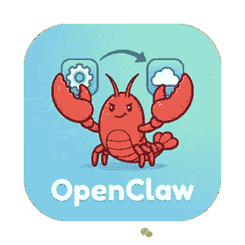
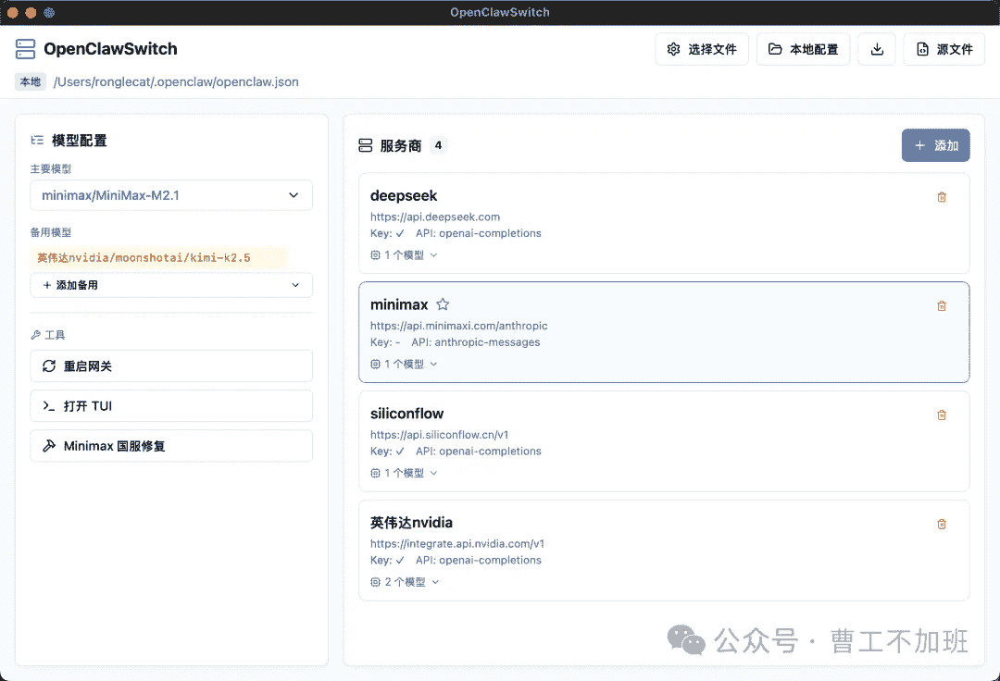
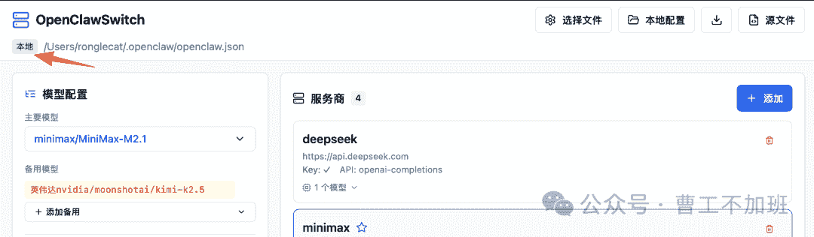
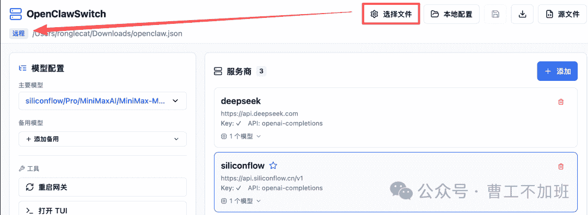
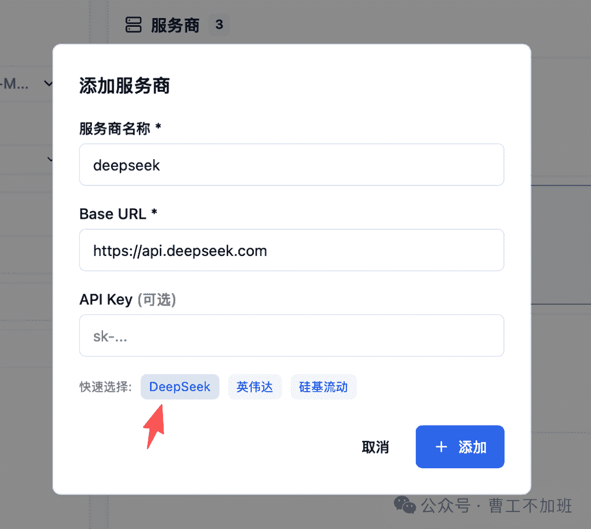
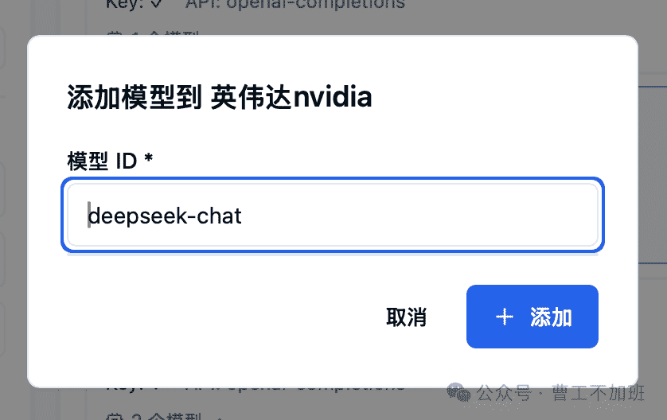
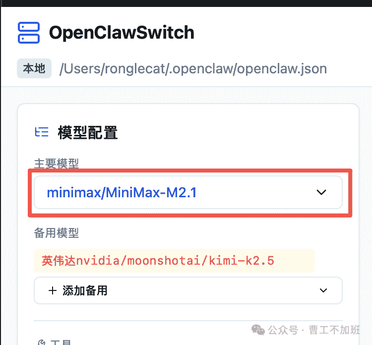
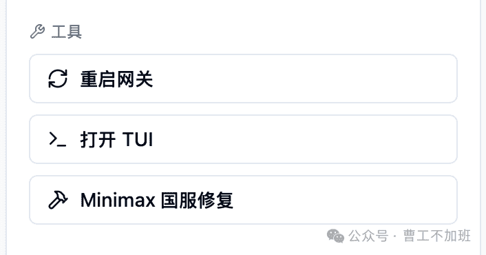

# 全网首发！OpenClaw 自定义模型配置工具来了，小白也能轻松上手

> 来源：[https://yunyinghui.feishu.cn/docx/Vzj1dI0MloYXPnxkG8FcjfHEnEg](https://yunyinghui.feishu.cn/docx/Vzj1dI0MloYXPnxkG8FcjfHEnEg)

---

> **原创公众号：**铁柱AGI

> **发布时间：**2026-02-06 09:46:44

> **收录开源AI知识库：**[万象 AI 实验室](https://yunyinghui.feishu.cn/wiki/WhelwZnxQi55mpkOzatc3Xran5b?from=from_copylink)



# **一、配置地狱**

OpenClaw 很好玩，但接入自定义模型时，配置文件能改到你怀疑人生。

你想接个 DeepSeek，得：

1.  1. 先找到 ~/.openclaw/openclaw.json

1.  2. 手写 JSON 配置 baseUrl 、 apiKey 、 models 列表

1.  3. 保存后重启网关

1.  4. 报错了？检查逗号、括号、引号……

想换个模型试试？重复一遍。

想加个备用模型？继续手撸 JSON。

OpenClaw 的内置服务商（OpenAI、Anthropic）用着很方便，但国内用户常用的 DeepSeek、硅基流动、通义千问这些，都得在 models.providers 里自己配。

虽然 WebUI 也有模型配置，但是那个交互体验我宁愿改 JSON 配置文件。

我懂代码的配起来都麻烦，别说很多想体验 OpenClaw 的小白用户了。

**我实在不想每次都手写 JSON，于是加班**（违背了咱们不加班的宗旨）写了个小工具。



---

# **二、工具简介**

**OpenClawSwi**tch 是一个 配置文件可视化编辑器 ，目前的核心功能：

**把 ****openclaw.json**** 的编辑变成点选操作。**

+   • 添加服务商：填名称、URL、Key，点一下

+   • 添加模型：输入 ID 或从 API 获取，选一下

+   • 切换模型：下拉菜单选择，秒切

+   • 备用模型：点「添加备用」，多选

技术栈：Tauri + Rust + Vue 3，打包后 3-5MB。

开源地址：https://github.com/RongleCat/OpenClawSwitch

后续会围绕 OpenClaw 便捷使用的放心加入更多功能。

---

# **三、怎么用**

## **3.1 启动**

下载安装运行，自动加载 ~/.openclaw/openclaw.json 。

顶部显示当前文件路径和模式（本地/远程）：

+   • **本地模式 **：加载默认配置，修改自动保存



+   • **远程模式 **：加载你选的文件，手动保存，适用于云端部署的朋友，下载修改完以后再上传回服务器覆盖。



## **3.2 添加服务商**

点击「添加」，填三个字段：

**服务商名称 **：服务商名称，比如 deepseek

**Base URL **：API 地址，填服务商提供的请求地址，带不带 /v1 要看服务商文档

**API Key **：请求凭证，在服务商处获取

国内用户福音：DeepSeek、硅基流动、英伟达的基本信息支持一键填充，只需要填上 API Key 即可。



## **3.3 添加模型**

服务商卡片里点「+」，两种方式：

1.  1. **手动输入 **： deepseek-chat 、 Qwen/Qwen2.5-72B-Instruct ，在模型列表加载失败且你确定有这个模型的时候可以直接填写模型 ID。



1.  2. **API 获取 **：配了 Key 就能从服务商拉取模型列表，支持搜索

> 提示：模型 ID 不用加前缀。填 Qwen/Qwen2.5-72B-Instruct ，系统自动组合成 siliconflow/Qwen/Qwen2.5-72B-Instruct 。

## **3.4 切换模型**

左侧「模型配置」区：

+   • **主要模型 **：下拉选择，如 deepseek/deepseek-chat



+   • **备用模型 **：点「添加备用」，主模型挂了自动切 （经过测试能切换模型进行对话，但是消息输出异常，感觉是 OpenClaw 的问题）

主模型切换以后是直接生效的，可以通过给 OpenClaw 发送 /new 命令新建会话以后在新的会话里询问 OpenClaw 现在使用的是什么模型，如果觉得不放心可以使用下面的重启网关功能。

## **3.5 工具区**

左侧底部三个按钮：



+   • **重启网关 **：后台执行网关重启命令。

+   • **打开 TUI **：自动打开终端进入 OpenClaw TUI 模式，可以直接与 OpenClaw 对话交互。

+   • **Minimax 国服修复 **：一键切到国内地址。

## 3.6 ⚠️macOS/苹果电脑用户注意

软件安装完打开以后会提示应用损坏，在终端执行下面的代码，再尝试打开应用：

```
xattr -c /Applications/OpenClawSwitch.app
```

# **四、写在最后**

这个工具已经开源，希望能帮大家降低 OpenClaw 的入门门槛。

技术不复杂，但解决了我自己的痛点，如果对你也有用，那就更好了。

**下载方式：**

关注公众号，发送 **「OpenClaw」 **获取工具下载链接。

也可以直接去 GitHub：https://github.com/RongleCat/OpenClawSwitch

---

有问题欢迎提 Issue，或者自己改代码——反正都是开源的。

# 📱交流合作

持**续关注并更新 Op****enClaw 的相关资讯动态，研究报告，商业落地，常见问题，永久免费在线查看。已建立社群**聊聊 OpenClaw 发展、应用、对接及合作，邀请嘉宾讲课，没进群的可以扫码加入，群满可加大国微信 ID：zhangyuguo94s（备注：OpenClaw），已经在社群内的无需重复加入，开源知识库及社群学习全部为公开免费分享。

> **特别说明：**不要申请编辑和复制文档，有需求请进群加微信沟通。


**微信学习交流群**


**飞书学习交流群**


好友（ID：zhangyuguo94s）

**扫码交流、进群、合作**