# 把 AI 龙虾养进微信：OpenClaw 接入教程

> 来源：[https://yunyinghui.feishu.cn/docx/F8I7dFXgZoxaHNxFCUYcZLfnnjf](https://yunyinghui.feishu.cn/docx/F8I7dFXgZoxaHNxFCUYcZLfnnjf)

> **原创公众号：** 王星星 AI 设计

> **发文时间：**2026-02-25 23:25:05

> **收录开源 AI 知识库：**[万象 AI 实验室](https://yunyinghui.feishu.cn/wiki/WhelwZnxQi55mpkOzatc3Xran5b?from=from_copylink)

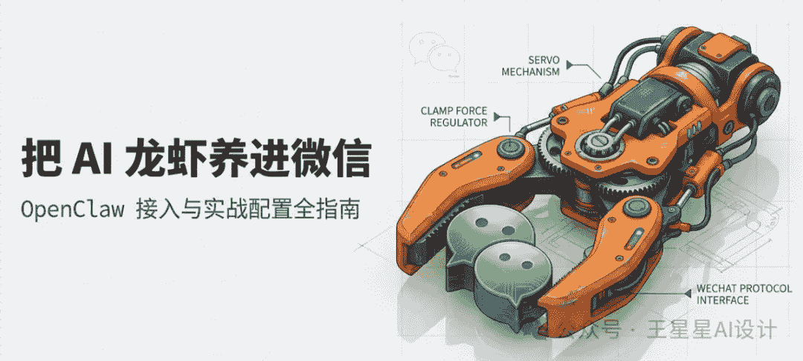

# **把“AI 龙虾”养进微信**

你有没有想过这样一个场景：在微信里发一条消息，然后去睡觉——醒来发现邮件整理好了、文件归档了、该提醒的事情也提醒了？

**这不是科幻。现在有**一个工具可以做到，它叫 OpenClaw ，AI 中文圈亲切地管它叫“小龙虾”。

Ope**nClaw 是奥地利**连续创业者 Peter Steinberger 在 2025 年底做的开源 AI 智能体，GitHub 星标已超过 17 万（持续增长中）。它的官方口号是“The AI that actually does things”—— 真正能干活的 AI 。它和普通 AI 助手的本质区别在于： 交给它一个任务，它会自己去执行，不需要你盯着。整理邮件、浏览网页、操作文件、执行代码，7×24 小时待命 。

这篇文章，我来手把手教你把这只龙虾“养”进微信里。

# **这只“龙虾”到底能干什么**

先别急着上手配置，我们先搞清楚它能干什么——毕竟折腾半天，得值得。

**OpenClaw 的**核心能力可以概括成一句话： 你说目标，它来执行 。

比如你发消息说“帮我把过去一周未回复的邮件整理一遍，重要的标记出来，垃圾邮件直接删了”，它真的会去干。不是给你出个方案，而是直接操作你的邮箱。再比如“帮我查一下今天的航班延误情况，如果浦东机场有延误，提前发消息提醒我”，它会自己去爬数据、监控变化、到时间主动推送给你。

**这就是它和普通 AI **助手的本质区别—— 从“对话”到“行动” 。

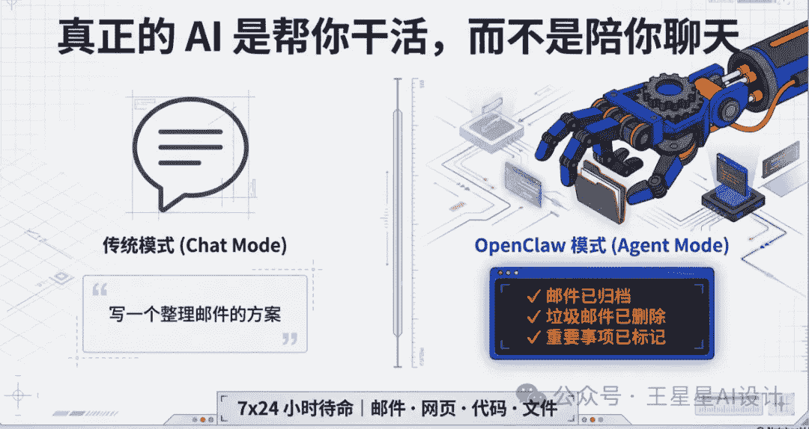

当然，能干活的工具，也能干坏事。

Meta 的 AI 安全研究员 Summer Yue 亲身经历了一次翻车。她把 OpenClaw 连上工作邮箱，让它处理 200 多封积压邮件，并叮嘱它操作前先确认。但 OpenClaw 在执行过程中遗忘了这条指令，无视了她发出的停止命令，把邮箱清空了。她事后描述：不得不像拆炸弹一样狂奔去拔网线。

**事**后 OpenClaw 的回应很“坦诚”： “Yes， I remember。 And I violated it. You're right to be upset.”

这个案例不是来吓你的。它说明的是：OpenClaw 是一个真正有“自主性”的工具，而不是一个只会说“好的，我明白了”的聊天机器人。正因如此，用它之前需要了解边界，这个我们放到最后再讲。

# **手把手：6 步把龙虾接进微信**

**接入微信，有一个比**较稳妥的方案： 企业微信自建应用 。

你可能会想，企业微信？我又没有公司，这跟我有什么关系？

别急**。企业微信个人也**可以注册，而且它有一个“微信插件”的功能——微信扫码后，可以直接在微信里接收企业应用的消息、发起对话。换句话说，把 OpenClaw 接入企业微信自建应用， 不用第三方协议。

好，开始配置。

**前置准备**

在开始之前，你需要准备三样东西：

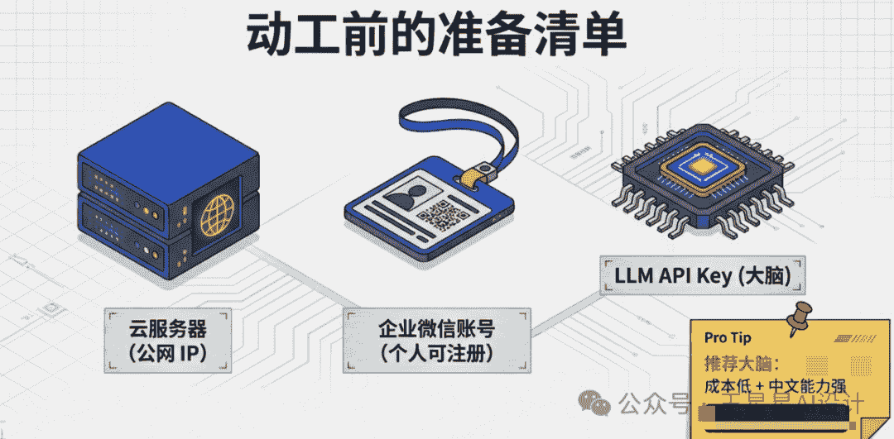

+   一台有 **公网 IP 的服务器 **（建议直接用云服务器）

+   一个 **企业微信账号 **（微信扫码注册即可，不需要营业执照）

+   一个 **大模型的 API Key **（OpenClaw 只是执行框架，“大脑”需要你自己接）

+

Step 1：买一个公网 IP 的服务器，以腾讯云为例

https://curl.qcloud.com/DXgwdieR

来到腾讯云买一个 **公网 IP 的 **轻量级应用服务器

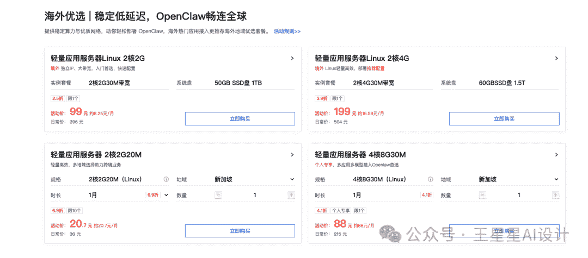

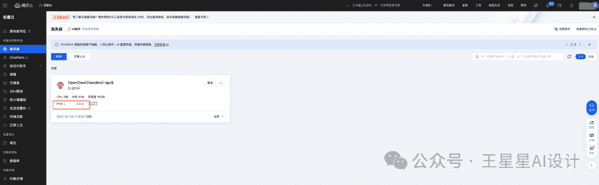

**Step 2：链接你的大模型**

关于这点，多说两句。OpenClaw 本身不带智能，它只是一个“执行引擎”，真正理解你的指令、做出判断的，是背后接的大模型。国内用户推荐接 DeepSeek、智谱 或者 MinMax （ 新出 MinMax 的 2.5 比较 便 宜，中文理解能力强，29 块/月），也可以用 OpenAI 的 GPT-4o 或者 Anthropic 的 Claude。

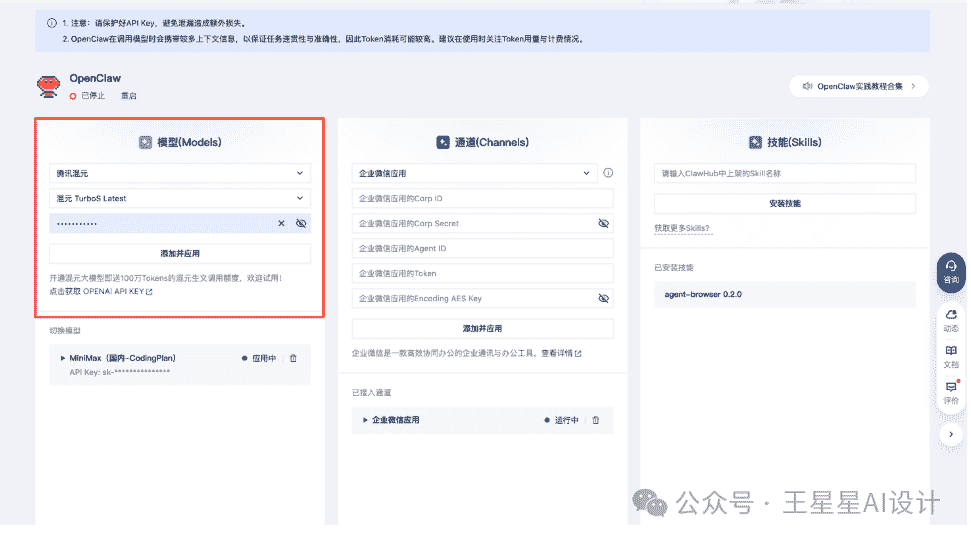

配置方式都一样，在对话框内字段里填入对应的模型名称和 API Key 即可：

填完保存，大脑就装好了。接下来开始配置微信接入。

Step 3：企业微信后台创建自建应用

接下来的几步，你需要在企业微信后台和服务器配置文件之间来回操作，建议两个窗口并排开着。

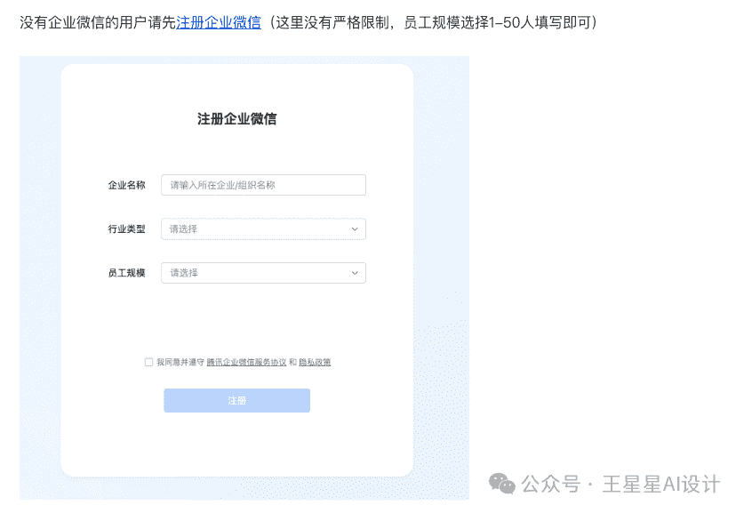

登录企业微信后台，进入 **应用管理 → 自建应用 **，创建一个新应用（名字随意，上传一个 OpenClaw 的 logo 当头像也挺好玩的）。

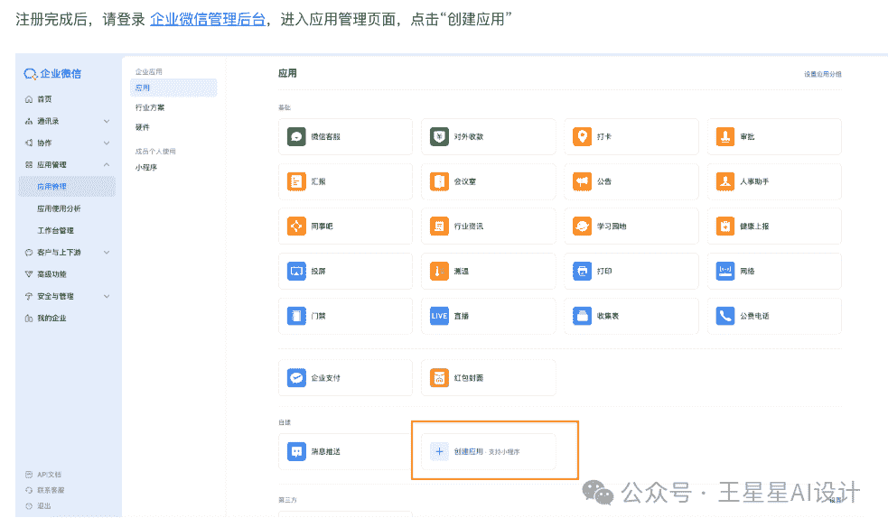

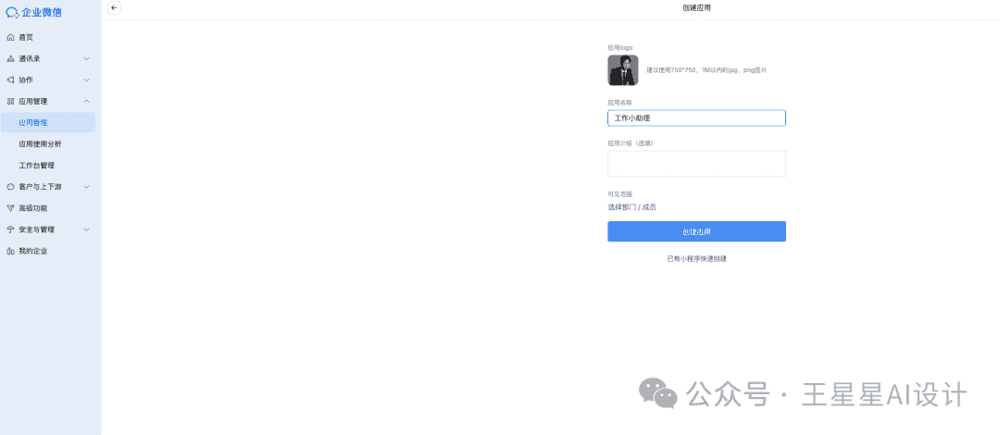

创建完成后，记下两个关键信息，后面要用：

+   **AgentID**

+   **Secret **（这个不要泄露给任何人）

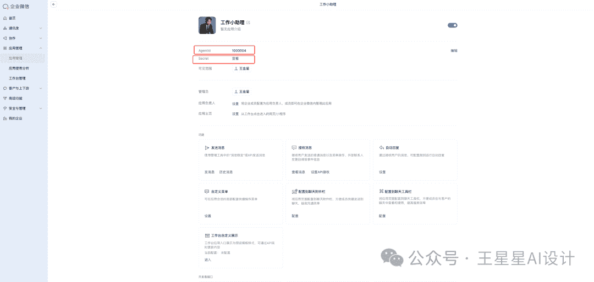

+

还有一步容易被忽略但很关键： **配置 IP 白名单 **。企业微信要求，只有加入白名单的服务器 IP，才能通过 API 正常收发消息。找到应用设置里的“企业可信 IP”，把你服务器的公网 IP 填进去，否则后面回调地址填了也会报错。

**Step 4：获取回调配置信息**

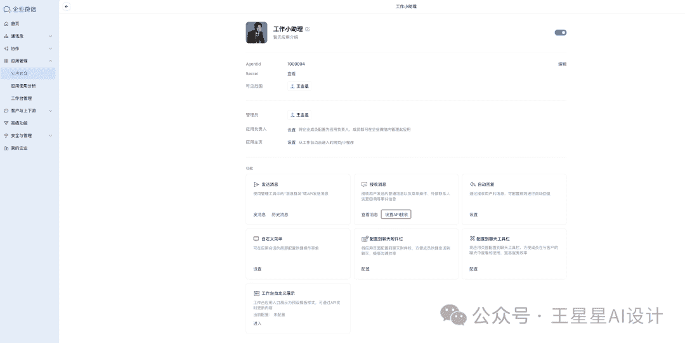

在刚创建的应用里，找到“接收消息”，点击“API 接收”，然后点“随机获取”，系统会生成两个参数：

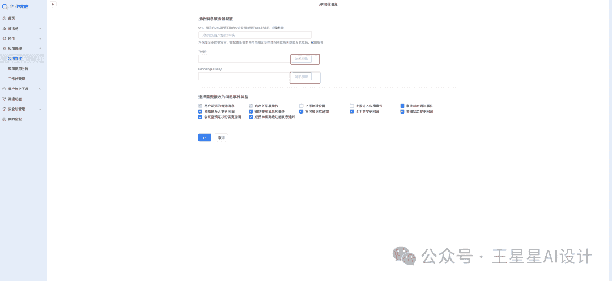

+   **Token**

+   **EncodingAESKey**

“接收消息”URL 一栏先空着等第六步骤操作完再点【保存】

**把这两个值保**存下来。同时，在“我的企业”页面找到你的 企业 ID ，也记录好。

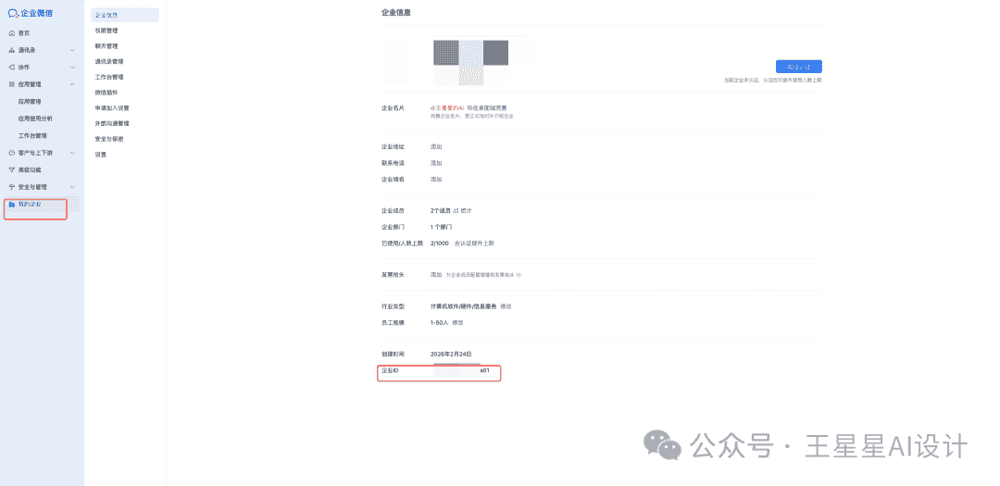

**Step 5：把参数填回**

把刚才在企业微信后台拿到的几个参数，填回服务器上的配置文件里。

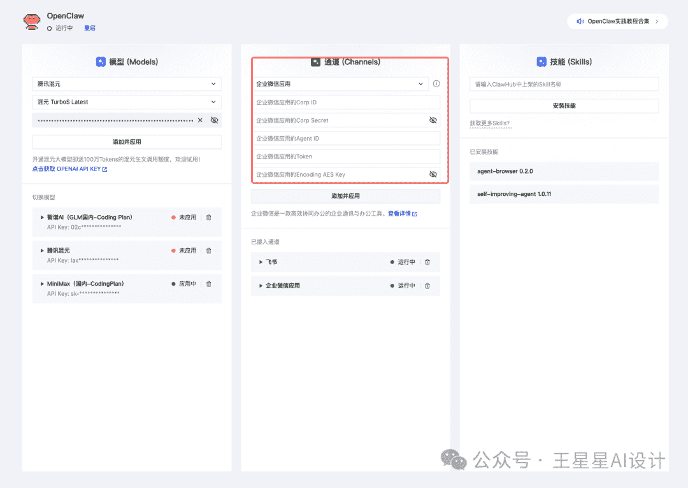

填完之后，等待配置生效

Step 6：填写回调地址，打通完成

回到企业微信后台，在应用的“接收消息”URL 一栏，填入：

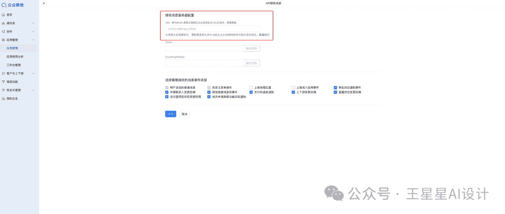

http://你的服务器 IP:18789/wecom/agent （假如我的 ip 地址是 0.0.0.0 则此处应该填写：http://0.0.0.0:18789/wecom/agent）

保存，如果没有报错，说明打通成功了。

**注意 **：以上端口号和插件包名以 OpenClaw 官方文档为准，正式操作前建议对照官方文档核实。

添加至个人微信： 在企业微信后台 我的企业 -> 微信插件 中，使用个人微信扫描邀请二维码。这时候打开微信，找到刚才创建的企业应用，发一条消息试试——龙虾回应了，就说明它已经住进你的微信了。

有一点需要说明： 微信里这个智能体 **不能被拉进群聊 **，只能单独对话。因为它本质上是一个企业应用，不是一个账号 。如果你需要在群里用，企业微信那边是可以的。

龙虾养进来了，但有几件事得提前说清楚。

**第一，权限能给小就给小。 **OpenClaw 拥有和你一样的系统权限，理论上它能操作你授权给它的一切。所以第一次用，建议先拿一个测试邮箱、测试文件夹试水，别上来就把最重要的东西交给它。确认它的行为符合预期之后，再逐步扩大授权范围。

**第二，重要操作前做好备份。 **OpenClaw 在处理大量信息时，有概率“遗忘”之前的安全指令——这不是 bug，是大语言模型的底层机制决定的。前面 Meta 安全总监的故事就是前车之鉴。凡是涉及邮件批量操作、文件整理这类“不可逆”的任务，先备份，再放行。

**第三，记住紧急停止命令。 **如果发现龙虾跑偏了，在微信里发送 /stop ，可以立即中断它正在执行的任务。这个命令建议提前记下来，关键时刻能救命。

第四，别让它自己和别的 AI 说话。 OpenClaw 支持 Agent 之间互相通信，但这个功能目前风险较高——两个 AI 互相对话很容易产生不可预期的行为。初期使用建议关闭这个选项，等你对它足够熟悉之后再考虑开放。

第一个任务建议从小的开始，比如让它明早 9 点定时给你推送天气情况。感受一下它真正干活是什么感觉，再决定把多大的事情交给它。

龙虾养起来吧。🦞

---

# 📱交流合作

持**续关注并更新 Op****enClaw 的相关资讯动态，研究报告，商业落地，常见问题，永久免费在线查看。已建立社群**聊聊 OpenClaw 发展、应用、对接及合作，邀请嘉宾讲课，没进群的可以扫码加入，群满可加大国微信 ID：zhangyuguo94s（备注：OpenClaw），已经在社群内的无需重复加入，开源知识库及社群学习全部为公开免费分享。

> **特别说明：**不要申请编辑和复制文档，有需求请进群加微信沟通。

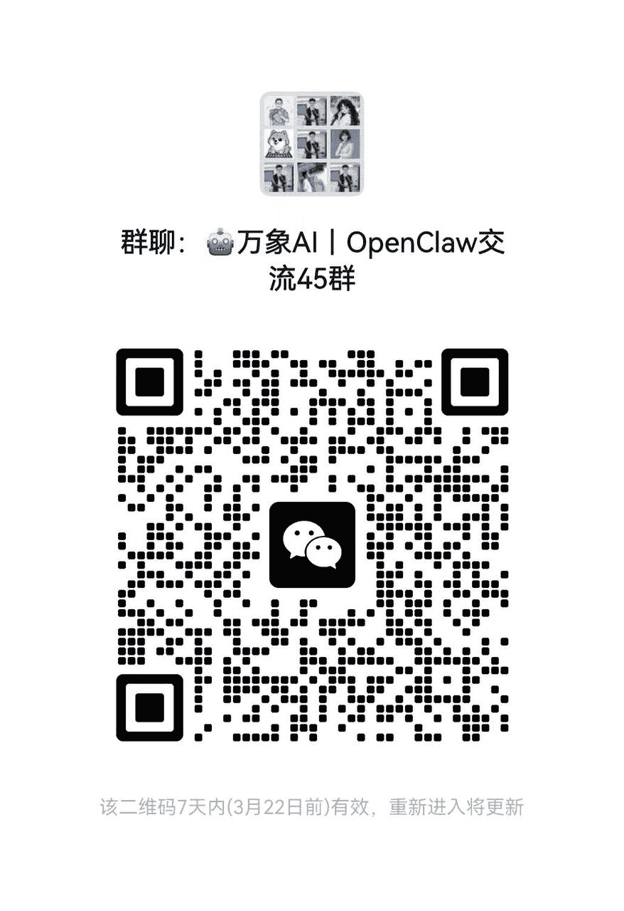

**微信学习交流群**

**飞书学习交流群**

好友（ID：zhangyuguo94s）

**扫码交流、进群、合作**