# 闲置安卓机安装 OpenClaw，控制手机拍照，网页搜索，无需 Root！

> 来源：[https://yunyinghui.feishu.cn/docx/Wxgudbrd9o8IqMxR0SDcD051nCb](https://yunyinghui.feishu.cn/docx/Wxgudbrd9o8IqMxR0SDcD051nCb)

---

> **原创👸号：**铁柱 AGI

> **发文时间：**2026-02-13 09:32:26

> **收录开源AI知识库：**[万象 AI 实验室](https://yunyinghui.feishu.cn/wiki/WhelwZnxQi55mpkOzatc3Xran5b?from=from_copylink)

> 一台手机，双重身份：既是运行 AI 的服务器，又是被 AI 控制的设备。在虚拟 Linux 环境中运行 OpenClaw，通过 Discord 对话让它控制手机本身——现在就能实现。

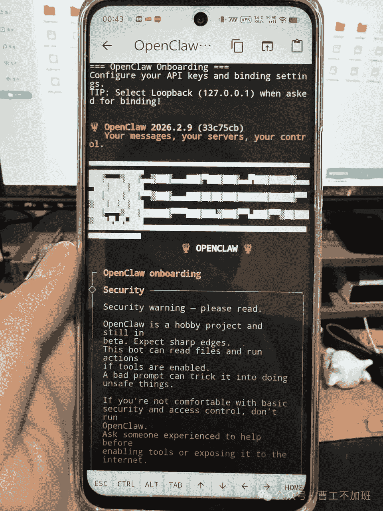

## 一、为什么要把 OpenClaw 装进手机？

OpenClaw 是一个强大的 AI 网关，通常运行在电脑或服务器上。但你那台吃灰的旧安卓手机，其实也能变成一台 24 小时在线的 AI 服务器。

更有意思的是：这台手机不仅运行 AI，还能被 AI 控制。OpenClaw 在虚拟 Ubuntu 环境中运行，通过 adb 命令控制宿主安卓系统，实现拍照、打开 App、操作浏览器等自动化操作。

**为什么这么做？**

零成本：闲置手机利用起来，不用额外买服务器。手机功耗远低于电脑，接上充电器就能 7×24 小时运行。

一机两用：既是 AI 服务器，又是自动化执行终端。通过 Discord 对话，让 AI 控制手机拍照、打开 App、操作浏览器。

沙箱隔离：虚拟环境运行 AI，安全性更高。

感谢开源项目 openclawd-termux，现在通过一个 Flutter App 就能在安卓手机上一键部署完整的 OpenClaw 环境。

## 二、技术原理：虚拟环境中的 AI，控制真实的手机

OpenClaw 怎么在手机里运行，又怎么控制手机本身？

**核心架构：**

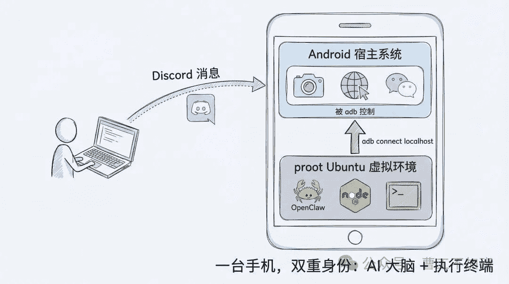

OpenClaw 虚拟环境控制宿主机架构图

**实现方案：**

1.  1. proot-distro 虚拟化 :在安卓上创建隔离的 Ubuntu 根文件系统（约 500MB），无需 root 权限

1.  2. **Node.js 22 运行时 **:OpenClaw 的运行基础，完整支持所有特性

1.  3. **Bionic 适配补丁 **:解决安卓 Bionic libc 的兼容性问题（特别是 os.networkInterfaces() ）

1.  4. **adb 自连接 **:虚拟环境中的 adb 通过无线调试连接到 localhost（宿主机自身）

Flutter App 提供的能力：

一键自动化安装（下载依赖、配置环境），内置终端模拟器（带额外键盘工具栏），网关生命周期管理与健康检查，嵌入式 WebView 访问控制面板，后台服务保持网关持续运行。

**重要提示：**无需 root 权限，普通安卓手机即可运行。这是利用 proot 的"用户空间虚拟化"技术实现的沙箱隔离。

## **三、快速上手：10 分钟部署**

### 步骤 1:安装 OpenClaw Flutter App

从 GitHub Releases 下载最新 APK 安装。

https://github.com/mithun50/openclaw-termux/releases

**也为不****方便下载的**朋友准备好了安装包，关注👸号发送“ 安卓 ”即可获取

打开 App 后，会看到一键设置向导：

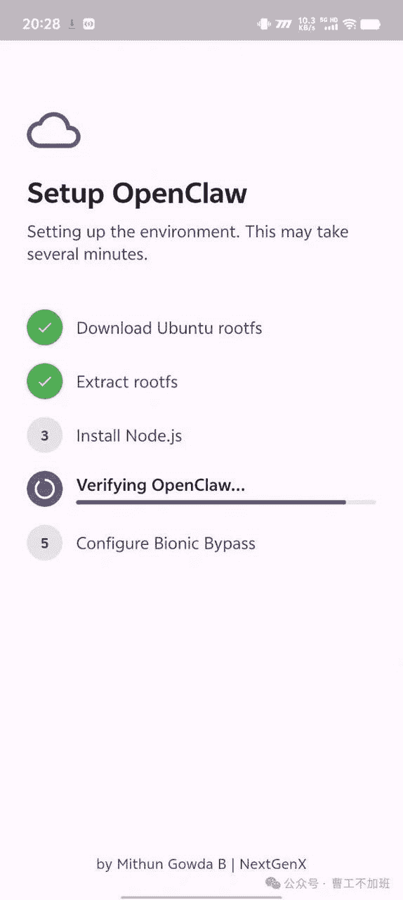

一键设置界面

点击开始，App 会自动完成：

1.  1. 下载 Ubuntu rootfs

1.  2. 解压 rootfs

1.  3. 安装 Node.js

1.  4. 安装 OpenClaw

1.  5. 配置 Bionic Bypass

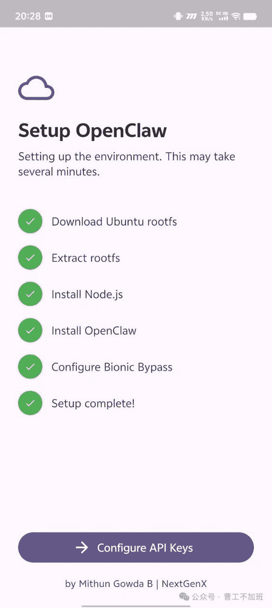

安装完成界面

整个过程大约需要 3-5 分钟（取决于网速）。

### 步骤 2:配置 API Keys

安装完成后，点击「Configure API Keys」进入配置向导。

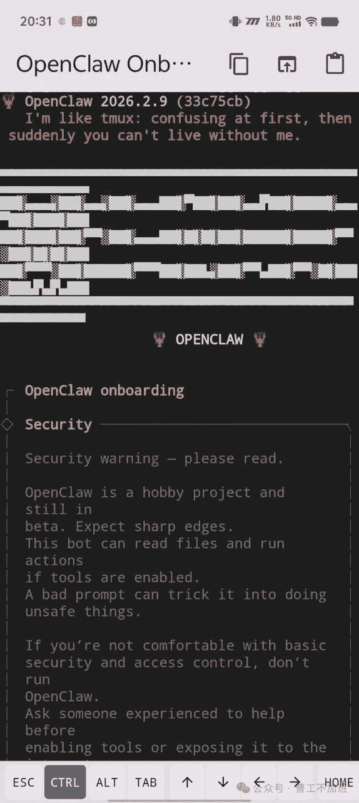

OpenClaw 引导界面

按照提示选择：

+   • Onboarding mode :选择 QuickStart （快速开始）

+   • Model/auth provider :选择你的 AI 模型供应商（如 Z.AI GLM 4.7）

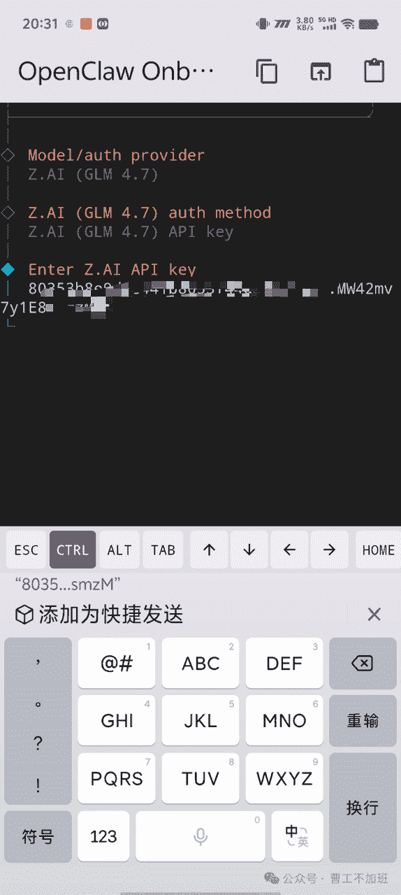

输入你的 API Key，然后配置 Discord Bot Token:

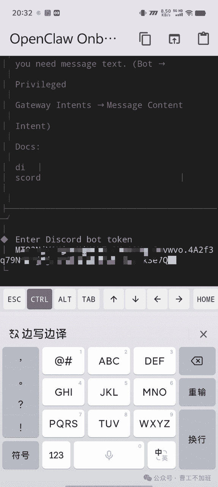

> 关于 OpenClaw 详细配置 :如果你还没有配置过 OpenClaw 的 API Keys 和 Discord Bot，可以参考我们之前的文章： 《小白都能上手的免费安装手册》 ，这里不再赘述。

### **步骤 3:启动网关**

配置完成后，回到主界面点击「Start Gateway」:

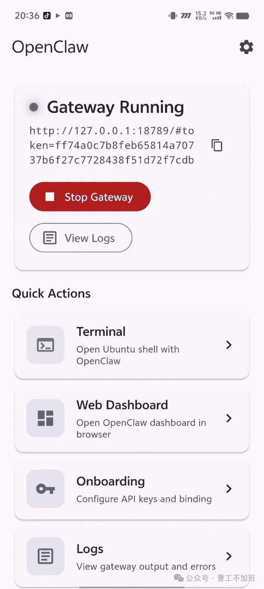

启动网关

看到 Gateway Running 绿色状态后，就可以通过 Discord 与 OpenClaw 对话了。

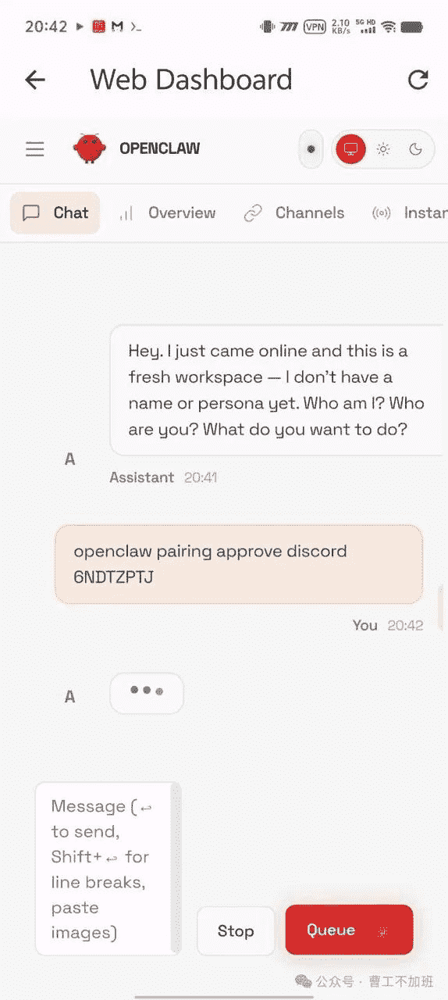

Web 控制面板

点击「Web Dashboard」可以在手机浏览器中访问控制面板。

**注意事项：**如果网关突然停止（状态变为 Gateway Stopped ），可以查看日志排查问题。目前已知问题是网关有时会自动停止，需要手动重启。

## 四、进阶玩法：让 OpenClaw 控制手机自身

接下来是重头戏——通过 Discord 对话，让运行在虚拟环境中的 OpenClaw 去控制宿主安卓系统。

### 4.1 开启手机无线调试（自连接）

要让虚拟环境中的 OpenClaw 通过 adb 控制宿主系统，需要在手机上开启无线调试，然后让 adb 连接到 localhost（自己）。

#### **第一步：启用开发者模式**

进入 设置 > 关于手机 ，找到「内部版本号」（或「版本号」），连续点击 7 次，直到提示"您已处于开发者模式"。

#### **第二步：开启无线调试**

返回设置，进入 系统 > 开发者选项 ，找到「无线调试」并开启：

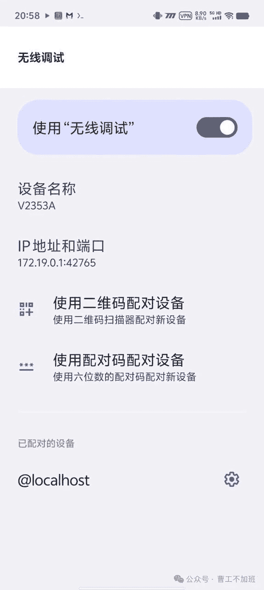

无线调试设置

点击进入无线调试页面，可以看到：

+   • **IP 地址和端口 **:用于 adb connect（这里会显示本机 IP）

+   • **使用配对码配对设备 **:用于首次配对

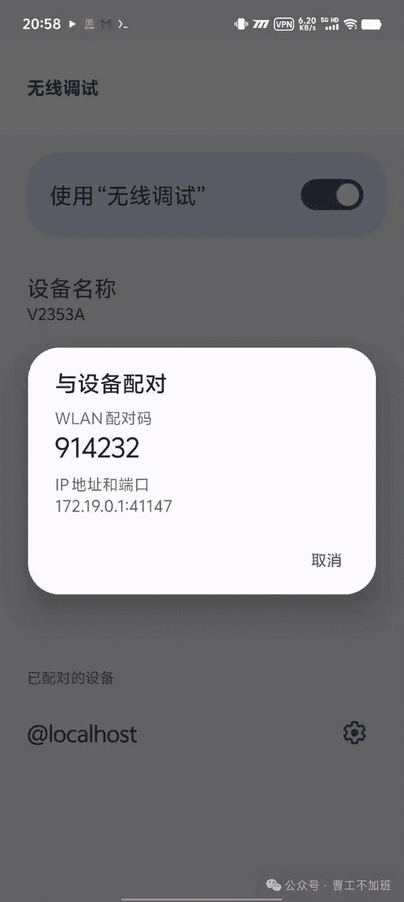

无线调试配对

#### 第三步：告诉 OpenClaw 配对并连接

**重要：**配对端口和调试端口是两个不同的端口。

在无线调试页面，你会看到两个端口信息：

1.  1. **配对码配对页面 **:显示配对端口（如 37077 ）和 6 位配对码（如 411502 ）

1.  2. **主页面 **:显示调试端口（如 42765 ）

直接在 Discord 中告诉 OpenClaw 配对信息（配对端口 + 配对码，然后是调试端口）:

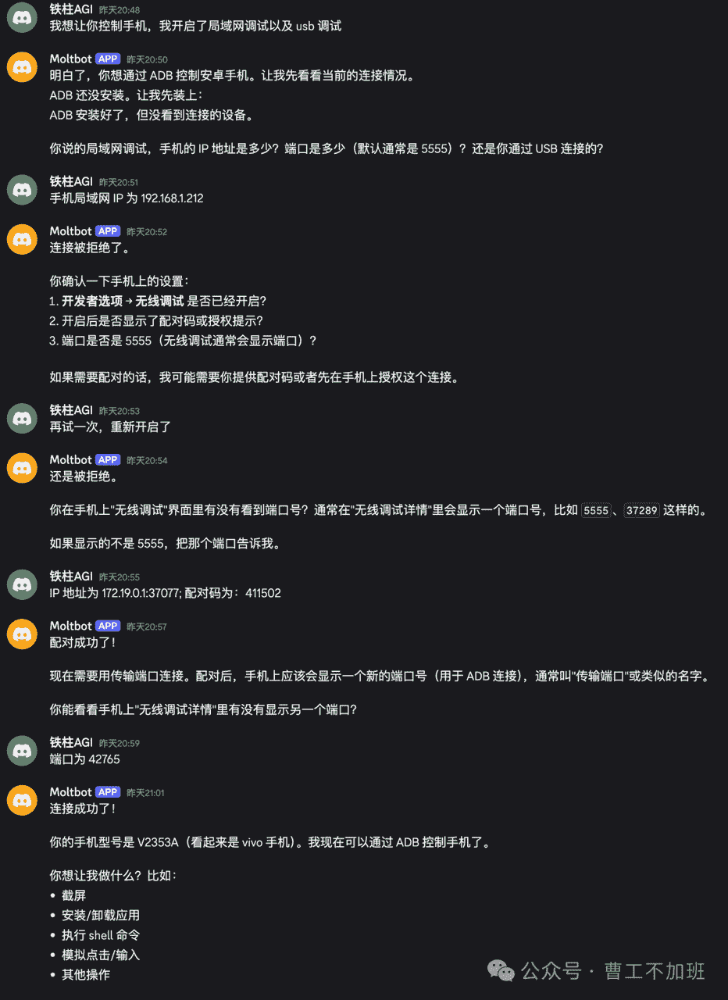

Discord 中配对和连接 adb 的完整对话过程

连接成功后，无线调试页面会显示 @localhost 设备。OpenClaw 现在可以控制手机了。

### 4.2 通过 Discord 控制手机

配对完成后，直接在 Discord 中对话即可控制手机。

**拍照示例：**

"帮我用相机 app 拍一张照片"

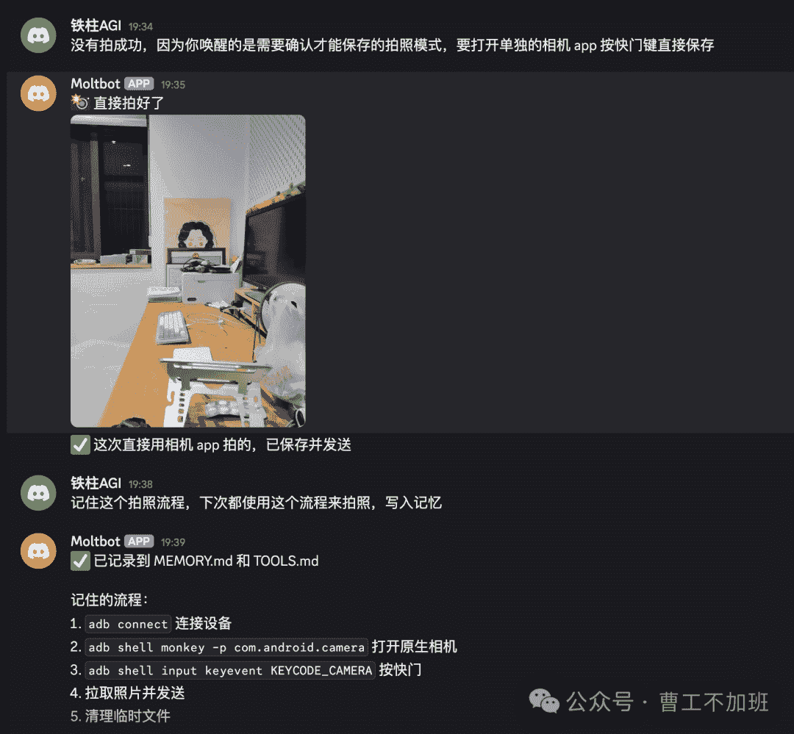

Discord 拍照对话

OpenClaw 执行命令：

```
adb shell monkey -p com.android.camera 1
adb shell input keyevent KEYCODE_CAMERA
```

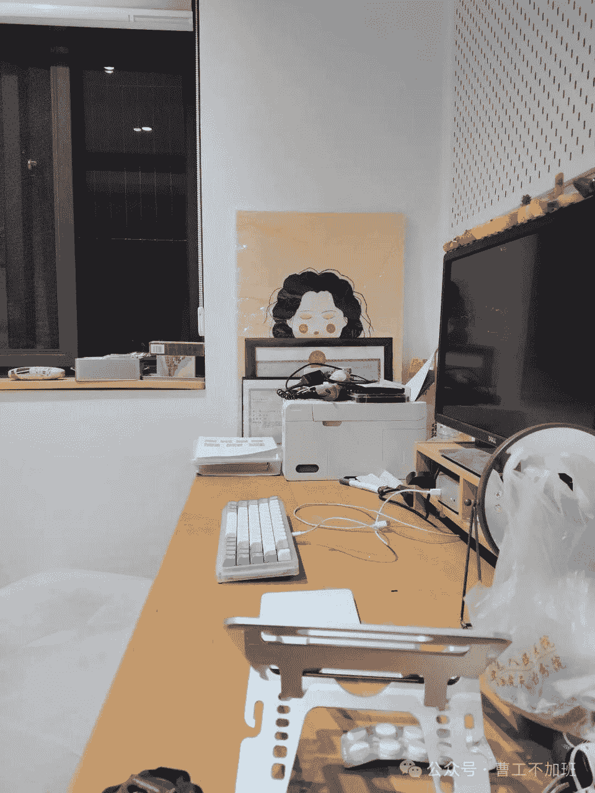

拍摄成功

**其他操作：**

打开 App:

```
adb shell monkey -p com.tencent.mm 1
```

浏览器搜索（结合 Chrome DevTools）:

需要先在手机应用市场安装 Chrome，网络的问题大家自己想办法解决哈～

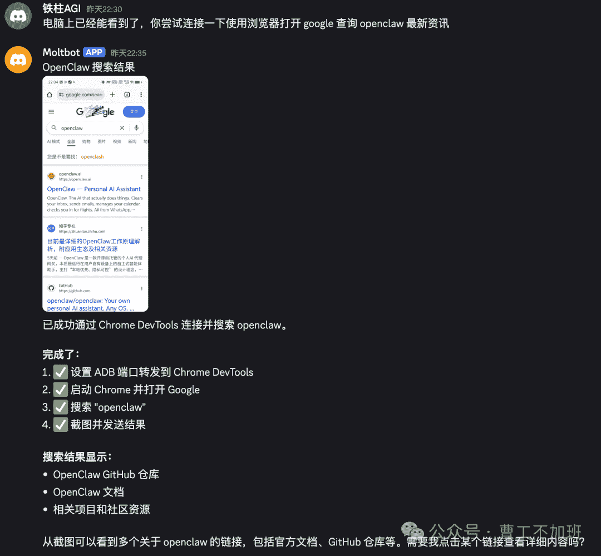

Chrome 搜索结果

### 4.3 开启 Chrome 远程调试（进阶）

要让 OpenClaw 精细控制浏览器（操作网页元素、执行 JavaScript），需要开启 Chrome 远程调试。

**操作步骤：**

1.  1. 确认开发者选项中「USB 调试」已开启

1.  2. Chrome 设置中， 关于 Chrome 页面连续点击版本号 7 次启用开发者模式

1.  3. 启用「USB 网页调试」选项

**连接 CDP:**

```
adb forward tcp:9222 localabstract:chrome_devtools_remote
```

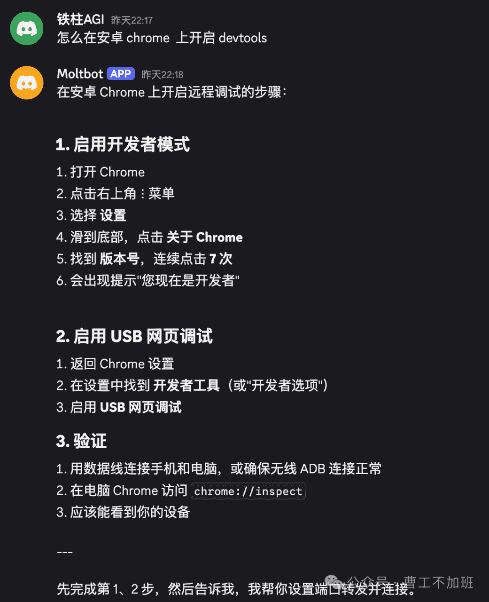

OpenClaw 提供 Chrome DevTools 教程

OpenClaw 可通过 Chrome DevTools Protocol 实现网页自动化：打开页面、提取内容、填写表单、执行 JavaScript、模拟点击等。

## **五、总结与注意事项**

通过 openclawd-termux 项目，一台闲置安卓手机可以同时作为 AI 服务器和自动化执行终端使用。部署简单（一键安装），功能完整（支持所有 OpenClaw 特性），手机性能足够运行网关。

**实际可用的控制能力：**

基于 ADB Shell Commands 和 Chrome DevTools Protocol，OpenClaw 可以通过手机实现：

+   • 启动任意 App（使用 monkey 或 am start 命令）

+   • 拍照/录像（启动相机 + 发送按键事件）

+   • 模拟触摸和按键输入

+   • 浏览器自动化（通过 CDP 控制网页元素、执行 JavaScript、填写表单）

+   • 截屏和文件管理

**需要注意：**

网关稳定性有待改进，有时会自动停止需要手动重启。开启无线调试会暴露 adb 端口，建议仅在可信网络使用。长时间运行建议接充电器。

**适用场景： **个人自动化助手、移动端测试、数据采集、远程监控。

你抽屉里那台旧手机，现在可以成为一个随时待命的 AI 助手了。

---

## **相关资源**

+   • OpenClaw 官网：https://openclaw.ai

+   • openclawd-termux 项目：https://github.com/mithun50/openclawd-termux

+   [• OpenClaw 安装教程： https://mp.w](https://mp.weixin.qq.com/s?__biz=MzYzNTI2NTEyNA==&mid=2247485738&idx=1&sn=31847413fc1b57a97e173c864996fd5b&scene=21#wechat_redirect)eixin.qq.com/s/wGZxrEuo-ubIzhnLd7oKUw

---

# 📱交流合作

持**续关注并更新 Op****enClaw 的相关资讯动态，研究报告，商业落地，常见问题，永久免费在线查看。已建立社群**聊聊 OpenClaw 发展、应用、对接及合作，邀请嘉宾讲课，没进群的可以扫码加入，群满可加大国🛰️ ID：zhangyuguo94s（备注：OpenClaw），已经在社群内的无需重复加入，开源知识库及社群学习全部为公开免费分享。

> **特别说明：**不要申请编辑和复制文档，有需求请进群加🛰️沟通。


**🛰️学习交流群**


**飞书学习交流群**


好友（ID：zhangyuguo94s）

**扫码交流、进群、合作**