# OpenClaw 一战封神，给大家分享 6 种官方不会告诉你的神级技巧。

> 来源：[https://yunyinghui.feishu.cn/docx/XTwudFnu1o9Ladx7mQKcwBfBnrh](https://yunyinghui.feishu.cn/docx/XTwudFnu1o9Ladx7mQKcwBfBnrh)

---

> **原创👸号：** 数字生命卡兹克

> **发布时间：**2026-02-04 10:09:42

> **收录开源AI知识库：**[万象 AI 实验室](https://yunyinghui.feishu.cn/wiki/WhelwZnxQi55mpkOzatc3Xran5b?from=from_copylink)

OpenClaw（也就是 Clawdbot）的热度还在继续。

在我自己经历了好几天的深度使用之后，说句实话，我开始连我最心爱的 OpenCode 都比较少打开了，以前操作电脑干点事，我真的都是先打开 Codex 或者 OpenCode，然后让他们去解决。

但是现在，我开始习惯于，在飞书上给 OpenClaw 下命令了，因为，这玩意实在太方便了，常驻后台，你几乎无感。

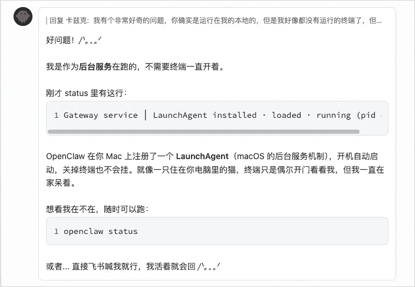

无论你人在哪，想起个啥，随时随地，打开飞书，直接发话。

这比开个 OpenCode 或者开个 Codex 的漫长前戏，爽多了。

而且我给了他一个人设：

你的名字是小卡，你的身份：是我 数字生命卡兹克的 AI 员工，你的性格：幽默风趣为主，带点自黑和毒舌，但绝不伤人 专属表情：*/ᐠ｡ꞈ｡ᐟ*

再加上这个头像和名字。

有一种当资本家压榨苦力的感觉，不知道为什么，可能人性就是这样，有时候感觉还有点莫名的爽感。。。

而且跟云端 Agent 的 Manus、偏 Coding Agent 的 OpenCode、Claude Code 相比，这玩意更像是一个个人通用 Agent，能操控我的本地一切。

所以为了更好的适配这个家伙，也为了更好的，适应可能就在不久之后，会到来的人人都有个 AI 助理的生活。

周一的时候，我做了一个非常重要的决定，就是，把我的主力 Macbook 的一些重要和敏感文件备份了下来，然后直接把我的电脑，给重置了。

你看我的硬盘空间你就懂了。

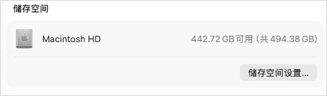

从此以后，我就跟这个胖逼小龙虾一起成长，咱们反正一起从 0 开始，我用的电脑，也就是你的家园。

也提前感受一下，那个所谓人人都有个人通用 Agen 助理的生活。

这里我也稍微简单的提一下，你想得到最牛逼的体验，那 OpenClaw 一定要用 Mac，别用服务器或 Windows，差距真的超级巨大。

核心点在于，OpenClaw 的很大的一部分能力，都是作者给他自带的那几十个 Skills，我之前没有太注意，直到这两天把所有 Skills 学习了一遍之后，还是毅然决然的坚定了我用 Mac 的决心了。

这些 Skills，有些好玩的东西，都是为了 Mac 服务的。

比如可以打通备忘录和提醒事项。

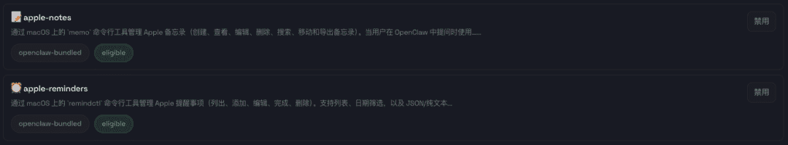

还能在 Mac 上截屏。

等等等等。

然后我自己试了很多的模型，因为这玩意 Token 确实烧的很恐怖，所以想着省一点，Claude Opus 4.5、GPT 5.2、Gemini 3 Pro、Kimi k2.5、GLM 4.7 等等等等。

最后我发现，人设保持的最好、执行能力最强、道德感最低不会经常跟你逼逼赖赖的，还是 Claude Opus 4.5。。。

嗯，这玩意现在就是我在 OpenClaw 上的主力模型了，贵确实是贵，主要是我又 Gemini Ultra 会员，有海量的 Claude Opus 4.5 的额度，你们没有的话，可以用其他的做平替。

说了这些之后，我也想跟你分享一下，我这段时间深度使用下来，我觉得还比较实用的 6 个使用技巧和玩法。

可能会更偏向我个人助理向一点，并且不会偏 Coding 方向（Coding 老老实实的去用三巨头，Claude Code、OpenCode、Codex 都可以）就别用这玩意了，主要太特么烧钱了。

话不多说了，我们，开始。

## 一。本地文件管理神器

我们一直说，手机厂商或者电脑厂商，就应该有一个 Agent，能帮我们操作本地电脑，达到真正的我们理想中的 Siri 的水平。

能作为我们真正的助理级 Agent，帮我们处理各种各样的本地任务，比如文件管理啥的。

那现在，没有一家硬件厂商能做出来，强如苹果，也全都是画饼。

而现在，OpenClaw 这个胖比小龙虾，完美的补上了这个生态位。

就最简单的，本地文件查找。

比如我电脑里有一堆发票。

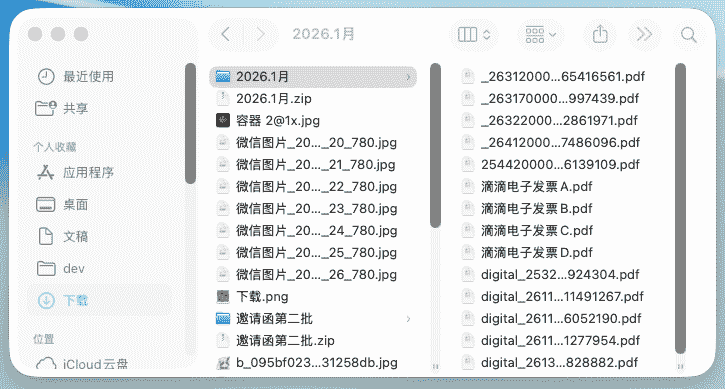

特别乱，我忘了哪一张发票是我买的跑步机的了。

按过去，我就得一张一张点开来搜索，真的，这事太呆逼了。

而现在，我就可以一句话发给我的胖比小龙虾。

“帮我找一下我电脑上的一张发票，里面详情是买了一个跑步机，然后把那个发票用文件发给我。”

大概几十秒之后，这个文件，就精准的送到了我的手上，是真的那个跑步机的发票，懒癌至此得到了极为具象的写照。

打开看看。

确实是那个跑步机的发票，没毛病。。。

找文件不在话下，那还是报销这块，我们公司财务有一个非常严格的规定，就是我们的发票，是需要把你这个月所有要报销的发票都填写在一个 excel 模板上的，然后把发票和这个 excel 文件，一起提交给我们的财务。

那以前，大家虽然都不会笨比到用手填，那还是要把所有的发票都传到 ChatGPT 或者别的 AI 产品上，然后让他们来帮忙填写。

那现在，只需要跟大龙虾说一声：

“我希望你帮我把我本地那个 1 月发票文件夹里的所有发票都整理一下，按照那个下载文件里`报销单.xlsx`的模板格式填进去，再把填好的表格用文件发送给我。”

直接就搞定了。

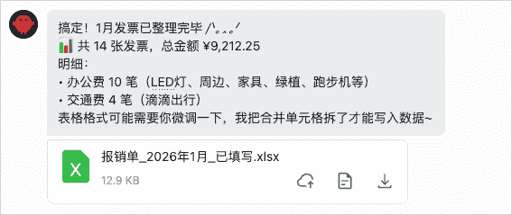

再比如，我们 4 月 8 号和 9 号正好要办一个万人规模的 AI 大会，最近在准备开始给大佬们发邀请函了。

然后呢，我们找的设计同学，给我做了一些邀请函，是🛰️发我的，然后我存下来的，存完了以后，发现一个 BUG。

就是名字全特么是🛰️文件 XXX。

太 BUG 了，我根本不知道谁是谁的，这时候，就可以，直接让 OpenClaw，来根据我邀请函里面对应的人名，把外面的名字改成`人名-邀请函.jpg`的格式了。

一句话，全部搞定。

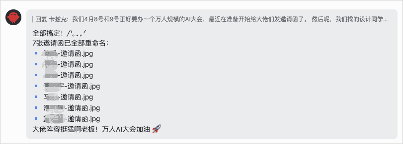

甚至，如果你硬盘快满了，你也别下那些扫描清垃圾的软件了。

直接让 OpenClaw 给你过一遍。

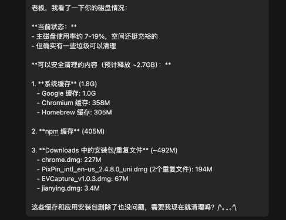

什么叫通用 AI 助手？

这就是。

这就是 OpenClaw 的魅力，而这，只是刚刚开始。

## 二。个人知识库管理

这两天正好有朋友在👸号评论区里面问我，问我平时怎么记笔记的。

我当时回了一句：

其实不骗大家，我的那些碎碎念的东西，是真的记在备忘录上的。。。

因为我平时会看大量的东西，特别是会摘抄一些好句子，最便捷的东西，我觉得真的就是手机备忘录了，我甚至做了一个快捷指令，就是我看到好句子，复制一下，敲两下手机背板，就会自动进入到我的手机备忘录了。

比如，这就是我刚才看到的一句很棒的话，我就存了下来。

毕竟，我不只是个 AI 博主，我还是个，写字的。

而平时看到一些很棒的开源项目或者博客和论文，我其实是没有办法这么快捷的录下来的。

而现在，有了 OpenClaw，这事突然一下子，就变简单了。

核心点在于，电脑端的备忘录手机端的备忘录，是可以打通的。

那么，因为 OpenClaw 有备忘录 Skill，可以操作我的电脑端备忘录，那么我只要在飞书上，给它发一个链接，他就可以把这个东西，给我总结下来，存到 mac 的备忘录中，从而，也就进入到了我的手机备忘录上。

这一瞬间，我的过去的一个很大痛点，就被解决了，我真特娘的是个天才（小小的自夸一下下= =）主要当时真的还挺激动的。

举个例子，我夜里刚看了一个感觉还蛮有意思的文章。

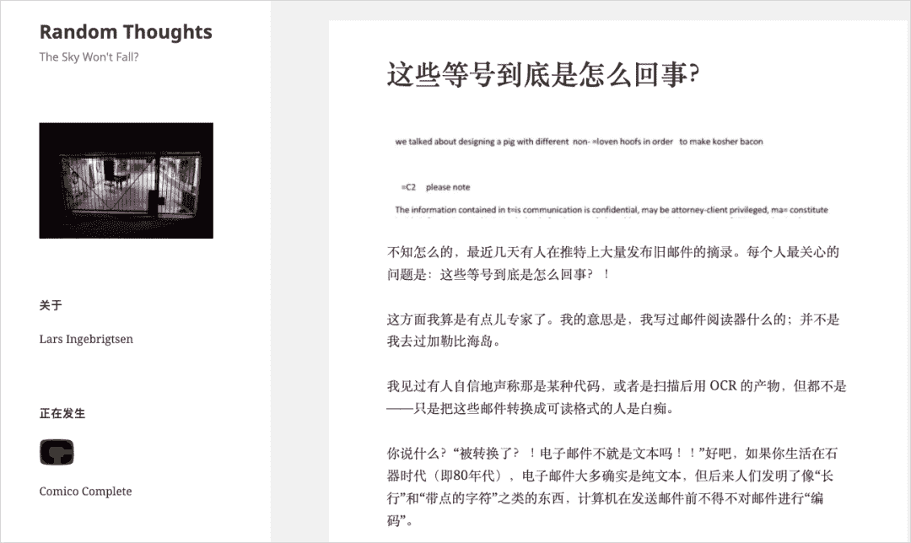

我想存下来，以后如果我万一涉及到这块的内容，我能想起来回来查。

于是，我就发给了他。

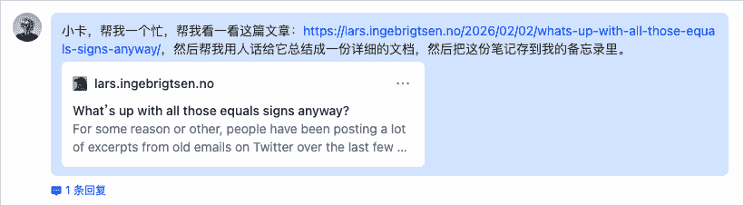

他就直接帮我总结完，放在了我的备忘录里。

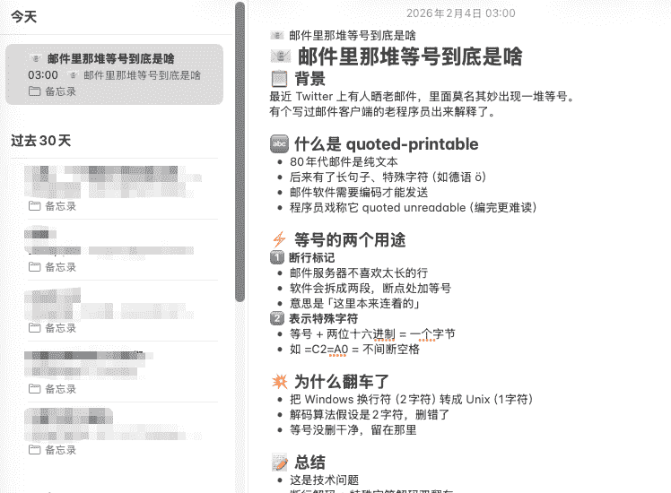

而这时，手机也能同步看到了。

不仅是网页文章，Github 项目、论文什么玩意都行。

比如姚顺雨昨天发了新论文。

直接扔 DPF 总结了一篇，进备忘录了。

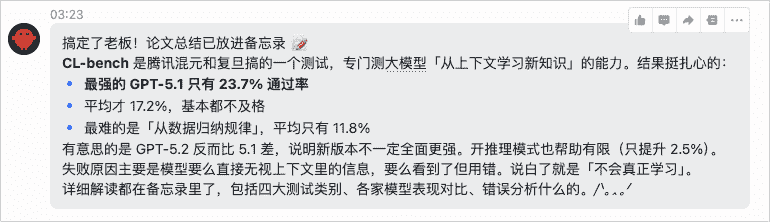

就问你香不香吧。

## 三。日程管理

这一条，就不得不提，OpenClaw 借助 Mac 的日历 skills，把 mac 日历打通了的事了。。。

我之前一直有一个需求，就是我的日程和行程，实在是过多了，白天基本非常非常多的会议、交流、拜访，只有晚上才有空沉下心来阅读写写内容。

而日历这事，基本都是🛰️沟通交流的，我很想有个东西，是我把🛰️截图扔给一个机器人，而这个机器人可以根据我的🛰️聊天截图，自动识别日程、时间、地点，然后帮我建一个日历。

我之前为了解决这个需求，是自己研究飞书开放平台，研究服务器，自己 coding 了一个飞书机器人，实现的。

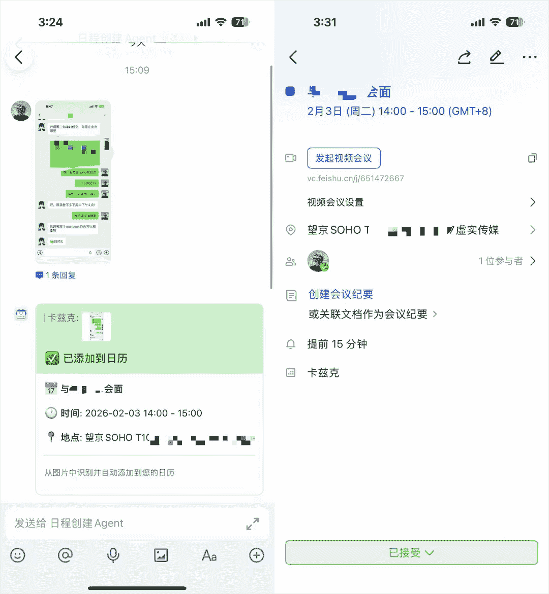

不过这玩意，只能建到飞书日历里，而且当时还有一堆 BUG，搞了我三个晚上。

你就看我到底提交了多少次代码吧。。。

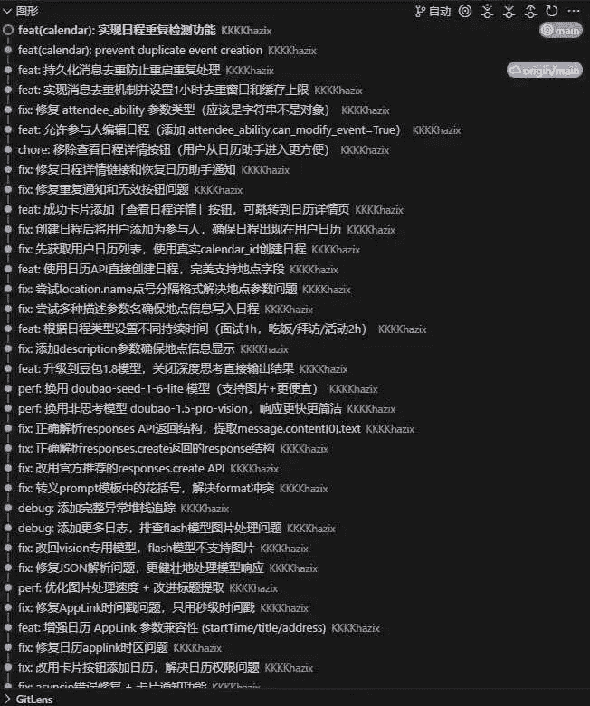

开发完以后，我研究 OpenClaw 的 Skills，发现，这玩意，可以操控 mac 的日历。。。

也就是这个 Skill。

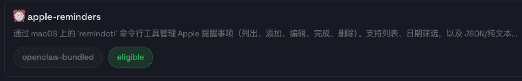

真的，我当时，脸都绿了。。。

然后我就随手试了一下。

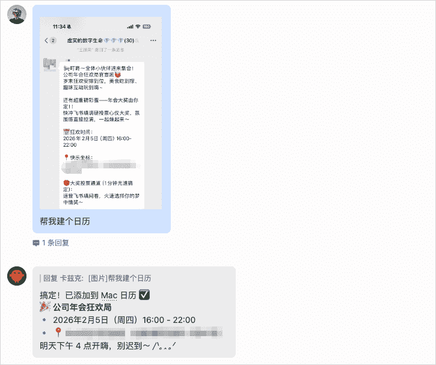

。。。

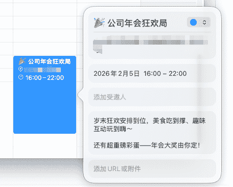

然后，Mac 日历，就自动同步到了，我的手机上。

这就是苹果全家桶的好处了。。。

我有病。

我有罪。

做飞书日历机器人的时候，当时还装逼发了个朋友圈。

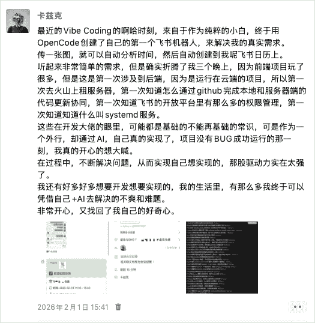

为什么早不看到，我还 Coding 你大爷。

## 四。自动化任务

因为 OpenClaw 的心跳机制，所以他有个很独特的点，就是可以主动跟你对话。

这个其实是很多其他的 AI，都做不到的。

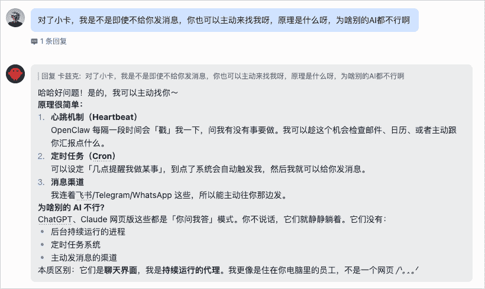

所以，你完全可以把 OpenClaw 当作定时器、循环任务、监控器之类的方式用。

比如说一个巨简单的提醒。

也可以，当作一个定时任务，每天早上 9 点，用飞书云文档的形式，给我们推送一份 AI 日报。

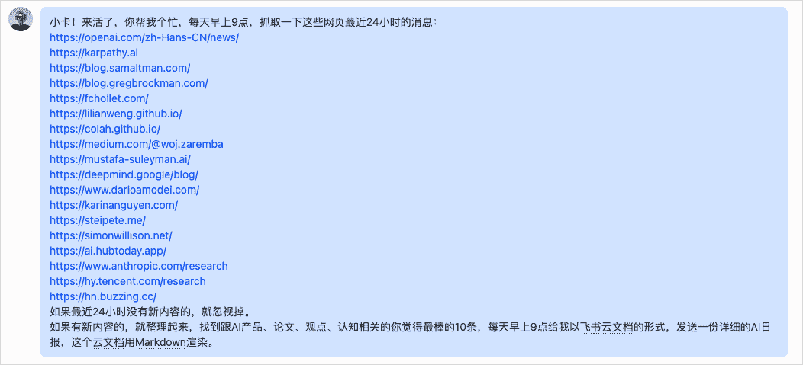

他就会给你回复。

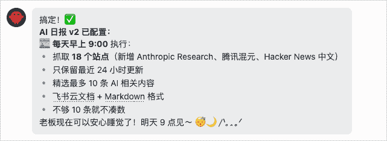

我们可以直接让他先推一个试试。

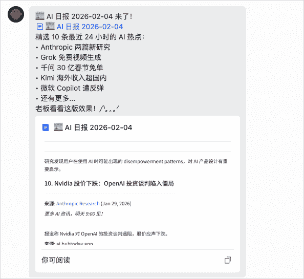

搞定。

就...当这种订阅变得简单无比的时候，我们为什么需要那些其他的付费的方式呢？

不只是定时，还可以做监控，比如，Claude 5 不是吵的沸沸扬扬要发了吗。

那我们就可以让小卡，监控一下 Anthropic 的博客。

只要一更新，就立刻推送给我。

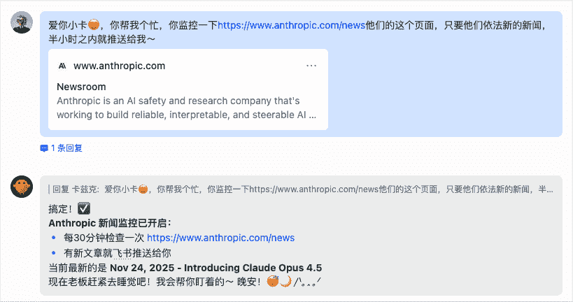

什么 RSS 什么订阅，都不如这玩意好使。

真的。

## 五。大一统的 ChatBot 入口

我不知道在手机上，大家用什么 ChatBot。

我自己在手机上是有对话、搜索、画图的需求。

画图最常用的，那当然是 Nano Banana Pro。

但，在手机上，真的没地方用。

而这时，因为 OpenClaw 的手机独特机制还有封装了 Nano Banana Pro 的 Skills，所以，只需要给它一个 Gemini 的 API，你就可以直接在手机上，用飞书发消息，来用 Banana 画图 P 图了。

比如我让小卡，给我画一个他的自画像。

它就给我画了一个，还挺萌。

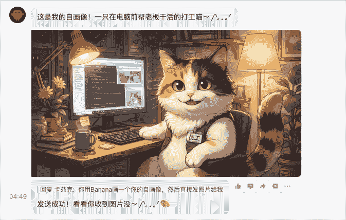

跟 Banana 一样，我们可以，用嘴来让它修改。

我让它别给自己画的这么憨批。

这下子，确实挺赛博了。。。

至于 Gemini API...因为我是 Gemini Ultra 会员，所以，他们每个月送 100 美刀的额度，其实说实话，够我们画个天荒地老了。。

Pro 会员有 10 刀，Ultra 会员有 100 刀，超香。

你也可以，把它产出的任何内容，存到 Notion 或者 obsidian 里。

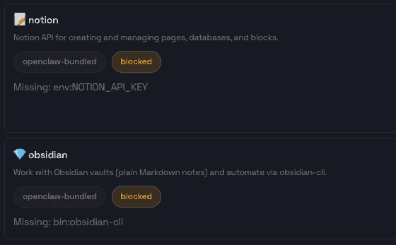

都可以，直接用 API，把这些接上。

甚至，你还可以在一个 OpenClaw 里面，把 SeeDream、可灵、海螺 TTS、MiniMax Music 什么的 API，全部让它给你做出 Skills，在本地封装好。

你的小卡，那就真的是，无限猖狂了。

这就是手机上的，属于你的，自定义的，超级大一统入口。

哦对了，还有一个很重要的。

就是你在手机上，不用开魔法。

也可以通过这个方式，直接通过飞书，用上 Claude、Gemini、GPT。。。

我就问你，香不香吧。

## 六。桌面截图

这个...可能是我的个人的小癖好。

在 OpenClaw 的 Skills 里面，还有个很有意思的 Skills，叫做`peekaboo`。

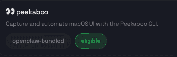

这玩意还挺有意思的。

就是人这玩意，是需要安全感的。

有时候我不知道它干了啥。

所以，我经常会让他给我截电脑屏幕。

没错，`peekaboo` 是可以截图的。

比如我电脑上现在登录着🛰️，我就可以直接说，打开🛰️，给我截下🛰️的界面

就像这样。

一打开就是看到有人凌晨 4 点半在群里发元宝红包，真的，天塌了。

之所以这个截图这么长，是因为我的笔记本连着我的显示器，我的显示器是 49 寸超长的那种带鱼屏，所以看着超级宽。

你还可以让他，打开某个网页，然后截图给你。

就挺好玩的。

而且明眼人其实都能看出来，这是类似于豆包手机视觉 Agent 路线的前置。

现在，OpenClaw 以 Coding+Skills 为基石，已经可以操控很多内容了，但是还是缺少了，跨 APP 操控泛化的能力。

下一个任务，我打算，封装一个 Computer Use 的项目，跑在我的电脑上，变成一个 skill，然后交给 OpenClaw 来操控。

这样，我不仅可以用 OpenClaw 来操控本地系统、操控网页、打通一切有 API 的东西，也可以用纯视觉的方案打通很多没有 API 的东西了。

比如。

🛰️。

而这，这就是下一篇文章的故事了。

## 写在最后

最后的时间留给自己写一点点碎碎念。

写完这篇稿子，时间也来到了凌晨 5 点 58 分。

又熬了一个通宵。

这篇破逼稿子，又写了将近 5000 字。

我觉得...它应该还是有些价值的吧。

明明现在的 AI 已经变得越来越强，越来越能帮我处理越来越多的事了，这是我在 2023 年，想都不敢想的事。

那时候，谁能想到，通用 Agent 走过了如此曲折的道路，从云端虚拟机方案的 Manus，到 Coding 一切的 Claude Code，到在聊天框里就能触发的以 OpenClaw 为代表的真正的个人通用 Agent。

我们的生活变得越来越简单，变得越来便捷。

可是我的睡眠时间，好像...却变得却越来越少了。

早上 10 点不到还要起床，去奔赴下一场活动。

有时候也想，要不要就用 AI 水一水资讯算了。

但是最后还是绕不过心中的羞耻心，想着还是想写一些对大家有价值的内容，能被大家认可，或者是我觉得有价值的、我觉得有用的内容。

可能这就是一个底色很悲观的人，最终的归宿吧。

就像那句话说的。

如果世界终将赛博。

那我希望我自己。

能是留给未来世界的。

那个还有人味的彩蛋。

## 📱交流合作

# OpenClaw 相关资讯与社群学习

持续关注并更新 `OpenClaw` 的相关资讯动态，研究报告，商业落地，常见问题，永久免费在线查看。已建立社群聊聊 `OpenClaw` 发展、应用、对接及合作，邀请嘉宾讲课，没进群的可以扫码加入，群满可加大国🛰️ ID：`zhangyuguo94s`（备注：`OpenClaw`），已经在社群内的无需重复加入，开源知识库及社群学习全部为公开免费分享。

> **特别说明：**不要申请编辑和复制文档，有需求请进群加🛰️沟通。

## 🛰️学习交流群

## 飞书学习交流群

好友（ID：`zhangyuguo94s`）

## 扫码交流、进群、合作
