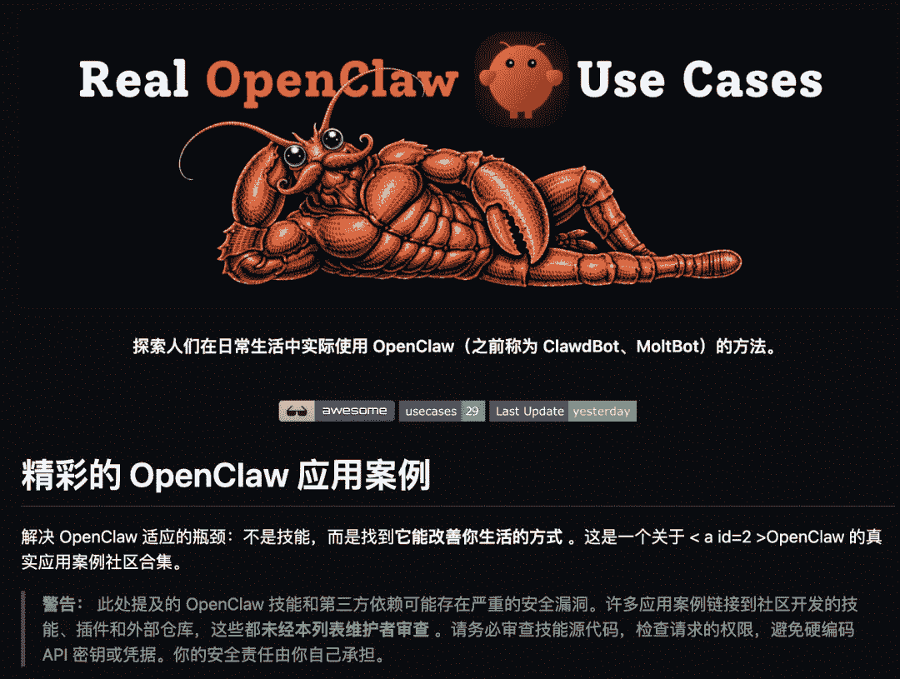
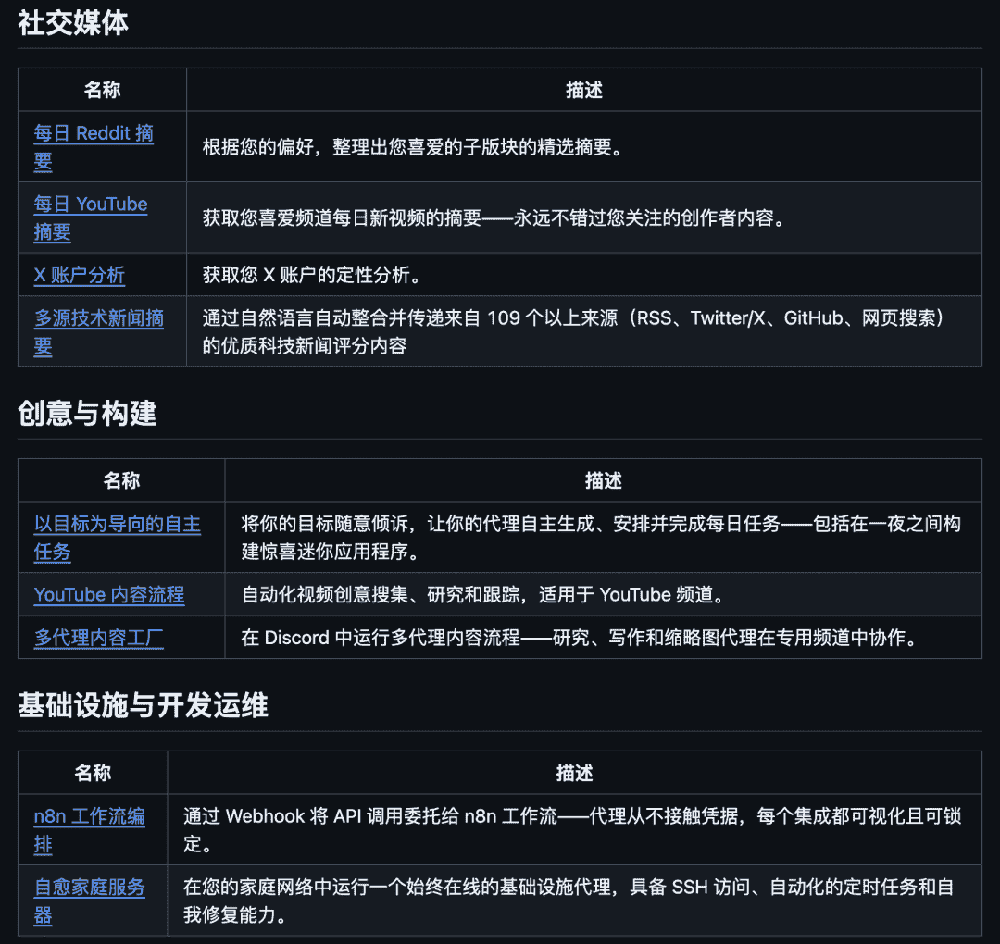
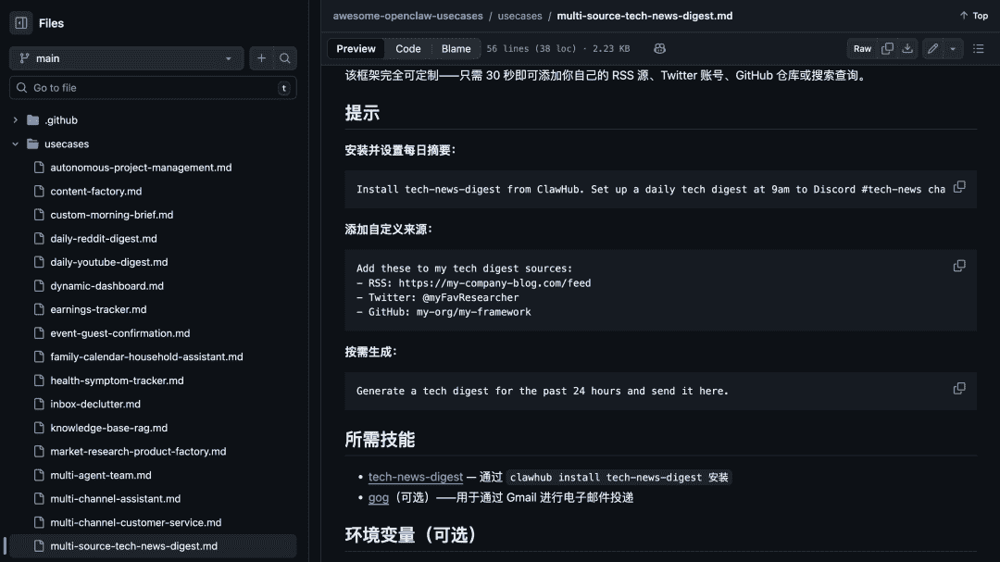
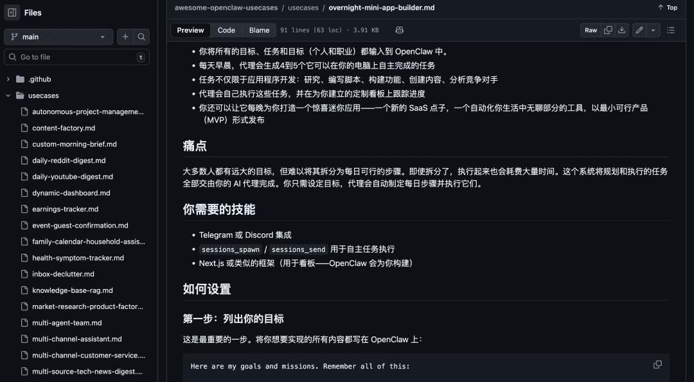
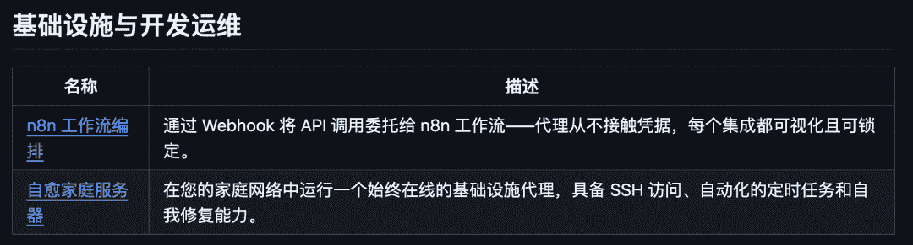
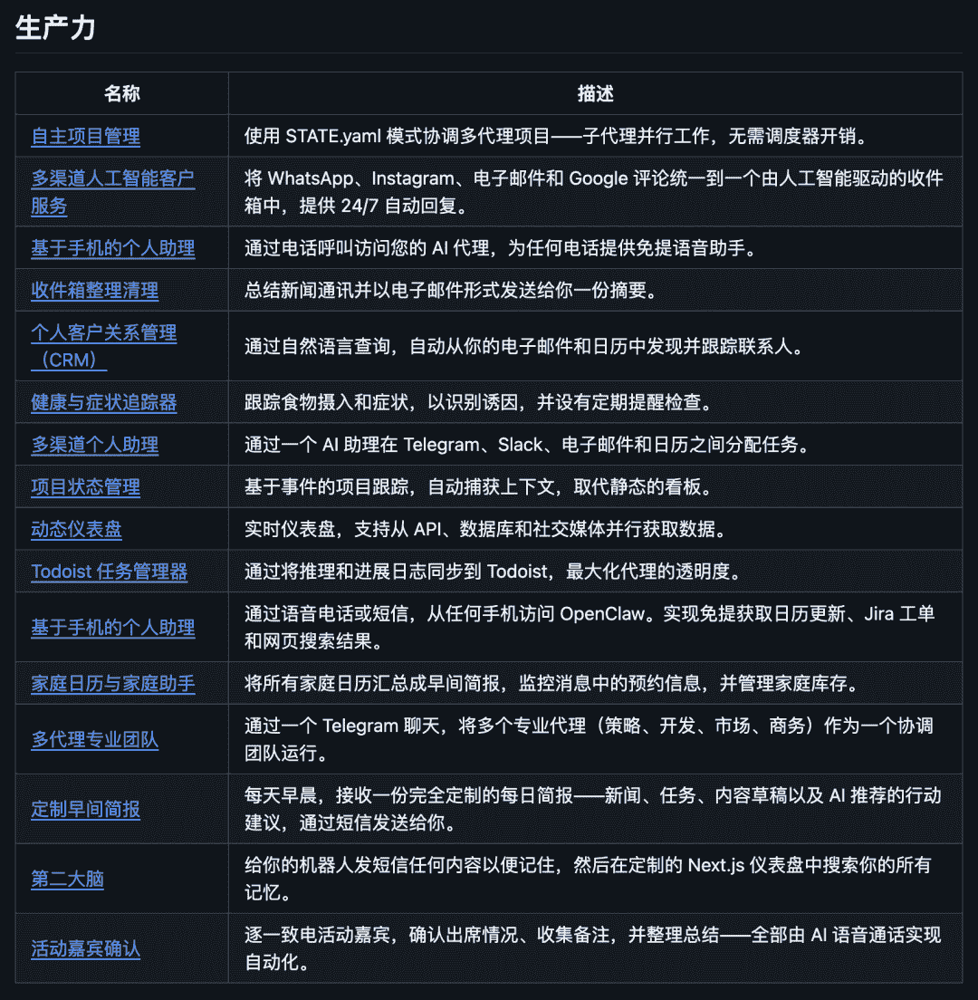
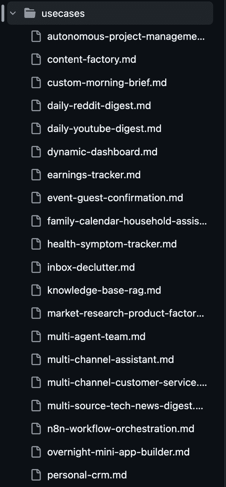
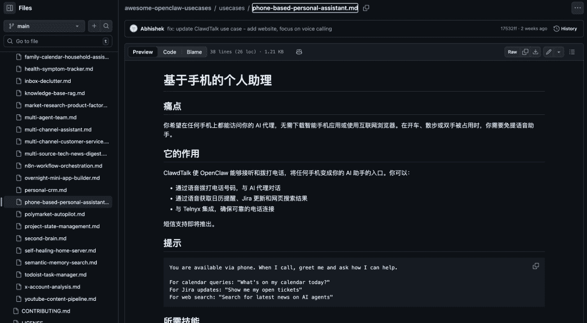

# GitHub 上开源了 30+ 个 OpenClaw 真实使用案例。

> 来源：[https://yunyinghui.feishu.cn/docx/OjqMdMJJiozjZAx9xKZcJni9nne](https://yunyinghui.feishu.cn/docx/OjqMdMJJiozjZAx9xKZcJni9nne)

---

> **原创公众号：**逛逛 GitHub

> **发文时间：**2026-02-22 15:04:42

> **收录开源AI知识库：**[万象 AI 实验室](https://yunyinghui.feishu.cn/wiki/WhelwZnxQi55mpkOzatc3Xran5b?from=from_copylink)

最近逛 GitHub 的时候发现了一个挺有意思的仓库， 专门收集 OpenClaw 的 usecases。

说实话，很多人装完 OpenClaw 之后的操作都是一样的：疯狂往里面塞各种 Skill，ClawHub 逛得跟菜市场一样热闹，今天装个天气查询，明天装个股票分析，后天又来个翻译助手。

结果装了一堆却发现每天还是在信息搜索、做个记录。Skill 装了一百个，生活一点没变轻松。

这个开源项目就是 **专门收集人们真实在用的 OpenClaw 场景，**而不是单纯介绍某个 Skill 或插件。

# **01**** **开源项目简介

awesome-openclaw-usecases 目前 收录了 30 多个经过验证的真实使用场景。

它的核心理念非常简单：不是教你装什么 Skill，而是告诉你别人是怎么把 OpenClaw 变成真正能帮人类干活的私人助理的。

如果 **你不知道 OpenC**law 具体能做什么 ，只停留在抽象概念。有一些自动化或搭建 AI 智能体想法，但 不知道如何系统落地 ，想参考别人已经跑通的真实工作流和自动化方案。

**希望有成熟路径而不是从零瞎试 **，可以瞧瞧这个开源项目。看了一下这个仓库的用例，分成了六大类，每个都挺实用的。

**社交媒体类**

很多人在用 OpenClaw 做信息获取和账号分析。比如每天自动汇总你关注的 subreddit，按你的偏好生成摘要。

还有人会让 AI 来盯关注的频道每天有新视频时，自动生成摘要，不再手动刷订阅。

还可以对你的社交媒体账号做定性分析，比如内容风格、互动情况啥的。

最实用的，还是 Multi-Source Tech News Digest，从 100+ 技术来源，比如 RSS、X、GitHub、搜索等 自动抓取新闻，做质量打分和聚合。

这个开源项目 已经准备好了配置流程， 很适合 想减少信息噪音、构建信息饮食体系的人。

**创意与构建**

重点在自动构建东西。

比如 Goal-Driven Autonomous Tasks 或者 Overnight Mini App Builder。

你只要 **脑暴目标，OpenClaw 会自己拆解任务**、安排执行，甚至夜里自动帮你构建小应用。

除此之外，还有自动化 YouTube 创作流水线： 选题挖掘 → 资料研究 → 选题追踪。

在 Discord 中搭建多智能体内容工厂：研究 agent、写作 agent、缩略图设计 agent，各自在专用频道里并行工作。

内容创作者、独立开发者可以去瞧瞧。

**基础设施与运维**

也有一个偏工程或者自动化运维的实践。比如把复杂 API 集成交给 n8n 工作流来做，OpenClaw 只通过 webhook 调用 n8n，智能体本身不用碰密钥，所有集成在 n8n 可视化界面中配置和锁定。

还有智能体常驻在你的家庭服务器或小型集群上，具备： SSH 访问能力、定时任务，自我监控和自愈。

**生产力**

这个项目中有很多生产力相关的 usecases。

**因为这非常能体现 OpenClaw 最**核心的价值， 是把你日常分散在手机、邮箱、日历里的信息入口，统一交给一个 AI 助理来处理。

比如可以用电话就能呼叫个人助手，开车或做家务时用语音问日程、查任务、搜资料。

每天早晨收到 **为你定制的 AI 晨报 **，自动汇总新闻、当天安排和建议行动。

Autonomous Project Management 这类用例，让多个智能体按照统一的 STATE.yaml 状态文件协同工作，自动拆解和跟踪项目任务，而不是靠你手动更新看板。

在认知和关系层面，Second Brain 与 Pe**rsonal** CRM 这两个用例提供了 记忆+人脉 的长期资产化能力：你可以把任何想记住的东西直接发给 bot。

# **02**** **如何使用

每个用例都提供了详细的配置步骤，基本上都是这个套路。

直接打开仓库的 usecases 文件夹，按类别浏览 Social Media、Creative、Infrastructure、Productivity、Research、Finance 重点关注你最迫切想解决的场景类别。

比如 Productivity 里的 Second Brain，每个文件名都是带编号的 。md 文档，阅读其概述和实现思路。

然后是理解架构模式，每个用例文档包含： 场景描述、技术栈、工作流图示、所需技能列表。

注意看文档中提到的核心组件，不需要完全复刻，而是理解消息触发 → Agent 处理 → 输出交付的模式。

