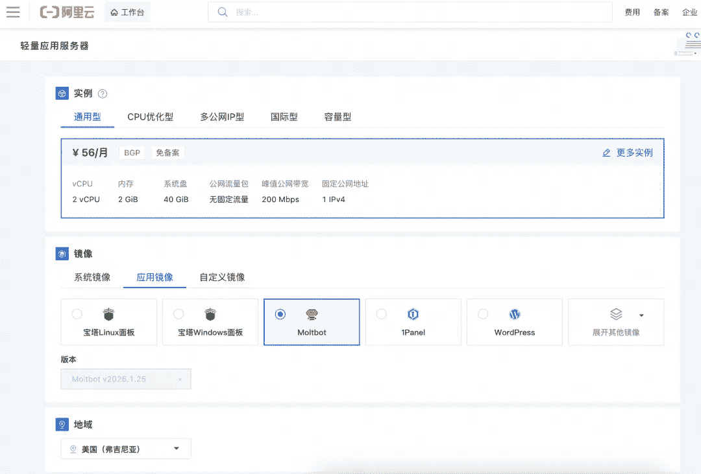
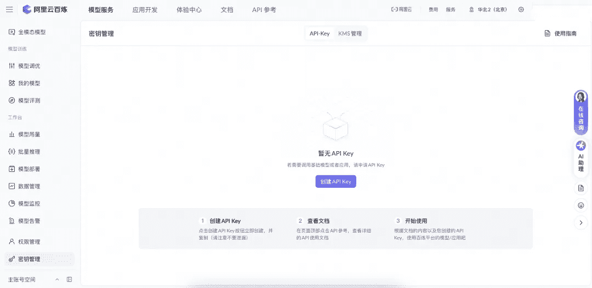
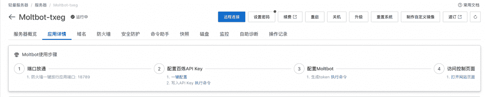

# 刚刚，阿里云上线 Clawdbot 全套云服务！

> 来源：[https://yunyinghui.feishu.cn/docx/I6K9ddNLvojdbwxAyXbcW9Gknfg](https://yunyinghui.feishu.cn/docx/I6K9ddNLvojdbwxAyXbcW9Gknfg)

> **👸号：**阿里云

> **发布时间：**2026-01-28 17:28:22

> **收录开源AI知识库：**[万象 AI 实验室](https://yunyinghui.feishu.cn/wiki/WhelwZnxQi55mpkOzatc3Xran5b?from=from_copylink)

刚刚，阿里云正式上线 Moltbot（原名：Clawdbot）全套云服务，全面提供 Agent 所需的算力、模型和消息应用等。

用户可在阿里云轻量应用服务器或无影云电脑上快速启用 Moltbot，并按需调用阿里云百炼上一百多款千问系列模型，在消息通道上，该方案不仅支持 iMessage 消息应用，还能基于阿里云计算巢实现钉钉消息互动。

云服务器部署教程如下👇

// 第一步：打开轻量应用服务器并安装 Moltbot 镜像

打开轻量服务器，点击「应用镜像」，选择「Moltbot」

// 第二步：配置 Moltbot

1. 前往百炼大模型控制台，找到密钥管理，单击创建 API-Key

2. 前往轻量应用服务器控制台，找到安装好 Moltbot 的实例，进入 「应用详情」 放行 18789 端口、配置百炼 API Key、执行命令，生成访问 Moltbot 的 Token。

a.端口放通：需要放通对应端口的防火墙，单击一键放通即可。

b.配置百炼 API Key ，单击 一键配置 ，输入百炼的 API-Key。单击 执行命令 ，写入 API Key。

c.配置 Moltbot ：单击 执行命令 ，生成访问 Moltbot 的 Token。

d.访问控制页面 ：单击 打开网站页面 可进入 Moltbot 对话页面。

此外，阿里云无影云电脑也已上线内置 Moltbot 和各种应用软件的专属镜像，预装了包括 VS Code、TMUX、钉钉、WPS 等组件，并支持钉钉、🐧 等软件唤醒 Moltbot，只需一键导入镜像即可启动。

/ END /