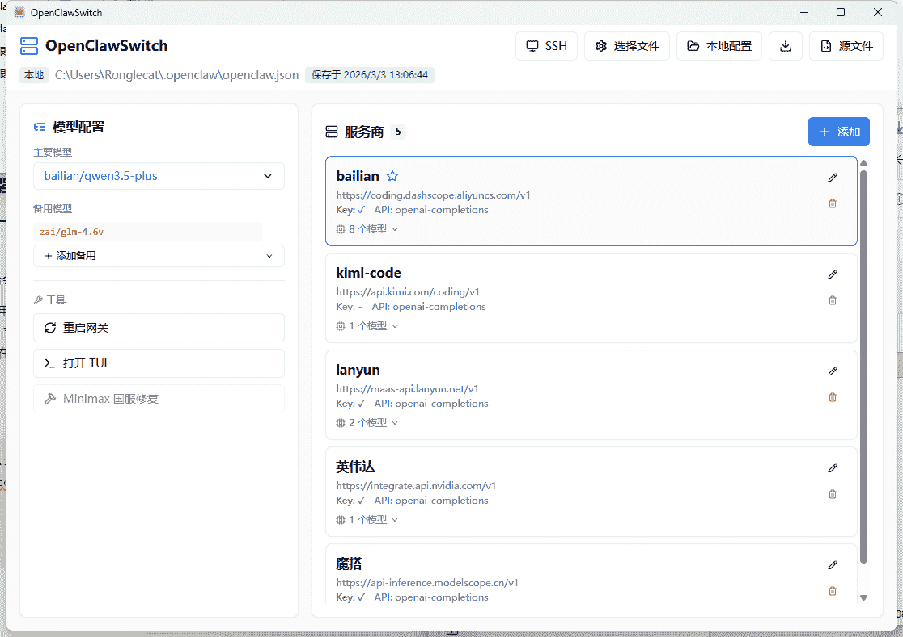
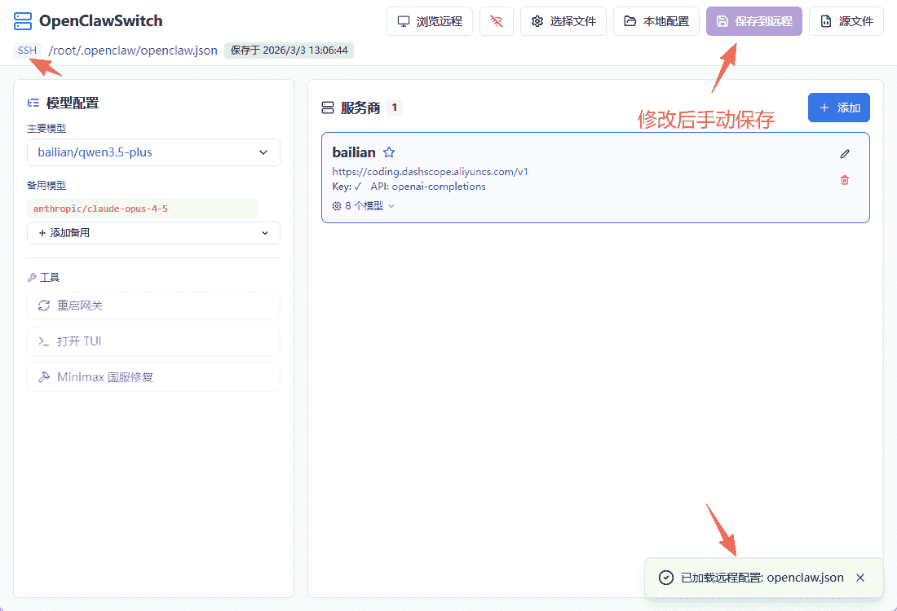
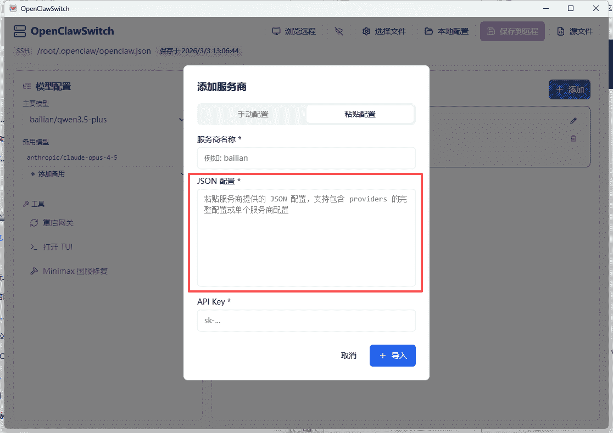
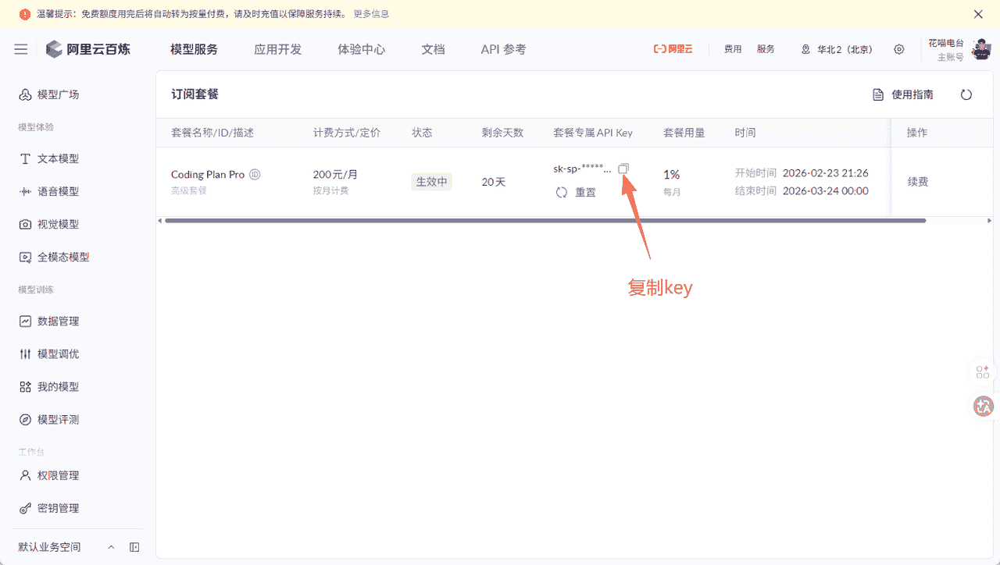
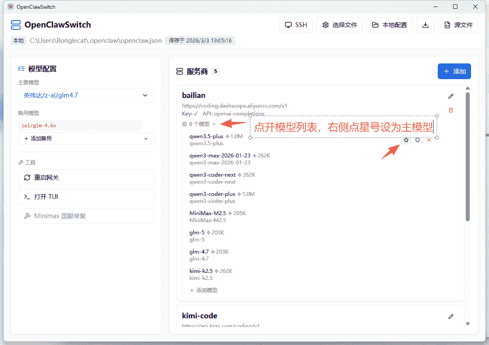
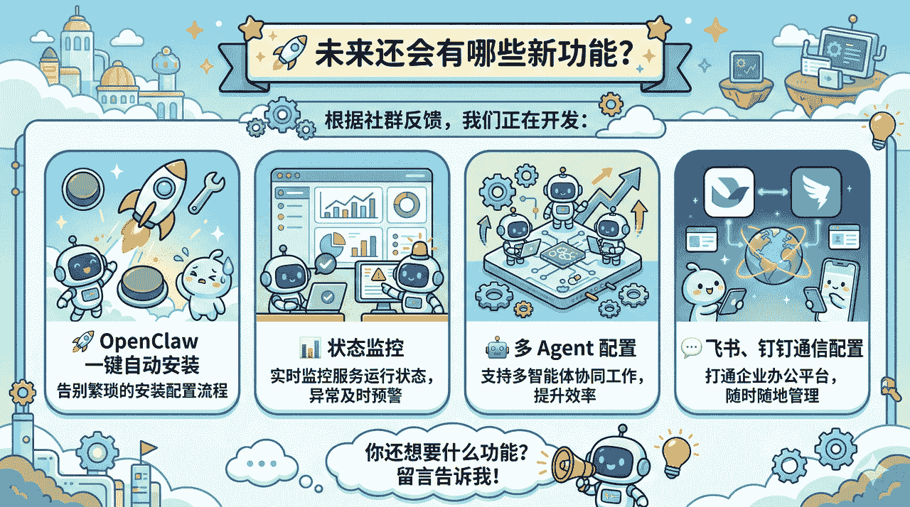

# 自定义模型告别繁琐配置！一键SSH管理你的AI服务器，这个开源神器你必须拥有

> 来源：[https://yunyinghui.feishu.cn/docx/JNzjd0JfRobozUxtxJTcFBtTnJg](https://yunyinghui.feishu.cn/docx/JNzjd0JfRobozUxtxJTcFBtTnJg)

> 还在为切换AI模型服务商而头疼？还在手动修改配置文件？今天给大家带来一个重磅更新！

---

## 你是否也遇到过这些痛点？

深夜12点，你的AI模型突然报错：

+   "配置文件在哪？"

+   "这个JSON格式怎么又错了？"

+   "要SSH到服务器上改配置？密码是多少来着..."

作为一个资深折腾党，我深知这些痛苦。于是，OpenClawSwitch v1.2.0 来了！



---

## 🎉 这次更新有多强大？

### 1️⃣ SSH远程连接：一键管理云服务器配置


**再也不用记密码、敲命令了！**

✅ **保存连接配置**：常用**服务器一键连接，**告别反**复输入

**✅ 密码/私钥双认证：支持密码登录和SSH密钥，安全无忧

✅ 可视化管理：直接在软件界面编辑远程配置文件，实时生效

**实际使用场景：**

以前需要这样操作：

```
ssh root@192.168.1.100
vim /etc/openclaw/config.json
# 手动修改...
# 保存退出...
# 重启服务...
```



现在只需要：

1.  点击"SSH"按钮

1.  填写你的服务器信息

1.  直接在可视化界面修改配置

1.  点击保存 ✅

**3秒搞定！**

---

### 2️⃣ JSON配置粘贴：告别手动填写的时代

**这个功能简直是懒人福音！**

以前添加一个AI服务商需要：

+   填写名称

+   填写URL

+   填写API Key

+   配置模型列表

+   设置参数...

现在只需要：

1.  从服务商官网复制JSON配置

1.  点击"粘贴配置"标签

1.  Ctrl+V 粘贴

1.  点击"导入" ✅

**支持批量导入多个服务商配置**，一次性搞定所有设置！



---

### 🎯 实战演示：接入阿里云百炼

以阿里云百炼为例，完整演示接入流程：

**步骤 1：** 打开 [官方接入文档](https://help.aliyun.com/zh/model-studio/openclaw-coding-plan)，复制 JSON 配置


**步骤 2：** 从[百炼平台](https://bailian.console.aliyun.com/) 获取 API Key



**步骤 3：** 粘贴 JSON 和 Key 到弹窗对应位置


**步骤 4：** 点击保存，选择 Qwen 3.5-Plus 模型为主要模型



**完成！** 现在你可以直接使用阿里云百炼的模型服务了。

---

## 📥 如何获取这个神器？

### 方式一：GitHub 开源下载（推荐）

访问官方[**仓**](https://github.com/RongleCat/OpenClawSwitch/releases/tag/v1.2.0)库：

👉 https://github.com/RongleCat/OpenClawSwitch/releases/tag/v1.2.0

**完全开源免费**，支持Windows/macOS/Linux三大平台！

### 方式二：👸号一键获取

关注👸号“**铁柱AGI**”回复关键词：**OpenClaw**

即可获取最新版本下载链接 + 详细使用教程

---

## 💡 为什么要开发这个工具？

说实话，市面上的AI模型管理工具要么收费，要么功能单一。

作为一个服务社群的技术爱好者，我经常看到群友们问：

+   "怎么切换模型？"

+   "配置文件在哪？"

+   "这个JSON怎么填？"

于是我想：能不能做一个真正简单易用的开源工具？

OpenClawSwitch 就是答案。

**我的承诺：**

✅ 永久开源免费

✅ 持续更新维护

✅ 社群优先支持

---

## 🚀 未来还会有哪些新功能？



根据社群反馈，我们正在开发：

+   🚀 O**penClaw 一键自动安装：**告别繁琐的安装配置流程

+   📊 状**态监控：**实时监控服务运行状态，异常及时预警

+   🤖 多** Agent 配置：**支持多智能体协同工作，提升效率

+   💬 飞**书、钉钉通信配置：**打通企业办公平台，随时随地管理

**你还想要什么功能？留言告诉我！**

---

## 🎁 最后的话

这个工具从构思到开发，融入了我和社群朋友的无数次讨论。

每一个功能的背后，都是为了让大家用得更爽。

如果这个工具帮到了你，不妨：

+   👍 点个「赞」和「在看」

+   🔄 转发给更多需要的朋友

+   💬 留言说说你的使用体验

开源不易，你的支持是我持续更新的动力！

---

📌 快**速获取：**

+   GitHub: [https://github.com/Rong](https://github.com/RongleCat/OpenClawSwitch)leCat/OpenClawSwitch

+   👸号回复：**OpenClaw**

💬 加**入社群：

** 欢迎加入我们的🦞 OpenClaw 交流群，第一时间获取更新和教程！添加🛰️：AI_Tiezhu

🍎M**ac 用户须知**

下载安装后以后要执行：

```
xattr -c /Applications/OpenClawSwitch.app
```

---

> 让我们一起打造更好用的 OpenClaw工具生态！