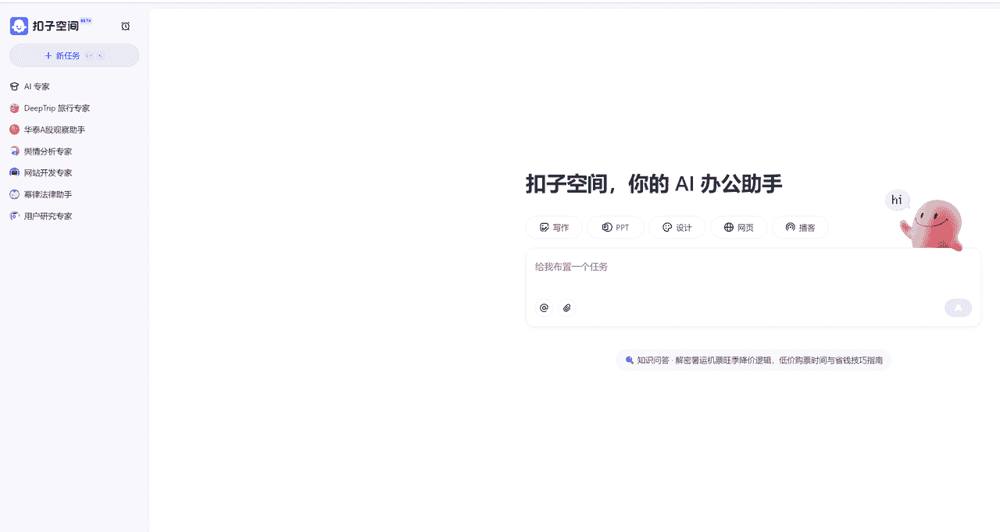
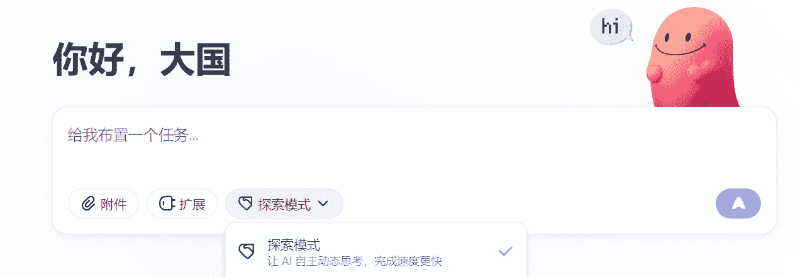
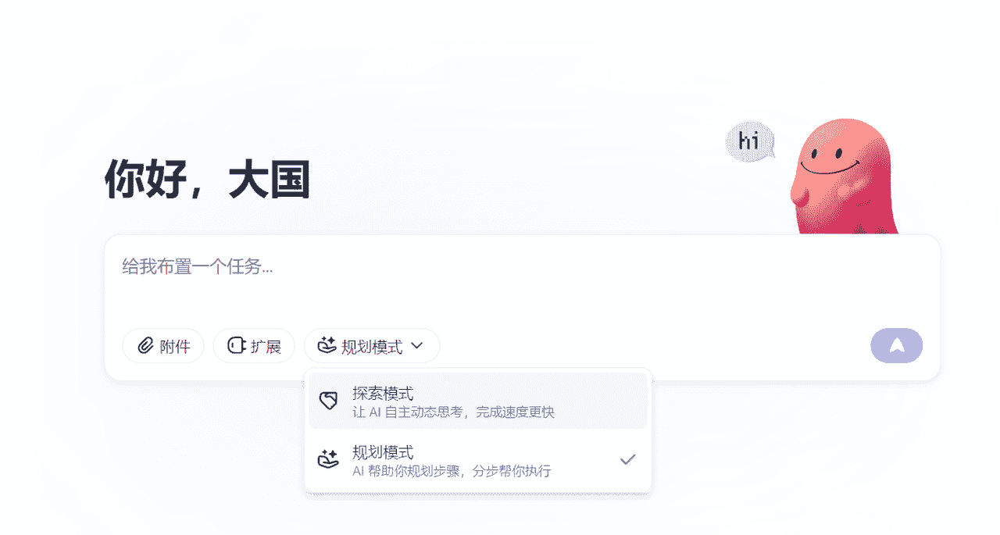
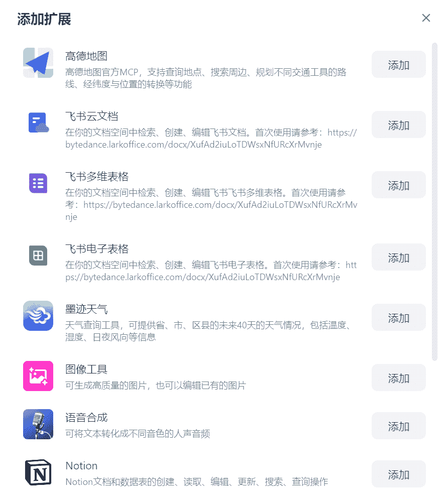
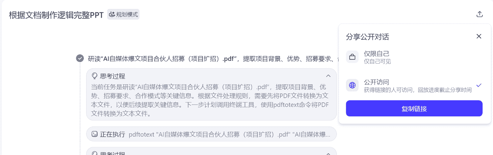
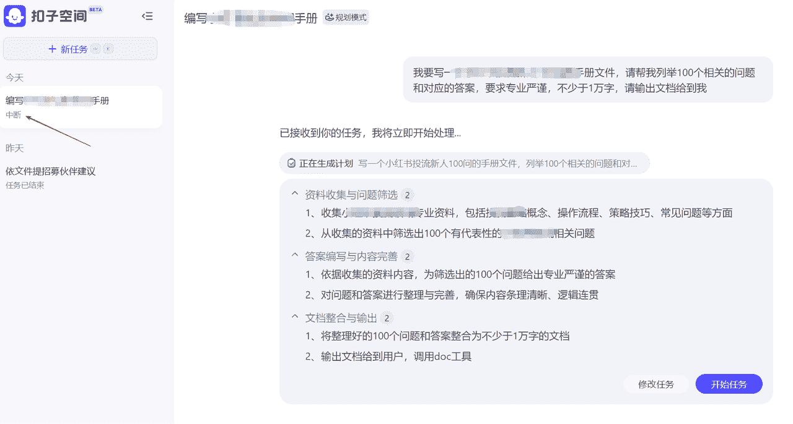
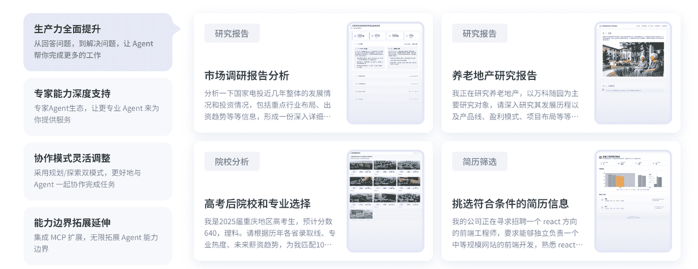
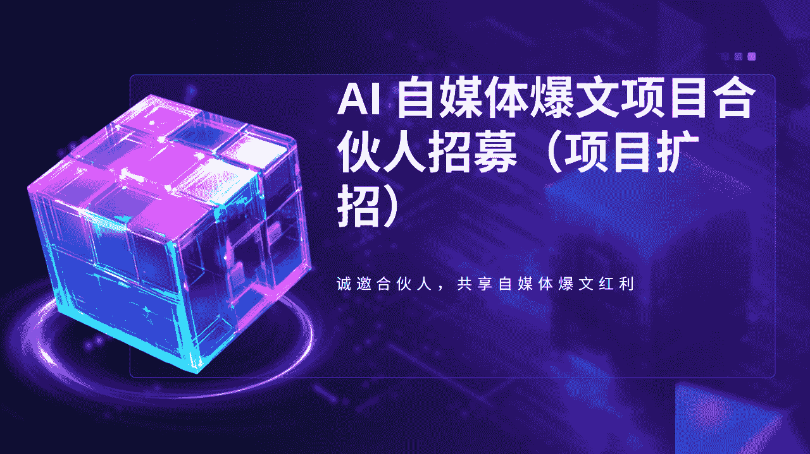
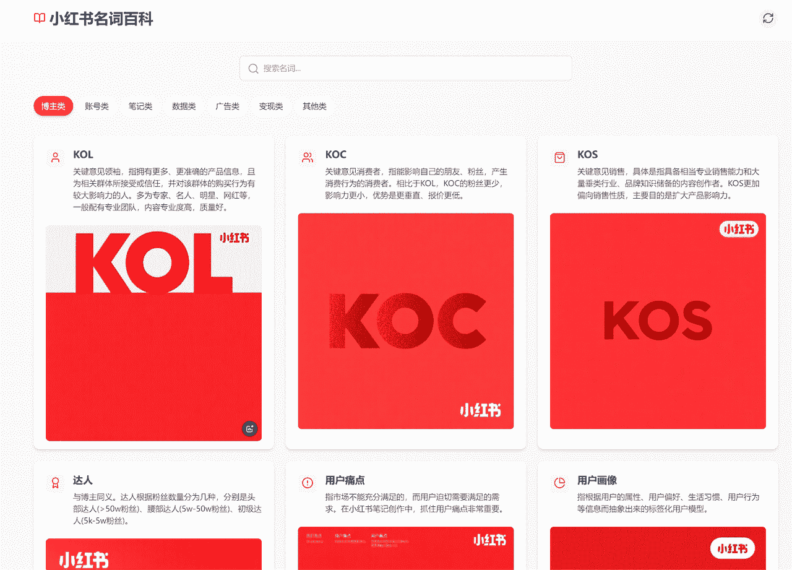

# 扣子空间学习手册（行业首发&持续更新 ing...）

> 来源：[https://yunyinghui.feishu.cn/docx/A9ZYd3ddioBtLext8VZcCMFRnTg](https://yunyinghui.feishu.cn/docx/A9ZYd3ddioBtLext8VZcCMFRnTg)

> **适用人群：**关注国内 Agent 发展及应用人群

> 首发时间：2025 年 4 月 19 日

> 更新时间：2025 年 4 月 23 日

> **内容出品人：**** **

> **内容出品方：**[玩赚 AI 实验室](https://yunyinghui.feishu.cn/wiki/WhelwZnxQi55mpkOzatc3Xran5b?from=from_copylink)

> **使用建议：**如果需要快速定位到精确内容，可以使用快捷键 Ctrl +F/Command +F 的形式，搜索关键字/词，查找你想要的内容。

> **持续更新扣子空间的****相关介绍及****动**态，使用技巧，实用案例等内容，永久免费在线查看，欢迎收藏转发支持，文末有惊喜。

> **关联阅读：**

> [Manus 学习手册（全网首发&持续更新 ing...) ](https://yunyinghui.feishu.cn/wiki/EHWlwTaUyihE00kBx0ocW2xsnRb?from=from_copylink)

# 🌈更新日志

# 一、扣子空间简介

## 基本介绍

4 月 18 日晚间，字节跳动扣子空间开启内测，定位通用 Agent。与其他类似产品如 manus 一样，扣子空间采用了邀请码制。扣子空间是用户和 AI Agent 协同办公的最佳场所。在这里，精通各项技能的通用实习生，各行各业的“领域专家”，任你选择。把任务交给扣子空间，把时间还给自己！

**体验网址：**[扣子空间 - AI 办公助手](https://www.coze.cn/s/99-CJHODzCk/)

## 产品定位

扣子空间的定位是通用型AI Agent，目标是帮助用户快速搭建和管理AI应用，简化工作流程，提高团队协作效率，支持跨职能协作，让用户能够专注于核心任务，而无需被枯燥的编排和设定所困扰。

## **发展历程**

+   2023年11月，海外版本coze上线，开始受到大家的关注。

+   2024年2月，国内版本扣子上线。

+   2024年7月，将免费版本设置为基础版，限制基础版免费资源和能力。

+   2024年10月，扣子平台UI全面升级，新增模版功能和全局小助手，用户可以一键复制使用模版功能。

+   2024年12月18号，扣子1.5版本发布，带来全新的AI应用开发环境、GUI搭建界面，并可一键发布为小程序、H5、API等多种应用形态。

+   2025年4月18日晚间，字节跳动扣子空间开启内测。

## 特点优势

来自扣子官方的介绍：

🌟从回答问题，到解决问题，让 Agent 帮你完成更多的工作

+   自动分析需求，拆解为多个子任务

+   自主调用工具（浏览器、代码编辑器等），执行任务

+   输出完整的结果报告，例如网页、PPT 、飞书文档等

🌟专家 Agent 生态，让更专业 Agent 来为你提供服务

+   「华泰 A 股观察助手」可以为你进行每日早报生成；针对股票分析问题，助手也能可以为你答疑解惑

+   「用户研究专家 」可以协助你进行用研资料深度分析，省时省力地助你获取更多用户洞察

🌟探索/规划双模式，更好地和 Agent 一起协作完成高难度任务

+   探索模式：让 AI 自主动态探索，完成速度更快

+   规划模式：让 AI 深度思考，适合高复杂性任务

🌟MCP 扩展集成，无限拓展 Agent 能力边界

+   首批官方支持飞书多维表格、高德地图、图像工具、语音合成等 MCP

+   即将支持「扣子开发平台」发布 MCP 至「扣子空间」

## 问题迭代

+   **技术稳定性有待提高**

在测试过程中，某些复杂任务处理的响应速度相对较慢，有时甚至出现页面不显示或结果无法生成的情况。例如，有用户在使用专家助手执行任务时，出现了Python脚本调用失败、API权限异常等Bug，导致任务长时间未能完成。

+   **存在“幻觉”现象**

在生成的内容中，可能会出现对某些时效性信息的错判，影响用户的信任度。如在生成的AI资讯页面中，对于“GPT - 5发布时间”的错判。

## 适合谁用

✅ 普通用户：直接体验现成的 AI Bot，比如学习、娱乐、办公助手

✅ 开发者/创作者：无需代码，快速搭建自己的 AI 应用。

✅ 企业/团队：低成本创建客服、培训等定制化 AI 工具

# 二、使用方法

## 使用入口

**使用地址：**[扣子空间 - AI 办公助手](https://www.coze.cn/s/99-CJHODzCk/)

## 区别对比

目前市面上主要的就是 Manus 和扣子空间。

**Manus 和扣子空间对比分析**

+   **Manus**：是 Monica 团队打造的全球首款通用型 Agent 产品，名称源于拉丁文“mens et manus”，寓意“知行合一”。其核心理念是为大语言模型（LLM）赋予“手”的能力，借助工具调用与任务执行，将抽象知识转化为实际操作，能独立思考、规划并执行复杂任务，在虚拟环境中灵活调用各类工具，最终直接交付完整的任务成果。

+   **扣子空间**：是字节跳动推出的 AI 平台，是用户和 AI Agent 协同办公的场所，有精通各项技能的「通用实习生」和各行各业的「领域专家」可供选择，能帮助用户完成任务。

大家也会拿来对比，其中主要区别如下：

#### 1）定价上

**Manus **采用**积分制收费**，基础版（39 美元/月）提供 3900 积分，专业版（199 美元/月）提供 19900 积分，积分消耗与任务复杂度挂钩。例如，设计并部署个性化网站需消耗 600 积分，耗时约 40 分钟。这种模式适合高频处理复杂任务的企业，但对个人用户或小型团队而言成本较高。

**扣子空间**提供目前是免费使用，支持基础功能（如文档解析、插件调用）。

#### 2）体验上

**Manus **强调**零干预自动化**，用户只需输入自然语言指令，系统即可完成任务拆解、工具调用和结果验证。例如，生成旅行攻**略时，它会自动**整合高德地图、墨迹天气等工具，输出分天行程、预算估算和注意事项。其过程可视化回放功能允许用户查看任务执行的每一步，增强信任感。然而，复杂任务的执行成本较高（如金融分析单次消耗约 2 美元），且存在逻辑错误等幻觉问题。

**扣子空间**任**务**处理高效流畅，能根据一句话指令迅速响应，完成从明确需求到搜索信息源、编程、设计网页 UI 及部署等一系列操作。有独特的探索、规划双模式，用户既可以让 AI Agent 自动处理任务，也能开启规划模式，与它携手攻克难题。应用场景广泛，能处理工作和生活中的多种需求，如生成网页报告、规划旅游攻略、制定减肥计划等。

#### 3）技术上

**Manus **采用**多智能体协作系统（MAS）**，内置**任务规划引**擎和沙盒环境，通过“规划-**执行-验证”**三阶段闭环实现复杂任务的全自动处理。例如，在股票分析场景中，它会自主拆解任务为数据爬取、财务指标计算、趋势预测等子步骤，并调用 Python 解释器、浏览器控制等工具链完成端到端交付。其技术亮点在于跨模态协同（如文本分析+图像生成）和强化学习优化，能根据用户反馈动态调整任务执行策略。

**扣子空间**任务处理高效流畅，能根据一句话指令迅速响应，完成从明确需求到搜索信息源、编程、设计网页 UI 及部署等一系列操作。 有独特的探索、规划双模式，用户既可以让 AI Agent 自动处理任务，也能开启规划模式，与它携手攻克难题。应用场景广泛，能处理工作和生活中的多种需求，如生成网页报告、规划旅游攻略、制定减肥计划等。

#### 4）场景上

**Manus **聚焦**标准化重度任务****，覆盖金融投研、医**疗诊**断、药物研发**等高价值场景。其全链路任务执行能力在 GAIA 基准测试中达到 86.5%的准确率，远超同类产品。例如，它能自动生成企业估值分析报告，整合财务数据、市场对比和增长预测，并输出交互式 HTML 文档。此外，Manus 支持异步任务执行，用户可离线提交需求（如股票分析），系统完成后自动推送结果，适合处理耗时较长的复杂需求。

**扣子空间**内置华泰 A 股观察助手专家 Agent 支持跟踪复盘自选股和大盘；内置用户研究专家 Agent 能帮助产品负责人和用户研究人员进行问卷分析、访谈纪要总结等工作；结合高德地图和墨迹天气规划旅游攻略；标准化任务，如周报生成、客服机器人、抖音 AI 分身、微信公众号客服机器人等低门槛应用。

# 三、使用技巧

## 1.模式解读

探索模式

AI 自主快速响应，适用于时效性强的任务。如果想让它一步到位输出，可以选择探索模式。例如，使用扣子的探索模式制定一份日本旅行攻略，扣子将推理过程的思维链与搜索深度结合，践行「边想边搜」，在获取到相关景点信息后，保存「景点信息」，开始「边想边做」，从景点中筛选出合适的景点并规划出行程安排，最终生成包含地图、景点介绍、必备日语短语及旅行提示的 html 旅行手册。

**

规划模**式

AI 深度思考与执行，专攻高复杂度项目。如果想亲自把控每个步骤，可以选择规划模式。例如，当提出“身高 180，体重 78 公斤，想在 3 个月内无器械减肥到 70 公斤”的需求时，它会迅速给出一个合理的减肥计划，并在用户确认后开始执行任务。

## 2.MCP 拓展

首批官方支持飞书多维表格、高德地图、图像工具、语音合成等 MCP（高德地图、飞书文档、飞书多维表格、语音合成等），让任务更好完成！

> **什么是 MCP？**

> Model Context Protocol （MCP） 是一个开放协议，它使 LLM 应用与外部数据源和工具之间的无缝集成成为可能。无论你是构建 AI 驱动的 IDE、改善 chat 交互，还是构建自定义的 AI 工作流，MCP 提供了一种标准化的方式，将 LLM 与它们所需的上下文连接起来。

> 目前，MCP 已经积累了足够的临界规模和动能，因此它被视为 2023-2025 年“代理开放标准”之争的潜在赢家。有人预计，按照当前的速度，MCP 将在 7 月超 OpenAPI。

## 3.对外权限

可以设置生成的过程对外是否展示，能确保一定的可控性。

## 4.体验总结

### 任务会中断

给扣子下发任务过程中，也会出现任务中断的情况。

### 用时会比较久

很多用户生成任务的过程中都表示，用时比较久，等待时间较长。

# 四、实操案例

## 官方案例

地址：https://www.coze.cn/space-preview

[扣子空间社区案例分享](https://bytedance.larkoffice.com/docx/JfsrdLwPxobdhDx2Sc3c1HgPnHf)

[扣子空间社区案例分享](https://bytedance.larkoffice.com/base/J41ebAsr8abq3tsTei7c6Rcrnkc?from=from_copylink)

## 用户案例

### 案例一：做 PPT

实操流程：[扣子空间](https://space.coze.cn/s/kTGfViMGy8k/)

效果展示：

[AI自媒体爆文项目合伙人招募-548754eefe.pdf](https://internal-api-drive-stream.feishu.cn/space/api/box/stream/download/all/Dvo7bJKhIoA0yYxnuGfcK4aZnjb)

**使用评价：**有一定的美观度和相关度，但是离真正能用还是有点距离...

### 案例二：做网页

**实操流程：**[扣子空间](https://space.coze.cn/s/li9h0rhnEO0/)

**效果展示：**小红书名词百科介绍与网页制作需求说明

**使用评价：**还行，能正常用着，感觉效果也还可以，可以再优化一下提示词！

---

# 智能体学习交流社群

1.持续关注并更新** A**I 智能体的相**关**资讯动态，研究报告，赚钱案例，常见问题，已建立社群聊聊 AI 发展及应用，没进群的可以扫码加入，群满可加 AI 研究爱好者大国微信 ID：zyg90s（备注：AI），已经在社群内的无需重复加入。

2.**关于文档负责人大国**：7 年老运营，互联网流量观察家，曾就职于互联网大厂，现研究 AI 实战应用，努力成为最懂 AI 的运营人。

**5000人飞书学习交流群**

**5000人飞书学习交流群**

**微信入群渠道**

进群或者加好友了解更多 AI 智能体实战案例

**觉得有用欢迎留个赞**