# 扣子空间实战案例宝典（持续更新中...

> 来源：[https://yunyinghui.feishu.cn/docx/Wb6Rd6ju3ojaHSxJglUcTF4tncg](https://yunyinghui.feishu.cn/docx/Wb6Rd6ju3ojaHSxJglUcTF4tncg)

> **适用人群：**关注国内 Agent 发展及应用人群

> 首发时间：2025 年 9 月 1 日

> 更新时间：2025 年 9 月 1 日

> **内容出品人：**** **** **

> **内容出品方：**[玩赚 AI 实验室](https://yunyinghui.feishu.cn/wiki/WhelwZnxQi55mpkOzatc3Xran5b?from=from_copylink)

> **使用建议：**如果需要快速定位到精确内容，可以使用快捷键 Ctrl +F/Command +F 的形式，搜索关键字/词，查找你想要的内容。

> **持续更新扣子空间的****相关使用技巧，实用案例等内容，****永久免费在****线**查看，欢迎收藏转发支持，文末有惊喜。

2025 年 4 月，字节版的“Manus”横空出世，时至今日，进化功能无比强大！如果你问我哪个 AI 工具做海报，做 PPT，做播客更可用，更优质，那扣子空间必须算上一个！不仅仅如此，这还是一个完全免费的工具，简直就是职场人的大救星！

> 话不多说，直接上链接，还没注册的抓紧注册一个！

> https://www.coze.cn/s/99-CJHODzCk/

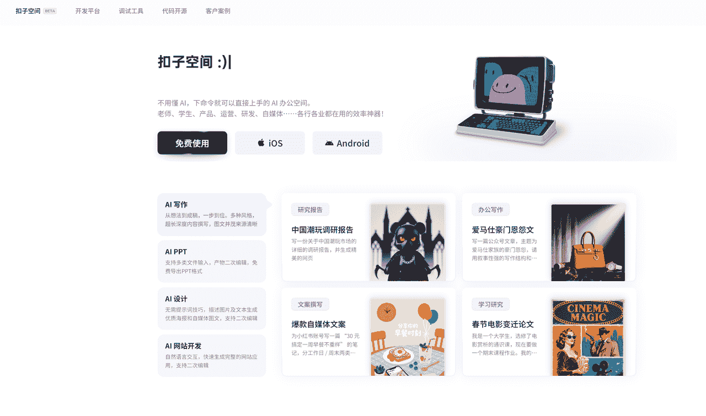

# 一、扣子空间简介

## 扣子空间是个啥？

扣子空间，就是你的 AI 万能助手！它能学能聊能干事儿。它是一个让用户与 AI 智能体高效协作的工具，旨在成为用户与 AI Agent 协同办公的最佳场所！

> **Agent 分类**

> **通用 Agent:**好比一位精通各项技能的"通用实习生"，能够精准洞察你的需求，自动拆解需求并规划计划，高

> 效执行，最终交付高质量的成果。

> **专家 Agent:**好比一位领域内的"资深专家"，专注于垂直领域的专业工作。例如用户研究专家 Agent，它能够助力产品负责人与专业人员撰写问卷、分析问卷、撰写访谈提纲、总结纪要，强化团队的用户洞察力。华泰 A 股观察助手专家 Agent 能基于专业数据和框架进行个股分析和行研每日为投资者总结自选股的最新情况，并以早报的形式发送，也能执行复杂的分析需求。

## 凭啥选它？四大特点！

+   **双工作模式：**支持 “探索模式” 和 “规划模式”。探索模式下 AI 自动快速执行任务，适合简单需求；规划模式下 AI 先拆解任务步骤，用户可随时介入调整，适合复杂任务。

+   **智能体类型丰富：**内置通用智能体和专家智能体。通用智能体可以自动整理信息，生成报告、网页、PPT 等，还能自动搜索扩展关键词，完成资料搜集，在规划模式下可模拟操作电脑、浏览网页等；专家智能体针对特定领域，如 “用户研究专家” 和 “华泰 A 股观察助手”，能处理更复杂的任务，如生成用户调研报告、股票分析等。

+   **MCP 协议支持：**通过 MCP 协议，可接入飞书、多维表格、高德地图、语音合成等插件，极大扩展了 AI 的能力边界，用户还可以自定义插件，持续拓展智能体的能力。

+   **快速创建智能体：**提供直观的界面和强大的工具，帮助用户快速创建 AI 智能体，用户只需输入智能体的名称和功能介绍，系统就会自动生成一个头像，甚至可以根据用户的需求自动创建智能体。

# 二、实战案例

## 💻️实用编程类：

## 网页制作

嗯？还在花几万块定制化一个网页？你就 out 啦！

> **输入魔法指令**：分析一下国家电投近几年整体的发展情况和投资情况，包括重点行业布局、出资趋势等等信息，形成一份深入详细的报告，同时做一个可视化的网页


可以看到 Coze 智能体提供的数据非常详细，还有模有样的，在这个基础上修改，岂不是立省几万？

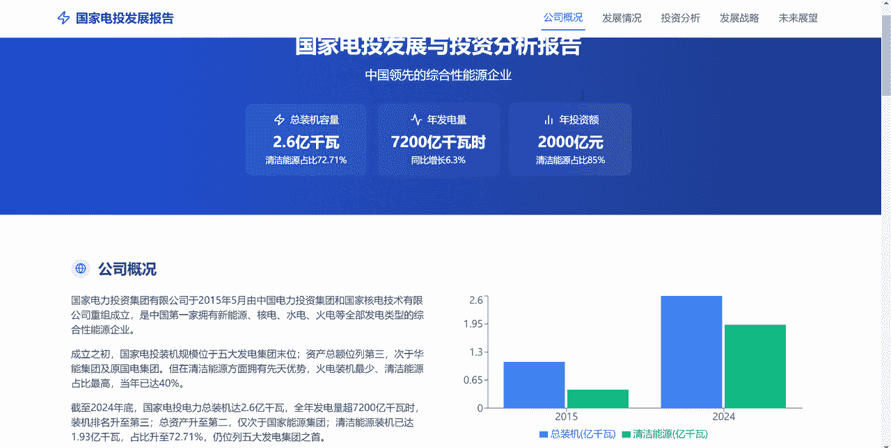

## Web 应用设计

30s 做一个应用，时间管理大师就是我！

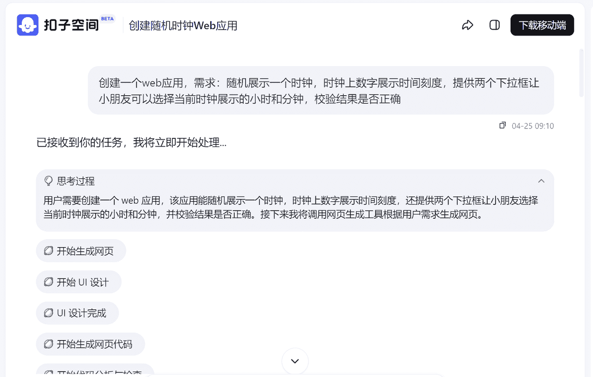

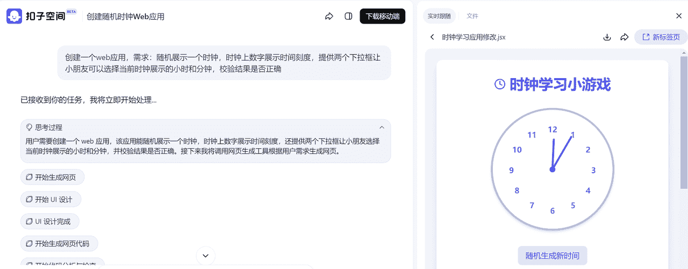

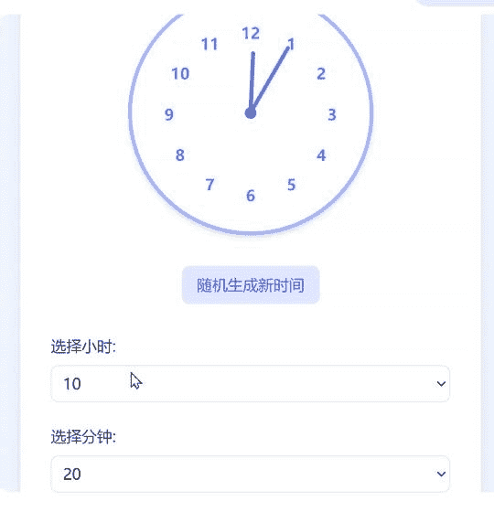

[chrome_nv0PDLhupR.mp4](https://internal-api-drive-stream.feishu.cn/space/api/box/stream/download/all/WdnlbJp1BoNFbbx7P93csdV4n4e)

经过测试，扣子空间生成的简单 Web 应用是实际可操作的。

## 算法设计

算法工程师看完直接汗流浃背，一些基础算法甚至可以直接可视化其算法流程。

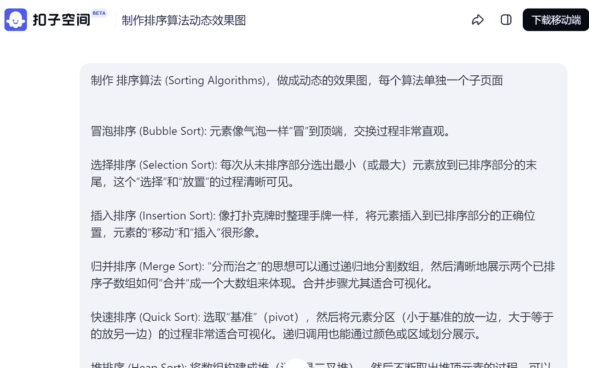

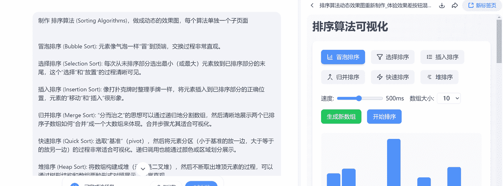

Coze 智能体不仅成功复现了排序算法的动态效果图，还生成了算法原理流程图

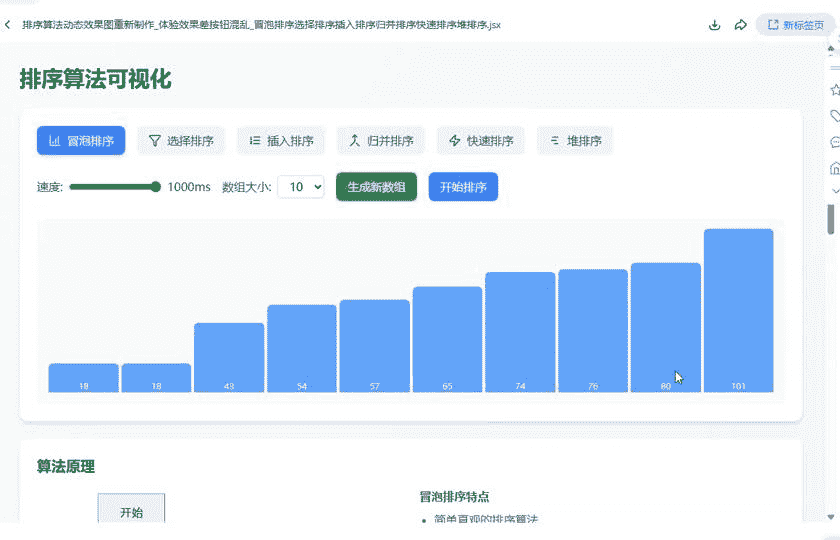

[NVIDIA_Overlay_CWwUWz01Fb.mp4](https://internal-api-drive-stream.feishu.cn/space/api/box/stream/download/all/B5PNbnPADouNr0x85Sec0oidnRe)

## 系统构建

产品经理拿到用户需求没思路？用扣子帮你扩充一下完整系统！

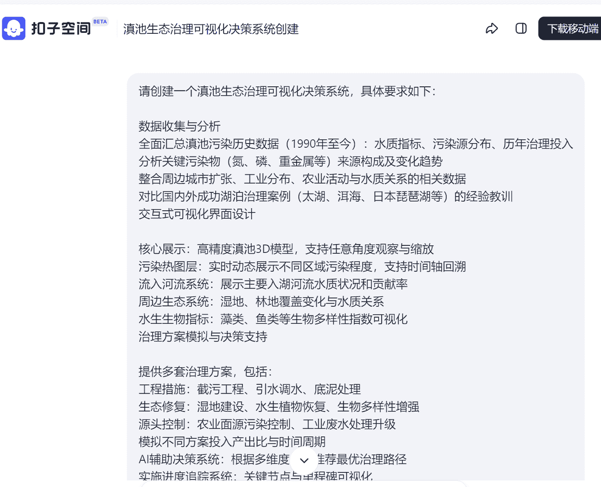

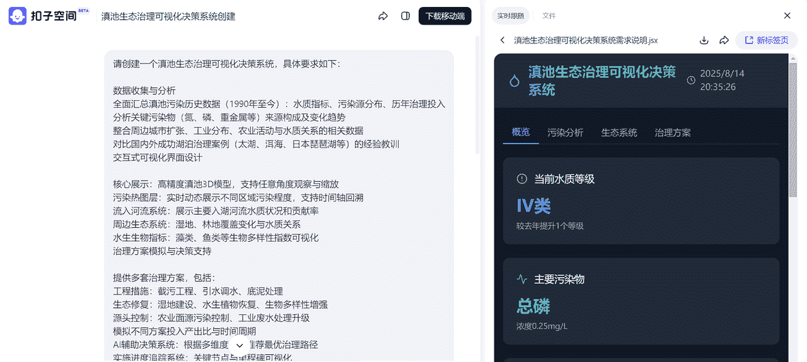

Coze 智能生成的实时热力图和数据统计图，大大简化了决策难度。

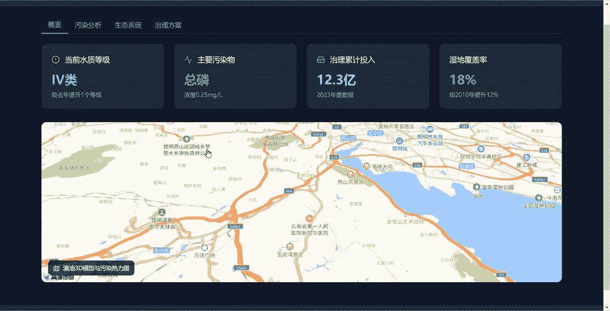

[chrome_afWRLmQO3A.mp4](https://internal-api-drive-stream.feishu.cn/space/api/box/stream/download/all/Vi3ybZVYxoD4R5xdpfvcGYqvn4g)

## 游戏开发

让扣子给我们开发一个经典的俄罗斯方块小游戏。可以看到他会自动帮我们设计 ui 和实际代码完成一个完整的游戏。

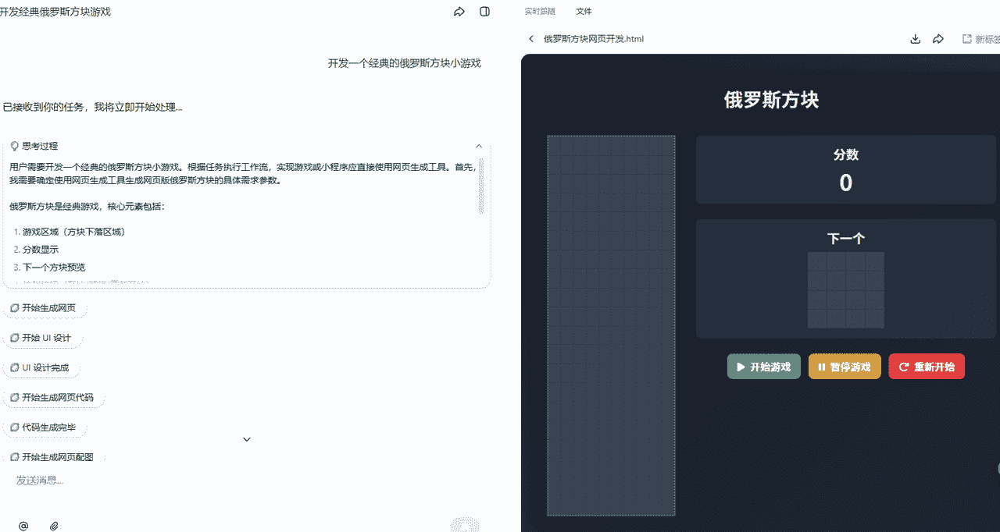

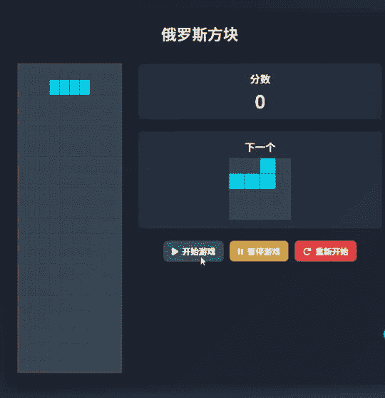

[NVIDIA_Overlay_15T9nqeAWY.mp4](https://internal-api-drive-stream.feishu.cn/space/api/box/stream/download/all/HE9lbks0go783UxwswXcnR1kn5c)

## 网站搭建

生成一个常用 ai 工具的网站导航，coze 自动帮我们完成了代码和前端设计。

```
&lt;!DOCTYPE html&gt;
&lt;html lang=&quot;zh-CN&quot;&gt;
&lt;head&gt;
    &lt;meta charset=&quot;UTF-8&quot;&gt;
    &lt;meta name=&quot;viewport&quot; content=&quot;width=device-width, initial-scale=1.0&quot;&gt;
    &lt;title&gt;AI工具导航 - 一站式发现优质AI工具&lt;/title&gt;
    &lt;script src=&quot;https://cdn.tailwindcss.com/3.3.3&quot;&gt;&lt;/script&gt;
    &lt;link rel=&quot;stylesheet&quot; href=&quot;https://cdnjs.cloudflare.com/ajax/libs/font-awesome/6.7.2/css/all.min.css&quot;&gt;
    &lt;style&gt;
        body {
            font-family: &#x27;Inter&#x27;, &#x27;Noto Sans SC&#x27;, sans-serif;
            background-color: #f8fafc;
            color: #1e293b;
        }
        .card-hover {
            transition: all 0.3s ease;
        }
        .card-hover:hover {
            transform: translateY(-5px);
            box-shadow: 0 10px 25px -5px rgba(0, 0, 0, 0.1);
        }
        .category-chip {
            transition: all 0.2s ease;
        }
        .category-chip:hover {
            transform: scale(1.05);
        }
        .search-input:focus {
            box-shadow: 0 0 0 3px rgba(99, 102, 241, 0.2);
        }
        .tool-link {
            position: relative;
        }
        .tool-link::after {
            content: &#x27;&#x27;;
            position: absolute;
            bottom: -2px;
            left: 0;
            width: 0;
            height: 2px;
            background-color: #6366f1;
            transition: width 0.3s ease;
        }
        .tool-link:hover::after {
            width: 100%;
        }
    &lt;/style&gt;
&lt;/head&gt;
&lt;body class=&quot;min-h-screen&quot;&gt;
    &lt;!-- 导航栏 --&gt;
    &lt;nav class=&quot;bg-white shadow-sm sticky top-0 z-50&quot;&gt;
        &lt;div class=&quot;container mx-auto px-4 py-3 flex items-center justify-between&quot;&gt;
            &lt;div class=&quot;flex items-center&quot;&gt;
                &lt;i class=&quot;fas fa-robot text-indigo-600 text-2xl mr-2&quot;&gt;&lt;/i&gt;
               
```


[NVIDIA_Overlay_ipTSFKM6lG.mp4](https://internal-api-drive-stream.feishu.cn/space/api/box/stream/download/all/UOMEb8X8woO9n5xCTzOcTiXFnAi)

## 🖌️设计创作类：

## 视频生成

什么！我们看的热门视频居然是一键生成的？学会了他，想看什么视频就自己生成！轻轻松松做副业挣钱！

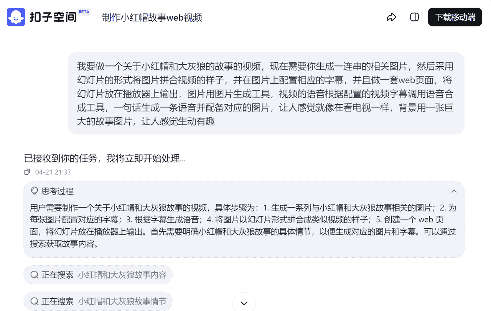

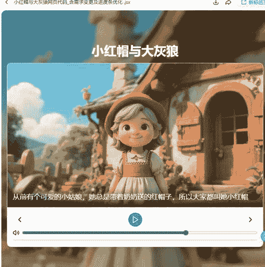

[NVIDIA_Overlay_CBD30iB1nW.mp4](https://internal-api-drive-stream.feishu.cn/space/api/box/stream/download/all/HF1YbJRjno4vOvxH9ulcZ6cXnng)

Coze 智能体生成的视频虽然人物一致性稍有欠缺，但总体效果还是相当不错的。

## **品牌周边设计**

想给品牌设计周边，一样可以用扣子空间！

```
请基于以下详细要求，设计一套完整的&quot;万象AI实验室&quot;品牌包装视觉系统：  
1. 品牌核心要素:    
* 品牌名称：万象AI实验室    
* LOGO：花体英文字体设计    
* 主色调：浅蓝色(#64b4d8)和纯白色    
* 背景处理：白色渐变至浅蓝色的过渡效果    
* 字体要求：全系列包装采用统一风格的字体系统  

2. 包装设计范围 (需包含但不限于)：    
* 纸质手提袋    
* 透明咖啡杯    
* 菜单设计    
* 名片规范    
* 纸杯样式    
* 其他品牌周边包装  

3. 设计原则:    
* 视觉统一性：在所有包装形式上保持品牌元素的一致性    
* 信息布局：合理平衡品牌名称展示与产品信息传达    
* 延展性：设计需具备跨不同媒介和尺寸的可扩展性    
* 品牌调性：传达高品质、有格调的专业形象  

4. 技术与质感要求:    
* 采用C4D建模技术呈现包装立体效果    
* 模拟高级摄影质感的光影处理    
* 严格限定色彩使用，不得出现规定色系外的其他颜色  请提供完整的视觉设计方案，包含各包装的正面/侧面/背面视图，以及整体品牌视觉系统的规范说明。
```

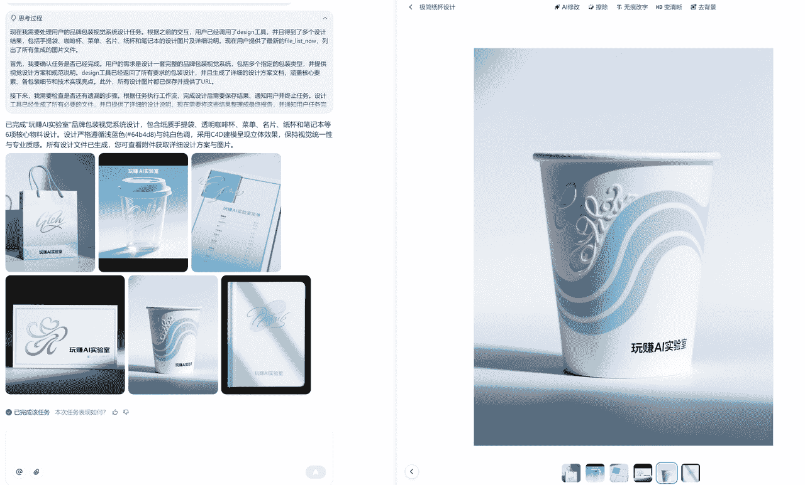

##  宣传海报设计

想要设计宣传海报？当然也没有问题！

```
请设计一张手绘风格的直播海报，需包含以下核心信息和设计要求：  
一、核心内容要素 
1. 主标题：AI编程共学~ 解锁零基础入门编程+实操落地 精彩案例展示✖️高效技巧传递！ 
2. 活动形式：飞书会议直播 
3. 时间信息：9月10日 20:00-22:00  

二、设计风格要求 
1. 手绘风格：整体采用温暖、亲切的手绘质感，线条可略带随意感，色彩以明快活泼为主色调 
2. 视觉元素：    
- 需包含编程相关的手绘图标（如代码符号、电脑、AI机器人等）    
- 可添加学习场景元素（如笔记本、铅笔、灯泡等创意符号）    
- 建议设计一个简洁的&quot;共学&quot;概念图形（如多人协作的抽象表现）  
 三、布局建议 
1. 标题文字采用手写风格字体，重点词语（如&quot;AI编程共学&quot;、&quot;零基础入门&quot;、&quot;实操落地&quot;）可做放大或色彩突出处理 
2. 时间信息放置在显眼位置，可设计成日历或时钟的手绘图形样式 
3. 整体构图需留出适当空白，避免元素过于拥挤  

四、色彩方案 建议以2-3种主色调为主，可参考以下组合： 
- 方案A：科技蓝+活力橙+白色背景（体现科技感与学习热情） 
- 方案B：草绿色+暖黄色+米色背景（营造轻松自然的学习氛围）
```

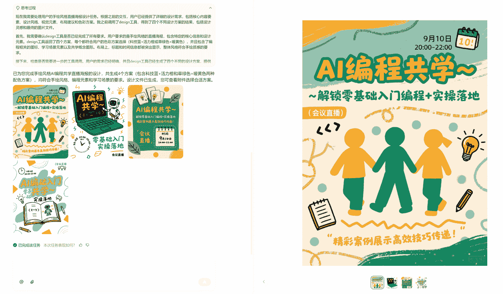

## 音乐创作

让扣子生成一首好听的原创流行乐，下面我们放送我们的第一首 ai“原创歌曲”。

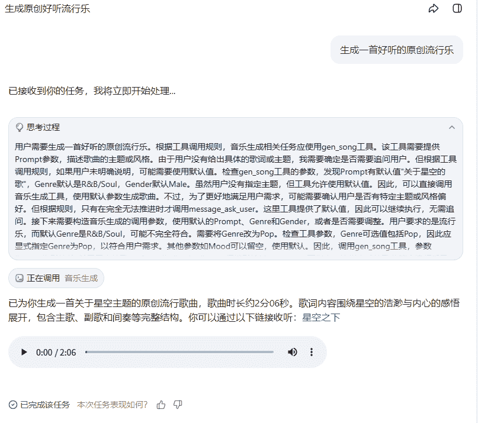

```
{
  &quot;执行参数&quot;: {
    &quot;Genre&quot;: &quot;Pop&quot;,
    &quot;Prompt&quot;: &quot;关于星空的歌&quot;
  },
  &quot;执行结果&quot;: {
    &quot;code&quot;: 0,
    &quot;data&quot;: {
      &quot;FailureReason&quot;: {
        &quot;Code&quot;: 0,
        &quot;Msg&quot;: &quot;&quot;
      },
      &quot;SongDetail&quot;: {
        &quot;AudioUrl&quot;: &quot;https://lf-bot-studio-plugin-resource.coze.cn/obj/bot-studio-platform-plugin-tos/artist/image/44677c59030c4359a2d06b9d07ea26a0.wav&quot;,
        &quot;Captions&quot;: &quot;{\&quot;attribute\&quot;:{\&quot;extra\&quot;:{\&quot;is_singing\&quot;:\&quot;False\&quot;,\&quot;language\&quot;:\&quot;zh-CN\&quot;,\&quot;sta_use_batch_request\&quot;:\&quot;False\&quot;,\&quot;asr_service\&quot;:\&quot;asr\&quot;,\&quot;caption_type\&quot;:\&quot;singing\&quot;}},\&quot;code\&quot;:0,\&quot;duration\&quot;:126.573875,\&quot;id\&quot;:\&quot;9778f892-5233-4756-964c-5425fe26202a\&quot;,\&quot;message\&quot;:\&quot;Success\&quot;,\&quot;utterances\&quot;:[{\&quot;attribute\&quot;:{},\&quot;end_time\&quot;:4702,\&quot;start_time\&quot;:1623,\&quot;text\&quot;:\&quot;[intro]\&quot;,\&quot;words\&quot;:[{\&quot;attribute\&quot;:{},\&quot;end_time\&quot;:1623,\&quot;start_time\&quot;:1623,\&quot;text\&quot;:\&quot;[\&quot;},{\&quot;attribute\&quot;:{},\&quot;end_time\&quot;:2816,\&quot;start_time\&quot;:1623,\&quot;text\&quot;:\&quot;intro\&quot;},{\&quot;attribute\&quot;:{},\&quot;end_time\&quot;:4702,\&quot;start_time\&quot;:2816,\&quot;text\&quot;:\&quot;]\&quot;}]},{\&quot;attribute\&quot;:{},\&quot;end_time\&quot;:8942,\&quot;start_time\&quot;:4703,\&quot;text\&quot;:\&quot;[chorus]\&quot;,\&quot;words\&quot;:[{\&quot;attribute\&quot;:{},\&quot;end_time\&quot;:4703,\&quot;start_time\&quot;:4703,\&quot;text\&quot;:\&quot;[\&quot;},{\&quot;attribute\&quot;:{},\&quot;end_time\&quot;:7016,\&quot;start_time\&quot;:4703,\&quot;text\&quot;:\&quot;chorus\&quot;},{\&quot;attribute\&quot;:{},\&quot;end_time\&quot;:8942,\&quot;start_time\&quot;:7016,\&quot;text\&quot;:\&quot;]\&quot;}]},{\&quot;attribute\&quot;:{},\&quot;end_time\&quot;:14662,\&quot;start_time\&quot;:8943,\&quot;text\&quot;:\&quot;在星空中感受宇宙的浩渺\&quot;,\&quot;words\&quot;:[{\&quot;attribute\&quot;:{},\&quot;end_time\&quot;:9296,\&quot;start_time\&quot;:8943,\&quot;text\&quot;:\&quot;在\&quot;},{\&quot;attribute\&quot;:{},\&quot;end_time\&quot;:9780,\&quot;start_time\&quot;:9463,\&quot;text\&quot;:\&quot;星\&quot;},{\&quot;attribute\&quot;:{},\&quot;end_time\&quot;:10096,\&quot;start_time\&quot;:9780,\&quot;text\&quot;:\&quot;空\&quot;},{\&quot;attribute\&quot;:{},\&quot;end_time\&quot;:10656,\&quot;start_time\&quot;:10303,\&quot;text\&quot;:\&quot;中\&quot;},{\&quot;attribute\&quot;:{},\&quot;end_time\&quot;:11000,\&quot;start_time\&quot;:10783,\&quot;text\&quot;:\&quot;感\&quot;},{\&quot;attribute\&quot;:{},\&quot;end_time\&quot;:11216,\&quot;start_time\&quot;:11000,\&quot;text\&quot;:\&quot;受\&quot;},{\&quot;attribute\&quot;:{},\&quot;end_time\&quot;:12060,\&quot;start_time\&quot;:11863,\&quot;text\&quot;:\&quot;宇\&quot;},{\&quot;attribute\&quot;:{},\&quot;end_time\&quot;:12256,\&quot;start_time\&quot;:12060,\&quot;text\&quot;:\&quot;宙\&quot;},{\&quot;attribute\&quot;:{},\&quot;end_time\&quot;:12920,\&quot;start_time\&quot;:12623,\&quot;text\&quot;:\&quot;的\&quot;},{\&quot;attribute\&quot;:{},\&quot;end_time\&quot;:13080,\&quot;start_time\&quot;:12920,\&quot;text\&quot;:\&quot;浩\&quot;},{\&quot;attribute\&quot;:{},\&quot;end_time\&quot;:13296,\&quot;start_time\&quot;:13080,\&quot;text\&quot;:\&quot;渺\&quot;},{\&quot;attribute\&quot;:{},\&quot;end_time\&quot;:14662,\&quot;start_time\&quot;:13296,\&quot;text\&quot;:\&quot;\&quot;}]},{\&quot;attribute\&quot;:{},\&quot;end_time\&quot;:20502,\&quot;start_time\&quot;:14663,\&quot;text\&quot;:\&quot;思绪飘飞无尽远方不再渺小\&quot;,\&quot;words\&quot;:[{\&quot;attribute\&quot;:{},\&quot;end_time\&quot;:14860,\&quot;start_time\&quot;:14663,\&quot;text\&quot;:\&quot;思\&quot;},{\&quot;attribute\&quot;:{},\&quot;end_time\&quot;:15056,\&quot;start_time\&quot;:14860,\&quot;text\&quot;:\&quot;绪\&quot;},{\&quot;attribute\&quot;:{},\&quot;end_time\&quot;:15520,\&quot;start_time\&quot;:15183,\&quot;text\&quot;:\&quot;飘\&quot;},{\&quot;attribute\&quot;:{},\&quot;end_time\&quot;:15780,\&quot;start_time\&quot;:15520,\&quot;text\&quot;:\&quot;飞\&quot;},{\&quot;attribute\&quot;:{},\&quot;end_time\&quot;:15920,\&quot;start_time\&quot;:15780,\&quot;text\&quot;:\&quot;无\&quot;},{\&quot;attribute\&quot;:{},\&quot;end_time\&quot;:16136,\&quot;start_time\&quot;:15920,\&quot;text\&quot;:\&quot;尽\&quot;},{\&quot;attribute\&quot;:{},\&quot;end_time\&quot;:16440,\&quot;start_time\&quot;:16223,\&quot;text\&quot;:\&quot;远\&quot;},{\&quot;attribute\&quot;:{},\&quot;end_time\&quot;:16656,\&quot;start_time\&quot;:16440,\&quot;text\&quot;:\&quot;方\&quot;},{\&quot;attribute\&quot;:{},\&quot;end_time\&quot;:17140,\&quot;start_time\&quot;:16823,\&quot;text\&quot;:\&quot;不\&quot;},{\&quot;attribute\&quot;:{},\&quot;end_time\&quot;:17456,\&quot;start_time\&quot;:17140,\&quot;text\&quot;:\&quot;再\&quot;},{\&quot;attribute\&quot;:{},\&quot;end_time\&quot;:19060,\&quot;start_time\&quot;:18863,\&quot;text\&quot;:\&quot;渺\&quot;},{\&quot;attribute\&quot;:{},\&quot;end_time\&quot;:19256,\&quot;start_time\&quot;:19060,\&quot;text\&quot;:\&quot;小\&quot;},{\&quot;attribute\&quot;:{},\&quot;end_time\&quot;:20502,\&quot;start_time\&quot;:19256,\&quot;text\&quot;:\&quot;\&quot;}]},{\&quot;attribute\&quot;:{},\&quot;end_time\&quot;:24982,\&quot;start_time\&quot;:20503,\&quot;text\&quot;:\&quot;孤独是我与星空的暗号\&quot;,\&quot;words\&quot;:[{\&quot;attribute\&quot;:{},\&quot;end_time\&quot;:20700,\&quot;start_time\&quot;:20503,\&quot;text\&quot;:\&quot;孤\&quot;},{\&quot;attribute\&quot;:{},\&quot;end_time\&quot;:20896,\&quot;start_time\&quot;:20700,\&quot;text\&quot;:\&quot;独\&quot;},{\&quot;attribute\&quot;:{},\&quot;end_time\&quot;:21696,\&quot;start_time\&quot;:21343,\&quot;text\&quot;:\&quot;是\&quot;},{\&quot;attribute\&quot;:{},\&quot;end_time\&quot;:22216,\&quot;start_time\&quot;:21863,\&quot;text\&quot;:\&quot;我\&quot;},{\&quot;attribute\&quot;:{},\&quot;end_time\&quot;:22660,\&quot;start_time\&quot;:22343,\&quot;text\&quot;:\&quot;与\&quot;},{\&quot;attribute\&quot;:{},\&quot;end_time\&quot;:22960,\&quot;start_time\&quot;:22660,\&quot;text\&quot;:\&quot;星\&quot;},{\&quot;attribute\&quot;:{},\&quot;end_time\&quot;:23296,\&quot;start_time\&quot;:22960,\&quot;text\&quot;:\&quot;空\&quot;},{\&quot;attribute\&quot;:{},\&quot;end_time\&quot;:23776,\&quot;start_time\&quot;:23423,\&quot;text\&quot;:\&quot;的\&quot;},{\&quot;attribute\&quot;:{},\&quot;end_time\&quot;:24296,\&quot;start_time\&quot;:23943,\&quot;text\&quot;:\&quot;暗\&quot;},{\&quot;attribute\&quot;:{},\&quot;end_time\&quot;:24816,\&quot;start_time\&quot;:24463,\&quot;text\&quot;:\&quot;号\&quot;},{\&quot;attribute\&quot;:{},\&quot;end_time\&quot;:24982,\&quot;start_time\&quot;:24816,\&quot;text\&quot;:\&quot;\&quot;}]},{\&quot;attribute\&quot;:{},\&quot;end_time\&quot;:27022,\&quot;start_time\&quot;:24983,\&quot;text\&quot;:\&quot;黑暗里静静闪耀\&quot;,\&quot;words\&quot;:[{\&quot;attribute\&quot;:{},\&quot;end_time\&quot;:25180,\&quot;start_time\&quot;:24983,\&quot;text\&quot;:\&quot;黑\&quot;},{\&quot;attribute\&quot;:{},\&quot;end_time\&quot;:25376,\&quot;start_time\&quot;:25180,\&quot;text\&quot;:\&quot;暗\&quot;},{\&quot;attribute\&quot;:{},\&quot;end_time\&quot;:25780,\&quot;start_time\&quot;:25503,\&quot;text\&quot;:\&quot;里\&quot;},{\&quot;attribute\&quot;:{},\&quot;end_time\&quot;:25940,\&quot;start_time\&quot;:25780,\&quot;text\&quot;:\&quot;静\&quot;},{\&quot;attribute\&quot;:{},\&quot;end_time\&quot;:26176,\&quot;start_time\&quot;:25940,\&quot;text\&quot;:\&quot;静\&quot;},{\&quot;attribute\&quot;:{},\&quot;end_time\&quot;:26500,\&quot;start_time\&quot;:26303,\&quot;text\&quot;:\&quot;闪\&quot;},{\&quot;attribute\&quot;:{},\&quot;end_time\&quot;:26696,\&quot;start_time\&quot;:26500,\&quot;text\&quot;:\&quot;耀\&quot;},{\&quot;attribute\&quot;:{},\&quot;end_time\&quot;:27022,\&quot;start_time\&quot;:26696,\&quot;text\&quot;:\&quot;\&quot;}]},{\&quot;attribute\&quot;:{},\&quot;end_time\&quot;:29422,\&quot;start_time\&quot;:27023,\&quot;text\&quot;:\&quot;[verse]\&quot;,\&quot;words\&quot;:[{\&quot;attribute\&quot;:{},\&quot;end_time\&quot;:27023,\&quot;start_time\&quot;:27023,\&quot;text\&quot;:\&quot;[\&quot;},{\&quot;attribute\&quot;:{},\&quot;end_time\&quot;:27776,\&quot;start_time\&quot;:27023,\&quot;text\&quot;:\&quot;verse\&quot;},{\&quot;attribute\&quot;:{},\&quot;end_time\&quot;:29422,\&quot;start_time\&quot;:27776,\&quot;text\&quot;:\&quot;]\&quot;}]},{\&quot;attribute\&quot;:{},\&quot;end_time\&quot;:33622,\&quot;start_time\&quot;:29423,\&quot;text\&quot;:\&quot;星球的运转轨道\&quot;,\&quot;words\&quot;:[{\&quot;attribute\&quot;:{},\&quot;end_time\&quot;:29620,\&quot;start_time\&quot;:29423,\&quot;text\&quot;:\&quot;星\&quot;},{\&quot;attribute\&quot;:{},\&quot;end_time\&quot;:29816,\&quot;start_time\&quot;:29620,\&quot;text\&quot;:\&quot;球\&quot;},{\&quot;attribute\&quot;:{},\&quot;end_time\&quot;:30376,\&quot;start_time\&quot;:30023,\&quot;text\&quot;:\&quot;的\&quot;},{\&quot;attribute\&quot;:{},\&quot;end_time\&quot;:30840,\&quot;start_time\&quot;:30503,\&quot;text\&quot;:\&quot;运\&quot;},{\&quot;attribute\&quot;:{},\&quot;end_time\&quot;:31176,\&quot;start_time\&quot;:30840,\&quot;text\&quot;:\&quot;转\&quot;},{\&quot;attribute\&quot;:{},\&quot;end_time\&quot;:31520,\&quot;start_time\&quot;:31303,\&quot;text\&quot;:\&quot;轨\&quot;},{\&quot;attribute\&quot;:{},\&quot;end_time\&quot;:31736,\&quot;start_time\&quot;:31520,\&quot;text\&quot;:\&quot;道\&quot;},{\&quot;attribute\&quot;:{},\&quot;end_time\&quot;:33622,\&quot;start_time\&quot;:31736,\&quot;text\&quot;:\&quot;\&quot;}]},{\&quot;attribute\&quot;:{},\&quot;end_time\&quot;:37342,\&quot;start_time\&quot;:33623,\&quot;text\&quot;:\&quot;指引着迷茫的寻找\&quot;,\&quot;words\&quot;:[{\&quot;attribute\&quot;:{},\&quot;end_time\&quot;:33820,\&quot;start_time\&quot;:33623,\&quot;text\&quot;:\&quot;指\&quot;},{\&quot;attribute\&quot;:{},\&quot;end_time\&quot;:34016,\&quot;start_time\&quot;:33820,\&quot;text\&quot;:\&quot;引\&quot;},{\&quot;attribute\&quot;:{},\&quot;end_time\&quot;:34576,\&quot;start_time\&quot;:34223,\&quot;text\&quot;:\&quot;着\&quot;},{\&quot;attribute\&quot;:{},\&quot;end_time\&quot;:34900,\&quot;start_time\&quot;:34703,\&quot;text\&quot;:\&quot;迷\&quot;},{\&quot;attribute\&quot;:{},\&quot;end_time\&quot;:35096,\&quot;start_time\&quot;:34900,\&quot;text\&quot;:\&quot;茫\&quot;},{\&quot;attribute\&quot;:{},\&quot;end_time\&quot;:35896,\&quot;start_time\&quot;:35543,\&quot;text\&quot;:\&quot;的\&quot;},{\&quot;attribute\&quot;:{},\&quot;end_time\&quot;:36180,\&quot;start_time\&quot;:35983,\&quot;text\&quot;:\&quot;寻\&quot;},{\&quot;attribute\&quot;:{},\&quot;end_time\&quot;:36376,\&quot;start_time\&quot;:36180,\&quot;text\&quot;:\&quot;找\&quot;},{\&quot;attribute\&quot;:{},\&quot;end_time\&quot;:37342,\&quot;start_time\&quot;:36376,\&quot;text\&quot;:\&quot;\&quot;}]},{\&quot;attribute\&quot;:{},\&quot;end_time\&quot;:42062,\&quot;start_time\&quot;:37343,\&quot;text\&quot;:\&quot;时光的指针不停歇奔跑\&quot;,\&quot;words\&quot;:[{\&quot;attribute\&quot;:{},\&quot;end_time\&quot;:37540,\&quot;start_time\&quot;:37343,\&quot;text\&quot;:\&quot;时\&quot;},{\&quot;attribute\&quot;:{},\&quot;end_time\&quot;:37736,\&quot;start_time\&quot;:37540,\&quot;text\&quot;:\&quot;光\&quot;},{\&quot;attribute\&quot;:{},\&quot;end_time\&quot;:38420,\&quot;start_time\&quot;:38103,\&quot;text\&quot;:\&quot;的\&quot;},{\&quot;attribute\&quot;:{},\&quot;end_time\&quot;:38580,\&quot;start_time\&quot;:38420,\&quot;text\&quot;:\&quot;指\&quot;},{\&quot;attribute\&quot;:{},\&quot;end_time\&quot;:38776,\&quot;start_time\&quot;:38580,\&quot;text\&quot;:\&quot;针\&quot;},{\&quot;attribute\&quot;:{},\&quot;end_time\&quot;:39536,\&quot;start_time\&quot;:39183,\&quot;text\&quot;:\&quot;不\&quot;},{\&quot;attribute\&quot;:{},\&quot;end_time\&quot;:39900,\&quot;start_time\&quot;:39703,\&quot;text\&quot;:\&quot;停\&quot;},{\&quot;attribute\&quot;:{},\&quot;end_time\&quot;:40096,\&quot;start_time\&quot;:39900,\&quot;text\&quot;:\&quot;歇\&quot;},{\&quot;attribute\&quot;:{},\&quot;end_time\&quot;:40940,\&quot;start_time\&quot;:40743,\&quot;text\&quot;:\&quot;奔\&quot;},{\&quot;attribute\&quot;:{},\&quot;end_time\&quot;:41136,\&quot;start_time\&quot;:40940,\&quot;text\&quot;:\&quot;跑\&quot;},{\&quot;attribute\&quot;:{},\&quot;end_time\&quot;:42062,\&quot;start_time\&quot;:41136,\&quot;text\&quot;:\&quot;\&quot;}]},{\&quot;attribute\&quot;:{},\&quot;end_time\&quot;:44982,\&quot;start_time\&quot;:42063,\&quot;text\&quot;:\&quot;铭刻了永恒的记号\&quot;,\&quot;words\&quot;:[{\&quot;attribute\&quot;:{},\&quot;end_time\&quot;:42260,\&quot;start_time\&quot;:42063,\&quot;text\&quot;:\&quot;铭\&quot;},{\&quot;attribute\&quot;:{},\&quot;end_time\&quot;:42456,\&quot;start_time\&quot;:42260,\&quot;text\&quot;:\&quot;刻\&quot;},{\&quot;attribute\&quot;:{},\&quot;end_time\&quot;:42976,\&quot;start_time\&quot;:42623,\&quot;text\&quot;:\&quot;了\&quot;},{\&quot;attribute\&quot;:{},\&quot;end_time\&quot;:43260,\&quot;start_time\&quot;:43063,\&quot;text\&quot;:\&quot;永\&quot;},{\&quot;attribute\&quot;:{},\&quot;end_time\&quot;:43456,\&quot;start_time\&quot;:43260,\&quot;text\&quot;:\&quot;恒\&quot;},{\&quot;attribute\&quot;:{},\&quot;end_time\&quot;:44296,\&quot;start_time\&quot;:43943,\&quot;text\&quot;:\&quot;的\&quot;},{\&quot;attribute\&quot;:{},\&quot;end_time\&quot;:44620,\&quot;start_time\&quot;:44423,\&quot;text\&quot;:\&quot;记\&quot;},{\&quot;attribute\&quot;:{},\&quot;end_time\&quot;:44816,\&quot;start_time\&quot;:44620,\&quot;text\&quot;:\&quot;号\&quot;},{\&quot;attribute\&quot;:{},\&quot;end_time\&quot;:44982,\&quot;start_time\&quot;:44816,\&quot;text\&quot;:\&quot;\&quot;}]},{\&quot;attribute\&quot;:{},\&quot;end_time\&quot;:46502,\&quot;start_time\&quot;:44983,\&quot;text\&quot;:\&quot;[verse]\&quot;,\&quot;words\&quot;:[{\&quot;attribute\&quot;:{},\&quot;end_time\&quot;:44983,\&quot;start_time\&quot;:44983,\&quot;text\&quot;:\&quot;[\&quot;},{\&quot;attribute\&quot;:{},\&quot;end_time\&quot;:45696,\&quot;start_time\&quot;:44983,\&quot;text\&quot;:\&quot;verse\&quot;},{\&quot;attribute\&quot;:{},\&quot;end_time\&quot;:46502,\&quot;start_time\&quot;:45696,\&quot;text\&quot;:\&quot;]\&quot;}]},{\&quot;attribute\&quot;:{},\&quot;end_time\&quot;:50502,\&quot;start_time\&quot;:46503,\&quot;text\&quot;:\&quot;星光洒在我的身上\&quot;,\&quot;words\&quot;:[{\&quot;attribute\&quot;:{},\&quot;end_time\&quot;:46700,\&quot;start_time\&quot;:46503,\&quot;text\&quot;:\&quot;星\&quot;},{\&quot;attribute\&quot;:{},\&quot;end_time\&quot;:46896,\&quot;start_time\&quot;:46700,\&quot;text\&quot;:\&quot;光\&quot;},{\&quot;attribute\&quot;:{},\&quot;end_time\&quot;:47656,\&quot;start_time\&quot;:47303,\&quot;text\&quot;:\&quot;洒\&quot;},{\&quot;attribute\&quot;:{},\&quot;end_time\&quot;:48016,\&quot;start_time\&quot;:47663,\&quot;text\&quot;:\&quot;在\&quot;},{\&quot;attribute\&quot;:{},\&quot;end_time\&quot;:48496,\&quot;start_time\&quot;:48143,\&quot;text\&quot;:\&quot;我\&quot;},{\&quot;attribute\&quot;:{},\&quot;end_time\&quot;:49056,\&quot;start_time\&quot;:48703,\&quot;text\&quot;:\&quot;的\&quot;},{\&quot;attribute\&quot;:{},\&quot;end_time\&quot;:49536,\&quot;start_time\&quot;:49183,\&quot;text\&quot;:\&quot;身\&quot;},{\&quot;attribute\&quot;:{},\&quot;end_time\&quot;:50096,\&quot;start_time\&quot;:49743,\&quot;text\&quot;:\&quot;上\&quot;},{\&quot;attribute\&quot;:{},\&quot;end_time\&quot;:50502,\&quot;start_time\&quot;:50096,\&quot;text\&quot;:\&quot;\&quot;}]},{\&quot;attribute\&quot;:{},\&quot;end_time\&quot;:54462,\&quot;start_time\&quot;:50503,\&quot;text\&quot;:\&quot;内心的声音在回响\&quot;,\&quot;words\&quot;:[{\&quot;attribute\&quot;:{},\&quot;end_time\&quot;:50800,\&quot;start_time\&quot;:50503,\&quot;text\&quot;:\&quot;内\&quot;},{\&quot;attribute\&quot;:{},\&quot;end_time\&quot;:51080,\&quot;start_time\&quot;:50800,\&quot;text\&quot;:\&quot;心\&quot;},{\&quot;attribute\&quot;:{},\&quot;end_time\&quot;:51416,\&quot;start_time\&quot;:51080,\&quot;text\&quot;:\&quot;的\&quot;},{\&quot;attribute\&quot;:{},\&quot;end_time\&quot;:51700,\&quot;start_time\&quot;:51503,\&quot;text\&quot;:\&quot;声\&quot;},{\&quot;attribute\&quot;:{},\&quot;end_time\&quot;:51896,\&quot;start_time\&quot;:51700,\&quot;text\&quot;:\&quot;音\&quot;},{\&quot;attribute\&quot;:{},\&quot;end_time\&quot;:52400,\&quot;start_time\&quot;:52063,\&quot;text\&quot;:\&quot;在\&quot;},{\&quot;attribute\&quot;:{},\&quot;end_time\&quot;:52580,\&quot;start_time\&quot;:52400,\&quot;text\&quot;:\&quot;回\&quot;},{\&quot;attribute\&quot;:{},\&quot;end_time\&quot;:52776,\&quot;start_time\&quot;:52580,\&quot;text\&quot;:\&quot;响\&quot;},{\&quot;attribute\&quot;:{},\&quot;end_time\&quot;:54462,\&quot;start_time\&quot;:52776,\&quot;text\&quot;:\&quot;\&quot;}]},{\&quot;attribute\&quot;:{},\&quot;end_time\&quot;:58662,\&quot;start_time\&quot;:54463,\&quot;text\&quot;:\&quot;宁静渐渐充满心房\&quot;,\&quot;words\&quot;:[{\&quot;attribute\&quot;:{},\&quot;end_time\&quot;:54660,\&quot;start_time\&quot;:54463,\&quot;text\&quot;:\&quot;宁\&quot;},{\&quot;attribute\&quot;:{},\&quot;end_time\&quot;:54856,\&quot;start_time\&quot;:54660,\&quot;text\&quot;:\&quot;静\&quot;},{\&quot;attribute\&quot;:{},\&quot;end_time\&quot;:55120,\&quot;start_time\&quot;:54863,\&quot;text\&quot;:\&quot;渐\&quot;},{\&quot;attribute\&quot;:{},\&quot;end_time\&quot;:55376,\&quot;start_time\&quot;:55120,\&quot;text\&quot;:\&quot;渐\&quot;},{\&quot;attribute\&quot;:{},\&quot;end_time\&quot;:55896,\&quot;start_time\&quot;:55543,\&quot;text\&quot;:\&quot;充\&quot;},{\&quot;attribute\&quot;:{},\&quot;end_time\&quot;:56376,\&quot;start_time\&quot;:56023,\&quot;text\&quot;:\&quot;满\&quot;},{\&quot;attribute\&quot;:{},\&quot;end_time\&quot;:56740,\&quot;start_time\&quot;:56543,\&quot;text\&quot;:\&quot;心\&quot;},{\&quot;attribute\&quot;:{},\&quot;end_time\&quot;:56936,\&quot;start_time\&quot;:56740,\&quot;text\&quot;:\&quot;房\&quot;},{\&quot;attribute\&quot;:{},\&quot;end_time\&quot;:58662,\&quot;start_time\&quot;:56936,\&quot;text\&quot;:\&quot;\&quot;}]},{\&quot;attribute\&quot;:{},\&quot;end_time\&quot;:63176,\&quot;start_time\&quot;:58663,\&quot;text\&quot;:\&quot;我沉醉于这星光\&quot;,\&quot;words\&quot;:[{\&quot;attribute\&quot;:{},\&quot;end_time\&quot;:58960,\&quot;start_time\&quot;:58663,\&quot;text\&quot;:\&quot;我\&quot;},{\&quot;attribute\&quot;:{},\&quot;end_time\&quot;:59220,\&quot;start_time\&quot;:58960,\&quot;text\&quot;:\&quot;沉\&quot;},{\&quot;attribute\&quot;:{},\&quot;end_time\&quot;:59500,\&quot;start_time\&quot;:59220,\&quot;text\&quot;:\&quot;醉\&quot;},{\&quot;attribute\&quot;:{},\&quot;end_time\&quot;:59816,\&quot;start_time\&quot;:59500,\&quot;text\&quot;:\&quot;于\&quot;},{\&quot;attribute\&quot;:{},\&quot;end_time\&quot;:60616,\&quot;start_time\&quot;:60263,\&quot;text\&quot;:\&quot;这\&quot;},{\&quot;attribute\&quot;:{},\&quot;end_time\&quot;:60980,\&quot;start_time\&quot;:60783,\&quot;text\&quot;:\&quot;星\&quot;},{\&quot;attribute\&quot;:{},\&quot;end_time\&quot;:61176,\&quot;start_time\&quot;:60980,\&quot;text\&quot;:\&quot;光\&quot;},{\&quot;attribute\&quot;:{},\&quot;end_time\&quot;:63176,\&quot;start_time\&quot;:61176,\&quot;text\&quot;:\&quot;\&quot;}]},{\&quot;attribute\&quot;:{},\&quot;end_time\&quot;:68936,\&quot;start_time\&quot;:64823,\&quot;text\&quot;:\&quot;[inst]\&quot;,\&quot;words\&quot;:[{\&quot;attribute\&quot;:{},\&quot;end_time\&quot;:64823,\&quot;start_time\&quot;:64823,\&quot;text\&quot;:\&quot;[\&quot;},{\&quot;attribute\&quot;:{},\&quot;end_time\&quot;:66936,\&quot;start_time\&quot;:64823,\&quot;text\&quot;:\&quot;inst\&quot;},{\&quot;attribute\&quot;:{},\&quot;end_time\&quot;:68936,\&quot;start_time\&quot;:66936,\&quot;text\&quot;:\&quot;]\&quot;}]},{\&quot;attribute\&quot;:{},\&quot;end_time\&quot;:72062,\&quot;start_time\&quot;:69063,\&quot;text\&quot;:\&quot;[chorus]\&quot;,\&quot;words\&quot;:[{\&quot;attribute\&quot;:{},\&quot;end_time\&quot;:69063,\&quot;start_time\&quot;:69063,\&quot;text\&quot;:\&quot;[\&quot;},{\&quot;attribute\&quot;:{},\&quot;end_time\&quot;:71896,\&quot;start_time\&quot;:69063,\&quot;text\&quot;:\&quot;chorus\&quot;},{\&quot;attribute\&quot;:{},\&quot;end_time\&quot;:72062,\&quot;start_time\&quot;:71896,\&quot;text\&quot;:\&quot;]\&quot;}]},{\&quot;attribute\&quot;:{},\&quot;end_time\&quot;:77782,\&quot;start_time\&quot;:72063,\&quot;text\&quot;:\&quot;在星空中感受宇宙的浩渺\&quot;,\&quot;words\&quot;:[{\&quot;attribute\&quot;:{},\&quot;end_time\&quot;:72416,\&quot;start_time\&quot;:72063,\&quot;text\&quot;:\&quot;在\&quot;},{\&quot;attribute\&quot;:{},\&quot;end_time\&quot;:72880,\&quot;start_time\&quot;:72543,\&quot;text\&quot;:\&quot;星\&quot;},{\&quot;attribute\&quot;:{},\&quot;end_time\&quot;:73216,\&quot;start_time\&quot;:72880,\&quot;text\&quot;:\&quot;空\&quot;},{\&quot;attribute\&quot;:{},\&quot;end_time\&quot;:73776,\&quot;start_time\&quot;:73423,\&quot;text\&quot;:\&quot;中\&quot;},{\&quot;attribute\&quot;:{},\&quot;end_time\&quot;:74120,\&quot;start_time\&quot;:73903,\&quot;text\&quot;:\&quot;感\&quot;},{\&quot;attribute\&quot;:{},\&quot;end_time\&quot;:74336,\&quot;start_time\&quot;:74120,\&quot;text\&quot;:\&quot;受\&quot;},{\&quot;attribute\&quot;:{},\&quot;end_time\&quot;:75180,\&quot;start_time\&quot;:74983,\&quot;text\&quot;:\&quot;宇\&quot;},{\&quot;attribute\&quot;:{},\&quot;end_time\&quot;:75376,\&quot;start_time\&quot;:75180,\&quot;text\&quot;:\&quot;宙\&quot;},{\&quot;attribute\&quot;:{},\&quot;end_time\&quot;:76040,\&quot;start_time\&quot;:75743,\&quot;text\&quot;:\&quot;的\&quot;},{\&quot;attribute\&quot;:{},\&quot;end_time\&quot;:76200,\&quot;start_time\&quot;:76040,\&quot;text\&quot;:\&quot;浩\&quot;},{\&quot;attribute\&quot;:{},\&quot;end_time\&quot;:76416,\&quot;start_time\&quot;:76200,\&quot;text\&quot;:\&quot;渺\&quot;},{\&quot;attribute\&quot;:{},\&quot;end_time\&quot;:77782,\&quot;start_time\&quot;:76416,\&quot;text\&quot;:\&quot;\&quot;}]},{\&quot;attribute\&quot;:{},\&quot;end_time\&quot;:83622,\&quot;start_time\&quot;:77783,\&quot;text\&quot;:\&quot;思绪飘飞无尽远方不再渺小\&quot;,\&quot;words\&quot;:[{\&quot;attribute\&quot;:{},\&quot;end_time\&quot;:77980,\&quot;start_time\&quot;:77783,\&quot;text\&quot;:\&quot;思\&quot;},{\&quot;attribute\&quot;:{},\&quot;end_time\&quot;:78176,\&quot;start_time\&quot;:77980,\&quot;text\&quot;:\&quot;绪\&quot;},{\&quot;attribute\&quot;:{},\&quot;end_time\&quot;:78640,\&quot;start_time\&quot;:78303,\&quot;text\&quot;:\&quot;飘\&quot;},{\&quot;attribute\&quot;:{},\&quot;end_time\&quot;:78920,\&quot;start_time\&quot;:78640,\&quot;text\&quot;:\&quot;飞\&quot;},{\&quot;attribute\&quot;:{},\&quot;end_time\&quot;:79060,\&quot;start_time\&quot;:78920,\&quot;text\&quot;:\&quot;无\&quot;},{\&quot;attribute\&quot;:{},\&quot;end_time\&quot;:79256,\&quot;start_time\&quot;:79060,\&quot;text\&quot;:\&quot;尽\&quot;},{\&quot;attribute\&quot;:{},\&quot;end_time\&quot;:79580,\&quot;start_time\&quot;:79383,\&quot;text\&quot;:\&quot;远\&quot;},{\&quot;attribute\&quot;:{},\&quot;end_time\&quot;:79776,\&quot;start_time\&quot;:79580,\&quot;text\&quot;:\&quot;方\&quot;},{\&quot;attribute\&quot;:{},\&quot;end_time\&quot;:80280,\&quot;start_time\&quot;:79943,\&quot;text\&quot;:\&quot;不\&quot;},{\&quot;attribute\&quot;:{},\&quot;end_time\&quot;:80616,\&quot;start_time\&quot;:80280,\&quot;text\&quot;:\&quot;再\&quot;},{\&quot;attribute\&quot;:{},\&quot;end_time\&quot;:82180,\&quot;start_time\&quot;:81983,\&quot;text\&quot;:\&quot;渺\&quot;},{\&quot;attribute\&quot;:{},\&quot;end_time\&quot;:82376,\&quot;start_time\&quot;:82180,\&quot;text\&quot;:\&quot;小\&quot;},{\&quot;attribute\&quot;:{},\&quot;end_time\&quot;:83622,\&quot;start_time\&quot;:82376,\&quot;text\&quot;:\&quot;\&quot;}]},{\&quot;attribute\&quot;:{},\&quot;end_time\&quot;:88102,\&quot;start_time\&quot;:83623,\&quot;text\&quot;:\&quot;孤独是我与星空的暗号\&quot;,\&quot;words\&quot;:[{\&quot;attribute\&quot;:{},\&quot;end_time\&quot;:83820,\&quot;start_time\&quot;:83623,\&quot;text\&quot;:\&quot;孤\&quot;},{\&quot;attribute\&quot;:{},\&quot;end_time\&quot;:84016,\&quot;start_time\&quot;:83820,\&quot;text\&quot;:\&quot;独\&quot;},{\&quot;attribute\&quot;:{},\&quot;end_time\&quot;:84816,\&quot;start_time\&quot;:84463,\&quot;text\&quot;:\&quot;是\&quot;},{\&quot;attribute\&quot;:{},\&quot;end_time\&quot;:85336,\&quot;start_time\&quot;:84983,\&quot;text\&quot;:\&quot;我\&quot;},{\&quot;attribute\&quot;:{},\&quot;end_time\&quot;:85800,\&quot;start_time\&quot;:85503,\&quot;text\&quot;:\&quot;与\&quot;},{\&quot;attribute\&quot;:{},\&quot;end_time\&quot;:86080,\&quot;start_time\&quot;:85800,\&quot;text\&quot;:\&quot;星\&quot;},{\&quot;attribute\&quot;:{},\&quot;end_time\&quot;:86416,\&quot;start_time\&quot;:86080,\&quot;text\&quot;:\&quot;空\&quot;},{\&quot;attribute\&quot;:{},\&quot;end_time\&quot;:86896,\&quot;start_time\&quot;:86543,\&quot;text\&quot;:\&quot;的\&quot;},{\&quot;attribute\&quot;:{},\&quot;end_time\&quot;:87416,\&quot;start_time\&quot;:87063,\&quot;text\&quot;:\&quot;暗\&quot;},{\&quot;attribute\&quot;:{},\&quot;end_time\&quot;:87936,\&quot;start_time\&quot;:87583,\&quot;text\&quot;:\&quot;号\&quot;},{\&quot;attribute\&quot;:{},\&quot;end_time\&quot;:88102,\&quot;start_time\&quot;:87936,\&quot;text\&quot;:\&quot;\&quot;}]},{\&quot;attribute\&quot;:{},\&quot;end_time\&quot;:90022,\&quot;start_time\&quot;:88103,\&quot;text\&quot;:\&quot;黑暗里静静闪耀\&quot;,\&quot;words\&quot;:[{\&quot;attribute\&quot;:{},\&quot;end_time\&quot;:88300,\&quot;start_time\&quot;:88103,\&quot;text\&quot;:\&quot;黑\&quot;},{\&quot;attribute\&quot;:{},\&quot;end_time\&quot;:88496,\&quot;start_time\&quot;:88300,\&quot;text\&quot;:\&quot;暗\&quot;},{\&quot;attribute\&quot;:{},\&quot;end_time\&quot;:88940,\&quot;start_time\&quot;:88623,\&quot;text\&quot;:\&quot;里\&quot;},{\&quot;attribute\&quot;:{},\&quot;end_time\&quot;:89100,\&quot;start_time\&quot;:88940,\&quot;text\&quot;:\&quot;静\&quot;},{\&quot;attribute\&quot;:{},\&quot;end_time\&quot;:89296,\&quot;start_time\&quot;:89100,\&quot;text\&quot;:\&quot;静\&quot;},{\&quot;attribute\&quot;:{},\&quot;end_time\&quot;:89620,\&quot;start_time\&quot;:89423,\&quot;text\&quot;:\&quot;闪\&quot;},{\&quot;attribute\&quot;:{},\&quot;end_time\&quot;:89816,\&quot;start_time\&quot;:89620,\&quot;text\&quot;:\&quot;耀\&quot;},{\&quot;attribute\&quot;:{},\&quot;end_time\&quot;:90022,\&quot;start_time\&quot;:89816,\&quot;text\&quot;:\&quot;\&quot;}]},{\&quot;attribute\&quot;:{},\&quot;end_time\&quot;:92456,\&quot;start_time\&quot;:90023,\&quot;text\&quot;:\&quot;[chorus]\&quot;,\&quot;words\&quot;:[{\&quot;attribute\&quot;:{},\&quot;end_time\&quot;:90023,\&quot;start_time\&quot;:90023,\&quot;text\&quot;:\&quot;[\&quot;},{\&quot;attribute\&quot;:{},\&quot;end_time\&quot;:90456,\&quot;start_time\&quot;:90023,\&quot;text\&quot;:\&quot;chorus\&quot;},{\&quot;attribute\&quot;:{},\&quot;end_time\&quot;:92456,\&quot;start_time\&quot;:90456,\&quot;text\&quot;:\&quot;]\&quot;}]},{\&quot;attribute\&quot;:{},\&quot;end_time\&quot;:98902,\&quot;start_time\&quot;:93103,\&quot;text\&quot;:\&quot;在星空中探寻生命的奇妙\&quot;,\&quot;words\&quot;:[{\&quot;attribute\&quot;:{},\&quot;end_time\&quot;:93456,\&quot;start_time\&quot;:93103,\&quot;text\&quot;:\&quot;在\&quot;},{\&quot;attribute\&quot;:{},\&quot;end_time\&quot;:93960,\&quot;start_time\&quot;:93623,\&quot;text\&quot;:\&quot;星\&quot;},{\&quot;attribute\&quot;:{},\&quot;end_time\&quot;:94296,\&quot;start_time\&quot;:93960,\&quot;text\&quot;:\&quot;空\&quot;},{\&quot;attribute\&quot;:{},\&quot;end_time\&quot;:94816,\&quot;start_time\&quot;:94463,\&quot;text\&quot;:\&quot;中\&quot;},{\&quot;attribute\&quot;:{},\&quot;end_time\&quot;:95336,\&quot;start_time\&quot;:94983,\&quot;text\&quot;:\&quot;探\&quot;},{\&quot;attribute\&quot;:{},\&quot;end_time\&quot;:95896,\&quot;start_time\&quot;:95543,\&quot;text\&quot;:\&quot;寻\&quot;},{\&quot;attribute\&quot;:{},\&quot;end_time\&quot;:96220,\&quot;start_time\&quot;:96023,\&quot;text\&quot;:\&quot;生\&quot;},{\&quot;attribute\&quot;:{},\&quot;end_time\&quot;:96416,\&quot;start_time\&quot;:96220,\&quot;text\&quot;:\&quot;命\&quot;},{\&quot;attribute\&quot;:{},\&quot;end_time\&quot;:97120,\&quot;start_time\&quot;:96823,\&quot;text\&quot;:\&quot;的\&quot;},{\&quot;attribute\&quot;:{},\&quot;end_time\&quot;:97280,\&quot;start_time\&quot;:97120,\&quot;text\&quot;:\&quot;奇\&quot;},{\&quot;attribute\&quot;:{},\&quot;end_time\&quot;:97496,\&quot;start_time\&quot;:97280,\&quot;text\&quot;:\&quot;妙\&quot;},{\&quot;attribute\&quot;:{},\&quot;end_time\&quot;:98902,\&quot;start_time\&quot;:97496,\&quot;text\&quot;:\&quot;\&quot;}]},{\&quot;attribute\&quot;:{},\&quot;end_time\&quot;:104662,\&quot;start_time\&quot;:98903,\&quot;text\&quot;:\&quot;灵魂翱翔穿越银河追寻目标\&quot;,\&quot;words\&quot;:[{\&quot;attribute\&quot;:{},\&quot;end_time\&quot;:99100,\&quot;start_time\&quot;:98903,\&quot;text\&quot;:\&quot;灵\&quot;},{\&quot;attribute\&quot;:{},\&quot;end_time\&quot;:99296,\&quot;start_time\&quot;:99100,\&quot;text\&quot;:\&quot;魂\&quot;},{\&quot;attribute\&quot;:{},\&quot;end_time\&quot;:99620,\&quot;start_time\&quot;:99423,\&quot;text\&quot;:\&quot;翱\&quot;},{\&quot;attribute\&quot;:{},\&quot;end_time\&quot;:99816,\&quot;start_time\&quot;:99620,\&quot;text\&quot;:\&quot;翔\&quot;},{\&quot;attribute\&quot;:{},\&quot;end_time\&quot;:100140,\&quot;start_time\&quot;:99943,\&quot;text\&quot;:\&quot;穿\&quot;},{\&quot;attribute\&quot;:{},\&quot;end_time\&quot;:100336,\&quot;start_time\&quot;:100140,\&quot;text\&quot;:\&quot;越\&quot;},{\&quot;attribute\&quot;:{},\&quot;end_time\&quot;:100700,\&quot;start_time\&quot;:100503,\&quot;text\&quot;:\&quot;银\&quot;},{\&quot;attribute\&quot;:{},\&quot;end_time\&quot;:100896,\&quot;start_time\&quot;:100700,\&quot;text\&quot;:\&quot;河\&quot;},{\&quot;attribute\&quot;:{},\&quot;end_time\&quot;:101336,\&quot;start_time\&quot;:100983,\&quot;text\&quot;:\&quot;追\&quot;},{\&quot;attribute\&quot;:{},\&quot;end_time\&quot;:101696,\&quot;start_time\&quot;:101343,\&quot;text\&quot;:\&quot;寻\&quot;},{\&quot;attribute\&quot;:{},\&quot;end_time\&quot;:103300,\&quot;start_time\&quot;:103103,\&quot;text\&quot;:\&quot;目\&quot;},{\&quot;attribute\&quot;:{},\&quot;end_time\&quot;:103496,\&quot;start_time\&quot;:103300,\&quot;text\&quot;:\&quot;标\&quot;},{\&quot;attribute\&quot;:{},\&quot;end_time\&quot;:104662,\&quot;start_time\&quot;:103496,\&quot;text\&quot;:\&quot;\&quot;}]},{\&quot;attribute\&quot;:{},\&quot;end_time\&quot;:109142,\&quot;start_time\&quot;:104663,\&quot;text\&quot;:\&quot;寂静是我与星空的拥抱\&quot;,\&quot;words\&quot;:[{\&quot;attribute\&quot;:{},\&quot;end_time\&quot;:104860,\&quot;start_time\&quot;:104663,\&quot;text\&quot;:\&quot;寂\&quot;},{\&quot;attribute\&quot;:{},\&quot;end_time\&quot;:105056,\&quot;start_time\&quot;:104860,\&quot;text\&quot;:\&quot;静\&quot;},{\&quot;attribute\&quot;:{},\&quot;end_time\&quot;:105856,\&quot;start_time\&quot;:105503,\&quot;text\&quot;:\&quot;是\&quot;},{\&quot;attribute\&quot;:{},\&quot;end_time\&quot;:106376,\&quot;start_time\&quot;:106023,\&quot;text\&quot;:\&quot;我\&quot;},{\&quot;attribute\&quot;:{},\&quot;end_time\&quot;:106820,\&quot;start_time\&quot;:106503,\&quot;text\&quot;:\&quot;与\&quot;},{\&quot;attribute\&quot;:{},\&quot;end_time\&quot;:107120,\&quot;start_time\&quot;:106820,\&quot;text\&quot;:\&quot;星\&quot;},{\&quot;attribute\&quot;:{},\&quot;end_time\&quot;:107456,\&quot;start_time\&quot;:107120,\&quot;text\&quot;:\&quot;空\&quot;},{\&quot;attribute\&quot;:{},\&quot;end_time\&quot;:107936,\&quot;start_time\&quot;:107583,\&quot;text\&quot;:\&quot;的\&quot;},{\&quot;attribute\&quot;:{},\&quot;end_time\&quot;:108456,\&quot;start_time\&quot;:108103,\&quot;text\&quot;:\&quot;拥\&quot;},{\&quot;attribute\&quot;:{},\&quot;end_time\&quot;:108976,\&quot;start_time\&quot;:108623,\&quot;text\&quot;:\&quot;抱\&quot;},{\&quot;attribute\&quot;:{},\&quot;end_time\&quot;:109142,\&quot;start_time\&quot;:108976,\&quot;text\&quot;:\&quot;\&quot;}]},{\&quot;attribute\&quot;:{},\&quot;end_time\&quot;:112856,\&quot;start_time\&quot;:109143,\&quot;text\&quot;:\&quot;永恒里默默燃烧\&quot;,\&quot;words\&quot;:[{\&quot;attribute\&quot;:{},\&quot;end_time\&quot;:109340,\&quot;start_time\&quot;:109143,\&quot;text\&quot;:\&quot;永\&quot;},{\&quot;attribute\&quot;:{},\&quot;end_time\&quot;:109536,\&quot;start_time\&quot;:109340,\&quot;text\&quot;:\&quot;恒\&quot;},{\&quot;attribute\&quot;:{},\&quot;end_time\&quot;:109940,\&quot;start_time\&quot;:109703,\&quot;text\&quot;:\&quot;里\&quot;},{\&quot;attribute\&quot;:{},\&quot;end_time\&quot;:110080,\&quot;start_time\&quot;:109940,\&quot;text\&quot;:\&quot;默\&quot;},{\&quot;attribute\&quot;:{},\&quot;end_time\&quot;:110336,\&quot;start_time\&quot;:110080,\&quot;text\&quot;:\&quot;默\&quot;},{\&quot;attribute\&quot;:{},\&quot;end_time\&quot;:110660,\&quot;start_time\&quot;:110463,\&quot;text\&quot;:\&quot;燃\&quot;},{\&quot;attribute\&quot;:{},\&quot;end_time\&quot;:110856,\&quot;start_time\&quot;:110660,\&quot;text\&quot;:\&quot;烧\&quot;},{\&quot;attribute\&quot;:{},\&quot;end_time\&quot;:112856,\&quot;start_time\&quot;:110856,\&quot;text\&quot;:\&quot;\&quot;}]},{\&quot;attribute\&quot;:{},\&quot;end_time\&quot;:126573,\&quot;start_time\&quot;:123903,\&quot;text\&quot;:\&quot;[outro]\&quot;,\&quot;words\&quot;:[{\&quot;attribute\&quot;:{},\&quot;end_time\&quot;:123903,\&quot;start_time\&quot;:123903,\&quot;text\&quot;:\&quot;[\&quot;},{\&quot;attribute\&quot;:{},\&quot;end_time\&quot;:125256,\&quot;start_time\&quot;:123903,\&quot;text\&quot;:\&quot;outro\&quot;},{\&quot;attribute\&quot;:{},\&quot;end_time\&quot;:126573,\&quot;start_time\&quot;:125256,\&quot;text\&quot;:\&quot;]\&quot;}]}]}&quot;,
        &quot;Duration&quot;: 126,
        &quot;Lyrics&quot;: &quot;[intro]\n[chorus]\n在星空中感受宇宙的浩渺\n思绪飘飞无尽远方不再渺小\n孤独是我与星空的暗号\n黑暗里静静闪耀\n[verse]\n星球的运转轨道\n指引着迷茫的寻找\n时光的指针不停歇奔跑\n铭刻了永恒的记号\n[verse]\n星光洒在我的身上\n内心的声音在回响\n宁静渐渐充满心房\n我沉醉于这星光\n[inst]\n[chorus]\n在星空中感受宇宙的浩渺\n思绪飘飞无尽远方不再渺小\n孤独是我与星空的暗号\n黑暗里静静闪耀\n[chorus]\n在星空中探寻生命的奇妙\n灵魂翱翔穿越银河追寻目标\n寂静是我与星空的拥抱\n永恒里默默燃烧\n[outro]&quot;
      },
      &quot;Status&quot;: 2,
      &quot;TaskID&quot;: &quot;202509376443559846346753&quot;
    },
    &quot;log_id&quot;: &quot;021757310271398fdbddc0100ffcd01ffffffff00000001ca5315&quot;,
    &quot;msg&quot;: &quot;success&quot;
  }
}
```


[44677c59030c4359a2d06b9d07ea26a0.wav](https://internal-api-drive-stream.feishu.cn/space/api/box/stream/download/all/DdJibilDBoGc65x2b5RcAxCGnBd)

## 👩🏼‍💻办公生活类：

## PPT 制作

我们对着扣子输入魔法指令：

> **输入魔法指令：**生成一个讲细胞的生物学课件，包括细胞的详细结构，细胞的生命周期，配合适当附图。

这个时候就可以去冲一杯美美的咖啡了，都喝完回来，就看到我们”主理人“扣子已经给我准备好正菜咯～


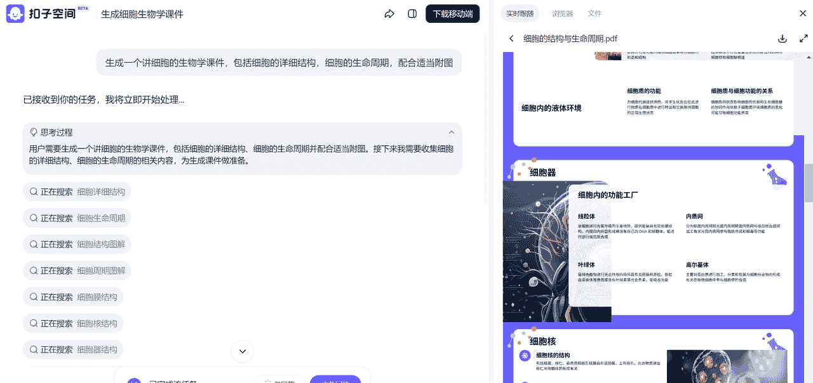

最终的视觉效果还是挺惊艳的，图文并茂，一个 ppt 的初版就此生成了～改改就可以拿去忽悠领导了（bushi🙅

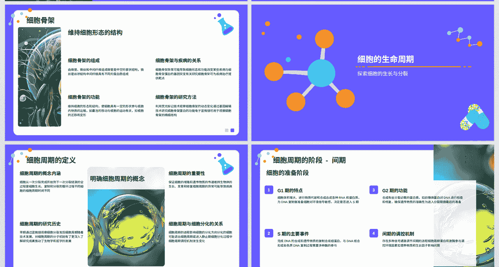

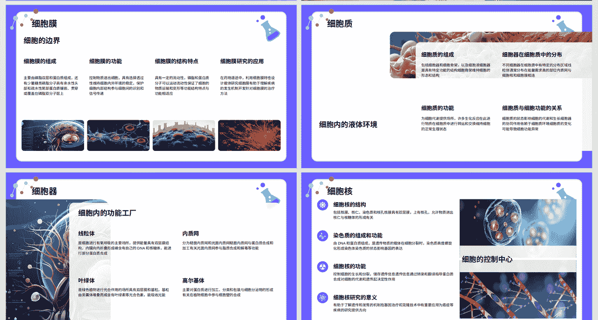

## 制作旅游攻略

有没有朋友和大国一样经常因为出门做攻略太麻烦而放弃了旅游？那就把烦心事丢给扣子吧！

> **输入魔法指令**：我需要一个 10 月 1-7 日从上海出发的 7 天香格里拉行程，总共一行 5 人，预算为 10 万人民币左右。我们喜欢历史遗迹、隐藏的宝地和藏区文化。我们想飞到丽江后一路自驾，请提供详细的行程安排和一个简单的 HTML 旅行手册，包含地图、景点描述、必备的装备和我们整个旅程中可以参考的旅行小贴士。

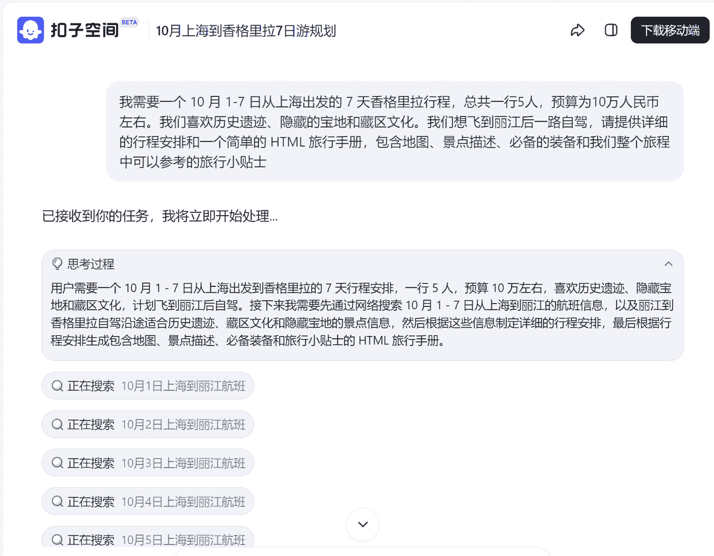

Coze 智能体不仅为我们做了详细的日程安排，甚至还生成了路线图！再也不怕出门前因为做攻略而吵架啦！

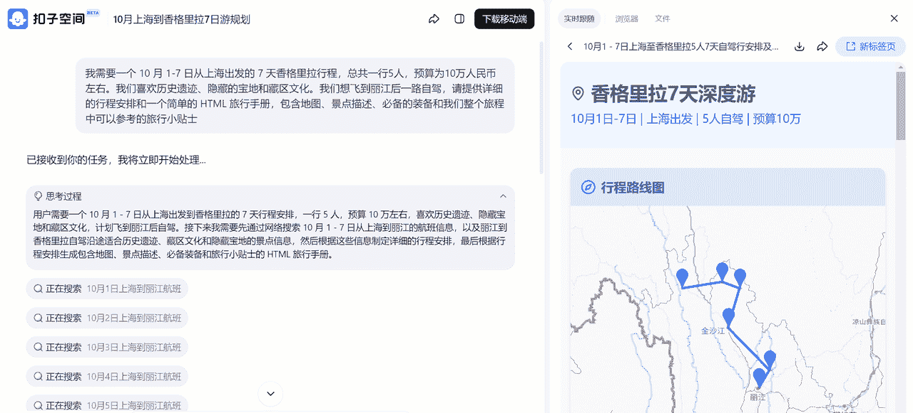

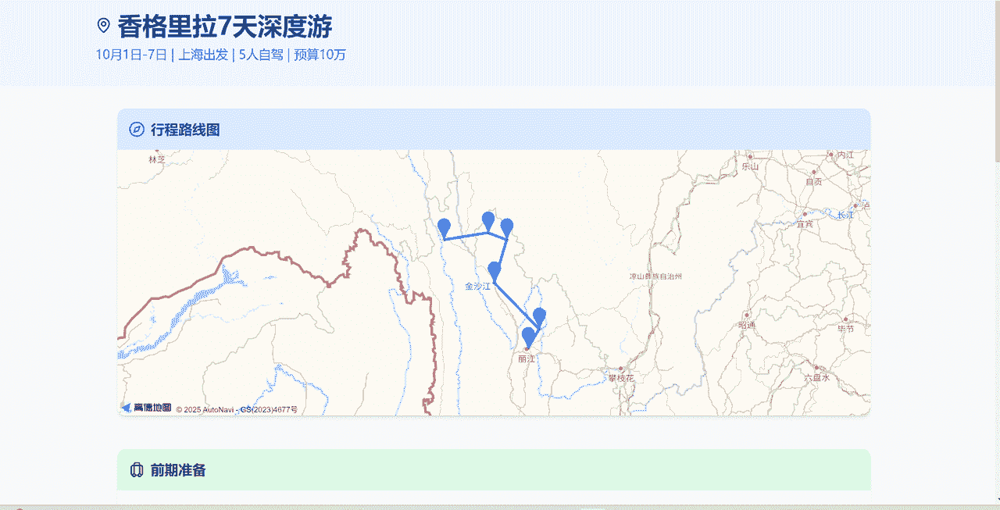

## 投资咨询

什么？扣子不仅能帮你省钱，还能带你赚钱，用扣子，用信息秘书，享牛逼人生？这真是太牛了！

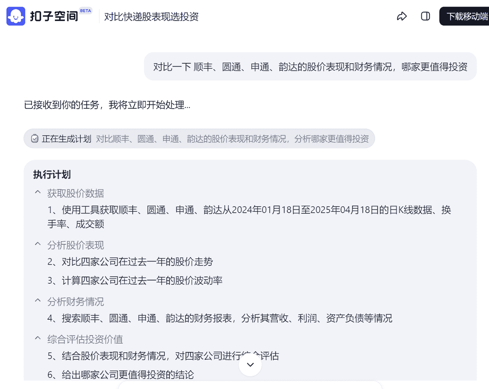

只需简单一句话，营收，利润等信息手到擒来，真是快哉快哉！

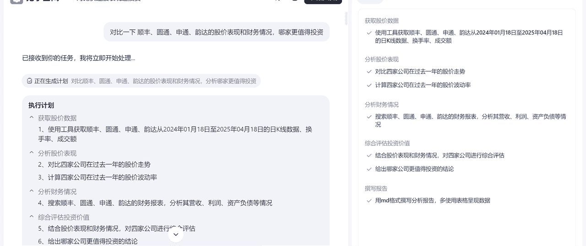

## 互动教学设计

如果你是一位老师，能为学生生成一个基础力学定律的互动教学那就太酷了！我们输入指令，可以看到扣子帮我们自动生成了一个力学互动课堂。

```
&lt;!DOCTYPE html&gt;
&lt;html lang=&quot;zh-CN&quot;&gt;
&lt;head&gt;
    &lt;meta charset=&quot;UTF-8&quot;&gt;
    &lt;meta name=&quot;viewport&quot; content=&quot;width=device-width, initial-scale=1.0&quot;&gt;
    &lt;title&gt;力学互动教学 - 中学生物理学习平台&lt;/title&gt;
    &lt;script src=&quot;https://cdn.tailwindcss.com/3.3.3&quot;&gt;&lt;/script&gt;
    &lt;link rel=&quot;stylesheet&quot; href=&quot;https://cdnjs.cloudflare.com/ajax/libs/font-awesome/6.7.2/css/all.min.css&quot;&gt;
    &lt;script src=&quot;https://cdnjs.cloudflare.com/ajax/libs/Chart.js/3.9.1/chart.min.js&quot;&gt;&lt;/script&gt;
    &lt;script src=&quot;https://cdnjs.cloudflare.com/ajax/libs/mermaid/11.5.0/mermaid.min.js&quot;&gt;&lt;/script&gt;
    &lt;style&gt;
        body {
            font-family: &#x27;Noto Sans SC&#x27;, sans-serif;
            background: linear-gradient(135deg, #f0f9ff 0%, #e6f4ff 100%);
            color: #1e293b;
        }
        .glass-card {
            background: rgba(255, 255, 255, 0.8);
            backdrop-filter: blur(10px);
            border-radius: 16px;
            border: 1px solid rgba(255, 255, 255, 0.3);
            box-shadow: 0 8px 32px 0 rgba(31, 38, 135, 0.1);
        }
        .interactive-card {
            transition: all 0.3s ease;
        }
        .interactive-card:hover {
            transform: translateY(-5px);
            box-shadow: 0 12px 28px 0 rgba(31, 38, 135, 0.15);
        }
        .highlight {
            position: relative;
            display: inline-block;
        }
        .highlight::after {
            content: &#x27;&#x27;;
            position: absolute;
            bottom: 0;
            left: 0;
            width: 100%;
            height: 8px;
            background-color: rgba(59, 130, 246, 0.2);
            z-index: -1;
        }
        .vector-arrow {
            stroke: #3b82f6;
            stroke-width: 3;
            marker-end: url(#arrowhead);
        }
        .simulation-area {
            background-color: #f8fafc;
            border-radius: 12px;
            border: 1px dashed #cbd5e1;
        }
        
```


[NVIDIA_Overlay_e8cg10YcHo.mp4](https://internal-api-drive-stream.feishu.cn/space/api/box/stream/download/all/HpXYbfgO3odQuuxYp8EcQH7MnKh)

## 品牌分析

比如我们希望扣子分析一下国内的几大奶茶品牌，可以看到直接帮我们生成了一份品牌分析报告！

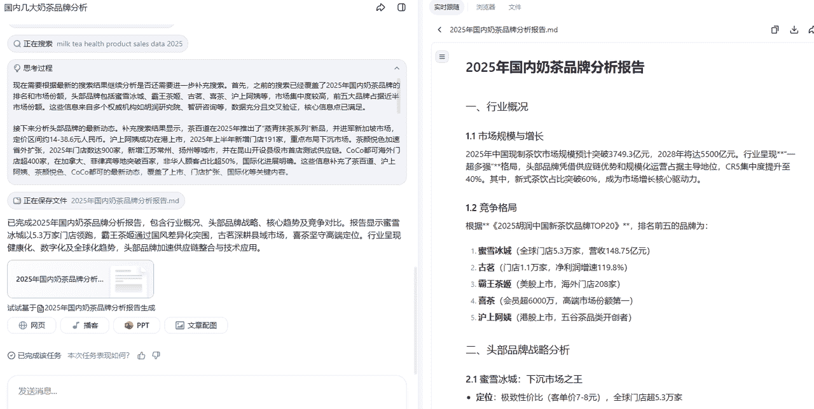

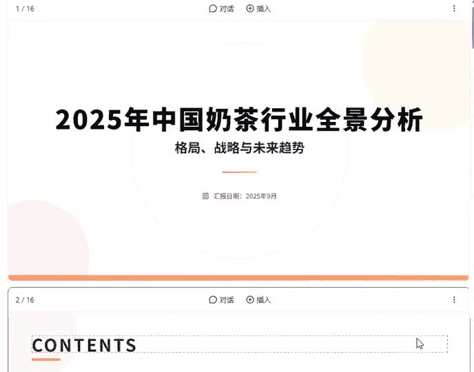

[NVIDIA_Overlay_JcLYaae2Bo.mp4](https://internal-api-drive-stream.feishu.cn/space/api/box/stream/download/all/NHQvbbbb5op049x954GcZmABneb)

基础办公任务还头疼？请速戳扣子空间：https://www.coze.cn/s/99-CJHODzCk/

---

# 智能体学习交流社群

1.持续关注并更新** A**I 智能体的相**关**资讯动态，研究报告，赚钱案例，常见问题，已建立社群聊聊 AI 发展及应用，没进群的可以扫码加入，群满可加 AI 研究爱好者大国🛰️ ID：zyg90s（备注：AI），已经在社群内的无需重复加入。

2.**关于文档负责人大国**：7 年老运营，互联网流量观察家，曾就职于互联网大厂，现研究 AI 实战应用，努力成为最懂 AI 的运营人。

**5000 人飞书学习交流群**


**5000 人飞书学习交流群**


**🛰️入群渠道**

进群或者加好友了解更多 AI 智能体实战案例

**觉得有用欢迎留个赞**