# 🛰️群聊一键整理！n8n+AI 自动生成日报

> 来源：[https://yunyinghui.feishu.cn/docx/NWjydzYZwoOhLNxNCcEczFaUnvc](https://yunyinghui.feishu.cn/docx/NWjydzYZwoOhLNxNCcEczFaUnvc)

> 本文作者：林月半子，来源👸号：林月半子的 AI 笔记。

> 推荐理由：这篇文章几乎是保姆级教你用 n8n + AI 打造全自动🛰️群聊日报系统，一键提取有价值信息、生成可视化报表、输出精美 HTML 页面，还能定时运行。从单群到多群批量处理，主子工作流架构让效率翻倍，彻底解放双手，技术小白也能跟着教程一步步搭建，从此告别无效爬楼，让 AI 帮你把群聊变成知识宝藏。

---

> 昨晚睡前群消息还是几十条，一觉醒来直接 999+...

> 你是不是也有这种体验：

+   技术群里讨论了一整天 AI 模型的训练技巧，但被各种表情包、闲聊冲散了；

+   工作群里老板发了重要通知，结果被淹没在一堆"收到"里；

+   好不容易找到个高质量学习群，想回顾下昨天的精彩讨论，翻了半天消息愣是没找到。

作为一个重度群聊用户，我受够了每天无意义的"爬楼"。于是花了 1 个周末，用 n8n 搭了个自动化系统，让 AI 帮我整理群聊精华：

+   自动提取有价值的讨论内容

+   生成可视化报表：谁最活跃、哪些话题最热

+   输出精美的 HTML 页面，手机电脑都能看

+   每天定时运行，再也不用手动整理

效果？简直不要太爽！

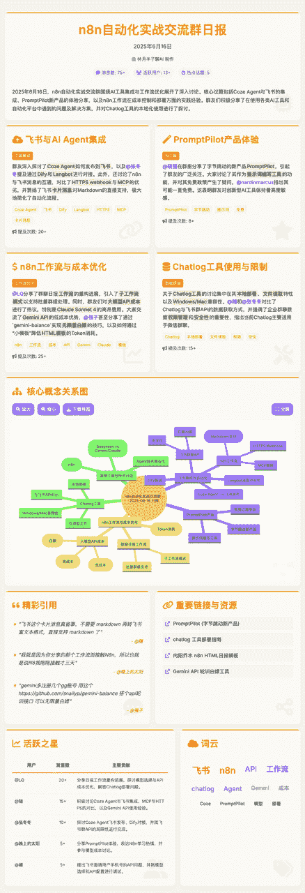

从此告别无效爬楼！科技改变生活，自动化解放双手。

废话不多说，直接上保姆级教程。

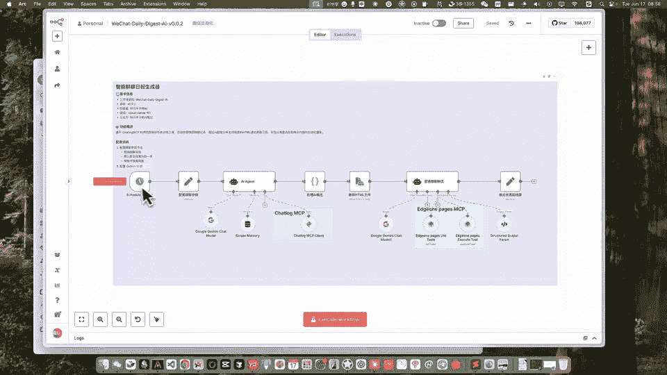

[0bc3iibyoaad7uak4r2subufgqwdq5bahbya.f10002.mp4](https://internal-api-drive-stream.feishu.cn/space/api/box/stream/download/all/YpD6bK349oZGTtxDpCVcLwJRnLd)

> 项目地址：

> `https://github.com/lqshow/awesome-n8n-workflows/tree/main/workflows/wechat-daily-report`

# 第一步：安装配置 Chatlog

`Chatlog` [1] ——这个神器级聊天记录工具，能够让我们轻松驾驭🛰️庞大的聊天数据库。

## 安全性说明

首先回答大家最关心的问题：使用 `Chatlog` 会有封号风险吗？

它只是读取本地数据库，没有任何写入操作。如果不使用机器人功能，安全性极高。

> 作者在这个 GitHub issue 中详细解释了技术原理（可直接定位源码）：`https://github.com/sjzar/chatlog/issues/2`

## 下载安装

访问 GitHub Releases [2] 页面，根据操作系统选择相应安装包。有技术能力的同学也可以直接通过源码编译安装。

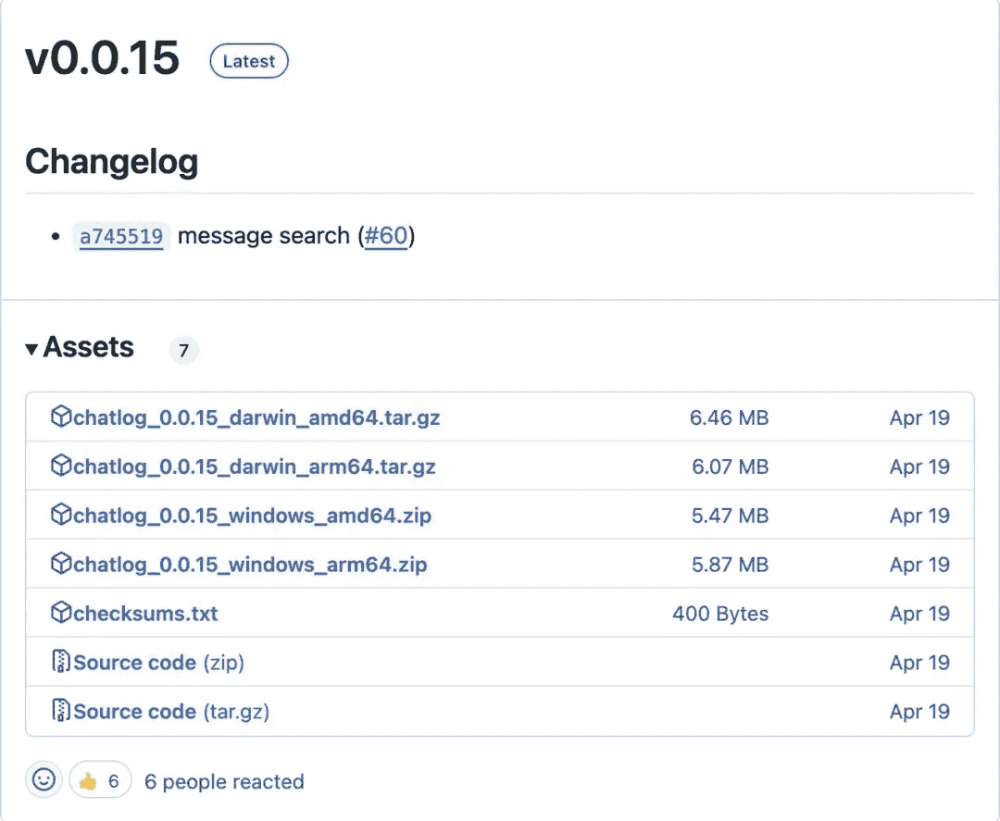

## 运行程序

下载完成后，直接在终端执行二进制文件。

MacOS 用户注意：初次运行可能遇到 "`chatlog`" Not Opened 的安全提示。

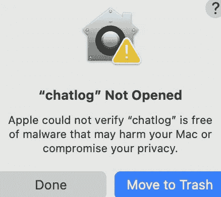

解决方案简单粗暴：

1.  系统偏好设置 → 安全性与隐私 → 通用

1.  找到被阻止的应用信息

1.  点击"仍要打开"按钮

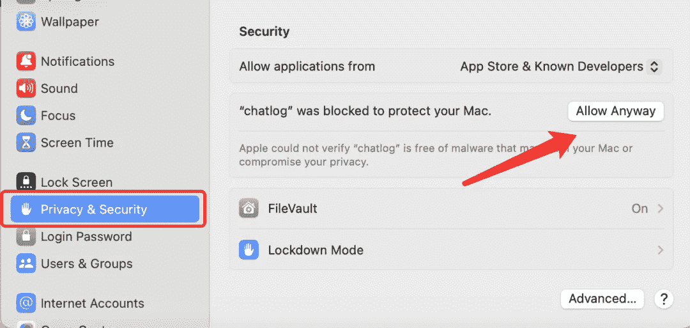

然后在终端运行：

```
$(pwd)/chatlog
```

成功启动后，你会看到如下界面。特别关注 `Version` 字段——这是本地🛰️版本号，后续获取密钥时会用到。

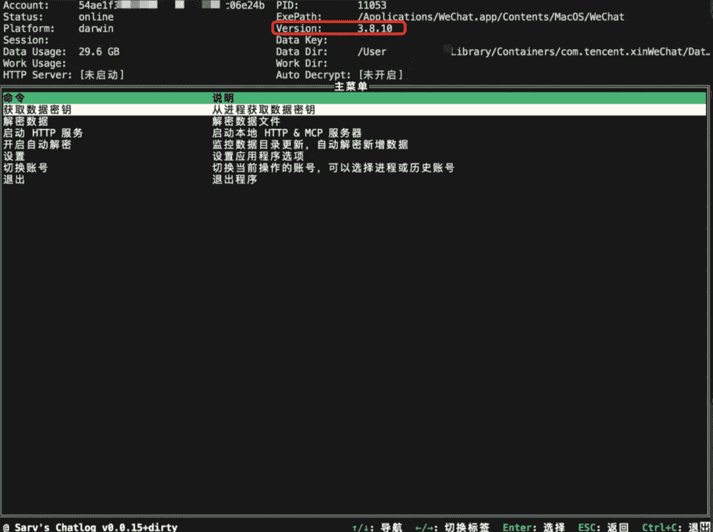

## 获取数据密钥

> 🛰️版本兼容性

> 不同🛰️版本的密钥获取成功率存在差异。如果遇到获取失败，可参考这些 issue 调整版本：

+   `https://github.com/sjzar/chatlog/issues/46`

+   `https://github.com/sjzar/chatlog/issues/131`

版本确认无误后，直接执行密钥获取操作。MacOS 用户记得先关闭系统保护（SIP）。

## MacOS 专项：关闭 SIP 系统保护

Mac 用户需要额外步骤——临时关闭 SIP（系统完整性保护）。

Step 1: 进入恢复模式

Intel 芯片 Mac：关机后重新开机，立即按住 Command（⌘）+ R ，看到苹果标志或进度条再松手。

Apple Silicon Mac ：完全关机后，按住电源键直到看到"正在载入启动选项"，选择"选项" > "继续"。

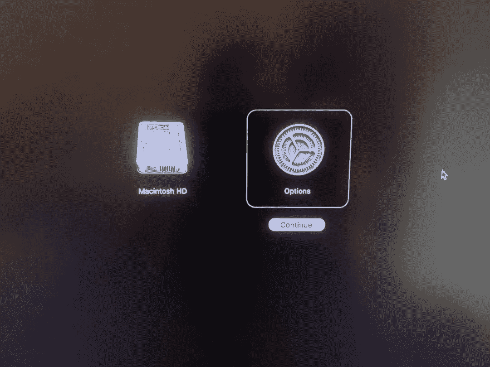

选择用户并输入密码。


Step 2: 打开终端

恢复模式下，点击顶部菜单栏"实用工具"，选择"终端"。

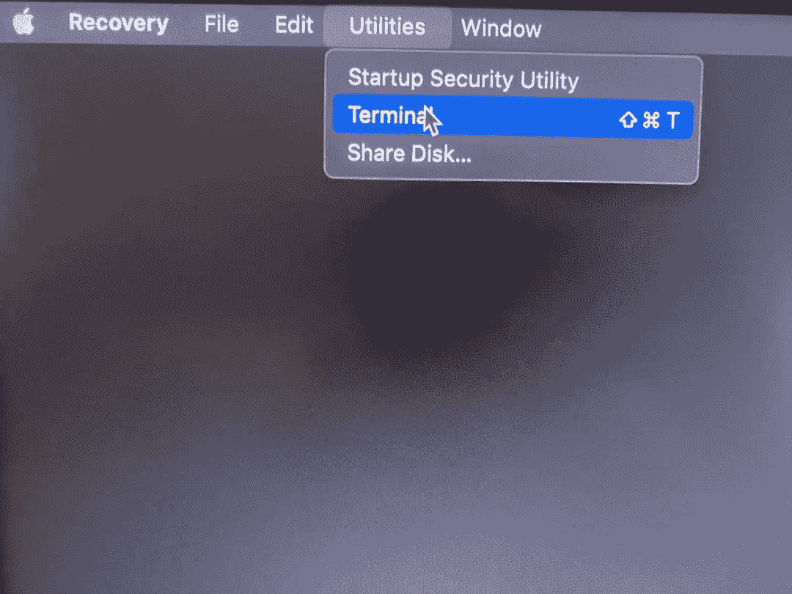

Step 3: 关闭 SIP

执行命令：

```
# 完全关闭 SIP
csrutil disable
```

看到 "System Integrity Protection is off" 提示即为成功。

Step 4: 重启 Mac

正常系统中验证 SIP 状态：

```
➜ csrutil status
System Integrity Protection status: disabled.
```

> ★

> 重要提醒：

> 获取密钥成功后，务必重新启用 SIP！再次进入恢复模式，执行 `csrutil enable` ，重启后通过 `csrutil status` 验证。

## 解密数据与启动服务

密钥获取成功后，进入数据解密环节。操作极其简单。

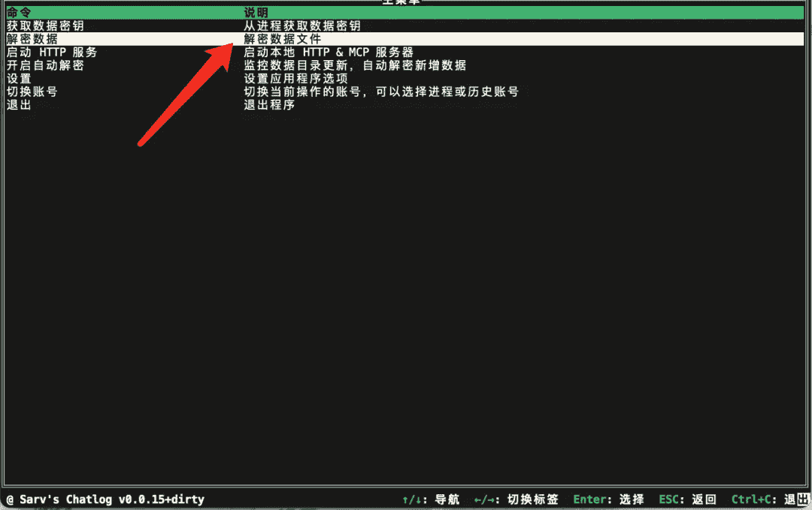

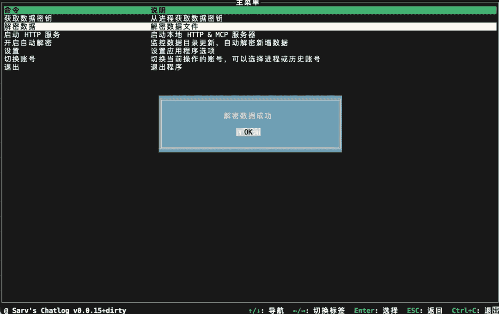

数据解密完成后，启动 HTTP 服务：

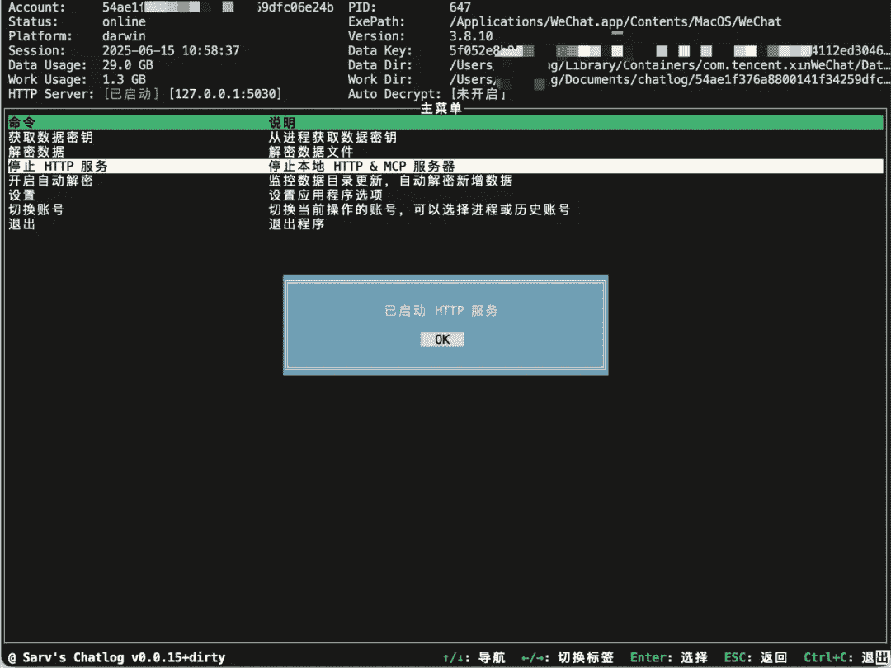

看到 "HTTP Server 已启动" 状态，说明 `Chatlog` 部署成功。可通过访问 `http://localhost:5030/` 确认服务正常。

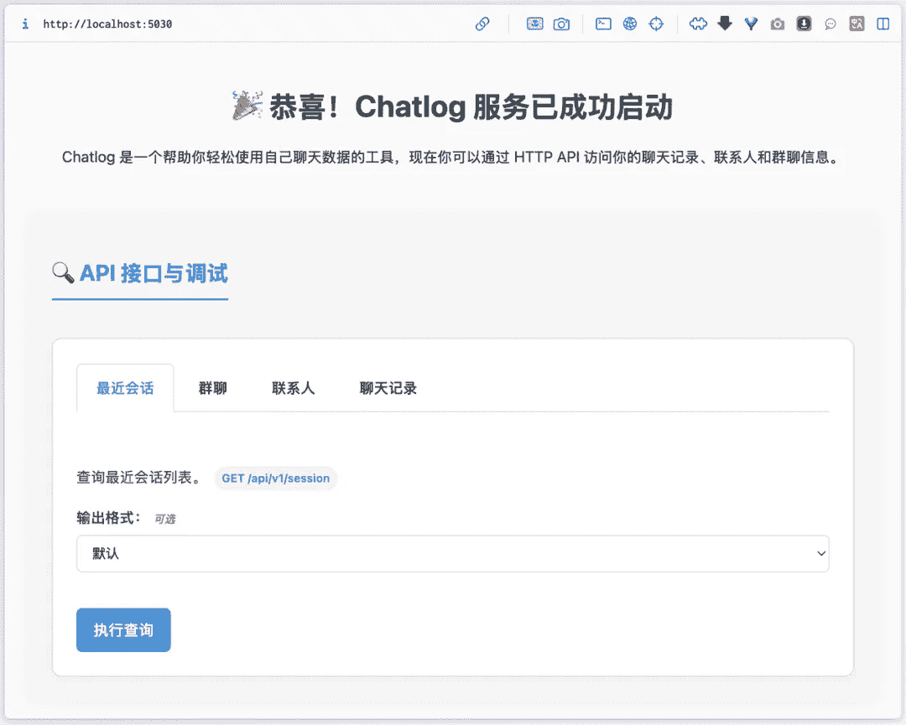

# 第二步：配置 n8n 工作流

## 本地部署 n8n

考虑到🛰️聊天数据的高度隐私性，我们选择本地部署 n8n 实例。使用 Docker 是最简便的方案：

```
docker volume create n8n_data

docker run -it --rm \
    --name n8n \
    -p 5678:5678 \
    -e GENERIC_TIMEZONE=Asia/Shanghai \
    -e N8N_ENFORCE_SETTINGS_FILE_PERMISSIONS=true \
    -v n8n_data:/home/node/.n8n \
    docker.n8n.io/n8nio/n8n:1.94.1
```

## Chatlog 与 n8n 的集成魔法

官方支持 MCP SSE 协议，使用便捷。但这里有个关键坑点：官方文档示例使用客户端如 ChatWise 或 Cherry Studio，如果我们也直接配置 `http://127.0.0.1:5030/sse` 作为 SSE 地址：

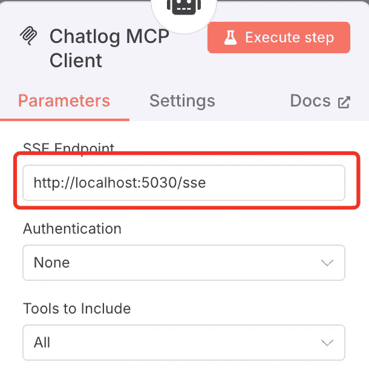

你只要一运行，必然报错！

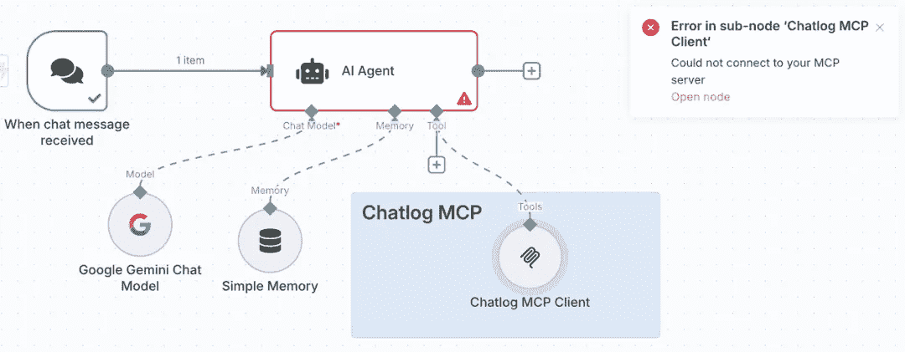

为什么呢？因为它连不上啊！

问题根源：n8n 运行在 Docker 容器中，`Chatlog` 运行在宿主机上。容器无法直接访问 `localhost` 服务。

解决方案：Docker 提供了特殊域名 `host.docker.internal` ，专门用于容器访问宿主机服务。

工作原理：Docker 自动将此域名解析到宿主机内部 IP。在容器内通过 `host.docker.internal`:端口号 访问宿主机服务。

所以我们只要将配置改成这样子即可。

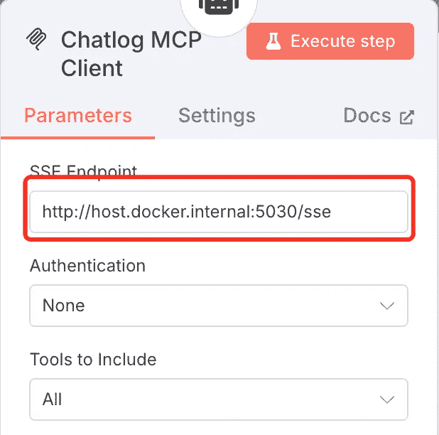

如果 Mac 用户用的是 OrbStack ：它完全兼容 Docker Desktop 特性，也可使用自家域名 `host.lima.internal` 。

`localhost` 强迫症患者 ：运行容器时使用 `host` 网络模式即可。

## 功能验证测试

> 测试提示词：

> 2025 年 6 月 14 号，n8n 学习交流 这个群里都聊了什么？总结成无序列表，按照讨论热度排序。

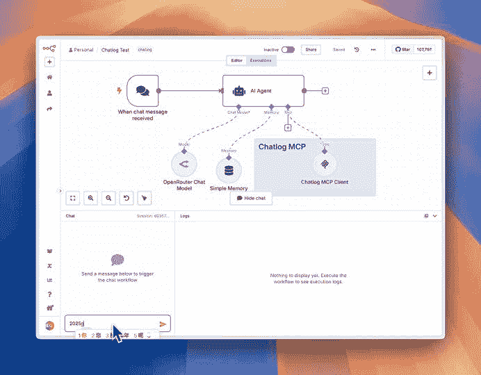

[0bc3x4acyaaaj4aazxsryzufbp6dfs7qalaa.f10002.mp4](https://internal-api-drive-stream.feishu.cn/space/api/box/stream/download/all/CbmXbc2SBoVpxExnAaccVyjNnw9)

视频详情

ok! 测试结果显示功能正常！

到此为止，我们的准备工作算是告一段落了，现在我们开始真正的做一个一键自动生成日报的工作流，来解决我们最初说的痛点！

# 第三步：构建群聊日报工作流

看到这张工作流图了吗？看起来复杂，实际上逻辑清晰得很。

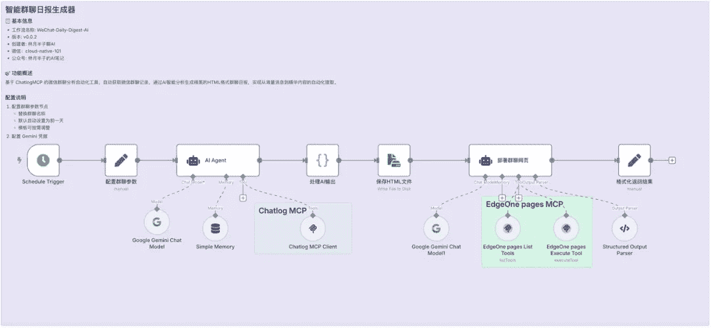

每个节点都有自己的"使命"。有的负责定时触发，有的专门处理数据，还有的负责最终的美化输出。就像一条精密的生产线，原材料是杂乱无章的群聊记录，最终产品是结构化的精美日报。

但别被这些节点数量吓到。我们一个一个来拆解。

## 1. `Schedule Trigger`（定时触发器）

这家伙就是整个系统的"闹钟"。

每天早上 7 点，它会准时"醒来"，然后唤醒整条工作流水线。

想象一下：你还在被窝里做梦，AI 已经开始为你整理昨天的群聊精华了。

## 2. 设置群消息（`Set` 节点）

这个节点看似简单，实则关键。

它负责告诉后续的 AI："兄弟，今天要分析哪个群？分析哪一天的数据？用什么样式模板？"

配置内容说起来也不复杂：

+   群名：目标分析群组

+   日期：昨天日期（表达式自动获取）

+   日报网页风格：AI 生成页面的"设计稿"

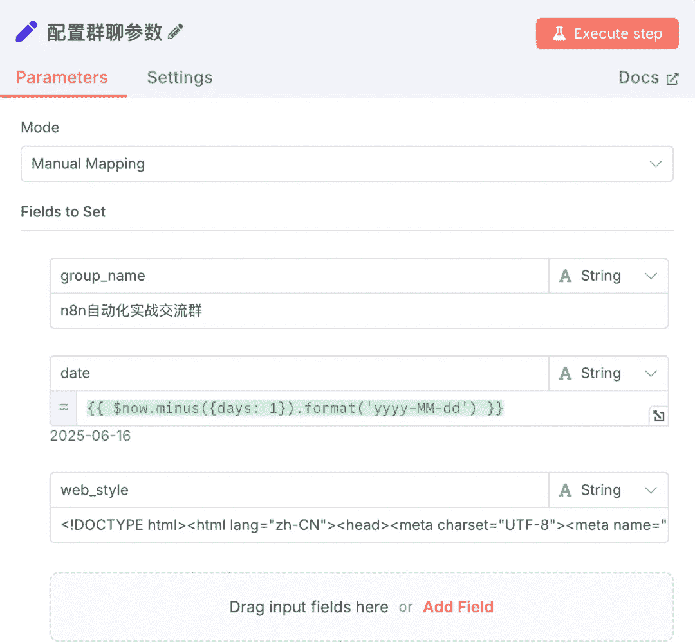

这里要特别感谢朱行政同学的贡献。工作流里的网页模板基础来源于他精心整理的飞书文档：网页模板 [3]

## 3. AI Agent 节点——系统大脑

如果说前面的节点是"准备工作"，那这个 AI Agent 就是"主角登场"了。

它的任务听起来简单：分析群聊，生成日报。但背后的复杂度？简直是降维打击。

核心能力包括但不限于：

+   调用 `chatlog` 工具获取聊天数据

+   语义分析群聊内容，识别有价值信息

+   智能提取关键讨论点和热门话题

+   统计数据可视化处理

+   生成完整 HTML 日报

想想看：几百条消息，各种话题混杂，表情包、链接、图片、语音...AI 需要从这些"信息噪音"中提炼出真正的"知识黄金"。

提示词配置：

```
搜索 {{ $(&#x27;配置群聊参数&#x27;).item.json.group_name }} 群聊 {{ $(&#x27;配置群聊参数&#x27;).item.json.date }} 记录，并生成完整的HTML格式日报

群组: {{ $(&#x27;配置群聊参数&#x27;).item.json.group_name }}
日期: {{ $(&#x27;配置群聊参数&#x27;).item.json.date }}
样式模板: {{ $json.web_style }}

输出格式：完整的HTML文档代码
```

但这只是冰山一角。真正的"魔法"在于那个超长的系统 Prompt...

详细的 AI Agent 指令 ：

```
# 微信群聊日报生成器

你是极具审美的前端设计大师和群聊分析专家，专门为群聊记录生成视觉引人入胜、布局紧凑无空隙、配色和谐统一、风格固定一致、适合截图分享的单页HTML日报。

## 重要：工具使用要求
- 你必须使用chatlog工具来获取聊天记录
- 不能假设或模拟聊天数据
- 每次任务都要先调用chatlog工具

## 可用工具
你有以下MCP工具可用：
- chatlog: 获取历史聊天记录

## 核心任务
1. 使用chatlog工具获取指定的群聊记录
2. 详细分析群聊内容并提炼关键信息
3. 生成基于Bento Grid设计风格的单页HTML网站

## 工作流程
1. 根据用户提供的查询条件，调用chatlog工具获取聊天记录
2. 分析聊天记录，提取关键信息
3. 生成完整的HTML格式群聊日报

## 自动提取信息能力
- 群名称：从聊天记录的系统通知或常见群聊信息中提取
- 日期：使用聊天记录中最近的日期，或者默认使用今天的日期  
- 时间范围：根据记录中的首条和末条消息时间确定
- 支持多种聊天记录格式：[时间] 昵称：消息内容、时间 - 昵称：消息内容等

## 日报内容结构（必须包含）
### 群聊总结
- 群聊内容概述
- 消息数量、活跃人员数量、热点话题数量
- 统计时间

### 今日热点（3-4个主要话题）
- 关键词提取
- 消息数量统计
- 关键词提及次数
- 突出显示微信名

### 核心概念关系图
- 将核心内容生成Mermaid思维导图
- 展示话题间逻辑关系

### 精彩引用（3条代表性发言）
- 突出显示微信名
- 有影响力或代表性的发言

### 重要链接与资源
- 链接支持点击跳转
- 整理分享的文档和工具

### 活跃之星（按发言次数倒序）
- 发言次数统计
- 人员前加@标识
- 主要贡献内容描述
- 突出显示微信名

### 词云
- 高频关键词可视化
- 按重要性分级显示

## 设计风格要求
采用极简主义风格 (Minimalist)：
- 简约、留白、精确排版、无衬线字体、克制装饰
- 白色背景，橘色字体作为强调色
- 配色方案：
  - 背景色：#f5f4ee（略暖的米白色）
  - 卡片背景：#faf9f6
  - 强调色：#ff8906（主要橙色）
  - 文字色：#212529（主要文字）

## 布局技术要求
### Bento Grid设计
- 采用动态且无缝的网格布局，确保整个视口区域被高效利用
- 主卡片展示核心概念（占25-30%视觉区域）
- 子主题卡片包含不同话题，每个卡片有独特标题和简短描述
- 严格定义卡片尺寸和比例，避免因内容多少导致布局变化

### 视觉平衡
- 确保色彩分布均匀，避免超过4种色系
- 图标和视觉元素均匀分布
- 文本密度相对均衡
- 卡片形状可变化但保持视觉一致性

### 技术实现
- 单个HTML文件，内嵌CSS和JavaScript
- 使用CSS变量定义所有颜色和尺寸
- 使用CSS Grid实现不规则网格布局
- 优化页面确保在单视口中完整显示，适合截图
- 页面宽度100%，最大宽度1000px
- 优先纵向布局，适合移动端截图分享

### 字体要求
- 使用Inter, SF Pro Display, Segoe UI字体
- 主标题≥36px，副标题≥28px，卡片标题≥22px
- 正文≥16px，标签≥14px
- 使用相对单位(rem)适应不同设备

### 颜色对比要求
- 确保颜色对比度足够高
- 避免使用过多颜色，保持3-4种以内
- 文字和背景对比清晰，可读性高

## 处理原则
- 客观分析，不添加主观判断
- 保护用户隐私，适当处理敏感信息
- 提取有价值的技术讨论内容
- 忽略无意义的闲聊和大量系统消息
- 除专业名词外，其他输出内容要求中文
- 确保生成的日报具有参考价值

## 输出要求
必须输出完整的HTML文档，包含：
1. 完整的HTML结构
2. 内嵌CSS样式（基于提供的模板）
3. JavaScript交互功能
4. Mermaid图表支持
5. 响应式设计
6. Font Awesome图标
7. 动画效果

严格按照极简主义风格生成，确保每次输出的页面风格完全一致。

## 重要提示
当用户提供查询条件时，你必须：
1. 首先使用chatlog工具获取相应的聊天记录
2. 分析获取到的聊天数据
3. 然后生成完整的HTML格式群聊日报
```

## 4. `Read/Write Files`（文件保存节点）

AI 生成了精美的 HTML，但总得有地方存放吧？

这个节点专门负责文件保存。本地存储一份，方便调试和备份。如果你有自己的服务器，还可以直接同步过去。

## 5. 自动部署群聊网页

有了 HTML 文件，下一步自然是让更多人看到。


EdgeOne Pages 就是为此而生。一键部署，生成公开链接，随时随地查看日报。朋友想看你的群聊分析？直接扔个链接过去。

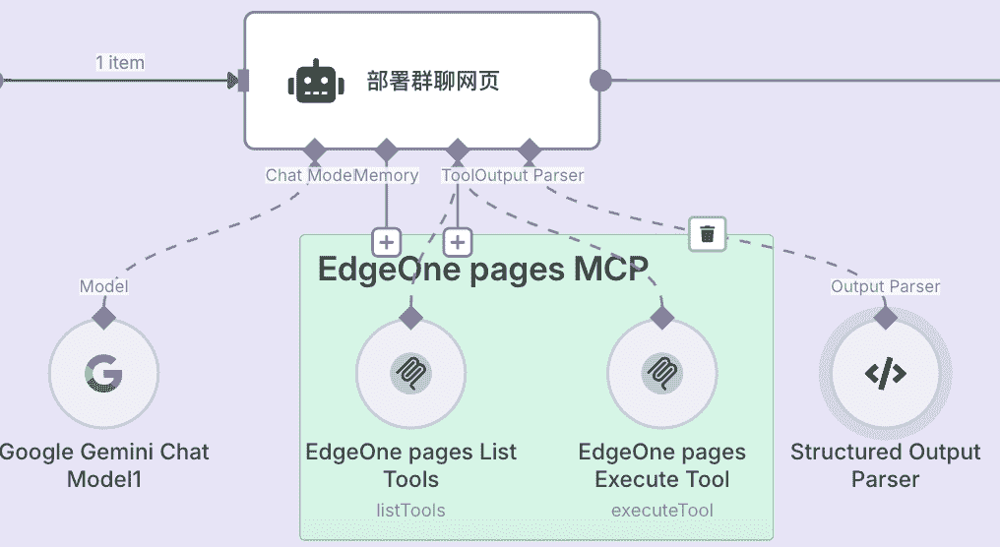

## 6. 格式化返回结果

最后一步，整理部署信息。

访问链接、部署状态、生成时间...这些元数据都会被整齐地打包，方便后续查看和管理。

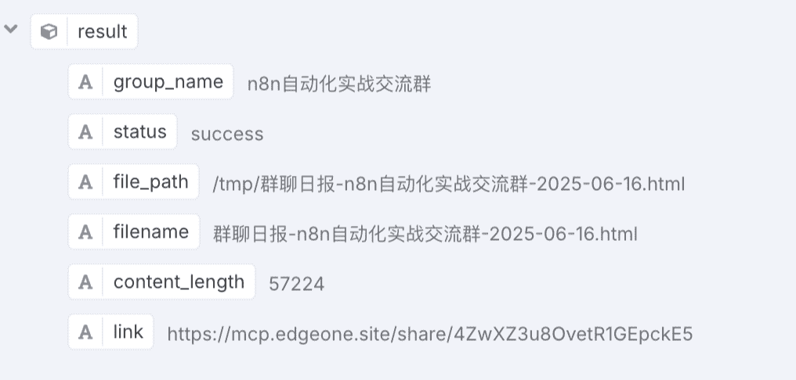

工作流的精妙之处在于：每个节点职责单一，但组合起来威力巨大。这就是模块化设计的魅力——复杂问题被拆解成若干简单子任务，然后通过精巧的编排实现强大功能。

MCP 协议与 n8n 的结合？这可能是我见过的最优雅的🛰️数据自动化方案。

# 第四步：批量处理多群聊——主子工作流架构

单群组？那只是小试牛刀。

真正的威力在于批量处理。想象一下：你同时在十几个技术群、学习群、工作群，每个群都有自己的"生态"和话题节奏。手动分析？累死你也分析不完。

这时候就需要"升级装备"了——主子工作流架构。

听起来高大上？其实就是"分而治之"的古老智慧在现代自动化中的体现。一个负责调度指挥，一个专注执行任务。就像项目经理和程序员的关系，各司其职，配合无间。

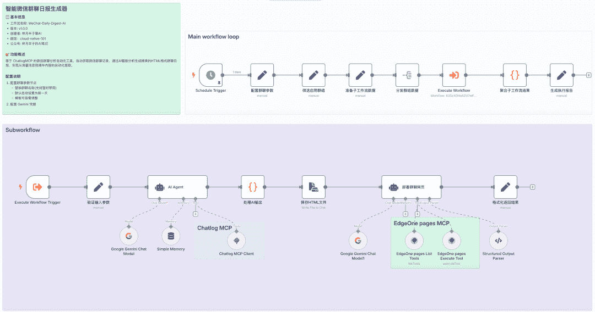

## 为什么要搞这么复杂？

有人可能会问：直接复制几遍单群聊工作流不行吗？

行是行，但问题来了：

+ 维护成本爆炸！修改一个逻辑要改 `N` 个地方

+ 错误传播！一个群出问题，可能影响其他群的处理

+ 资源浪费！每个工作流都要重复相同的初始化步骤

主子架构优雅地解决了这些痛点。

## 架构优势深度解析

### 1. 模块化设计，职责清晰

主工作流专注管理：时间调度、任务分发、结果汇总

子工作流专注执行：数据获取、AI 分析、报告生成。

这种职责分离带来的好处？

+ 代码逻辑清晰如水，新手也能快速理解

+ 修改单群聊处理逻辑时，主调度逻辑纹丝不动

+ 可以单独测试子工作流，调试效率大幅提升

### 2. 并发处理能力

传统的串行处理：群 1→群 2→群 3→...十个群要等十倍时间。 主子架构的并行处理：群 1、群 2、群 3...同时启动，时间压缩到极致。

这不仅仅是速度提升，更是思维模式的转变。从"排队等候"到"并发协作"，效率提升是几何级的。

### 3. 错误隔离，稳定性提升

> ★

> 群聊 A 处理失败 ≠ 群聊 B 也会失败

这种"故障隔离"设计，让整个系统具备了真正的稳定性。某个环节出问题，不会造成"全线崩溃"。最重要的是可针对失败群聊单独调试重试！

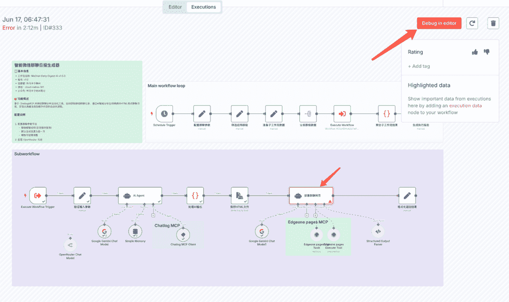

批量处理的前提是什么？合理的配置管理。

```
[
  {
    "group_name": "n8n自动化实战交流群",
    "group_owner": "LQ",
    "description": "n8n自动化实战交流群",
    "enabled": true
  },
  {
    "group_name": "n8n学习交流", 
    "group_owner": "向阳乔木",
    "description": "n8n学习交流",
    "enabled": true
  }
]
```

简单的 `JSON` 配置，背后却蕴含着巧思：

+ `enabled` 字段支持动态开关，某个群暂时不想分析？一键关闭

+ `group_owner` 字段便于责任追踪和问题定位

+ `description` 字段为后续的分类统计预留空间

## 工作流架构深度剖析

主工作流（Main workflow loop）

它是整个系统的"指挥中心"。

+ `Schedule Trigger` ：定时器启动，准点开工

+ `配置群详细参数`：读取群聊清单，确定今日处理目标

+ `准备元数据`：统一的模板配置，确保输出风格一致

+ `准备工具环境数据`：MCP 服务连接配置

+ `分发数据组织`：将任务包分发给各个子工作流

+ `Execute Workflow` ：批量启动子工作流，开始并行处理

+ `整合工作流输出结果`：收集所有处理结果，汇总统计

+ `生成执行报告`：汇总处理状态和统计信息

子工作流（Subworkflow）

它是具体的"执行专家"。每个实例专门服务一个群聊，职责清晰：

+ `Execute Workflow Trigger` ：接收主工作流的任务委派

+ `验证输入参数`：检查传入群聊参数有效性

+ `AI Agent`：核心分析逻辑（Google Gemini + Chatlog MCP）

+ `处理 AI 输出`：清理和格式化生成数据

+ `保存 HTML 文件`：生成单个群聊日报文件

+ `部署群聊日报页面`：使用 EdgeOne Pages 在线发布，生成分享链接

+ `格式化输出结果`：向主工作流汇报任务执行状态

这种架构变革的意义，远超技术层面。

对运营数据人员来说，这意味着什么？

> ★

> 以前：手动打开每个群→逐条浏览消息→手工整理要点→制作图表→编写总结

> 现在：设定时间→批量自动处理→查看汇总报告→重点关注异常

效率提升？不止 10 倍。更重要的是，你从重复性劳动中解放出来，可以专注于更有价值的洞察分析。

## 扩展性的无限可能

当前架构的美妙之处在于：它为未来预留了足够的扩展空间。

想要增加新的群聊类型？修改配置文件即可。 需要接入新的 AI 模型？调整子工作流参数。 要对接其他发布平台？在子工作流末尾添加新节点。

这种"开放式架构"确保了系统的长期生命力。技术在进步，需求在变化，但架构的核心逻辑依然稳固。

### 更多可能性

当然，聊天记录的价值远不止日报这一种形式。基于同样的技术架构，我们可以解锁更多玩法：

#### 📅 时间维度的多样化

+ 群聊周报 - 深度分析一周的话题演进和知识沉淀

+ 月度总结 -技术话题变化趋势，群组"知识密度"曲线分析

+ 年终盘点 - 最热话题、活跃排行、价值资源的"群聊考古学"

#### 🎯 内容维度的精细化

+ 技术专题汇总 - 某个技术栈的所有相关讨论整合

+ 问题解答集锦 - 自动生成 FAQ，关联历史相关讨论

+ 资源分享清单 - 汇总所有分享的工具、文档、链接

#### 📊 跨群分析的立体化

+ 多群话题对比 - 前端群关注体验，后端群在意性能，不同角色思维模式一览无余

+ 知识网络图谱 - 技术概念如何在群组间传播的完整图谱

+ 专家意见聚合 - 通过回复数、引用频率识别真正的技术意见领袖

想象一下：AI 自动为你生成《2024 年度人工智能技术趋势报告》，数据来源是你参与的所有技术群；或者生成《我的知识成长轨迹》，展示你在各个学习群中的提问、讨论和进步历程。

## 写在后面

当我第一次看到 AI 从几百条群聊记录中精准提取出技术讨论的核心脉络时，我意识到我们正在经历一场静悄悄的革命。

这不仅仅是一个工具的诞生，而是 人机协作范式的深刻变革 。我们不再是被动的信息消费者，而是主动的数据炼金师——利用 AI 的洞察力和自动化的执行力，从海量的数字噪音中萃取真正的价值结晶。

这套系统揭示了一个更广阔的可能性： 每个人都可以成为自己数字生活的建筑师。 不需要深厚的编程背景，不需要昂贵的基础设施，只需要好奇心和一点点耐心，就能构建出专属的智能助手。

当你第一次看到自己的群聊被 AI 整理成精美的知识地图时，你会明白：我们已经不再是简单的工具使用者，而是数字时代的共创者。

未来已来，就从这一份群聊日报开始。

## 参考资料

[1] Chatlog: `https://github.com/sjzar/chatlog/tree/main`

[2] GitHub Releases: `https://github.com/sjzar/chatlog/releases`
