# MCP 学习手册（持续更新 ing...)

> 来源：[https://yunyinghui.feishu.cn/docx/FVusdw8E8oYra9xuCGWcGa7pnRe](https://yunyinghui.feishu.cn/docx/FVusdw8E8oYra9xuCGWcGa7pnRe)

> **适用人群：**关注国内 MCP 发展及应用人群

> 首发时间：2025 年 5 月 14 日

> 更新时间：2025 年 7 月 4 日

> **内容出品人：**** **** **

> **内容出品方：**[玩赚 AI 实验室](https://yunyinghui.feishu.cn/wiki/WhelwZnxQi55mpkOzatc3Xran5b?from=from_copylink)

> **使用建议：**如果需要快速定位到精确内容，可以使用快捷键 Ctrl +F/Command +F 的形式，搜索关键字/词，查找你想要的内容。

> **持续更新 MCP 的****相关介绍及****动**态，应用案例，精选市场，实用场景等内容，永久免费在线查看，欢迎收藏转发支持，文末有惊喜。

# 一、MCP 基本介绍

## **定义和目标**

MCP（Model Context Protocol，模型上下文协议）是由 Anthropic 于 2024 年 11 月推出的开源协议。

MCP 旨在替换碎片化的 Agent 代码集成，从而使 AI 系统更可靠，更有效。通过建立通用标准，服务商可以基于协议来推出它们自己服务的 AI 能力，从而支持开发者更快的构建更强大的 AI 应用。开发者也不需要重复造轮子，通过开源项目可以建立强大的 AI Agent 生态。

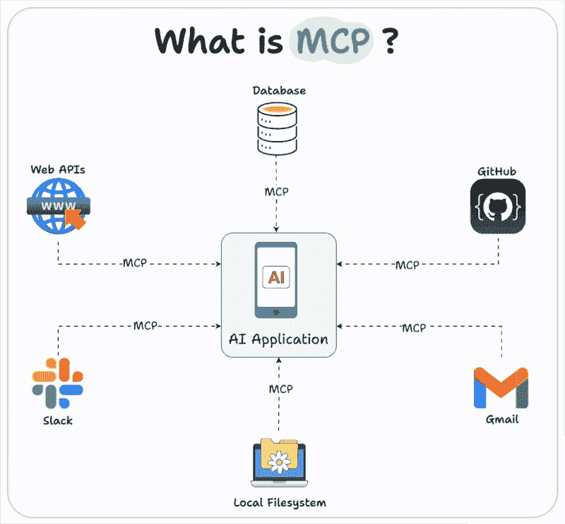

> 国内大厂快速布局 MCP 的原因有 3 个：

> 

> 1）抢占智能体时代的行业生态位

> 2）通过 MCP 解决数据孤岛问题，打破各家公司之间的孤立状态，形成数据互通的生态系统。

> 3）迎合“大势所趋”，目前至少有 60%以上的国际主流厂商都已经支持 MCP，就像当年互联网普及 HTTP 协议一样，现在支持 MCP 意味着拿到进入新生态的门票。

>

> 阿里是国内最早宣布支持 MCP 的大厂

## **MCP 的本质与价值**

MCP 的核心价值在于提供一种标准化的方式，让 AI 模型与外部世界进行交互。在 MCP 出现之前，开发者需要为每个 AI 集成创建定制化的解决方案，这导致了严重的碎片化问题。

MCP 解决了这些问题，它提供了以下关键价值：

+   **统一集成标准：**一个协议对接所有集成，降低开发难度

+   **实时数据更新：**支持动态数据交互而非静态连接

+   **自动工具发现：**支持动态工具发现和上下文处理

+   **隐私保护：**数据和工具不需上传远端，保护数据隐私

+   **开发效率：**显著减少开发时间，提高系统可靠性

## **核心能力**

根据 MCP 协议规范，服务器可以提供三种核心对象：

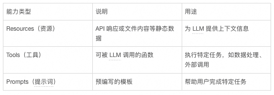

## 核心架构

MCP 将大模型与外部的交互抽象成了“客户端-服务器”架构。其核心架构主要包含以下几个部分：

+   **MCP Host（客户端）：**这是承载 AI 应用的前端，如 Claude 桌面、IDE 或其它 AI 工具。Host 内部内置 MCP 客户端组件，负责与 MCP 服务器建立 1:1 连接，发送请求并接收响应。

+   MCP Server（服务器）：作为轻量级的服务端程序，MCP 服务器通过统一的 MCP 协议向客户端暴露特定的功能（如数据访问、工具调用、提示信息等）。每个服务器可以连接不同的数据源或外部服务。

+   **数据资源：**MCP 服务器可访问两类数据源：一类是本地数据源，即用户计算机上存储和管理的数据。另一类是远程服务，例如通过 Web API 获取的外部数据，这使得 AI 应用能够直接访问互联网数据。

下面这张图展示了 MCP 各组件之间的关系。

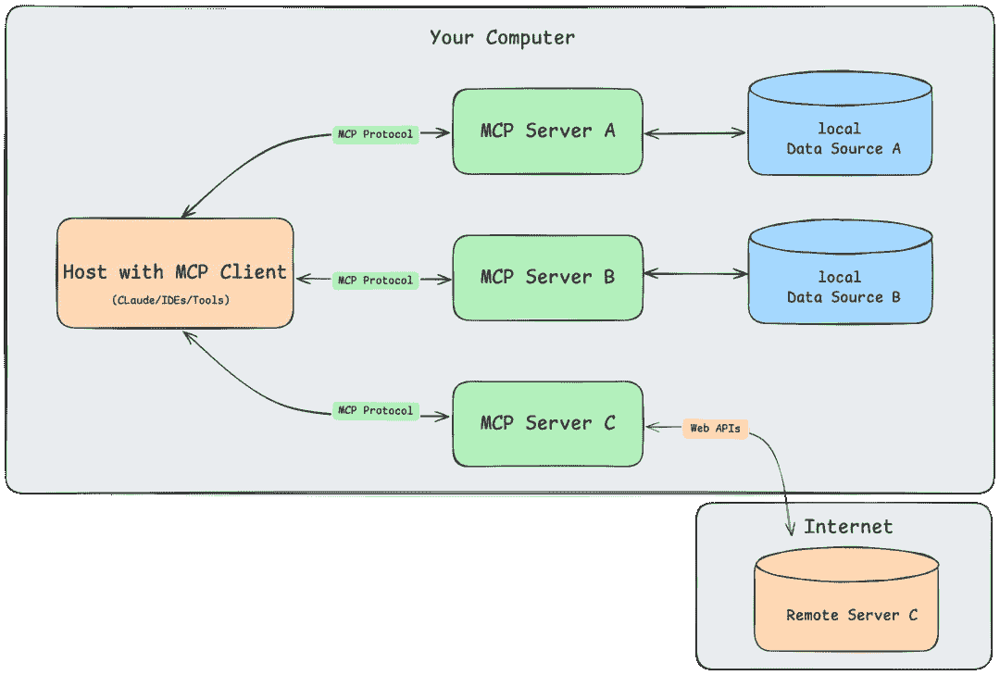

## MCP 原理

+   **结构化上下文整合：**MCP 通过定义标准化的资源描述与调用机制（基于 JSON-RPC 2.0 协议），使模型能够自动获取结构化数据源，如本地文件系统、企业数据库或实时 API 数据。相较于早期手动拼接非结构化数据的 prompt 设计方式，这种动态上下文加载将信息获取延迟降低 90%以上，同时保证了数据完整性与时效性。

+   **双向交互机制创新：**传统 Function Call 仅支持单向请求-响应模式，而 MCP 允许服务器主动推送数据（如设备状态告警）或请求用户授权这种双向通信能力使模型在医疗诊断等场景中，能实时获取最新检测报告并触发二次确认流程，显著提升了复杂决策的可靠性。

+   **多模态上下文管理：**MCP 支持对话上下文的标准化存储与跨会话继承。例如在客服场景中，模型可持久化用户历史订单信息，结合当前咨询内容生成精准回复，避免了传统方案中需要反复人工注入历史数据的低效操作

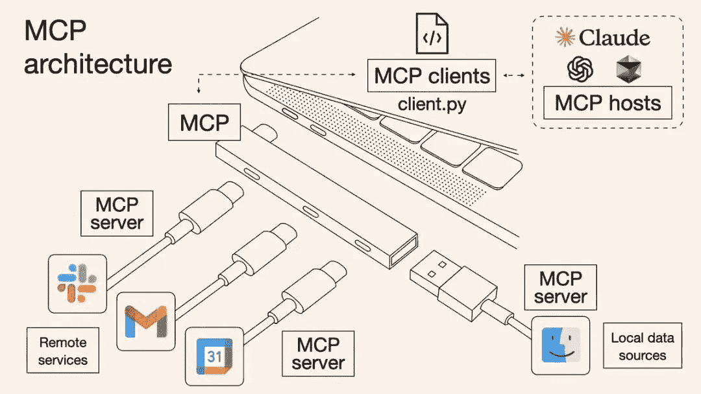

MCP 核心是让我们能方便地调用多个工具，那随之而来的问题是 LLM（模型）是在什么时候确定使用哪些工具的呢？ Anthropic 为我们提供了详细的解释，当用户提出一个问题时：

+   客户端（Claude Desktop / Cursor）将问题发送给 LLM。

+   LLM 分析可用的工具，并决定使用哪一个（或多个）。

+   客户端通过 MCP Server 执行所选的工具。

+   工具的执行结果被送回给 LLM。

+   LLM 结合执行结果，归纳总结后生成自然语言展示给用户！

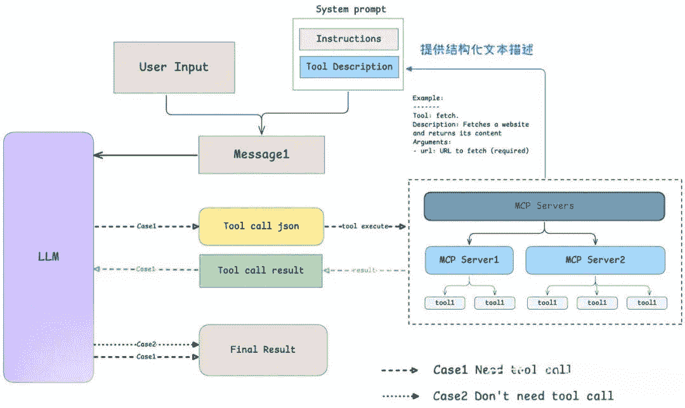

## MCP 和 API 的区别

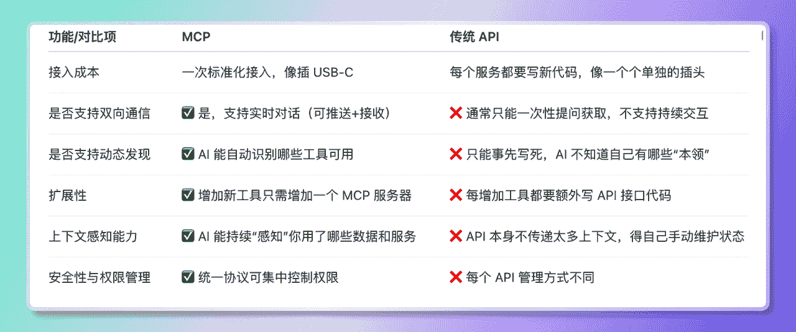

举个例子，例如：你要开发一个 AI 行程规划助手

用 API 开发：要单独接入 Google Calendar API、邮件 API、航司 API，每个都要写认证、错误处理使用

MCP：AI 助手可以无缝查询日程、预订航班、发送确认邮件，而无需为每个工具编写特定集成。只接入 MCP 协议，AI 能自动访问这些服务（如：看日历 → 改航班 → 发邮件）

## 总结一句话：

> MCP 是一个为 AI 而设计的“智能标准连接协议”，让模型能像插 USB-C 一样自由访问各种工具和数据源，而不再受限于一个个麻烦的 API 接口。

**由**于使用 MCP 还是需要有一定的技术基础，所以目前 MCP 基本都是开发者在使用，上手难度还是有点高。

## 优势与局限

**1）核心优势**

+   **标准化**：统一接口规范，消除碎片化，降低开发成本。

+   **安全性**：内置访问控制和授权机制，保护敏感数据。

+   **灵活性**：支持多种数据源和工具，适应多样化场景。

+   **社区驱动****：开源**生态活跃，GitHub 上已有 3000+ MCP Server 项目。

**2）局限性**

+   **复杂逻辑支持有限**：**MCP** 擅长工具调用，但对于需要复杂推理的任务，可能需要结合其他框架（如 LangChain）。

+   **生态尚不成熟**：尽管发展迅速，但 **MCP** 的工具和文档仍需完善，部分场景的实现可能需要开发者自行探索。

+   **学习曲线**：对于新手，配置和调试 **MCP** 服务器可能有一定门槛。

# 二、MCP Server 开发实践

## MCP Server 关键概念

MCP 服务器可以提供三种主要类型的功能：

+   **资源：**Resource，客户端可以读取的类似文件的数据（例如 API 响应或文件内容）

+   **工具：**Tool，可由 LLM 调用的函数（经用户批准）

+   **提示：**Prompt，预先编写的模板，帮助用户完成特定任务

但是当前的 MCP Server 主要聚焦于提供各种不同功能的工具，用户可以通过编写工具来提供 AI 更多与现实交互的能力。

工具即为函数，定义一个工具通常需要包含以下必须的属性：

+   **函数描述：**函数本身具备的具体功能及使用场景

+   **函数参数：**调用该函数所需的参数定义（参数的类型、描述及是否必填等信息）

## MCP 开发核心流程

### 环境配置

+   安装 Python 3.8+并配置虚拟环境（推荐使用uv工具管理依赖）

+   安装 MCP SDK：pip install mcp[cli] 或 uv add "mcp[cli]"

+   开发工具选择：支持 Claude Desktop、Cherry Studio 等 MCP 客户端

### 服务器开发

+   基础架构​：使用FastMCP类快速搭建服务框架（示例代码）：

```
from mcp.server.fastmcp import FastMCP
mcp = FastMCP(&quot;MyApp&quot;, host=&quot;0.0.0.0&quot;, port=8080)
@mcp.resource(path=&quot;/weather&quot;)
def get_weather(city: str):
    return {&quot;temp&quot;: 25, &quot;condition&quot;: &quot;sunny&quot;}
mcp.run()  # 启动服务器
```

+   功能扩展：

+   资源（Resources）：结构化数据访问（如城市信息数据库）

+   工具（Tools）：动态功能接口（如天气 API 调用）

+   提示（Prompts）：交互模板设计（指导 LLM 处理输入）

### 客户端集成

+   配置文件设置：在客户端（如 Claude Desktop）的claude_desktop_config.json中添加服务路径

+   通信协议：支持 SSE（Server-Sent Events）和 JSON-RPC 2.0

### 开发示例

完整开发示例可参考 GitHub 开源项目：

[github.com](https://github.com/mcp-weather-demo)

（需配置 Tablestore 实例）

### 安全检查

MCP 安全检查清单：https://github.com/slowmist/MCP-Security-Checklist

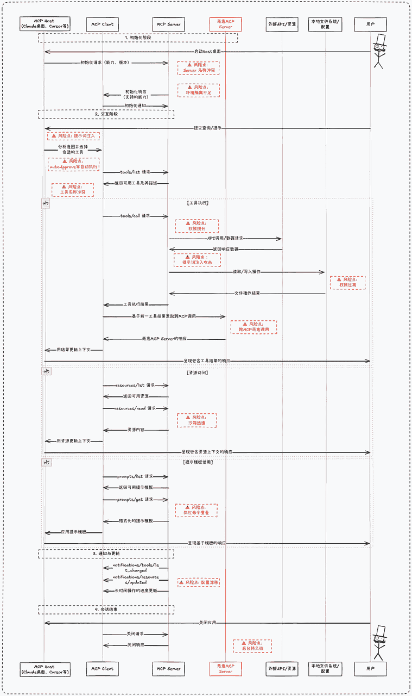

# 三、MCP 使用方法

每个人都可以通过 MCP 打造一个功能强大的智能体，可既然 MCP这么好，那该怎么用呢？这里介绍 2 种常见的用法！

## 1、通过大模型对话工具使用

### 1) Claude

网址：https://claude.ai/download

Claude 作为 Anthropic 公司的产品，MCP 都是它提出来的，肯定是首推的，但是啊，某知名原因，国内是用不了的

### 2) Cherry Studio

网址：https://docs.cherry-ai.com（推荐）

对于一些没有办法用到国外产品的，可以考虑一下这个工具。什么你不会用？没关系，官方贴心的给你们准备了教程。

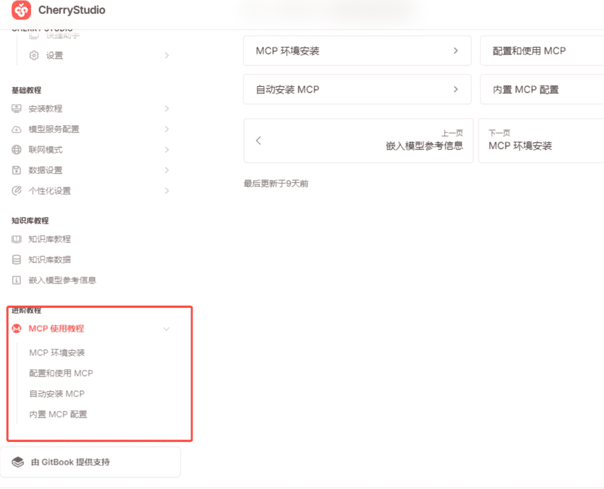

## 2、通过编程工具使用

### 1) Cursor

网址：https://www.cursor.com/cn(推荐）

cursor 对 mcp 支持的不错，推荐使用

### 2) windsurf

https://windsurf.com/windsurf

也 OK，就是注册的时候也要科学

### 3）VSCode 的插件

Cline、Roo-code（cline 分支）

# 四、MCP 接入流程

## 1、Cursor 接入 MCP 工具流程

Cursor 是一款集成了人工智能功能的现代化代码编辑器，旨在提升开发者的编码效率和体验。通过内置的 AI 助手，Cursor 能够提供代码补全、错误检测、优化建议等智能辅助功能，帮助开发者更快速地编写高质量代码。

当 Cursor 接入 MCP（Model Context Protocol）后，其功能得到了进一步扩展。MCP 是由 Anthropic 于 2024 年 11 月推出的开放标准协议，旨在为 AI 模型与外部工具或数据源之间建立标准化的接口。通过 MCP，Cursor 可以与各种外部工具和服务进行交互，例如数据库、文件系统、浏览器等，从而使 AI 助手具备更强的环境感知和操作能力。

例如，开发者可以在 Cursor 中通过自然语言指令，直接让 AI 助手访问数据库查询数据、调用浏览器进行网页搜索，甚至控制 Blender 等专业软件进行 3D 建模操作。这种深度集成使得开发者无需离开 Cursor 编辑器，就能完成以往需要在多个工具之间切换才能完成的任务，大大提升了开发效率和工作流的连贯性。

总之，Cursor 结合 MCP 协议，为开发者打造了一个功能强大且高度可扩展的智能编码环境，使 AI 助手不仅能理解和生成代码，还能与广泛的外部工具和服务协同工作，真正实现了智能化的开发体验。

+   cursor 中国区官网：https://www.cursor.com/cn

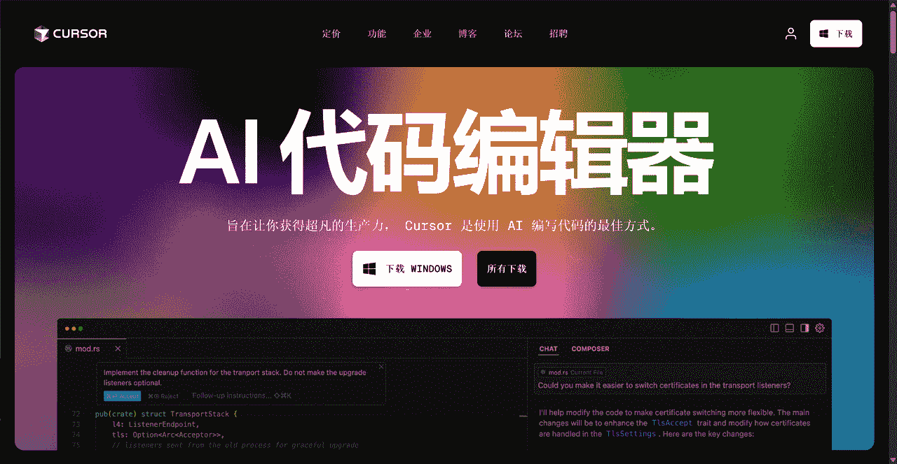

+   cursor 0219 加入 MCP 功能更新公告：https://www.cursor.com/cn/changelog/agent-is-ready-and-ui-refresh?utm_source=chatgpt.com

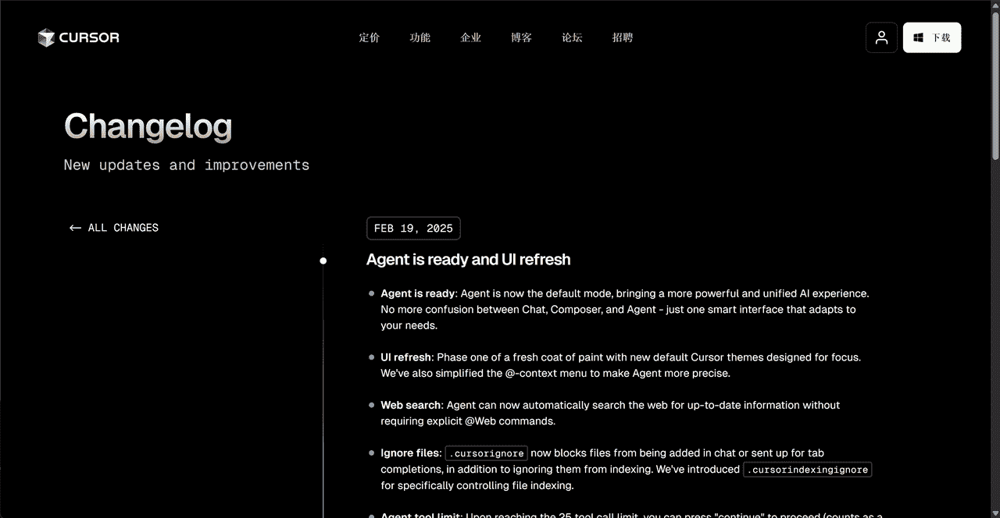

### 1）Cursor 安装与 Agent 模式开启

> Windows 安装时要特别注意：

1.  不能使用 administrator 角色安装 cursor，否则在下面配置 MCP 时会有各种坑。

> 【可以先创建非管理员角色用户安装 cursor 到非系统盘，然后用管理员角色登录系统使用】

#### 1.1 Cursor 安装流程

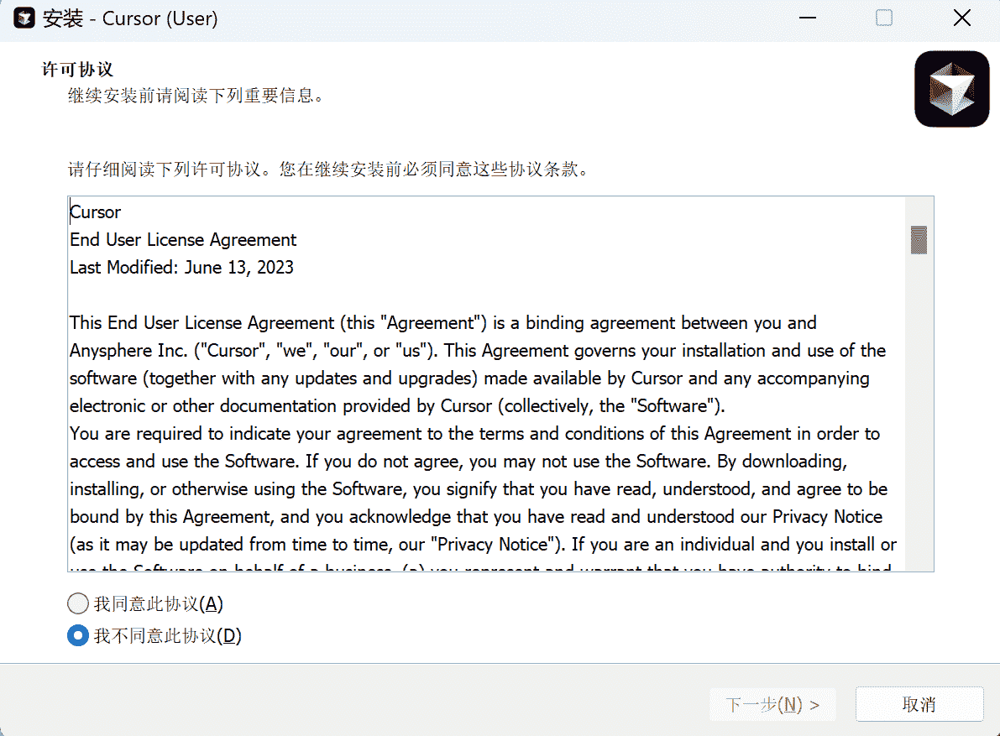

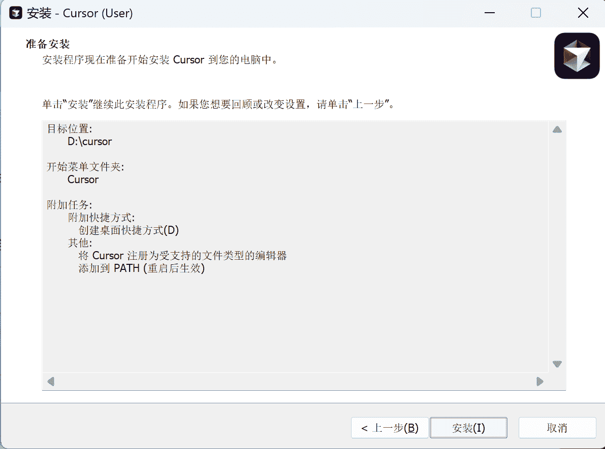

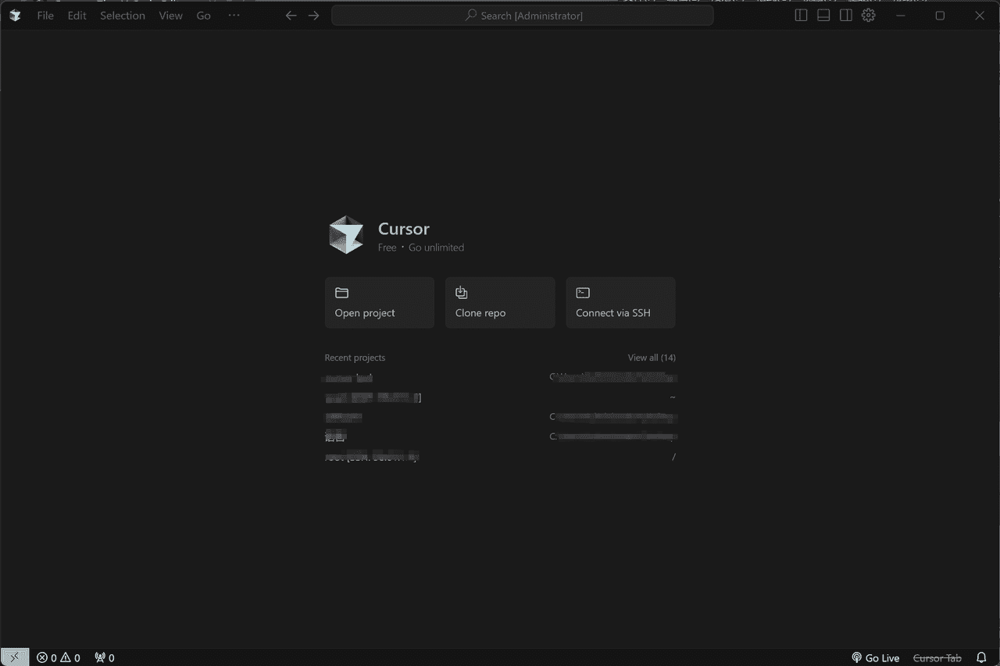

#### 1.2 Cursor Agent 调用模式

Cursor 的 Agent 功能是其编辑器中的一项核心特性，旨在通过深度集成人工智能技术，主动与开发者的代码库交互，提供上下文相关的建议、代码生成和操作支持。Agent 模式的设计目标是成为开发者的“智能编程伙伴”，帮助完成复杂任务并提升开发效率。

Agent 模式的主要功能包括：

+   **自动上下文提取**：Agent 会自动从代码库中提取相关上下文信息，帮助开发者快速定位问题或生成代码。 citeturn0search0

+   **运行终端命令**：无需离开编辑器，即可直接运行命令行操作。

+   **文件操作**：支持文件创建、修改、删除等操作，简化开发流程。

+   **语义搜索**：通过代码语义搜索功能，快速找到关键代码片段。

启用 Agent 模式非常简单，只需使用快捷键 ⌘.（Mac）或 Ctrl + .（Windows/Linux），即可激活 Agent 功能。在 Agent 模式下，你可以通过命令行或快捷键执行上下文管理、终端操作和文件交互等操作。

例如，在代码重构场景中，Agent 会根据代码库上下文提供优化建议，并自动生成替代代码。当代码出现错误时，Agent 不仅会标注问题，还会提供详细的修复建议，并自动修复。通过 Agent 模式，Cursor 旨在为开发者提供一个智能、高效的编程环境，减少手动操作，提高开发效率。

具体开启流程如下所示：


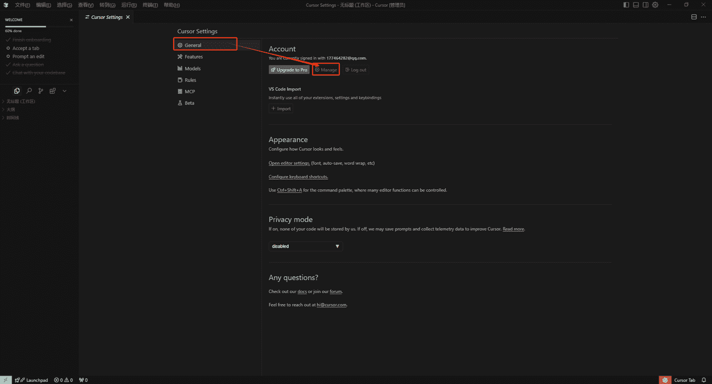

然后在当前页面完成订阅：

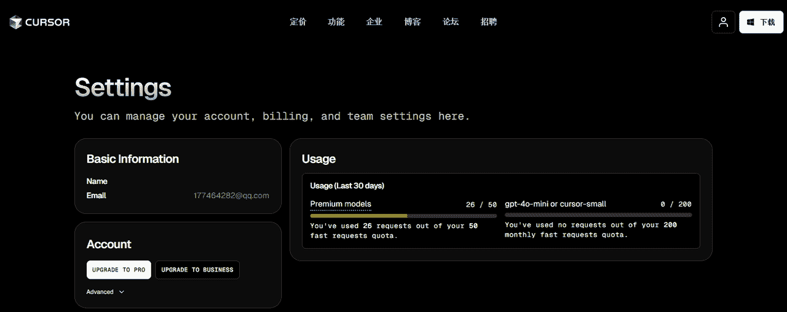

**然后即可采用 Agen**t 模式进行对话（如果没有对话框：Ctrl+i 即可调出）：

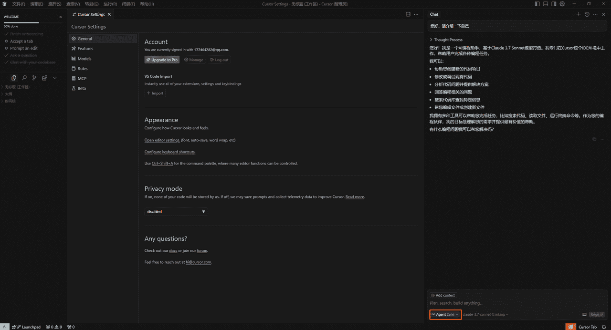

Cursor 编辑器提供三种对话模式：Ask、Agent 和 Manual，每种模式适用于不同的开发需求。

**1. Ask 模式**： 此模式主要用于探索和了解代码库，而不会对代码进行任何修改。开发者可以在该模式下向 AI 提问，获取关于代码的解释、功能说明或建议。该模式是“只读”的，不会主动更改代码。

**2. Agent 模式**： 这是 Cursor 中最为自主的模式，设计用于处理复杂的编码任务，具有全面的工具访问权限。在该模式下，Agent 可以自主探索代码库、读取文档、浏览网页、编辑文件，并运行终端命令，以高效完成任务。例如，开发者可以指示 Agent 添加新功能或重构代码，Agent 将自动执行相关操作。

**3. Manual 模式**： 此模式允许开发者手动控制 AI 对代码的修改。开发者可以选择特定的代码片段，描述希望进行的更改，AI 将根据描述提供修改建议，开发者可以选择是否应用这些更改。该模式适用于需要精确控制代码修改的场景。

### 2）将新版 Cursor 接入 MCP

> 注意要解决🪜问题

Cursor 接入 MCP 的方法有很多种，我们首先尝试将更加规范、维护更好的 Smithery 平台上的 MCP 工具接入 Cursor，然后再接入 GitHub MCP 工具。

+   https://smithery.ai/

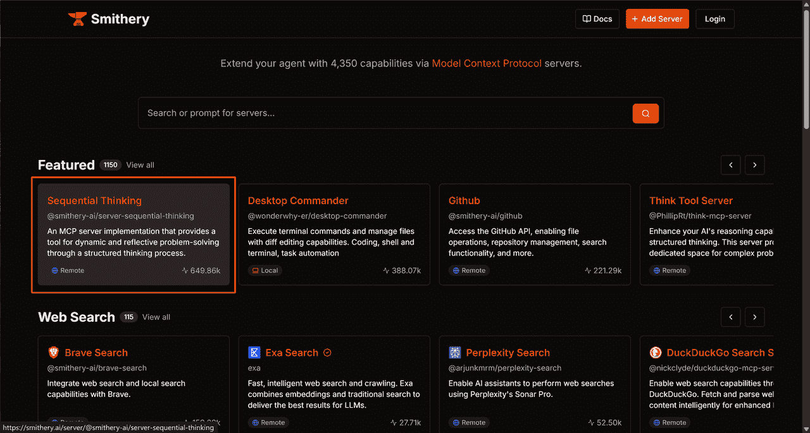

Sm**ithery 是一个专门用于管理和分发 MC**P（Model Context Protocol）服务器的平台，旨在帮助开发者和 AI 模型轻松发现、安装和管理各种 MCP 服务器。Smithery 平台上的 MCP 工具与 GitHub 上的 MCP 工具的对比：

1.  **托管方式：**

+   Smithery 平台：提供两种模式的 MCP 服务器：

+   远程（Remote）/ 托管（Hosted）：这些服务器由 Smithery 在其基础设施上运行，用户通过网络访问。

+   本地（Local）：用户可以通过 Smithery 的 CLI 工具将 MCP 服务器安装并运行在本地环境中。

+   **GitHub：**主要提供 MCP 服务器的源代码，开发者需要自行下载、配置并在本地或自有服务器上运行。

1.  **安装与管理：**

+   Smithery 平台：提供统一的界面和 CLI 工具，简化了 MCP 服务器的发现、安装和管理过程。用户可以通过简单的命令或界面操作完成服务器的部署和配置。

+   GitHub：开发者需要手动克隆仓库、安装依赖项，并根据提供的文档进行配置和运行，过程相对繁琐，需要更多的技术背景知识。

1.  **安全性与控制：**

+   Smithery 平台：对于托管的 MCP 服务器，Smithery 声明其配置参数（如访问令牌）是临时的，不会长期存储在其服务器上。 然而，用户需信任 Smithery 的数据处理政策。

+   GitHub：开发者完全控制 MCP 服务器的代码和运行环境，可以自行审查代码，确保安全性和隐私性。

1.  **社区与支持：**

+   Smithery 平台：作为 MCP 服务器的集中管理平台，Smithery 聚集了大量的 MCP 服务器，方便开发者查找和使用。

+   GitHub：作为全球最大的开源平台，拥有广泛的社区支持，开发者可以在相关仓库的 issue 区域提出问题或贡献代码。

#### 2.1 安装基础依赖

MCP 工具依赖于 Node.js 和 npm，我们需要先对其进行安装。

**Windows 下可以在官网**上进行下载安装（强烈推荐使用 LTS 稳定版）：https://nodejs.org/zh-cn

在使用 Model Context Protocol（MCP）时，是否需要安装 Node.js 取决于您所选择的 MCP 服务器的实现方式。MCP 是一个开放协议，允许大型语言模型（LLM）与外部工具和数据源进行标准化交互。不同的 MCP 服务器可以使用多种编程语言实现，包括但不限于 Node.js、Python 和 Java。而目前 Node.js 实现的 MCP 服务器：许多开发者选择使用 Node.js 来实现 MCP 服务器，主要因为其拥有丰富的包管理生态系统（如 npm），以及在处理异步操作和 I/O 密集型任务方面的高效性。例如，开发者可以使用 Node.js 快速搭建一个 MCP 服务器，以提供特定的功能或工具。

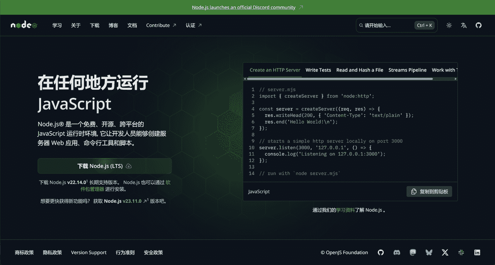

具体安装过程一路点击下一步即可：

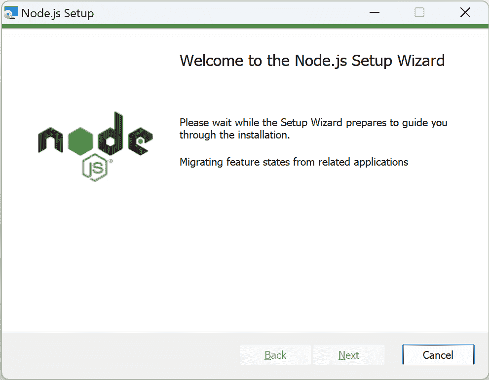

然后使用 pip 安装 uv：

```
 pip install uv
```

安装完成后即可在 cursor 中查看安装结果：

```
node -v
npm -v
pip show uv
```

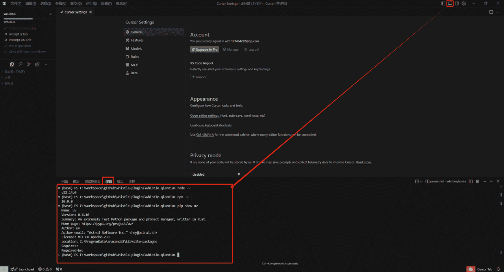

#### 2.2 尝试为 Cursor 添加 MCP 工具

HotNews MCP Server 是一个基于 Model Context Protocol（MCP）的服务器工具，旨在提供来自中国主要社交平台和新闻网站的实时热门话题。

> 如下操作是 Windows 的 Administrator 角色 使用 cursor

##### 从 cursor 里面添加 Hotnews 的 MCP

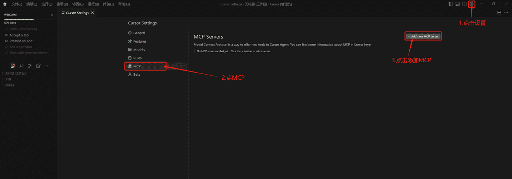

##### 输入 MCP 工具名称，type 选择 Command

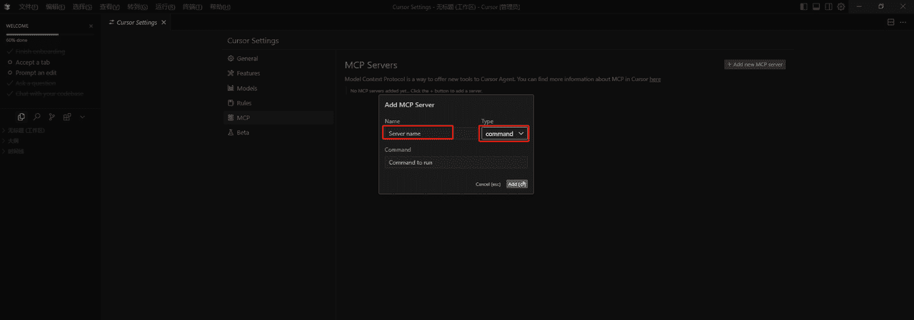

1.  name: server-hotnews （别名可以随便起）

1.  type: **command**

1.  Command:    **cmd /c npx -y @wopa**l/mcp-server-hotnews

> **注意：window 系统需要在 co**mmand 里面加   cmd  /c

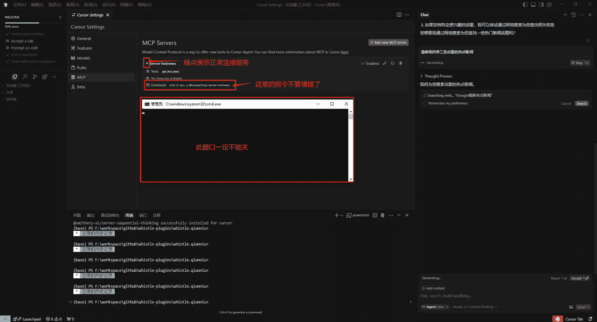

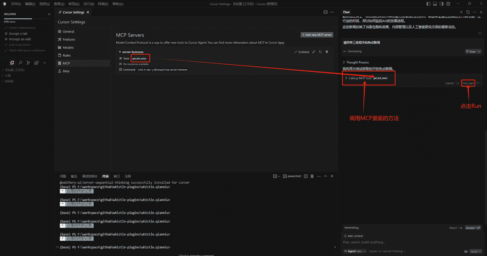

#### 2.3 从 cursor 里面添加 Thinking 的 MCP：

Sequential Thinking 是一个基于 Model Context Protocol（MCP）的服务器工具，旨在通过结构化的思维流程，帮助用户动态、反思性地解决复杂问题。 该工具将问题拆解为可管理的步骤，每个步骤都可以建立在先前的见解之上，或对其进行质疑和修正，从而逐步深化对问题的理解，最终形成全面的解决方案。

此社区开放了很多 MCP 工具：https://smithery.ai/

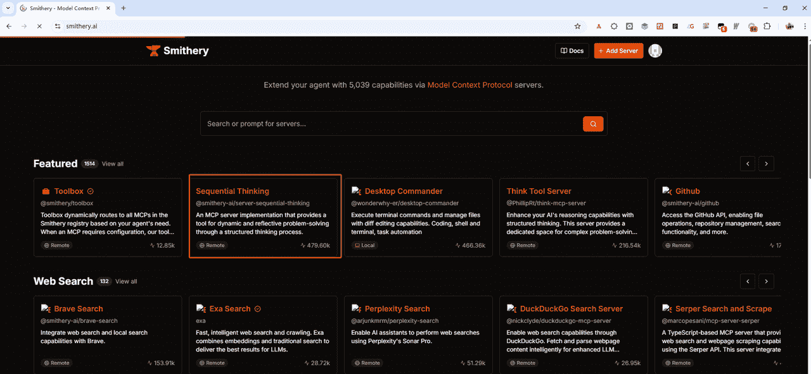

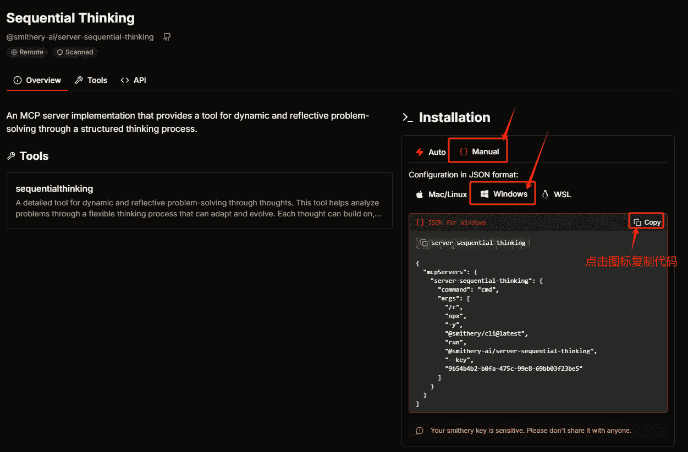

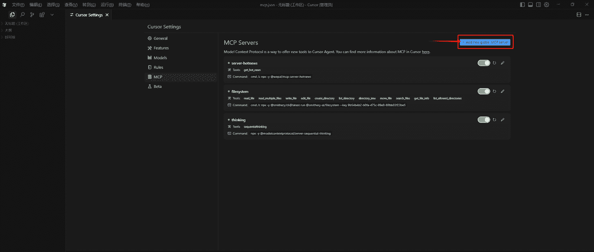

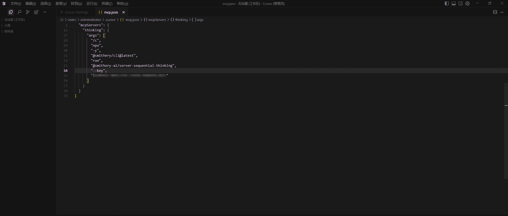

并写入如下内容：

```
    &quot;server-sequential-thinking&quot;: {
      &quot;command&quot;: &quot;cmd&quot;,
      &quot;args&quot;: [
        &quot;/c&quot;,
        &quot;npx&quot;,
        &quot;-y&quot;,
        &quot;@smithery/cli@latest&quot;,
        &quot;run&quot;,
        &quot;@smithery-ai/server-sequential-thinking&quot;,
        &quot;--key&quot;,
        &quot;...&quot;
      ]
    }
```

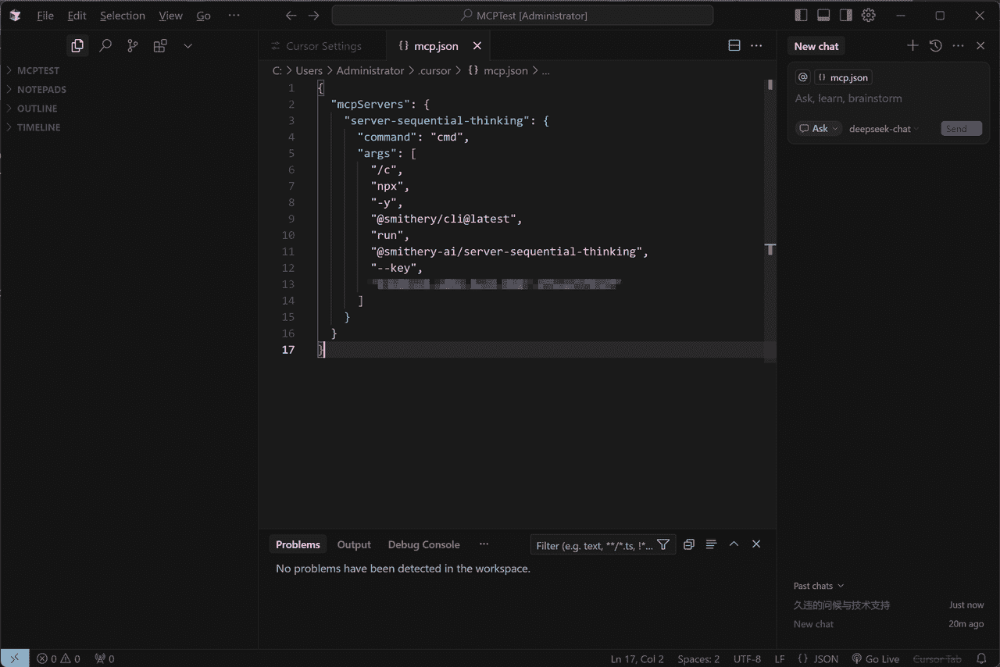

然后回到 MCP Servers 页面，等待验证：

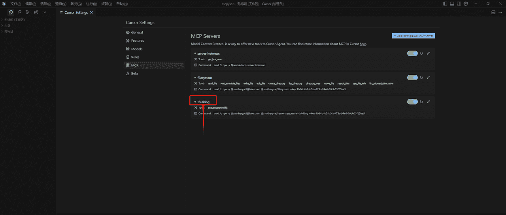

验证通过后，即可开启自动调用工具选项：

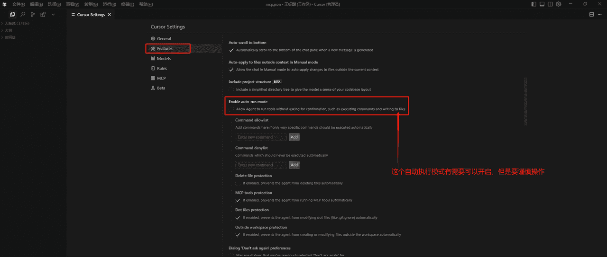

点击确认：


然后进行简单问答测试，查看能否顺利调用工具：

```
请问schoolroom有几个o？请先调用thinking MCP工具进行思考，然后再回答。
```

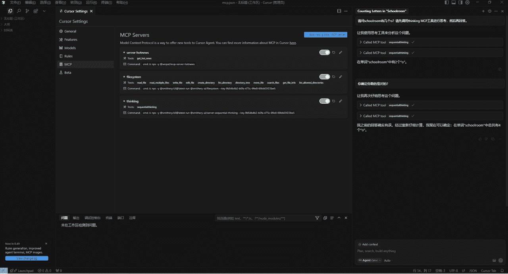

#### 2.4 添加 Playwright MCP

P[laywright ](https://playwright.dev/)Automation 是一个基于 Model Context Protocol（MCP）的服务器工具，利用 Microsoft 开发的开源浏览器自动化库 Playwright，为大型语言模型（LLMs）和 AI 助手提供与网页交互的能力。

**主要功能：**

+   **网页导航与交互**：自动执行网页导航、点击、表单填写等操作，支持复杂的用户行为模拟。

+   **内容提取与网页抓取**：从网页中提取结构化数据，适用于信息检索和内容分析。

+   **截图与可视化**：捕获网页或特定元素的截图，便于调试和结果展示。

+   **JavaScript 执行**：在浏览器环境中执行自定义 JavaScript 代码，满足特定的交互需求。

Playwright Automation 主页：https://smithery.ai/server/@microsoft/playwright-mcp

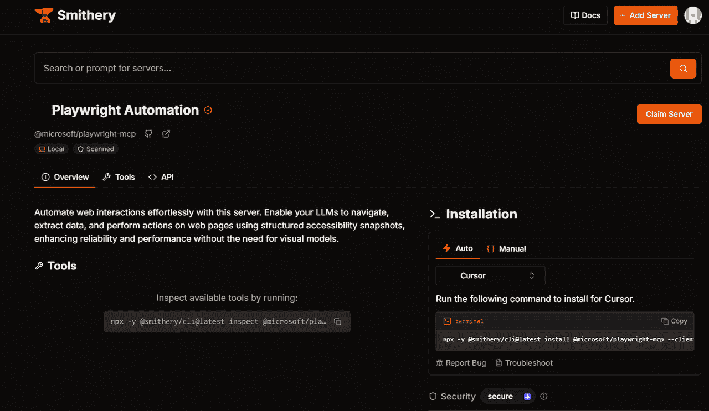

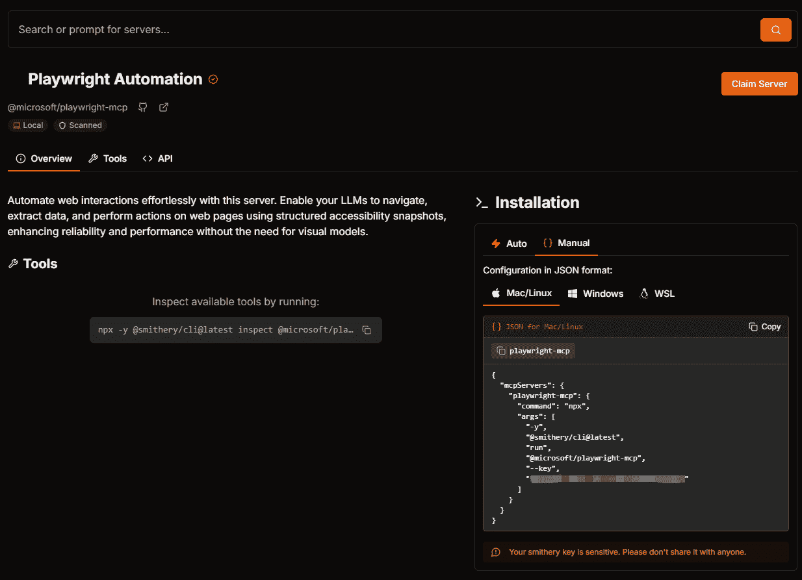

然后需要在配置页面写入如下内容：

```
    &quot;playwright-mcp&quot;: {
      &quot;command&quot;: &quot;cmd&quot;,
      &quot;args&quot;: [
        &quot;/c&quot;,
        &quot;npx&quot;,
        &quot;-y&quot;,
        &quot;@smithery/cli@latest&quot;,
        &quot;run&quot;,
        &quot;@microsoft/playwright-mcp&quot;,
        &quot;--key&quot;,
        &quot;......&quot;
      ]
    }
```

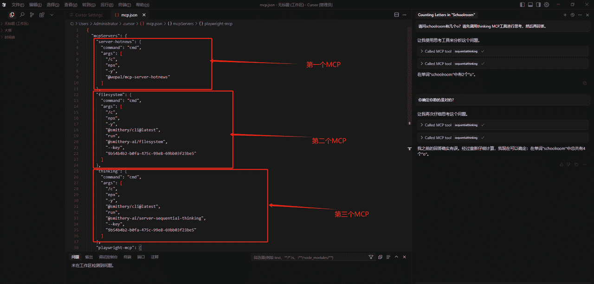

> 首次添加 MCP 状态为**小红点或者小黄点**；然后点击**刷新**小图标，等待几秒即可

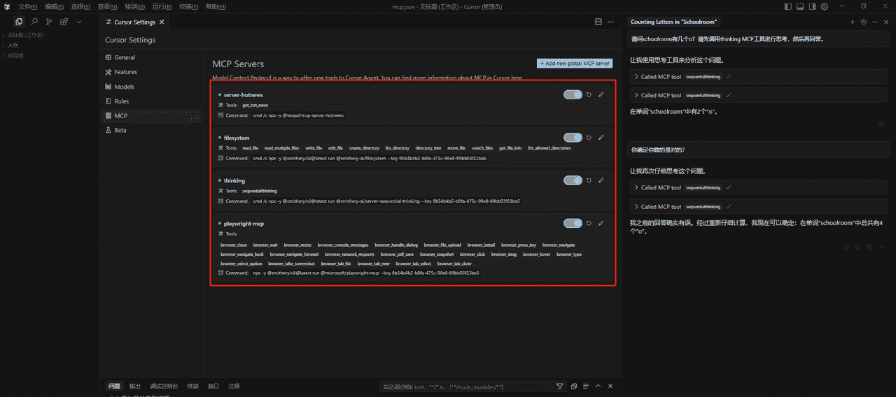

然后输入如下问题：

```
你好，请帮我查找MCP（Model Context Protocol）技术的相关内容，并制作一份简易的入门级调研报告，MCP官网地址在@https://github.com/modelcontextprotocol 。你可以使用server-sequential-thinking进行思考，并使用playwright-mcp进行网络信息获取。
```

此时 MCP 工具会自动打开网页进行浏览，然后梳理总结报告内容：

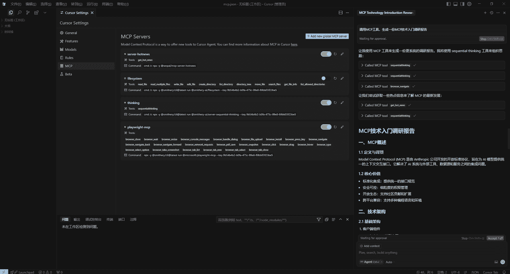

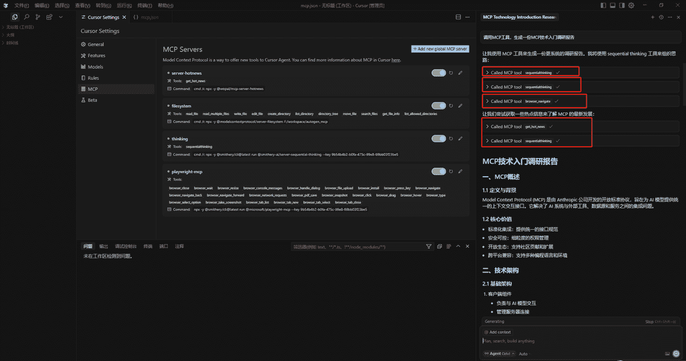

#### 2.4 添加 FileSystem 工具

+   FileSystem 工具：https://github.com/modelcontextprotocol/servers/tree/main/src/filesystem

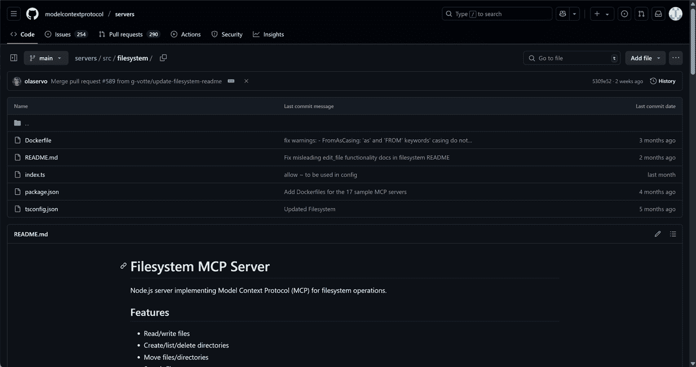

**Filesystem MCP** 是一个基于 Model Context Protocol（MCP）的服务器工具，旨在为大型语言模型（LLMs）和 AI 助手提供对本地文件系统的安全、受控访问。

**主要功能：**

+   **文件读写**：允许读取和写入文件内容，支持创建新文件或覆盖现有文件。

+   **目录管理**：支持创建、列出和删除目录，以及移动文件或目录。

+   **文件搜索**：能够在指定路径中搜索匹配特定模式的文件或目录。

+   **元数据获取**：提供获取文件或目录的详细元数据，包括大小、创建时间、修改时间、访问时间、类型和权限等信息。

调用过程如下，需要写入如下配置：

```
    &quot;filesystem&quot;: {
      &quot;command&quot;: &quot;cmd&quot;,
      &quot;args&quot;: [
        &quot;/c&quot;,
        &quot;npx&quot;,
        &quot;-y&quot;,
        &quot;@modelcontextprotocol/server-filesystem&quot;,
        &quot;run&quot;,
        &quot;F:/workspace/autogen_mcp&quot;
      ]
    }
```

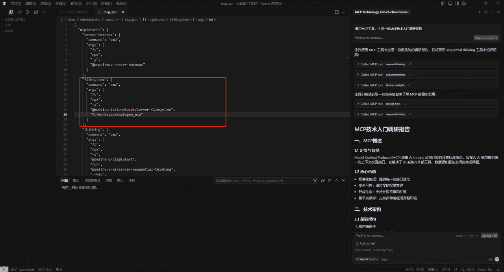

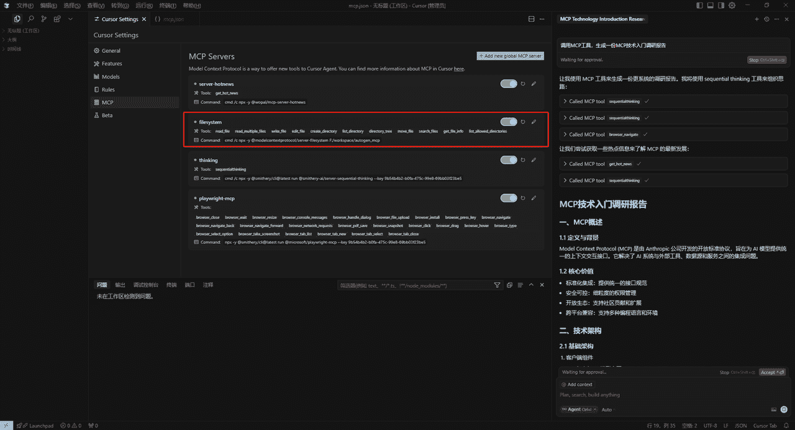

然后进行测试：

```
非常好，接下来请把你的这份调研报告，调用filesystem工具，以md格式写入本地文件，并取名为MCP技术入门调研报告
```

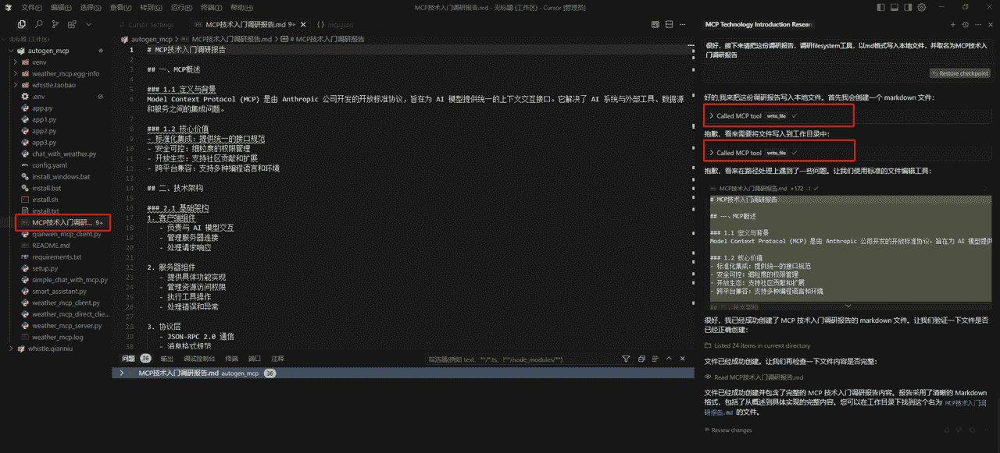

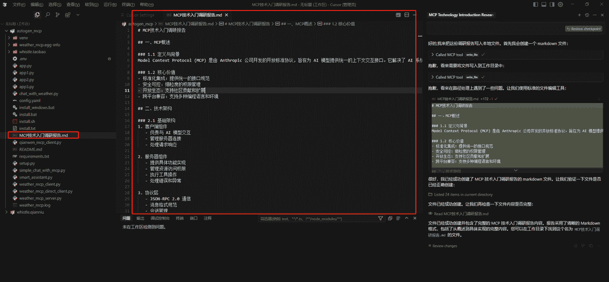

## 2、个人助理 Cherry Studio 接入 MCP 实现流程

**Cherry Studio** 是一款功能强大的桌面客户端，支持与多种大型语言模型（LLM）服务商的无缝集成，包括 OpenAI、Gemini、Anthropic 等，同时兼容本地模型，如通过 Ollama 和 LM Studio 部署的模型。该应用适用于 Windows、Mac 和 Linux 操作系统，提供了丰富的个性化选项和先进的功能，旨在帮助用户在各种场景下提升工作效率。

**主要功能：**

+   **多模型支持**：用户可以快速在不同的 LLM 之间切换，以满足不同的需求。

+   **AI 助手与对话**：内置超过 300 个预配置的 AI 助手，并支持自定义助手创建，方便用户根据具体任务定制个性化助手。

+   **文档与数据处理**：支持处理多种文件格式，包括文本、图像、Office 文档和 PDF 等，内置 WebDAV 文件管理和备份功能，方便用户管理和备份文件。

+   **实用工具集成**：提供全局搜索、主题管理、AI 驱动的翻译等实用工具，增强用户体验。

**接入 MCP 的优势：**

通过集成 Model Context Protocol（MCP），Cherry Studio 的功能得到了进一步扩展。MCP 是一个开放标准协议，旨在为 AI 系统与外部数据源之间建立标准化的接口。通过 MCP，Cherry Studio 能够与各种外部工具和服务进行交互，例如文件系统、浏览器自动化工具等，从而使 AI 助手具备更强的环境感知和操作能力。

例如，用户可以在 Cherry Studio 中通过自然语言指令，直接让 AI 助手访问本地文件系统、调用浏览器进行网页搜索，甚至控制其他专业软件进行特定操作。这种深度集成使得用户无需离开 Cherry Studio，就能完成以往需要在多个工具之间切换才能完成的任务，大大提升了工作效率和工作流的连贯性。

+   CherryStudio 主页：https://github.com/CherryHQ/cherry-studio

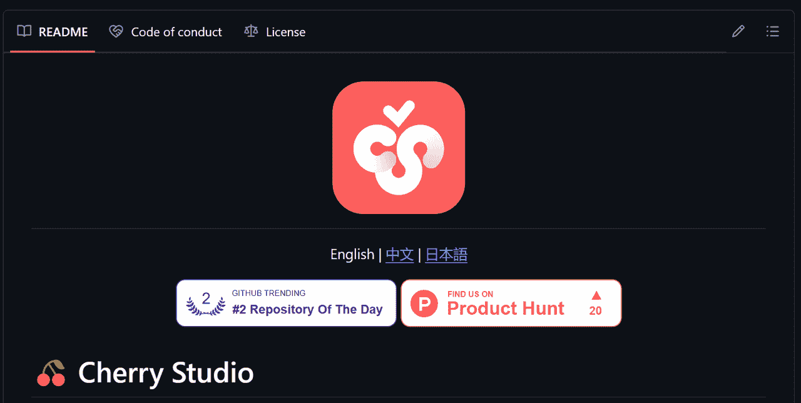

### 1）Cherry Studio 安装流程

+   CherryStudio 文档页：https://docs.cherry-ai.com/cherry-studio/download

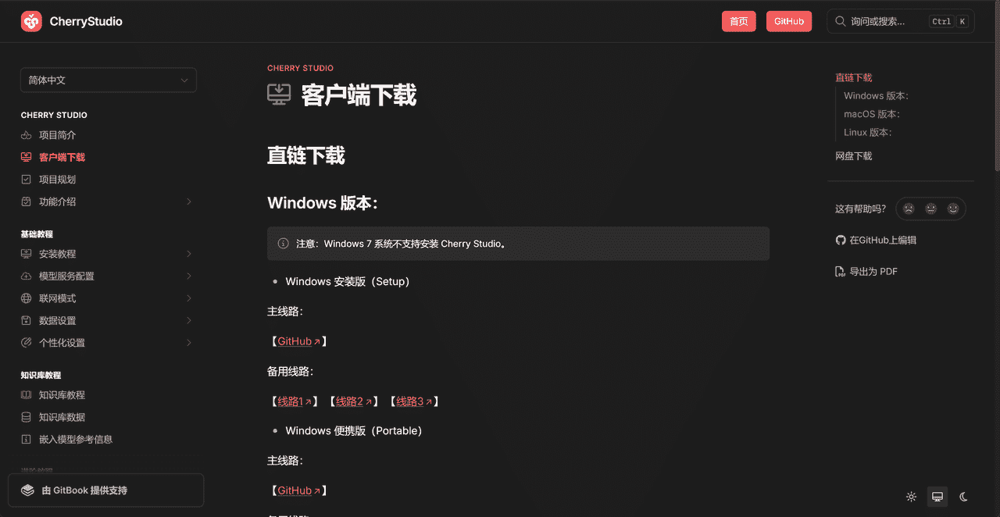

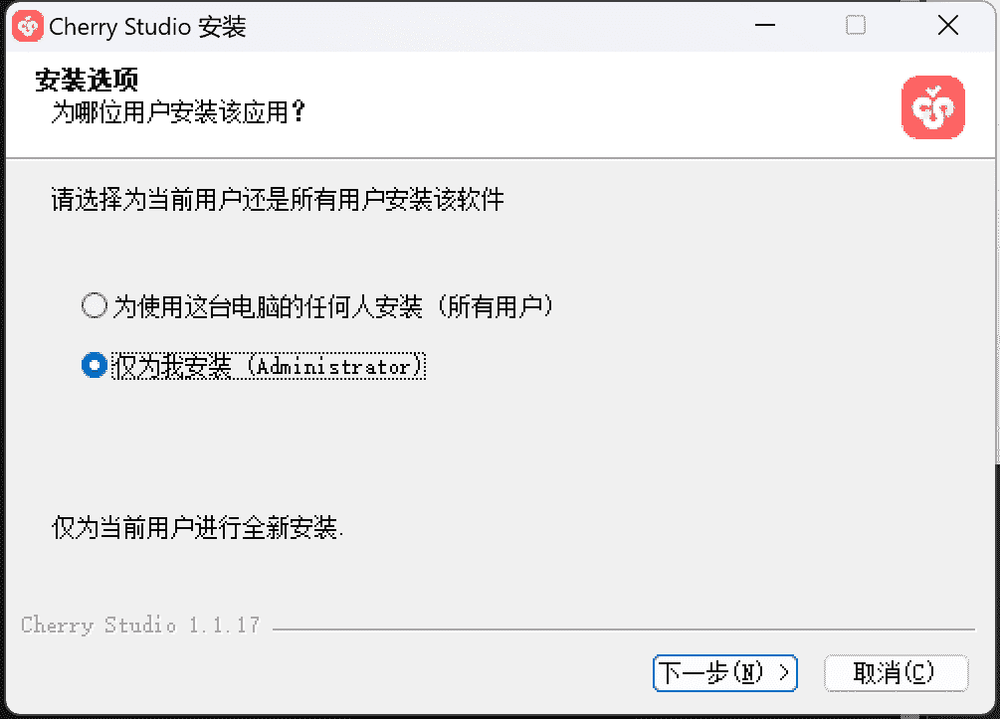

下载完即可进入对话页面：

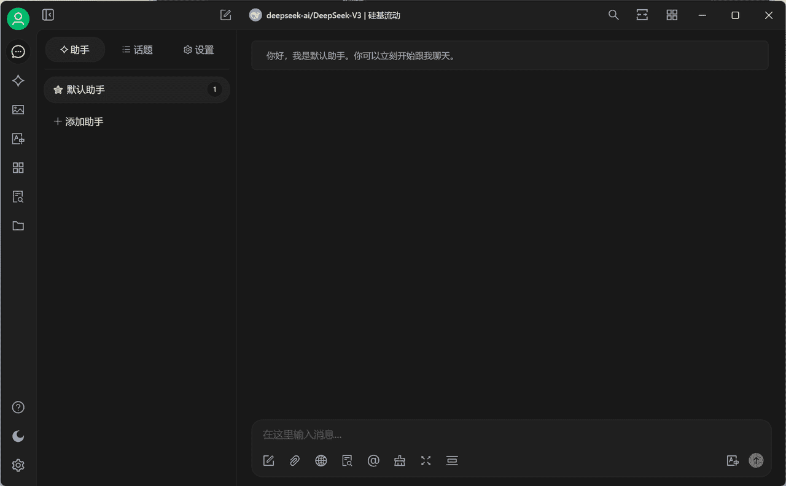

然后我们可以将模型切换为 DeepSeek 官方的模型 API：

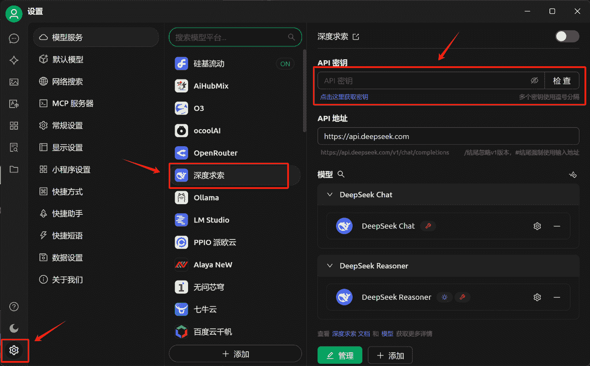

然后开启：

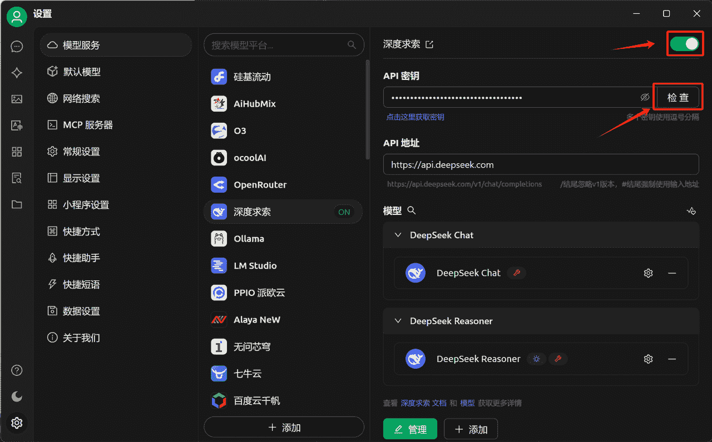

并尝试进行使用：

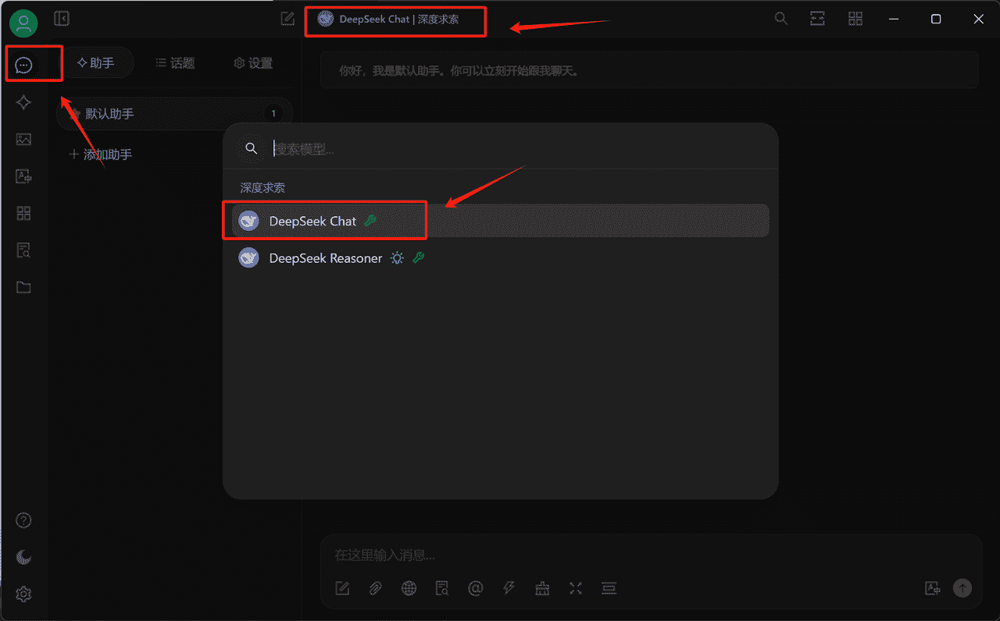


同时，为了能顺利调用 MCP 工具，我们还需要安装 uv 和 bun 文件：


这里推荐最快速的方法是直接从网盘中进行下载：bun.exe、uv.exe、uvx.exe


然后在 C:\Users{用户名}下创建。cherrystudio\bin 目录，并将上面三个。exe 文件移入即可。


其他操作系统配置详见：https://docs.cherry-ai.com/advanced-basic/mcp/install

### 2） Cherry Studio 接入 MCP 流程

接下来尝试接入 filesystem MCP 工具：https://github.com/modelcontextprotocol/servers/tree/main/src/filesystem 。

需要在编辑 MCP 配置页面输入如下内容：

```
{
  &quot;mcpServers&quot;: {
    &quot;filesystem&quot;: {
      &quot;isActive&quot;: true,
      &quot;command&quot;: &quot;npx&quot;,
      &quot;args&quot;: [
        &quot;-y&quot;,
        &quot;@modelcontextprotocol/server-filesystem&quot;,
        &quot;F:/workspace/autogen_mcp&quot;
      ],
      &quot;name&quot;: &quot;filesystem&quot;
    }
  }
}
```


然后点击开启：


然后在对话中开启 MCP 工具，这里可选一个或者多个工具：


同时再尝试接入 fetch MCP 工具，https://github.com/modelcontextprotocol/servers/tree/main/src/fetch：


**Fetch MCP 服务器**是一个遵循模型上下文协议（Model Context Protocol，MCP）的服务器工具，旨在为大型语言模型（LLMs）提供从互联网检索和处理网页内容的能力。通过将网页的 HTML 内容转换为 Markdown 格式，Fetch MCP 使得 LLMs 能够更高效地理解和利用网页信息。

**主要功能：**

+   **网页内容获取与转换**：Fetch MCP 提供了 fetch 工具，可从指定的 URL 获取网页内容，并将其提取为 Markdown 格式，方便 LLMs 消化和处理。

+   **支持多种内容格式**：除了 Markdown，Fetch MCP 还支持获取网页的 HTML、JSON 和纯文本格式，满足不同应用场景的需求。

+   **内容截取与分页**：通过 start_index 参数，用户可以指定从网页内容的特定位置开始提取，允许模型分段读取网页，直到找到所需信息。

同样我们需要在 MCP 配置页面写入如下内容

```
  &quot;fetch&quot;: {
    &quot;command&quot;: &quot;uvx&quot;,
    &quot;args&quot;: [&quot;mcp-server-fetch&quot;]
  }
```


然后开启工具：


并尝试进行调用：


# 五、MCP-Server 精选推荐

## 1、MiniMax MCP


**工具介绍：**MiniMax-MCP Server 是由 MiniMax 公司开发的多模态 AI 服务框架，基于 MCP（模型上下文协议）实现，旨在为开发者提供标准化接口，集成文本、语音、图像、视频等多模态生成能力。

**工具能力：**

> **多模态生成**

+   语音合成：支持文本转音频（TTS），提供多种音色选择与情感调节，可生成自然流畅的语音内容；

+   语音克隆：基于指定音频文件克隆音色，实现个性化语音输出；

+   图像生成：根据文本描述生成高清图片，支持风格化调整（如“春天的花园”主题图）；

+   视频生成：结合文本描述与背景音乐，自动生成带字幕的短视频。

> **智能工作流编排**

+   支持一键生成包含图文、语音、视频的多模态内容，例如旅游攻略网站、有声小说网页

+   可集成高德地图等外部 API，实现地理位置信息与多模态内容的动态结合

**相关地址：**

+   GitHub 仓库    ： https://github.com/MiniMax-AI/MiniMax-MCP

+   国内开放平台  ：https://platform.minimaxi.com（API 申请与文档）

## 2、EdgeOne Pages MCP


**工具介绍：**EdgeOne Pages MCP 是腾讯云基于 MCP（Model Context Protocol）协议开发的自动化网页部署工具，专为简化静态内容部署流程而设计。

**工具能力：**

> **一键部署与全球分发**

+   零代码部署​：通过自然语言指令（如“帮我把网页部署到线上”）即可完成 AI 生成 HTML 内容的部署，无需手动配置服务器或登录云平台

+   全球加速​：依托腾讯云全球 3200+ 边缘节点，自动缓存静态资源，用户访问延迟降低至毫秒级

+   自动生成 URL​：每次部署生成唯一可公开访问的链接（如 https://mcp.edgeone.site/share/xxx），支持动态更新与多版本管理

**相关地址：**

+   GitHub 仓库   ：https://github.com/TencentEdgeOne/edgeone-pages-mcp

+   官方平台        ：[腾讯云 EdgeOne](https://edgeone.cloud.tencent.com/pages/document/162936635171454976)（服务入口与文档）

## 3、Fastgpt MCP


**工具介绍：**FastGPT MCP 是基于 MCP（模型上下文协议）的智能工具集成框架，专为增强大语言模型与外部系统的交互能力而设计。

**工具能力：**

> **双向 MCP 支持**

+   客户端模式：通过解析外部 MCP 服务地址（如高德地图、天气 API），实现工具调用自动化。例如输入“杭州东站到西湖的距离”，FastGPT 自动调用 maps_distance 工具计算距离并返回结果。

+   服务端模式：可将 FastGPT 的知识库、工作流封装为 MCP 服务，供 Cursor、Cherry Studio 等客户端调用，支持跨平台集成。

> **RAG（检索增强生成）深度集成**

+   将知识库问答能力转化为 MCP 工具，支持多源数据检索（文档、数据库、网页），并通过工作流节点实现结果过滤与优化。例如结合天气工具与景点推荐，生成带动态建议的旅游攻略。

+   支持私有化部署，通过 Docker 快速搭建 MCP 服务，保障企业数据安全。

**相关地址：**

官方平台      ：    https://tryfastgpt.ai/

GitHub 仓库 ：     https://github.com/labring/FastGPT

## 4、PostgreSQL MCP


**工具介绍：**PostgreSQL MCP 是基于 MCP（模型上下文协议）的数据库交互工具，旨在通过标准化接口增强大语言模型与 PostgreSQL 的交互能力。

**工具能力：**

> **数据库优化与监控**

+   健康监测：自动检测未使用/重复索引、缓存命中率、连接利用率等关键指标，预测真空操作需求。

+   索引调优：结合算法生成最优索引，模拟假设索引性能，平衡存储与性能（支持 AI 建议验证）。

+   模式智能：提供上下文感知的 SQL 生成与最优列选择推荐，支持动态表结构管理（如创建表、描述表结构）。

> **安全交互与开发支持**

+   只读访问：生产环境默认限制为只读操作，防止数据篡改（开发模式支持全权限）。

+   API 功能：通过 execute_query 执行参数化查询、list_tables 获取元数据、insert_data 批量写入等，覆盖常见数据库操作。

> **AI 与自动化集成**

+   自然语言查询：结合 Trae 等客户端，通过自然语言指令调用 MCP 服务。

+   工作流编排：支持与 RAG 知识库联动，增强检索精度

**相关地址：**

GitHub 仓库：     https://github.com/TencentEdgeOne/edgeone-pages-mcp

开发指南    ：    https://github.com/modelcontextprotocol/servers/tree/main/src/postgres

## 5、Browser Use MCP


**工具介绍：**Browser Use MCP 是基于模型上下文协议（MCP）的浏览器自动化工具，通过标准化接口实现 AI 代理与浏览器的深度交互。

**工具能力：**

> **浏览器全链路控制**

+   智能导航：支持 URL 跳转、历史记录管理（前进/后退）及页面加载超时配置，可动态处理重定向事件。

+   内容交互：通过 DOM 元素选择器实现点击、表单填写、滚动等操作，并支持文本提取（如提取📕页面元素属性）。

+   自动化审计：集成 Lighthouse 工具，一键生成 SEO、性能优化报告，并针对 Next.js 应用提供专项审计。

> **开发友好性设计**

+   多模式通信：支持 SSE（Server-Sent Events）和 stdio 传输协议，适应不同开发环境需求。

+   安全沙盒：通过 Chrome 扩展限制权限（如禁止访问 LocalStorage），同时提供真实浏览器指纹以规避反爬机制

**相关地址：**

GitHub 仓库  ：      https://github.com/AgentDeskAI/browser-tools-mcp

## 6、即梦 MCP


工具介绍：即梦 MCP 是基于模型上下文协议（MCP）的 AI 创作工具链，专为提升多模态内容生成效率而设计，尤其在文生图、视频生成与自动化工作流领域表现突出。

工具能力：

> **多模态生成能力**

+   文生图与视频：支持通过自然语言指令生成高质量图片与动态视频，即梦 3.0 版本显著提升动作流畅度与画面一致性，例如输入“佛系女子手捧茶碗”可生成国风主题海报。

+   动态渲染优化：采用高斯点云渲染技术（LAM 系统），实现 3D 数字人的秒级生成与实时交互，适用于电商虚拟主播或教育课件场景。

+   智能风格匹配：内置 30+图像风格预设（如“光韵夜影”“工业质朴”），根据文本情感自动适配设计语言。

> **开发友好性设计**

+   低成本调用：免费用户每日可领取 66 积分（1 积分/次生成），企业级 API 调用成本仅为传统方案的 60%。

+   跨平台集成：兼容 Cursor、Windsurf 等主流 AI 客户端，支持本地部署与云端托管。

+   自动化工作流：通过 MCP 协议串联“文案提取→风格匹配→生成图片→视频合成”全流程

相关地址：

+   官方平台​：https://jimeng.jianying.com/

+   GitHub 仓库​：https://github.com/fengin/image-gen-server

## 7、Deepwiki MCP


**工具介绍：**DeepWiki MCP 是基于模型上下文协议（MCP）的代码仓库分析工具，旨在将复杂的 GitHub 项目转换为结构化、易理解的文档与交互式知识库。

**工具能力：**

> **文档自动化生成**

+   智能解析：通过分析代码文件、README 和配置文件，自动生成包含功能描述、技术栈、模块关系等内容的百科式文档，替代传统碎片化阅读模式。

+   交互式图表：集成 Mermaid 图表引擎，动态展示项目架构图、数据流图与类层次结构，帮助开发者直观理解代码逻辑。

> **多模态交互支持**

+   对话式 AI 助手：内置 Devin AI，支持自然语言提问（如“如何部署此项目？”），结合代码上下文生成精准解答，降低新开发者上手门槛。

+   深度研究模式：可点击特定函数或模块触发多轮分析，提供优化建议与潜在问题预警，相当于“AI 资深工程师”全程指导

**相关地址：**

**GitHub 仓库：  **  https://github.com/regenrek/deepwiki-mcp

## 8、Firecrawl MCP


**工具介绍：**Firecrawl MCP 是基于模型上下文协议（MCP）的企业级网页爬虫工具，专为动态渲染、批量抓取与智能数据分析设计。

**工具能力：**

> **动态渲染与批量处理**

+   JavaScript 渲染：内置浏览器级渲染引擎，可精准抓取 React/Vue 动态页面（如淘宝实时价格、📕动态内容），无需手动模拟浏览器操作。

+   批量任务管理：支持并行处理数千 URL，通过 Redis 队列和负载均衡机制实现稳定高并发（单节点支持 50+ 请求/秒）。

> **智能内容处理**

+   语义搜索与深度研究：输入自然语言指令（如“2025 年新能源汽车销量预测”），自动筛选相关页面并提取结构化数据，支持递归爬取（设置 maxDepth 参数控制深度）。

+   LLM 友好输出：结果默认转为 Markdown 或 JSON 格式，便于大模型直接分析，例如生成舆情报告或市场趋势图表

**相关地址：**

GitHub 仓库 ：  https://github.com/mendableai/firecrawl-mcp-server

官方网站     ：  https://www.firecrawl.dev/

## 9、File System MCP


**工具介绍：**File System MCP 是基于模型上下文协议（MCP）的文件系统交互工具，旨在通过标准化接口实现 AI 模型与本地文件系统的安全、高效交互。

**工具能力：**

> **文件与目录管理**

+   读写文件：支持直接读取文件内容并写入新数据，例如自动生成代码文件或修改配置文件。

+   目录操作：创建、删除、列出目录结构，并支持递归搜索文件（如通过通配符匹配 。tmp 文件）。

+   文件移动与重命名：灵活调整文件位置或名称，适用于项目重构场景。

> **元数据与安全控制**

+   元数据获取：可查询文件大小、修改时间、权限等详细信息，辅助 AI 判断文件状态。

+   权限限制：仅允许操作用户指定的目录路径（如 D:/test），避免越权访问风险。

**相关地址：**

GitHub 仓库   ：    https://github.com/modelcontextprotocol/servers/tree/main/src/postgres

Go 语言实现  ：      https://gitcode.com/gh_mirrors/mc/mcp-filesystem-server

## 10、高德地图 MCP


**工具介绍：**高德地图 MCP（Model Context Protocol）是基于开放协议构建的 AI 与地理服务深度融合平台，通过标准化接口将地图服务能力无缝集成到 AI 应用中。作为国内首个实现大模型与地图 APP 互联的 MCP 服务

**工具能力：**

> **地理服务与定位**

+   地理编码/逆地理编码：将地址与经纬度双向解析，支持结构化地址和模糊关键词

+   IP 定位：基于用户 IP 快速定位至城市级别，适用于个性化推荐场景。

+   天气查询：通过坐标或城市名获取实时天气数据，包括温度、湿度和空气质量。

> **智能路径规划**

+   多模式规划：覆盖驾车、骑行（最长 500 公里）、步行（100 公里内）及公交（跨城市综合交通方案）。

+   实时路况优化：结合交通拥堵数据动态调整路线，提升出行效率。

> **精准数据查询与分析**

+   POI 搜索：支持关键词模糊匹配（如“1km 内美食”）、周边半径搜索（以坐标为中心）及详情查询（营业时间、评分等）。

+   距离测量：提供驾车路线距离、步行距离及直线距离计算。

> **高级交互与联动**

+   地理围栏触发：当设备进入预设区域时自动响应事件，应用于物流监控、安全预警等场景

**相关地址：**https://lbs.amap.com/

# 六、精选 MCP 应用市场

全球最受欢迎的 MCP 应用市场 MCP.so 出自一名中国独立开发者“艾逗笔”，此前他曾为腾讯高级工程师。目前 MCP.so 上收录了超过 11000 个 MCP Server，魔搭社区收录了 2900 余个。

## 1、MCP 官方


**资源库介绍：**作为 Anthropic 开源的官方项目，这个 GitHub 仓库是 MCP 技术的源头，收录了官方推荐的 MCP Servers 以及经过筛选的高质量第三方社区贡献。

**核心优势：**

+   官方维护，质量有保障

+   提供标准实现参考和示例代码

+   包含详细的开发文档和技术教程

+   定期更新最佳实践指南

**相关地址：****https://github.com/modelcon**textprotocol/servers

## 2、Awesome MCP Servers


**资源库介绍：**Awesome MCP Servers 是一个开源的 MCP（Model Context Protocol）协议资源聚合平台，旨在为 AI 大模型提供标准化接口，使其能够安全、高效地连接外部系统和工具。该项目由开发者社区维护，目前收录了 3000+ 个 MCP 服务器，覆盖浏览器自动化、金融、游戏开发、科研、安全等 20+ 垂直领域，支持本地与云端双重部署模式，大幅降低 AI 与真实世界交互的技术门槛

**核心优势：**

+   按功能划分为 8 大类（如 Web 爬虫、数据库交互、云服务等）

+   每个工具都有详细说明和使用示例

+   涵盖 Playwright 浏览器自动化、YouTube 字幕分析等垂直场景

+   定期维护更新，剔除过时资源

**相关地址：**https://mcpservers.org

## 3、Fleur


**资源库介绍： **Fleur 是专为 macOS 用户设计的无代码 MCP（Model Context Protocol）工具平台，旨在简化 AI 大模型与本地应用的交互流程。它通过封装复杂的协议配置，将 MCP 功能转化为直观的图形化操作界面，支持零代码调用浏览器自动化、系统工具集成、跨应用协作等场景

**核心优势：**

> **零代码可视化操作**

+   提供拖拽式界面设计器，用户可通过预置模块（如「网页爬取」「文件管理」「API 调用」）组合任务流，无需编写 JSON 或命令行代码。

+   示例：通过「网页自动化」模块 +「数据导出」模块，实现电商价格监控并生成 Excel 报表。

> **深度整合 macOS 生态**

+   原生支持 macOS 系统级功能，如 Spotlight 搜索、快捷指令（Shortcuts）、Finder 文件操作，实现跨应用自动化协作。

+   特色功能：通过「Safari 扩展」模块直接注入 JavaScript 脚本，动态修改网页元素。

**相关地址：**https://www.fleurmcp.com

## 4、MCP-Toolkit


**资源库介绍：**MCP-Toolkit 是围绕 Model Context Protocol（MCP） 构建的综合性工具集合，旨在解决 AI 开发中的工具调用碎片化、安全风险高、部署复杂等痛点。

**核心优势：**

> **标准化与生态整合**

+   协议统一：通过 MCP 协议定义工具调用规范，避免不同 AI 客户端重复适配，工具复用率提升 80%。

+   容器化分发：Docker 将 MCP 工具封装为即用镜像，开发者无需处理 npm 依赖或手动配置环境，部署效率提升 3 倍。

> **安全与权限控制**

+   沙箱隔离：工具运行在独立容器中，限制文件系统访问范围，防止数据泄露。

+   凭证管理：集成 Docker Hub 账号体系，支持 OAuth 加密授权与权限动态回收，避免 API Key 硬编码风险

**相关地址：****https://github.co**m/21st-dev/magic-mcp

## 5、Playwright MCP Server


**资源库介绍：**Playwright MCP Server 是微软基于 Playwright 框架 开发的浏览器自动化协议服务，专为 大语言模型（LLM） 设计，通过 Model Context Protocol（MCP） 实现自然语言指令与浏览器操作的转换。

**核心优势：**

> **LLM 友好性**

+   基于结构化数据交互，无需依赖视觉模型或截图解析，降低计算资源消耗。

+   支持动态生成 Playwright 代码，例如用户输入“点击登录按钮”，自动转换为 page.click（"#login"）。

> **开发者效率提升**

+   一键部署：通过 npm 全局安装（npm install -g @playwright/mcp），支持本地与云端双模式启动。

+   多工具集成：兼容 VS Code、Cursor IDE、Claude Desktop 等开发环境，提供预置调试配置

**相关地址：****https://github.com/micr**osoft/playwright-mcp

## 6、GitHub-MCP


**资源库介绍：**这是 GitHub 官方团队开发的 MCP 服务器，专门为大模型提供操作 GitHub 仓库的能力，包括查看代码、创建 PR、管理 Issue 等功能。

**核心优势：**

+   直接访问 GitHub API 的完整功能

+   支持代码仓库浏览、搜索和分析

+   提供 PR 创建和代码审查能力

+   可集成到 CI/CD 流程中

**相关地址：****https://github.com/gith**ub/github-mcp-server

## 7、MCP.so

**资源库介绍：**mcp.so 是全球最大的 MCP（Model Context Protocol）服务器与客户端资源聚合平台，由社区驱动并深度整合 AI 工具生态，截至 2025 年 5 月已收录 超过 8,500 个 MCP 服务器，覆盖 12 大核心领域。其核心定位为 AI 工具互联的“超级市场”​​，通过标准化协议与智能化服务发现引擎，实现大模型与真实世界工具的无缝交互。

**核心优势：**

> **源规模与生态完整度：**

+   收录数量全网第一（8,500+），涵盖微软 Playwright、百度地图、Figma 等企业级服务接口；

+   兼容主流 AI 客户端（如 Cursor、Claude、HyperChat）。

> **智能化服务发现引擎：**

+   基于 768 维语义向量编码 和混合检索算法（BM25+余弦相似度），搜索准确率达 97.6%；

+   支持 OpenAPI/Swagger 等 500+ 协议自动转换，解决工具互联的“巴别塔困境”。

**相关地址：****https://mcp.so**

## 8、Aimcp.info


**资源库介绍：**Aimcp.info 是 MCP（Model Context Protocol）生态中专注于中文用户服务的导航平台，致力于为开发者、研究人员及爱好者提供一站式资源聚合服务。该平台整合了协议规范、开源项目、工具链及实践案例

**核心优势：**

+   支持中文关键词检索与部分汉化内容，是国内用户快速接入 MCP 生态的首选平台。

+   通过社区维护机制筛选高质量 MCP 工具，优先展示高星 GitHub 项目。

+   深度兼容主流 AI 客户端（如 Cursor、Claude Desktop），支持一键生成配置命令，简化工具链集成流程。

+   定期更新全球开发者提交的 MCP 服务器案例，并提供教程

**相关地址：**https://www.aimcp.info/zh

## 9、mcp.run


**资源库介绍：**mcp.run 是由开源社区维护的 MCP（Model Context Protocol）服务托管与模板平台，专注于降低开发者接入 MCP 生态的门槛。截至 2025 年 5 月，平台已收录 4,876 个 MCP 服务器，覆盖开发、运维、数据分析等场景

**核心优势：**

+   通过 Web 界面直接部署服务，省去本地安装依赖（如 Docker、Node.js）的繁琐流程，部署效率提升 3 倍以上。

+   覆盖主流场景的预置模板（如数据分析、自动化测试），支持参数自定义与流程编排，例如快速搭建“数据抓取→清洗→可视化”全链路。

+   提供安全沙箱隔离（基于 Firecracker 微虚拟机），限制文件系统访问范围，响应时间 <0.3 秒，日均处理 2.3 亿次 API 请求。

**相关地址： **https://www.mcp.run

## 10、Smithery.ai


**资源库介绍：**Smithery.ai 是 MCP（Model Context Protocol）生态中的核心导航与工具聚合平台，由开源社区驱动并获 Anthropic 等企业背书。截至 2025 年 5 月，平台已整合 4,606+ 个 MCP 工具，覆盖浏览器自动化、数据库管理、云端服务集成等场景，致力于降低开发者接入 AI 工具链的门槛，推动大模型从“对话式建议”向“任务执行体”的范式跃迁。

**核心优势：**

+   超简单的使用流程：找到想要的 MCP 工具，直接复制 Install Command

+   一键生成 Cursor 配置命令，复制即可使用

+   集成 GitHub 跳转功能，快速获取代码示例

+   支持按 Star 数量、更新频率筛选优质服务

+   直观的分类系统，快速定位所需工具

**相关地址：**https://smithery.ai

## 11、PulseMCP


**资源库介绍：**PulseMCP 是 MCP（Model Context Protocol）生态中兼具资源聚合与生态观察功能的综合平台，截至 2025 年 5 月已收录 3,290+ 个 MCP 服务器和 200+ 个 MCP 客户端工具，覆盖开发、运维、数据分析等 8 大核心场景。其核心定位为 MCP 生态的“动态仪表盘”​​，通过双轨资源收集与生态洞察，助力开发者实现 AI 工具链的快速集成与效能跃升。

**核心优势：**

+   唯一同时收录 MCP 服务器与客户端工具的平台。

+   基于每周发布的《MCP 生态观察》报告，实时追踪技术趋势；

+   案例库包含 120+ 行业解决方案。

+   采用社区评分（Star 数量）、下载次数、更新频率三维评估体系，优先展示高可靠性工具；

**相关地址：**https://www.pulsemcp.com

## 12、Glama MCP


**资源库介绍：**Glama MCP 是 MCP（Model Context Protocol）生态中专注于多模型集成与跨平台兼容性的综合资源库，截至 2025 年 5 月已收录 3,000+ 个 MCP 服务器，覆盖浏览器自动化、数据库管理、云服务集成等 12 大核心场景。其核心定位为 “多模型 AI 应用的超级连接器”​​，通过统一协议实现大语言模型（LLM）与多样化工具的无缝交互。

**核心优势：**

+   支持 Claude、Qwen 等主流 AI 模型的 API 调用，兼容 OpenAI 的 Agents SDK；

+   提供 TypeScript/Python/Go 多语言适配器，覆盖 90% 开发场景。

+   覆盖 浏览器自动化（Playwright、Puppeteer）、数据库操作（PostgreSQL、SQLite）、云服务（AWS、Google Drive）等高频需求；

+   特别标注 企业级认证服务（如阿里云百炼集成方案），规避稳定性风险。

**相关地址： **https://glama.ai/mcp/servers

## 13、MCP Marketplace


**资源库介绍：**MCP Marketplace 是 MCP（Model Context Protocol）生态中以开发者体验为核心的工具聚合平台，截至 2025 年 5 月已整合 4,000+ 个 MCP 服务器，覆盖浏览器自动化、数据库管理、云服务集成等 15+ 核心场景。其核心定位为 “AI 工具链的应用商店”​​，通过标准化协议与社区共创模式，降低开发者接入复杂工具链的门槛

**核心优势：**

+   直接在 VS Code 内安装和管理 MCP

+   无需手动配置，一键安装即用

+   所有 MCP 服务经过兼容性测试

+   与代码编辑流程无缝集成

+   定期更新最新工具

**相关地址：****https://github.com/c**line/mcp-marketplace

## 14、Cursor Directory


**资源库介绍：**如果你是 Cursor 的用户，这个资源站绝对不能错过。Cursor Directory 最初只是收集整理 Cursor rules 的，今年增加了对 MCP Servers 的收集，目前已收录 1800+个 MCP Servers。

**核心优势：**

+   集成Smithery（https://smithery.ai）等社区站点，收录300+认证MCP服务，涵盖数据库、API、开发工具等场景

+   供Sequential Thinking（思维链分析）、Fetch（网页抓取）等开箱即用模板

+   客户端自动扫描可用MCP服务

**相关地址： ****h**ttps://cursor.directoryv

## 15、阿里百炼 MCP


**资源库介绍：**阿里百炼 MCP 资源库是阿里云推出的一站式大模型工具集成与调用平台，截至 2025 年 5 月已整合 50+官方及社区 MCP 服务，覆盖生活信息、浏览器自动化、数据抓取、内容生成等核心场景。其核心定位为“AI 能力的标准化连接器”，通过统一协议实现大模型与外部工具的无缝交互，支持从服务注册到智能体调用的全生命周期管理

**核心优势：**

+   通过可视化界面实现 5 分钟智能体构建。

+   依托阿里云函数计算，服务按需弹性启用，响应时间<0.3 秒，日均处理 2.3 亿次 API 请求。

+   兼容通义千问、GPT-4、Claude 等主流大模型，支持混合调用多服务。

+   提供企业级私有化部署，支持将内部 CRM/ERP 系统封装为 MCP 工具，确保数据安全。

+   按调用量计费，企业无需预置服务器集群。

**相关地址：****h**ttps://bailian.console.aliyun.com/?tab=mcp#/mcp-market

**相关文章：**

实测：阿里云百炼上线「全周期 MCP 服务」

## 16、百度搜索开放平台 MCP


**资源库介绍：**百度搜索开放平台的 MCP 资源库是其 AI 开放计划的核心组成部分，致力于为开发者提供标准化、高兼容性的 AI 服务调用生态。该资源库以模型上下文协议（Model Context Protocol，MCP）为基础，通过统一的接口标准，将分散的 AI 工具、数据源和外部系统整合为可即插即用的服务模块。

**核心优势：**

+   资源库支持与国内外主流 AI 平台（如 Anthropic、OpenAI、阿里、腾讯等）的 MCP 协议互通，开发者无需重复适配不同系统接口。

+   提供预集成服务，降低开发复杂度。

+   基于双重发现机制，通过 LLM 驱动的语义解析和动态调度算法，精准匹配开发者服务与用户需求。

+   享受百度搜索日均数亿级流量的免费分发，典型案例 ProcessOn 接入后单日访问量翻倍，年节省营销成本超 1500 万元。

+   一键调用与托管：通过百度智能云千帆平台，开发者可直接调用资源库中的工具或托管自有服务，支持多渠道分发（如🛰️👸号、企业系统）

**相关地址：**https://sai.baidu.com/ai/mcp

## 17、魔塔社区 MCP


**资源库介绍：**魔搭社区 MCP 资源库是中文领域规模最大、生态最完整的开源 MCP（模型上下文协议）服务集合，由阿里云与 CCF 开源发展委员会联合推出。该资源库以“模型即服务”（MaaS）为核心理念，通过标准化协议整合 AI 模型与外部工具、数据源的交互能力，覆盖搜索、地图、支付、开发者工具等 20 余个领域，上线近 1500 个 MCP 服务器

**核心优势：**

+   覆盖超 1500 个服务，独家首发支付宝 MCP（首个 AI 支付场景服务）、MiniMax 语音/视频生成工具等明星资源。

+   1 分钟搭建服务，通过 MCP 实验场，开发者无需代码即可配置复杂服务

+   支付场景闭环，支付宝 MCP 打通 AI 应用商业化“最后一公里”，支持交易创建、退款等全流程

+   开源生态共建，支持开发者上传自定义 MCP 服务器（如 GitLab 项目管理工具），并与魔搭 5 万个开源模型联动，激发创新场景。

**相关地址：**https://www.modelscope.cn/mcp

# 七、MCP 相关文档

## MCP 官方介绍

[Introducing the Mo](https://www.anthropic.com/news/model-context-protocol)del Context Protocol

## MCP 官方文档

https://modelcontextprotocol.io/introduction

## 学习文档汇总

[MCP 使用指南](https://pk0zg2jkji.feishu.cn/docx/HbVGdBN8CouL5gxwYofcoXyinWg)

[一篇文章搞懂MCP](https://pk0zg2jkji.feishu.cn/docx/GAGFdqAL2oBfzJxFrASc8ewUn1b)

[看完这篇，你也能跟小学生讲明白什么是MCP丨大白话技术科普](https://t16jzwqrzjx.feishu.cn/docx/KunhdNGojoVBbmx5L88ckyWCnpg)

## 大厂技术文章

### 得物

最近爆火的 MCP 究竟有多大魅力？MCP 开发初体验

### 阿里

[一文讲透 MCP 的原理及实践](https://mp.weixin.qq.com/s/kElGH8WvrHr_0Hv-nQT8lQ)

从零开始开发 MCP Server

### 腾讯

MCP 协议从原理到开发：一文读懂大模型交互的标准化革命！

## 优质文章精选

全网最细，一文带你弄懂 MCP 的核心原理

[详解 MCP 传输机制](https://mp.weixin.qq.com/s/gmgo_glOzbvdFwePP1yQ9g)

# 八、MCP 实践案例

## 国内案例

[10分钟搞定高德地图MCP！我用AI解决了约会地点选择难题](https://superhuang.feishu.cn/wiki/GpQAwqvK9ikhvCkPWnecx78InKv)

[如何使用cursor+高德MCP，0 门槛搭建 “甜蜜之约” 网站](https://za34xyg3vu8.feishu.cn/docx/FGQgdxtgConKq9x3wxkcZUSQngh)

## 国外案例

### 1）WhatsApp MCP — 像人类一样聊天，但更聪明

AI 代理可以发送和**接收 WhatsAp**p 消息，包括图像、语音笔记和视频 ——如果添加 ElevenLabs MCP，它甚至可以以您最喜欢的声音说话。

想象一个语音机器人处理您的潜在客户或提供客户支持。

🔗 G**ithub3.6k **⭐ : https://github.com/lharries/whatsapp-mcp

### 2）Unity MCP — 使用提示创建整个游戏

**UnityMCP** 充当桥梁，允许 Cursor/Claude 等 AI 助手通过本地 MCP 客户端直接与 Unity 编辑器交互。它为您的 LLM 提供了在 Unity 中管理资源、控制场景、编辑脚本和自动执行任务的工具。

🔗G**ithub 1.9k ⭐ **:https://github.com/justinpbarnett/unity-mcp

### 3）Ableton MCP — 使用提示制作音乐

**Yes, music.**** 描述您的氛围，并观看您**的 AI 代理通过 MCP 在 Ableton Live 中生成曲目。这就像在你的终端里有一个迷你的 Daft Punk。

**🔗Github 1.5k **⭐ : https://github.com/ahujasid/ableton-mcp

### 4、Figma MCP — 无需触摸鼠标即可设计

**告诉 AI 代理要设计什****么，它会直接与 Figma 协**作。从线框到最终的 UI 屏幕 — 全部通过文本创建。这就像赋予您的光标设计超能力。

**🔗Github3.4k **⭐ :https://github.com/sonnylazuardi/cursor-talk-to-figma-mcp

### 5、ElevenLabs MCP — 您的 AI 代理之声

**让 AI 使用 Ele**venLabs 的超逼真语音说**话、转录甚至****拨打电话 。** 一位开发人员使用它来启动一个订购披萨的机器人 。

**🔗Github539 **⭐ :https://github.com/elevenlabs/elevenlabs-mcp

### 6、使用 Firecrawl MCP 轻松进行网页抓取

**Firecrawl** MCP 服务器可以抓取网站、提取数据并运行深入研究 ——所有这些都由单个提示触发。非常适合市场研究、SEO 审计，甚至是有竞争力的情报。

**🔗Github 2.9k **⭐ :https://github.com/mendableai/firecrawl-mcp-server

### 7、Supabase MCP — 实时数据库访问

写入数据库、创建表、读取用户数据 — 所有这些都通过 Supabase MCP 的 AI 代理完成。无需复杂的身份验证或后端设置。

🔗G**ithub 1.3k ⭐ **:https://github.com/supabase-community/supabase-mcp

### 8、Browserbase MCP — 像人类一样浏览

使用无头浏览器**模拟真实的用户作** — 预订酒店、填写表格、滚动网站。代理将成为您在 Web 上的私人助理。

**🔗Github 840 **⭐:  https://github.com/browserbase/mcp-server-browserbase

### 9、FastAPI MCP — 自动包装您的 API

这个开源的 gem 将任何 FastAPI 应用程序变成一组即插即用的 MCP 工具——无需配置。非常适合为 Claude、Cursor 或您自己的 AI 堆栈构建自定义工具链。

**🔗Github 4.2k **⭐: https://github.com/tadata-org/fastapi_mcp

### 10、Github Official MCP Server

**G**itHub 的新 MCP 服务器是一个改变游戏规则的后端，供开发人员在 GitHub 上构建自定义工具。 它简化了身份验证、事件处理和 API 交互 — 所有这些都在一个非常简单的 Docker 设置中。

无论是自动化工作流程、构建开发仪表板，还是创建 AI 驱动的助手，MCP 都可以提供对具有结构和规模的 GitHub 数据的实时访问。

这是 GitHub 向自动化优先、AI 集成的未来迈出的悄然一步——如果在 GitHub 上构建，这就是您不知道自己需要的基础设施升级。

🔗G**ithub 12.7k **⭐ : https://github.com/github/github-mcp-server

---

# MCP 学习文档说明

1.持续关注并更新 AI 的相关资讯动态，研究报告，赚**钱案例，常见问题，永久免费在线**查看，目标是成为最大的免费 AI 学习社群。

2.已建立社群聊聊 **AI** 发展及应用，**没进****群****的**可以扫码加入，群满可加大国🛰️ ID：zhangyuguo94s（备注：AI），已经在社群内的无需重复加入，开源知识库及社群学习全部为公开免费分享。 投稿或爆料，请联系大国 。

3.**关于文档负责人大国**：高帆文化 CEO，曾就职于教培大厂，目前创业，主攻研究 AI 落地应用、企业流量增长！

AI 智能体飞书 5000 人学习群


**🛰️入群渠道**

（🛰️ ID：zhangyuguo94s）

**防火防盗防失连**

**申请进智能体🛰️学习群**

加好友了解更多 Agent 相关信息

点赞、评论、转发，欢迎一键三连！