# Manus 学习手册（全网首发&持续更新 ing...)

> 来源：[https://yunyinghui.feishu.cn/docx/YP1zdke5mokdraxVovPchbvfnzb](https://yunyinghui.feishu.cn/docx/YP1zdke5mokdraxVovPchbvfnzb)

> **适用人群：**关注国内 Agent 发展及应用人群

> 首发时间：2025 年 3 月 6 日

> 更新时间：2025 年 3 月 28 日

> **内容出品人：**** **

> **内容出品方：**[玩赚 AI 实验室](https://yunyinghui.feishu.cn/wiki/WhelwZnxQi55mpkOzatc3Xran5b?from=from_copylink)

> **使用建议：**如果需要快速定位到精确内容，可以使用快捷键 Ctrl +F/Command +F 的形式，搜索关键字/词，查找你想要的内容。

> **持续更新 Manus 的****相关介绍及****动**态，研究报告，实用场景等内容，永久免费在线查看，欢迎收藏转发支持，文末有惊喜。

> **延伸阅读：**

> [Deepseek 学习手册（持续更新 ing...) ](https://yunyinghui.feishu.cn/wiki/QuK2wYgOXiH3m6k1tADcxuhjnEg)

# 🌈更新日志

# 🎯Manus 交流群

欢迎加入，开源交流，组织线上线下活动与学习小组！

**5000 人飞书学习群**

**飞书扫码进群学习**

**防火防盗防失连**

**申请进 Manus 微信学习群**

# 一、Manus 简介

## 产品介绍

Manus 是一个由** Monica 团队**打造的通用 AI 智能体平台，**全球首款通用型 Agent，**致力于将用户的想法转化为具体成果。它不仅能回答问题，还能自主分析任务需求，通过调用虚拟环境中的工具（如浏览器、代码编辑器、文件处理器等），完成从数据收集到结果交付的全流程操作。无论是分析股票趋势、生成财务报告、规划旅行行程，还是编写可运行代码，Manus 都能高效执行并输出可视化成果。平台采用多智能体架构（Multiple Agent System），在云端虚拟机中运行，已在 GAIA 基准测试中超越 OpenAI 的 Deep Research，展现出卓越的任务处理能力。

官网放了很多 case，每个 case，都值得细看。Manus 的产品口号是"Leave it to Manus"（交给 Manus 处理），强调其能够在用户休息的同时完成各种工作和生活任务，实现思维与行动的桥接。

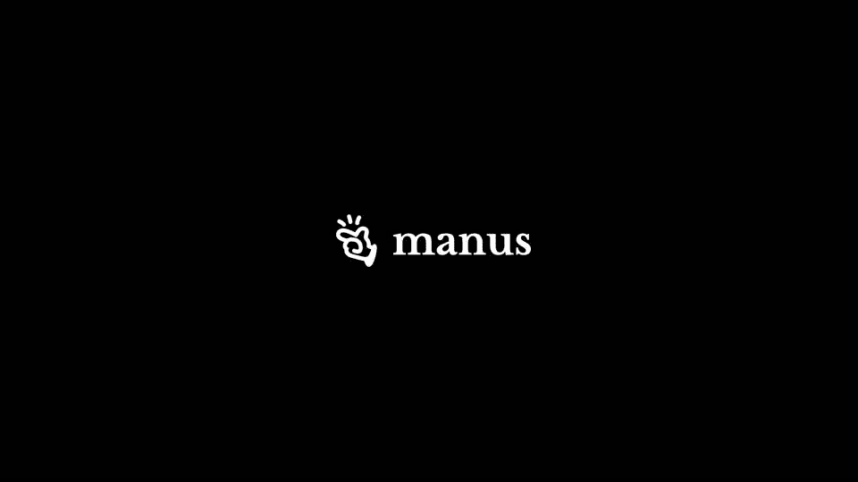

[WeChat_20250306125704.mp4](https://internal-api-drive-stream.feishu.cn/space/api/box/stream/download/all/MsnAbyixxorDkjxv0brcLGWWnfb)

Monica.im 的发展历程如下：

• 2022 年 11 月 20 日 ：Monica 项目立项，据报道比 ChatGPT 发布早了 10 天（来自第三方报道）

• 2023 年 ：公司正式成立（LinkedIn 数据确认）

• 2025 年 3 月 ：推出 Manus AI 代理产品（X 平台发布信息）

## 产品网址

官方网址：https://manus.im/

目前还在内测，可在登录后，申请加入内测。无需本地安装，用户通过网页即可访问。

## 团队信息

打造 Manus 的，是来自 Monica 团**队，**一家土生土长的中国公司。近期，创始人肖弘接受张小珺访谈表示，"AI Agent 不是代码竞赛，而是'让用户忘记技术'的设计战争。"

肖弘，男，1992 年出生，华中科技大学软件学院 2011 级本科生，华中科技大学联创团队毕业队员，Monica 创始人、CEO。2011 年，肖弘进入华中科技大学软件工程专业学习。

2**0**15 年，他毕业后创业，早期创业不算顺利（如校园社交、二手集市）。2016 年，他创业微信公众号运营者提供编辑与数据分析工具（武汉夜莺科技（产品：微伴助手、壹伴，累计服务超 200 万 B 端用户，并帮助企业触达数亿 C 端用户），专注于微信生态的应用研发与推广。2021 年，完成腾讯等数亿人民币战略融资。

2022 年，肖弘创立了“蝴蝶效应”公司，并推出了 AI 浏览器插件 Monica。2023 年，收购 chatgpt4google 浏览器插件工具，和 Monica 进行矩阵运营。

季逸超，男，1992 年生，高中开发苹果应用程序，本科、硕士就读于北京信息科技大学计算机学院，大一推出“猛犸 4”浏览器，并获得 Macworld2011 特等奖，20 岁时获得真格基金与红杉资本的投资，曾是福布斯中国 30 岁以下精英榜的成员，创立了 Peak Labs。季逸超是推出 Manus 产品的 Monica 公司联合创始人兼首席科学家。

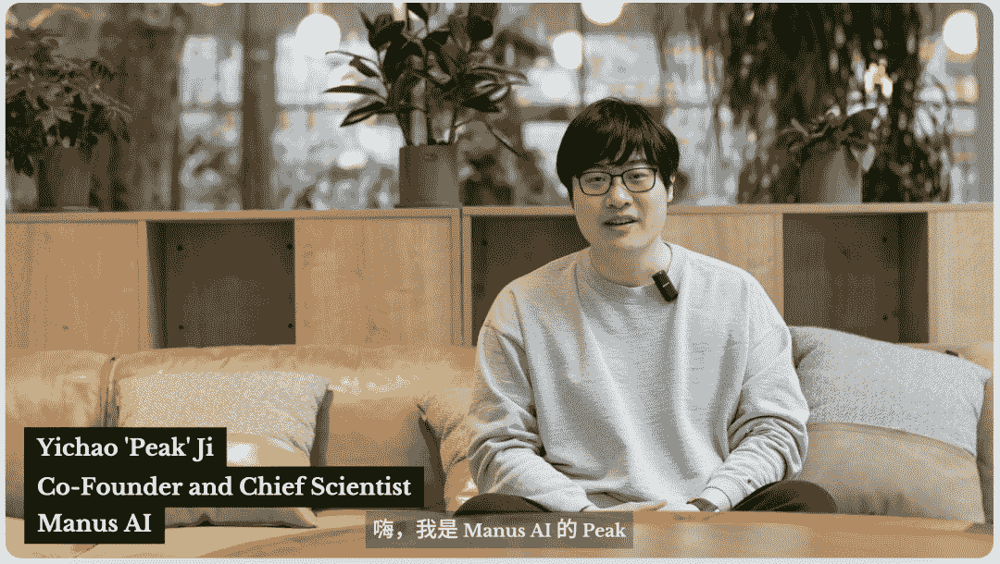

**延伸阅读：**[

95。 对 Manus 创始人肖弘的 3 小时](https://www.xiaoyuzhoufm.com/episode/67c3d80fb0167b8db9e3ec0f?s=eyJ1IjoiNWY0OTNmNjNlMGY1ZTcyM2JiNGY3M2Y4IiwiZCI6MX0%3D)访谈：世界不是线性外推，做博弈中的重要变量

## 火爆原因

**1）最强研究类 Agent**

在 GAIA 基准测试中，Manus 的表现远超 OpenAI 的 Deep Search （市场公认最强研究类 Agent），全球首款真正意义上的通用 AI Agent。

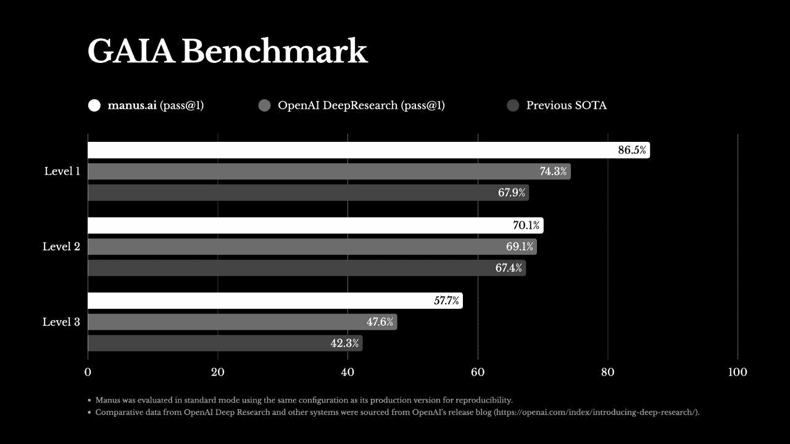

> GAIA 是智能体最全面的基准测试，GAIA 中的问题非常难，突出了基于 LLM 的系统的某些困难。

+   GAIA: https://hf.co/datasets/gaia-benchmark/GAIA

> 在 GAIA 的公开排行榜上，GPT-4-Turbo 的平均成绩不到 7%。最高的提交是一种基于 Autogen 的解决方案，使用了复杂的多智能体系统并利用 OpenAI 的工具调用功能，达到了 40%。

+   公开排行榜：https://hf.co/spaces/gaia-benchmark/leaderboard

**2）中国团队的“智造”基因 **

创始人肖弘（华中科技大学校友）曾打造海外爆款 AI 插件 Monica，团队坚持“少结构，多智能”理念，让 AI 能力自然涌现。

“AI Agent 不是代码竞赛，而是让用户忘记技术的设计战争。” ——肖弘

## 功能亮点

核心功能 Manus 作为通用 AI 代理，具备以下核心功能：

**1） 独立思考与系统规划**

Manus 能够通过独立思考和系统规划，在自己的虚拟环境中灵活调用各类工具。

**2）工具使用能力**

能够编写并执行代码、智能浏览网页、操作各类网页应用，为用户直接交付完整的任务成果。

**3）任务执行与监控**

用户可以实时通过移动端查看任务执行状态，当用户回来时，Manus 将呈现结果。

**4）多场景应用**

适用于市场调研、文件批量处理、旅行规划、数据分析等多种复杂场景。

**延伸阅读：**

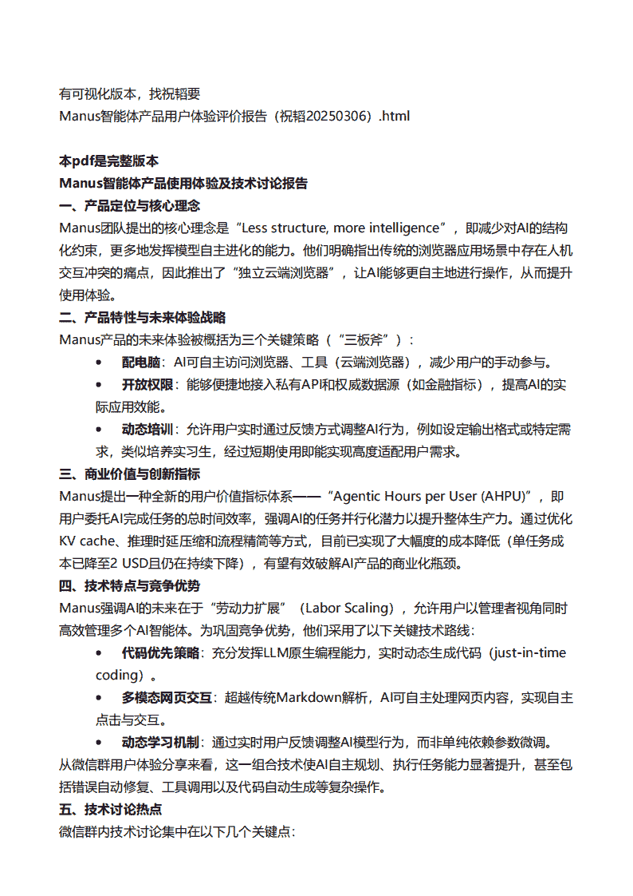

[Manus产品使用体验评价报告（祝韬20250306）.pdf](https://internal-api-drive-stream.feishu.cn/space/api/box/stream/download/all/Ysxobp5MboJzLzxommtc7I0lnGh)

## 使用场景

使用场景根据官方网站展示的用例，Manus 可以应用于以下场景：

**1.  旅行规划**

不仅整合旅行信息，还为用户创建定制旅行手册。例如，为用户规划日本四月旅行，提供个性化的旅行建议和详细手册。

**2.  股票分析**

进行深入的股票分析，设计视觉上吸引人的仪表盘展示全面的股票洞察。例如，对特斯拉股票进行深度分析，创建可视化仪表盘。

**3.  教育内容创建**

为中学教师创建视频演示材料，解释动量定理等复杂概念，帮助教师更有效地教学。

** 4.  保险政策比较**

创建清晰的保险政策比较表，提供最佳决策建议，帮助用户选择最适合的保险产品。

**5.  供应商采购**

在整个网络中进行深入研究，找到最适合用户需求的供应商，作为真正公平的代理为用户服务。

**6.  财务报告分析**

通过研究和数据分析捕捉市场对特定公司（如亚马逊）的情绪变化，提供过去四个季度的市场情绪分析。

** 7.  创业公司列表整理**

访问相关网站识别符合条件的公司，并将其整理成表格。例如，整理 YC W25 批次的所有 B2B 公司列表。

**8.  在线商店运营分析**

分析亚马逊商店销售数据，提供可操作的洞察、详细可视化和定制策略，帮助提升销售业绩。

Manus 案例库：https://manus.im/usecases

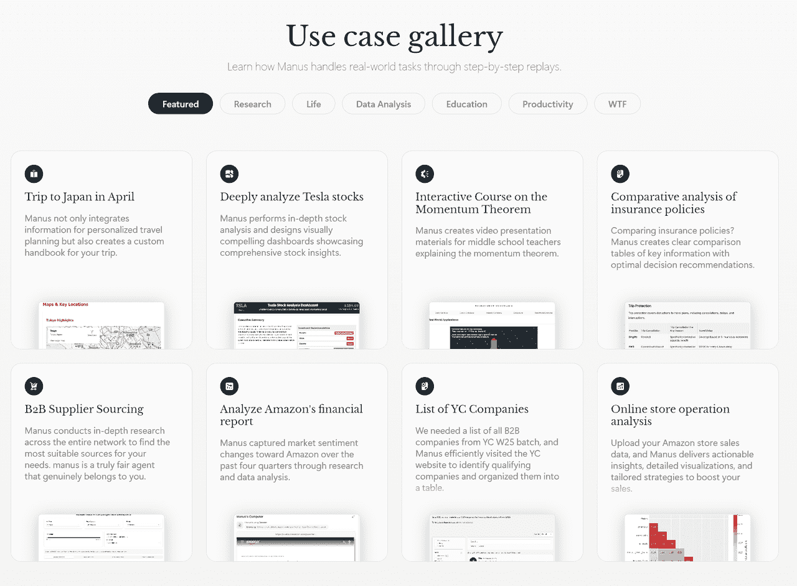

## 产品动态

### 2025 年 3 月 28 日

【Manus 正式版 APP 海外上线】

3 月 28 日，记者查询发现，Manus 正式版 APP 于海外上线，不过目前仍需邀请码才能使用。

APP 显示，目前有两种收费方式：Manus Starter 每月收费 39 美元，可获得 3900 积分，最多可以同时运行 2 个任务。Manus Pro 每月收费 199 美元，可获得 19900 积分，最多可以同时运行 5 个任务，同时支持使用高投入模式和其他测试功能。

### 2025 年 3 月 12 日

【Manus：200 万人等候使用 Manus】

中国 AI 智能体企业 ManusAI 表示，7 天来，Manus 使用申请等候名单增加到两百万人。我们对惊人的需求感到非常兴奋和谦卑，正在夜以继日地工作，尽快将 Manus 带给更多的人。

### **2025 年 3 月 11 日**

【Manus 将与阿里通义千问团队正式达成战略合作】

Manus 平台于 3 月 11 日宣布，将与阿里通义千问团队正式达成战略合作。双方将基于通义千问系列开源模型，在国产模型和算力平台上实现 Manus 的全部功能。目前两家技术团队已展开紧密协作，致力于为中国用户打造更具创造力的通用智能体产品。据了解，2024 年 11 月，公司完成 A 轮融资，领投方为腾讯和红杉中国，真格基金和王慧文等跟投。此前，公司曾于 2023 年 2 月和 8 月获得来自真格基金的两轮投资。

### **2025 年 3 月 10 日**

【Manus 创始人透露，产品基于阿里千问大模型开发】

3 月 10 日，Manus 创始人季逸超在社交平台透露，Manus 产品使用了不同的基于阿里千问大模型（Qwen）的微调模型。Manus 是由创业公司 Monica 发布的首款 AI Agent 产品，最近在社交媒体火爆出圈。

### **2025 年 3 月 8 日**

【Manus 官方 X 账号解冻】

3 月 8 日，中国 AI 智能体企业 ManusAI 官方账号已经复原。“我们回归了，提醒下，这是我们唯一官方账号，接下来我们会继续分享炫酷的用例，敬请期待。”ManusAI（ManusAI_HQ）官方账号指出。Manus 首席科学家和联合创始人季逸超也第一时间公布了这一消息，并重申：“Manus 从未参与任何加密货币项目、代币发行、区块链首发等。任何有相近名称的虚拟货币，其声称与我们有关的提法都是虚假的。”

### **2025 年 3 月 7 日**

**【Manus 回应官方 X 账号**被冻结：正积极与 X 团队合作解决此事】

3 月 7 日，Manus 联合创始人兼首席科学家季逸超发文称，Manus 的官方 X 账户被意外暂停，正积极与 X 的支持团队合作解决此事。初步观察表明，暂停可能与第三方提及加密货币诈骗有关，该领域与 Manus 的运营完全无关。季逸超还澄清，Manus 从未参与加密货币项目、代币发行或区块链计划。

### **2025 年 3 月 6 日**

**【Manus 开通官方微博】**

3 月 6 日，ManusAI 官方微博上线，目前粉丝数 982 人，并获得蓝 V 认证。不过，该微博尚无简介。

官方微博：[weibo.com](https://weibo.com/u/7986279143)

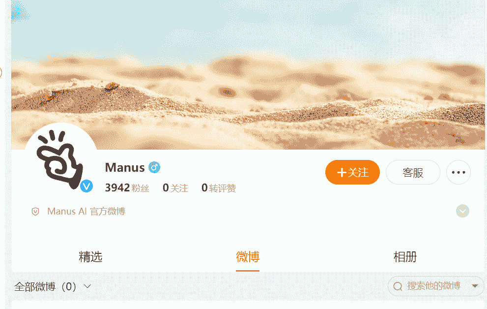

**【ManusAI 合伙人张涛澄清邀请码 **Manus 及推广，短期内专注产品构建】

据蓝鲸新闻，在推出全球首款通用 AlAgent“Manus”引发科技行业关注后，Manus AI 合伙人张涛在社交平台回应称，短期内会专注 build。他表示，感谢大家对 Manus 的关注，特此澄清：1。我们从未开设任何付费获取邀请码的渠道；2.我们从未投入任何市场推广预算；3.内测期间系统容量有限，我们将优先保障现有用户的核心体验，并逐步有序释放邀请。

**【中国团队发布通用型 AI Agent 产**品 Manus，性能超越 OpenAI】

日前，一支来自中国的团队正式对外发布通用型 AI Agent 产品 Manus。据团队介绍，Manus 在 GAIA 基准测试中取得了 SOTA（State-of-the-Art）的成绩，显示其性能超越 OpenAI 的同层次大模型。从发布的视频演示来看，Manus 在接到用户指令后可以直接操作电脑完成一系列报告撰写、表格制作等工作，并在最后导出符合用户需求的产品。

# 二、使用方法

## 1）访问与申请内测

• 方式 1：访问官网 [manus.im](https://manus.im/) 注册等待名单。

**申请地址：****https://manus.im**/invitation/waitlist

• 方式 2：加入官方 Discord 社群，获取邀请码。

目前仅开放邀请制，每日名额有限。需要邀请码的可以进我们的学习圈，关注邀请码动态！

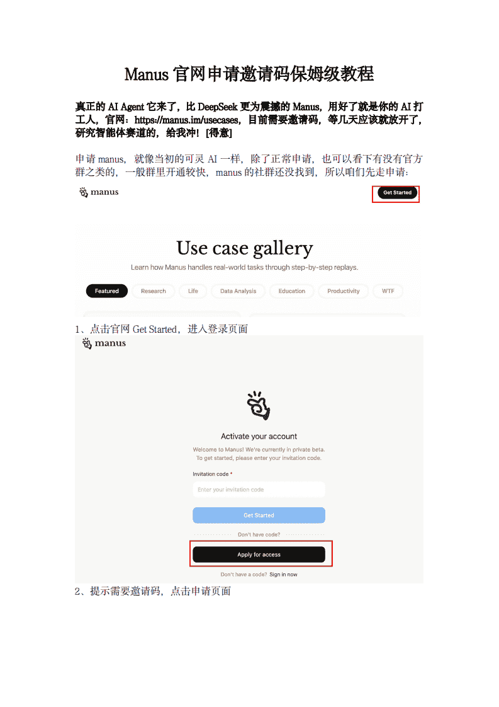

[Manus官网申请邀请码保姆级教程.pdf](https://internal-api-drive-stream.feishu.cn/space/api/box/stream/download/all/R9DzbKrxVocqlLxHGbNcGdKLndf)

大国有 Manus 联合创始人微信，目前也没有多余的邀请码，先等一段时间吧...

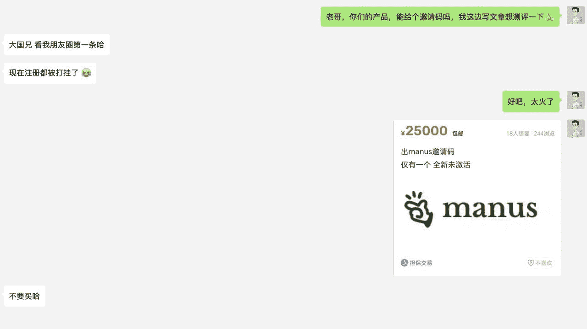

**Manus 团队最新的声明**

希望大家多一点善意，这个热度和需求量感觉团队确实没想到。

> **卡 BUG 登录**

> Manus 无需注册码可以卡 bug 进去，免费分享下操作步骤：

> 步骤：

> 1.不用邀请码，直接用 gmail 登录

> 2.提前准备好一个指令，复制

> 3.点击他们的 logo，会登录到对话框，此时把命令粘贴到输入框里，点回车 （注意：这一步要快，不要等他自动跳转到需要邀请码的地方）

> 4.不行的话，反复执行第 3 步

> **友情提示：**最好用谷歌浏览器

> 已失效

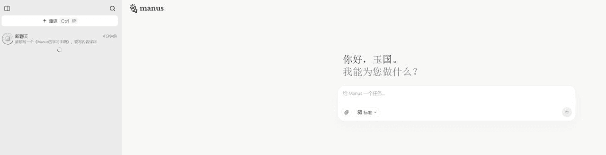

## 2）对话框提交提示词

+   输入自然语言指令：需明确任务目标与交付形式（如“生成包含地图的 HTML 旅行手册”）。

+   动态调整与反馈：任务执行中可修改需求（如增减预算），Manus 会实时修正路径。若结果符合预期，可告知“以后都这样做”以固化偏好。

##   3）成果交付与扩展功能

+   直接使用成果：如部署完成的网页游戏链接、可视化股票仪表盘、合同对比表等。

+   高级功能示例：

+   数据分析：上传 Excel 销售数据，生成可视化报告及优化建议。

+   多模态处理：解析室内平面图设计灯光布局，或转换课堂录音为图文笔记。

# 三、使用技巧

## 1）首次使用指南

1. 登录后点击“新建会话”，输入指令如： “帮我整理小米 Su7 发布会的十页 PPT，要求数据可视化+行业对比。”

2. Manus 将自动拆解任务、调用工具链，最终生成完整成果。

## 2）进阶使用技巧

• 多轮交互：执行中随时追加指令，例如：“增加竞品分析章节。”

• 结果导出：支持 PDF、Excel、网页链接等多种格式下载。

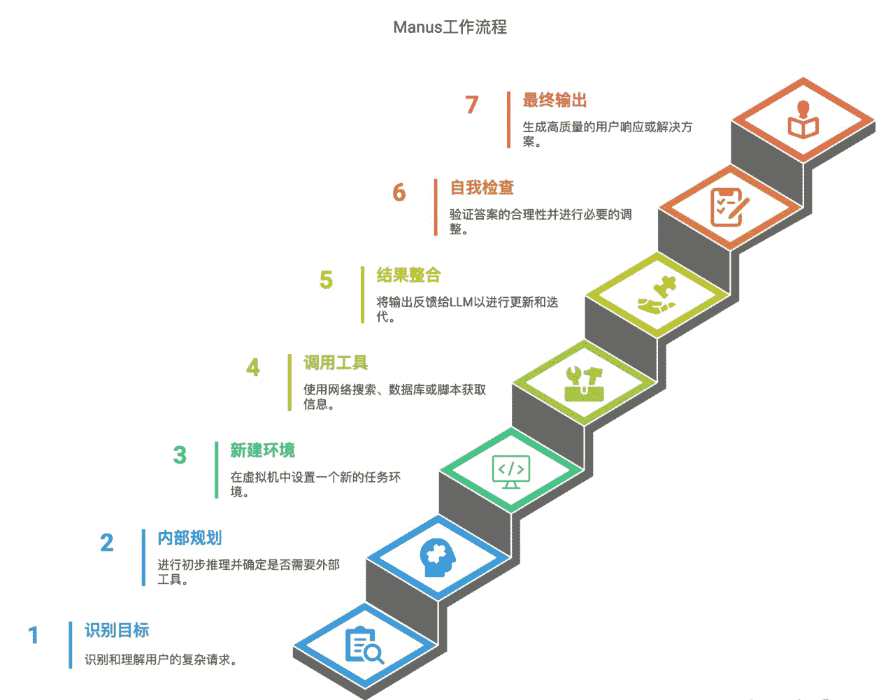

## 学习课件

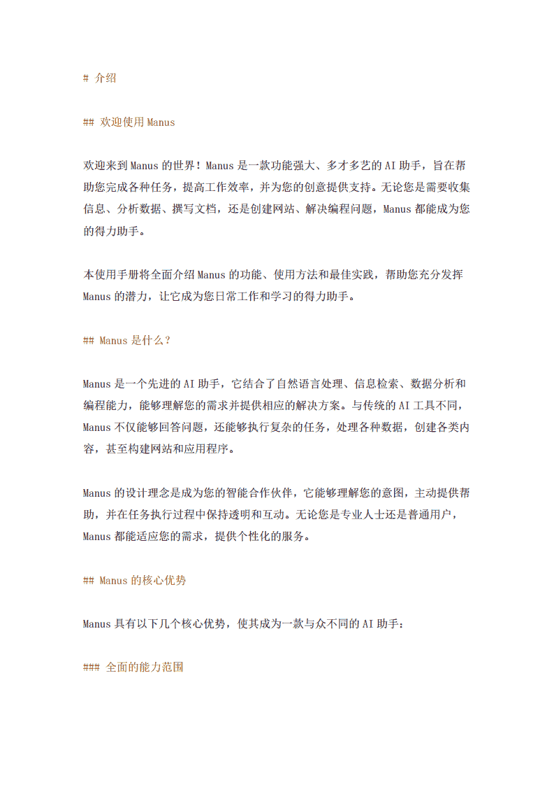

[Manus 实操手册大全.pdf](https://internal-api-drive-stream.feishu.cn/space/api/box/stream/download/all/Wg9AbcFwwoYy3MxlzSpcOoKbnw3)

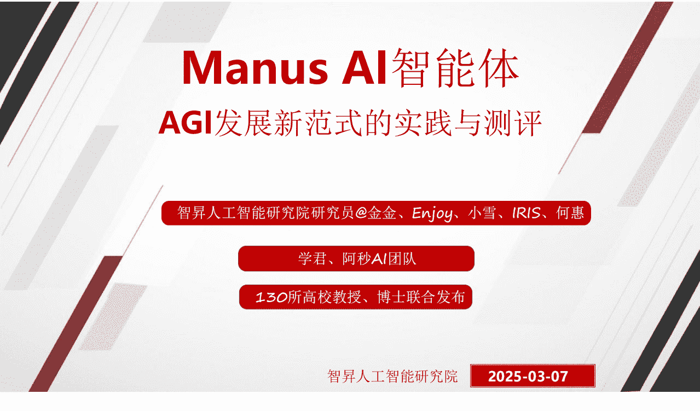

[Manus AI智能体：AGI发展新范式的实践与测评202503.pdf](https://internal-api-drive-stream.feishu.cn/space/api/box/stream/download/all/CkckbxL0aoxsPbx2pGHcnY1Cngx)

# 四、实操案例

## 官方案例

### 1）老师做 PPT

提示词：

我是一名中学物理老师，正准备教授动量守恒定律。您能否创建一系列清晰准确的演示动画，并将它们整理成一个简单的 HTML 演示文稿？

地址：https://manus.im/share/pAdLIvlktJmV945593mFio

### 2）股票分析

提示词：

我想要一份特斯拉股票的全面分析，包括：概述：公司概况、关键指标、业绩数据和投资建议财务数据：收入趋势、利润率、资产负债表和现金流分析市场情绪：分析师评级、情绪指标和新闻影响技术分析：价格趋势、技术指标和支撑/阻力水平资产比较：市场份额和与主要竞争对手的财务指标对比价值投资者：内在价值、增长潜力和风险因素投资论点：SWOT 分析和针对不同类型投资者的建议

地址：https://manus.im/share/xFgpHb15vKqfRPWIs3JJPJ?replay=1

### 3）旅游规划

提示词：

我需要一个 4 月 15-23 日从西雅图出发的 7 天日本行程，预算为我和未婚妻两人 2500-5000 美元。我们喜欢历史遗迹、隐藏的宝地和日本文化（剑道、茶道、禅修）。我们想看奈良的鹿并徒步探索城市。我计划在这次旅行中求婚，需要一个特别场所的建议。请提供详细的行程安排和一个简单的 HTML 旅行手册，包含地图、景点描述、必备的日语短语和我们整个旅程中可以参考的旅行小贴士。

地址：https://manus.im/share/brWKUSp51ItvVMBpcXNCZ1?replay=1

## 网友案例

### 1）简历筛选

需求：假装是 HR，丢给 Manus 一个压缩包，里面有 10 份简历（从网上随便找的公开样本），说：“挑出 3 个最适合程序员岗位的，给我排名和理由。”

过程：上传文件，输入指令后，Manus 开始干活。它先解压，然后一条条分析，还给我发了进度消息：“正在阅读第 5 份，预计 5 分钟完成。”最后，它给出了一个表格，列了 3 个人的名字、工作经验、技能匹配度，还附了简短评价，比如“候选人 A，5 年 Python 经验，适合高级开发岗”。

结果：不到 10 分钟搞定！表格清晰，理由靠谱。我对比了下，确实是 10 份里最强的仨。

### 2）制作 PPT

需求：“帮我做个 10 页 PPT，介绍小米 SU7，包含外观、性能和价格，简洁风格。”

过程：Manus 先搜了小米 SU7 的资料，然后用内置工具生成了 PPT，15 分钟后给出了下载链接。打开一看，10 页齐全，有图片、有数据，排版还挺好看。

结果：虽然有些细节（比如字体）还得调调，但整体省了至少 2 小时。

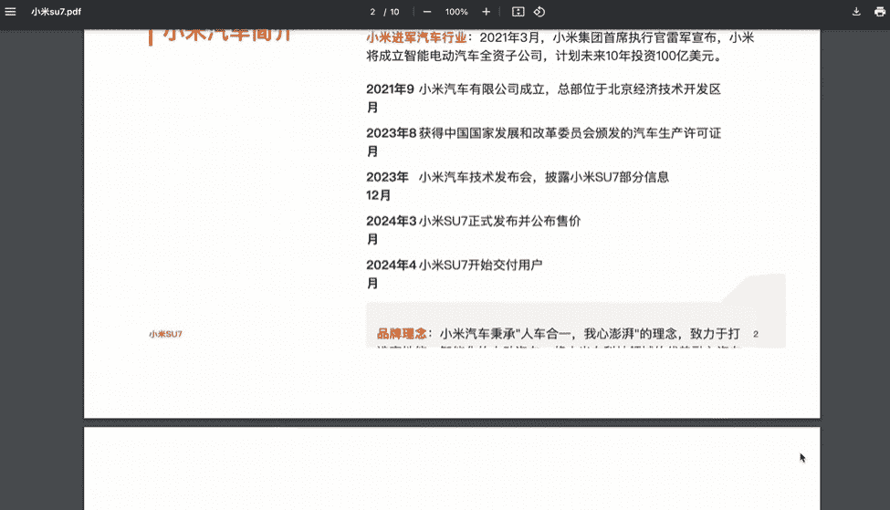

## **有趣测试案例收集**

[Manus 有趣案例收集](https://yunyinghui.feishu.cn/share/base/form/shrcnAXEl74gLzLfzeqKn71uagh)

# 五、研究报告

## 券商报告

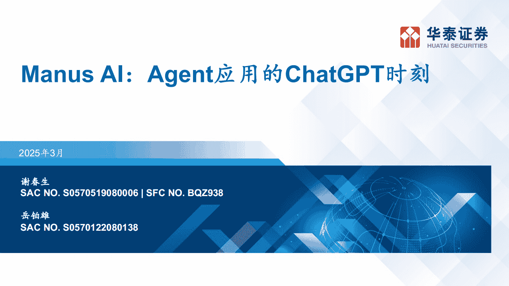

[华泰证券：Manus AI：Agent元年开启.pdf](https://internal-api-drive-stream.feishu.cn/space/api/box/stream/download/all/G584b1dBJozSOtxoKzccQgUynpc)

## 行业报告

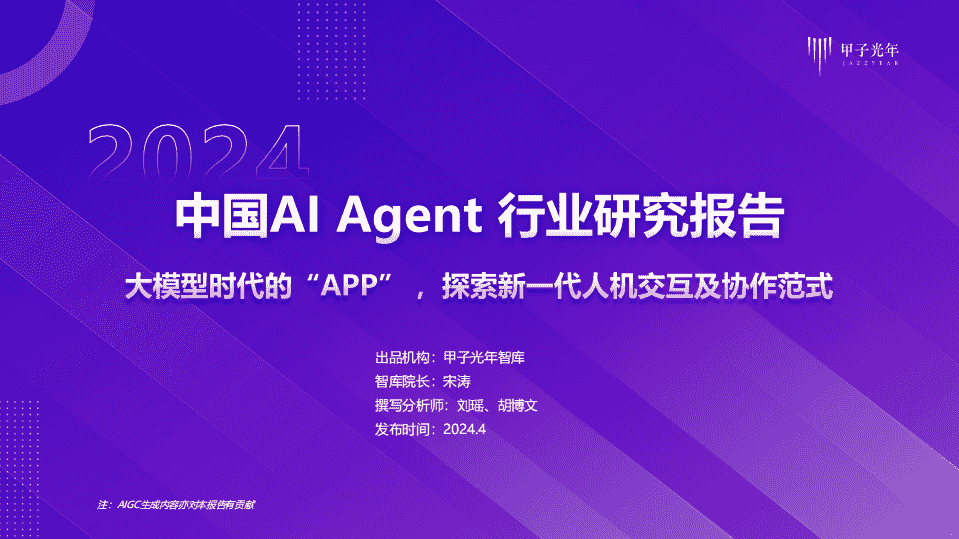

[2024中国AI Agent行业研究报告-甲子光年.pdf](https://internal-api-drive-stream.feishu.cn/space/api/box/stream/download/all/OAdabv1jZol8b5xTjTwcbOypnQb)

# 六、媒体报道

## 媒体报道

### 央视网

一夜之间火爆全网！又一个中国 AI 产品刷屏

### 极客公园

AI Agent 的「GPT 时刻」，Manus 炸醒整个 AI 圈！

### 甲子光年

Manus 背后的华人团队：套壳到极致，就是胜利｜甲子光年

## 名人观点

### 逐鹿网创始人阑夕

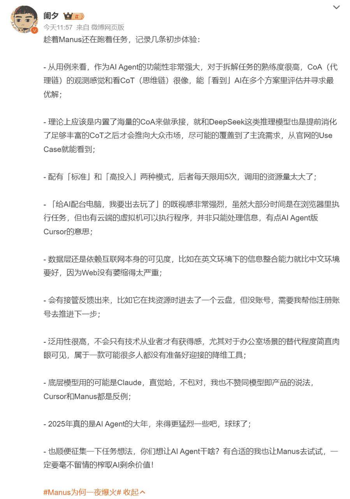

---

# 智能体学习交流社群

1.持续关注并更新** A**I 智能体的相**关**资讯动态，研究报告，赚钱案例，常见问题，已建立社群聊聊 AI 发展及应用，没进群的可以扫码加入，群满可加 AI 研究爱好者大国微信 ID：zyg90s（备注：AI），已经在社群内的无需重复加入。

2.**关于文档负责人大国**：7 年老运营，互联网流量观察家，曾就职于互联网大厂，现研究 AI 实战应用，努力成为最懂 AI 的运营人。

**5000人飞书学习交流群**

**5000人飞书学习交流群**

**微信入群渠道**

进群或者加好友了解更多 AI 智能体实战案例

**觉得有用欢迎留个赞**