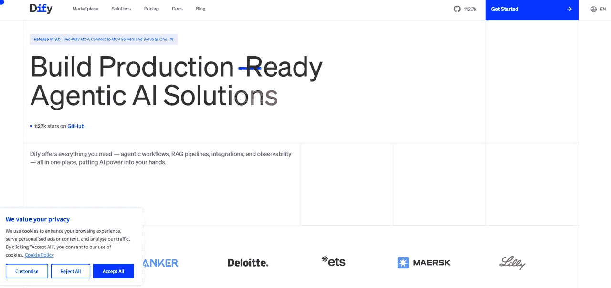
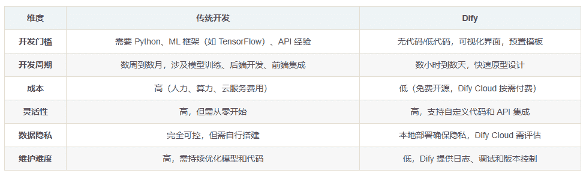
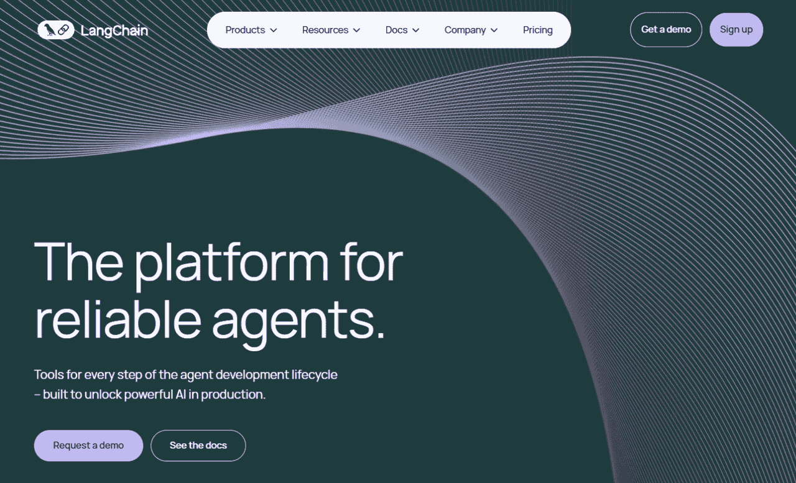
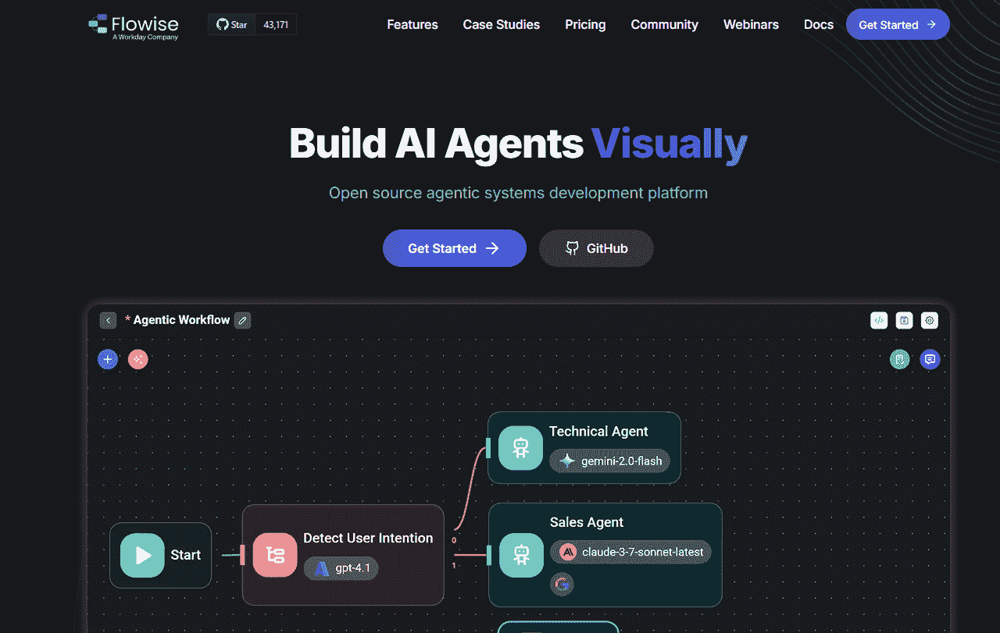
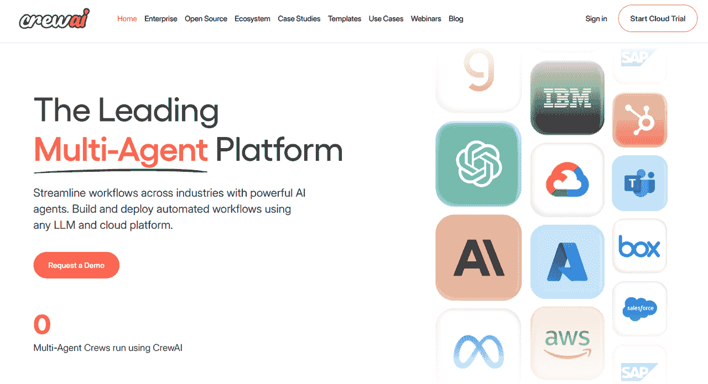

# Dify是什么？

> 来源：[https://yunyinghui.feishu.cn/docx/PZOBdwJABoSXA5xEXIncaCLTnxg](https://yunyinghui.feishu.cn/docx/PZOBdwJABoSXA5xEXIncaCLTnxg)

---

# [认识Dify](https://dify.ai/)



Dify 是一款基于Apache 2.0协议开源的AI应用开发平台，由langgenius团队打造。其名称“Define Your AI”传递出它的核心目标：让用户能够通过可视化界面轻松定义和创建属于自己的AI应用，无需编写复杂代码。

Dify融合了后端即服务（BaaS）和大语言模型运维（LLMOps）的能力，提供从数据处理、模型调用、流程设计，到插件扩展和应用部署的全链路开发环境。

# 平台定位

Dify致力于成为AI应用的高效开发与运维平台，有效弥合了技术能力与业务需求之间的差距：

+   面向非技术用户：借助直观的拖拽界面和丰富的模板，用户可以快速搭建聊天助手、自动文档生成或数据查询类应用。

+   面向开发者：平台支持通过代码节点、API集成和插件机制进行深度定制，兼顾易用性与灵活性。

+   面向企业用户：提供团队协作、数据安全管理以及生产环境部署等能力，助力AI应用的规模化与商业化。

## 核心特点

Dify以“降低开发门槛，而不牺牲功能强大性”为设计原则，其主要特点包括：

### 无代码/低代码开发

Dify 的可视化工作流编辑器让用户通过拖放节点（如 Start、LLM、Answer）构建复杂逻辑，无需编写代码。对于有编程经验的用户，Dify 提供 Code 节点，支持 Python 和 Node.js 扩展功能。这种双模式设计兼顾了易用性和灵活性。

示例：一个市场营销人员可以在 10 分钟内通过 Dify 创建一个生成社交媒体内容的 AI 助手，而开发者可以添加自定义逻辑，优化输出格式。

### 多模型支持

Dify 集成了多种大型语言模型，包括：

商业模型：OpenAI GPT、Anthropic Claude、Google Gemini。

开源模型：Llama、Mistral、Grok（由 xAI 提供）。

本地模型：通过 Ollama 或 LocalAI 运行（如 http://localhost:9889）。

用户可以根据预算、性能和隐私需求选择合适的模型，并轻松切换。

### 检索增强生成（RAG）管道

Dify 的 RAG（Retrieval-Augmented Generation）功能允许从外部数据源（如 PDF、网页、TXT 文件）提取信息，结合 LLM 生成更准确的回答。RAG 管道包括：

数据提取：解析多格式文档。

数据转换：将文本转为向量，存储在 Weaviate 或 pgvector 数据库。

检索与生成：根据用户查询检索相关内容，优化 LLM 输出。

示例：企业可以上传产品手册，构建一个基于知识库的客服机器人，回答客户问题时引用具体条款。

### 强大的工作流引擎

Dify 的工作流（Workflow）功能通过节点连接实现多步骤逻辑，支持复杂任务如迭代搜索、条件分支和批量处理。常见节点包括：

**Start 节点**：捕获用户输入。

**LLM 节点**：调用语言模型。

**Tools 节点**：集成外部工具（如 Serper、Yahoo Finance）。

**If/Else 节点**：条件分支。

**Iteration 节点**：循环处理。

示例：Deep Research 工作流可以通过迭代搜索和 LLM 分析，生成带引用的研究报告。

### 丰富的插件生态

Dify 提供内置工具（如 Exa Answer、JinaReader）和自定义 API 集成，扩展工作流功能。用户可以通过 HTTP 节点调用第三方服务，或开发自己的工具。

示例：调用 OpenWeather API 获取实时天气数据，结合 LLM 生成天气报告。

### 灵活的部署方式

Dify 支持：

云端部署：通过 Dify Cloud 快速启动，适合快速原型设计。

本地部署：使用 Docker Compose 或源代码部署，满足数据隐私需求。

混合部署：结合云端和本地，优化成本和性能。

本地部署最低要求：2 vCPU，8GB 内存，20GB 存储（参考 Dify 文档 - 本地部署）。

### 开源与社区驱动

Dify 的开源性质使其透明、可定制，并拥有活跃的社区支持。用户可以通过 Dify GitHub Discussions 获取帮助，或参与代码贡献。

Dify 的应用场景

Dify 的灵活性使其适用于多种场景，以下是一些典型应用：

### 聊天机器人

场景：客户支持、电商导购、教育助手。

功能：多轮对话、知识库查询、上下文记忆。

1.  数据分析

场景：金融市场分析、用户反馈处理、趋势预测。

功能：集成外部数据源，生成报告。

1.  内容生成

场景：营销文案、社交媒体内容、多语言翻译。

功能：批量生成、格式优化。

1.  自动化任务

场景：批量邮件发送、数据清洗、内容分发。

功能：Iteration 节点、API 集成。

1.  教育与研究

场景：基于文档的问答、研究助手。

功能：RAG 管道、Deep Research 工作流。

# 传统开发与 Dify 的对比

为了更好地理解 Dify 的价值，我们将传统 AI 开发与 Dify 进行对比：



# **为什么选择 Dify？**

Dify 的独特优势使其成为 AI 应用开发的理想选择：

**易用性**：非技术用户也能快速上手，开发者可深度定制。

**生态整合**：支持多种模型、工具和数据源，覆盖广泛场景。

**社区支持**：开源社区提供丰富的资源和快速问题解决。

# 市面上类似dify的平台对比

## 平台概览

在深入对比之前，我们先来快速了解这四大平台的核心定位与特点：

### [**Dify**](https://dify.ai)

+   **定位**​：开源的低代码/无代码 AI 应用开发平台，融合 BaaS（后端即服务）与 LLMOps，支持快速搭建聊天机器人、自动化流程和数据分析工具。

+   **核心特点**​：

+   提供可视化工作流编辑器，支持 Chatflow（对话流）和 Workflow（任务流）；

+   内置 RAG 能力，集成知识库与向量数据库（如 Weaviate）；

+   支持多模型接入（OpenAI、Claude、Ollama 等）和丰富工具集成（如 Serper、Yahoo Finance）；

+   支持云托管（Dify Cloud）与本地 Docker 部署。

+   **社区生态**​：GitHub 上有近千名贡献者，总下载量超 500 万（截至 2025 年 7 月）。

### [**LangChain**](https://www.langchain.com/)



+   **定位**​：面向开发者的 Python/JS 框架，专注基于 LLM 的复杂应用开发，强调代码灵活性与控制力。

+   **核心特点**​：

+   高度模块化（Chains、Agents、Tools 等），支持深度定制；

+   可集成 RAG 与外部工具（如 SerpAPI、Wikipedia）；

+   需编程实现，适合有开发经验的团队。

+   **社区生态**​：开发者社区活跃，广泛应用于企业级场景。

### [**Flowise**](https://flowiseai.com/)



+   **定位**​：开源低代码 AI 工作流搭建平台，形态类似 Dify，但更偏技术导向，强调模块化与扩展性。

+   **核心特点**​：

+   可视化拖拽界面，支持复杂流程设计；

+   基于 LangChain 生态，需手动配置模型与工具；

+   支持 Docker 和云部署。

+   **社区生态**​：处于快速发展期，更适合技术团队使用。

### [**CrewAI**](https://www.crewai.com/)



+   **定位**​：多智能体协作平台，通过角色化 Agent 分工完成任务，适用于客户支持、项目规划等协作场景。

+   **核心特点**​：

+   基于角色驱动的多 Agent 自动化协作；

+   强调任务调度与错误处理机制；

+   依赖 LangChain 技术栈，需代码配置。

+   **社区生态**​：仍属新兴社区，专注在多代理自动化方向。

---

1.  多维度对比

我们从开发门槛、功能灵活性、部署方式、适用场景、生态支持和成本这六个角度进行系统对比。

##  开发门槛

**Dify**​：

+   无代码/低代码模式，非技术人员可通过界面快速搭建应用（如聊天机器人），开发者也可通过 Code 节点（Python/Node.js）扩展功能。

+   学习成本低，1-2 小时可上手，提供模板加速开发（如 DeepResearch 工作流）。

+   举例：无需代码即可构建基于 RAG 的问答系统。

**LangChain**​：

+   代码驱动，需熟悉 Python/JavaScript，理解 Chains、Agents 等概念。

+   学习曲线陡峭，通常需数周才能熟练使用。

+   举例：需编写代码实现 RAG，手动配置向量数据库和检索逻辑。

**Flowise**​：

+   低代码可视化操作，但需理解 LangChain 组件与配置逻辑。

+   中等学习成本，约 1-2 天可基本掌握，适合有一定技术背景的用户。

+   举例：可通过拖拽搭建工作流，但仍需设置 LLM 参数、连接组件等。

**CrewAI**​：

+   完全代码实现，基于 LangChain，需编写 Agent 角色与任务流程。

+   学习成本高，建议有数周 LangChain 使用经验。

+   举例：需编程实现多代理协作，如市场分析自动分工。

> ✅ **小结**​：Dify 对非技术人员最友好，Flowise 次之；LangChain 和 CrewAI 更适合开发者。

## 3. 功能与灵活性

**Dify**​：

+   支持 Chatflow（对话）和 Workflow（自动化），内置 RAG、多种工具节点（如 If/Else、循环处理）、API 扩展能力。

+   平衡功能丰富度和易用性，可通过代码节点满足一定定制需求。

+   举例：可搭建“深度研究”工作流，自动联网搜索->分析->生成带引用的报告（详见 Dify 博客案例）。

**LangChain**​：

+   提供高度灵活的模块（Chains、Agents、Tools），适合构建复杂、自主决策的应用。

+   功能最强，但一切依赖代码实现。

+   举例：可构建能自主调用外部 API、完成多步推理的 Agent。

**Flowise**​：

+   功能与 Dify 类似，支持基于 LangChain 组件搭建工作流，但配置更显技术化。

+   灵活性高，但使用复杂度也较高。

+   举例：可构建数据处理管道，但需自行配置向量存储和检索链路。

**CrewAI**​：

+   专注多代理协作场景，内置任务分配、流程传递与错误处理机制。

+   在分工协作类任务中表现突出，但场景相对垂直。

+   举例：可实现多 Agent 协同完成市场调研与报告撰写。

> ✅ **小结**​：Dify 在易用和功能间平衡较好；LangChain 灵活性最强；CrewAI 长于多代理协作；Flowise 更偏向技术型用户。

##  部署方式

**Dify**​：

+   提供云托管（Dify Cloud），含免费额度（200 次 OpenAI 调用）；

+   支持一键本地部署（Docker Compose），最低配置约 2 vCPU、8GB 内存。

**LangChain**​：

+   无官方云服务，需自行部署在 AWS、GCP 或本地；

+   需配 Python 环境及依赖，部署相对复杂。

**Flowise**​：

+   提供 Flowise Cloud 云服务；

+   支持 Docker 或 Node.js 本地部署，配置复杂度中等。

**CrewAI**​：

+   无官方云服务，需自行部署；

+   依赖 Python 和 LangChain 环境。

> ✅ **小结**​：Dify 和 Flowise 提供开箱即用的云服务及简洁的本地部署方案，更适合快速启动；LangChain 和 CrewAI 需自建环境，部署门槛较高。

##  适用场景

**Dify**​：

+   聊天机器人、内容生成、数据提取与分析、自动化任务、教育辅助等；

+   适合非技术用户、中小企业及快速原型开发。

**LangChain**​：

+   复杂企业级系统、高度定制的自主代理应用、深度 RAG 与推理场景；

+   适合有研发能力的大型团队。

**Flowise**​：

+   企业级自动化流程、数据管道、需可视化的复杂工作流；

+   适合技术团队及中大型项目。

**CrewAI**​：

+   多角色 Agent 协作场景，如项目规划、客户支持、协同调研；

+   适合专注多代理协作的开发团队。

> ✅ **小结**​：Dify 适用面最广，尤其适合无代码和轻量开发；LangChain 和 CrewAI 更聚焦复杂与垂直场景；Flowise 面向技术团队的中大型工作流应用。

##  生态支持

**Dify**​：

+   社区活跃（GitHub 800+ 贡献者），文档齐全，提供大量模板和博客教程；

+   内置多种工具（如 Serper、Yahoo Finance），支持社区插件扩展。

**LangChain**​：

+   拥有最庞大的开发者社区，资源丰富（教程、第三方工具集成）；

+   需自行实现和集成各类功能，技术含量高。

**Flowise**​：

+   社区增长较快，但生态仍较新，依赖 LangChain 组件；

+   文档和社区资源仍在完善中。

**CrewAI**​：

+   属新兴社区，生态较薄弱，高度依赖 LangChain 技术栈；

+   需更多案例和插件支持。

> ✅ **小结**​：Dify 和 LangChain 生态最成熟；Dify 对初学者更友好；LangChain 更适合资深开发者；Flowise 和 CrewAI 仍处于生态建设期。

##  成本对比

**Dify**​：

+   云服务有免费额度，付费计划灵活；

+   本地部署免费，仅需承担硬件成本。

**LangChain**​：

+   无官方云服务，需支付云平台费用及开发人力成本；

+   开源免费，但开发投入较高。

**Flowise**​：

+   Flowise Cloud 按需付费；

+   本地部署免费，需投入运维资源。

**CrewAI**​：

+   依赖自建云环境或本地资源，成本结构与 LangChain 类似。

> ✅ **小结**​：Dify 和 Flowise 具备更清晰的低成本入门路径；LangChain 和 CrewAI 虽开源免费，但开发和运维隐性成本较高。

# 如何开始使用 Dify？

> 有技术基础的可以看看，没技术基础看后边一章详细的本地部署教程

以下是快速入门的步骤：

+   注册 Dify Cloud：

+   访问 Dify 官网，使用 GitHub/Google 注册。

+   免费试用提供 200 次 OpenAI 调用。

+   本地部署（可选）

克隆仓库：

```
git clone https://github.com/langgenius/dify.git
cd dify/docker
```

配置环境并启动：

```
cp .env.example .env
docker compose -f docker-compose.middleware.yaml up -d
docker compose up -d --build
```

访问 http://localhost/install 初始化。

+   创建应用：

+   登录 Dify，点击“Create Application”。

+   选择模板（如“DeepResearch”）或空白应用。

+   探索功能：

+   配置 LLM（如 OpenAI 或 Ollama）。

+   尝试拖放节点，构建简单工作流。

## 常见问题与解答

Q：Dify 适合哪些用户？

A：适合非技术用户（快速构建应用）、开发者（定制功能）和企业（生产部署）。

Q：Dify 是否免费？

A：Dify 开源版免费，Dify Cloud 提供免费试用和付费订阅。

Q：如何确保数据隐私？

A：选择本地部署，结合本地模型（如 Ollama）实现完全离线运行。

Q：Dify 支持哪些语言？

A：支持多语言界面和工作流，适合全球用户。

# 结论

Dify 是一款具有革新意义的低代码 AI 应用开发平台，它通过提供无代码/低代码界面、支持多种大语言模型、内置 RAG 技术以及可视化工作流设计，显著降低了 AI 应用开发的技术门槛。该平台既适用于快速构建和验证原型，也能够支撑严苛的企业级生产环境需求。无论你是希望创建一个简单的对话助手，还是开发一套多步骤的智能业务流程，Dify 都提供了易于使用且功能强大的工具支持。