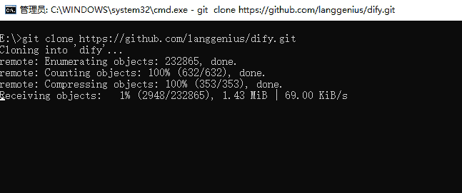
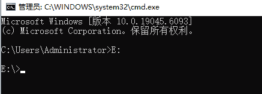
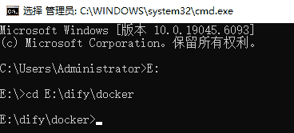
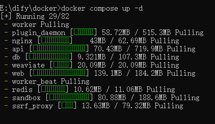
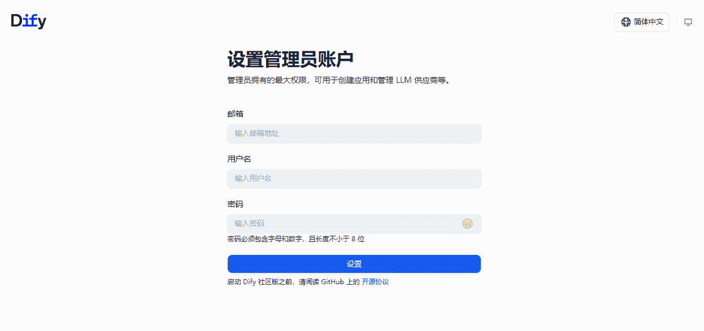

# Dify本地部署

> 来源：[https://yunyinghui.feishu.cn/docx/KuyNdmalAoanrhxLf6WcwTcan9e](https://yunyinghui.feishu.cn/docx/KuyNdmalAoanrhxLf6WcwTcan9e)

---

# 本地部署教程

> 建议全程用梯子，保证安装速度

## 1、下载

在"https://github.com/langgenius/dify"中下载 Dify，这里选择最新版本，我已经下载好了，需要自取

[dify-main.zip](https://internal-api-drive-stream.feishu.cn/space/api/box/stream/download/all/QqxKbm8NFoTSQwxdhO9cPhb1npc)

下载完成后，将压缩包解压到 E 盘“D:\dify”中。进入到“E:\dify\docker”目录【目录看你们自己需要存放】，将

“.env.example”文件改名为“.env”，然后在该目录下打开 cmd

## 2、安装并启动

通过如下命令启动 Dify:

输入E:

输入cd E:\dify\docker

docker compose up -d

等待一段时间后，当所有 images 下载完成后，Dify 启动成功。

停止容器命令：

docker compose down

## 3、访问网址

http://127.0.0.1/install 和 http://localhost/install

进入安装页面

填写用户名和密码以及邮箱，点击设置后咱们就可以进入页面了