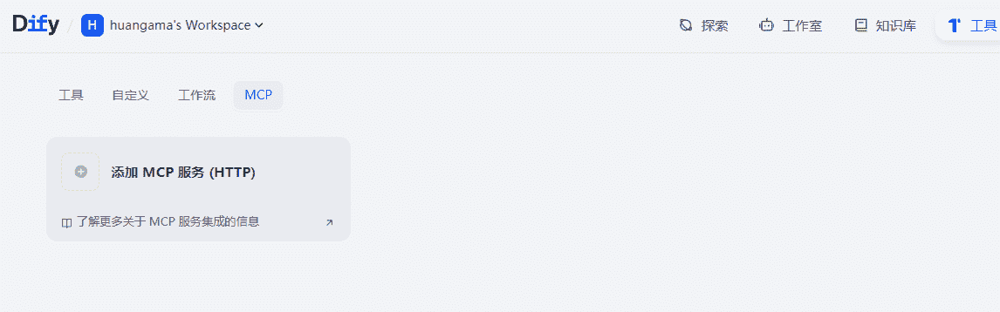
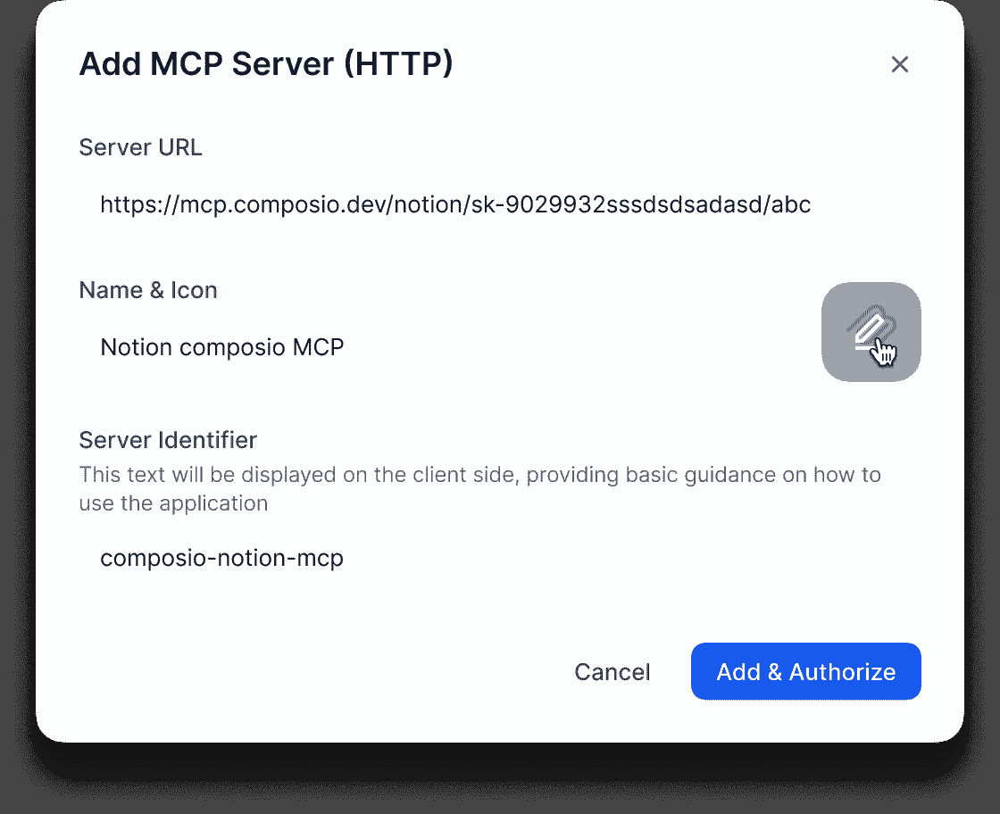
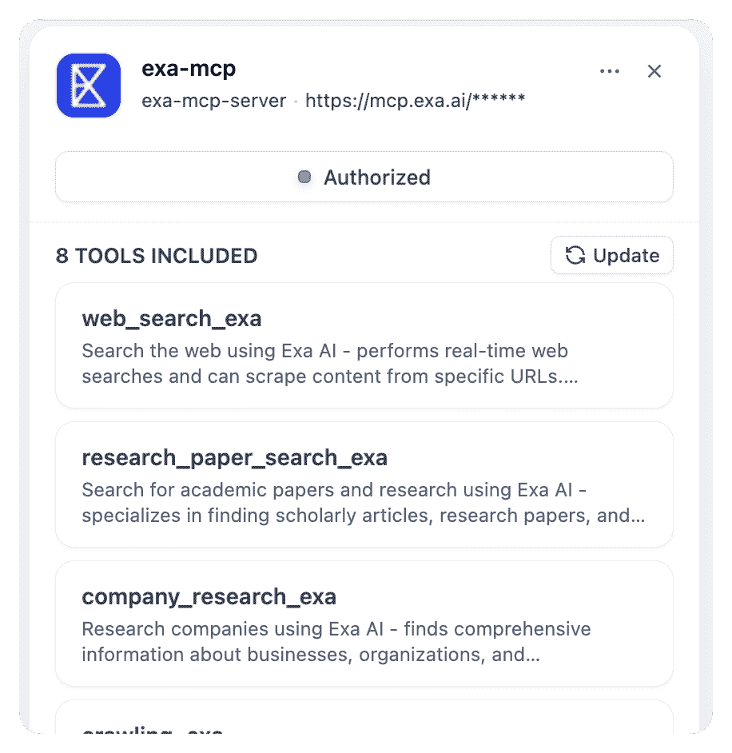
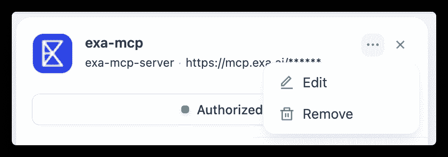
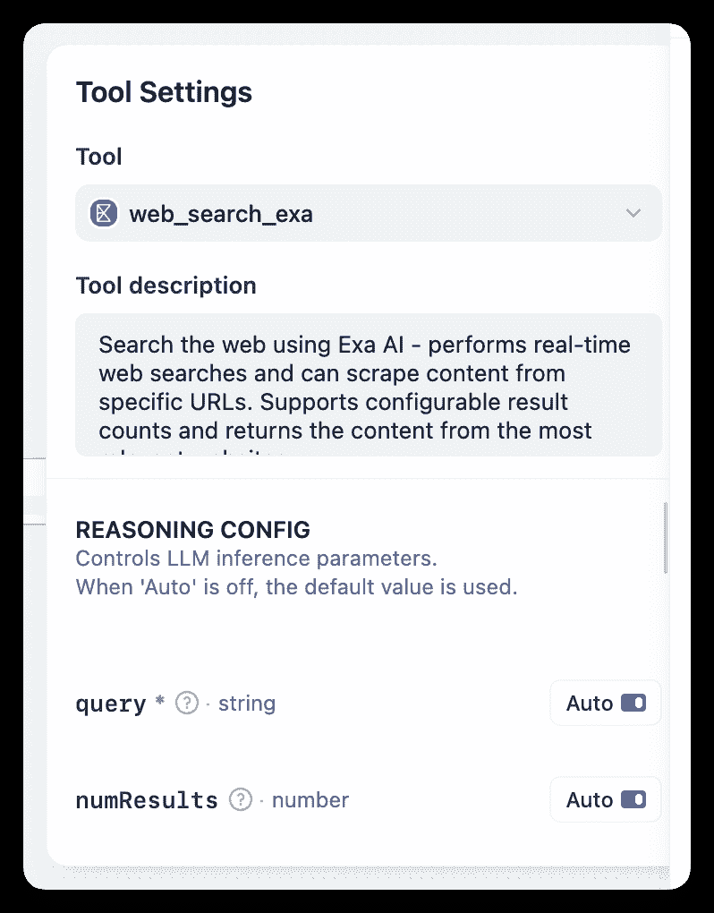

# 快速集成 MCP

> 来源：[https://yunyinghui.feishu.cn/docx/TqIsdYat7oUuSrxCNQwcTUXVnM5](https://yunyinghui.feishu.cn/docx/TqIsdYat7oUuSrxCNQwcTUXVnM5)

---

## 📚 概述

本教程将带您深入了解如何在 Dify 中集成和使用 MCP（Model Context Protocol）工具，扩展您的 AI 应用功能。

### 🎯 学习目标

+   掌握 MCP 服务器的配置和管理

+   学会在 Agent 和 Workflow 中使用 MCP 工具

+   了解工具定制和最佳实践

你可以在 Dify 的 Agent 和 Workflow 应用中，直接集成来自外部 MCP 服务器的工具。除了使用 Dify 内置插件外，还可以接入 MCP 生态系统中的第三方服务，持续扩展你的应用功能。

本[文介](https://docs.dify.ai/zh-hans/guides/application-publishing/publish-mcp)绍了如何在 Dify 内集成和使用 MCP 工具。如果你希望将自己的 Dify 应用发布为 MCP 服务器，请参考此链接。

目前仅支持接入使用 HTTP 传输协议的 MCP 服务器 。

## 🛠️ MCP 服务器管理

登录 Dify 后，在左侧导航栏中依次点击 工具 → MCP，即可进入外部 MCP 服务器的管理页面。在这里，你可以统一管理所有为自身应用配置的 MCP 服务器。

#### 添加 MCP 服务器

点击 添加 MCP 服务器（HTTP），即可集成新的外部工具服务。需要填写如下信息：

+   服务器 URL：MCP 服务器的 HTTP 接口地址，例如集成 Notion 时为 https://api.notion.com/mcp。

+   名称与图标：自定义服务器名称，建议选择能清晰体现工具用途的名字。Dify 会自动尝试获取服务器域名的图标，你也可以手动上传。

+   服务器标识符：Dify 用于区分服务器的唯一 ID。规则：小写字母、数字、下划线或连字符，最多 24 个字符。

> **重要提醒**

> ⚠️ 服务器 ID 一旦创建即无法更改！

+   更改服务器 ID 会导致所有依赖该服务器的应用失效

+   这对应用迁移尤为重要

#### 授权与工具发现

添加服务器后，Dify 会自动执行如下操作：

1.  检测可用工具：自动识别该服务器能提供哪些工具功能。

1.  处理授权流程：如服务器需要身份验证，则自动发起 OAuth 授权流程。

1.  获取工具定义：下载各工具的接口定义（schema）。

1.  同步工具列表：将识别到的工具加入 Agent 或 Workflow 应用的构建页面。

当 Dify 成功获取到至少一个可用工具后，会在页面中显示该服务器的信息卡片：

#### 管理已连接服务器

点击对应服务器卡片，可进行以下操作：

+   更新工具：重新从服务器获取最新工具信息，适用于服务方新增或调整功能后更新。

+   重新授权：点击授权状态，更新服务器的访问权限（如令牌失效需重新授权）。

+   编辑配置：可修改服务器信息。

更改服务器 URL 会触发重新授权，修改服务器 ID 会让已有应用失效！

+   移除服务器：断开服务器连接。此后所有依赖该服务器工具的应用都会报错，直到你重新连接或删除相关工具。

## 在应用中使用 MCP 工具

当服务器配置完成后，其下的工具会出现在应用构建时的工具选择区：

### Agent 应用

+   在 Agent 配置界面，与内置工具并列显示 MCP 工具。

+   工具按服务器分组，例如：“Notion MCP » 创建页面”、“Linear MCP » 创建任务”等。

+   可一键”添加全部”，快速启用该服务器下的所有工具。

### Workflow 应用

+   构建 Workflow 时，MCP 工具以可选节点类型出现。

+   每个工具节点都会指明归属服务器，便于定位和排查问题。

+   参数较为复杂的工具会自动生成 JSON 格式的结构化输入界面。

###

### Workflows 中的 Agent 节点

在 Workflow 的 Agent 节点中，也可灵活选择 MCP 工具进行配置，使用方式与独立 Agent 一致。

##

## 按需定制 MCP 工具

将 MCP 工具添加到 Agent 节点或 Agent 应用中后，你可以根据实际需求灵活定制：

### 工具说明

可自定义工具的显示描述，调整为更贴合业务场景的说明信息，替换原 MCP 服务器自带描述。

### 参数配置（Reasoning Config）

两种模式对比：

每个工具参数可灵活选择两种模式：

+   自动（Auto）：让 AI 根据上下文智能决定该参数值（默认）。

+   固定值（Fixed Value）：设定为某个确定的值（支持静态文本或变量表达式），AI 不再推理此参数。

使用示例：

+   统一配置项，例如将搜索工具的 numResults 固定为 10。

+   预填写不应更改的参数，如特定的 API 地址、返回格式等。

+   通过减少 AI 需要处理的参数数量，简化工具调用逻辑。

例如，配置 Web 搜索工具时：

+   将 query 设置为”自动”，由 AI 动态生成搜索内容。

+   将 numResults 固定为 5，控制每次返回结果数量。

+   其他如过滤条件参数也可固定，以保证结果一致性。

## 应用迁移

当你导出包含 MCP 工具的 Dify 应用时：

+   DSL 导出：导出的 DSL 文件会引用所用 MCP 服务器的唯一标识符（ID）。

+   环境迁移：迁移应用到其他环境时，需在目标环境添加相同 ID 的 MCP 服务器。这样可以确保工具引用关系保持不变。

+   应用共享：建议在文档中明确标注依赖的 MCP 服务器（包括 URL 和 ID），以便团队协作和环境同步。

## 常见问题排查

## 📝 总结

通过本教程，您已经掌握了：

1.  ✅ MCP 服务器的配置和管理

1.  ✅ 在 Agent 和 Workflow 中集成 MCP 工具

1.  ✅ 工具定制和参数配置

1.  ✅ 应用迁移和问题排查