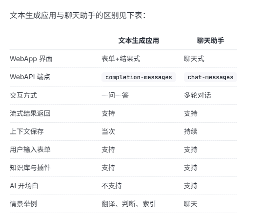
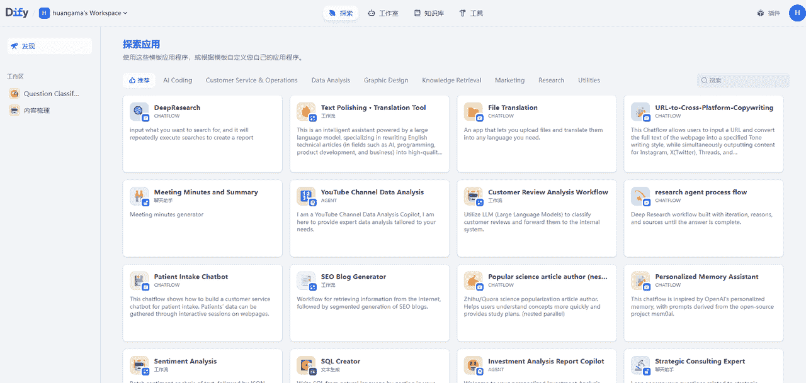
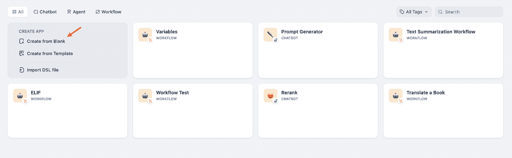
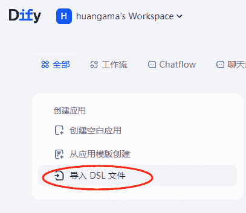

# Dify构建应用种类

> 来源：[https://yunyinghui.feishu.cn/docx/NoMJdRiL4oiF6Sxf4Z6cDEuwn1H](https://yunyinghui.feishu.cn/docx/NoMJdRiL4oiF6Sxf4Z6cDEuwn1H)

---

# 一、应用定义和价值

### 1.1 应用的定义

在 Dify 中，应用是基于 GPT 等大语言模型构建的实际场景应用。它不仅仅是一个技术工具，更是一个完整的 AI 解决方案。

### 1.2 应用的价值

一个 Dify 应用为开发者提供了三大核心价值：

#### 🚀 技术价值

+   封装友好的 API：提供标准化的接口，支持 Token 鉴权

+   开箱即用的 WebApp：美观且托管的用户界面

+   二次开发支持：基于模板进行定制化开发

#### 🛠️ 开发价值

+   提示词工程：可视化编辑和优化提示词

+   上下文管理：智能的对话上下文处理

+   日志分析：完整的应用运行数据分析

+   标注系统：数据标注和模型优化支持

#### 💼 商业价值

+   快速交付：缩短 AI 应用开发周期

+   成本控制：减少基础设施投入

+   灵活部署：支持多种部署方式

# 二、应用类型详解

### 2.1 聊天助手 🤖

适用场景：客服机器人、智能问答、个人助手

+   特点：基于 LLM 的对话式交互

+   优势：自然语言理解，多轮对话支持

+   应用：在线客服、智能导购、学习助手

### 2.2 文本生成应用 ✍️

适用场景：内容创作、文档处理、语言服务

+   特点：专注于文本生成类任务

+   功能：故事创作、文本分类、多语言翻译

+   应用：新闻写作、营销文案、技术文档

### 2.3 Agent 智能体 🧠

适用场景：复杂任务处理、自动化工作流

+   特点：具备任务分解和推理能力

+   能力：工具调用、多步骤执行、智能决策

+   应用：数据分析、项目管理、自动化运维

### 2.4 对话流 💬

适用场景：复杂业务流程、多轮交互

+   特点：具有记忆功能的多轮对话

+   优势：状态管理、流程控制、用户体验优化

+   应用：订单处理、预约系统、培训流程

### 2.5 工作流 ⚙️

适用场景：批处理任务、自动化流程

+   特点：单轮生成类任务的高效处理

+   优势：批量处理、并行执行、结果聚合

+   应用：数据处理、报告生成、批量分析

# 第三章：选择指南

## 3.1 应用类型选择矩阵

## 3.2、创建demo应用

### 从模板创建应用

初次使用 Dify 时，你可能对于应用创建比较陌生。为了帮助新手用户快速了解在 Dify 上能够构建哪些类型的应用，Dify 团队内的提示词工程师已经创建多场景、高质量的应用模板。你可以从导航选择 「工作室 」，在应用列表内选择 「从模板创建」。

任意选择某个模板，并将其添加至工作区。

#### 创建一个新应用

如果你需要在 Dify 上创建一个空白应用，你可以从导航选择 「工作室」 ，在应用列表内选择 「从空白创建 」。

Dify 上可以创建 5 种不同的应用类型，分别是聊天助手、文本生成应用、Agent、Chatflow 和 Workflow。创建应用时，你需要给应用起一个名字、选择合适的图标，或者上传喜爱的图片用作图标、使用一段清晰的文字描述此应用的用途，以便后续应用在团队内的使用。

#### 通过 DSL 文件创建应用

> Dify DSL 是由 Dify.AI 所定义的 AI 应用工程文件标准，文件格式为 YML。该标准涵盖应用在 Dify 内的基本描述、模型参数、编排配置等信息。

