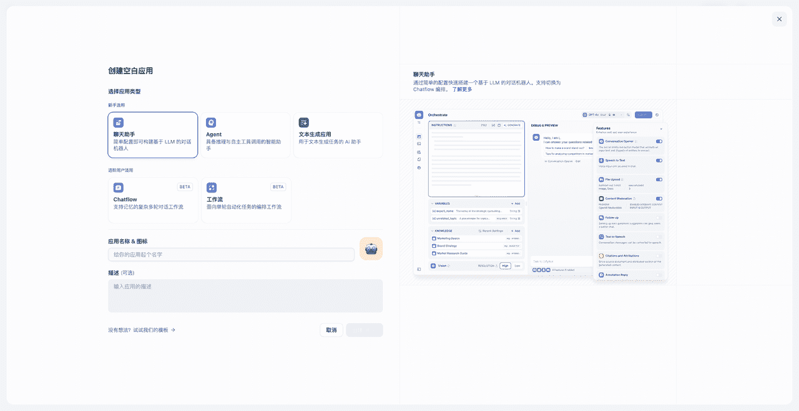
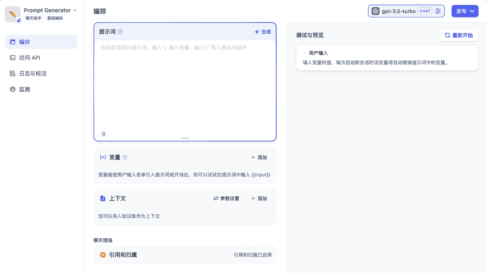
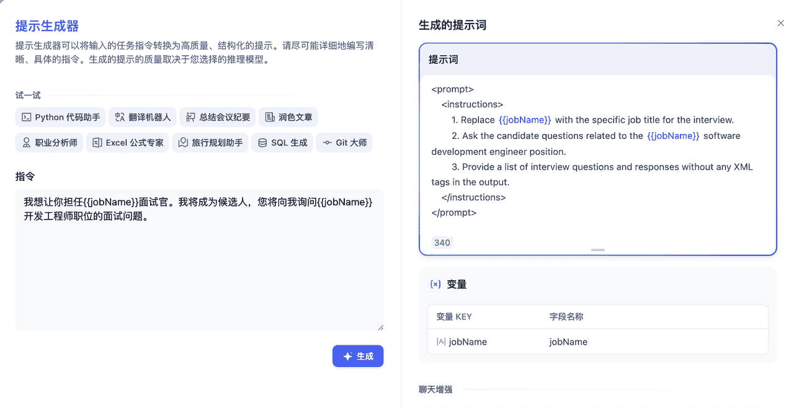

# Dify+面试聊天助手

> 来源：[https://yunyinghui.feishu.cn/docx/K7I2deSQsoAzHexHptxcUZOlnrd](https://yunyinghui.feishu.cn/docx/K7I2deSQsoAzHexHptxcUZOlnrd)

---

## 📚 目标

通过本教程，您将学会如何创建和编排一个专业的对话型应用，以面试官应用为例进行实践。

---

## 🎯 第一课：了解对话型应用

### 适用场景

对话型应用广泛应用于多个领域：

### 核心功能特性

+   ✅ 对话前提示词：约束AI回复的专业性

+   ✅ 变量支持：动态内容替换

+   ✅ 上下文管理：保持对话连贯性

+   ✅ 开场白设置：提升用户体验

+   ✅ 问题建议：引导对话流程

---

## 🛠️ 第二课：创建应用

### 步骤1：创建新应用

在首页点击 “创建应用” 按钮创建应用。填上应用名称，应用类型选择聊天助手。



####

### 步骤2：编排应用

创建应用后会自动跳转到应用概览页。点击左侧菜单 编排 来编排应用。



填写提示词提示词用于约束 AI 给出专业的回复，让回应更加精确。你可以借助内置的提示生成器，编写合适的提示词。提示词内支持插入表单变量，例如 {{input}}。提示词中的变量的值会替换成用户填写的值。示例：

1.  输入提示指令，要求给出一段面试场景的提示词。

1.  右侧内容框将自动生成提示词。

1.  你可以在提示词内插入自定义变量。



### 步骤3：设置对话开场白

1.  点击页面底部的 "添加功能" 按钮

1.  选择 "对话开场白" 功能

1.  编写个性化开场白：

```
   你好，{{name}}。我是你的面试官，Bob。
   你准备好了吗？让我们开始今天的面试吧！
```

### 步骤4：添加开场问题

为提升互动性，可以预设几个开场问题：

+   "请简单介绍一下你自己"

+   "你为什么选择这个职位？"

+   "你对我们公司了解多少？"

##### 添加上下文

如果希望AI的回复严格基于企业知识库：

1.  引用知识库：

+   上传企业文档

+   设置客服话术规范

+   定义回复范围

1.  配置上下文：

+   选择相关文档

+   设置引用权重

+   测试回复准确性

### 步骤5、调试流程

1.  右侧调试面板：

+   填写用户输入项

+   测试不同场景

+   观察AI回复质量

1.  效果优化：

+   调整提示词内容

+   切换不同底层模型

+   对比回复效果

### 常见问题解决

## 📋 课程总结

### 关键要点回顾

1.  ✅ 明确应用场景和目标用户

1.  ✅ 编写清晰专业的提示词

1.  ✅ 设置友好的对话开场白

1.  ✅ 合理利用知识库和上下文

1.  ✅ 持续调试和优化效果