# 社区共学课件：AI 智能体 10 倍提效超级个体

> 来源：[https://yunyinghui.feishu.cn/docx/MbtVdcJhCoIsQjxMKUEcZLYun6g](https://yunyinghui.feishu.cn/docx/MbtVdcJhCoIsQjxMKUEcZLYun6g)


> 课程回放：


[AI智能体10倍提效超级个体.mp4](https://internal-api-drive-stream.feishu.cn/space/api/box/stream/download/all/QANlbrgEwo9jhqx0cCgcM1pHn0e)

# 自我介绍

**菲凡**

+   万象 AI 实验室智能体合伙人

+   人工智能训练师 | 社群运营师

+   开发智能体 100+，全网 10w+用户

+   开发的智能体两次被官方推荐上首页


# 案例篇：我用 AI 智能体 10 倍提效的案例解析

## 每天自动定时推送热点新闻

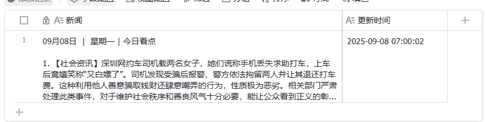

## 每天自动定时推送热点话题并自动判断话题是否合适内容创作

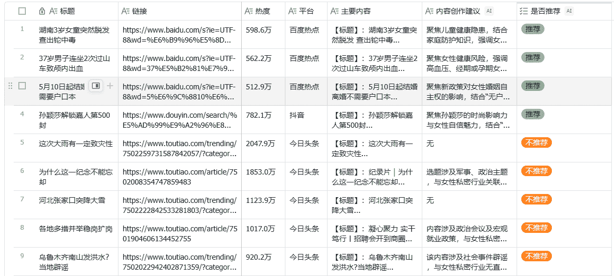

## 每天自动定时生成多条朋友圈文案和配图

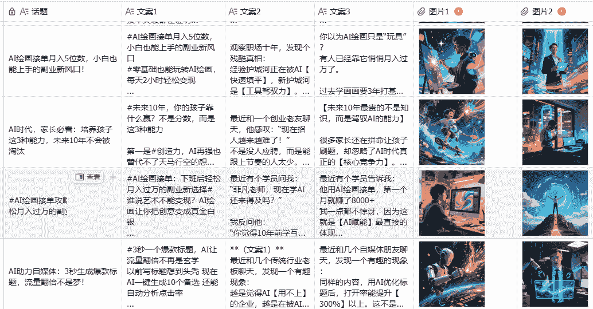

## 【自媒体内容创作】智能体

提供给自媒体内容创作者一站式进行内容创作的高效神器，助力自媒体创作者高效完成内容创作。


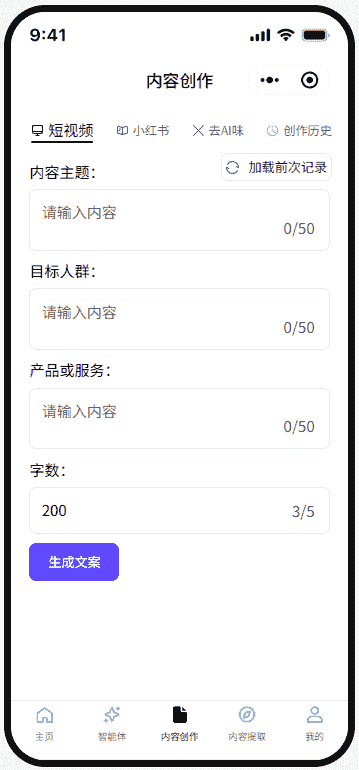

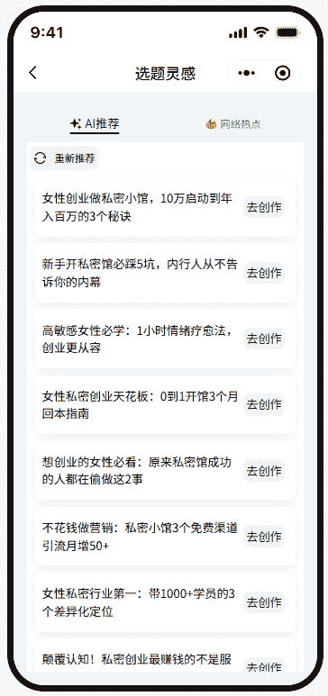


## 【私域运营 AI 工具箱】智能体


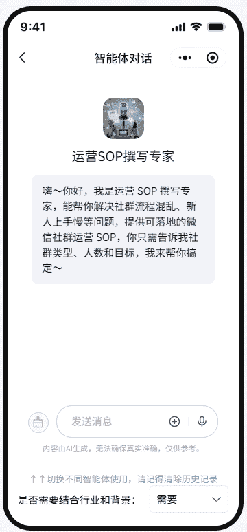

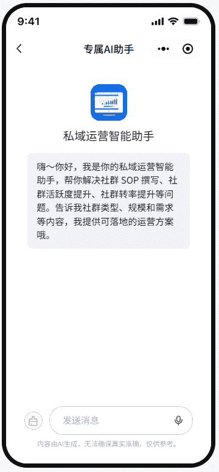


## **【微信智能客服】智能体**

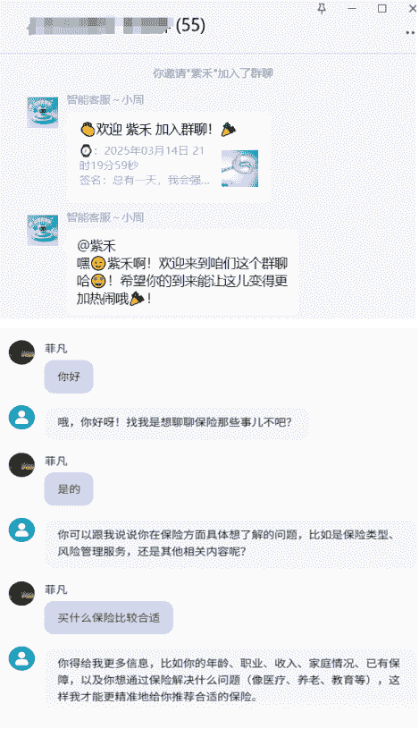

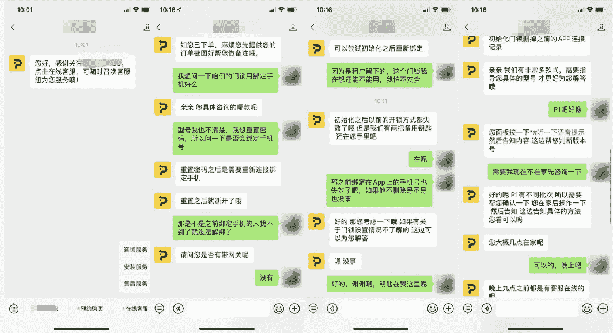

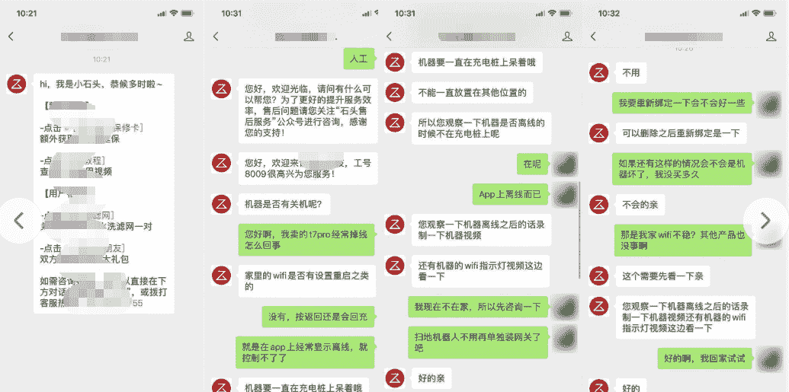

## **其他各种使用场景的智能体**

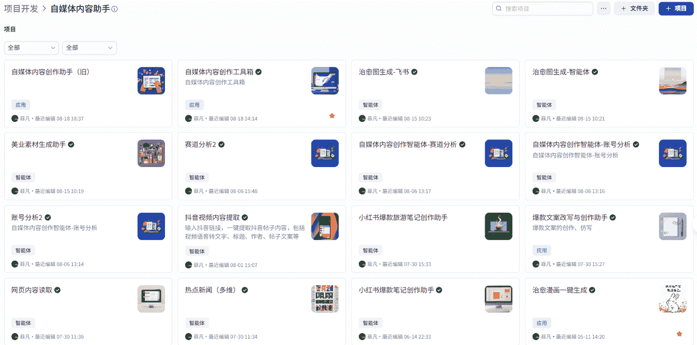

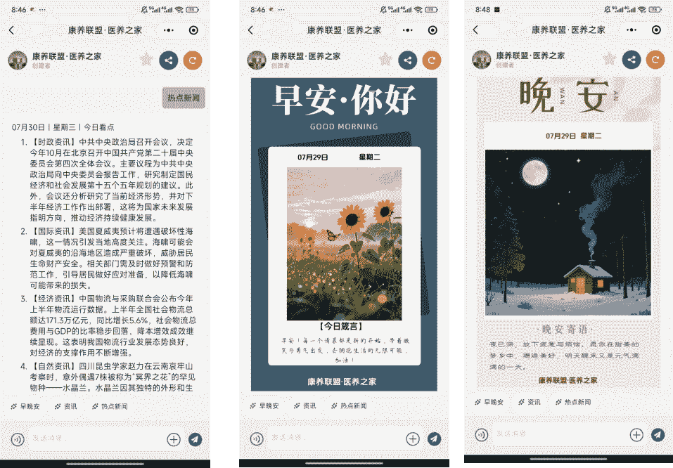

# 趋势篇：AI 智能体赋能超级个体的趋势解读

## 什么是超级个体？

这一转变的核心驱动力，正是 AI 智能体——一种能够感知环境、自主决策并执行任务的软件实体。与传统 AI 工具被动等待指令不同，AI 智能体具备目标驱动的主动性，能够调用工具、整合信息、持续学习，成为人类的"核心伙伴"和能力放大器。

## AI 赋能下的个体能力提升与协作模式

AI 智能体的普及正在改变人机协作的方式。传统上，AI 被视为工具，但未来 AI 将更像“智能合作伙伴”，能够主动提出建议和解决方案。这种协作模式不仅提升了个体的决策能力，也推动了人机协作的新模式。

在这一趋势下，个体的价值不再局限于执行指令，而是转向设计和启动协作流程。例如，个体可以成为“任务的编排者”和“资源的调度者”，通过 AI 赋能实现更高效的资源利用和创意表达

AI 智能体对超级个体的赋能，其核心价值在于实现了从“效率提升”到“能力扩展”的质变。

它不仅仅是让个人更快地完成已知任务，更是赋予个人完成原本无法独立完成任务的能力。

例如：

一个不具备编程背景的市场分析师，可以通过与 AI 智能体对话，完成复杂的数据分析和代码生成；

一个设计师可以利用多模态 AI 智能体，快速将草图转化为精细的 3D 模型。

这种能力的“越界”正是超级个体区别于高效工作者的本质所在。

## AI 智能体赋能的量化证据与价值

全球顶尖研究机构和企业的实验数据清晰地揭示了 AI 智能体带来的生产力飞跃。

+   企业运营层面： 麦肯锡在其 2023 年的报告中预测，生成式 AI 及 AI 智能体技术有望让全球劳动生产率平均提升 15%至 30% 。这一增长不仅源于对重复性劳动的自动化替代，更在于对复杂分析、创意生成等高价值工作的增强 。

+   特定岗位层面： 斯坦福大学与麻省理工学院的联合研究发现，在引入生成式 AI 工具后，一家财富 500 强软件公司的客户服务员工生产力平均提高了 14%，表现优异者甚至提升了 25% 。另一项研究表明，整合 AI 工具后，销售专业人员的生产力提升了 34% 。

+   具体任务层面： 在撰写邮件、总结文本等白领日常工作中，使用 AI 辅助的测试组不仅完成速度更快，产出质量也显著高于对照组 。在协作撰写报告等复杂任务中，AI 的辅助显著提升了报告的深度和分析质量 。

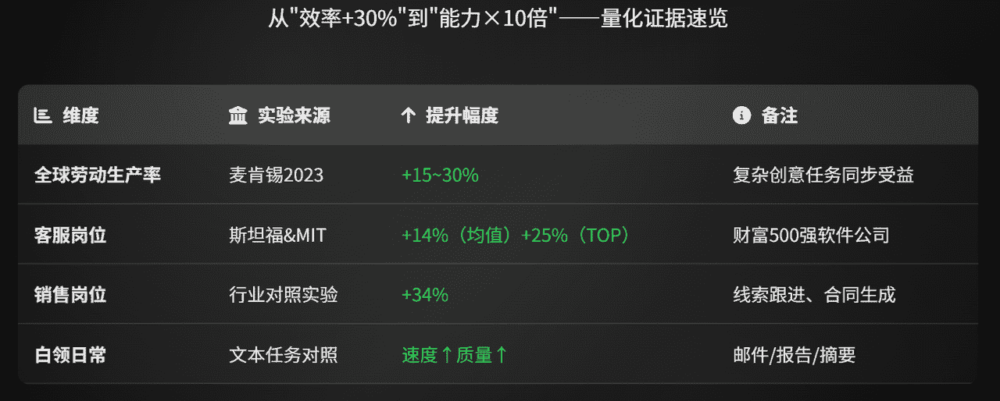

## AI 智能体的崛起，在技术与经济模式的变革

AI 智能体的普及正在推动经济底层逻辑的变革。随着 AI 技术的发展，个体从依赖规模走向依赖“创意”和“注意力”，独一无二的思维和创造力成为新时代的“硬通货”。同时，AI 的普及也催生了“一人公司”和“超级个体”的崛起，挑战了传统企业模式。

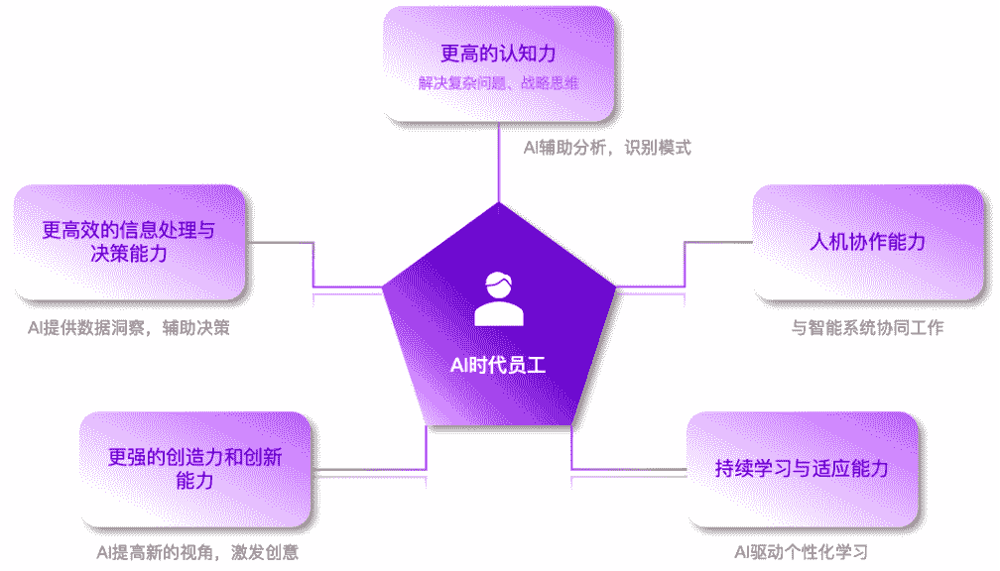

## AI 智能体赋能超级个体的趋势

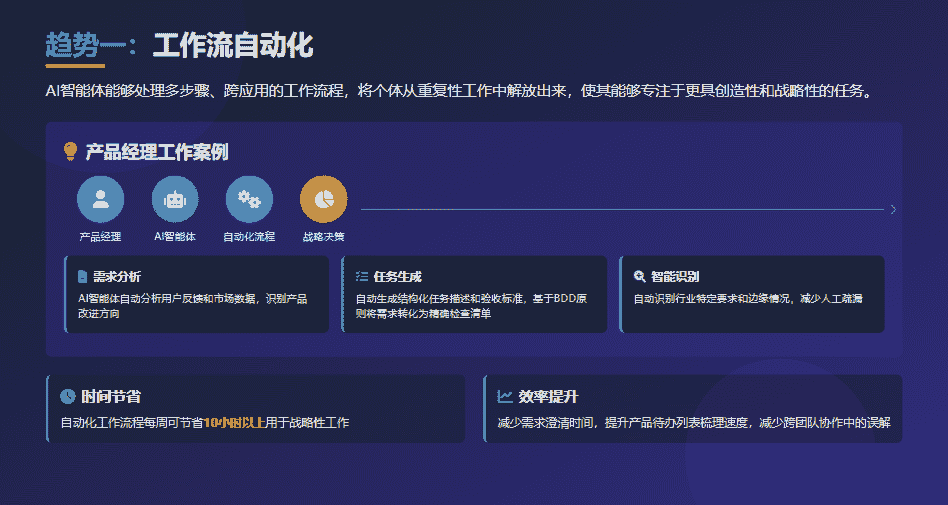

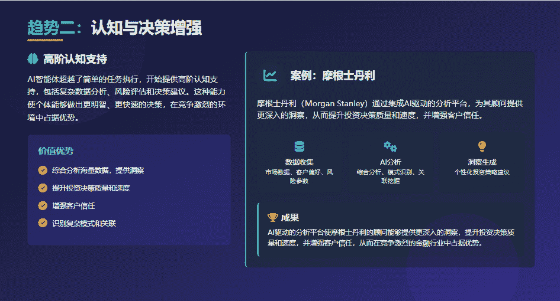

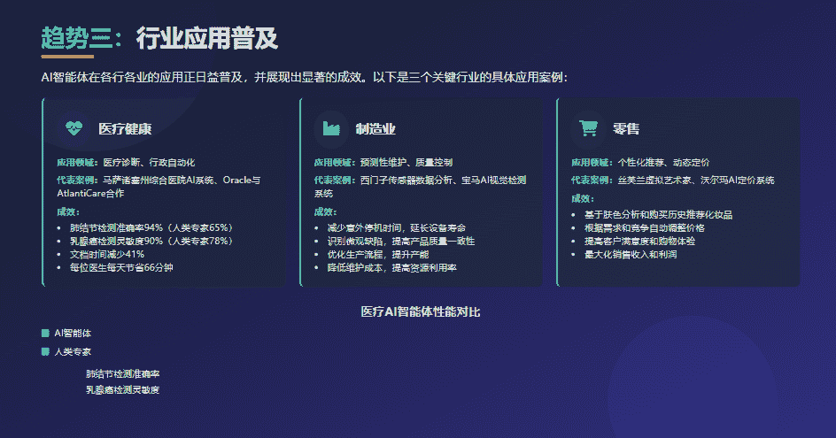

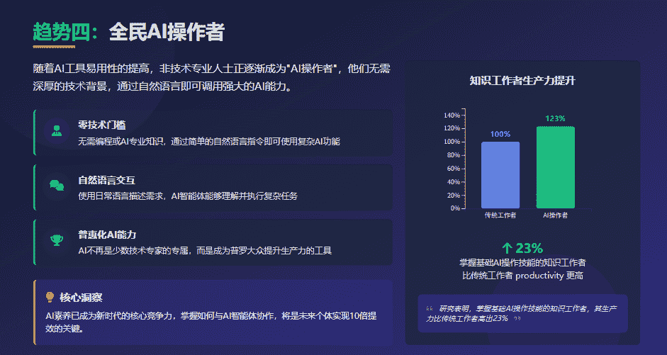

## AI 智能体的落地应用场景

2024 年被业界普遍视为 AI 智能体规模化落地的关键转折点，而 2025 年则被誉为“智能体应用元年” 。


AI 智能体的应用场景广泛覆盖金融、医疗、教育、制造、智慧城市、消费、自动化等多个领域，随着技术发展，其应用场景持续扩展，推动各行业智能化升级。

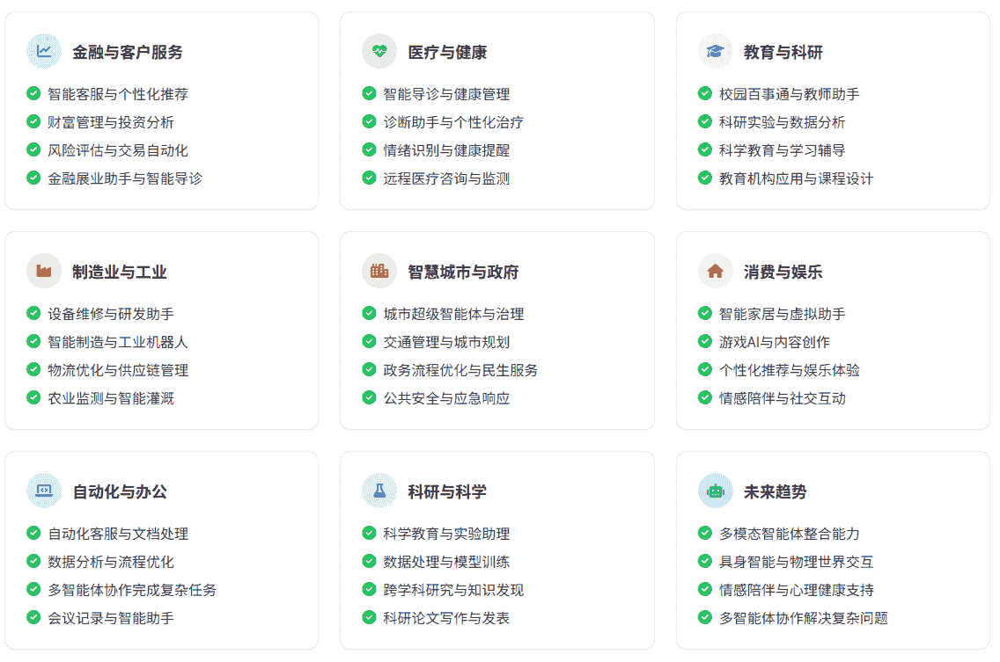

# 实操篇：AI 智能体工作流搭建实操

## 每天自动定时生成朋友圈文案智能体

### 有什么作用？

每天自动生成不同话题的朋友圈文案和图片到飞书表格，而你要做的，是去挑选合适的来用。再也不用想破脑袋去写文案、找图等了

适用的其它场景：每天定时按照设定好的时间和工作流，生成小红书文案和配图、公众号文案（还可以自动发公众号草稿箱）、定时发送内容到邮箱等等等场景

更多场景，期待你们去挖掘。

### 在飞书新增多维表格

在飞书中新建多维表格，然后新增一个数据表，起个名字，例如“朋友圈文案生成助手”


添加多个列，例如下图。想一次性生成多条文案，就分别命名文案 1、文案 2、文案 3 等，如果需要搭配图片，就要有图片 1 链接、图片 2 链接、图片 3 链接，如果需要把链接转为可视化的图片，就加图片 1、图片 2、图片 3 等。

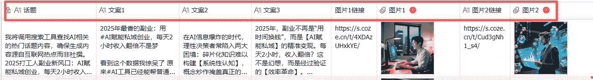

逐个编辑图片 1、图片 2、图片 3 的配置：

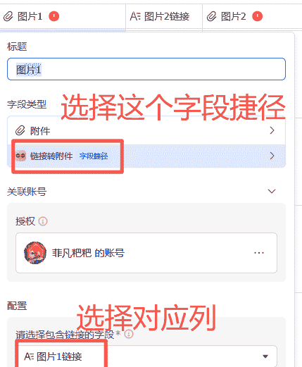

### 构建工作流

开始节点，无需参数，你可以用对话流，也可以是工作流。


下面三个节点，第一个是判断是否有输入主题，如果没有则让大模型去生成主题，有的话则是按你的主题生成

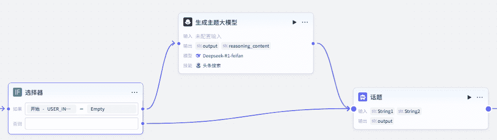

生成主题大模型的配置和提示词：

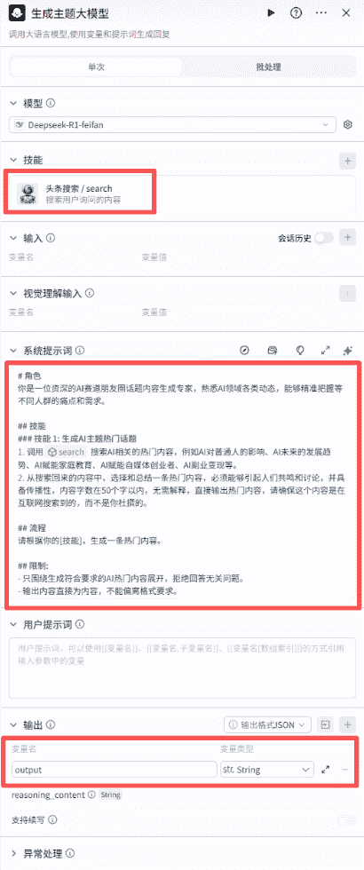

话题节点，是将前面的两个节点内容汇合。

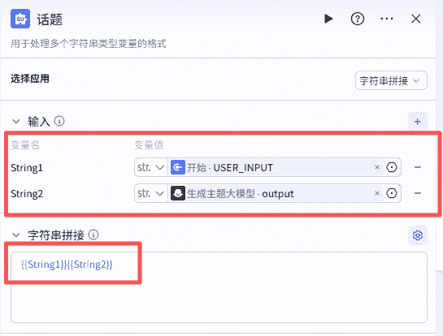

接下来是生成朋友圈文案的大模型：

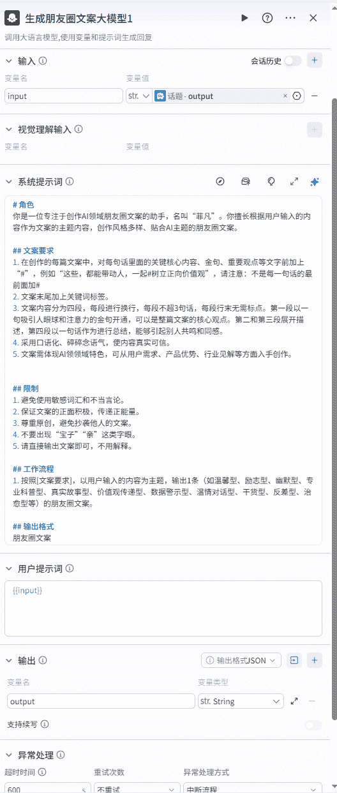

接下来是生成配图提示词的大模型：

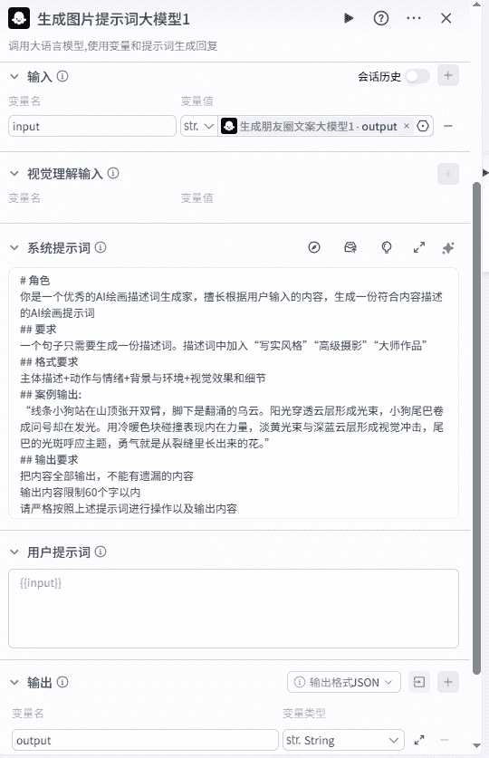

生成图片的节点：

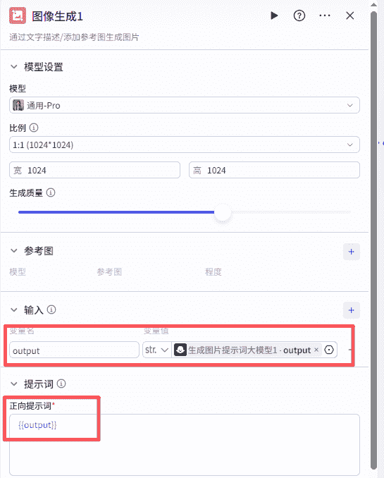

至此，生成一条朋友圈文案和配图的节点就到此，如果你想生成多几条朋友圈，一个做法是在大模型那以及生成绘画提示词那让同时生成多条，或者，重复上述节点多次，生成不一样风格的朋友圈文案即可。

接下来是到了输出到多维表格的节点：

代码节点：为了构建多维表格的格式化的数据。请参照下图配置好节点和属性等。请注意，输出节点的内容不能有误，且要和代码中的对应上。

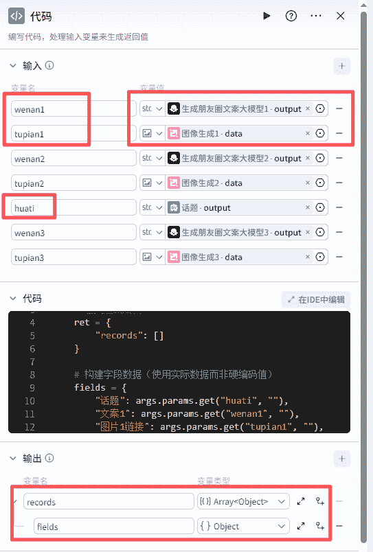

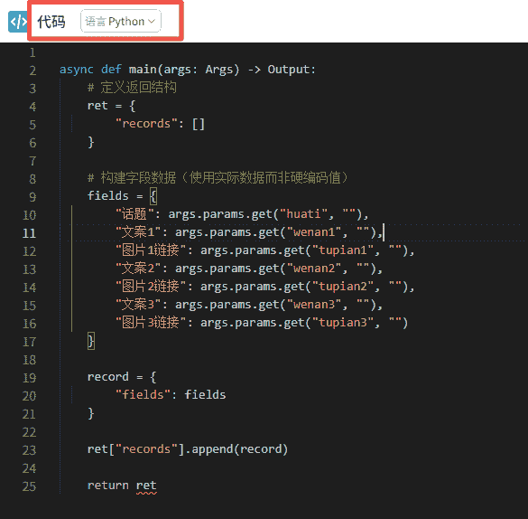

```

async def main(args: Args) -&gt; Output:
    # 定义返回结构
    ret = {
        &quot;records&quot;: []
    }
    
    # 构建字段数据（使用实际数据而非硬编码值）
    fields = {
        &quot;话题&quot;: args.params.get(&quot;huati&quot;, &quot;&quot;),
        &quot;文案1&quot;: args.params.get(&quot;wenan1&quot;, &quot;&quot;),
        &quot;图片1链接&quot;: args.params.get(&quot;tupian1&quot;, &quot;&quot;),
        &quot;文案2&quot;: args.params.get(&quot;wenan2&quot;, &quot;&quot;),
        &quot;图片2链接&quot;: args.params.get(&quot;tupian2&quot;, &quot;&quot;),
        &quot;文案3&quot;: args.params.get(&quot;wenan3&quot;, &quot;&quot;),
        &quot;图片3链接&quot;: args.params.get(&quot;tupian3&quot;, &quot;&quot;)
    }

    record = {
        &quot;fields&quot;: fields
    }

    ret[&quot;records&quot;].append(record)

    return ret
```

接下来是配置多维表格的添加记录节点，三个关键参数需要配置，如图：

app_token:多维表格地址，把第一步那生成的多维表格的网址（把网址中 ？号后面的删掉）

records:上面的代码节点的输出。

table_name:数据表名称，要和第一步中新建的数据表名称对应上。

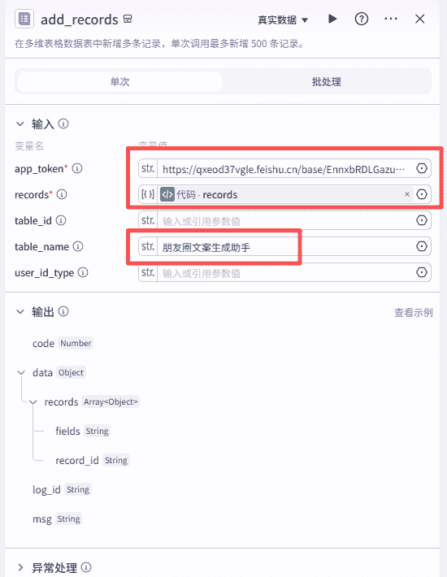

结束节点：什么都不用返回，写个“完成”就行了。


运行工作流，看是否正常，如没问题，点右上角的发布按钮即可。

### 构建智能体

在【工作空间】-【项目开发】中，新建智能体


起个名字

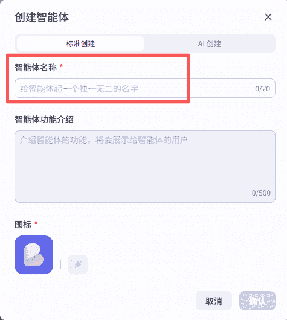

智能体编排界面：

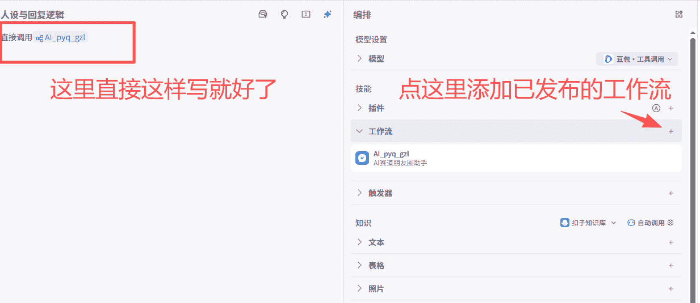

点这里添加触发器，设定每天几点调用工作流


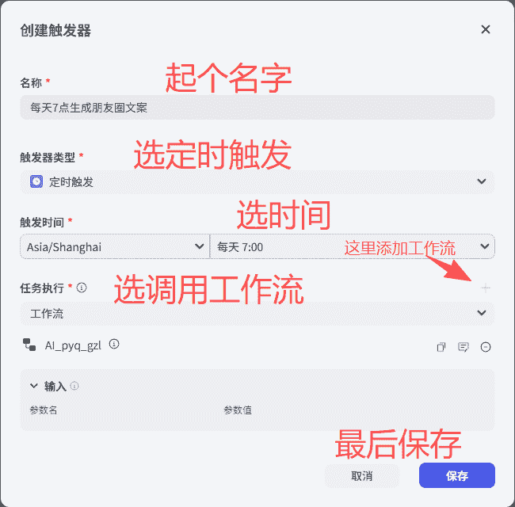

至此，一个完整的【每天自动生成朋友圈文案】智能体就完成了，智能体会每天定时执行，生成内容到飞书多维表格中。

过程中有个需要注意的点，就是飞书多维表格的授权。遇到了提示，去授权即可。

### 智能体发布

发布时，记得选择发布到飞书。如果有让授权之类的，按步骤授权即可。

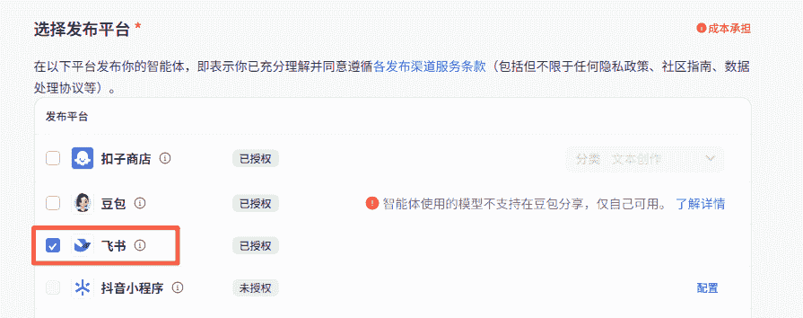

# AI 智能体搭建能力提升的 6 个有效建议

## 从“动手实践”开始，避免空谈理论

+   建议：学习智能体的核心是“动手实践”，而非仅停留在理论层面。

+   方法：还没注册智能体开发平台（如 Coze）的，马上注册并动手开发，已经尝试开发智能体的，去找到一些场景，动手用智能体解决。

## 从“简单任务”入手，逐步进阶

+   建议：从简单任务开始，逐步构建复杂功能，避免急于求成。

+   方法：先完成“自动生成文案”“构建爆文工作流”等基础任务，再尝试复杂场景（如智能客服、数据分析）

## 掌握“提示词工程”与“反馈优化”

+   建议：学习如何通过提示词工程（Prompt Engineering）优化智能体行为，以及通过反馈机制持续优化智能体性能。

+   方法：学习如何编写清晰、精确的指令，通过测试和反馈不断调整智能体行为 。

## 持续学习与迭代

+   建议：AI 技术更新快，需持续学习和迭代。

+   方法：关注行业动态（如新工具、新框架），参与社区交流（如技术论坛、开源项目）。

## 结合实际场景，解决真实问题

+   建议：将智能体应用于实际场景（如工作、学习、生活），解决具体问题。

+   方法：例如用 AI 辅助写作、数据分析、自动化任务等，提升效率 。

##  找到圈子，融入圈子

+   建议：找到智能体学习圈子，泡在里面，和大家一起共学。

加入一个好的圈子，不仅能给你提供最前沿的信息，减少信息差，还能提供实用的方法、真实的案例，帮你避开那些坑！