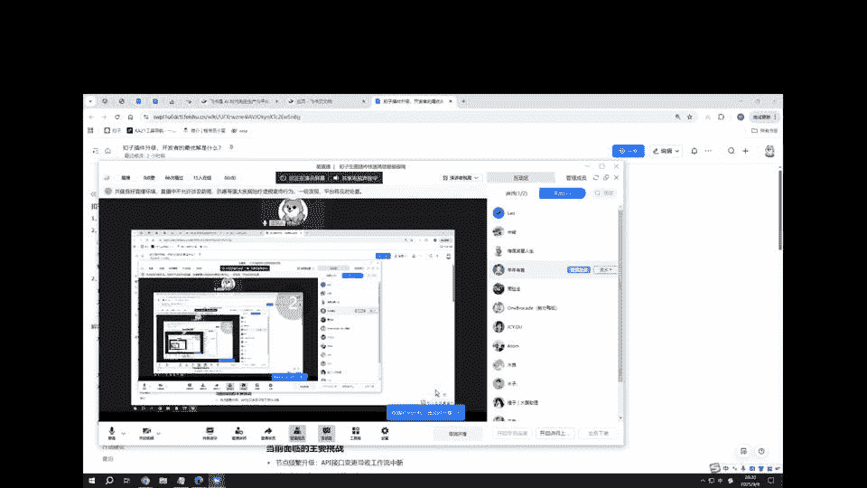

# 社区共学课件：扣子生图插件快速高效替换指南

> 来源：[https://yunyinghui.feishu.cn/docx/D6Trd1uTXoYayIx1ZmqceVxXn5b](https://yunyinghui.feishu.cn/docx/D6Trd1uTXoYayIx1ZmqceVxXn5b)

> **直播回放：**

[扣子生图插件快速高效替换指南.mp4](https://internal-api-drive-stream.feishu.cn/space/api/box/stream/download/all/Im1XbVej0oazq1xIGGPcqMlRnab)

# 个人介绍

> 吴瑞孟【黄啊码】

> **现任职位**

> 深圳金脉全域数科公司 CTO 兼联合创始人

> **专业身份**

> 扣子头部开发者 · 三节课特邀讲师

> **技术专长**

> AI 全栈 RPA 自动化专家

> **专注领域**

> AI 智能体商业化落地 · 企业自动化流程设计

# 1、主讲内容

## Coze 插件升级带来的一系列问题和解决方案

## 当前面临的主要挑战

+   节点频繁升级：API 接口变更导致工作流中断

+   插件突然下架：依赖的第三方服务不可用

+   版本兼容性问题：新旧版本不兼容

+   维护成本高：需要持续关注和更新

## 影响范围

+   开发效率：频繁修复影响开发进度

+   用户体验：服务不稳定影响用户满意度

+   运营成本：维护成本持续上升

+   业务连续性：关键功能可能随时中断

# 2、核心问题分析

问题根源分析

## 1. 技术层面

API 依赖性强：过度依赖第三方 API

版本管理混乱：缺乏统一的版本控制策略

错误处理不足：缺乏完善的异常处理机制

## 2. 管理层面

监控体系不完善：无法及时发现节点异常

应急预案缺失：缺乏快速响应机制

文档更新滞后：技术文档更新不及时

## 3. 架构层面

耦合度过高：节点间依赖关系复杂

扩展性差：难以快速替换失效节点

容错能力弱：单点故障影响整体

# 解决方案详解

## 方案一：节点稳定性管理策略

### 1.1 选择稳定的插件和节点

✅ 优先选择：

官方认证的插件

社区维护活跃的节点

有长期维护承诺的服务

❌ 避免选择：

个人开发的不稳定插件

缺乏文档的第三方服务

版本更新频繁的 API

### 1.2 建立节点评估体系

稳定性评分：基于历史可用性数据

维护活跃度：关注更新频率和响应速度

社区反馈：参考用户评价和问题反馈

技术文档：评估文档完整性和更新及时性

## 方案二：自我封装节点，降低重复性工作

1、封装常用的节点，避免牵一发而动全身

2、注意版本控制，避免插件升级回退版本造成的影响

## 方案三：开发属于自己的插件

#### ✅ 开发优势

+   **完全控制**：不受第三方服务影响

+   **定制化**：满足特定业务需求

+   **稳定性**：长期维护保障

#### ✅ 开发建议

1.  **MVP 原则**：先实现核心功能

1.  **模块化设计**：便于后续扩展

1.  **文档完善**：提供详细使用说明，要做长期工作，不做短期自我满足。

# 总结

## 核心点回顾

1.  **问题识别**：准确识别节点升级/下架的根本原因

1.  **架构优化**：设计灵活、可扩展的工作流架构

1.  **监控预警**：建立完善的监控和预警体系

1.  **版本管理**：实施科学的版本管理和发布策略

1.  **持续改进**：建立持续优化和改进机制

## 行动建议

+   **立即行动**：评估现有工作流稳定性

+   **短期规划**：实施架构优化和监控体系

+   **长期规划**：建立智能化运维体系

+   **持续学习**：关注技术发展趋势和最佳实践

## 最后

+   微信：ama_huangama

+   **致谢：****万象** AI 实验室的平台支持和扣子各位开发者朋友的观看