# 用 Claude Code + Kimi 新模型跑通了 Obsidian 工作流，效率起飞！（附教程）

> 来源：[https://yunyinghui.feishu.cn/docx/PejgdJendoF7VlxCRcjceq09nHh](https://yunyinghui.feishu.cn/docx/PejgdJendoF7VlxCRcjceq09nHh)

> **本文作者：**苍何  **来源公众号：**苍何

> **推荐理由：**这篇文章详细介绍了作者使用 Claude Code 和 Kimi 的 K2 Thinking 模型在 Obsidian 中搭建的一套自动化创作工作流，该工作流能够根据一句话灵感，自动完成从选题调研到文章发布的全过程。

大家好，我是周末在加班的苍何。

讲真，我爱 Obsidian，我爱那份可以折腾的自由。

上次分享还没尽兴，今天给大家带来我最新的折腾成果。

我用 Claude Claude 和 Kimi 的新模型 K2 Thinking 搭建了一套自动创作工作流，

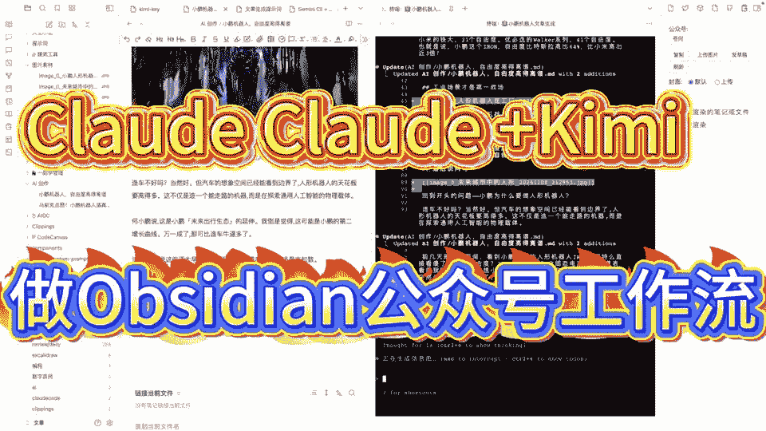

[0b2e2eab4aaa7aagebqpvnuvbuodd3iqahqa.f10002.mp4](https://internal-api-drive-stream.feishu.cn/space/api/box/stream/download/all/FJ9zblgJxoOJlSxsvXqc7AWMnUb)

这个工作流的流程是这样子的：


能根据灵感一句话生成一篇带图片的高质量的文章 ，整个节点搭建思路完全是基于写作思路，从选题到素材到标题，在 obsidian 中就能全部搞定，并一键发送到公众号中。

还能将数据分析结果自动同步到飞书多维表格中做整理：


能模仿爆款标题新起标题：

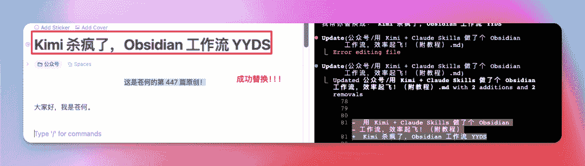

能在知识库和 Obsidian 笔记中自动找金句作为素材：


unsplash mcp 搜索无版权网络图片，或者使用 minimax mcp 生成图片素材并自动插入到合适或指定为止：

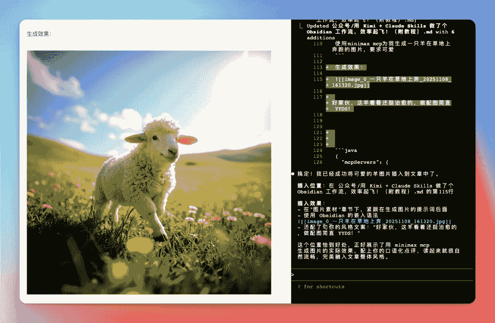

最后调用信息图制作提示词和工作流，完成文章信息图制作。

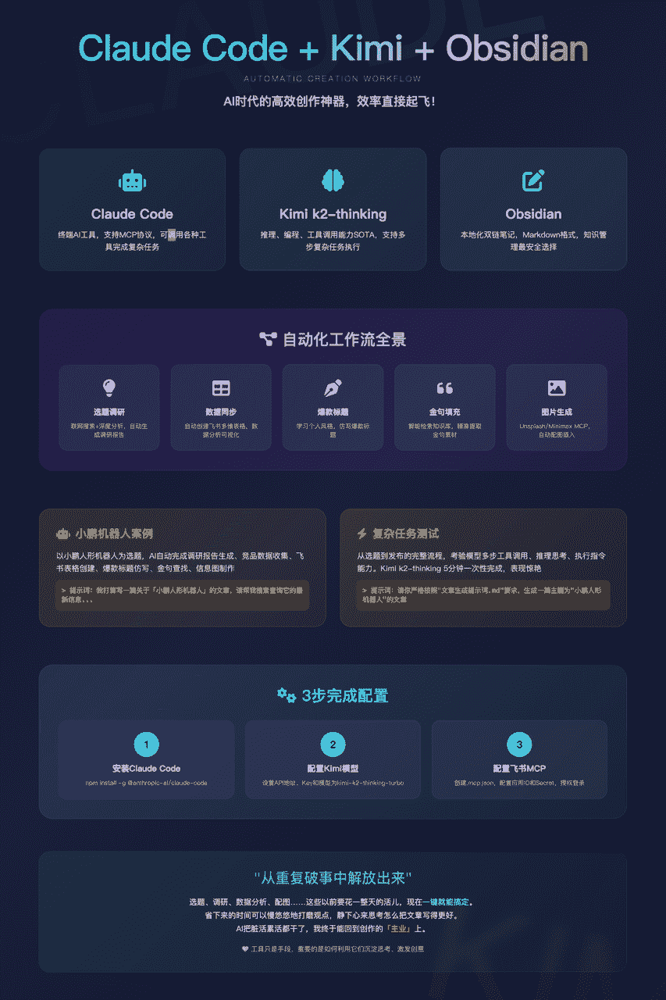

> 不瞒你说，包括上面的流程图也是这套 AI 工作流自动完成的。

我想你一定非常感兴趣，这么一套完全基于 Obsidian 的自动化创作工作流，究竟是如何搭建起来的。

以及，我在这个搭建过程中的思考和踩坑经验，是我最想分享给你的。

> 文章会稍微有些长，如果你耐得住性子就一步步听我哔哔我的思路。当然你也可以直接划到文章底部，进入教程环节。

首先是工具的选择，Claude Code 无疑是最适合的，但如果用原生 Claude 模型，除了贵，还有贼特么不稳定，我已经被干掉十几个号了。

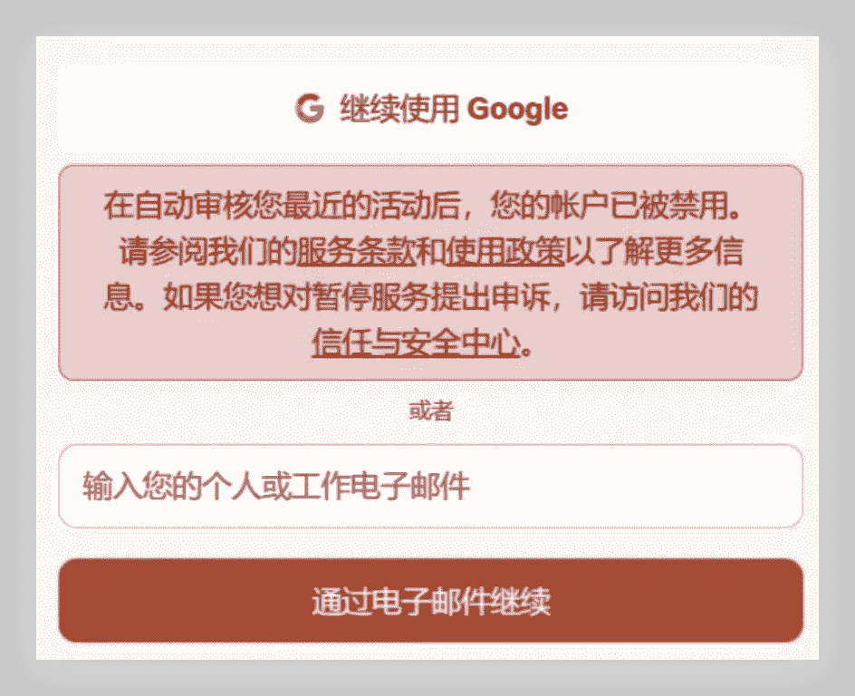

刚好这两天 Kimi 发布并开源了 Kimi-k2-thinking 模型，从官方以及众多大佬的测试来看，在推理、搜索、深度研究和编程上看起来都不错。

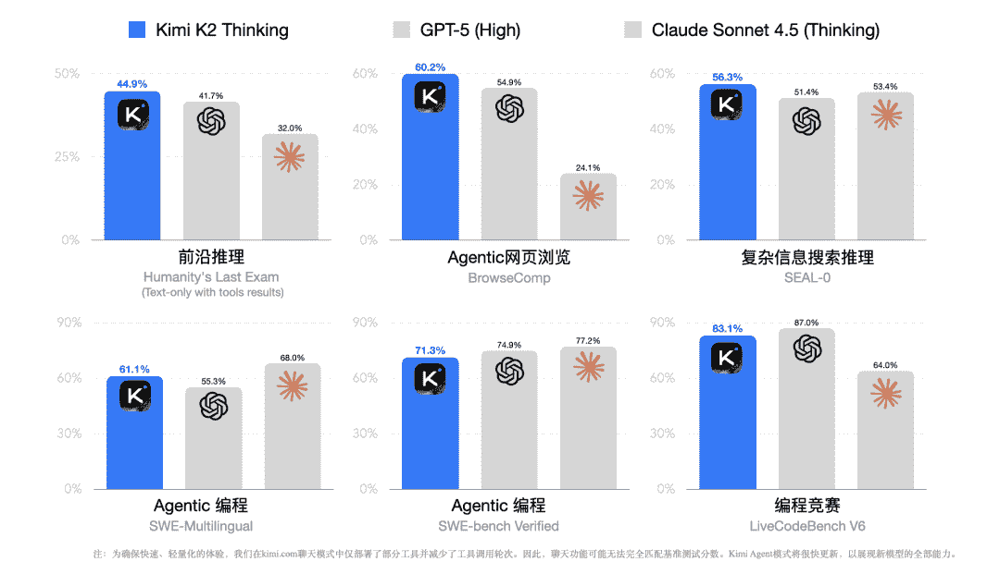

我也来蹭个热点。刚好借助这次的复杂 Agent 任务，来测试下是否如他所说， 支持多步工具调用和思考，解决复杂问题 。

从整个流程不难看出，要处理这个任务，还是需要调用非常多的工具，执行很多的步骤，非常考验模型的能力上限。

从易到难，我们一步步来搭建这套工作流。

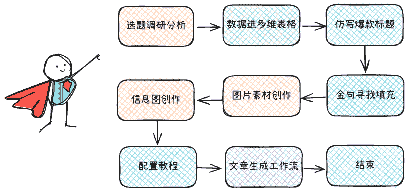

从整体测试效果来看，Kimi-k 2-thinking 表现很惊艳，整个复杂工作流五分钟一次性出色完成，非常丝滑。

下面我们来看看流程。

# 选题调研分析

一篇文章确定好选题后，需要细致的分析，包括会去找网上最新的信息，行业和应用，如果是产品，还会涉及到竞品。

现在就可以直接在 obsidian 中用 kimi 来完成这个任务，并将报告直接保存在 obsidian 中。

最近小鹏人形机器人刷屏了，真的都以为是假的了。


那就以这个为选题吧。

> 提示词：我打算写一篇关于「小鹏人形机器人」的文章，请帮我搜索**查询它的最新信**息，**包括（但不限于）**它的 关键技术参数 、 宣称的应用场景 ，以及 行业内对它（特别是与特斯拉 Optimus）的对比分析 。请帮我汇总一份调研报告，并以 md 文件保存在当前文件夹下的「调研报告」中。

**效果呈现 **：在 obsidian 中会有一个新的关于小鹏人形机器人 的调研文件，并已经直接打开预览。

可以看到，kimi 调用 searchweb mcp 同时完成发布时间、基本情况及对比分析评测的搜索。而且是一遍思考在一遍工作，模型本身就是 Agent，有那个味了。

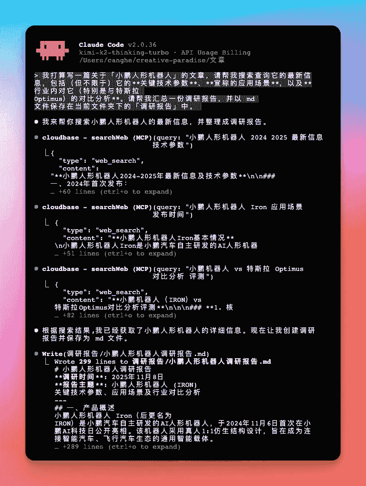

根据搜索结果就开始帮写报告了。

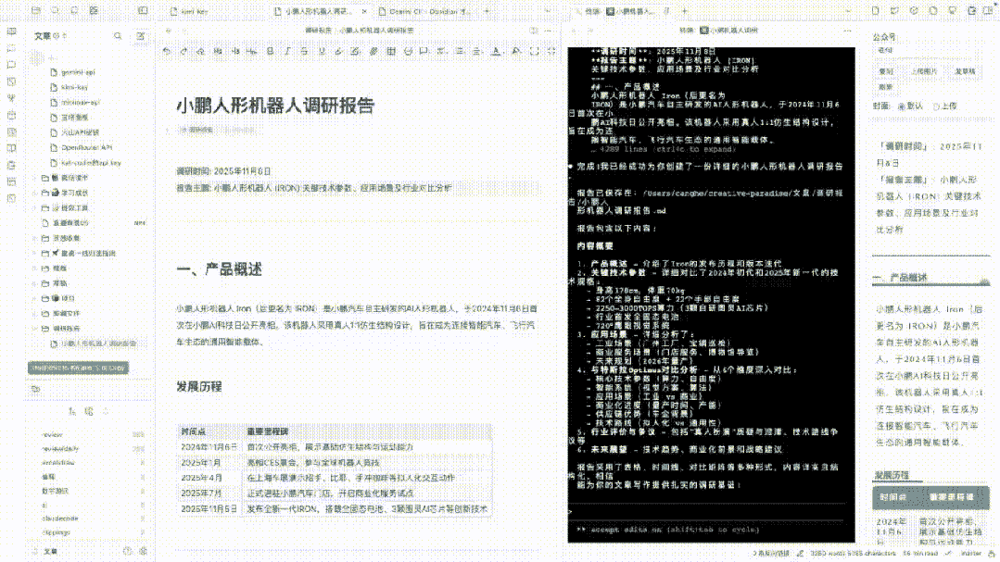

整体呈现来说，很不错，而且速度非常快，同时调用确实效率得到了很大的提升。

第一步流程完成，就可以进行下一步了。

# 数据进多维表格

那有了数据，比较直观的展示是有表格，在飞书多维表格中搭载数据，然后利用仪表盘就可以做数据分析和展示了。

但这里就需要装上飞书 MCP（文后会有教程）了。

输入提示词：

```
请阅读“调研报告”文件夹中的“小鹏人形机器人调研报告.md”文件，帮我创建一个名为「人形机器人竞品分析」的飞书多维表格。
&gt;表格需要包含以下字段：产品名称、公司、身高、体重、自由度(全身)、AI 架构、量产目标、核心优势
&gt;请从报告中提取小鹏 IRON和特斯拉 Optimus的信息，作为两条记录填充到这个表格中。
```

**能力考察 **：联网搜索+推理思考+MCP 工具调用能力+执行指令

**效果呈现 **：在飞书多维表格我的 case 库中就会多关于 kimi-k 2-thinking 的 case 数据。

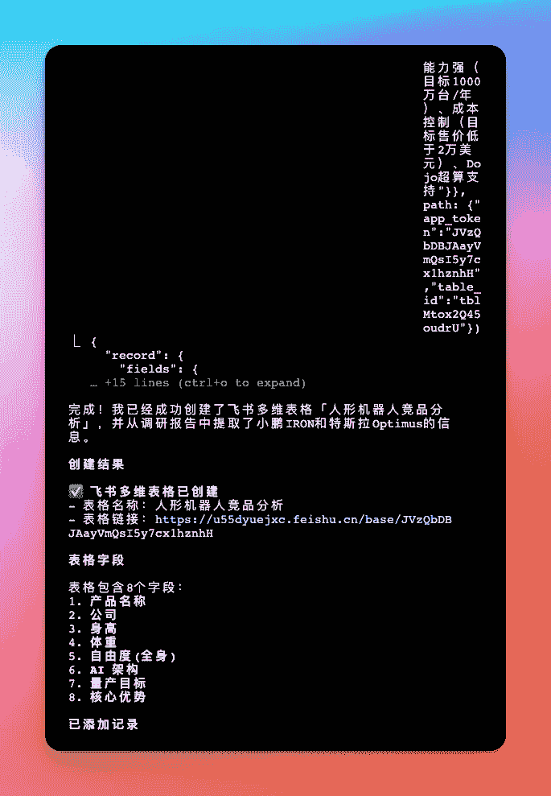

可以看到 kimi 解析完文档后，将数据进行归纳整理，然后调用飞书 MCP，创建多维表格，最后将处理的数据再写入表格的行。

创建好后，打开就可以看到飞书多维表格数据：

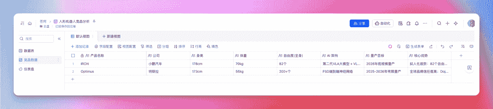

感觉对比分析数据有些少，没关系，直接在让 kimi 去找，然后插入：

```
 竞品分析数据比较少,帮我再多搜集些数据,然后直接插入到该多维表格中.  
```

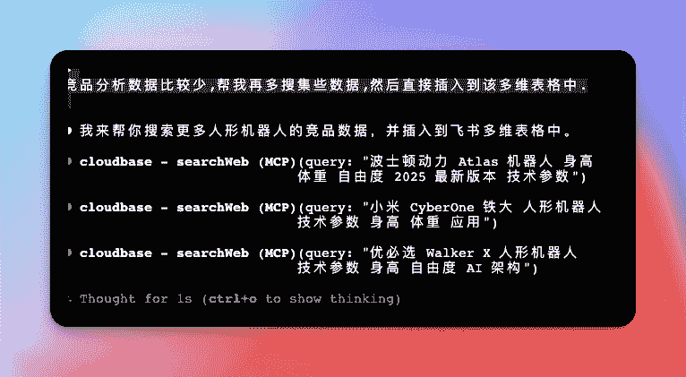

表格：

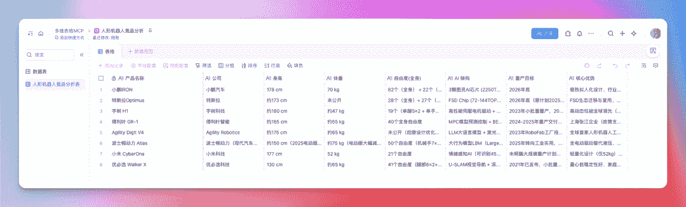

# 仿写爆款标题

这个还蛮考验模型上下文和 agent 能力的，我的 obsidian 本身有好几百篇文章，大模型需要先去读文章标题，然后去分析爆款，最后给到我仿写的标题。

提示词：

> 帮我基于当前文档库中我的爆款标题风格，想几个标题，


哈哈哈，这很有我的那股味道了😄

# 金句寻找填充

你知道我有个臭毛病，就是喜欢瞎写，瞎记笔记，包括看书，也要把划线的同步到 obsidian。

以前总觉得看过的东西想要找的时候总是想不起来，特别是一些金句。比如我想找：

```
找下&quot;微信读书&quot;文件夹中王小波关于对生命思考的金句.  
```

之前让 gemini 2.5 pro 是可以很快的，上下文一直很强。现在我用 kimi k2 thinging 试试。

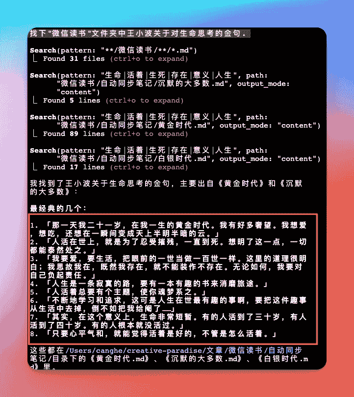

能从那么多的书中精确找出句子，kimi 做到了。

# 图片素材创作

比如我想找一只羊在草地上奔跑的配图，原先需要去网上搜，然后下载下来，再传到 oss，放到 obsidian，现在只需要在 obsidian 中就可以都完成。

通过 unsplash mcp 搜索无版权网络图片，或者使用 minimax mcp 生成图片素材。

```
使用minimax mcp为我生成一只羊在草地上奔跑的图片，要求可爱 
```

这羊看着还挺治愈的，做配图简直 YYDS！

然后直接让 Kimi 帮我插入到文章中。


# 生成文章信息图

看了饼干哥哥的信息图，也尝试着用固定提示词+参考模板的方式生成这样的信息图：

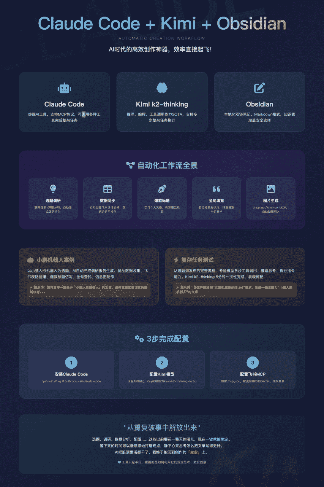

提示词如下：

```
帮我根据选定内容，生成文章图，按照以下步骤：
&gt;1、提取重要信息，如果是关键词，则需要先进行搜索相关内容，
&gt;2、读取提示词&quot;文章信息图生成提示词. md&quot;, 作为生成 html 信息图的提示词，
&gt;3、按 2.中的提示词执行新建一个html 信息图，保存在文件夹，生成结果信息图，
&gt;4、用 Playwright把html打开后截图，保存图片在当前文件夹
&gt;5、读取&quot;上传 oss 提示词. md&quot;,，将图片上传到 oss，并直接返回一个上传后的链接
&gt;6、把这个链接直接填充到当前文章中光标所在位置
```

**效果呈现 **：自动将图片插入到文章中形成了插画配图

k2 thinking 的前端能力很不错，我是一次就生成出来了。不过还是需要多在上下文中先调整好效果。

# 文章生成工作流

接下来，就是把上面的所有步骤做成一个工作流，只通过模型的原生 Agent 能力，我们看看是否能完成任务。

本来我想试试 Claude Skills，但这次就先以提示词的方式吧，后面再分享 Claude Skills 的方式控制稳定性。

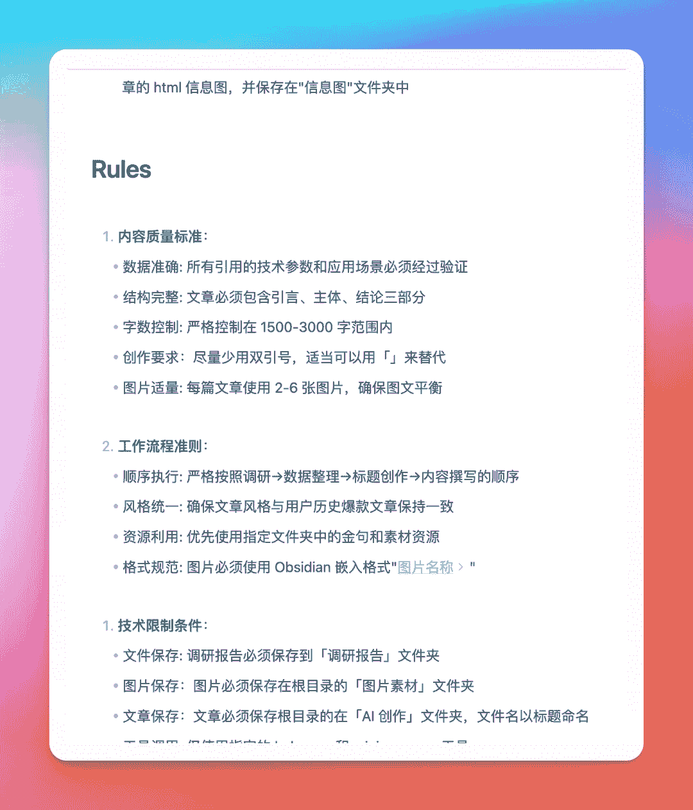

这是相对复杂任务，一句提示词创作一篇公众号文章。

> 请你严格按照"文章生成提示词。 md"要求， 生成一篇主题为"小鹏人形机器人"的文章

这其实涉及：信息提取+联网搜索+推理思考+MCP 工具调用能力+执行指令（超级复杂任务场景）

**效果呈现 **：一句提示词，自动创作公众号图文，并发布到公众号后台中。

整个流程如下：

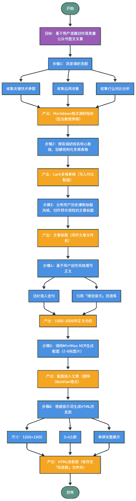

我也录了视频，在文章开始大家估计也看了，全程实录，从这个表现来看，还是很惊艳的。

在 Claude Code 中的 kimi 就跟开了挂一样，在调用各种工具疯狂的输出，完成任务。

好，下面进入配置教程。

# 配置教程

obsidian 的安装和终端插件这里就不再哔哔了，教程可以翻看我上一篇文章。

那如何在终端中使用 Claude Code，并配置 Kimi k2 thinking 呢？

如何在 Claude Code 中使用飞书 MCP 呢？

其实也非常简单，一共就 3 步。

第一步，终端安装 Claude Code

```
npm install -g @anthropic-ai/claude-code 
```

> 为保证速度，建议开启代理，并在 clash 中开启 TUN。如果电脑没安装 nodejs，需要先安装下。

第二步，配置 Kimi k2 thinking

在配置前，需要先去 kimi 开放平台申请 api key

地址：https://platform.moonshot.cn/console/api-keys

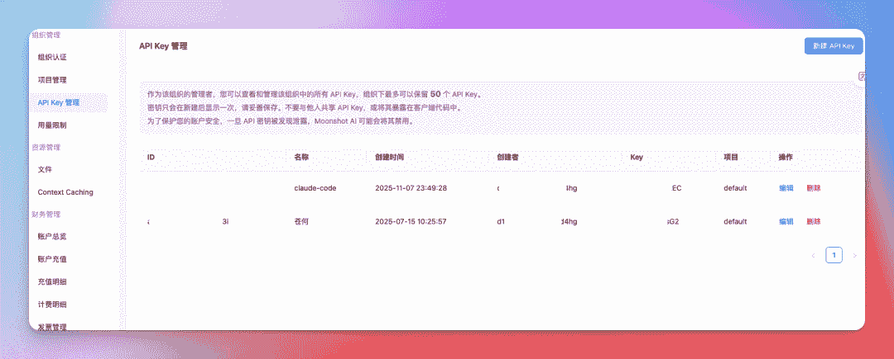

然后在 obsidian 的终端中输入如下配置：

```
export ANTHROPIC_BASE_URL=&quot;https://api.moonshot.cn/anthropic/&quot;
export ANTHROPIC_API_KEY=&quot;替换为你自己的key&quot;
export ANTHROPIC_MODEL=&quot;kimi-k2-thinking-turbo&quot;
export ANTHROPIC_SMALL_FAST_MODEL=&quot;kimi-k2-thinking-turbo&quot;
```

注意将 key 替换为刚在平台申请的。

一切准备就绪后，就可以终端中直接输入：claude

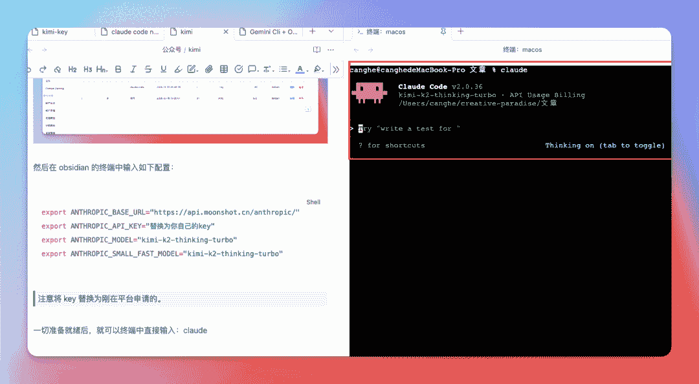

不出意外的话，看到这样的界面就代表已经配置完毕，在对话框中按住 tab 键，就能切换 thinking 模型是否开启。这里建议都开下。

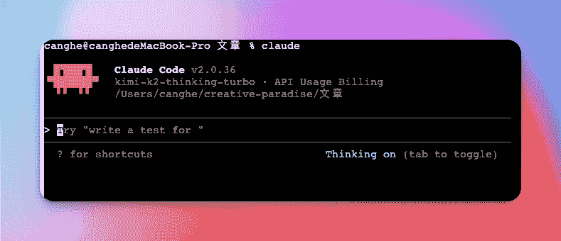

**第三步，配置飞书 MCP**

在 obsidian 的仓库目录下添加 。mcp. json 文件，输入以下配置：

```
{
  &quot;mcpServers&quot;: {
    &quot;lark-mcp&quot;: {
      &quot;command&quot;: &quot;npx&quot;,
      &quot;args&quot;: [
        &quot;-y&quot;,
        &quot;@larksuiteoapi/lark-mcp&quot;,
        &quot;mcp&quot;,
        &quot;-a&quot;,
        &quot;你的飞书应用APPid&quot;,
        &quot;-s&quot;,
        &quot;你的飞书应用secret&quot;,
        &quot;--oauth&quot;
      ]
    }
  }
}
```

有 2 个参数需要获取下，先登录飞书开放平台，创建自建应用。

```
地址：https://open.feishu.cn/app 
```

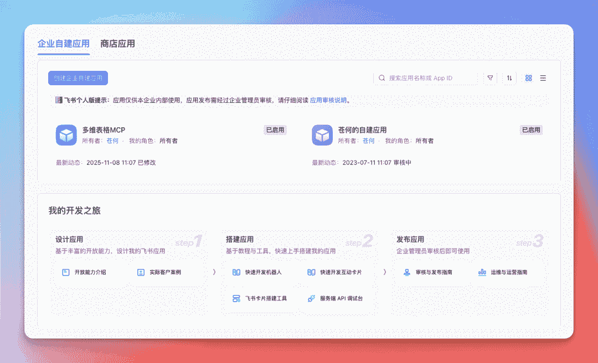

开通相关权限：

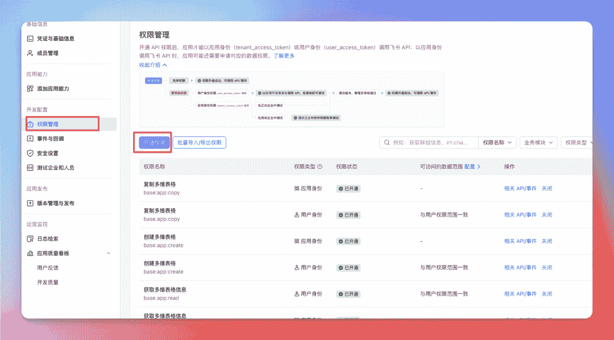

在搜索栏出填入以下权限代码：

```
im:chat:create, im:chat, im:message, wiki:wiki, wiki:wiki:readonly, docx:document, bitable:app, drive:drive, docs:document:import, contact:user.id:readonly
```

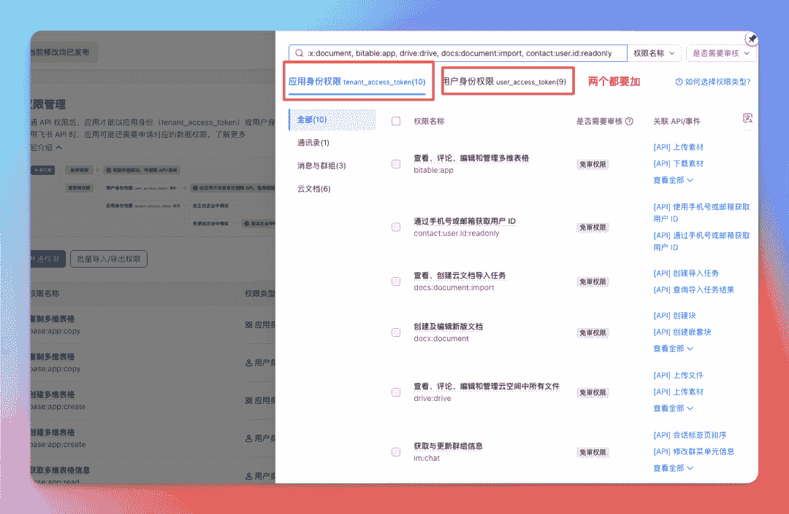

> 应用身份权限和用户身份权限都要加，不然会有奇怪的问题导致失败。

最后加上多维表格全部权限，就 okk 啦。

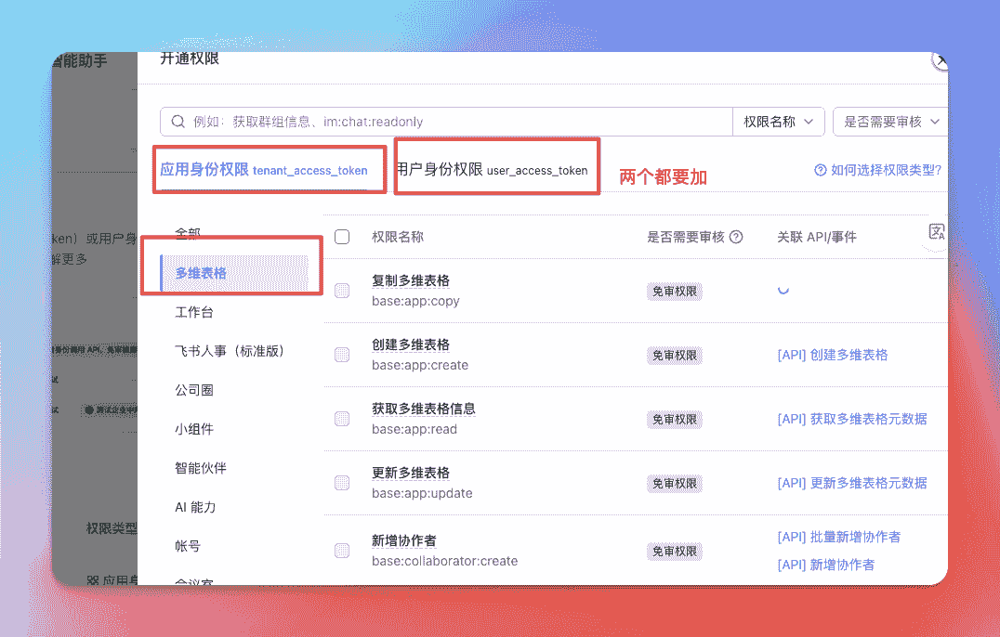

安全设置这里把这个本地重定向 URL 加上：

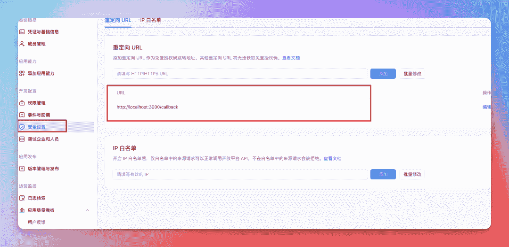

接下来安装飞书 mcp server，终端中输入以下命令：

```
npx -y @larksuiteoapi/lark-mcp login -a &lt;your_app_id&gt; -s &lt;your_app_secret&gt;
```

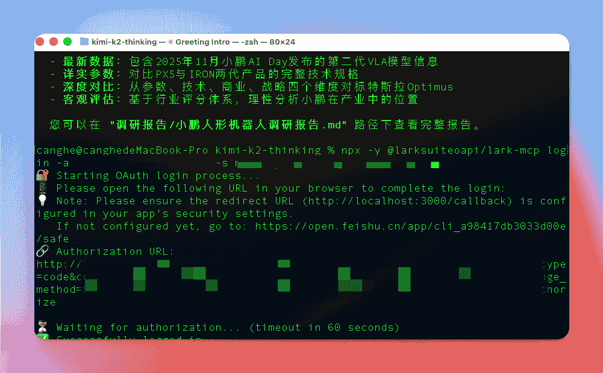

唤起授权页面，授权 OK 即可。

这样就可以在 claude code 中通过 kimi k2 thinking 调用飞书 mcp，做很多同步操作了。

# 写在最后

讲真的，折腾完这套工作流，我最大的感受不是省了多少钱，也不是有多牛逼，而是—— 我终于可以从那些重复的破事儿里解放出来了 。

选题、调研、数据分析、配图……这些以前要花一整天功夫的活儿，现在一键就能搞定。省下来的时间干啥？我可以慢悠悠地打磨观点，可以静下心来思考怎么把文章写得更好，甚至可以发条呆、喝杯咖啡、看看窗外的云。

这让我想起王小波那句话： 「人的一切痛苦，本质上都是对自己无能的愤怒」 。以前的我，就是被这些繁琐的工具操作磨得没脾气。现在好了，AI 把脏活累活都干了，我终于能回到创作的「主业」上。

kimi 的表现也很好，在复杂任务上表现的非常稳，看来以后，可以更多的折腾了。

不过目前 kimi k2 thinking 在上下文上依旧还有进步的空间，有时候会无法精确定位我想要的句子。

对了， 你觉得这套工作流里哪个环节对你最有用？ 留言区聊聊，也欢迎分享你的 Obsidian 自动化经验。

如果觉得有帮助， **点个赞、转给需要的朋友 **，让更多人 get 到这个效率神器。

下期见。