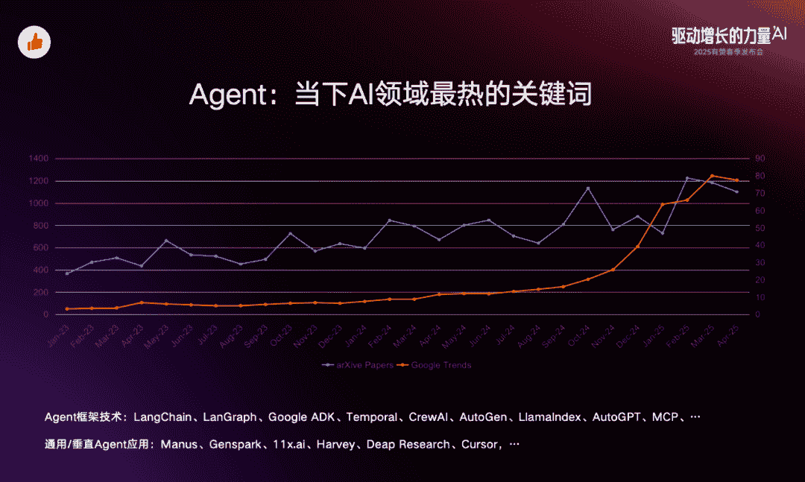
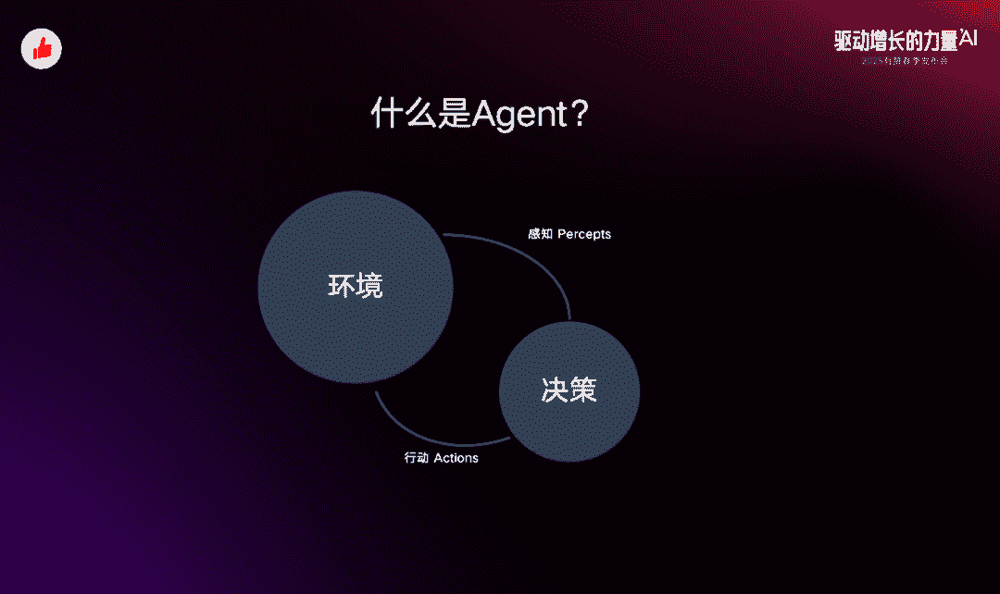
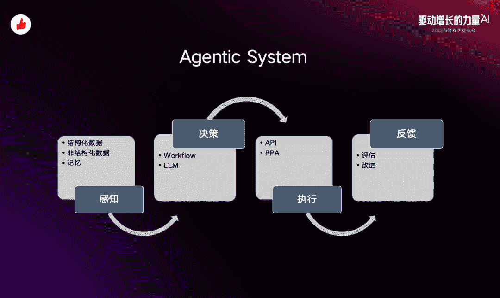
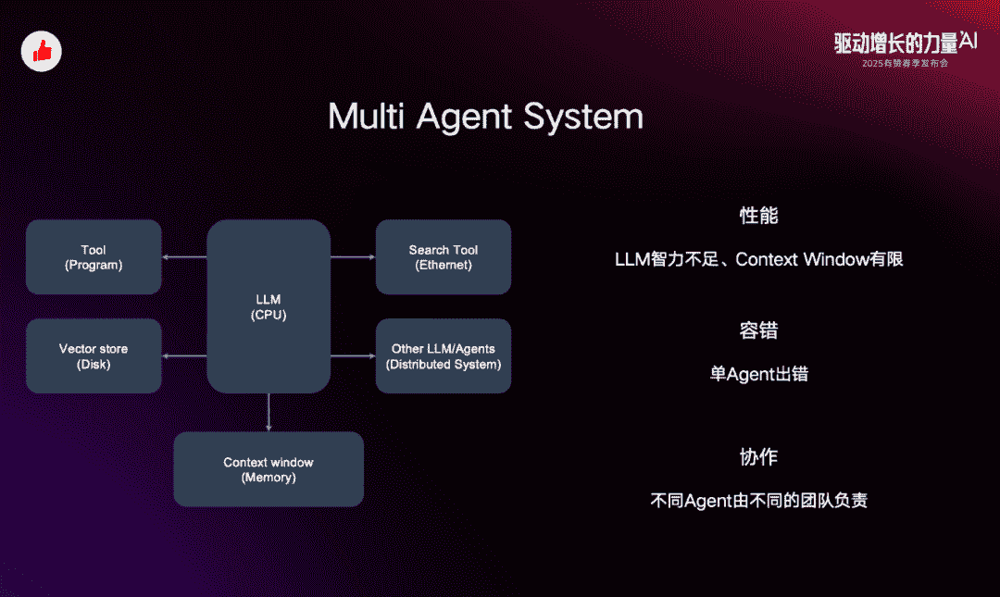
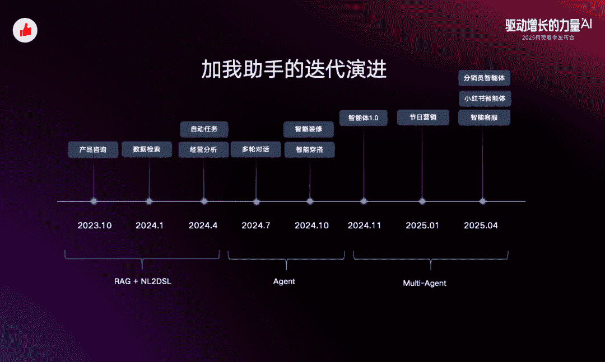
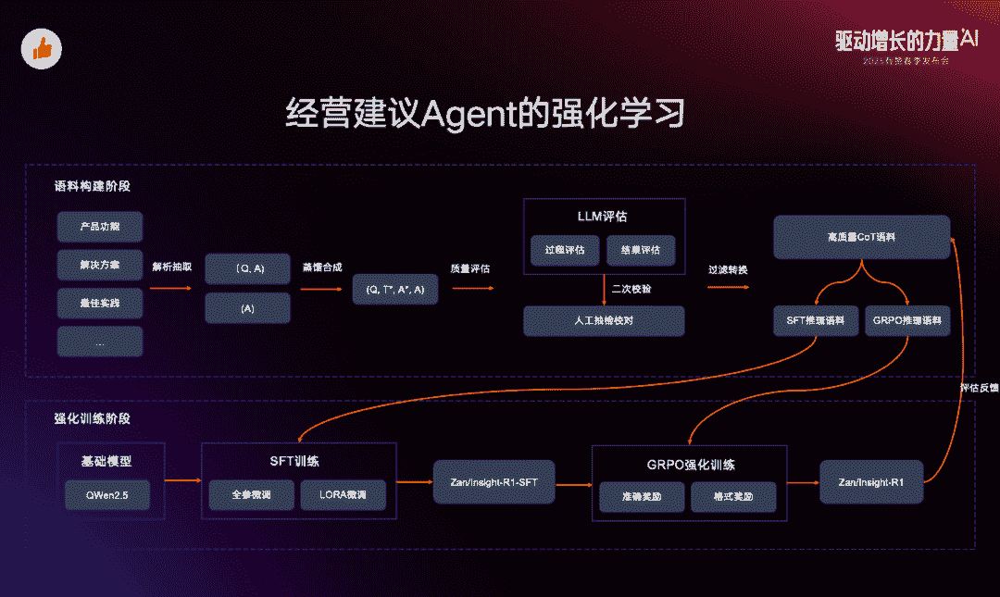
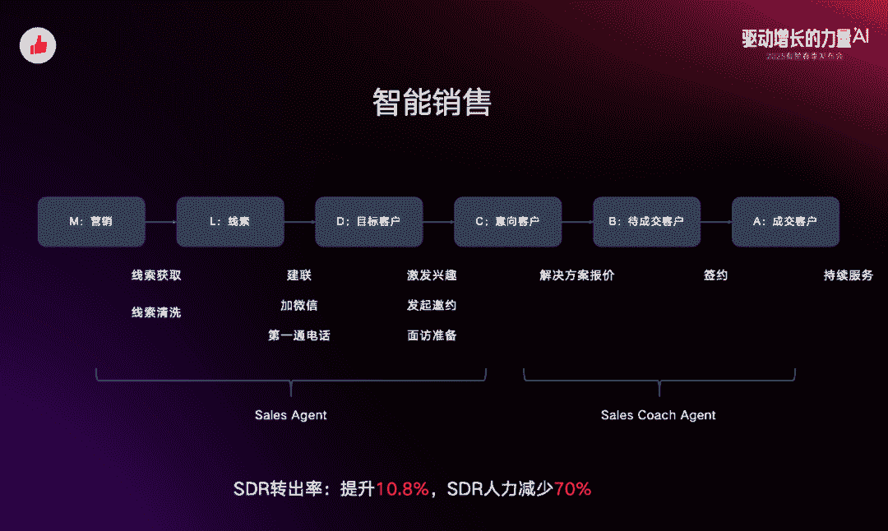
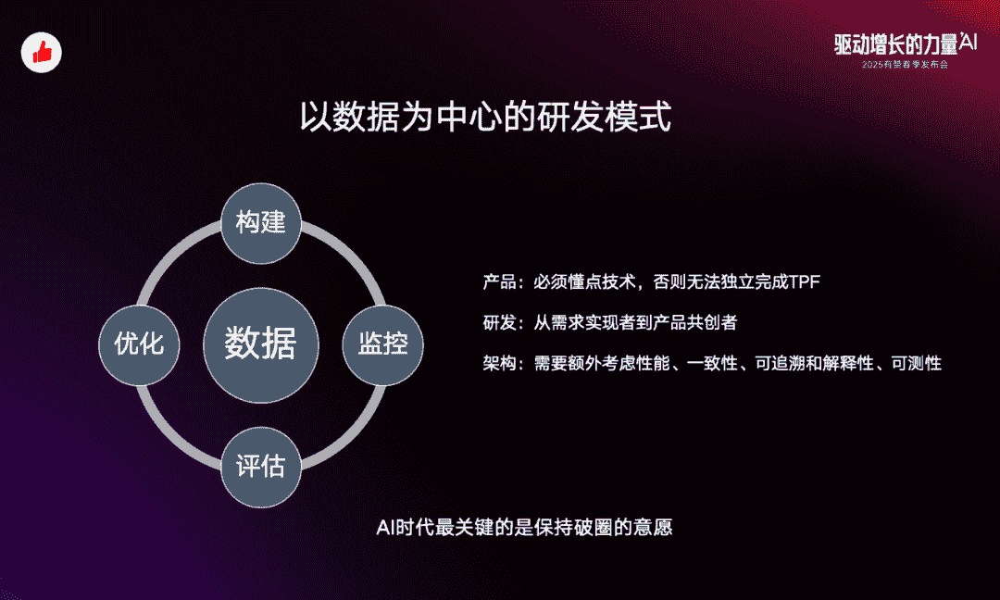

# 从概念到落地：有赞 Agent 应用与探索

> 来源：[https://yunyinghui.feishu.cn/docx/ZJS8dXnkGo3WfSx43lncciZDnUc](https://yunyinghui.feishu.cn/docx/ZJS8dXnkGo3WfSx43lncciZDnUc)

> **本文作者：**有赞，**来源👸号： ** 有赞 Coder

> **推荐理由：**这篇文章分享了有赞在 Agent 技术领域的探索与实践，文章强调 Agent 技术需结合业务场景落地，通过持续实践和数据驱动优化，推动 AI 在商业领域的价值实现。

本文内容来自 2025.5.22 有赞 Menlo 发布会 CIO & 大模型研讨会专场分享，分享人余晖。全文约 4600 字，预计阅读时间 10 分钟。

+   1 引言

+   2 Agent 相关概念

+   2.1 什么是 Agent

+   2.2 Agentic System 的组成部分

+   2.3 Multi-Agent 系统的设计原则

+   3 有赞的 Agent 实践案例

+   3.1 智能助手（加我助手）

+   3.2 智能销售

+   4 AI 时代的挑战和实践

+   4.1 产品研发面临的四个「不知道」

+   4.2 软件范式的根本性变化

+   4.3 以数据为中心的研发模式

+   5 结语：Agent 技术的未来展望

文末有个招聘彩蛋，记得看到最后哦！

## ** ****1 引言**

Agent 技术正在成为 AI 领域的热门关键词。2023 年至今，arXiv 上含「agent」关键词的论文数量持续攀升，2025 年截止到 4 月每月近千篇；工业界则先后涌现出 LangChain、CrewAI、LlamaIndex 等数十种框架，并催生了编程、金融、法律等各种通用和垂直的 Agent 产品。

图 1：Agent 技术生态繁荣，各类框架层出不穷

作为技术人，我们不仅关注概念本身，更关注如何将其落地为实际业务价值。本文将分享有赞在 Agent 领域的实践经验，从技术原理到业务应用，展示我们如何在零售 SaaS 场景中探索 Agent 技术的实际价值。

## ** ****2 Agent 相关概念**

### ** ****2.1 什么是 Agent **

当我们谈论 Agent 时，究竟在谈论什么？有趣的是，即使在 Agent 大爆发的今天，关于其定义仍然没有明确共识。在研究过程中，我们接触过至少 30 种不同定义，比如：

> 前 OpenAI 安全主管 Lilian Weng：

> Agent = LLM + planning + memory + tools

> LangChain：使用 LLM 决定控制流的系统

>

> OpenAI：能够独立为用户完成任务的系统

每家公司都声称自己在做 Agent，但每家做的 Agent 又各不相同。最近 OpenAI 在《A practical guide to building AI agents》中隐晦指出， LangChain 的 LangGraph 框架是一种对于 Agent 的过度抽象，LangChain CEO 公开回应这个指责，还引发了很多开发者在 Twitter 上关于 Agent 的讨论。

与其争论什么是「真正的」Agent，不如承认系统有不同的智能程度（agentic system），就像自动驾驶汽车有不同的自主程度一样。

图 2：Agent 与环境的交互模型

尽管定义各异，基本共识是： Agent 是一种有目标、基于环境的决策系统 。与 LLM 最大的区别在于，Agent 可以与现实世界交互，从感知环境开始，做出决策并执行，影响环境，然后基于反馈调整，不断迭代循环。

### ** **2.2 Agentic System 的组成部分

一个完整的 Agentic System 包含四个核心部分：

1.  **感知 **：为模型构造上下文。最常见的是 RAG（检索增强生成），也可以查询结构化信息（数据库、网页）或检索历史记录（记忆）。

1.  **决策 **：本质是规划。可以通过规则构建（workflow），也可以通过 LLM 驱动（自主 agent），或借助外部规划器。设计时需权衡泛化性和正确性——LLM 驱动泛化程度高但不确定性大，workflow 泛化程度低但更可控。

1.  **执行 **：调用工具改变环境。包括 API 调用（Rest、RPC、SQL、函数调用）或 RPA 整合图形软件（如 Anthropic 的 Computer use）。

1.  **反馈 **：评估和迭代机制。可通过人类标注、规则或模型生成，更新可以是离线或在线的。

图 3：Agentic System 的四个核心组成部分

这个闭环构成了 agent 的基础单元（building block）。复杂 Agent 由小 Agent 构成，符合业务逻辑——大决策由一系列小决策构成。

### ** **2.3 Multi-Agent 系统的设计原则

Agent 互相调用和协作构成 Multi-agent 系统，但设计时需谨防过度拆分。一个 Agent 应代表一个业务决策点，可通过持续反馈优化。

什么时候需要 Multi-agent？可从分布式系统借鉴思路。把 Agent 比作计算机：LLM 是 CPU、Context window 是内存、向量数据库是硬盘、tool 是程序。分布式系统解决三个问题：

性能不足：单机计算/存储不够（如 Hadoop、Flink）

容错：单系统易出问题，需多系统协同

协作：不同团队负责不同微服务

图 4：Multi-agent 系统设计原则

Multi-agent 系统也是如此，主要解决单次 LLM 调用智力不足的问题，其次是容错和协作。系统架构应从单 Agent 开始，在必要时才过渡到多 Agent。

## ** **3 有赞的 Agent 实践案例

下面介绍一些有赞的 Agent 实践案例，简单分享下加我助手和智能销售两个项目：

### ** ****3.1 智能助手（加我助手） **

加我助手的演进遵循了从单 Agent 到 Multi-agent 的路径：

1.  初始阶段：仅有产品问答模块，使用简单 RAG

1.  技能扩展：添加多种技能，但用户需手动切换

1.  意图识别：开发意图识别 Agent，仍为单 Agent 架构

1.  多 Agent 体系：场景复杂化 + 多团队协作需求

图 5：加我助手的迭代演进

除架构演进外，我们还进行了技术优化：

**RAG 优化 **：增加查询改写功能，提高系统鲁棒性。用户不一定会提出完美问题，通过查询扩展和改写，系统能更好处理各种输入变化。

**知识图谱 **：引入 GraphRAG 技术，将产品知识问答准确度从 76%提升到 93%。对算法实力一般但工程能力强的团队，知识图谱是模型后训练的实用替代方案。

**强化学习 **：经营分析场景中，将评价体系（如 AARRR 模型）转化为强化学习的奖励函数，实现模型持续优化。

图 6：经营建议场景下的强化学习

当然我们也在经营分析场景上基于 SFT 和强化学习进行微调，这个时候我们之前基于经营分析 Agent 构建的数据集和评价体系，天然就过渡到了 RL 领域的环境和奖励函数的构建。之前我们在评价一个经营建议好坏的一个重要指标是思考过程是不是符合 AARRR，那么现在做 RL 的时候的奖励函数之一就是其思考过程是否符合 AARRR。

### ** ****3.2 智能销售 **

我们在过去的一年时间里一直试图想要通过 AI 技术来改善我们自己的销售过程，提升销售业绩。

在有赞这类 B2B 的销售场景里，销售链路比较长。整个过程有线索挖掘、意向判断、挖掘需求、邀约演示、报价成交等多个阶段。整个过程我们通过自动拉群和通过 AI 的意向判断和需求挖掘，整体的线索转出率比人工高了 10 个百分点，并且让原先的 SDR 线上团队的人数从 10 个人减少到 2 个人，并且这两个人只需要负责检查质量和做应急处理即可。

图 7：智能销售项目

当前我们的智能销售还在沿着 Sales Agent 方向深耕，开始打造 AI Native（原生的）销售平台。所谓 AI 原生应该不满足于做一个 Copilot，我们认为应该是能够完成销售目标的 Agent，是每个销售人员的数字分身。

## ** ****4 AI 时代的挑战和实践**

### ** **4.1 产品研发面临的四个「不知道」

AI 时代给了我们很多机遇，但是也给我们产品研发工作带来前所未有的挑战。我们在组建 AI 团队的时候，成员都是从传统产品研发转岗的，大家发现在做 AI 项目，尤其是 AI 原生应用的时候，传统的基于流程式的软件工程方法论开始逐渐有点失效了。

我们碰到了很多问题，总结成了四个不知道：

1.  不知道能不能做：模型能力边界不明，需求可行性难判断，技术进展速度快

1.  不知道做成什么样：GUI 界面还是对话框？功能如何组织？

1.  不知道怎么协作：角色定义、职责分配、测试方法都需重新思考

1.  不知道好不好用：用户接受度和体验效果难以预测 这些问题源于底层软件范式的变化。

### ** ****4.2 软件范式的根本性变化 **

传统软件基于确定性逻辑：相同输入产生相同输出。AI 系统则是概率性的，行为难以完全预测。这要求产研团队重新思考基本假设：

+   从「完美无缺」到「足够好」：接受概率性结果，设计容错机制

+   从「代码为王」到「数据为王」：核心竞争力从代码转向数据和模型

+   从「静态需求」到「动态迭代」：基于数据反馈持续优化

### ** **4.3 以数据为中心的研发模式

AI** 产品的核**心竞争力从代码转向了数据。产品研发不再仅仅是编写代码，而是围绕数据收集、标注、训练、评估和部署展开。这要求产研团队建立全新的工作流程和评估标准，同时需要产品和研发人员都具备 数据思维 。

在这种开发模式下，数据质量和数据策略成为产品成功的关键因素。团队需要思考如何获取高质量数据，如何设计从用户交互的过程中收集数据以实现数据飞轮。基于数据的 Agent 反馈迭代速度，就直接决定产品的核心竞争力。

在这种情况下对于团队的每个人都是一种挑战，面对这种挑战，最关键**的其实**是需要团队中的每一个人都需要保持 破圈 的意愿。传统的软件开发中，长期的专业分工而形成的身份认同感让人倾向于固守自己的专业领域，不断强化自己的专业壁垒。

**但是 AI** 在不断降低专业门槛的同时更强调 全栈思维 ，单一技术背景已经难以应对复杂挑战。传统的"产品定需求、研发做实现"的简单分工已不适应 AI 时代，需要每个角色主动跨越传统边界，形成互补协作。将工程思维、设计思维、商业思维和科学思维有机结合，形成解决 AI 复杂问题的综合能力。

+   产品经理：必须懂技术，能独立完成 TPF 验证

+   研发人员：从需求实现者到产品共创者

+   架构师：需考虑性能、一致性、可解释性、可测试性等新维度

图八：以数据为中心的研发模式

## 5 结语：Agent 技术的未来展望

通过有赞的实践，我们看到 Agent 技术在商业场景中的巨大潜力。Agent 正在重塑客户互动和价值创造方式，为零售业务带来新的可能性。

对想探索 Agent 的团队，我们建议：从小处着手，从单 Agent 开始，关注数据质量和反馈机制，保持「破圈」意愿。在技术快速迭代的今天，唯有持续学习和实践，才能把握变革机遇。

有赞将继续在 Agent 领域深耕，为零售业务带来更多智能化解决方案。我们期待与更多伙伴交流，共同推动 AI 技术在商业领域落地与发展。同时我们也开放下述岗位需求，欢迎投递。

#### ** ****Agent 全栈工程师 **

有赞正在打造若干 Agent 产品，让它成为帮助客户更高效经营的 AI Agent。为此，我们希望寻找若干热衷探索 AI 应用的全栈工程师。

我们相信在 AI 时代，产品、算法、工程的伙伴应该像创业小组一样聚集在一起，不设边界，做大量朴素的探索，这意味着：

+   强悍的学习能力，通过精读论文和不断尝试新技术、新框架，拓展技术视野；

+   思维开放、热爱动手尝试，能够自主实现端到端的项目 Demo 落地；

+   积极乐观，在探索过程中不怕受挫，持续升级对 AI 技术能力和边界的认知，能预判技术对业务的潜在影响；

**岗位职责**

+   全栈开发与 AI 集成

+   负责 AI 驱动的全栈系统设计与开发，涵盖前端交互界面（React/Vue）、后端服务架构（Python/Java）、数据库及 AI 模型部署全链路

+   将大语言模型应用集成至实际业务场景，优化模型推理效率及服务稳定性

+   技术架构设计与创新

+   设计高可用、可扩展的 Agent 工程架构

+   研究 LLM、Agent、RL 等前沿技术并推动落地应用

**任职要求**

+   计算机/数学/电子工程等相关专业本科及以上学历

+   熟练掌握至少一种主流编程语言（Java、JavaScript、Python 等）

+   具备扎实的计算机基础知识，包括数据结构、算法、操作系统、网络等

+   对 AI 技术有浓厚兴趣，有实际项目经验或参与过 AI 相关实践活动

+   了解基本的软件工程实践，如版本控制、测试、CI/CD 等

+   具备良好的学习能力、沟通能力和团队协作精神

**加分项**

+   熟悉机器学习基础理论和常用算法，了解深度学习框架（如 TensorFlow、PyTorch 等）

+   具备产品思维，能理解业务需求并转化为技术方案

**成长建议**

+   持续关注 AI 领域的最新技术发展，积极参与技术社区和学习交流

+   在实践中不断提升编程能力和系统设计能力，尝试解决复杂的工程问题

+   培养产品思维，思考如何将 AI 技术转化为有价值的产品功能

+   参与开源项目或自主开发 AI 应用，积累实战经验

+   学习跨学科知识，如产品设计、用户体验、业务领域知识等，提升综合解决问题的能力

+   保持技术好奇心，不断尝试新技术、新框架，拓展技术视野