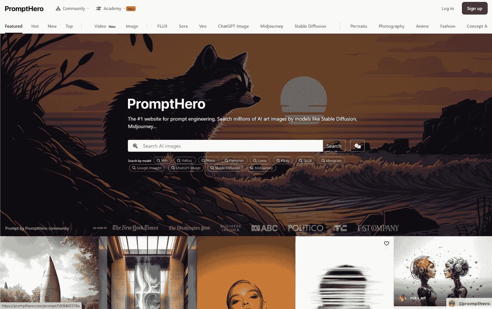
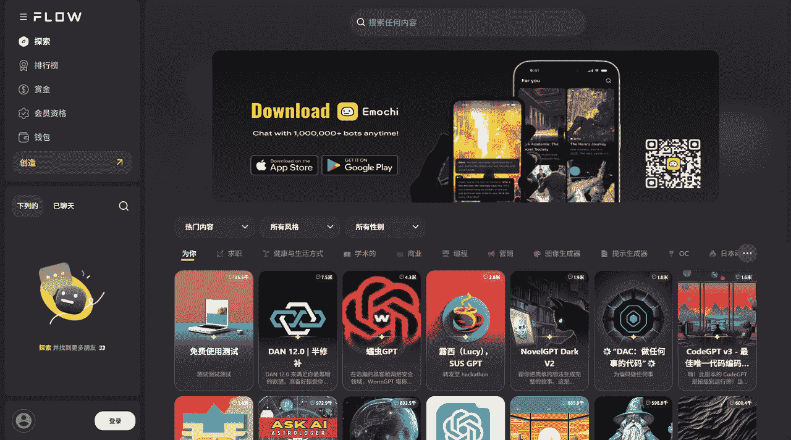
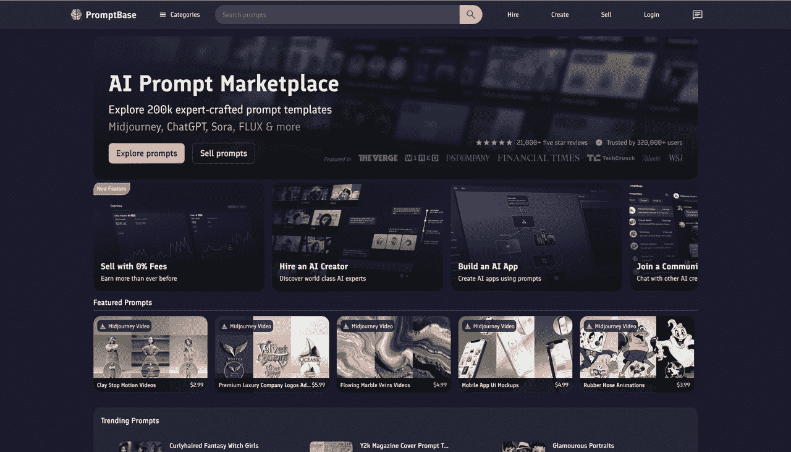
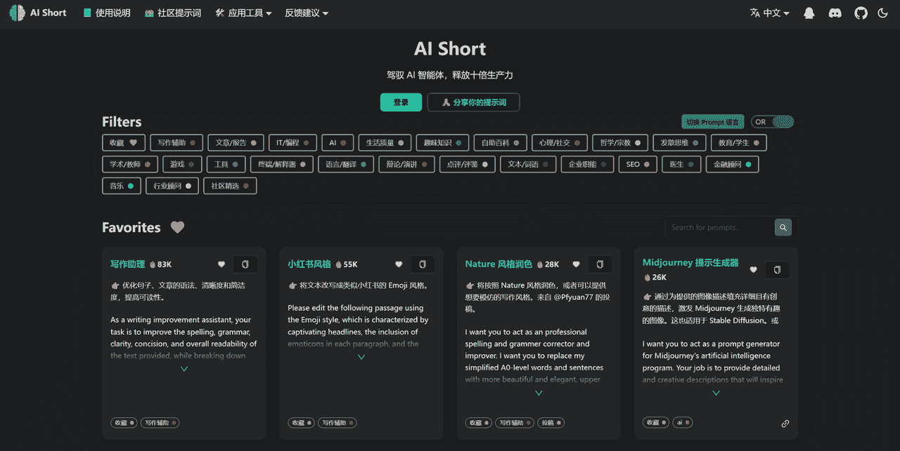
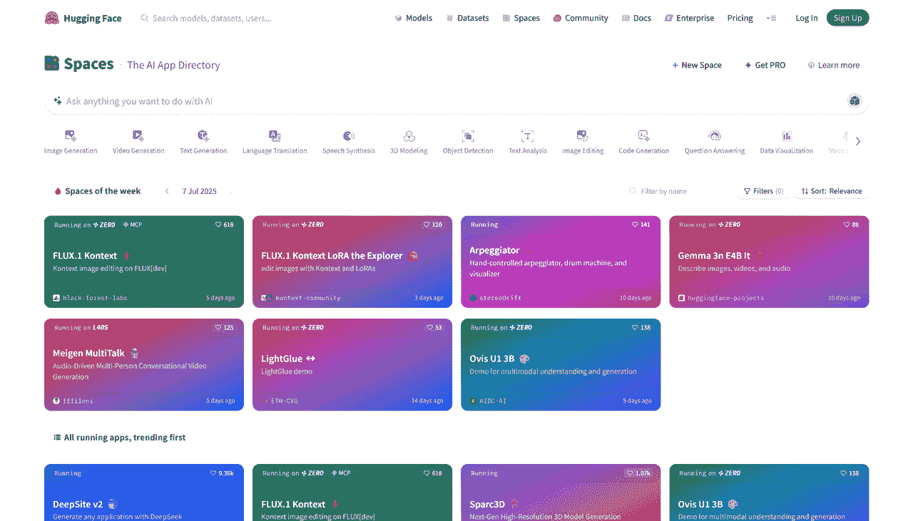
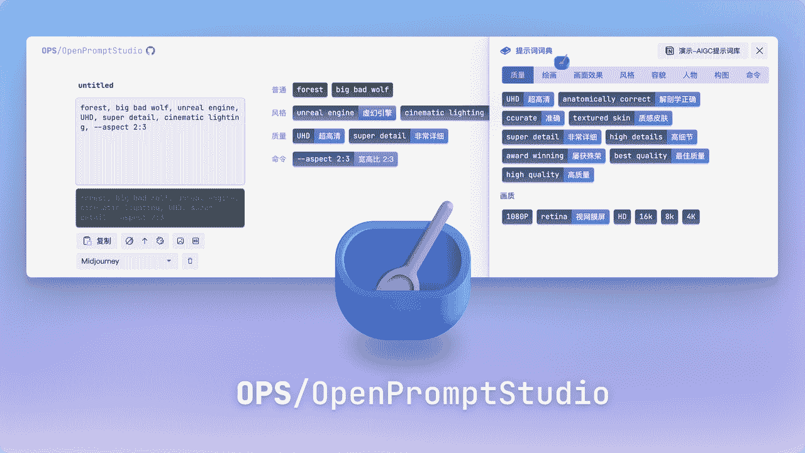
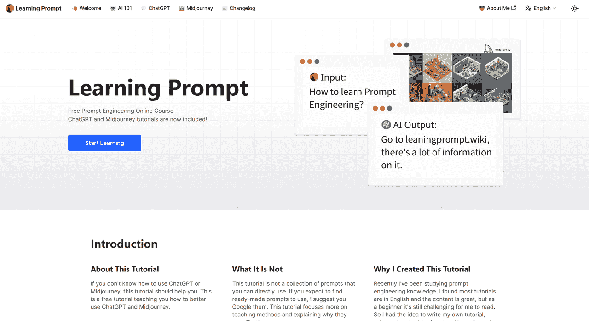
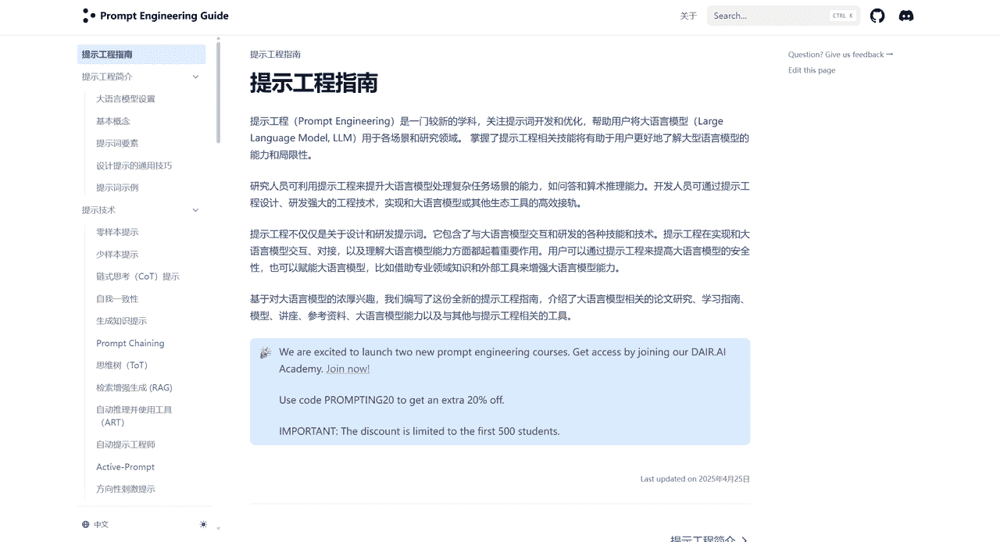
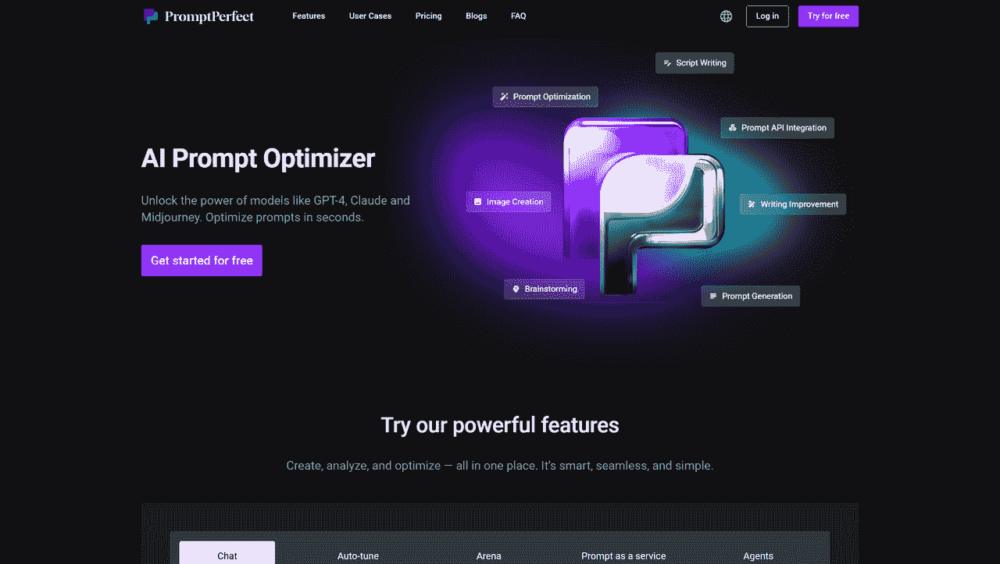
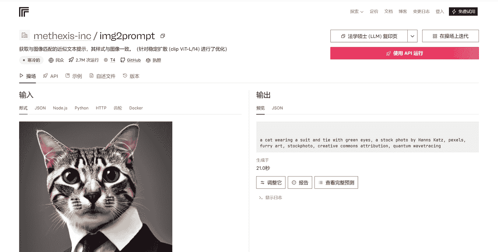

# 全网精选优质 Prompt 网站

> 来源：[https://yunyinghui.feishu.cn/docx/WvwZdsYcToWtWaxOzJJcrow1n1d](https://yunyinghui.feishu.cn/docx/WvwZdsYcToWtWaxOzJJcrow1n1d)

> **适用人群：****学习 AI 提示词人群**

> 首发时间：2025 年 7 月 7 日

> **更新****时间**：2025 年 7 月 10 日

> **内容出品人：**** **

> **内容出品方：**[Mix AI Lab](https://yunyinghui.feishu.cn/wiki/WhelwZnxQi55mpkOzatc3Xran5b?from=from_copylink)

> **使用建议：**如果需要快速定位到精确内容，可以使用快捷键 Ctrl +F/Command +F 的形式，搜索关键字/词，查找你想要的内容。

> **持续更新**** ****AI 相关****提示词学习相关内容，****永久免费在线****查看，欢迎收藏转发支**持，文末有惊喜，大国出品，必属精品。

> 🎯全**网最接地气 AI 知识库：「**[**AI 实验室」知识库（**](https://yunyinghui.feishu.cn/wiki/space/7340161844864598017?ccm_open_type=lark_wiki_spaceLink&open_tab_from=wiki_home)AI 绘画、AI 写作、AI 视频等应用技能）

# 全网精选优质 Prompt 网站大全

> 站在巨人肩膀上学提问，精选资源库让 AI 输出质量提升 300%

本文将全网优质 Prompt 资源分为五大核心类别，每类精选最具价值的平台，并附上核心功能、适用场景及直达链接，助您精准匹配需求：

## 一、 综合 Prompt 平台（文本+图像+多模型支持）

这类平台覆盖场景广泛，支持多种 AI 模型，是资源搜索的首选入口。

1.  **PromptHero**

+   **🌟核心功能： **全球最大的 Prompt 搜索引擎之一，支持按模型（Stable Diffusion， Midjourney， DALL-E， ChatGPT 等）和内容类型（图像、文本、音乐）搜索海量提示词；提供作品展示、收藏、评价、分享社区；内置“学院”（Academy）提供在线课程。

+   **🎯适用场景： **寻找特定风格/主题的图像灵感、获取文本生成模板、系统学习 Prompt 工程。

+   **🔗链接： **https://prompthero.com

1.  **FlowGPT**

+   **🌟核心功能： **强大的社区驱动型 Prompt 分享平台，尤其擅长 ChatGPT 提示词。按场景（编程、营销、学术、生活、游戏等）分类清晰，提供案例演示和用户互动（点赞/评论）。资源极其丰富，涵盖日常到专业领域。

+   **🎯适用场景： **寻找解决具体问题（写代码、做计划、起标题等）的 ChatGPT 指令；探索不同应用场景的 Prompt 思路。

+   **🔗链接： **https://flowgpt.com

1.  **PromptBase**

+   **🌟核心功能： **专业的 Prompt 交易市场。用户可购买高质量的付费 Prompt（涵盖写作、绘画、提示工程等），也可出售自己创作的 Prompt。质量相对较高，经过筛选。

+   **🎯适用场景： **寻求可直接商用或解决复杂问题的高质量、成熟 Prompt 模板；出售自己的 Prompt 技能获利。

+   **🔗链接： **https://promptbase.com

## 二、 文本生成专用 Prompt 资源（聚焦 ChatGPT 等 LLM）

专精于提升与大语言模型对话效果的 Prompt 资源库。

1.  AI Short (Aishort.top)

+   **🌟核心功能： **中文友好！提供简洁易用的**ChatGPT 快捷指令表**。分类优秀（写作辅助、办公效率、编程、学术等），支持标签筛选、关键词搜索和一键复制。极大提升日常生产力。

+   **🎯适用场景： **快速获取开箱即用的 ChatGPT 操作指令，解决工作学习中的具体任务（写邮件、润色文案、生成报告、解释概念等）。

+   **🔗链接： **https://www.aishort.top

1.  **Snack Prompt**

+   **🌟核心功能： **提供大量现成的 ChatGPT Prompt 模板，界面友好，支持在线编辑细节（目标、语言、语气、风格）。提供免费的 Chrome/Edge 插件，方便一键使用。

+   **🎯适用场景： **寻找结构化的、可定制的 ChatGPT 任务模板（如制定健身计划、创作营销文案、模拟面试）；追求便捷的浏览器集成体验。

+   **🔗链接： **https://snackprompt.com

1.  **Hugging Face Hub - Chat**GPT Prompt Generator

+   **🌟核心功能： **在机器学习巨擘 Hugging Face 的平台上，提供生成角色设定 Prompt 的工具。输入你想要的 GPT 角色，即可生成一段专属提示词。

+   **🎯适用场景： **为 ChatGPT 创建特定角色（如专业顾问、特定风格的作家、模拟对话对象）。

+   **🔗链接： **https://huggingface.co/spaces

## 三、 AI 绘画专用 Prompt 资源（Midjourney， SD， DALL-E）

专注于提升 AI 绘画效果，提供灵感和关键词工具。

1.  **Lexica (The Stable Diffusion **prompt encyclopedia)

+   **🌟核心功能： **Stable Diffusion 的权威 Prompt 图库。采用**图文结合**方式展示海量生成图片及其对应的完整 Prompt。搜索功能强大，可通过关键词或上传图片反推 Prompt。

+   **🎯适用场景： **寻找 Stable Diffusion 的优质 Prompt 灵感；通过图片反查其生成提示词；理解 Prompt 如何影响图像效果。

+   **🔗链接： **https://lexica.art

1.  OpenPromptStudio (OPS)

+   **🌟核心功能： **强大的可视化 Prompt 编辑工具（支持 Midjourney 等）。核心功能：中英翻译、中文转英文 Prompt、按类别（通用/样式/质量/命令）管理提示词、可视化编辑、导出图片、内置词典、概念管理。极大提升编写复杂 Prompt 的效率。

+   **🎯适用场景： **高效编写、管理、优化复杂的 Midjourney 等绘画 Prompt；解决中英文 Prompt 转换问题；结构化学习 Prompt 组件。

+   **🔗链接： **h[ttps://github.com/Moon](https://github.com/Moonvy/OpenPromptStudio)vy/OpenPromptStudio （开源项目，需下载使用）

1.  **IMI Prompt**

+   **🌟核心功能： **极简易用的 Midjourney Prompt 生成器。用户只需输入核心创意概念，选择喜欢的艺术风格（内置大量风格选项，持续更新），即可自动生成完整 Prompt，降低艺术术语使用门槛。

+   **🎯适用场景： **快速生成风格化 Midjourney Prompt，尤其适合不熟悉复杂艺术术语的用户探索不同风格。

+   **🔗链接： **https://www.imiprompt.com

## 四、 学习与社区型资源

系统学习 Prompt 工程方法与最佳实践的殿堂。

1.  **Learning Prompt**

+   **🌟核心功能： ****免费的、系统化的**Prompt 工程教程 Wiki。全面覆盖 ChatGPT 和 Midjourney 的使用教学，从基础概念、核心技巧到高级应用。内容详实，注重方法论和原理解析，是打牢基础的首选。

+   **🎯适用场景： **从零开始系统学习 Prompt 编写技巧；深入理解不同 AI 模型（ChatGPT/MJ）的提示原理；获取免费高质量教程。

+   **🔗链接： **https://learningprompt.wiki

1.  Prompt Engineering Guide

+   **🌟核心功能： **内容更偏向学术和工程实践的 Prompt 指南。涵盖基础概念、技术（零样本/少样本、思维链 CoT、自洽性等）、应用、模型、论文及工具资源。适合希望深入理解背后技术的用户。

+   **🎯适用场景： **深入学习 Prompt 工程的技术细节、研究前沿和最佳实践；查找相关学术论文和工具。

+   **🔗链接： **https://www.promptingguide.ai/zh （有中文版）

## 五、 实用工具型

解决特定 Prompt 相关问题的利器。

1.  **PromptPerfect**

+   **🌟核心功能： **提示词优化引擎。输入一个简单的想法或初始 Prompt，它能生成更详细、更有效、针对特定 AI 模型（文本和图像模型）优化的 Prompt。提供优化前后对比。

+   **🎯适用场景： **优化粗糙或效果不佳的初始 Prompt；获取更专业、更可能触发高质量输出的提示词。

+   **🔗链接： **https://promptperfect.jinaai.cn

1.  **img2prompt**

+   **🌟核心功能： **图生文（反推 Prompt）工具。上传一张由 AI 生成的图片，尝试推测出生成该图可能使用的 Prompt。对学习 Prompt 构成和模仿风格很有帮助。

+   **🎯适用场景： **看到喜欢的 AI 生成图时，反推其可能的 Prompt 进行学习模仿。

+   **🔗链接： **可在 h[ttps://replicate.com/meth](https://replicate.com/methexis-inc/img2prompt)exis-inc/img2prompt 等平台找到相关模型。

#  主流 Prompt 平台核心能力对比表

| 平台名称 | 主要支持模型类型 | 核心优势 | 语言支持 | 资源类型 |
| --- | --- | --- | --- | --- |
| **PromptHero** | SD、MJ、DALL-E、ChatGPT 等 | 全球最大搜索引擎，多模型支持 | 多语言 | 搜索/社区/课程 |
| **FlowGPT** | ChatGPT 为主 | 场景分类清晰，社区活跃 | 英文为主 | 模板/案例/社区 |
| **PromptBase** | 多类型 | 商业级高质量 Prompt 交易 | 英文 | 付费模板市场 |
| **AI Short** | ChatGPT | 中文快捷指令，生产力提升 | 中文友好 | 分类指令库 |
| **Lexica** | Stable Diffusion | 图文结合，效果直观 | 英文 | 图片/Prompt 库 |
| **PromptHeroes** | MJ、SD、DALL-E | 中文社区与资源整合 | 中文 | 搜索/社区/课程 |
| OpenPromptStudio | Midjourney 等 | 可视化编辑，中英互译 | 中英支持 | 编辑工具 |
| **Learning Prompt** | ChatGPT、Midjourney | 免费系统化教程 | 中文 | 教育 Wiki |

---

#  高效使用 Prompt 资源库准则

1.  **明确核心需求：** 先想清楚你要 AI 做什么（写文案？画图？写代码？），再根据任务类型选择对应资源库。

1.  **模仿 → 理解 → 创新：** 初学者直接复制优质 Prompt 使用 → 分析其结构、关键词 → 逐步修改尝试 → 最终形成自己风格。

1.  **善用搜索与筛选：** 大型平台多用关键词、模型、类别筛选，精准定位所需 Prompt 模板。

1.  **关注社区动态：** 优质 Prompt 常源于社区分享，关注活跃平台更新和热门作品，获取前沿技巧。

1.  **工具辅助提效：** 利用 OPS、PromptPerfect 等工具解决翻译、优化、结构化难题。

1.  **注意版权声明：** 特别是付费 Prompt 和生成内容，商用前留意平台及模型的版权政策。

---

# AI 学习交流社群

1.持续关注并更新 AI 的相关资讯动态，研究报告，落地场景，赚钱案例，常见问题，免费在线查看，目标是成为最大的开源 AI 应用及技能提升学习社群，做有高质量的开源知识库。

2.已建立社群聊 **AI** 发展及应用，**没进群的可以扫码加入，🛰️群可加 AI 研究爱好者大国🛰️ ID：zyg90s**（备注：AI）申请加入，已经在社群内的无需重复加入，有AI方向的合作也欢迎交流。

3.**关于文档负责人大国**：高帆文化CEO，曾就职于教培大厂，目前创业，主攻研究AI落地应用、企业流量增长及达人IP孵化。

**5000人飞书学习交流群**

**飞书交流群**

**🛰️好友**

（ID：zhangyuguo94s）

**扫码加🛰️入🛰️群**

进群或者加好友了解更多 AIGC 实战案例

**觉得有用欢迎留个赞**