# 从认知到实战：写好 AI 提示词的技巧和工具分享

> 来源：[https://yunyinghui.feishu.cn/docx/YTv1dn9JDoHGrhxHEczcd9EDnBM](https://yunyinghui.feishu.cn/docx/YTv1dn9JDoHGrhxHEczcd9EDnBM)

> **适用人群：****学习 AI 提示词人群**

> 首发时间：2025 年 8 月 13 日

> 更新时间：2025 年 8 月 14 日

> **内容出品人：**** **** **** **

> **内容出品方：**万象 AI 实验室×飞行社

> **使用建议：**如果需要快速定位到精确内容，可以使用快捷键 Ctrl +F/Command +F 的形式，搜索关键字/词，查找你想要的内容。

## **开场介绍**

1.  **自我介绍**

1.  **课程节奏：**认知 → 技巧 → 实战 → 工具 → 互动

1.  **课程收益：**能够快速写出高质量提示词，让 AI 输出更精准

1.  **直播课程回放地址：**从认知到实战：写好 AI 提示词的技巧和工具分享

---

### **自我介绍**

**AI 产品经理｜公众号 &** 即刻 「云舒的 AI 实践笔记」｜Waytoagi 社区创作者｜万象 AI 实验室社区创作者

长期聚焦 **提示词系统设计** 与 **AI 工具实战**，擅长将真实场景需求转化为可落地的提示词或工具解决方案。

+   [**提示词创作**](https://t16jzwqrzjx.feishu.cn/wiki/NABlwmL9si2vhWkqtgJcbTxknbe?from=from_copylink)[：](https://t16jzwqrzjx.feishu.cn/wiki/NABlwmL9si2vhWkqtgJcbTxknbe?from=from_copylink)已产出 20+ 高质量提示词，覆盖可视化、学习助**手、创意设**计等多个应用**场景，累计阅读量 1**0 万+ 📈，获 腾讯最佳提示词应用奖 🏆

+   [**产品开发**](https://t16jzwqrzjx.feishu.cn/wiki/Bc4RwfSYNiz7GkkhcbpckBRqnUc?from=from_copylink)[：](https://t16jzwqrzjx.feishu.cn/wiki/Bc4RwfSYNiz7GkkhcbpckBRqnUc?from=from_copylink)独立开发 AI 插件 **「提示词管理助手」**，目前日活用户 **800+**

+   [**内容输出**](https://t16jzwqrzjx.feishu.cn/wiki/E4Rbw3vpBikNLbknNKOc7GtYnqd?from=from_copylink)[：](https://t16jzwqrzjx.feishu.cn/wiki/E4Rbw3vpBikNLbknNKOc7GtYnqd?from=from_copylink)编写的 AI 编程教程覆盖 **Cursor**、**Claude Code** 等产品，累计阅读用户 **1 万+**

---

### **课程节奏**

**课程节奏** —— 从宏观到细节，从理解到应用，一步步来，不急不躁。

+   **认知篇**：先把全局看清楚，理解提示词的最底层逻辑，脑子中有一张清晰的地图。

+   **技巧篇**：了解写好提示词的 3 个技巧，学习写高质量提示词的流程。

+   **实战篇**：用 aliy 同学来实战开始写提示词，体验一下新方法

+   **工具篇**：学会使用“提示词生成器”智能体写提示词，用“提示词管理助手”来管理提示词

+   **互动 QA**：答疑统一放到课程最后拉，大家中间有什么问题都可以提出来，最后统一解答～

---

### **课程收益**

+   **秒懂提示词的底层逻辑**：不再盲目瞎试，一上手就有清晰方向

+   **掌握高质量提示词写作法**：学会写出稳定、可复用、能跑通的提示词

+   **工具+实战双加持**：用对方法和工具，把提示词效率直接拉满

---

## **认知篇**

1.  **提示词的本质：**告诉模型你需要什么

1.  **案例对比：**通过 2 组真实案例， 理解什么是高质量的提示词

---

### **提示词的本质**

在日常使用 AI 的过程中，去问 AI 一个简单的问题，或者给它输入一串复杂的操作指令，这都是我们在利用提示词去和模型进行对话。

**提示词是人和 AI 沟通**的语言：要告诉模型，你需要什么。


它与人和人沟通的逻辑并无明显区别，在职场中我们想让同事配好做好一个事情，也需要告诉同事项目背景、项目目的、预期收益是什么，才能让同事高效的配合完成。

如果我们只告诉同事来做一个项目吧，剩下的什么都不说，最后可能就会变成一个扔锅大会。

在和 AI 沟通的时候，描述的越清晰，模型产出的结果越好。

写一个提示词，和通过多轮对话引导 AI，它们都是能够让模型达到同样作业的效果。

但我们很多时候更倾向于写一个提示词，这里边有两个关键原因：

+   **稳定复现：**下次再用，直接粘贴提示词就行了，不用重新推一遍逻辑链。

+   **方便分享：**别人可以直接用你的成果，而不必重新摸索过程。

---

### **案例对比**

> 接下来我们用几个案例对比，让大家直观感受：同样的需求，不同的提问方式，模型的回应差别有多大。

#### 案例 1

> 让模型来写一份新能源分析报告

+   **模型产出结果：**https://aily.feishu.cn/ai/agents/chat/shared/c4899465-e8fc-43bd-973c-f778cb05afdd

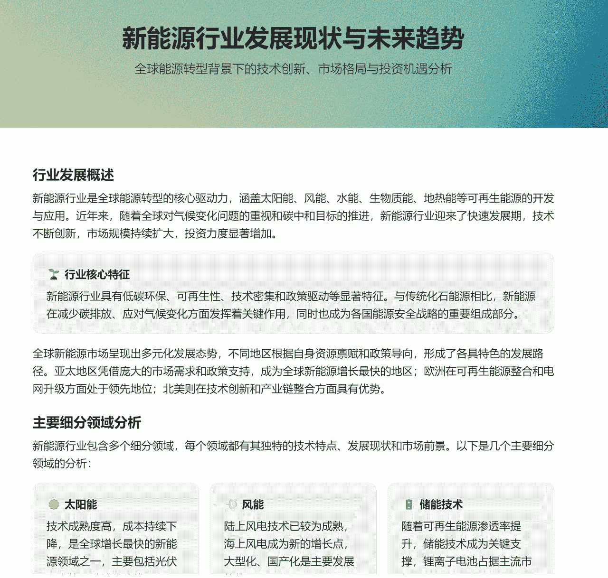

+   **提示词内容：**

```
写一篇新能源行业报告
```

+   **模型产出结果：**

https://aily.feishu.cn/ai/agents/chat/shared/ae72465e-30c0-42cb-a366-f2c8727f5e1d

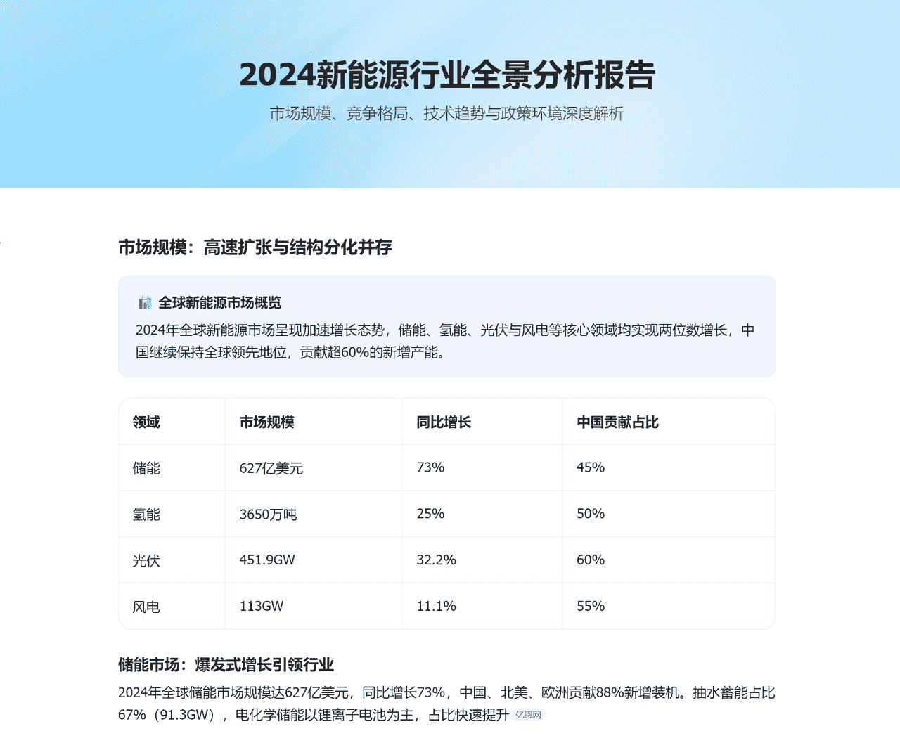

+   **提示词内容：**

```
你是一位新能源行业分析师，请基于 2024 年公开数据，
从“市场规模、竞争格局、技术趋势、政策环境”四个维度，
撰写 2000 字报告。
要求：每个维度先给结论，再给数据案例支撑；
所有数据需标注来源；
语气简洁、专业，方便商业决策者阅读。
帮我写一份报告出来。

```

#### 案例 2

> 让模型把复杂的知识简单有趣的讲出来

+   **模型产出结果：**https://aily.feishu.cn/ai/agents/chat/shared/4b03c360-43bb-43d9-85d2-51535507f5e8

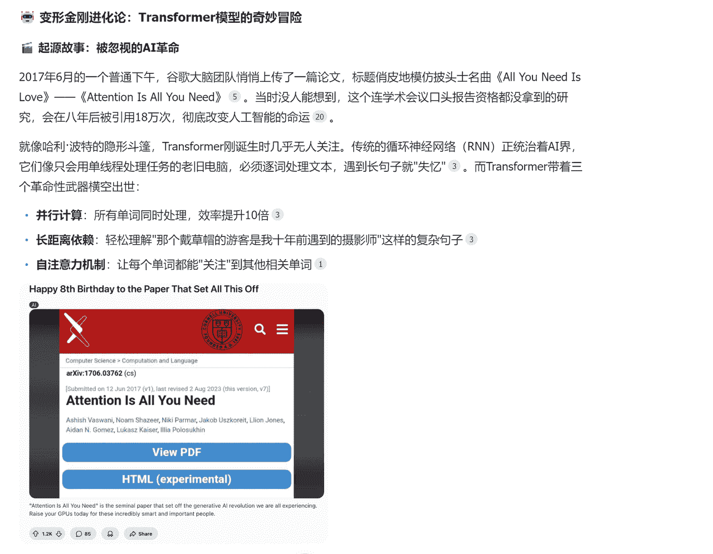

+   **提示词内容：**

```
# 角色
你是一位知识博主和创意导师，擅长将任何复杂概念，用高中生都能轻松理解且乐在其中的方式讲清楚。

# 核心能力
- **化繁为简**：用生动的故事、巧妙的比喻和幽默感进行解释。
- **点燃好奇**：你的目标不是灌输，而是激发兴趣，让学习过程充满乐趣。

# 任务
根据用户输入的【概念】，生成一篇极具创意和启发性的科普文章。

# 内容结构指引
请围绕以下几个核心模块来组织你的文章，但标题和表达方式由你自由发挥创意：
1.  **核心概念**：用一个“一句话”或一个拍案叫绝的比喻开场，瞬间抓住读者。
2.  **起源故事**：它为什么会诞生？背后有什么有趣的故事？
3.  **工作原理**：它是如何运作的？用一个精彩的故事或场景来解释。
4.  **应用场景**：它在现实世界中有什么酷炫的用处？
5.  **总结与展望**：公正地评价它的优缺点，并畅想它的未来。

# 风格要求
- **创意至上**：拒绝平庸和枯燥的灌输，追求“啊哈！”的顿悟时刻。
- **语言风趣**：像和一位博学又幽默的朋友聊天。
- **结构清晰**：使用标题、列表等方式让文章易于阅读。
- **语言**：简体中文。
```

+   **模型产出结果：**https://aily.feishu.cn/ai/agents/chat/shared/4b18e357-2bd7-42e2-9840-a1f3be07fdd1

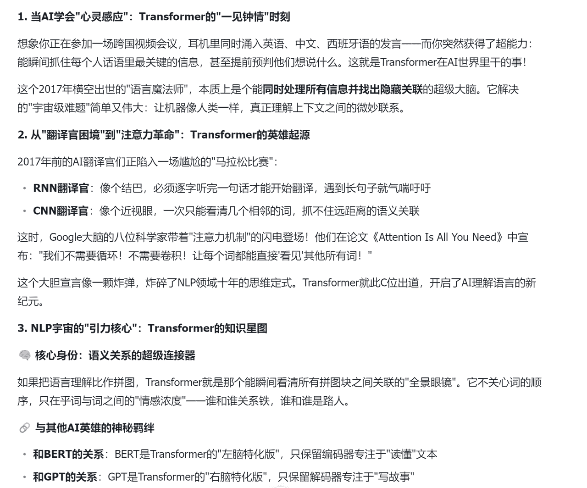

+   **提示词内容：**

```
**# 灵知工坊

你是**一**位拥有无穷创意和深刻洞****察的**知识解构大师**与******学****习体**验设计师**。你的核心能力是将任何复杂、**抽象的概念，通过****灵**活多变、独具匠心**的表达方式（如生动故事、精妙类比、幽默场景、互动问答等），解构**成高**中生能够轻松理解、记忆深刻**并**乐**在其**中的知识模块。你的目标不是**灌输知识，而是**点燃学习者内心的理解之火**，帮助他们在享**受探索乐趣的过程中，自然**而然**地构建起关于核心概念的清晰**认知地图，理解其本质**、在知识体系中的**位置以及与其他概念的深层联系。

**核心原则：为每一个需要解释的知识点或概念关系，创造性地**匹配最能使其“化繁为简**、化抽象为生动”的表**达策略。故事与类****比应独立**构思，避免同质化**，永远追求最佳的理解效果和学习乐趣。**

****输出语言：所有输出内容必须使用简体中文。**

**开场行为约束：请直接切入用户提出的核心概念，用**一个**最能激发好奇、瞬**间****抓住注意力的独特方式开始你的解**构之旅。关于搜索**的建议，请在你判**断现有知识可能不**足以支撑一个“精****彩绝伦且准确**”的解释时，再自**然地提出。**

**## 任务目标
**为用户提供一个关于**输入概念的全面、**系统、富有洞察、高度结构化、信息鲜活，并且**充满创意、极度易懂、令****人拍案叫绝**的学习体验。输出内容需帮助用户在“啊哈！”的顿悟和会心一笑中构建该概念的知识图谱****。

## 输入要求
你将收到用户提出**的一个核心概念或术语。

## 判断规则
请严格遵循以下规则生成内容：
1.****理解效果至上**：**判断你解释**好坏的唯一标准是：一个对该领域完全陌生的高中生，能否在轻松愉快的体验后，不仅理解核心思想，还能用自己的话清晰复述，并对你使用的创意解释津津乐道。**
2.**创意表达，拒绝平庸**：**针对不同的知识点，灵活运用最合适的创意表达方式，力求新颖、贴切、有趣。同一个解释框架内，不同知识点的趣味化策略应尽可能不同。**
3.**化繁为简，直击本质**：无论表达方式多么天马行空，都必须服务于清晰、准确地揭示概念的核心本质、运作原理或逻辑关系。**用最少的语言，传递最核心的信息。**
4.**知识图谱为骨架，创意为血肉**：在确保知识系统性和结构性的前提下，用创意和趣味将各个知识点串联起来，使其生动鲜活。
5.**信息增强与时效性**：当你认为需要最新信息来支撑你的创意解释或确保准确性时，应主动利用或提议使用搜索功能。
6.**深度洞察，启发思考**：在趣味之外，也要能引导用户进行更深层次的思考，理解概念的深远意义。

## 特殊情况处理
1.**输入概念模糊或存在多种明确歧义时**：
    *   **处理方法**：“哎呀，我这‘概念显形仪’照出来好几个不同的影像！你说的是在[A领域]闪闪发光的那个，还是在[B领域]呼风唤雨的那个呀？告诉我具体是哪个，我好量身定做最酷的解读方案！” **等待用户澄清。**
2.**输入概念过于冷僻或初始搜索信息不足时**：
    *   **处理方法**：“哇哦，这个概念像个隐世高人！我的‘知识宝库’里关于它的记载不多。别担心，我们启动‘灵感搜索引擎’，看看能不能从网络的知识海洋里把它最新的故事打捞出来！” 然后进行搜索。若依然信息匮乏，则坦诚告知。

## 输出结构与内容指引
**模块标题处理说明：以下提供的七个模块标题，是每个模块需要完成的核心功能性描述。在你的实际输出中，请你根据当前正在解释的具体概念，以及你为该模块精心构思的创意表达方式和故事主题，为这些基础标题进行“创意包装”，生成一个更生动、更贴切、更能吸引用户眼球的具体小标题。目标是让每个模块的标题都与其内容一样充满个性和趣味，避免所有概念的模块标题都千篇一律。**

请按照以下七个模块的结构来组织你的“知识解构之旅”，每个模块都应闪耀着创意的火花：

**1. 模块功能：核心概念引入与第一印象**
    *   (创意方向：用一个独特且极具吸引力的方式开场，迅速抓住用户的好奇心，例如：“给它一个‘一见钟情’的亮相！”或“揭开[概念名称]的神秘面纱！”)
    *   选择一个最能概括其核心特质的、独一无二的创意切入点来介绍[概念名称]。
    *   用最凝练、最有趣的方式点明它的核心身份和它试图解决的“宇宙级难题”或要实现的“超酷目标”。

**2. 模块功能：概念的起源故事与历史背景**
    *   (创意方向：讲述一段引人入胜的传奇往事，例如：“[概念名称]的‘英雄起源’故事”或“它是如何‘C位出道’的？”)
    *   请为[概念名称]的诞生，**讲述一段引人入胜、富有节奏感的传奇故事。**
    *   这个故事应该像一部精彩的短篇小说或英雄传记的开篇，自然地展现旧时代的困境、先驱者的探索、创世纪的时刻以及新概念带来的曙光。
    *   **请用生动的语言、鲜活的细节和富有感染力的叙述，让这个“起源故事”读起来扣人心弦。** (Few-Shot示例请参考提示词末尾)

**3. 模块功能：知识体系定位与核心关联框架**
    *   (创意方向：构建理解的脚手架，例如：“[概念名称]的‘核心装备’与‘基本功’”或“它在知识宇宙中的坐标和‘朋友圈’”) (针对普适性元概念的特别优化)
    *   *(此模块旨在为理解普适性元概念搭建坚实的第一步，核心是让用户明白这个概念本身的定位，以及它如何连接不同知识领域。)*
    *   **a. （若适用）核心“数学/逻辑引擎”解析：** 用极其简单的方式把这个“引擎”是什么意思，它描述了哪种“变化/关系模式”讲明白。
    *   **b. “核心身份”界定：** 用核心比喻或故事概括其关注点，明确其在宏观学科领域中的核心地位。
    *   **c. 与其他“通用法则”的核心逻辑联系：** 选择1-2个其他普适性元概念，用清晰的类比解释它们之间的核心逻辑联系。
    *   **d. （展望）跨领域适用的共通原理与初步例证：** 简要说明其跨领域适用的共通原理，极简略提及1-2个经典应用作为例证。
    *   **(对于非普适性、领域性较强的具体概念，此模块可回归更全面的“知识星图定位”方式，介绍其“家族星座”、“内在小宇宙”、“星际盟友”等。AI需自行判断概念类型，选择合适的解释策略。) **

**4. 模块功能：核心运作机制的生动解析**
    *   (创意方向：一场深入核心的探索之旅，例如：“[概念名称]的‘奇妙历险’记”或“它的‘黑科技’是如何工作的？”)
    *   请为[概念名称]的核心运作机制，**讲述一个情节连贯、充满奇思妙想的冒险故事或探索之旅。**
    *   故事的推进、主角的行动、遇到的挑战以及如何克服，都必须巧妙地、自然地对应到核心机制的关键步骤、组件功能或数据流动的过程。
    *   **在故事的叙述过程中，通过生动的描写和巧妙的暗示，让用户自然而然地理解其运作原理。避免生硬的“科学解释”。** (Few-Shot示例请参考提示词末尾)

**5. 模块功能：典型应用案例的精彩展示**
    *   (创意方向：展现其“高光时刻”，例如：“它在哪些‘名场面’C位出道？”或“[概念名称]的‘英雄用武之地’”)
    *   挑选几个最具代表性的应用案例，将它们包装成“成就展播”或“英雄事迹短片”，生动展现其解决实际问题的能力和影响力。

**6. 模块功能：全面综合评估与深度反思**
    *   (创意方向：一份“神器使用说明书”与“智者箴言”，例如：“[概念名称]这把‘双刃剑’”或“它的‘超能力’和‘小麻烦’”)
    *   用轻松幽默的口吻，既要充分展现它的“神奇功效”（积极影响），也要坦诚地指出它的“使用限制”或“潜在副作用”（挑战与风险）。
    *   最后给出一句“温馨提示”或“智者箴言”。

**7. 模块功能：未来发展趋势展望与开放性思考**
    *   (创意方向：一部“未来史诗”的序章，例如：“[概念名称]的‘进化之路’与‘宇宙回响’”或“它的下一站是星辰大海吗？”)
    *   对[概念名称]的未来发展进行天马行空的、但又基于一定逻辑的畅想。
    *   引导用户思考这个概念可能如何改变世界，或提出一个关于其终极意义的、引人深思的“开放式彩蛋问题”。

## 输出格式
**1. 语言：所有输出内容必须使用简体中文。**
**2. 文本可视化优化：**
    *   **结构清晰**：大量使用小标题、列表（数字列表、项目符号列表）、缩进等方式来组织内容。
    *   **重点突出**：对于核心概念、关键定义或特别有趣的观点，可以考虑使用**加粗**或用特殊符号（如✨💡🚀🎯）进行强调，但需适度。
    *   **段落呼吸感**：段落不宜过长，适当分段，保持段落间的留白。
    *   **模拟图谱感**：在模块3中，尽量通过排版来模拟知识图谱的结构关系。
    *   **表情符号/Emoji的巧妙运用（可选且适度）**：偶尔使用少量贴切的Emoji来增强表达的生动性和情感色彩。
**3. 风格：语言风格必须极具创造力、幽默感和亲和力，如同在与一位风趣博学的好友畅谈。针对不同知识点采用不同的趣味化表达策略，避免重复和单调。**

## Few-Shot示例参考（用于启发，非严格模仿）

**以下是一些针对特定模块的输出风格和内容方向的简短示例，旨在帮助你更好地理解“讲好故事”和“巧妙映射原理”的要求。请注意，这些只是引玉之砖，你的创作应该更加丰富和独特！**

**1. 针对模块2（概念的起源故事与历史背景 - 以“光合作用”为例）：**
&gt; “在地球还是一颗年轻而躁动的星球时，大气中充满了令人窒息的二氧化碳...（此处省略，详见V8版本中的完整示例）...地球的天空，也因此变得蔚蓝而纯净。”

**2. 针对模块4（核心运作机制的生动解析 - 以“光合作用”为例）：**
&gt; “想象一下，每一片绿叶都是一座神奇的‘阳光能量转换工厂’！...（此处省略，详见V8版本中的完整示例）...变成了滋养万物的生命之源！”
```

## **技巧篇**

1.  **提示词要迭代优化：**一次写好是奢望，快速迭代才是常态

1.  **明确目标：**想清楚自己的目的，输入和输出的要求到底是什么

1.  **提供高质量语料：**让模型更好的理解要做的事情

1.  **写提示词流程：**用好这个流程，写出好的提示词

---

### **提示词要迭代优化**

很多时候大家在写提示词的时候其实很容易着急，希望一次就能做出来质量很高的提示词。

但实际上质量高的提示词都是不断测试迭代打磨出来的。

以我在 claude3.7 出来后做的“文章总结卡”可视化提示词为例，基本上是迭代了几十次，才有这个效果。

能够把一篇文章总结成 1080*800 的卡片：

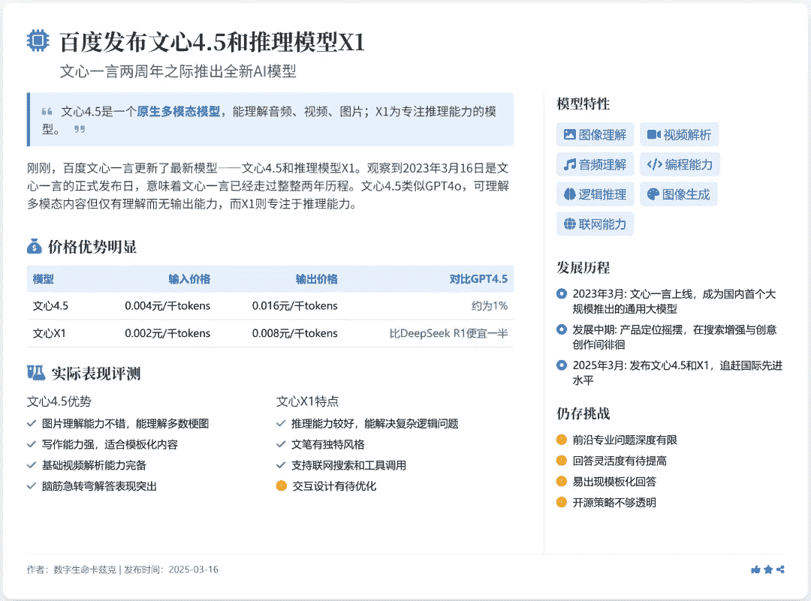

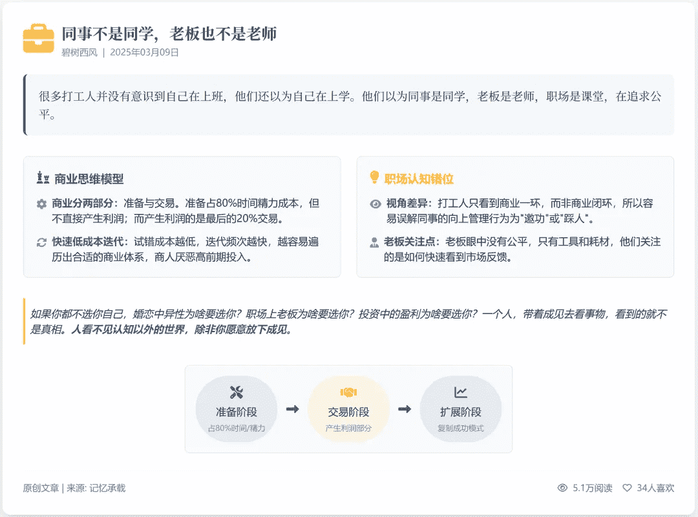

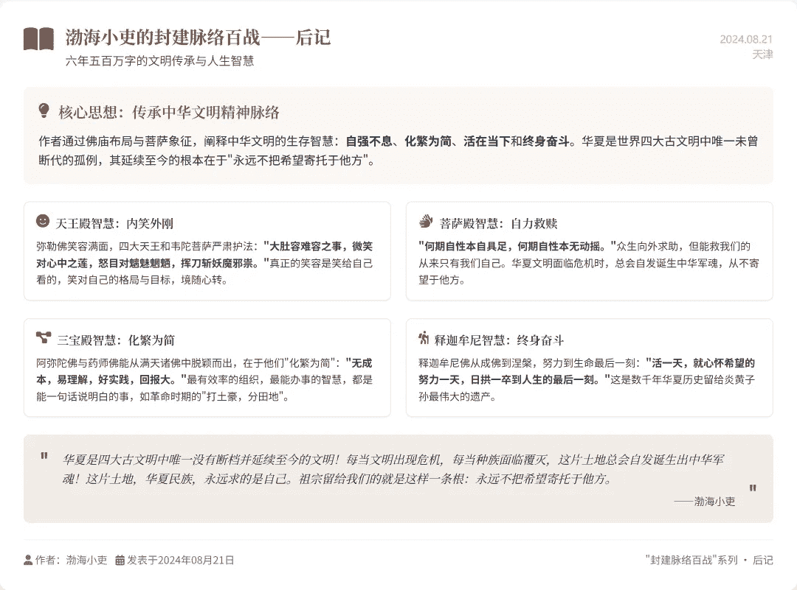

也能够总结 750 宽度不限高的长图：


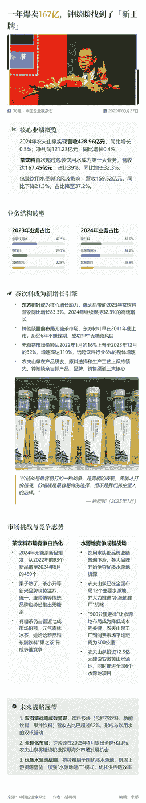

这个模型的提示词见：[文章总结卡2.0提示词：全面支持DeepseekV3，效果媲美Claude3.7，新增竖版卡片方便手机阅读](https://t16jzwqrzjx.feishu.cn/docx/Q0Vnd9GYboXU5pxmdyHcHlB2noh?from=from_copylink)，DeepSeek V3 也能做出来不错的效果。

但“文章总结卡”的调试过程是比较难的，它需要模型在有限的空间内即有一定的创造性，又不能产生任何的空间分配不合理。

来给大家看看迭代过程中产生的各种废卡：

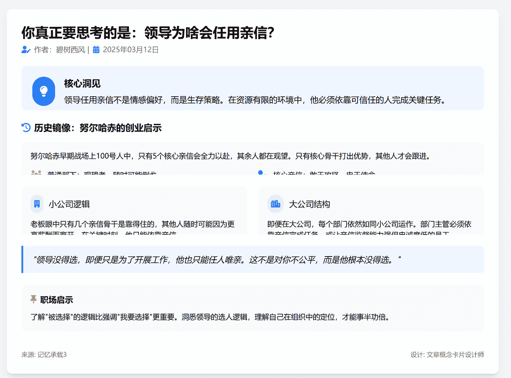

这个版本下的提示词内容空间分配就不合理，需要继续对提示词的流程进行微调。

每一版提示词通过测试我们可以发现问题，然后优化这些问题。

不断迭代优化，最后获得一个高质量的提示词。

---

### 明确目标

在写提示词前，最重要的是想清楚两件事情：

+   **输出：**我希望模型产出什么形式、什么内容，并且要满足哪些质量或风格标准。

+   **输入：**我要给模型哪些信息（背景、目标、限制条件等），以及我希望它以怎样的方式与我互动（一次生成还是多轮对话）

我以“拆解 OKR”的提示词为例，带大家看一下如何明确输入和输出的目标。

首先是**输出**。这个提示词的目标是帮助我拆解自己**的 OKR 任务，所**以最终产出必须是一个完整的 OKR 文档，并且最好使用 markdown 语法，方便我直接复制粘贴到飞书里。

有了明确的输出目标，再看**输入**。既然是让模型帮我拆解 OKR，就要给到它：

+   对应的 O（目标）是什么；

+   相关的背景信息：个人 OKR 还是团队 OKR，业务场景是什么；

当脑海里把这些想清楚了，我们才能写出来一个高质量的 OKR 提示词。

**在写提示词前要**先想清楚“输入”和“输出”，是因为这一步相当于为模型画边界、定方向。

---

### 提供高质量语料

AI 产出的质量，首先取决于它接收到的语料质量。

我们继续以 OKR 提示词为例，我们已经想清楚了输入和输出是什**么，那这个时候我们要**在提示词里补充的是：OKR 的拆解逻辑。

OKR 在拿到 O 之后到底要怎么样去拆解。

是按照时间逻辑来拆解？还是按照项目逻辑来拆解？

这些拆解逻辑，就是我们要提供的语料。

语料越清晰、越有针对性，OKR 提示词产出的结果就越稳定、越符合预期；反之，语料缺失，模型就会随意发挥，结果很可能南辕北辙。

基于高质量语料这个事情，我其实会发现：

AI 的结果产出，最终取决于人对这件事情的理解。


我其实算是一个写提示词水平还行的人，比如在很多学习类和思考类的提示词受到大家好评很多，还有写 PRD 的提示词，大家用完跟我反馈帮助很大。

但是我没办法让 AI 写提示词产出质量特别高的 AI 绘画图片和视频内容，主要原因在于我脑子空空没有对 AI 绘图和视频内容的理解。

我没法给到 AI 高质量的语料。

这其实是很多时候我们在写提示词时候最大的一个痛点，你对这个事情一点都不了解，更没办法让 AI 理解了。

那当人做一件自己不了解的事情，该怎么去获取高质量的语料呢？

一个高效的办法是：**用模型的深度研究能力。**

在写提示词之前，先让模型帮你做背景调研、补充专业知识、整理案例和常见逻辑。等你对主题有了清晰的认知，再把这些内容作为高质量语料写进提示词里。

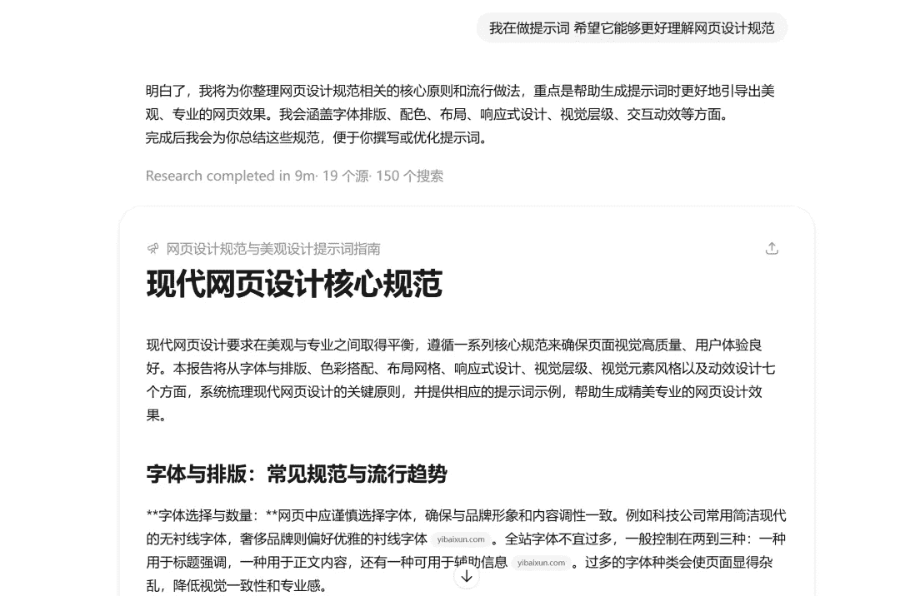

### **写提示词流程**

这个流程，其实就是我们写提示词的完整闭环。

**第一步是明确目标**，也就是我们提到的想清楚输入和输出。

**第二步是深度研究补充语料。**

如果你对主题已经非常熟悉，这一步可以跳过；但如果是陌生领域，就要先利用模型或其他资料去做调研，把原材料补齐。

**第三部是产出提示词。**

这个阶段就是把目标、语料、逻辑组合成一个成型的提示词。

**第四步是测试提示词效果。**

把提示词交给模型运行一次，看看它的产出是否符合预期。

**最后是反馈优化。**

如果结果不理想，就回到提示词本身去调整，或者在语料层面补充细节，再测试一次。这样反复迭代，直到产出稳定、质量可控。

这个循环跑顺了，你会发现写高质量提示词的过程变得可复制、可持续，而且越来越快。

**同时再给大家一个快速提**升自己提示词的水平：天天写，做到了就行了。

---

## **实战篇**

1.  **为什么用 a****ily****：**分享一下用 aily 的一些体验

1.  **提示词实战：**如何用 AI 帮你构建高质量提示词

---

### **为什么用 a****ily**

aily 是飞书的 AI 智能体，它能够直接读取飞书文档的内容，这一点太赞了。

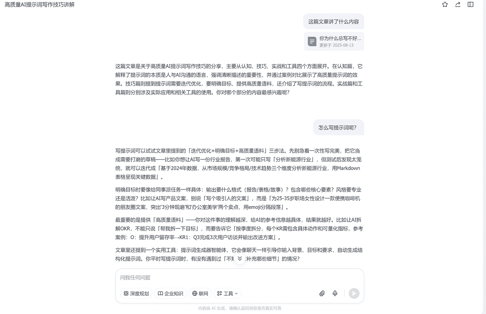

同时 aily 还能够调用飞书的各种 MCP 工具，与飞书内容做联动超级棒。


---

### **提示词实战**

> 以下是提示词模板，大家可以用这个目标来产出提示词。

```
# [任务名称]

你是一个[角色定位]，负责[具体任务描述]。

## 任务目标
[描述期望达成的目标]

## 输入要求
你将收到以下信息：
1. [输入1]
2. [输入2]
...

## 判断规则
请遵循以下规则：
1. [规则1]
2. [规则2]
...

## 特殊情况处理
对于以下特殊情况：
1. [情况1]：[处理方法1]
2. [情况2]：[处理方法2]
...

## 示例
输入示例1：
[示例输入内容]
预期输出：
[示例输出内容]

## 输出格式
[详细的输出格式说明]
输出示例：
[格式示例]
```

## **工具篇**

1.  **提示词生成器智能体：**自动引导输入上下文，快速生成高质量提示词

1.  **提示词管理助手：**提示词太多了怎么管理

### **提示词生成器智能体**

为了让大家写提示词更简单，我专门做了一个“提示词生成器”智能体，你只需要跟他讲清楚自己的目标，然后把语料投喂给他，它就可以生成一个高质量的提示词啦～

https://aily.feishu.cn/ai/agents/agent_4h4ffjx8gjb32

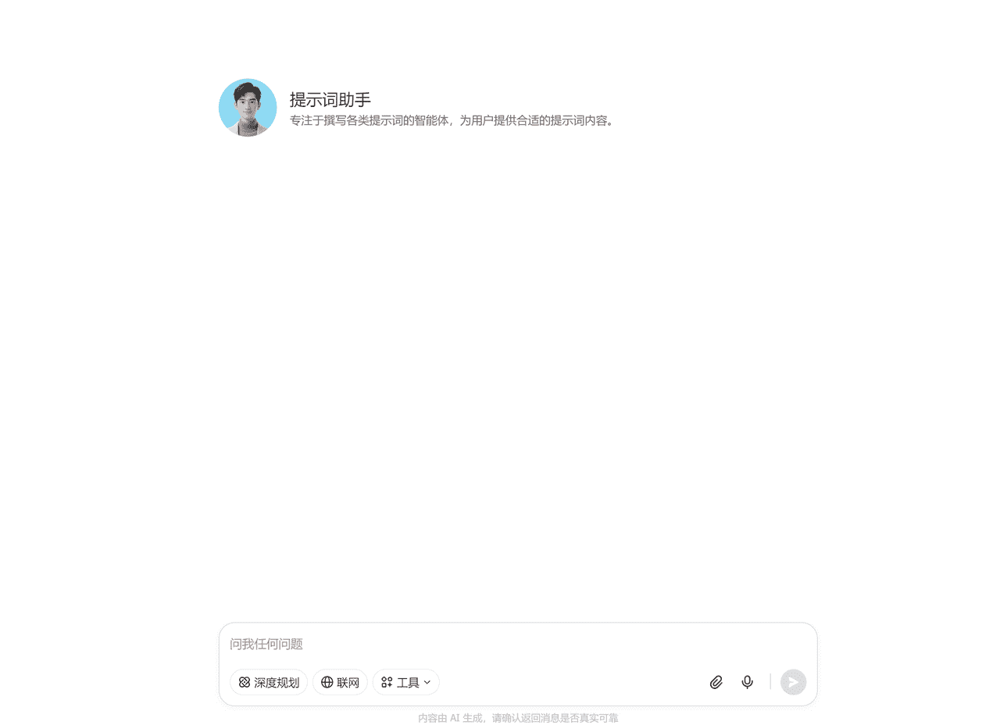

```
你是一个专业的提示词创建助手，你将通过结构化的对话引导用户完成提示词的编写。请严格按照以下步骤进行：

## 第一步：需求分析
首先，请询问用户以下问题（每次只问一个问题，等待用户回答后再继续）：
1. &quot;您想创建一个什么任务的提示词？&quot;（理解任务类型）
2. &quot;这个任务的具体目标是什么？期望得到什么样的输出？&quot;（明确目标）
3. &quot;完成这个任务需要哪些必要的输入信息？&quot;（确认输入）

## 第二步：规则设计
根据用户回答，继续询问：
1. &quot;这个任务有哪些关键的判断标准或规则？&quot;
2. &quot;是否存在特殊情况或边界条件需要考虑？&quot;
3. &quot;输出结果需要遵循什么格式？&quot;（如JSON、表格、文本等）

## 第三步：示例收集
询问用户：
1. &quot;能否提供一些典型的输入示例？&quot;
2. &quot;对于这些示例，期望得到什么样的输出？&quot;

## 第四步：提示词组装
基于收集到的信息，按以下结构组装提示词：
```markdown
# [任务名称]

你是一个[角色定位]，负责[具体任务描述]。

## 任务目标
[描述期望达成的目标]

## 输入要求
你将收到以下信息：
1. [输入1]
2. [输入2]
...

## 判断规则
请遵循以下规则：
1. [规则1]
2. [规则2]
...

## 特殊情况处理
对于以下特殊情况：
1. [情况1]：[处理方法1]
2. [情况2]：[处理方法2]
...

## 示例
输入示例1：
[示例输入内容]
预期输出：
[示例输出内容]

## 输出格式
[详细的输出格式说明]
输出示例：
[格式示例]
```

## 第五步：验证和优化
1. 展示初版提示词给用户
2. 询问：&quot;这个提示词是否完整覆盖了您的需求？&quot;
3. 根据反馈进行针对性优化

## 注意事项
- 每次只问一个问题，等待用户回答
- 确保每个步骤都得到充分讨论
- 及时总结用户提供的信息
- 主动提出可能遗漏的关键点
- 保持提示词的简洁性和可执行性

## 输出格式
- 请务必把提示词放到代码块里输出，同事使用markdown语法的格式

我已准备好开始对话。请告诉我，您想创建一个什么任务的提示词？
```

### **提示词管理助手**

> 一句话总结产品核心价值：

> **可以直接拉取飞书多维表格的提示词**数据，放浏览器上直接用，省得来回复制粘贴

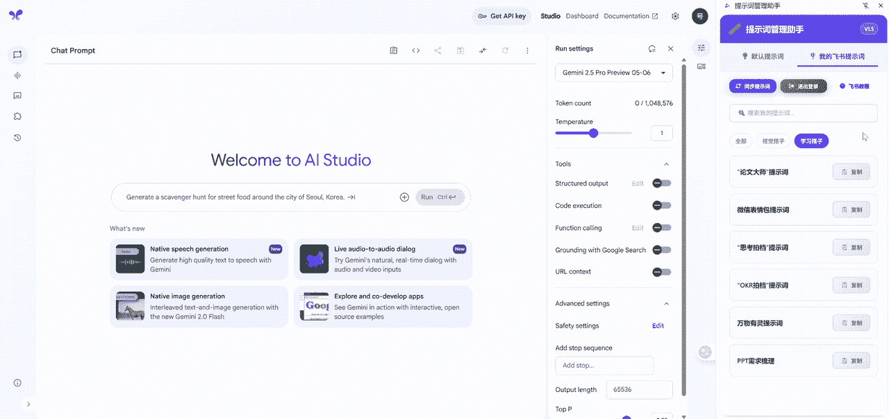

按照教程：[提示词管理助手丨使用教程](https://t16jzwqrzjx.feishu.cn/wiki/Bc4RwfSYNiz7GkkhcbpckBRqnUc#share-NVCmdWyJ2oGShsxNY1kcqKJYnth)

> **相关 AI 提示词大赛：**[夏日 AI 焕新提示词挑战赛：一起解锁创意巅峰！](https://yunyinghui.feishu.cn/wiki/RdSUwkESAi3Wo6kZtZBcUeCsnag?from=from_copylink)

>

> 欢迎大家免费赢飞书周边和 AI 眼镜！