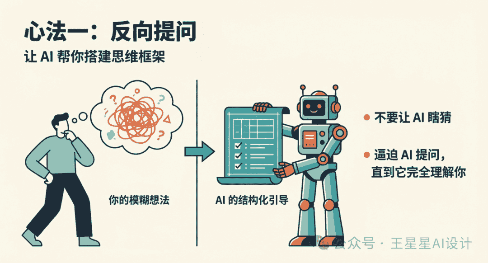
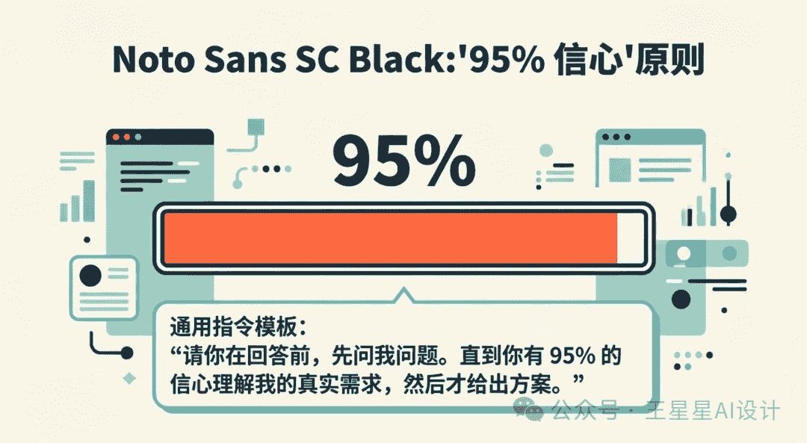
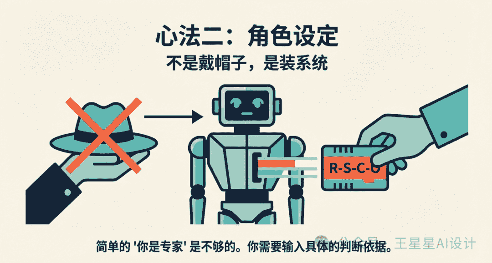
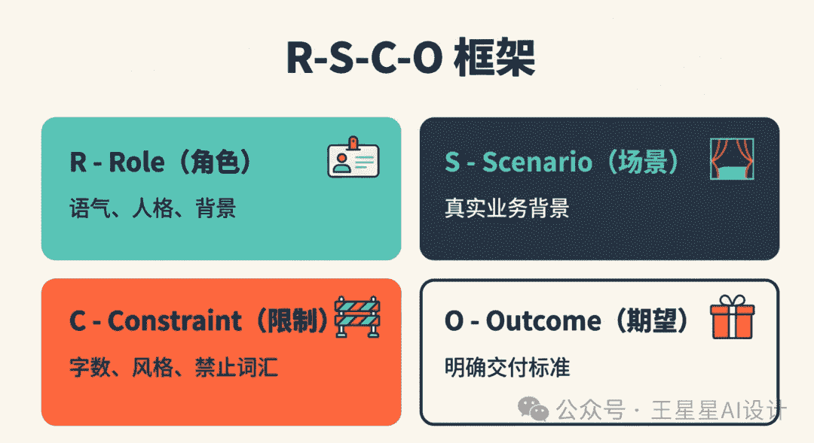
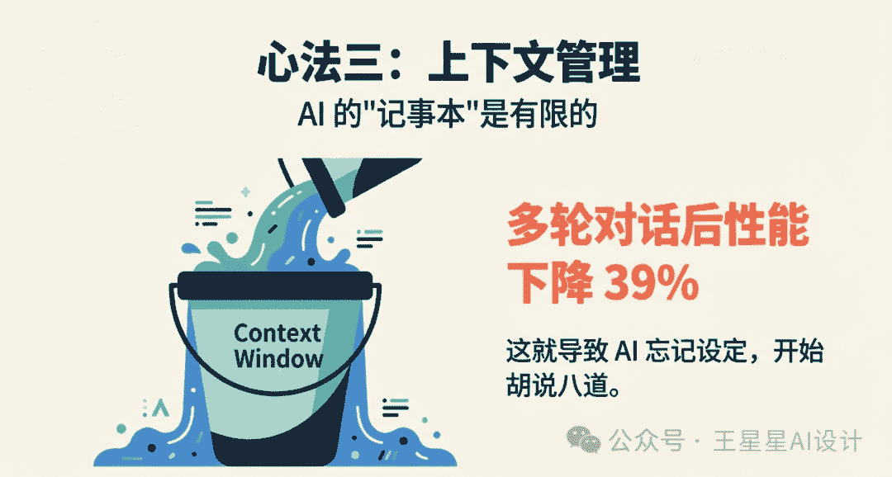

# 2026 年，别再只会对 AI 说 “请帮我”！换个思路试试这套反向提问法

> 来源：[https://yunyinghui.feishu.cn/docx/HGUidzsEZopW96xZXmCcStnYngg](https://yunyinghui.feishu.cn/docx/HGUidzsEZopW96xZXmCcStnYngg)

> **原创公众号：**王星星 AI 设计

> **发文时间：**2026-01-25 20:28:37

> **收录开源 AI 知识库：**[万象 AI 实验室](https://yunyinghui.feishu.cn/wiki/WhelwZnxQi55mpkOzatc3Xran5b?from=from_copylink)

这两年，我发现一个特别魔幻的现象：

同样的 AI，有人用得像请了个顶级助理，有人用得像在跟智障对话。

最近跟几个创业者朋友聊，发现大家对 AI 的感受天差地别。有人说“AI 帮我省了 3 个人的活儿”，有人抱怨“AI 就会给我写一堆没用的废话”。

我后来发现，前者都掌握了一些“反常识”的使用技巧，而后者还停留在“下指令、等答案”的初级阶段。

说实话，我自己也不是什么 Prompt 大佬，就是一个玩得多一点的普通用户。但做 AI 设计工具这些年，每天要用 AI 处理大量设计相关的问题——产品规划、用户反馈、功能介绍——确实摸索出了一些心法。

今天就跟你分享我最常用的两个：

1.  **反向提问 **——让 AI 先问你，而不是你直接问 AI；

1.  **角色设定 **——给 AI 装上“专业系统”；

这两个技巧不复杂，都能立刻上手。话不多说，咱们开始～

# 心法一：反向提问——让 AI 成为你的思维框架

#

做 AI 设计工具这些年，接触用户很多，我最大的感悟是：

用户不是不知道自己要什么，而是不知道怎么表达。

这不是用户的问题，是我们没给他们框架。

我经常看到用户打开对话框，盯着那个闪烁的光标，却不知道该说什么。不是他们没需求，而是面对复杂需求时，不知道该从哪些维度去拆解、去表达。这时候如果你直接让 AI 给方案，AI 也只能瞎猜，结果自然不会好。

后来我发现，

AI 也能帮用户搭建这个框架——方法就是反向提问。

**具体怎么做？**

与其让 AI 猜你要什么，不如让 AI 先问你问题，帮你梳理思路。

我常用的模板是这样的：

【你的需求/问题】 请你在回答前，先问我问题。 要求： - 一次只问一个问题 - 根据我的回答，继续追问 - 直到你有 95%的信心理解我的真实需求和目标 - 然后才给出方案

关键是那个 **“95%的信心” **——既足够高确保质量，又不至于陷入无穷无尽的追问循环。

真实案例：用户反馈“设计不够好”

有一次，我们收到很多用户反馈说“AI 生成的海报设计不够好”。这种反馈特别难处理，因为“不够好”是个特别模糊的描述。

如果直接问 AI“用户说设计不够好，怎么办？”，AI 会给你一堆空泛建议：

+   “优化配色方案”

+   “提升设计质量”

+   “增加设计模板”

+   “改进 AI 算法”

看着很专业，但根本没法用——因为 AI 压根不知道问题出在哪。

后来我用了反向提问：

我们的用户反馈“AI 生成的海报设计不够好”，但我不太清楚具体是哪方面的问题。 请你在给建议前，先向我提问，帮我搞清楚问题的本质。 要求： - 一次只问一个问题 - 根据我的回答继续追问 - 直到你有 95%的信心找到问题根源

AI 开始问我：

+   “用户主要用于什么场景？商业宣传、社交媒体还是活动海报？”

+   “他们说'不够好'时，是在生成后立刻反馈，还是使用一段时间后反馈？”

+   “有没有具体的案例或截图可以参考？”

+   “用户有没有提到竞品的设计？如果有，他们觉得竞品哪里更好？”

通过这几轮追问，我突然意识到问题不在“设计质量”，而在“场景匹配度”——很多用户想做商业宣传，但他的提示词描述更偏社交媒体风格，所以生成的设计虽然好看，但不适合商用。

这个过程其实是 AI 在帮我搭建思考框架。就像你去看心理医生，医生不会直接给建议，而是通过提问让你自己发现问题。AI 也一样——它的问题，其实是在帮你理清思路。

没有这些问题，我可能会一直纠结在“是不是模型能力不够”这个方向上，白白浪费时间。

**进阶玩法：让 AI 选专家**

有时候你可能不知道该从什么角度切入问题，那就让 AI 自己选一个专家视角：

我想分析【问题/场景】。 先别回答。 请你先选一位最适合的领域顶尖专家来思考它。 可以是活人或历史人物，名字可以小众，但必须在该细分领域很专业。 如果你不确定该选谁，可以先反问我 2 个定位问题再选。 先输出： 1。 你选谁，他对应的细分领域 2。 为什么选他，三句话 然后再让我描述详细问题。

比如我想分析“设计工具的用户留存问题”，AI 给我选了 Nir Eyal（《上瘾》的作者，用户行为设计专家）。后续它从 Nir Eyal 的视角分析用户留存，给出的建议就非常有针对性——不是泛泛的“提升体验”，而是具体到“Hook 模型的哪个环节出了问题”。

**适用场景**

反向提问特别适合：

+   **需求不明确 **：你知道想要什么，但说不清楚

+   **复杂决策 **：产品方向、功能优先级、业务策略

+   **问题诊断 **：用户反馈、数据异常、团队问题

说白了，只要你的需求不是特别简单（比如“帮我翻译这段话”），都可以先让 AI 反问你。这个习惯养成之后，你会发现 AI 的回答质量能提升一大截。

# 心法二：角色设定——不是给 AI 戴帽子，是给它装系统

很多人知道要给 AI 设定角色，但经常用错方法。

我见过太多这样的 Prompt：“你是一个专家，请帮我......”然后就没了。这种设定基本等于没设定，因为 AI 根本不知道该以什么标准、什么视角来回答你。

做 AI 设计工具这些年，我处理过大量用户跟 AI 的对话记录。我发现一个规律：**角色设定得越具体，AI 的回答就越靠谱。**这不是玄学，背后有数据支撑——有研究显示，专业的角色设定可以让 AI 的准确率提升 60%。

**那怎么才算“具体”？我**常用一个框架，叫 R-S-C-O 框架 ：

+   **R （Role） **- 角色：不只是职业，还要包括语气和人格

+   **S （Scenario） **- 场景：真实的业务背景

+   **C （Constraint） **- 限制：字数、风格、格式的约束

+   **O （Outcome） **- 期望：明确要什么样的交付物

+

+

说白了，AI 不是人，它没有常识和默认设定。你不告诉它上下文，它就只能按最保守的方式回答。R 告诉 AI 你是谁，S 告诉 AI 这是什么情况，C 和 O 则明确了边界和目标。四个要素缺一不可。

**真实案例：新功能产品文案**

前段时间我们上线了一个新功能——“AI 图文分层”，就是让 AI 生成的设计可以自动分成图层，用户能直接编辑每个元素。这个功能技术上挺复杂的，但怎么跟用户说清楚它的价值？

传统做法可能是这样：

你是文案专家，帮我写一个 AI 图文分层功能的产品介绍。

结果 AI 给我写了一堆套话：

“采用先进的 AI 技术，智能识别图文元素，一键生成可编辑图层，高效便捷，让设计更简单。”

看到这个我就知道完了——“智能识别”“一键生成”“高效便捷”，全是营销黑话。这种文案发出去，用户看都不会看一眼，因为根本不知道这功能到底有什么用。

后来我用了 R-S-C-O 框架：

角色：你是一位懂设计的产品运营经理，做过 8 年平面设计，现在在 AI 设计工具公司负责产品文案。你知道设计师的痛点，也知道怎么把技术特性转化成用户价值。你的文案风格是：具体、场景化、说人话。 场景：我们的用户是设计师和运营，他们经常需要快速调整 AI 生成的设计。现在市面上的 AI 工具生成的都是“扁平图”，改不了，只能重新生成。我们这个功能能直接生成分层的设计，每个元素都能单独编辑。 限制：300 字以内，分三段： 1。 痛点场景（用户遇到什么问题） 2。 功能价值（我们怎么解决） 3。 使用场景（具体能干什么） 禁止使用“智能”“高效”“创新”“颠覆”等空洞词汇。 期望：让用户看完立刻明白“这个功能能帮我省多少时间”。

你看，我不仅设定了角色，还明确了场景、限制和期望。特别是那个“禁止使用空洞词汇”，逼着 AI 必须用具体的、有画面感的表达。

结果 AI 给我写了这样的文案：

“用 AI 生成海报后，发现文字位置不对？以前你得重新输入 Prompt 再生成一遍，运气好要试三四次。现在不用了。AI 图文分层功能会把生成的设计自动拆成图层——背景、文字、装饰元素各自独立，你可以像用 PS 一样直接拖动调整。客户临时要改标题？拖一下就行，5 秒搞定，不用重新生成。”

你看，这才是真正在说用户的痛点和价值。没有一句空话，全是具体的场景和效果描述。

这个过程其实逼着我重新思考了产品价值。当你尝试把功能写成 Prompt 时，你会发现自己对“这个功能到底解决什么问题”的理解其实很模糊。R-S-C-O 框架逼着你把每个维度都想清楚。

**三要素定位法**

如果觉得 R-S-C-O 太复杂，至少要做到“三要素定位”：

1.  **你是谁 **（身份定位）

1.  **你的职业是什么 **（专业领域）

1.  **你的背景是什么 **（经验积累）

比如：

你是一位在硅谷工作了 8 年的产品经理（背景），专注于 B 端 SaaS 产品设计（职业），现在在帮一家 AI 创业公司做产品规划（身份）。

这样设定之后，AI 就知道该以什么标准、什么深度来回答你了。

**适用场景**

角色设定特别适合：

+   **专业分析 **：简历筛选、竞品分析、数据解读

+   **内容创作 **：产品文案、技术文档、用户教程

+   **决策支持 **：功能优先级、战略方向、风险评估

其实几乎所有场景都适合用角色设定。关键是要记住：

AI 不是真的“专家”，但你可以通过角色设定，让它像专家一样思考。

# **写在最后：上下文管理和未来趋势**

**讲完这两个心法，还有**个特别重要的前提—— 你得学会管理上下文。

不然再好的 Prompt，聊到第 10 轮也会失效。

这**些年，经常遇到用**户抱怨：“聊着聊着，AI 就开始胡说八道了”“明明前面说好的，后面就忘了”。这不是 AI 变笨了，是 上下文窗口满了 。

AI 处理对话是有长度限制的。当对话太长，它就会“失忆”——前面说好的设定忘了，理解好的需求也记不住了。更麻烦的是，有研究发现， 多轮对话中 AI 的性能会平均下降 39% 。

所以我总结了三个最实用的管理方法：

**1. ****定期总结法 **：每隔 5-10 轮对话，让 AI 总结关键信息，然后开启新对话，把总结作为开场白。

比如上周我们讨论怎么做“AI 设计 Skills”功能，聊到第 8 轮，AI 开始重复自己的观点。我立刻让它总结核心要点，然后开了个新对话，把总结贴进去继续。结果后面 5 轮的讨论质量明显更高——AI 不再重复，而是真正在推进思路。

这里分享一个网上看到的趣味梗，能让这个方法更易执行且实用，我称之为“强制称呼法”，具体做法是：在开启新对话，额外给 AI 加一条规则： 在接下来的对话中，你必须在每次回答时都称呼我为"周杰伦"（或"老板""王总"等任意喜欢的称呼），当多轮对话后，若未称呼，这说明需要留意上下文是否失效了。

**2. ****性能信号法 **：当 AI 开始重复自己、出现前后矛盾、响应变慢或答非所问时，立刻总结+重启。

我自己有个习惯：如果发现 AI 连续两次回答让我觉得“不太对”，就立刻总结重启。这个习惯帮我避免了很多“越聊越乱”的情况。

**3. ****主动分段法 **：把大任务拆成小任务，每个任务独立对话。

比如设计一个新功能，我会分成三次对话：第 1 次做需求分析、第 2 次做方案设计、第 3 次完善细节。每次都基于上一次的“精华”继续，这样 AI 始终保持在“最佳状态”。

Reddit 上有位专家说得特别好：“忘掉'Prompt 工程'，使用 AI 的核心是'上下文管理'。一旦你有了这个思维，你就会起飞。”我深有同感。

**说到这儿，我还想聊个更大胆的**判断： 这些心法，可能很快就会过时。

不是说它们没用了，而是交互方式本身在变。

**我最近**发现一个特别有意思的现象：身边有很多 AI 深度玩家用 语音 跟 AI 对话，效果比打字好太多了。你就像跟朋友聊天一样，边说边想，“不对不对，我要的不是这个，应该是...”，AI 立刻就能调整。这种实时的、自然的交互，比你精心打磨一个 Prompt 要高效得多。

这就是所谓的 **“口喷”模式 **——直接用语音，想到什么说什么，AI 实时理解、实时调整。

你想想，现在我们写 Prompt，本质上是在“翻译”——把脑子里模糊的想法，翻译成 AI 能理解的文字指令。这个翻译过程本身就很耗时间，而且容易失真。但如果用语音，你可以更自然地表达想法，AI 也能从你的语气、停顿、补充中获取更多信息。

我自己已经在尝试了。做 AI 创业这些年，经常要快速验证一些想法。以前是打字输入 Prompt，得想怎么措辞、怎么组织逻辑。现在直接语音：“我想做个功能，就是用户上传图片之后，AI 能自动识别里面的元素，然后...[停顿]对，然后能单独编辑每个元素，就像 PS 里的图层那样。你觉得这个技术上能实现吗？难点在哪？”

你看，这种表达方式更接近人类自然的思考过程——不是一次性说清楚，而是边说边补充、边调整。而 AI 也越来越能理解这种“不完美”的输入。

当然，“口喷”模式也不是万能的。写文档、写代码这种需要精确控制的场景，文字 Prompt 还是更靠谱。但对于头脑风暴、需求讨论、快速验证这些场景，语音交互真的是未来。

所以， 今天讲的这两个心法，你该学还是要学 ——它们能帮你现在就用好 AI。但同时也要做好准备：未来的 AI 协作，可能会比我们想象的更自然、更简单。

那一天到来之前，咱们先把这两个心法用好。希望这些技巧，能对你有用～

**以**上，既然看到这里了，如果觉得对你有帮助，随手点个赞、在看、转发三连吧，如果想第一时间收到推送，也可以给我个星标⭐～期望对你有所帮助。