# 3 万字长文深度解析大语言模型 LLM 原理

> 来源：[https://yunyinghui.feishu.cn/docx/UUupdKsZrom5slxoOiNcnE9snUd](https://yunyinghui.feishu.cn/docx/UUupdKsZrom5slxoOiNcnE9snUd)

---

> **说明：**原文作者royceshao，发布于👸号腾讯技术工程，本文为万象AI实验室推荐的LLM学习优质分享内容。

> **大语言模型 LLM** 的精妙之处在于很好地利用数学解决了工业场景的问题，笔者基于过往工程经验继续追本溯源，与腾讯学堂合作撰写本文，尝试让鹅厂小伙伴人人都能懂大语言模型的基础原理。

## 1、大语言模型简述

截止到 2025 年“大模型”一般泛指“超大参数模型”，参数是指深度神经网络里面“神经元数量、层数、神经元权重、神经元偏移量、超参数”等数据的集合，截止到本年度全球应用最广泛的是以 OpenAI 的 ChatGPT 为代表的“语言类模型”。在 Transformer 架构之前，一般使用“循环神经网络 RNN”及其衍生“长短记忆循环神经网络 LSTM”来进行语言类模型的推理，而 transformer 架构的精髓在于通过针对文本的编码器（encoder）和解码器（decoder）的堆叠设计，通过多头注意力机制（MHA）来计算文本序列中前后 token 的关联度，与传统的 RNN 架构的巨大区别（LSTM 通过门机制来赋予不同时间所出现的 token 不同的重要性）。

通过预训练（Pre-Train）+监督学习（Supervised Learning）标注（除了普通的标注外，针对特殊领域的问题会引入专家来进行标注），模型的预测精准度是决定于他所能看到的范围，在同一时间看到 10w 上下文和 1k 上下文，预测精准度和合理性是不一样的，所以在预训练时尽可能构造出“同一时间可以看见的最大范围的上下文”，那么在推理时就会更加的精准，这也是预训练（Pre-Train）需要超大规模集群的原因。

## 2.1 神经网络发展史

神经网络诞生于 20 世纪 40 年代，取得重要突破的节点在 20 世纪 70 年代、20 世纪 80 年代、21 世纪初。

20 世纪 70 年代：Paul Werbos 博士提出了影响深远的 `Back Propagation` 的神经网络学习算法，实际上找到了训练多层神经网络的方法。

20 世纪 80 年代：Hinton 教授等提出“隐单元”的概念，首次将神经网络的层数进行了增加，为解决非线性问题提供了更大的灵活性，同时 Hinton 教授在传统的 `Back Propagation` 算法中引入了可微非线性神经元（如 `Sigmoid` 激活函数神经元、可微是为了可以求偏微分），克服了早期神经元的一些问题（前馈计算结果爆炸等）；Yann LeCun 教授提出了著名的卷积神经网络 CNN，有效地应用于图像识别领域。

21 世纪初至今：Hinton 教授等揭开了深度学习的大幕；2012 年，Alex Krizhevsky 等使用 GPU 运行卷积神经网络 AlexNet 在图像分类大赛中取得了巨大的成功；2012 同年，吴恩达教授与 Jeff Dean 主导了 Google Brain 项目，通过 1.6 万个 CPU 组成有 10 亿个节点的深度神经网络模型，在图像识别和语音识别领域取得了重大成功；2016 年，由 DeepMind 研发的 AlphaGo 围棋程序，利用蒙特卡洛树搜索与两个深度神经网络相结合的方法，使用强化学习进一步改善它，强化学习（`Reinforce Learning`）方法（`Q-Learning`、策略梯度法、蒙特卡罗方法和时序差分学习）等，模仿了人类为实现目标所采取的反复试验的学习过程，开始被广泛运用。

2017 年，Google 在其著名论文《Attention is All you Need》中公开了奠定了现代 LLM 基础的 Transformer 架构，在 Transformer 之前，循环神经网络（RNN）及其更先进版本长短时记忆网络 LSTM 和门控循环单元（GRU）是处理序列任务的主流架构，但也正是因为必须遵循序列处理，大大限制了其并行化的能力；Transformer 架构则放弃了循环层，仅依赖注意力机制，进一步演化的叫做多头注意力机制（MHA），并行化带来了训练速度的极大提升。虽然 Transformer 架构最早是为自然语言处理设计的，但是已经被大量应用于其他领域，如视觉领域（Vision Transformer）、生命科学（DeepMind 的 Alpha Fold 系列）等。

2018 年，OpenAI 推出了 GPT-1，首次融合 Transformer 与无监督预训练技术，开启了对大语言模型的探索之旅，OpenAI 的高光时刻出现在 2023，当年推出的 ChatGPT3.5 在问题回答场景表现非常卓越，使得 ChatGPT 上知天文、下知地理，还具有能根据聊天的上下文进行互动的能力，具有与真正人类几乎无异的聊 天能力，其精准度远远要超出普通的搜索引擎。

2025 年，真正地进入到 LLM 百家争鸣时代，北美有 ChatGPT、Claude、Gemini、Grok 等，欧洲则有 Mistral，国内则有 DeepSeek、Hunyuan 等，业内趋势逐步从基础模型军备竞赛转移到 AI 应用的落地，首先是 Anthropic 提出了 MCP（Model Context Protocol）方便应用以统一的协议来集成各类模型；其次是智能体，通过模型搭配知识引擎、文本库向量化的能力，能够构建相对精准的智能体。

作为 AI 相关从业者，将尝试从原理上解释大语言模型的训练原理，以及与 GPU 集群的关系，核心部分：（1）涉及 Transformer 的精华部分（`self-attention`）；（2）`Back Propagation` 梯度理解及求解过程。这两部分是理解大语言模型如何被训练出来的基础。

### 2.1.1 认识单层神经网络（neural network）

首先建立对神经网络的基础认知，如图 1 所示，图中关键的概念如下：

① neural network: 神经网络，是函数的进阶形式，能够更好地拟合计算目标。

② input layer：输入层，可以是数值，也可以是向量，也可以是矩阵。

③ hidden layer：隐藏层，隐藏层的数量即为该神经网络的数量，图中为单层神经网络。

④ weight：权重参数，输入值乘以权重，针对输入值起到放大或缩小的作用。

⑤ output layer：输出层，可以为最后的计算结果，也可以是更进一步的归一化处理（`normalization`），更好的评价本次计算的拟合程度。

⑥ bias：偏移量参数，输入值乘以权重后加一个偏移量，起到微调的作用。

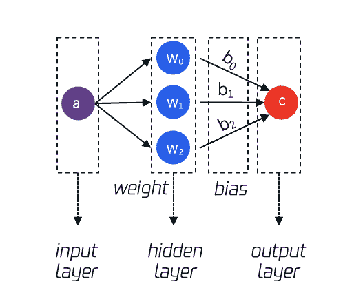

图 1：单 层神经网络示意图

### 2.1.2 认识深度神经网络（deep neural network）

如图 2 所示，为深度神经网络，重要概念如下：

① 层数：hidden layer 的总层数，不含输入层和输出层

② 维度：dimension，在语言类模型中，每个 token 会使用一定维度的向量来表示

③ 全连接：full connected network，在图 2 中，第 0 层的神经元与第 1 层的每个神经元都相连，这里神经元是指权重，连接线是指偏移量，每个计算结果（`a*w+b`）又会被送入所有的下一层神经元产生计算结果。

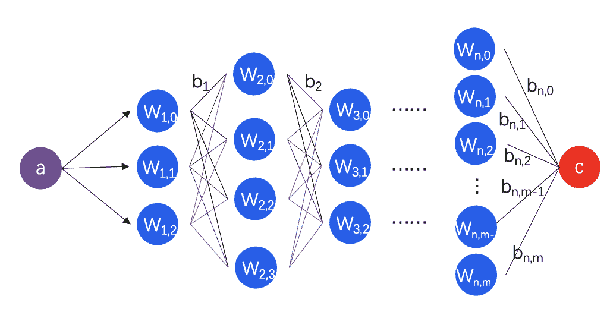

图 2：深度神经网络

## 2.2 文本如何在神经网络中计算

### 2.2.1 了解单词向量化（word2vec）

在互联网世界中当我们常需要计算两个单词之间的关联度，从最早的 `one-hot` 表示法（假设一部词典有 N 个单词，用一个 n 维向量来表示，每个单词占据某个位置，其他位置的值均为 0，两两单词之间是正交的），逐步发展为 `word embedding` 表示法（翻译为“词嵌入”，即将一个单词嵌入到某一个空间的过程）。谷歌在 2013 年提出来的“`word2vec` 语言算法模型”（一个 2 层的神经网络模型、输出结果为稠密向量）基于大量的文本的无监督学习为每个单词进行了 `word embedding` 的编码；如图 3 所示，`word2vec` 编码也是包含了两个更早语言类编码模型（`CBOW` 和 `skip-gram`），词向量模型本身也是开源的，所以各个厂商都会有自己的词向量模型，也会在持续的实践中迭代词向量模型。

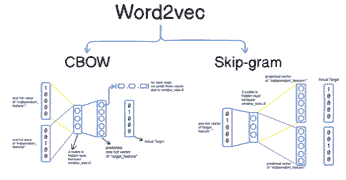

图 3：单词向量化算法

### 2.2.2 将句子分词为 token（Tokenizer）

虽然通过 `word2vec` 给了每个单词一个词向量的编码，但是此种 word-based tokenization 会造成词表过大的问题，另外一种是 char-based tokenization 则会忽略一些拼写错误，而业内常用的是“subword-based tokenization”，从最后的切分效果来看一个 token 大概是 0.75 个 word。`Byte-Pair Encoding`（`BPE`）是最广泛采用的 subword 分词模型，该模型也应用于 GPT 系列模型训练和推理中，事实上也取得了非常好的应用效果。图 4 是分词过程简单示意图，通过 `tokenizer` 过程，将句子中的每个 token 处理为向量。

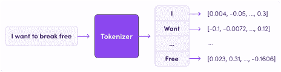

图 4：分词过程示意图

## 2.3 大语言模型训练过程

### 2.3.1 Pre-Train 训练过程概述

通常生成式大语言模型会历经如下训练过程，包括：

1、Pre-Train 预训练：该过程让模型能够从大量的无监督文本数据中学习语言的统计规律、语法结构、语义关系等，以便后续可以应用于下游任务，比如文本分类、问题应答、翻译等等。

2、`Supervised Fine Tuning` 有监督微调：该过程将会让模型学习如何解决特定领域的问题，OpenAI 提出了指令微调（`Instruct Finetuning`）的方案来完成 SFT 过程。

3、`RL` 强化学习及 `RLHF` 基于人类反馈强化学习：`Reinforcement Learning with Human Feedback`，该过程为模型生成的数据提供一个奖励分数，帮助模型学习哪些生成符合人类期望，哪些生成不符合人类期望。奖励模型的数据通常来自于人工标注的排序数据，标注员会对多个生成的回答进行排名，奖励模型基于人类的反馈排名来进行训练。

4、`OpenAI` 在 2022 年发表的《Training language models to follow instructions with human feedback》论文中解释了 GPT3 基于 `RLHF` 的训练过程。

### 2.3.2 Pre-Train 目标和过程简述

1、训练目的：调整权重参数及超参数（`hyper parameter`）使得模型能够较好地拟合存量互联网的知识。

2、训练过程：前馈传播+反向传播

如图 5 所示，描述了 `t0`、`t1`、`t2`、`t3`、`t4` 时刻神经网络所执行的动作，输入 token 为 `i`：

t0 时刻：经过神经网络计算，next token 预测了[“am“、”will“、”want“、”like“、”kind“]，归一化后的概率分别为[0.004、0.005、0.003、0.002、0.001]，按照概率选择顺序应该是"will">"am">"want">"like">"kind"，而 `RL` 也会针对结果进行打分并排序，假设排序结果是"will">"want">"am">"like">"kind"，虽然概率最高选择结果相同，但是在"am"和"want"的选择结果上并不一致，那么就需要针对此时刻的权重参数进行修正，我们计算出输出结果（output）与预期（expect）的差异（`Loss`），然后通过反向传播算法来调整参数。

t1 时刻：t0 时刻完成调整后，t1 时刻继续重复 t2 的过程，此时模型的输入为”I will"，继续通过前行传播预测 next token，同样的将生成结果（output）与预期结果（expect）计算差异，再进行反向传播调整参数。t2 时刻、t3 时刻、t4 时刻：同样循环计算此过程，直到训练结果与预期结果的 `Loss` 足够小。

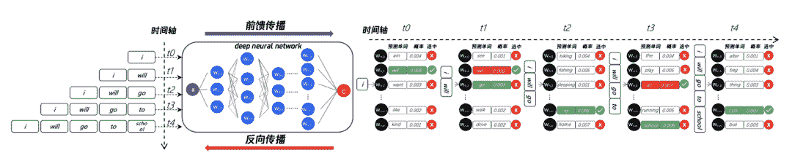

图 5：前馈计算预测下一个单词并打分、反向传播调整权重参数

### 2.3.3 前馈传播过程说明

随机初始化参数-》输入-》前馈传播-》生成预测

（1）随机初始化参数：神经网络初始是没有默认权重的，一般来说会赋予随机参数，后续通过持续多轮的训练来逐步更新权重参数等，使得整个神经网络达到最佳的拟合效果。

（2）输入 token：图 5 中的少量 token 仅用于说明，实际在训练的时候会输入超长文本，构成了训练的上下文，理论上模型看到的越多，它能够计算的越精准。

（3）前馈传播（`feedforward`）：在神经网络中会利用 Transformer 算法计算，包括：位置编码、多头注意力机制、FFN 等，最终不同神经元所产生的不同的预测 token 以及它的概率，在训练过程中会计算预测 token 与预期 token 的 `loss`。

### 2.3.4 反向传播过程

生成预测与预期比较-》反向传播-》更新参数

1、生成预测与预期比较：模型生成的预测 token 归一化后（`normalize`）有概率标识，那么概率高的会被选中，但是选中的 token 并不是期望的，此时会存在生成值与预期值的 `loss`。

2、反向传播：因为预测值（output）与预期值（expect）有 `loss`，所以需要借助于反向传播算法从最后一层往第一层反向传播，核心是基于链式法则进行梯度下降，通过调整下降的梯度（斜率）和学习率来起到逐步收敛的目的。

3、更新参数：1 次 FW、1 次 BW，就会完成一次权重参数的更新，这样的过程要进行数万轮直到随机输入、随机产出的与预期值的偏差基本收敛。

## 3、前馈传播（Feed Forward Propagation）计算过程演算

### 3.1 MLP 网络架构 multiple layer perceptron

如图 6 所示，即给神经网络一个输入，会让每一层的每一个神经元对其执行计算，然后将计算结果输出给下一层继续计算直到所有层完成运算，最后针对计算结果进行归一化，使得每种结果呈现一种概率分布，并通过 `Loss` 函数将生成结果与预期结果进行比较。

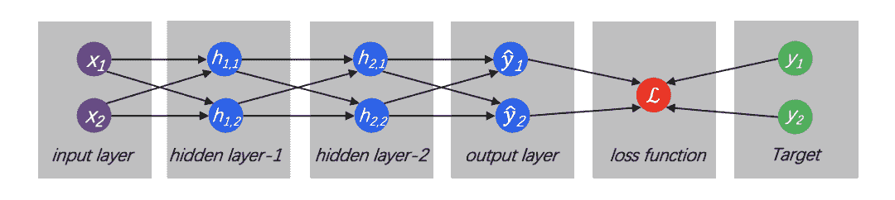

图 6：输入层、隐藏层、输出层、Loss 值计算

① `activation function`（激活函数）：将输入按照一定规则进行转换，常见的激活函数：`sigmoid`、`relu`、`tanh`、`softmax` 等，早期的激活函数主要是用于线性分类的，如图 6 所示，hidden layer 的每个神经元一般执行：`H[i]=g(A[i]H[i-1]+b[i])`，其中 `A[i]`、`B[i]` 为权重参数，`H[i-1]` 是上一个神经元的计算结果，其目的是向神经网络引入非线性元素，可以实现更好的拟合，`simoid`/`tanh` 是饱和激活函数，而 `ReLU` 及其变种为非饱和函数。

② `feedforward`（前馈传播）：每个节点之间都是全连接，即每个节点与下一层的所有节点都连接，这种特型被称为 fully connected network，从输入、经由 hidden layer、产生 output 的整个过程，即为前馈传播。

③ `loss function`（损失函数）：用来计算生成结果与预期结果之间的差距，一般分类（`classification problem`）问题用 `cross-entropy loss`（交叉熵）算法，回归类（`regression`）问题使用 `L1 Loss`（`mean absolute error`、`平均绝对误差`）或 `L2 Loss`（`mean square error`、`均方误差`）。

### 3.2 常见的 4 种激活函数

#### 3.2.1 `sigmoid`

如图 7 所示，又称”压缩函数”，输入为（−∞，∞）输出为（0，1），属于非线性函数，在神经网络中可以实现非线性分割，且单调递增利于反向传播时求导。

#### 3.2.2 `tanh`

如图 7 所示，`tanh` 输入为（-∞，∞）输出为（-1，1），相较于 `sigmoid` 函数引入了负数的输出，为神经网络激活过程提供了更多的变量。

#### 3.2.3 `ReLU`

如图 7 所示，`ReLU` 全称“Rectified Linear Unit”，修正线性单元，相较于 `sigmoid`，`relu` 在反向传播时计算量减少、不容易出现梯度消失的问题、会造成一定程度网络稀疏性，减少过拟合发生。

#### 3.2.4 `softmax`

如图 7 所示，或称归一化指数函数，能够将多分类的输出值转换为范围在[0， 1]和为 1 的概率分布，在深度神经网络中有着非常重要的作用。

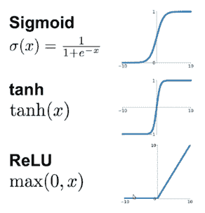

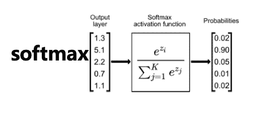

图 7：常见激活函数

### 3.3 将抽象的前馈传播转化为 GPU 可执行的矩阵计算

#### 3.3.1 前馈传播的基础参数说明

如图 8 所示是简化的深度神经网络的前馈传播的计算演示图，各个参数意义如下：

① `x1`，`x2`，`x3`：input layer 的输入参数 x，在大语言模型中为输入的 token 向量值。

② `w1，12`：w 是指权重，上标 2 指层数编号；下标”1，1”中靠前的 1 是指与下一层的第 1 个神经元的连接权重，靠后的 1 是指自身在本层的排列顺序。

③ `w1，13` ： w 是指权重，上标 3 指层数编号；下标”1，1”中靠前的 1 是指与下一层的第 1 个神经元的连接权重，靠后的 1 是指自身在本层的排列顺序。


④ `w2，13` ： `w` 是指权重，上标 `3` 指层数编号；下标”`2，1`”中靠前的 `2` 是指与下一层的第 `2` 个神经元相连；下标”`2，1`”中靠后的 `1` 是指自身在本层的排列顺序。

⑤ `w2，33`： `w` 是指权重，上标 `3` 指层数编号；下标“`2，3`”中靠前的 `2` 是指与下一层第 `2` 个神经元相连；下标”`2，3`”中靠后的 `3` 是指自身在本层的排列顺序。

⑥ `z12`： `z` 是指上一层计算结果（还未经过激活函数），上标 `2` 指层数编号，下标 `1` 是指所在层数的神经元序号。

⑦ `b12`：`b` 是指偏移量，上标 `2` 是指所在层数；下标 `1` 是指第偏移量要施加的神经元的序号。

⑧ `a12`：`a` 是指输入，上标 `2` 是指所在层数；下标 `1` 是指神经元的序号。

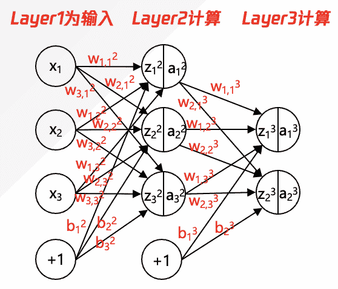

图 8：前馈传播计算中过程

### 3.3.2 前馈传播中发生的矩阵计算

如图 8 的计算逻辑中，`Layer1` 为输入（`x1`、`x2`、`x3`），需要进行两层计算，`Layer2` 和 `Layer3`，计算过程如下，上标 `T` 为矩阵的转置。

（1）计算 `Layer2` 的过程：`a12`，`a22`，`a32`

```
a12 = σ(z12)=σ(x1 w1,12 + x2 w1,22 + x3*w1,32 + b12)

a22 = σ(z22)=σ(x1 w2,12 + x2 w2,22 + x3*w2,32 + b22)

a32 = σ(z32)=σ(x1 w3,12 + x2 w3,22 + x3*w3,32 + b32)
```

其中 `σ` 为激活函数。`Layer2` 的计算过程转化为矩阵计算，`σ*（x*w（2）T+b2）=>（a12，a22，a32）`

（2）计算 `Layer3` 的过程：`a13`，`a23`

```
a13= σ(z13)=σ(w1,13 *a12+ w1,23 *a22+w1,33 *a32 +b13)

a23= σ(z23)=σ(w2,13 *a12+ w2,23 *a22+w2,33 *a32 +b23)
```

其中 `σ` 为激活函数。`Layer3` 的计算过程转化为矩阵计算：`σ*（a2*w（3）T+b3）=> （a13，a23）`

### 3.3.3 前馈传播的矩阵表示

上面 3.3.2 中复杂的计算，如果被归到矩阵计算，那么过程相对简单，如下：`z`、`a`、`W`、`b` 均为矩阵。

（1） 乘加计算结果：`zLayer= aLayer-1 * WLayer+bLayer`

（2） 激活函数处理后结果：`aLayer =σ（zLayer）`

使用更加泛化的公式可表示为：

```
zL=aL-1 * WL + bL

aL=σ(zL)
```

以上计算过程转化为 `GPU` 的原子计算”乘加运算“和”激活函数计算“

（1） `GPU` 的乘加运算：矩阵 `a`（上一层的计算结果、作为下一层的输入）* 矩阵 `W`（本层的权重参数）+ 矩阵 `b`（本层的偏移量）

（2） `GPU` 的激活函数计算：针对（1）的结果进行归一化后再输送给下一层。

图 8 中的层数和每层权重计算单元比较少，当层数大规模扩大、当每一层的权重计算单元大规模扩大时，会有超大规模的矩阵的”乘加运算“和”激活函数“计算，而矩阵本身的 `Dot Product` 运算是前面的矩阵某一个 `Row` 乘以后边的矩阵的某一个 `Column`，而不需要前面的某一个 `Row` 枚举与后面矩阵的所有 `Column` 相乘，所以可以进行拆分计算然后最终汇合，这也为利用 `GPU` 进行并行计算铺好了理论基础。

## 3.4 前馈传播中的 transformer 简介

### 3.4.1 Transformer 简述

`Transformer` 是一种神经网络模型，通过追踪连续数据（例如句子中的单词）的关系来理解上下文，进而理解每个 `token` 的含义，`transformer` 最核心使用的是自注意力机制（`self-attention`）来检测一些数据元素之间微妙影响和依赖关系，包括距离遥远的数据元素。`Transformer` 的方法逐步取代了 `CNN`（卷积神经网络）和 `RNN`（递归神经网络），`CNN` 和 `RNN` 不得不使用大量带有标记数据集来训练神经网络，制作这些数据既费钱又费时。`transformer` 通过数学的方法发现元素之间的关系，不需要人工标记，使得互联网中的数万亿的图像和文本有了用武之地；另外 `transformer` 还可以使用数学的方法并行处理，可以使得模型快速运行。

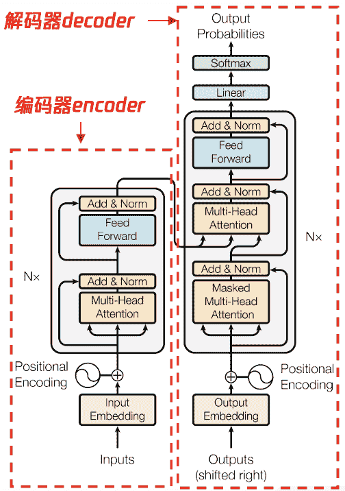

图 9： `transformer` 结构中的编码器和解码器

如图 9 所示是 Google 2017 年”Attention is All you Need”论文中标准的 `transformer` 架构，该架构中包含了 `encoder` 和 `decoder`：

1. `encoder`（图 9 左侧）

   ① 由 `N=6` 个 `layer` 堆叠组成，每个 `layer` 又分为两个 `sub-layer`。 ② 第一个 `sub-layer` 是 `multi-head attention` 多头注意力层。 ③ 第二个 `sub-layer` 是感知位置信息的全连接 `feed forward` 前馈层。 ④ 在 `MHA` 和 `FF` 层后面各增加了一个残差网络 `residual connection` 和一个归一化层 `normalization` ⑤ 输出的 `outputs` 的维度 `dmodel=512`

1. `decoder`（图 9 右侧）

   ① 由 `n=6` 个相同的 `layer` 堆叠组成，和 `encoder` 一样有 `MHA` 层（带 `mask`、遮挡部分信息）和 `FF` 前馈层，两者之间插入了标准的 `MHA` 层，用来计算 `encoder` 输入值与 `decoder` 内上一层输出值的 `self attention`。 ② 与 `encoder` 一样，在每个 `sublayer` 后增加了残差网络连接和归一化层。 ③ `MHA` 层增加了 `mask` 遮掩：防止当前位置关注后续后面的位置，确保位置 `i` 的预测仅依赖于小于位置 `i` 的信息。

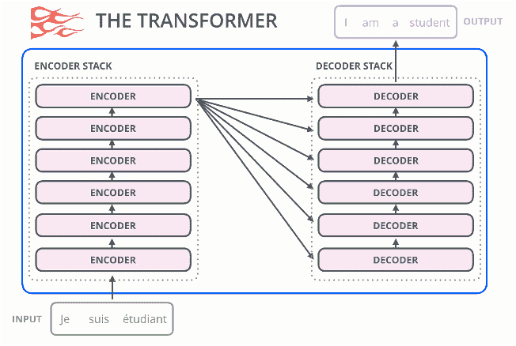

图 10 `transformer` 应用于语言翻译场景

如图 10 所示是利用 `transformer` 架构进行翻译，将 `Input` 的法语翻译成英语，建来说是将原始的法文 `input` 进行编码，这里编码带入了大量的信息，包括：`token` 在句子中的位置信息、`token` 与上下文的自注意力的信息等等，这些信息经过相同的 `6` 个 `layer` 计算完成后输出给 `decoder` 模块，`decoder` 模块则将编码所含的位置信息、自主力机制信息等等按照目标语言进行预测，从而产生翻译的结果。

### 3.4.2 Positional Encoding（位置编码）

单词在 `sequence` 中的出现的位置和顺序构成了 `sequence` 的语义，由于 `Transformer` 模型中没有递归和卷积的模块，为使模型可以利用 `sequence` 的顺序信息，`transformer` 模型中为每一个 `token` 注入了在 `sequence` 的相对信息和绝对信息。如图 11 所示模型为每个输入的 `input embedding` 注入了 `positional encoding` 信息，`positional encoding` 与 `input embedding` 保持一样的 `dmodel` 维度信息，因此可以直接将 `input embedding` 的向量与 `positional encoding` 直接求和。

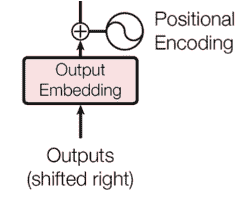

图 11 `transformer` 架构中的 `positional encoding` 的信息插入

`positional encoding` 的计算：一般可以使用学习或者是固定的方法来确定，如图 12 所示，采用正余弦函数的方式进行位置编码。计算逻辑解析：`pos`：`token` 的位置；`i`：`token` 的 `embedding` 的 `dimension` 维度。

`positional encoding` 的每一个维度的值对应一个正弦值，其波长呈现从 `2π`到 `10000*2π`的增长。该种算法可以让模型比较好地学习相对位置，因为对任何固定的偏移量 `k`，`PEpos+k` 都可以被表示为 `PEpos` 的线性函数。另有一个优势是推理时可以生成比训练时遇到序列长度更长的序列。

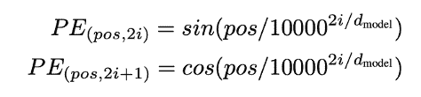

图 12 基于出现的次序计算一对编码，用来表征其位置信息

如图 13 所示，针对第 `k` 个 `input` 的 `positional encoding`，其位置编码实际就是 `sin（wi t）`、`cos（wi t）`的交叉出现的向量：

`[（sin（w1 t），cos（w1 t）），（sin（w2 t），cos（w2 t）），……（sin（Wd/2 t），cos（Wd/2 t））]`，其中 `W` 也为需要训练得出的参数。

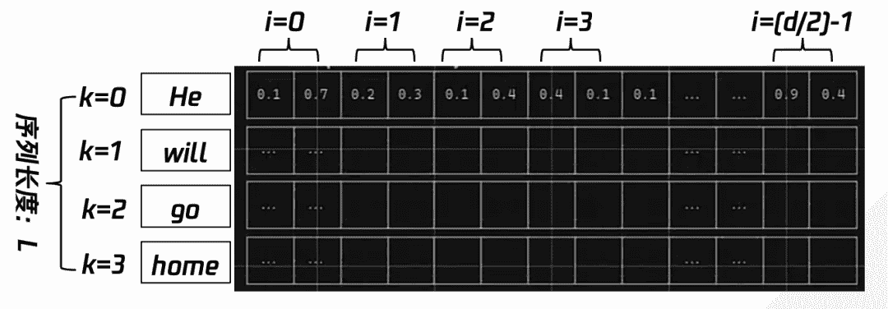

图 13 第 `k` 个位置的 `token`，生成与 `token` 的向量表示 `dimension` 长度一样的位置表示

如图 14 所示是 `positional encode` 的热力学度（不同值用不同的颜色表示），向量维度 `dmodel=128`，`sequence` 长度 `L=50`，每一行（`row`）是某个位置的 `positional encode` 的编码，呈现交叉竖条状（`sin`、`cos` 交叉）；每列则是不同的 `positional encoding` 在某个位置（如 `i`）的值。可以发现当 `i` 在（`0`，`50`）时，热力学表示更加丰富。另外，`positional encoding` 实际上与 `input token` 内容无关，当条件相同时，不同的 `input token` 所在位置相同，那么他们的 `positional encoding` 是相同的。

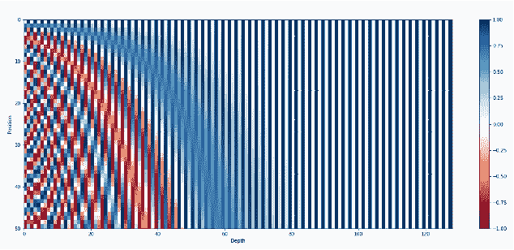

图 14 从 `0` 到 `50` 的位置的向量表示

## 3.5 transformer 的 self-attention 的计算过程推演

`transformer` 的注意力过程相当复杂，这里重点参考了参考文献 7.3 部分的内容。自注意力机制（`self-attention`）能够关注输入序列中不同位置的信息，并根据这些信息来生成当前位置的输出。多头自注意力机制（`MHA`）通过并行处理多个注意力机制，能够更好地捕捉输入序列中不同维度的信息，增强模型的表达能力和学习效率，从而提高模型在各种任务中的性能，例如机器翻译、文本生成和图像识别等。

### 3.5.1：使用 `Wq`、`Wk` 计算 `a1` 与其他所有 `a2`，`a3`，`a4` 的关联

如图 15 所示，输入为（`a1`，`a2`，`a3`，`a4`）的向量，按照传统递归神经网络或者卷积神经网络算法，会依顺序计算关联性，如：（`a1`->`b1`），（`a1`，`a2`）->`b2`，（`a1`，`a2`，`a3`）->`b3`、（`a1`，`a2`，`a3`，`a4`）->`b4`，而 `transformer` 的 `self attention` 方法则在计算 `b` 时考虑所有的输入，包括：计算 `b1` 时考虑 （`a1`，`a2`，`a3`，`a4`），计算 `b2` 时考虑（`a1`，`a2`，`a3`，`a4`）、 计算 `b3` 时考虑（`a1`，`a2`，`a3`，`a4`）、 `b4` 时考虑（`a1`，`a2`，`a3`，`a4`）。

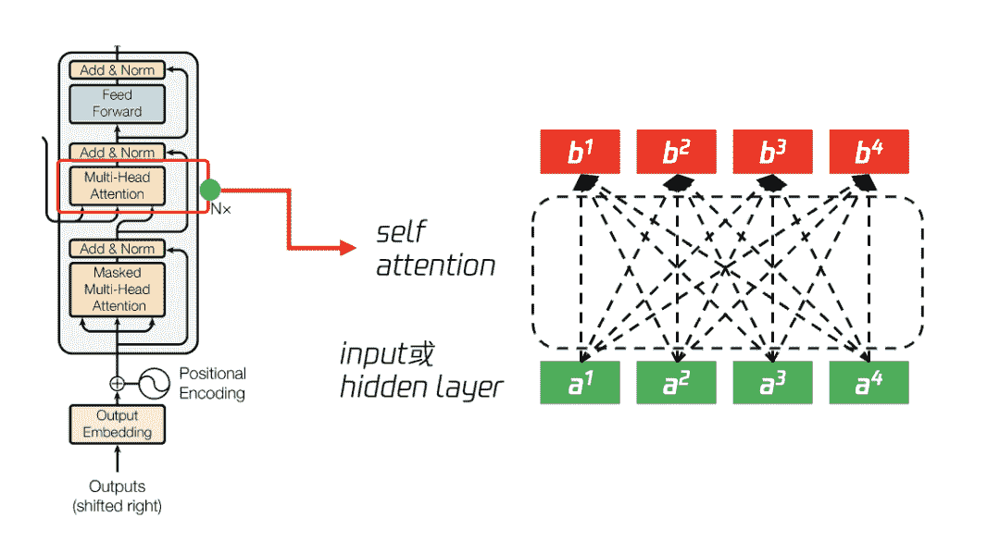

图 15 从输入 `a` 向量计算得到输出 `b` 向量

如图 16 所示为计算 `a1` 与其他输入的关联度（即注意力分数）的过程：

第①步：假设输入 `sequence` 共有 `4` 个 `token`，分别是 `a1`，`a2`，`a3`，`a4`，在 `self-attention` 中首先会计算 `a1` 向量与其他 `token`（`a2`，`a3`，`a4`）的关系，图 15 中的 `Wq` 与 `Wk` 矩阵均是通过学习所得，将 `a1`，`a2`，`a3`，`a4` 分别乘 `Wk` 矩阵得到 `k1`，`k2`，`k3`，`k4` 等矩阵，同时将 `a1` 与 `Wq` 矩阵相乘得到 `q1` 矩阵。

第②步：计算得到输入 `token` 的 `a1`，`a2`，`a3`，`a4` 的 `K` 值（`k1`，`k2`，`k3`，`k4`）和 `a1` 所对应的 `q` 值（`q1`）后，将每个 `k` 值与 `q1` 相乘，得到 `a1，1`，`a1，2`，`a1，3` 和 `a1，4`，相当于 `a1` 与其他输入 `token` 的关联权重。

第③步：`a1，1`、`a1，2`、`a1，3`、`a1，4` 是通过矩阵乘法得到的，通过 `softmax` 函数进行归一化，得到了向量 `a′` ，共有 `j` 项（输入 `token` 数量），每一项 `a（1，i）′` 即为 `a1` 与其他输入 `token` 的注意力分数。

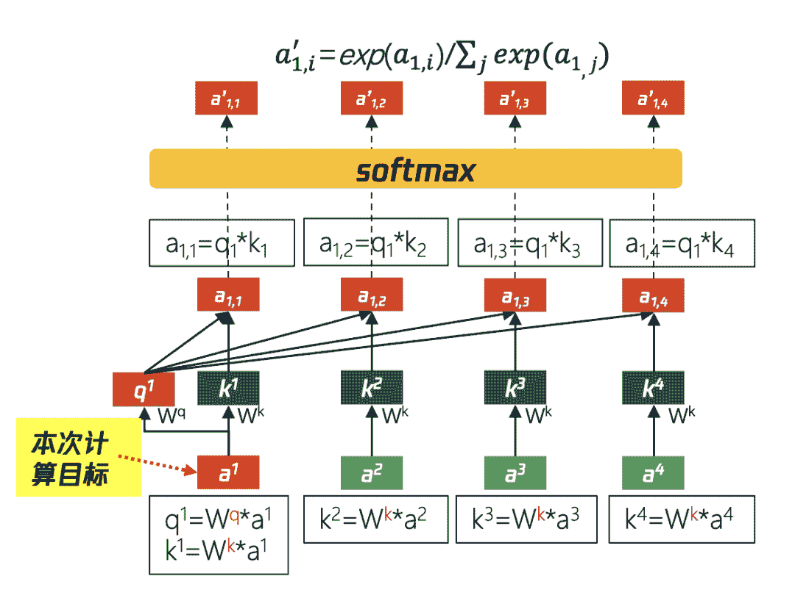

图 16 计算 `a1` 与其他输入的注意力分数

### 3.5.2：使用 `Wv` 矩阵从 `Attention Score` 中提取信息

在上一步中使用了 `Wq`（针对 `a1`）算出了 `q1` 矩阵、使用 `Wk`（针对 `a1`，`a2`，`a3`，`a4`）算出了 `k` 矩阵（`k1`，`k2`，`k3`，`k4`），利用 `q1` 分别与（`k1`，`k2`，`k3`，`k4`）并经过 `softmax` 处理得到 `Attention score`（`a’1，1`，`a’1，2`， `a’1，3`， `a’1，4`），但信息量过大，通过步骤 `2` 的 `Wv` 矩阵与（针对 `a1`，`a2`，`a3`，`a4`）相乘得到 `v` 矩阵（`v1`，`v2`，`v3`，`v4`），再将步骤 `1` 算得的 `attention score` 与 `v` 矩阵一一相乘，并将最后结果累加得到了 `b1`。其他 `b2`、`b3`、`b4` 均可以通过此方法运算得到。

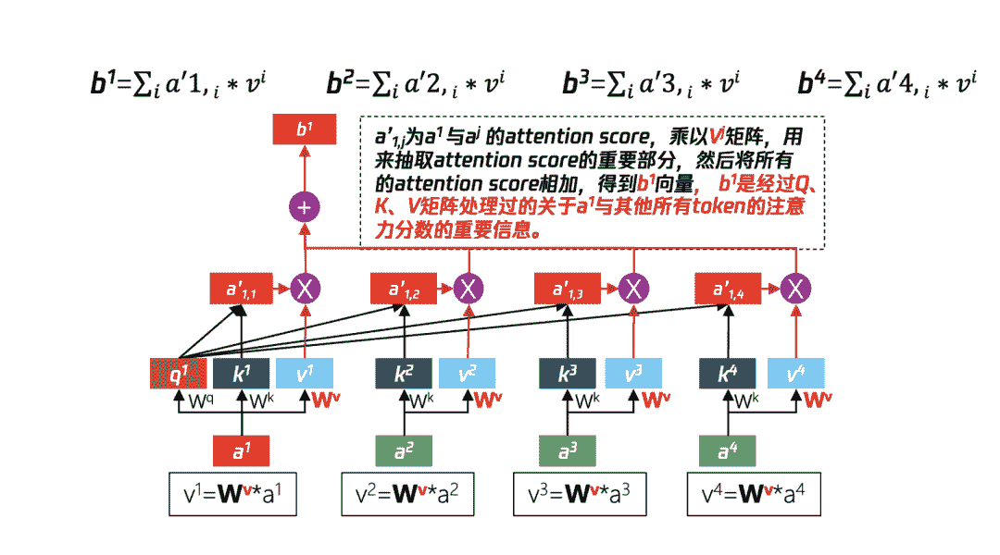

图 17 经过 `Wq` `Wk` 矩阵处理得到了注意力分数，通过 `Wv` 进一步提取分数中有价值的信息

### 3.5.3：`self-attention` 机制的矩阵化表示

前述过程演示了在输入为（`a1`，`a2`，`a3`，`a4`）的情况下，如何计算出 `a1` 与其他所有输入的注意力分数值 `b1`，`self attention` 的优势在于可以同步计算出 `a2`、`a3`、`a4` 与其他输入的注意力分数 `b2`、`b3`、`b4` 等（这里先假设 `Wq`、`Wk`、`Wv` 等参数已经 `ready`（实际这些参数通过神经网络反复迭代学习而来）从而将原来 `RNN\CNN` 的序列执行提升为并行执行，也极大幅度地提升了训练和推理的速度。

① 计算每个 `input` 的 `q` 值（`query` 值）

```
qi=[q1,q2,q3,q4]=Wq*[a1,a2,a3,a4]
```

②计算每个 `input` 的 `k` 值（`key` 值）

```
ki=[k1,k2,k3,k4]=Wk*[a1,a2,a3,a4]
```

③计算每个 `input` 的 `q` 值与其他所有 `k` 值的乘积，该值是未经过 `softmax` 的 `attention score`，矩阵计算时 `qi` 的转置与 `ki` 矩阵相乘

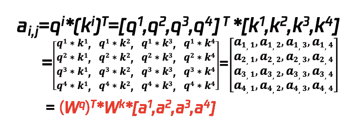

④ 针对 `ai，j` 计算 `softmax`（算法如左下图所示）的概率值得到 `a’i，j`

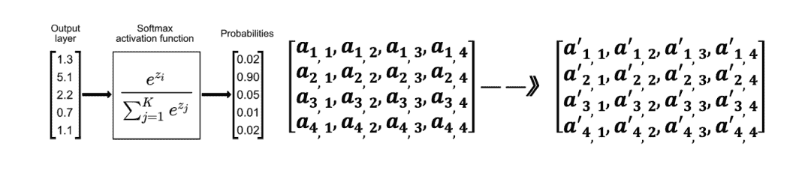

⑤ `a’i，j` 的信息量还是有些大，需要通过另外一个 `Wv` 矩阵进一步提取信息，首先将 `Wv` 矩阵与原始的输入矩阵相乘得到 `vi` 矩阵

```
vi=[v1,v2,v3,v4]=Wv*[a1,a2,a3,a4]
```

⑥将 `vi` 矩阵与已经算得的 `softmax` 的值 `a’i，j` 相乘来提取信息，计算过程如下：

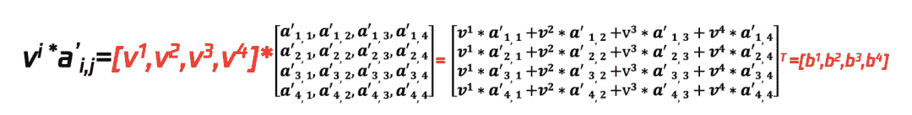

步骤 `4`：`self-attention` 机制的公式化表示

由于在使用 `GPU` 执行预算时，会有大量的矩阵变换技巧，所以使用了大量的篇幅来解释矩阵预算的细节，回到更高阶的视角，可以用少数几个公式来表示以上的运算过程，如下：

输入序列 `A=[a1，a2，a3，……an]`，三个学习所得的权重矩阵 `Wq`、`Wk`、`Wv`，对于输入序列 `A` 中的每个元素 `ai`:

① 公式一：

```
Qi = Wq * ai

Ki = Wk * ai

Vi = Wv * ai
```

`Q`（`query`）：要进行查询的目标 `token`，计算其与其他的 `token` 的关联度。

`K`（`key`）：在上下文中用来计算与目标 `query token` 的相关 `token`，称之为 `key`。

`V`（`value`）：计算 `query` 和 `key` 后有一系列的结果，需要从这些结果中提取有用的信息，称之为 `value`。

② 公式二：

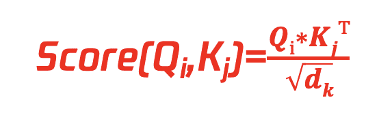

`Attention Score` 计算：计算每个 `query` 与上下文中（`context`）中的每个 `key` 的注意力分数值

`dk` :由于上述乘法会得到 `N2` 的计算结果，通过除`√dk` 来将结果降低数量级，`dk` 是 `Ki` 键向量维度。

③ 公式三：

```
a’i,j=softmax(score(Qi,Kj))
```

通过 `softmax` 函数使得注意力分数转为化 `0` 和 `1` 之前的数值且和为 `1`，进而得出注意力权重。

④ 公式四：

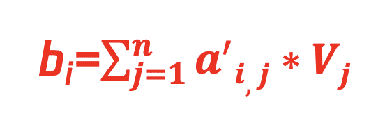

将每个元素的值向量 `Vi` 与其对应的注意力权重向量 `bi，j` 相乘， 然后求和， 得到最终的输出，即每个 `query` 与 `context` 内每个 `key` 经过 `value` 提取后的注意力值。

## 3.6 带掩码（`MASK`）的多头注意力机制

### 3.6.1 带掩码（`Mask`）注意力机制

在解码器中每个 `token` 允许看到所有的位置的 `token`，但是在编码器中为了保持自回归性，在计算多头注意力机制时需要遮挡该位置以后位置的信息，即使其只能基于已经看到的 `token` 来预测下一个 `token`，而不能看到全貌，该技术称为 `masking`。

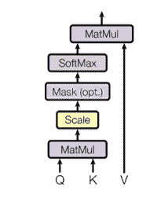

图 18 `Mask` 遮挡住后续信息

（`2`）多头（`MHA`）注意力机制

多头注意力机制允许模型共同关注来自不同位置的不同表示子空间的信息。

```
MultiHead(Q, K, V ) = Concat(head1, ..., headh)WO

where headi = Attention(Q WiQ , K WiK , V*WiV )
```


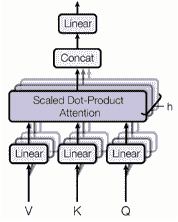

图 19 多 `Head` 计算不同维度的关联信息

## 3.6.2 前馈传播（FFN）中的计算

在每一个 `sublayer` 中包含 1 个注意力层和 1 个前馈层（即 `FFN`），该 `FFN` 层是一个全连接的前馈网络，它由两个线性变换以及它们之间的 `ReLU` 激活函数组成，在不同的位置执行的线性变换是相同的，但它们在不同层使用不同的参数。

```
FFN(x) = max(0, x*W1 + b1 )*W2 + b2
```

其中：

`x`：`attention` 层算出每个 `input` 的归一化后的 `Attention` score；`W1`、`b1`、`W2`、`b2` 等：权重参数。

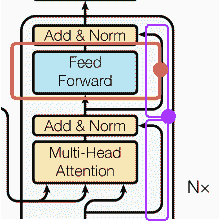

图 20 `transformer` 的 `FFN` 计算和残差连接

## 3.6.3 残差连接网络，减少上一层信息损失

图 20 中标紫的箭头为残差网络连接，在 `transformer` 模型中，在归一化前使用 `ResNet`，最终每个 `sublayer` 的输出为 `LayerNorm（x + Sublayer（x）`，其中 `Sublayer（x）` 是经过 `MHA` 或者 `FFN` 计算后的结果，然后加上（`ADD`）通过 `Residual Network` 输送过来的输入 `x`。`Add` 即为残差模块（`Residual Block`），将本层的输出和本层的输入对应位置相加（本层的输出和本层的输入维度相等）作为最终的输出。作用是将上一层的输入传给本层，避免因为上一层的处理导致丢失信息（在反向传播时抑制梯度消失）。

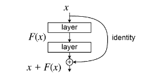

图 21 `transformer` 中也使用了 `ResNet`

# 4、尝试理解反向传播（`Back Propagation`）

理解反向传播，首先必须要理解 `ChainRule`，本部分重点引用了参考文献 7.5 中内容。`Back Propagation` 以网络每一层的权重为变量计算损失函数的梯度，以更新权重从而最小化损失函数。反向传播核心目标是找到合适的权重，使得对于训练集中的每个输入向量，神经网络都能产生一个与预设目标向量紧密匹配的输出向量。该方法整体上分为如下步骤：

step1：初始化权重（`weight`）并设置学习率（`learning rate`）和停止条件（`stopping criteria`）

step2：随机选择一个输入（`input`）及其对应的目标向量

step3：计算每一层的输入和最后一层的输出

step4：计算敏感度分量（`sensitivity`）

step5：计算梯度分量（`gradient`）并更新权重

step6：检查是否符合停止条件。退出并返回权重或循环回到步骤 2。

## 4.1 前序参数调整对预测结果的影响的演示

如图 22 是简单的 10 个 `input` 输入、4 个 `output` 的多层神经网络结构；图中`Σ`表示求和单元、`⊘` （图中圈里为曲线）代表非线性激活函数，计算单元之间的连线是权重。

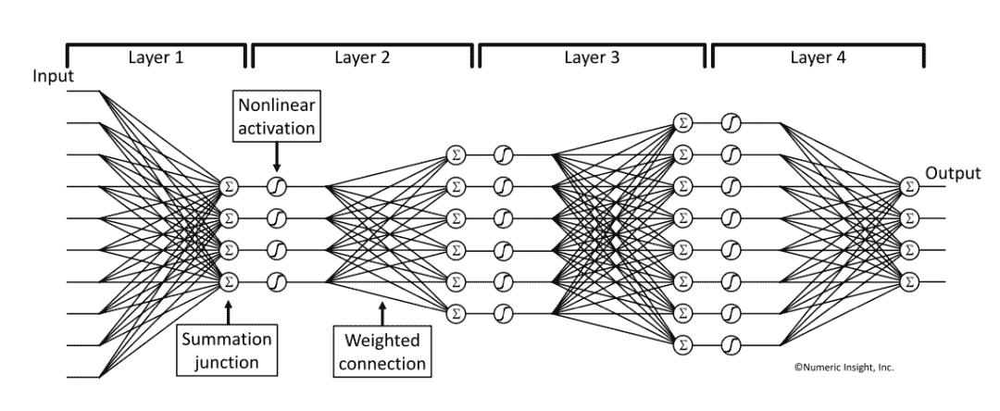

图 22 神经网络表示

### 4.1.1 定义计算结果与预期的目标 error

在图 23 基础上引入了“`Error computing block` 模块”，即图中的三角块，用来计算输出 `output` 与预期的 `target` 的差值即 `Error`。训练神经网络就是通过持续的迭代来缩小差距。我们通过打包（`Boxing`）`Layer3` 及其之后所有 `Layer`（图中的灰底部分），我们称之为 `current box`，从该 `box` 中出来的输出为 `e`，假设输入为`{c1，c2，c3，c4，c5，c6}`，我们的定义输入与输出的关系为：

```
e = E(c1, c2, c3, c4, c5, c6)
```

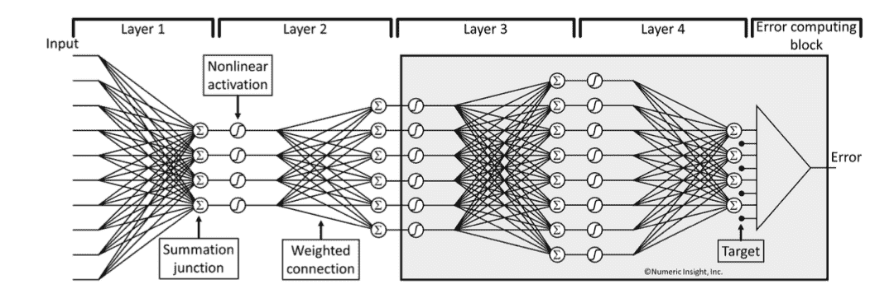

图 23 `Error computing block` 模块，计算输出 `output` 与 `target` 的偏差

### 4.1.2 某一层的输入所产生的敏感度分量

如图 24 展示的是计算敏感度分量（`sensitivity`）的过程，每个 `input` 项 `ci` 对应一个敏感度分量`δci`，当前 `box` 的所有的输入敏感度分量构成了最终的输出 `e` 的敏感度分量，当前所有输入的敏感度分量可以表示成：

`{δc1,δc2,δc3,δc4,δc5,δc6}`

假设 `c4` 和 `c6` 有微小变化`Δc4` 和`Δc6` ，那么对最终 `e` 带来的影响为：

```
δc4* Δc4+δc6* Δc6
```

在 `BP` 算法中，当前输入组件中的微小变化所产生的影响，最终会在输出端叠加。

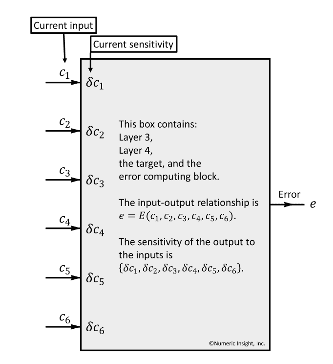

图 24 每个输入 `input` 对 `error` 的影响称为敏感度分量

### 4.1.3 往前推计算前一层（Preceding）的输入对于当前层（Current）的敏感度分量

我们将视野从 `current box` 往前看，将前一层称为 `Preceding Box`（即图 24 中的全部内容），`Preceding Box` 与 `Current Input` 构构成了图 25 中的内容，有几个重要的概念：

前序 `Box`：`Preceding Box Input`，即：

```
p = { p 1,  p 2,  p 3,  p 4}
```

前序 `Box` 的输入的敏感分量，`Preceding Box Input Sensitivity`，即：

```
δp={δp1,δp2,δp3,δp4}
```

可以推断出， `Preceding Box Input Sensitivity` 必然会影响到 `Current Box Input` 的影响，同时受两者之间的相关元素影响（包括激活函数、连接权重、求和单元等）。

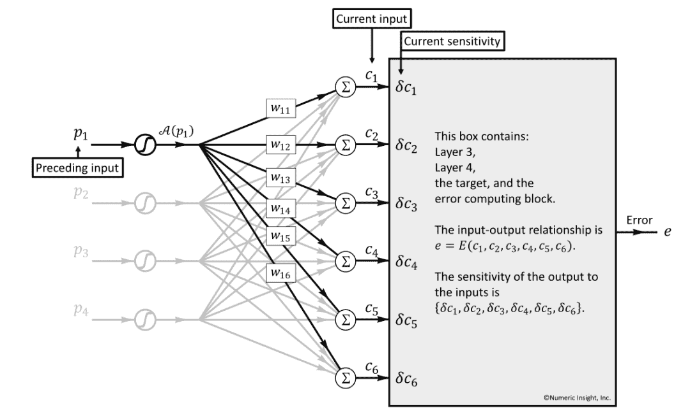

图 25 `Preceding Input` 对 `Current` 层的 `Error` 影响

### 4.1.4 前一层（Preceding）输入的 input 对于最终偏差 error 的影响

如图 26 所示，计算过程展示了 `Preceding Box` 的 `Input p1` 的微小变化`Δp1`，如何影响到最终的偏差 `Error e`，将该过程描述为公式：

`∂e⁄∂p1= δp1`，同时使 `A′（p1）` 示激活函数 `A（p1）` 在 `p1` 处的导数。

当发生`Δp1` 变化时：

①第 1 步会导致激活函数发生变化，带来的影响是：`Δp1∗A′（p1）`

②第 2 步由于与下一层的每个神经元互联，会影响到每个 `ci`（当然 `ci` 并不只受 `p1` 的影响，同样会受 `p2`，`p3`，`p4` 等的影响），此时单分析`Δp1` 的影响，分别为：`Δc1=Δp1∗ A′ （p1）*w11`、…… 、`Δc6=Δp1∗ A′ （p1）*w16`

③第 3 步会进入到 `Current Box`，会遵循本 `Box` 的敏感度分量即：`Δc1∗δc1+⋯+Δc6∗δc6`

④ 将`Δci` 逐一代入，得到上图中右下角的结果： `∂e⁄∂p1=δp1=Δp1∗A′ （p1）*w11∗δc1+⋯+Δp1∗A′ （p1）*w16∗δc6`

⑤ 前一层的敏感度相较于当前层的敏感度，公式化：`δpi=A′ （pi）*∑j wij∗δcj`

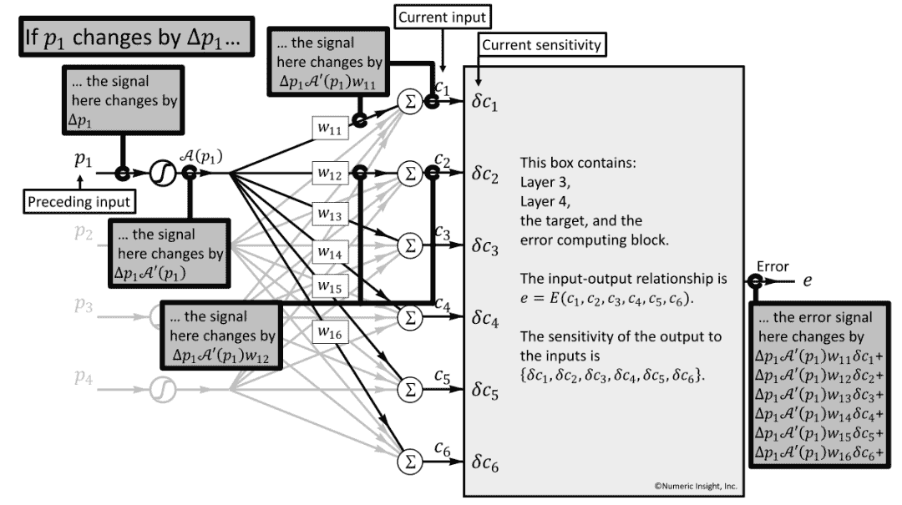

图 26 `preceding input` 的 `p1` 的变化`Δp1` ，带来最终 `error` 的影响

### 4.1.5 Current Box 的输入权重 `W11` 对于最终 error 的影响

如图 27 演示了权重（以 `W11` 为例）如何影响到最终的 `error` 值，当 `W11` 发生了`ΔW11` 的变化时：

第 1 步：会直观地影响 `Current Box` 的 `Input` 输入，即`Δw11∗A（p1）`

第 2 步：`c1` 输入对应的 `Current Box` 的敏感度单元为`δc1`，整体对 `e` 的影响为：`Δw11∗A（p1）∗δc1`

第 3 步：直观地，`e` 对于 `w11` 的偏导数（`partial derivative`）为：`∂e/∂w11=A（p1）∗δc1`

第 4 步：泛化地，`e` 对于 `wij` 的偏导数的公式化描述为：`∂e/∂wij=A（pi）∗δcj`

总结：通过该公式我们可以计算偏差 `error` 与权重参数 `W` 之间的关系，可使用最速下降法（`steepest descent`）最小化误差，并持续迭代优化权重。

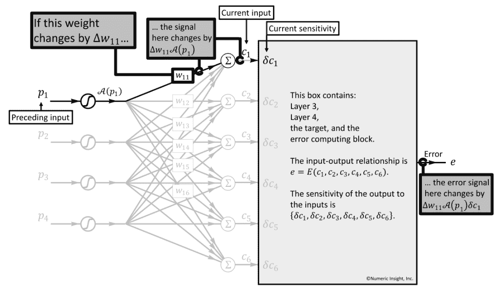

图 27 权重 `W11` 对最终 `error` 的影响

## 4.2 反向传播利用偏微分调整参数

在机器学习领域，用来评估两组数据集之间的差异方式有多种，包括：`Mean Square Error`（均方误差）、 `Cross Entropy`（交叉熵）等，整个神经网络训练就是不断调试参数，使得生成结果和预期结果的差异逐步收敛。

### 4.2.1 链式法则介绍

链式法则：也叫“复合函数的求导公式”，因为在前馈传播后，如果所产生的结果与预期值差距较大，则会采用反向传播来调整参数，而反向传播一般是运行随机梯度下降算法，需要通过求导数的方式来计算各个参数对于输出结果的影响，而这里求解不同的参数对于结果的影响就会使用到链式法则。

case1：函数：`z=h（y），y=g（x）`，求 `z` 对 `x` 的导数。

方法：`∆x→∆y→∆z`， `x` 影响 `y`，`y` 影响 `z`，所以 `x` 会对 `z` 产生影响：

`dz/dx=(dz/dy)*(dy/dx)`

case2：函数：`x=g（s）、y=h（s）、z=k（x，y）`，求 `z` 对 `s` 的导数

方法：`s` 的变化会同时影响到 `x` 和 `y`，继而影响到 `z`，`∆s→{（∆x、∆y）}→∆z`，结果为：

`dz/ds=(dz/dx) (dx/ds) + (dz/dy) (dy/ds)`

### 4.2.2 损失函数与权重参数的表示

如图 28 所示是一种简单的神经网络，输入为 `x1`、`x2`，神经元变化为简单的：`z=x1 w1+x2 w2+b`，激活函数`σ`为 `sigmoid（z）`，一个神经元的最终输出为 `a`，整个计算过程可以表示为：`a = sigmoid（x1 w1+x2 w2+b）`

`Back Propagation` 过程的计算目标：找到权重参数对于最终的偏差 `Cost` 的影响，换一种数学表达“找到损失函数 `Cost` 对于每个权重的偏微分（`∂`）”，即：`∂Cost∕∂w`，基于链式法则往后算一步，得到公式：

`∂Cost/∂w=∂C/∂z∗∂z/∂w`

显而易见，需要计算`∂C/∂z` 和`∂z/∂w`，其中：

（1） 将计算`∂z∕∂w` 的过程称为“`Forward Pass`”，由于从 `w` 得到 `z` 的过程为：`x1 w1+x2 w2+b`，所以`∂z∕∂w1=x1`，`∂z∕∂w2=x2`

（2） 将计算`∂C∕∂z` 的过程称为“`Backward Pass`”，因为 `z` 还需要经过激活函数`σ`的处理，又可以描述为计算 `C` 对激活函数`σ`的输入 `z` 的偏微分，过程较复杂继续在下一页描述。

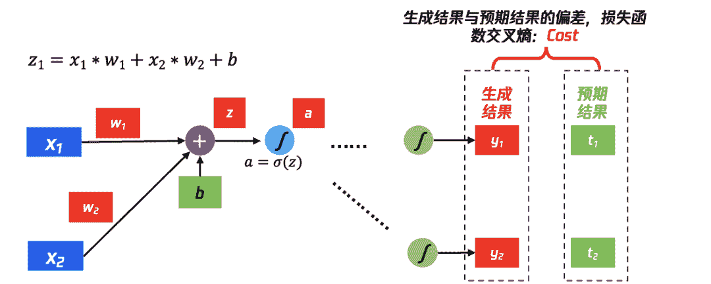

图 28 最终偏差 `Cost` 对权重参数 `w` 的影响，`ChainRule` 传递

### 4.2.3 第一层的`∂C∕∂z` 与第 2 层网络的关系，继续向第 2 层计算

如图 29 所示，第 1 层中的`∂C∕∂z`，需要继续递归地通过第 2 层计算，计算逻辑如下：

`∂C/∂z= ∂a/∂z * ∂C/∂a`

其中：`∂a/∂z=σ′（z）`， `σ′（z）`如图 30 中 `sigmoid` 的导数所示，易于计算得到， `∂C/∂a` 则继续基于 `Chain Rule` 继续推演：

`∂C/∂a=∂z′/∂a∗∂C/∂z′+(∂z′′)/∂a∗∂C/∂z′′`

其中已知：

`∂z′/∂a=w3`、` ∂z′′/∂a=w4`

则：

`∂C/∂z= σ^′ (z)[w3∗∂C/∂z′+w4∗∂C/∂z′′]`

其中`∂C/∂z′`、 `∂C/∂z′′`在本步骤中仍然无法计算得到，仍需依赖下一层的计算结果。

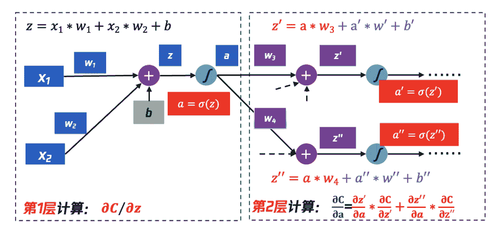

图 29 仅计算第 1 层，还无法感知 `Cost` 和 `w1`、`w2` 的关系，继续计算第 2 层

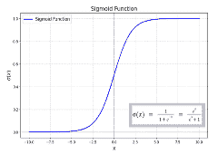

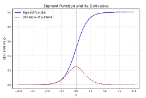

图 30 涉及到有激活函数的计算，其结果是已知的

### 4.2.4 继续计算`∂C∕∂z′`和`∂C∕∂z′′`偏微分，继续向第 3 层计算

如图 31 所示，我们在计算到第 2 层时，`∂C/∂z′`和`∂C/∂z′′`无法在本层计算得到（最终的损失函数 `C` 相较于本层的 input 的 `z’`和 `z’’`的偏微分），则继续向前延伸一层来计算（递归思路），以 `∂C/∂z′` 为例来描述计算结果，它与下一层的关系如下：

`∂C/∂z′=∂a′/∂z′(∂za/∂a′∗∂C/∂za+ ∂zb/∂a′∗∂C/∂zb)`

`∂za/∂a′`与`∂zb/∂a′`在就是连接权重： `∂za/∂a′=w5`， `∂zb/∂a′= w6`

`∂a′/∂z′`则是针对激活函数的求导：`∂a′/∂z′= σ（z′）`

那么核心需要求解的就是`∂C/∂za` 和`∂C/∂zb`，同样地需要继续向前求解。

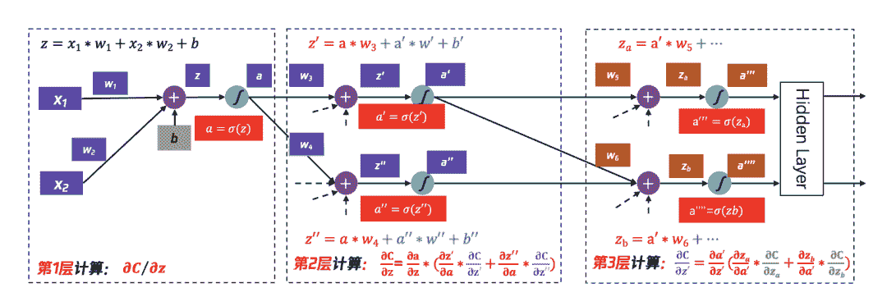

图 31 第 2 层仍然无法得到最终结果，继续向第 3 层计算

### 4.2.5 持续迭代，直到最后一层 output layer

如图 32 所示，前面一层的激活函数的输入 `z` 对最后偏差函数 `C` 的偏微分（`partial derivative`）与后面的每一层都相关，换言之：

当我们算出了最后一层 `N` 的权重参数与最终偏差 `C` 的偏微分，那么我们就可以算出 `N-1` 层的权重参数与最终偏差 `C` 的偏微分，以此类推，直到我们算出该神经网络所有的权重相较于最终偏差 `C` 的偏微分。

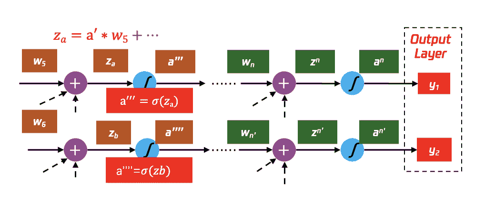

图 32 递归计算，一直到 `output layer`

## 4.3 反向传播+梯度下降更新参数

`Back Propagation` 描述了一个过程，该过程迭代计算每个权重对于最终偏差 `Cost` 的影响（即偏微分），那么如何运行 `Back Propagation` 过程去调整这些参数呢？目前较为可行的方式就是随机梯度下降方法（`Stochastic Gradient Descent`），在 `Forward Propagation` 和 `Back Propagation` 过程中运用随机梯度下降法及一些优化手段，可以自动调整参数使得神经网络输出与预期结果收敛。

### 4.3.1 梯度下降法的数学定义

梯度下降法（`Gradient Descent`）用来找到局部最小值，如图 33 所示，必须向函数上当前点对应梯度的反方向的规定步长距离进行迭代，直到到达局部最小值。一般的数学定义如下：如果实值函数 `F（x）` 在 `a` 点出可微且有定义，那么函数 `F（x）` 在 `a` 点沿着梯度相反的方向 `-∇F（a）` 下降最多。

如图 33 所示，左 `F（x）` 函数的参数 `x0`，`x1`， `x2`， `x3`， `x4` 等，输入到梯度函数：`b=a-η∇F（a）`

那么当从函数 `F（x）` 的局部极小值 `x0` 出发时，对应参数：

`xn+1= xn-ηn*∇F（xn）`，其中 `n≥0`

因此可以得到： `F（x0）≥F（x1）≥ F（x2）≥ F（x3）≥ F（x4）`

如果顺利的话序列`（xn）`收敛到期望的局部极小值，注意每次迭代步长是可以改变。

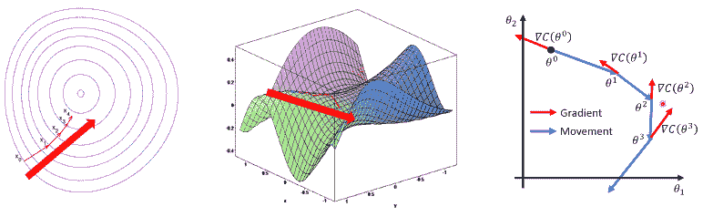

图 33 梯度下降演示

### 4.3.2 随机梯度下降法定义

本质上是对如下问题进行求解，即找到合适的参数`θ∗`，使损失函数 `Loss` 最小。`θ∗=arg（ min（ L（θ） ）`），其中`θ`是参数， `L` 是损失函数。假设函数有 2 个参数`{θ1， θ2}`，随机选取两个初始参数`[θ10，θ20]T`，第 2 组参数`[ θ11，θ21]T` ，按照梯度下降的方法：

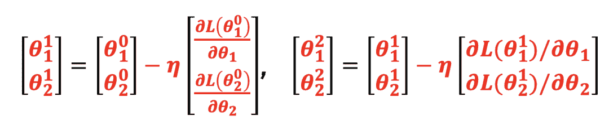

计算梯度（`Gradient`）的简单表示：

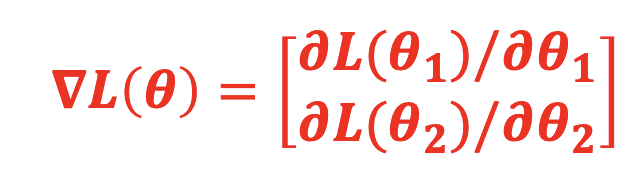

通过梯度下降法更新参数简单数学表示：

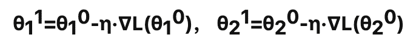

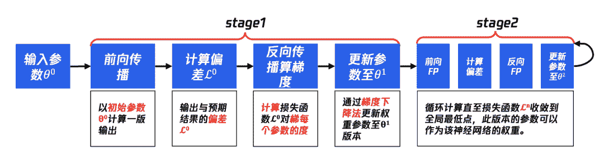

图 34 反向传播与梯度下降的关系

### 4.3.3 逐层反向传播，累加计算偏微分

在大语言模型的训练中基础的计算逻辑是：`a=σ（wx+b）` ， `σ`如 `sigmoid`

求解权重 `w` 对输出 `a` 的偏微分：

`da/dw= da/dσ∗dσ/dw=σ′(w)∗x`

从第 `n-1` 层到第 `n` 层的正向计算：

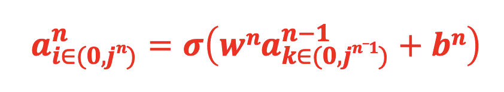

从第 `n` 层反向传播到 `n-1` 层的梯度计算：

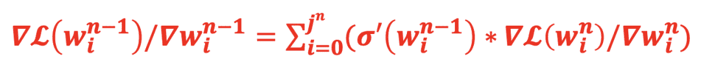

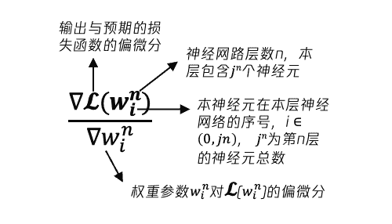

图 35 梯度表示

同理，从 `n-1` 层=>`n-2` 层，`n-2` 层=>`n-3` 层等等，每个神经元的参数的梯度均可以通过该种方法进行计算可得。

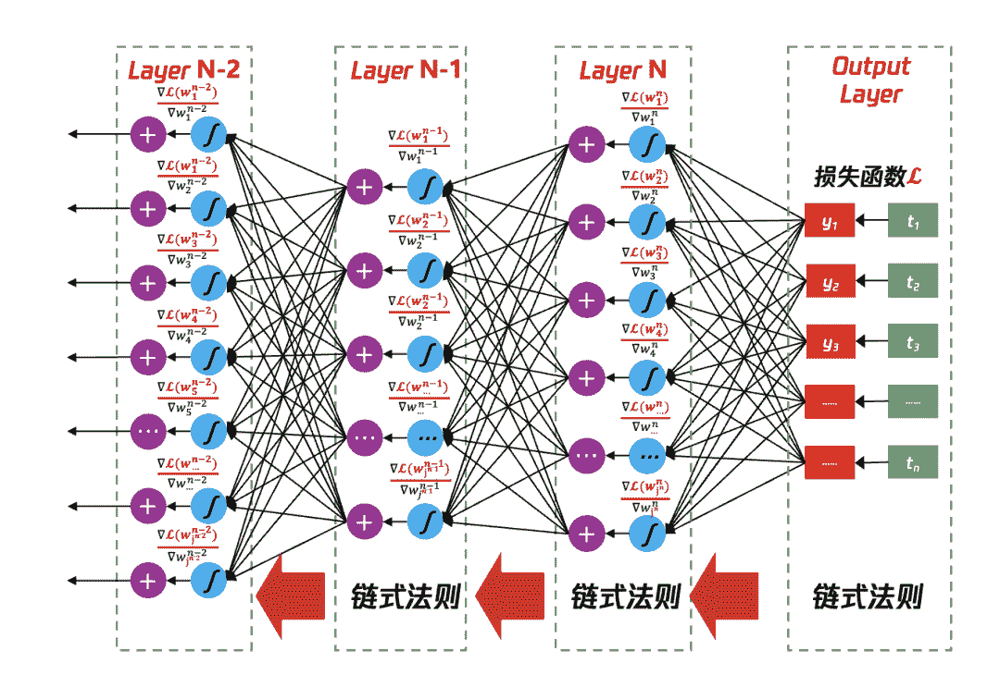

图 36 反向传播计算梯度，利用梯度更新参数

### 4.3.4 如何更新权重参数

当 `BP` 步骤完成每个参数对损失函数的偏微分后，接下来就是通过梯度下降来更新整个神经网络的参数，更新方法如下：

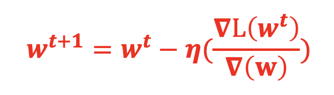

其中：`η`为学习率， `∇L（w^t ）/∇（w）` 为第 `t` 次迭代参数 `w` 对损失函数 `L` 的梯度，`t` 表示迭代版本。


### 4.3.5 为什么需要调整学习率 `Learning Rate`

`学习率`控制了朝着梯度方向下降的速度或者说步长。如果`学习率`太大，那么可能会“跳过”最小值，导致模型无法收敛；反之，如果`学习率`太小，那么优化过程会非常慢，甚至可能停留在一个不理想的局部最小值点。

### 4.3.6 如何调整学习率

`Adaptive Learning Rate`（自适应 `Learning Rate`），简称 `AdaGrad` ，为每个参数设置不同的 `Learning Rate`：

``

其中 `t` 是迭代次数，即 `learning rate` 与迭代次数相关，迭代次数越多，`learning rate` 会逐步变小，使其下降速度变得更慢，避免跨过全局极值点。

### 4.4 反向传播过程总结

反向传播完成了梯度计算，一般会通过随机梯度下降来更新参数的权重，运行过程如下：

**（1）损失函数 `Loss`**

``

（2）随机梯度下降首先会取一个 输入样例：`xn`，那么针对这个输入的损失函数为：

``

（3）计算梯度时，不再考虑对所有的结果的损失函数，而只针对该 `example` 的损失函数，其中`∇Lnxn` 的偏微分：

``

### 4.5 随机梯度下降与标准梯度下降的区别

如图 37 所示，计算完一个输入的偏差函数，即开始更新参数，在等高线图中出现了很多较小的点，代表以较小的步骤朝梯度下降的方向进行多次尝试；右边则是在计算所有的输入与预期的损失函数后进行一次梯度下降，步长较大，但实际上离全局最低点距离较远。

``

``

图 37 随机梯度下降带来一定的不确定性，收敛效果有时更佳

# 5、大语言模型训练为什么需要超大集群

通过前序介绍，我们了解了大语言模型的原理，即“通过向神经网络进行输入一组 `tokens`，运算预测下一个系列的 `tokens`（每个 `token` 使用概率表示），将预测的 `tokens` 的预期结果进行比较，会产生偏差，使用损失函数（`Loss Function`）来表示，然后通过反向传播过程计算整个神经网络里每个权重相较于损失函数 `L` 的偏微分（即梯度 `Gradient`），再通过梯度下降（`Gradient Descent`）的方式来持续刷新参数，直到梯度下降到全局最低点，此时权重参数达到最佳版本。”

# 6、如何使用 `GPU` 并行训练大语言模型

从以上过程可以看出，需要在一次完整的 `Feedforward Propagation` 和 `Backpropagation` 中需要保持全量数据，包括：全量的输入 `token`、利用 `transformer` 计算的注意力值、反向传播过程中的梯度、梯度下降过程中的中间值等等；随着 `Transformer` 架构将语言类的训练推理的输入 `token`、权重参数、输出 `token`、优化器状态（ `momentums & variations in Adam` ）等都提升到亿级别，对于每次迭代所要使用的算力和显存需求也相应的呈现指数级的放大。单一的 `GPU` 已经很难完成计算，因此需要 `GPU` 集群来完成运算，所以一般采用并行方式来进行训练。一般分为数据并行、模型并行、流水线并行、张量并行等形式。

## 6.1 数据并行

将相同的模型权重复制到多个工作器（`GPU`）中，并将一小部分数据分配给每个 `GPU` 同时处理，如果模型大小大于单个 `GPU` 节点的内存，则原始的 `Data Parallelism` 无法正常工作。一般采用 `Distributed Data Parallelism`，数据交换传输应在后端进行，并且不会干扰训练计算。尤其是涉及到整个网络中的 `Gradient Accumulation`（梯度累加，在前述推导中，`n-1` 层的梯度依赖于 `n` 层的相连的 `Sum`（梯度*激活函数）），该方案训练效率不高，一般较少采用。

## 6.2 模型并行

将计算和模型参数分配到不同的机器及 `GPU` 上，换言之不同的 `device` 承载不同的计算任务，如图 38 所示，当 `Device0` 完成 `F0`（即第 0 次 `FP`）后需要等待其他设备 `Device1`、`Device2`、`Device3`、`Device4` 等依次完成 1 次 `F0`、1 次 `F0`、1 次 `F0` 和一次 `B0`、`B0`、`B0`、`B0` 等，会造成设备空等情况比较严重，模型并行的方案在训练中也并不常用。

``

图 38 模型并行（`model parallelism`）训练示意图，空等时间过长

## 6.3 流水线并行

将模型并行 `MP` 与数据并行 `DP` 相结合，以减少低效的时间“泡沫”，具体措施如下：

（1） 1 次 `FP` 和 1 次 `BP`，即一次前向传播和一次反向传播，视为一个小批次（`minibatch`），`PP` 方法核心就是将小批次继续分解为微批次（`micro batch`），使得每一个设备在某一时间不专职于处理某一次迭代 `FP` 和 `BP` 的任务，而是在同一时间能够处理多个迭代的子任务，这样设备空等的时间就会变得很小。在该领域较为出众的方法分别是 `Gpipe` 和 `PipeDream`。

### 6.3.1 `GPipe`

如图 39 中 `Gpipe` 流程所示，因为要在本 `batch` 结束后同步梯度信息以保证全局的 `Gradient` 统一的，虽然 1 个 `batch` 中 `F0` 和 `B0` 被拆成了 4 个微批（`F0，0`、`F0，1`、`F0，2`、`F0，3`）和（`B0，3`、`B0，2`、`B0，1`、`B0，0`），但是每个 `Device` 至少有 6 个 `time stage` 在等待，占总时间 14 `stage` 的 42%，较纯 `Model parallelism` 有所改善，但是利用效率仍然不算高。

``

图 39 `Gpipe` 示意图：4 设备、4 微批次，每个 `batch` 完成后更新梯度，空等时间至少 40%

### 6.3.2 `PipeDream`

`PipeDream` 和 `Gpipe` 最大的不同是“打破了批次的限制”，可以交替地执行 `FP` 和 `BP`，得益于其调度算法能够记录好过程中的梯度数据，不必等待某一次 `Gradient` 同步结束后再执行下一个迭代的运算。为了保证数据的一致性，采用如下策略：

（1） `Weight stashing`：每个 `worker` 跟踪模型版本，确保在给定一个数据批次的前向和后向传递中使用相同版本的权重。

（2） `Vertical sync`：激活函数与梯度的版本在各个 `worker` 之间流转，计算时采用从前一个 `worker` 传递过来的版本，确保一致。

衍生版本有： `PipeDream-flush` 和 `PipeDream-2BW`。

``

图 40 `PipeDream` 示意图：虽然交叉处理微批次，但是针对某一微批次的数据副本是相同的

## 6.4 张量并行

模型并行 `MP` 和流水行并行 `PP` 均采用的是垂直分割模型的方式，即将某几层神经网络指定特定的 `GPU` 来执行计算，实际上也可以采用水平分割的方式，即将一层神经网络一分为 `N`，每一个小部分分到不同的 `GPU` 上执行，此类方法一般称为 `TP`（ `Tensor Parallelism` ）。在 `transformer` 架构中有 `MLP` 和 `Self-attention Block` 有大量的矩阵的乘法运算 `GEMM`，由于矩阵行列相乘特性可以进行拆分。

### 6.4.1 `GeLU` 和 `DropOut` 的矩阵拆分并行

如图 41 所示，按照如下方案进行拆分和合并：

激活函数：`Y=GeLU（X*A）`

拆分：`Split A = [A1，A2]`、`Split B=[B1，B2]`

那么：`[Y1，Y2]=[ GeLU（X A1）， GeLU（X A2）]`

`Y1`，`Y2` 继续执行 `Dropout`：`[Z1，Z2]=[Dropout（Y1 B1）， Dropout（Y2 B2）]`

合并：`Z=Merge[Z1，Z2]`

`A1->Y1->Z1`、`A2->Y2->Z2`，在矩阵运算中时独立的，彼此并无依赖，因此可以拆分到不同的计算 `worker` 上执行，最后进行合并。

``

图 41 矩阵的 `Dot Product` 拆开再合并

### 6.4.2 `Self-attention` 和 `Dropout` 的矩阵拆分并行

如图 42 所示，为 `Self-attention` 的过程，可以针对 `Q`、`K`、`V` 进行拆解：

``

图 42 `Self-attention` 本身大量的矩阵乘法，完成可以拆开进行

`Split V=[V1，V2]`、`Q=[Q1，Q2]`、`K=[K1，K2]`，分别执行 `Self-attention` 的计算过程：

`Y1=(Softmax(Q1X)(K1X)T/√dk)*(XV1)`

`Y2=(Softmax(Q2X)(K2X)T/√dk)*(XV2)`

同样的经过 `Dropout` 过程得到 `B1` 和 `B2`，最后机型合并得到：

`Z=Dropout([Y1B1,Y2B2])`

所以 `Self-attention` 的也可将 `QKV` 进行拆分与输入 `X` 分别计算最后合并。

### 6.4.3 `Self-attention` 和 `Dropout` 的矩阵拆分并行

将流水线、张量和数据并行相结合，为每个 `worker` 放置多个较小的连续层子集，而不是设备商放置放连续的层（“模型块”），1 个 `batch` 里面的微批次按照 `worker` 的数量 `m` 进行划分，如图 43 所示，上方的图是每个 `worker` 运行连续的 `model chunks`，下方的图则进一步分拆，每个 `device` 上运行更多的 `micro batches`，这样的效果是其闲置时间更少，利用率更高。

``

图 43 将一块 `Device` 在单元时间内拆成不同的 `stage`，`stage` 越密，其闲置的概率就越低

## 6.5 并行训练中的优化手段

### 6.5.1 `Activation Recomputation`，不存储激活函数的结果而重新计算

又可以称为“`activation checkpointing`”或“`gradient checkpointing`”，假设将一个 `L` 层网络均匀地划分为多个分区，只有分区边界处的激活值会被保存并在各个工作器之间传递。分区内部各层的中间激活值仍需用于计算梯度，因此在反向传播过程中会重新计算它们，减少分区内的梯度的存储需求。

### 6.5.2 `Mixed Precision Training`，混合精度计算

如图 44 所示，采用半精度来进行训练同时不损失精度，具体技术包括：

（1） 累积梯度使用全精度 （`FP32`） 模型权重副本，避免过小导致梯度丢失。

（2） 放大损失，可以更好地处理小幅度的梯度值，以此保留原本可能丢失的值。

（3） 更小算术精度运算，包括向量点积等，因为数据较大，因此采用 `FP16` 保存；`point-wise` 类计算均可以使用半精度，本身每一个点的精度损失对于累加的结果影响较小。

``

图 44 混合精度计算常用方案

### 6.5.3 `Memory Efficient Optimizer`，内存效率优化器

在做梯度下降时，需要使用动量（类似于球体沿着山坡滚落，动量帮助选择最佳的下降方向）和方差（计算学习率），也会耗费大量的内存。包括：

（1）占据内存最多的：梯度、参数、优化器（动量和方差）等。

（2）其他包括：激活、临时缓冲区和不可用的碎片内存等。

如何进行优化？`ZERO` 方法，即 `Zero Redundancy Optimizer`（零冗余优化器），具体措施包括：

（1）`ZERO-DP`：通过动态通信调度将优化器状态、梯度和参数划分到多个数据并行进程（`ZERO-DP`）中，以最大限度地减少通信量。

（2）`ZeRO-R`：使用分区激活重新计算、恒定缓冲区大小和动态内存碎片整理来优化残差状态的内存消耗。

## 6.6 并行框架

如果从 0 到 1 构建以上的并行训练或推理能力实在太复杂了，并行训练框架核心解决的是模型的正向和反向计算与 `GPU` 的计算 `Stage` 的匹配问题（减少 `GPU` 闲置等待时间），并行推理框架则架构相对简单，工业界为了解决并行问题实际上已经历经数年探索，具体包括：

### 6.6.1 并行训练框架

1、`DeepSpeed`：由微软开发的开源深度学习优化库，支持数据并行、流水线并行和张量切片模型并行，并可以灵活组合使用，解决显存效率和计算效率；支持 `ZeRO` 等优化手段和混合精度训练；适用于通用的机器学习训练场景，擅长数据并行和内存优化，在业内使用极其广泛。

2、`Megatron-LM`：由英伟达开发的基于 `PyTorch` 的分布式训练框架，专注于训练基于 `Transformer` 的大型语言类模型。`Megatron-LM` 综合应用了数据并行（`Data Parallelism`），张量并行（`Tensor Parallelism`）和流水线并行（`Pipeline Parallelism`），擅长张量并行。

### 6.6.2 并行推理框架

1、`vLLM`：`vLLM` 是伯克利大学 `LMSYS` 组织开源的大语言模型高速推理框架，可以和 `HuggingFace` 无缝集成，`vLLM` 利用了全新的注意力算法`PagedAttention`（允许在不连续的内存空间中存储连续的 `keys` 和 `values`，可以更加有效地利用 `GPU` 现存），有效地管理注意力键和值；支持多机多卡的张量并行、流水线并行等。

2、`SGlang`：同样也是开源项目，主要作者来自于加州伯克利，大部分作者也是 `vLLM` 的作者，创新之处在于对 `LLM` 的多轮对话的良好支持，核心使用 `RadixAttention` 和 `Constrained Decoding` 可以减少 `LLM Program` 的计算量，也和 `vLLM` 的 `PA`、`Continous Batching` 兼容的。

3、`TRT-LLM`：是一款由 `NVIDIA` 推出的大语言模型（`LLMs`）推理加速框架，为用户提供了一个易于使用的 `Python API`，并使用最新的优化技术将大型语言模型构建为 `TensorRT` 引擎文件，以便在 `NVIDIA GPU` 上高效地进行推理。

4、`DeepSpeed`：`Deepspeed` 框架添加了 `DeepSpeed Inference` 具有高性能多 `GPU` 推理功能，允许用户通过适应多 `GPU` 推理的最佳并行策略来有效地服务大型模型，同时考虑推理延迟和成本；针对推理优化的 `CUDA` 内核，通过深度融合和新颖的内核调度充分利用 `GPU` 资源，从而提高每个 `GPU` 的效率；有效的量化感知训练，支持量化后的模型推理，如 `INT8` 推理，模型量化可以节省内存（`memory`）和减少延迟（`latency`），同时不损害准确性。

5、`Caffe`：`Caffe` 率先做到了在 `GPU` 上高性能运行，它写了大量 `cuda kernel`，比如 `im2col` 后调用 `cuBLAS` 来优化卷积算子。同时很早支持数据并行方式多卡训练。其性能优势让很多人从 `Theano` 切换到 `Caffe`，正如 `vLLM` 的 `Paged Attention` 打开了吞吐天花板，早期的 `ImageNet` 和 `ResNet` 均基于 `Caffe` 平台训练产出。

## 6.7 补充

截止到 25 年 7 月份最强的模型包括 `GPT4.1`（`OpenAI`）、`DeepSeek-R1-0528`（`DeepSeek`）、`Claude4`（`Anthropic`）、`Gemini2.5 Pro`（`Google`）、`Llama4`（`Meta`）、`Grok3`（`xAI`）等，当模型需要更加智能时则需要进一步提升其参数量，在了解了大模型的训练原理后，那么就不难理解为何在硬件层面需要持续进行迭代了，一般是两种思路，采用 `Sacle UP`（如 `Nvidia` 的 `B200` 系列 `GPU`，采用堆叠方式），或 `Sacle Out` 在集群层面扩充（比如 `Grok3` 接近使用了 20 万张 `H100/H200` 训练）。

# 7、参考文献

1. `Lilianweng` 是 `openai` 原高级副总裁，在 `AI` 安全、`AI` 工程实践领域有[`极`](https://lilianweng.github.io/posts/2021-09-25-train-large/)高的造诣，她的博客文章每一篇都值得细读，本文的 AI 并行训练部分重点参考： https://lilianweng.github.io/posts/2021-09-25-train-large/

1. `GPT` 训练过程参考 `openai` 的首发文章，从无监督预训练演化到指令微调和基于人类反馈的[`强化训练，基于此达到了极佳的效果，随后各个大厂`](https://arxiv.org/abs/2203.02155%EF%BC%8C%E3%80%8Atraining)均是采用此种训练方法来调试模型， https://arxiv.org/abs/2203.02155，《`training language models to follow instructions with human feedback`》


# 深度学习与 AI 相关资源列表

1. 台大李宏毅教授的系列文章，早期解读 `transformer` 注意力机制的佳作，`https://speech.ee.ntu.edu.tw/~hylee/ml/ml2021-course-data/self_v7.pdf`

2. `DeepSpeed` 并行训练框架提出的 `ZeRO` 技术，大幅度优化了训练的内存开销，`https://arxiv.org/abs/1910.02054`，《ZeRO- Memory Optimizations Toward Training Trillion Parameter Models》

3. 对 `BackPropagation` 算法解释佳作，常见的如梯度、敏感度分量、偏微分的应用等，`https://www.researchgate.net/publication/266396438_A_Gentle_Introduction_to_Backpropagation`，《A Gentle Introduction to Backpropagation》

4. 数据并行加速训练方案：`https://arxiv.org/abs/2006.15704`，《Experiences on Accelerating Data Parallel Training》

5. 流水线并行的 `PipeDream` 方案：`https://people.eecs.berkeley.edu/~matei/papers/2019/sosp_pipedream.pdf`，《PipeDream: Generalized Pipeline Parallelism for DNN Training》

6. `FP16`&`FP8` 混合精度训练方案：`https://arxiv.org/abs/1710.03740`，《Mixed Precision Training》

7. 流水线并行的 `GPipe` 方案：`https://arxiv.org/abs/1811.06965`，《GPipe: Efficient Training of Giant Neural Networks using Pipeline Parallelism》

8. 反向传播时通过梯度下降法来更新一版的参数，如何自适应地调节学习率，避免陷入 `Local Minimun`，而顺利实现 `Global Minimum`，`https://arxiv.org/abs/1804.04235`，《Adafactor: Adaptive Learning Rates with Sublinear Memory Cost》

9. `https://resources.nvidia.com/en-us-generative-ai-for-retail/watch-7`

10. `https://wuli.wiki/online/FunDer.html`

11. `https://wuli.wiki//online/ChainR.html`

12. `https://jalammar.github.io/illustrated-gpt2/`

13. `https://kazemnejad.com/blog/transformer_architecture_positional_encoding/`

14. `https://libguides.hkust.edu.hk/AI-tools-literature-review/compare-llm`
