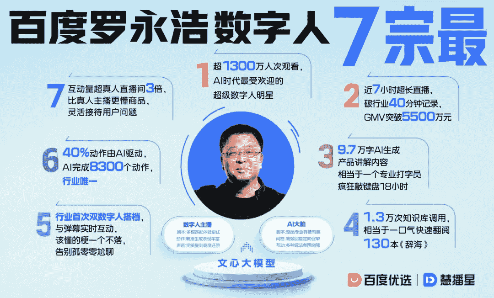
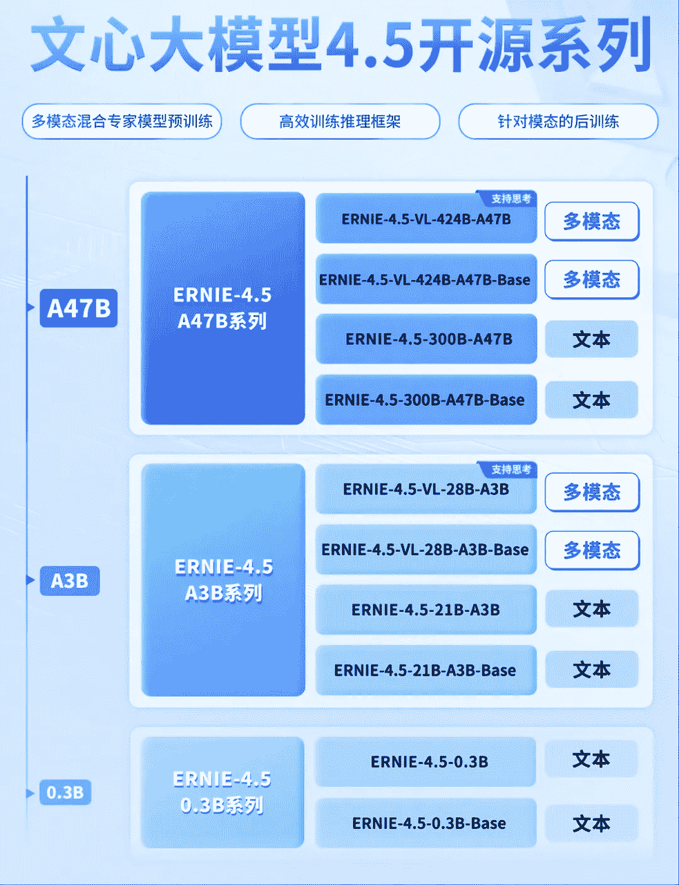
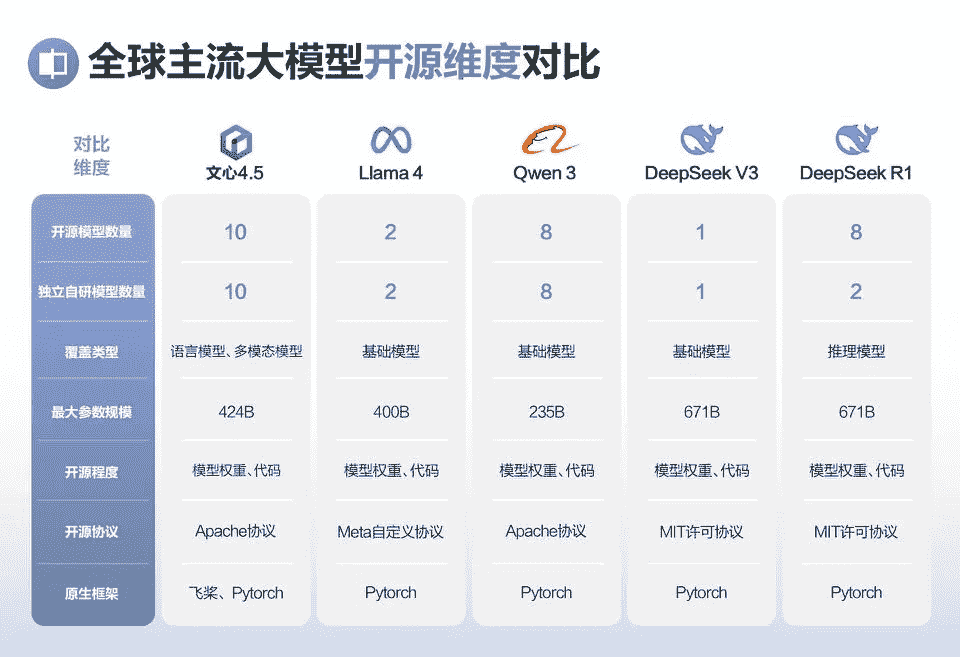
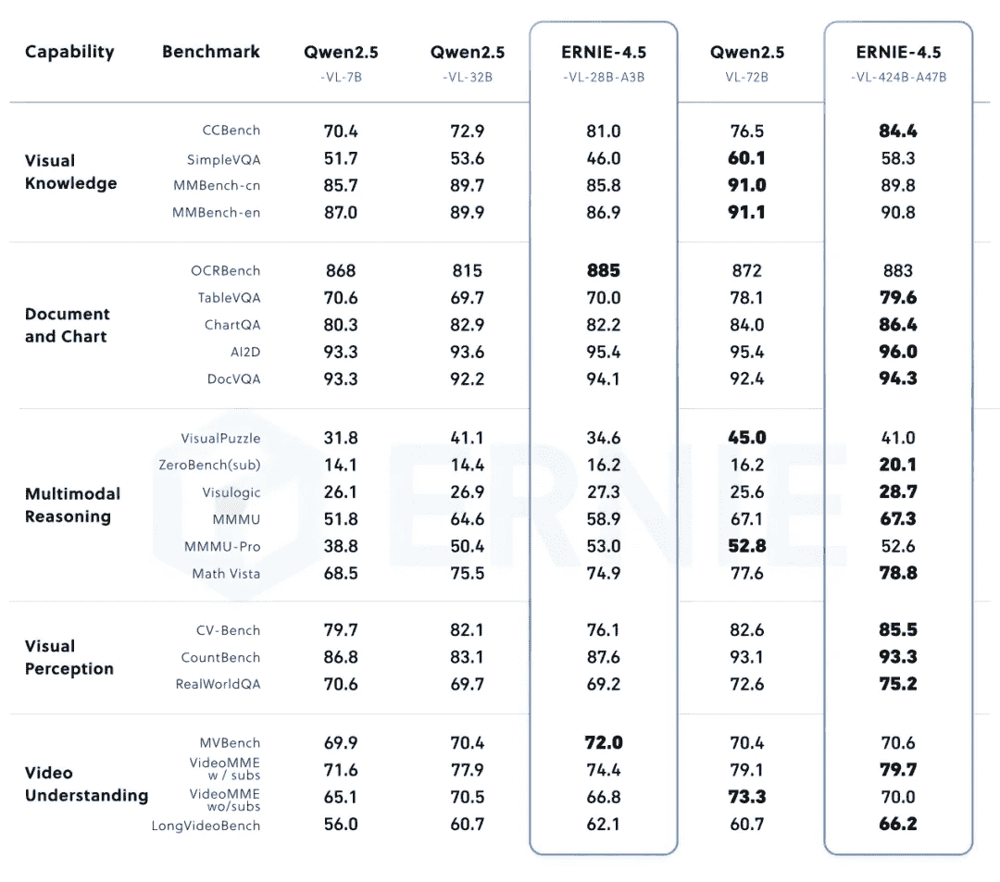
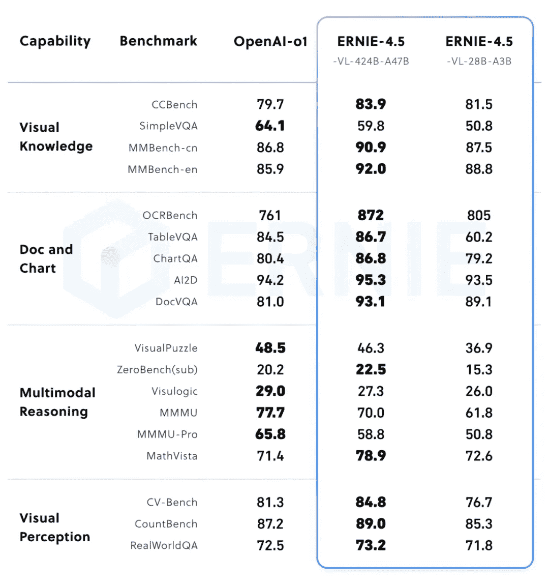
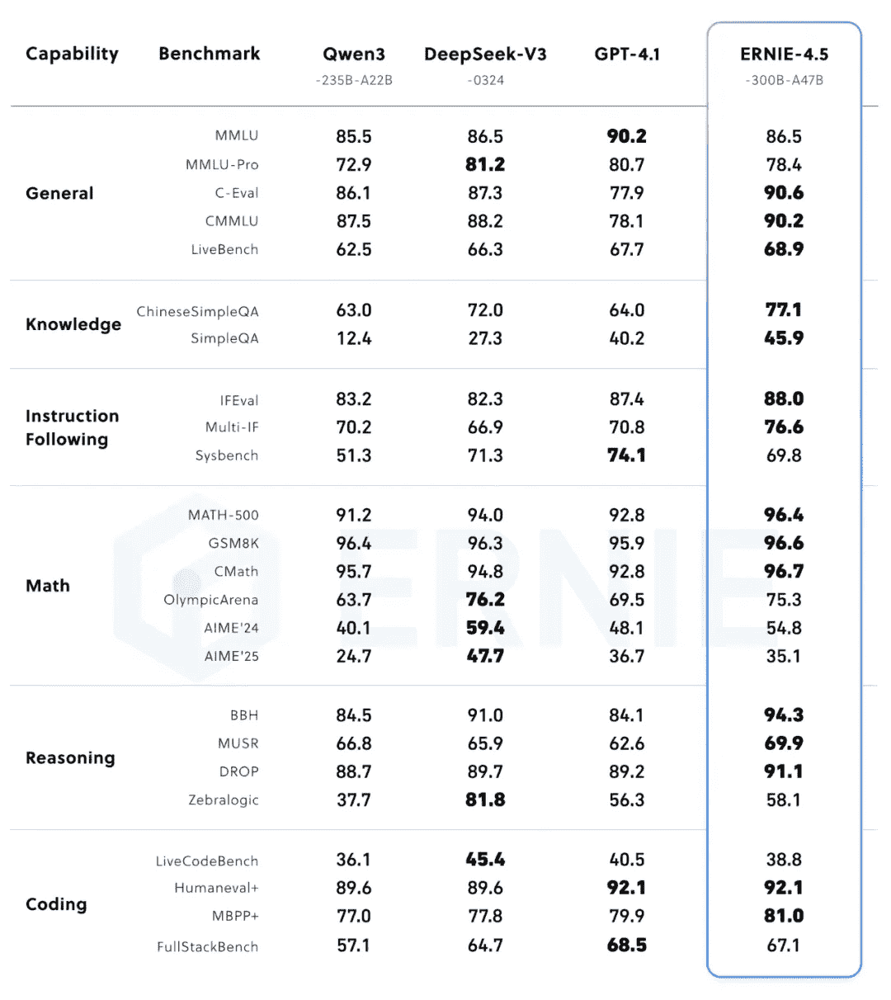
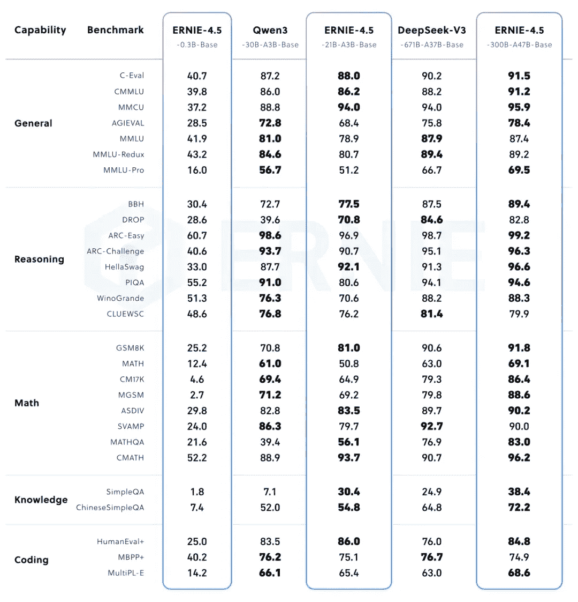
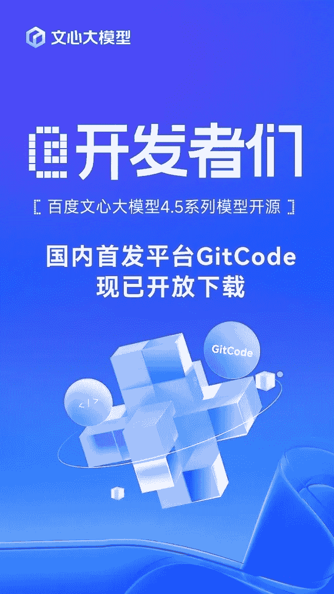

# 最强数字人背后的「AI 大模型」正式开源！

> 来源：[https://yunyinghui.feishu.cn/docx/U3AKdVyRYoHXZoxdodGcHBQAnZf](https://yunyinghui.feishu.cn/docx/U3AKdVyRYoHXZoxdodGcHBQAnZf)

凌晨 2 点的直播间本该沉寂，罗永浩数字人却正对着镜头挑眉：这个价位我比你们还心疼品牌方！弹幕瞬间炸开 ——1300 万观众盯着屏幕里那个表情、语气、手势完美复刻真人的数字人，见证它 3 小时狂揽 5500 万 GMV！

这一切都基于文心大模型的技术迭代，整场直播 AI 调用知识库 1.3 万次，生成 9.7 万字产品讲解内容，双数字人搭档做出超 8300 个动作，最终实现了对罗氏幽默的 1:1 复刻。

百度工程师透露，文心大模型现在不仅能理解文本台词，还能根据语义自动生成匹配的表情、手势和语气。「就像给数字人装了个『情绪发动机』，它能自己判断什么时候该激动，什么时候该严肃。」更夸张的是，当直播间在线人数突破 1000 万时，数字人还会临时调整话术，提醒助理「上福利链接」，这种实时决策能力让真人主播都捏了把汗。

而就在 6 月 30 日， 百度正式宣布 文心大模型 4.5 系列模型开源！ 涵盖 47B、3B 激活参数的混合专家（MoE）模型，与 0.3B 参数的稠密型模型等 10 款模型，并实现预训练权重和推理代码的完全开源。目前，文心大模型 4.5 开源系列已可在飞桨星河社区、HuggingFace 等平台下载部署使用，同时开源模型 API 服务也可在百度智能云千帆大模型平台使用。 此次文心大模型 4.5 系列开源后， 百度实现了框架层与模型层的“双层开源”。

文心大模型 4.5 系列开源模型

大模型领域的几大巨头几乎同时宣布开源，标志着 AI 正从“稀缺资源”向“水电煤”式基础设施的彻底转变。 这一转变的背后，是行业逻辑正经历重构。

以往，拥有千亿参数的大模型由于算力与研发成本高昂，长期被视作“稀缺资源”；而当下，免费开放的策略正推动 AI 技术从实验室走向广阔的现实场景。企业竞争的核心，也从单纯的技术较量转向生态体系的构建与用户黏性的争夺。唯有能够以更低成本、更高效率支撑全民化 AI 服务的企业，才能在新一轮竞争中占据优势地位。

**当**其他公司还在纠结是否开源单个模型时，百度直接甩出「王炸」： 一口气开源 10 款模型，从 0.3B 到 424B 参数量全覆盖，就像突然把珍藏多年的兵器库向全世界敞开 。在 Hugging Face 社区，开发者们发现这些模型不仅代码全开源，连预训练权重都毫无保留。

更震撼的是性能成绩单： **多模态模型在视觉常识评测中超越 OpenAI 的 o1，文本能力碾压 De**epSeek-V3，就连 21B 的轻量级模型都能和 Qwen3 打得有来有回。

文心 4.5 预训练模型在主流基准测试中表现优异

文心 4.5-300B-A47B 模型在主流基准测试中表现优异

文心多模态后训练模型在多个多模态基准测试中达到 SOTA 水平

有网友发现一个有趣的时间线：2 月 27 日路透社爆料百度将发布文心 4.5，凌晨 OpenAI 就仓促推出 GPT-4.5，结果性能被吐槽「挤牙膏」。

这场没有硝烟的战争早已暗流涌动。当百度用飞桨框架 + 昆仑芯打造出训练成本降低 99%的全栈优势时，谷歌也在 3 月开源多模态模型 Gemma 3，试图用「模型 + 工具链 + 社区」的组合拳突围。Gartner 最新报告指出，到 2026 年中国 50% 的 AI 生态将基于开源模型构建，这意味着一场全球性的技术狂欢正在拉开序幕。

对开发者来说，这场竞争堪称幸福的烦恼。现在他们可以在千帆大模型平台上，像逛超市一样挑选文心 4.5、DeepSeek 等模型，用更低成本开发应用。一位 95 后开发者在论坛分享：用文心 4.5 的轻量级模型做了个宠物翻译 APP，成本比去年低了 80%，现在每天有 10 万用户用它跟猫说话。

文心 4.5 系列模型的开源不仅是技术事件，更是一场生活方式的变革。当文心快码的 AI IDE 能帮程序员自动生成代码时，当文小言的图片问答功能让老人用拍照就能查药说明书时，我们突然意识到： AI 不再是实验室里的高冷技术，而是走进菜市场的生活助手。

李彦宏在 Create 大会上预言： 2025 年最激动人心的突破是 AI 数字人。 但现实可能比预言更疯狂 —— 现在连路边奶茶店都在用数字人做店员，用多模态模型识别顾客表情推荐口味。有店主晒出数据：数字人上岗后，点单效率提升 30%，顾客停留时间增加一倍，「它会跟小朋友说『喝完奶茶要刷牙哦』，这种亲切感真人都难做到。」

更**震撼的是智能体的崛起。文心 4.5 支持的 Cod**ing Agent 能自动编写代码，未来甚至可能出现 AI 同事： 帮你写周报的文案智能体、自动做 PPT 的办公智能体、根据体检报告定制食谱的健康智能体。 当这些数字分身渗透到生活每个角落，我们或许正在见证人类历史上最深刻的生产力变革。

互联网让信息无国界，AI 开源正在让智慧无边界。当百度把文心 4.5 系列模型的钥匙交给全世界时，我们突然明白：真正的技术革命，从来不是闭门造车的炫技，而是打开大门让更多人参与创造。或许某天，当我们的孩子与数字人谈笑风生时，会好奇地问：爸爸，当年文心开源的时候，你在做什么？

那时我们可以骄傲地说： **我见证了一个时代的开启！**

如果你也是一名开发者，不妨亲自去官网下载体验一下，开启属于你的 AI 新时代。

**官网地址： ****https://ai.gitcode.com/theme**/1939325484087291906

····· 万象 AI 实验室出品 ·····