# 百度千帆首创 20 条数据即可开启高效模型训练

> 来源：[https://yunyinghui.feishu.cn/docx/CDGPdD9ceoIZsdx2jVXcbilynnv](https://yunyinghui.feishu.cn/docx/CDGPdD9ceoIZsdx2jVXcbilynnv)

数字化转型中，企业对大模型的业务适配需求日益迫切，但数据准备成为核心卡点。大模型训练需要高质量且充足的数据支持，但垂类场景常面临高质量标注数据稀缺、成本高昂的问题，隐私合规也限制了数据来源。此外，数据类别不平衡也会影响模型效果。许多企业团队缺乏算法背景，传统数据增强技术门槛高，难以实现小数据量下的高效能。

为此，千帆 ModelBuilder 重磅升级文本数据集「数据增强」功能，业界首创智能生成+人工筛选双轨增强链路，直击精调数据样本稀疏与分布偏差两大痛点！通过 Evol-Instruct 等算法产品化实现能力多元拓展，结合自动化效率与人工质控双重保障，显著降低训练集构建门槛与成本，助力非技术用户高效打造优质数据，驱动模型效果实现质的飞跃。

## ▌什么是数据增强功能：灵活扩充，丰富数据

在大模型训练中，训练数据的样本量和多样性直接影响模型的表现和泛化能力。在一些垂类场景应用中，受限于成本过高、隐私保护和领域数据稀缺等因素，获取数量充足且质量优良的训练数据往往很难。这种情况下，可以通过数据增强（Data Augmentation）的方式，对已有数据进行一定程度的扩充和丰富。其核心目的是在原始数据量有限或质量不足时，通过创造多样化的“新”数据，提升模型的泛化能力、鲁棒性和性能。

数据增强是指通过对已有的种子数据施加特定的变换、扰动或生成策略，创造出一系列内容合理、语义和风格保持一致但形式多样的增强数据。通过这种方式扩大训练数据规模，增强训练数据的多样性，引导模型在训练中学习到更丰富的语言模式与语义变体，从而降低过拟合风险，增强模型在真实场景中的泛化能力。

千帆模**型开发平台** ModelBuilder 支持对文本数据集进行灵活的增强操作，支持分步生成多样化的 Prompt 和高质量的 Response 训练数据，改善模型训练效果。

## ▌千帆 ModelBuider「数据增强」四大核心优势

+   **难题克解，效能跃升：**精准解决精调数据准备的两大核心痛点——样本稀疏（数据量不足）与分布偏差（数据分布不均），有效提升模型泛化能力，显著优化最终训练效果。

+   **能力多元，灵活适配：**集成 Evol-Instruct 等前沿算法并实现产品化落地，提供丰富的预置增强方向，支持高度自定义配置，无缝适配各类差异化业务场景需求。

+   **智能协同，质效双优：**独创**「Prompt 自动生成 → 人工筛**选优化 → Response 智能生成」增强链路。深度融合数据洞察与增强能力，在自动化提升效率的同时，引入关键人工干预环节，双重保障数据质量与效果最优。

+   **降本拓能，普惠易用：**显著降低精调数据准备的技术门槛与经济成本。通过零代码、可视化操作界面，赋能非算法技术背景的业务同学高效构建高质量精调训练集，加速模型落地应用。

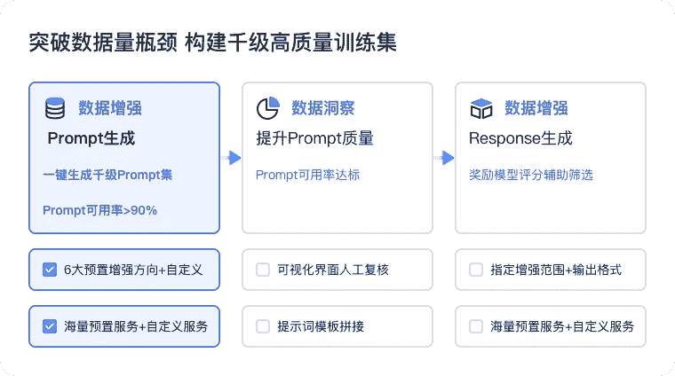

## ▌基于「数据增强」功能的效果评估实验

### **实验场景选取**

本次实验选取**舆论媒体的文本情感分析**场景。情感分析（也被称为意见挖掘）是自然语言处理的重要分支，其通过挖掘文本中的主观信息来判断文本作者的情感态度，这一技术在市场分析、公共情感监测、产品管理等多个领域都有着广泛应用。

在本次实验的任务场景中，**需要构建一个能将文章、社交媒体观点及网友评论划分为“**正面”“负面”“中性”三类情感倾向的模型，用于理解和分类网络文字背后作者或用户的情感反应，为公共舆论监测、社会情绪分析和市场营销策略等提供参考依据。该场景存在一些特点与挑战：一方面，用户群体多样导致评论数据差异较大；另一方面，评论形式丰富，包含口语化文字、表情符号及多种修辞手法，这要求模型能够理解这些修辞手法背后的情感含义，从而准确解读文本所承载的情感。

### **结论**

从实验**结****果来看**，基于目前**平台的****数****据**增强功能，在原始数据量有限或质量不足时，通过创造多样化的“新”数据，能够针对具体业务场景，结合模型精调有效提高模型的性能。本实验仅采用轻量化模型 ERNIE-Tiny-8K 和默认参数配置作为参考，仅使用 20 条数据，准确率已经能够从基础模型的 23% 提升到 85%，二次优化后，也能提升至 86%，并几乎追平「人工准备数据 3000 条」的模型效果。

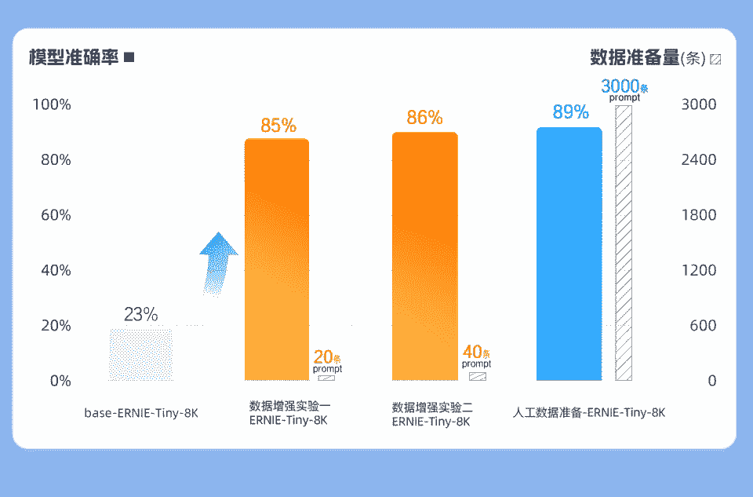

### **实验流程**

在此次实验中，我们选取**舆论媒体的文本情感分析**场景，并基于 ERNIE-Tiny-8K 进行模型精调，并按照下面的流程进行实验。

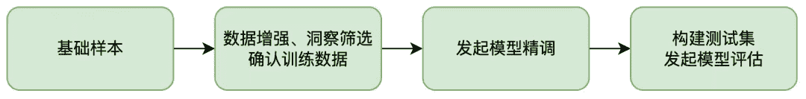

### 实验一内容

**Step1 **编写 20 条基础样本，定义舆情监测行业——情感分析任务场景

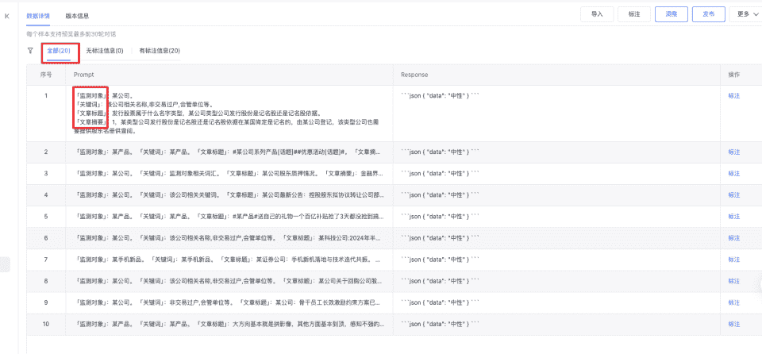

**Step2 **创建数据增强任务，设置增强方向，生成 2900 条数据样本，包含：「监测对象」「关键词」「文章标题」「文章摘要」字段

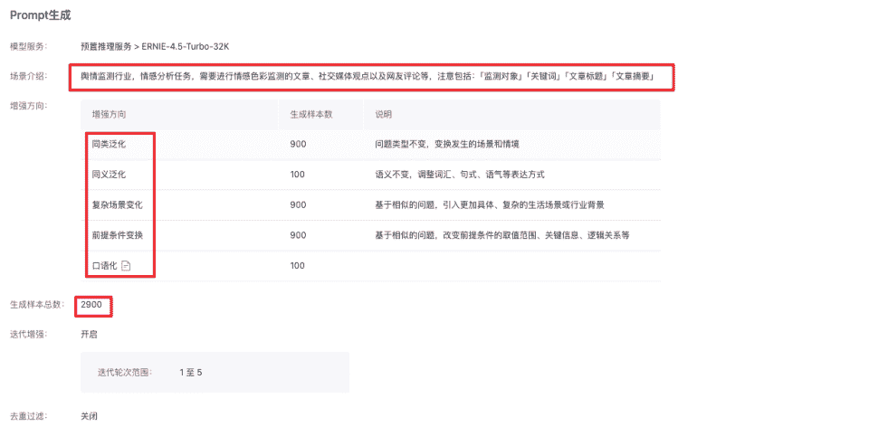

**Step3 **Prompt 筛选优化&Response 生成：发起数据洞察进行批量筛选及提示词模板拼接，同时选择教师模型 ERNIE 4.0 进行 response 的生成

**Step4 ****数据筛选：**标注完成后发现中性数据相对较少、正面和负面数据较多（相对理想的数据比例分布而言），因此按照测试集数据比例分布做调整，共保留 784 条样本，作为最终训练数据

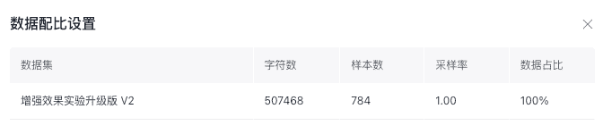

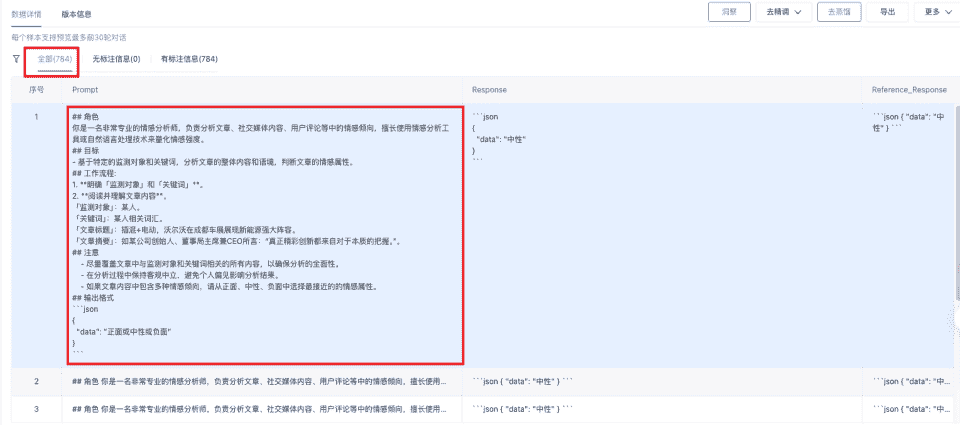

**Step5 ****使用 ERNIE-Tiny-8K 发**起模型精调，需要配置多个实验进行效果对比

**效果最好的实验配置为——选择 SFT 全量更新**，学习率 0.00001，迭代轮次为 3

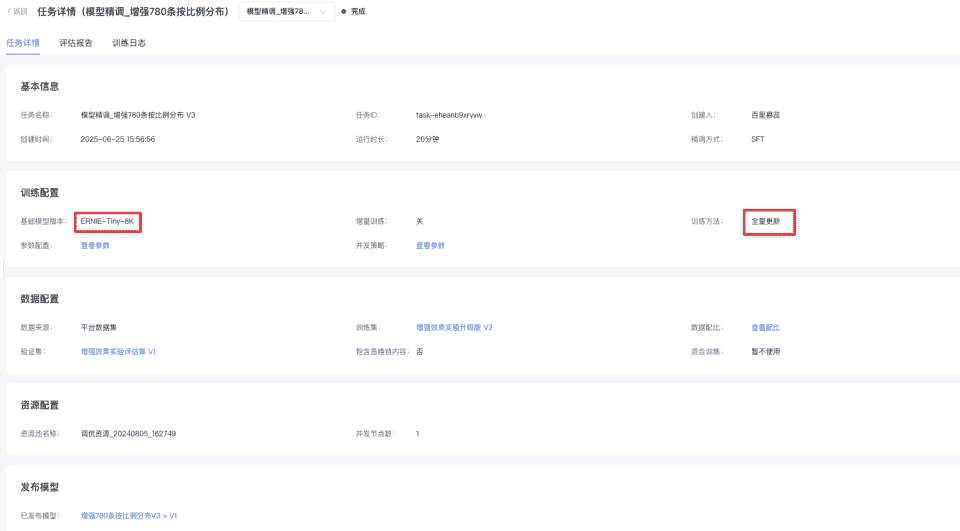

**Step6 **精调结束后，基于平台创建自动评估任务

+   **评估对象配置**

选择新建推理结果集，批量推理，精调模型版本，添加评估集

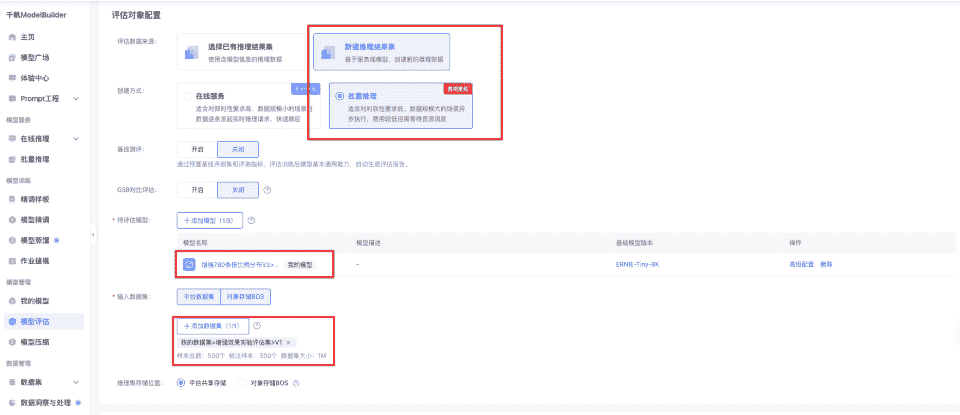

+   **评估方法配置**

设置自动裁判员打分方法，对比模型推理输出 Response（模型回答）和 Reference_Response（参考回答）一致性，来评估模型准确率

**相符**

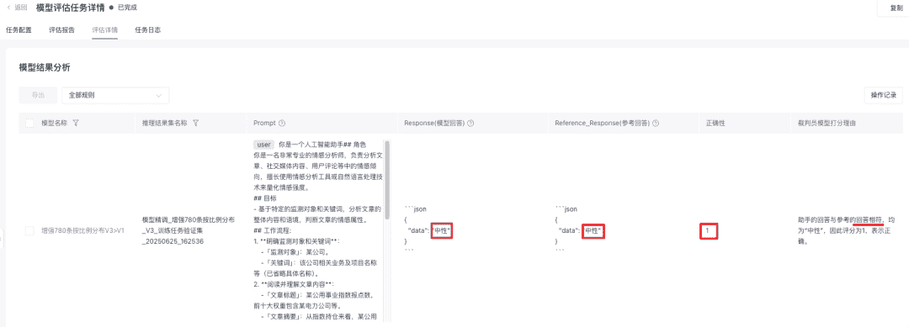

**不符**

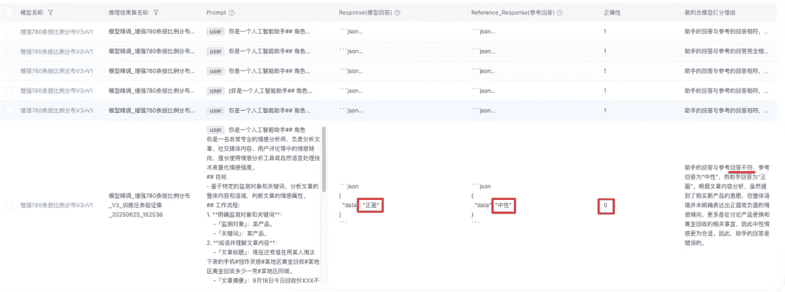

### 实验结果

训练后的模型准确率提升至 85%。

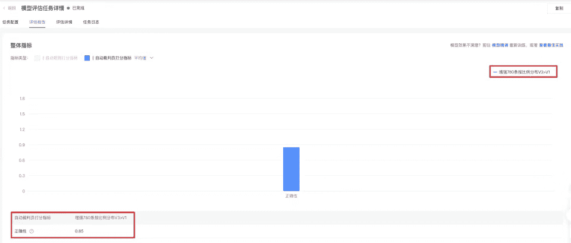

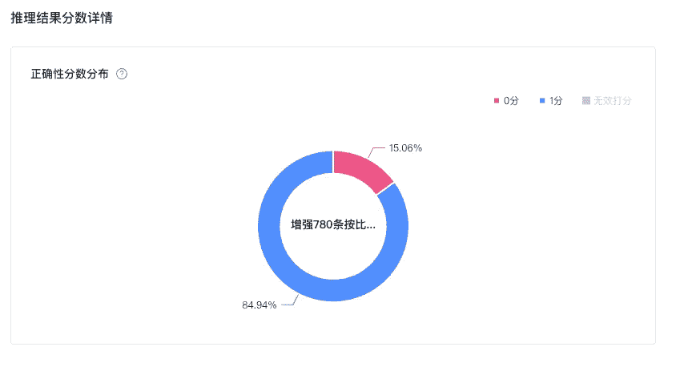

### **额外补充**

实验一中，对 20 条基础样本进行同类、同义泛化进行数据增强，但由于中性数据较少所以导致整体数据量少，额外还补充进行了实验二：重点基于 20 条中性样本继续做定向增强，解决此前数据比例分布不均的问题，训练后的模型准确率提升至 86%！

## **▌👉即刻体验「数据增强」功能**

「数据增强」功能现已上线百度智能云千帆模型开发平台 ModelBuilder，即刻访问百度智能云千帆官网，体验模型训练新功能！

🌟在数据增强完成后，建议开发者人工审核标注结果以及数据分布情况，确保数据质量及分布均满足要求，然后发起模型精调。

> >> 百度智能云千帆官网：

> https://cloud.baidu.com/product-s/qianfan_modelbuilder

> >>「数据增强」功能详情：

> https://cloud.baidu.com/doc/WENXINWORKSHOP/s/lliu6hycy#1-%E4%B8%8A%E4%BC%A0%E6%95%B0%E6%8D%AE%E9%9B%86