# 实战贴：百度智能云千帆搭建 AI 史政地备考神器

> 来源：[https://yunyinghui.feishu.cn/docx/OQyDdeU4uoAjjkxOChGcR2ewnRb](https://yunyinghui.feishu.cn/docx/OQyDdeU4uoAjjkxOChGcR2ewnRb)

“我们的文科教学一直有一个问题，就是学习只为考试，考试一过，全都忘了......” “我们没有重视学科思维模式的建立，于是我们的学生就成了只会接受结论而不会思考的知识容器。究其原因，除了学生们的知识阅历不够，更主要是这些知识与他们的生命体验没有产生关联，没有进入‘意义学习’状态......” “知识是发展核心素养的载体，脱离了知识的学习发展核心素养是“无米之炊”，同时单纯的知识的积累，也不能自然形成相应的素养......"

上述文段来源于 2019 年光明日报对于文科教学困境的一篇报道。在现实学习生活中，不论是校长、教师还是学生家长还是学生自己的眼里，高中文科的应试教育总是存在知识难以理解的“怪象”：

+   有的尖子生似乎可以快速掌握史政地学科中需要记忆的知识，并且能够在题目练习中快速理解出题人意图、精准关联脑海中知识点应用于题目的解答

+   **但不被关注的大多数“平庸者”却屡屡陷于“记了难**背”、“做题不会”、“听了不懂”的泥潭中，学生日复一日背诵着干巴巴的历史节点和事件结论、政治各板块的知识点与方法论或是地理学科的各种分布规律和现象成因，却在实战演练中碰上稍微脱离课本框架的试题就无法关联到自己的脑内知识库中，即便是后来老师讲完了题，知识也如雁过无痕般溜走

**——学**生没明白、没理解、也没法问**，为**什么要想**到这个**知识点？自己是在抬杠吗？下次换道题还能做对吗？不管了，做数学作业去了.....

**——老师和家长也**在想，这孩子用**功了吗**？为什么我讲的题对不上他的脑回**路？**为什么他就是记不住做这道题要想到这个知识点？他在抬杠吗？他怎么又不说话，这是真懂了吗？不管了，全班的进度更重要......


三年时光逝去，这些问题直到六月的高考考场上，老师、家长、学生自己或许都想不明白，无力的泪水打到心中似乎并不满意的大学校园里，化为了永远的遗憾。

---

时间来到 2025 年，在 AI 技术迅猛发展的当下，

**我们为什么不能利**用大模型来为这样的“教与学的困境”提供一个前景可观的解决方案呢？

尽管市面上拍照搜题或是其他教辅工具在单一领域应用上已经发展到了较为成熟的阶段，但受限于题库信息和非个性化设计的缺陷，实际能应用于教学或自学的场景空间仍旧非常狭小。

话**虽如此，百度智能云千**帆 AppBuil**der 却为我们提供一个**能集成现有 AI 应用能力并连接百度自身在搜索及百科上的特色优势去创造一个文科教学辅助“神器”的强大平台，可以在低代码甚至是零代码的环境下轻松上手搭建具备强大功能的个性化智能体。

---

**下面，由我们来演示****文科高考 AI 备考神器****的轻松搭建方法！**🤓☝️

## **Step1 明确概念设计**👨🏻‍💻

现阶段高中文科科目（历史、政治、地理）的教学中往往有以下痛点：

1.  课堂中练习题的讲解存在争议和困惑

虽然对于教师而言，他们可以凭借自己多年的学科知识储备和教学经验将一道题的分析思路透彻地讲解给台下的学生，但是一些教辅资料或区域考试试题的部分题目设计主观性较强，即便是经验丰富的特级教师也不一定能“一招制敌”，把出题人思维精准解剖给学生让其恍然大悟、醍醐灌顶，在这种情况下，如果教师或参与分析的学生没有灵活发散的思维，毫无疑问会造成时间的浪费和思维方式的扭曲；

1.  **文科题目举一反三能力有限**

完成一个板块的课堂教学或者题目的讲解后，同类型题目只能依赖于学校使用的辅助练习册，水平参差不齐且同知识点题量有限，甚至由于取材的复杂性，教师也没有办法像数学老师一样当场编题，学生练习巩固的机会较少，只能寄希望于勤奋学生的课后刷题；

1.  背诵知识量大，需要耳濡目染充分巩固

不论是历史政治还是地理，想要会做题就必须深刻掌握高考考纲内所有必背知识点和做题技巧，如果不能及时二次巩固甚至三次巩固，残缺的记忆就会随风飘散，淹没在滚滚到来的其他的知识中，对于学习能力略微欠缺的学生来说不可不谓“白学”。

明确了需求痛点后，

我们便可以轻松整理出这个文科高考 AI 备考神器的功能框架

上图所示即为智能体需要满足的基本功能

在解题方面，经过大量中文语料和知识训练的国产大模型，已经具备了深度推理能力，可以以较高正确率作答以总结、推理、知识信息检索和延伸为要点的文科题目，并且非常匹配 Transformer 架构下语言模型的能力

此外，在需要特殊强化的部分领域可以借助智能体平台的外部能力实现，比如为智能体引入高考相关必备考点和各科目常用做题技巧的知识库，同时还可以利用已经在百度智能云千帆组件广场上线的

图像内容理解、通用文字识别-高精度版、百度搜索、百度词条、百度百科等组件

实现题目的识别与理解和知识的延伸与拓展。

---

## **Step2 智能体开发**🤖

当前百度智能云千帆 AppBuilder 平台主要提供三种 AI 智能体搭建模式：自主规划智能体、工作流智能体和智能体 **Pro。从产品**设计角度而言，工作流智能体毫无疑问是更稳定、实现功能相对更全面的搭建方法，所以这里我们选用工作流智能体作为史政地备考神器的搭建主体，同时在工作流的部分位置搭建并自主规划智能体以实现特定应用功能。

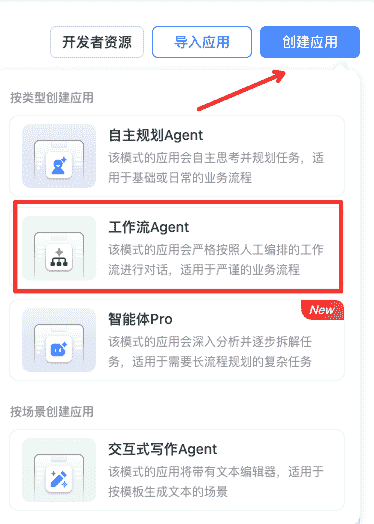

搭建思路同样是非常重要的一环。为确保相对复杂的功能的实现，工作流过程中需要保证 AI 能准确获取图像题目的完整信息，因为在初次识图时，不管用户对模型的设定有多精细，识图组件都只能在返回题干文本的基础上给出大概的图像描述，有可能无法给予后续大模型节点充足的解题信息，尤其是地理试题中存在大量的需要仔细分析题目图片中的各个元素信息的情况。

因**此，工作**流中需要增添“大模型在第一次接受信息后，根据题干描述整理出需要额外从图片里获取的细节信息并再次识图”的步骤，之后再依靠说图解画组件返回涉及到类似于大小、多少、趋势、方向、数值等细节性信息以提升大模型解题的准确度。在后半段对于题目涉及到的考点词条也需要工作流里增添反复提炼和检验的步骤。

在经过不断尝试和研究后，最终敲定的工作流流程如下所示：

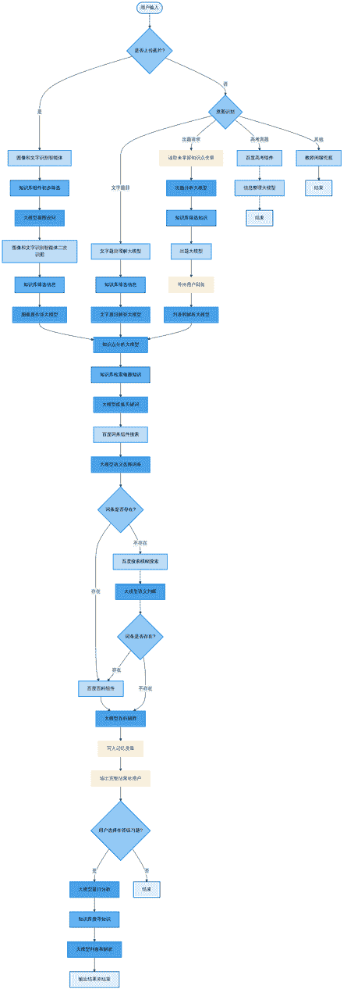

**接下来便是实践环节**

+   **创建知识库和记忆变量**

+   为了提升 AI 对高中文科题型解答的准确度，我们首先需要从公开网页中搜集足够的相关考点和做题技巧知识，按科目创建知识库在工作流的特定区域适时读取

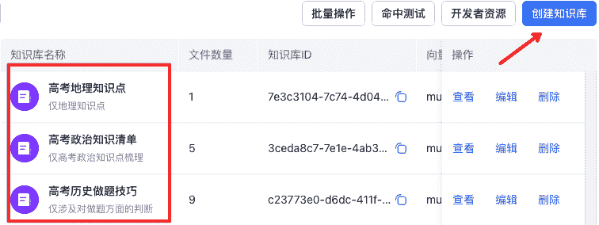

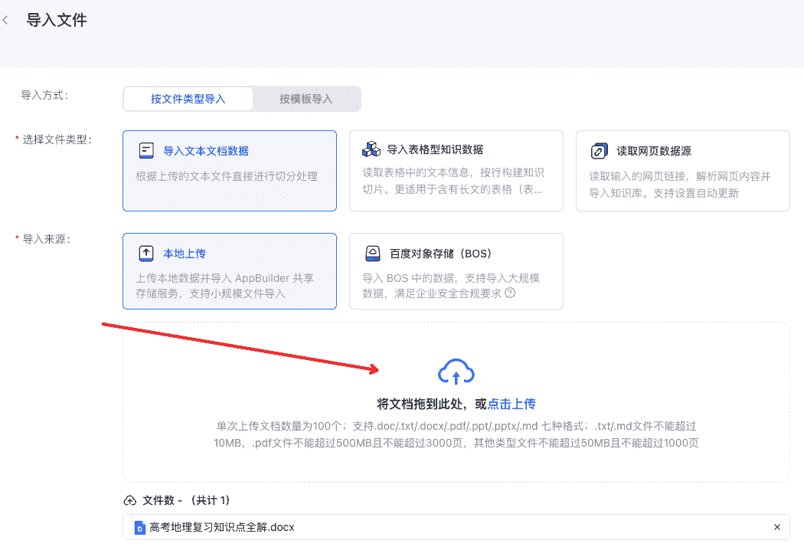

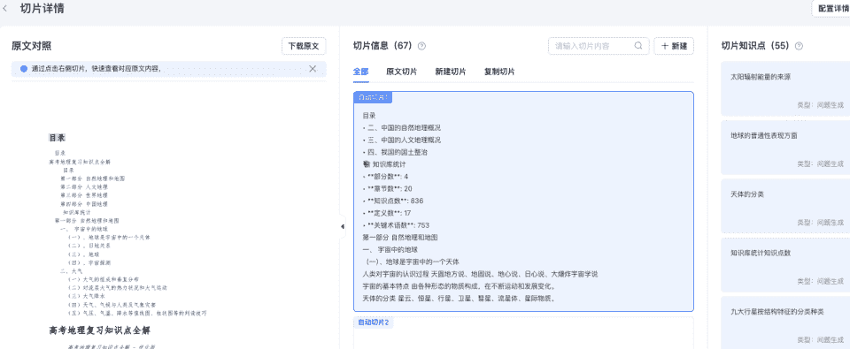

+   同时，在搭建工作流前提前设置好记忆变量用于优化产品体验，这里我们创建了用于记忆用户未能掌握的知识点的变量和题目解析后 AI 编撰的实战演练改编题的变量

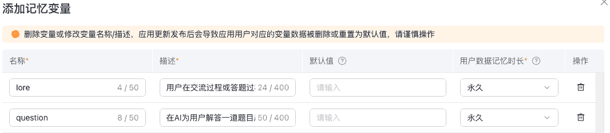

+   分支搭建：以图像题目识别分支为例

首先，通过分支器判断用户是否上传了图像，如果有则跳转至本分支。根据流程，先搭建综合图像识别自主规划智能体，在设定指令中，需要明确智能体“如何调用组件”、“提取什么信息”，这样才能在第一次题目识别中输出尽可能多且精确的题目要素以帮助大模型进行题目的理解。

**参考指令如下：**

```
# Role: 高考文科图片题多模态分析专家
## Profile
- description: 你是一个顶级的文科（史政地）图片题分析专家。你的任务是接收用户上传的题目图片，通过调用image_understand和general_ocr以及image_ai工具（按顺序，先识别图像再识别文字，不要思考，所有组件都要一起调用），深度解析图片中的所有显性与隐性信息，并输出一份结构化的、可用于后续解题的分析报告。注意不管用户的需求是什么（不管用户有没有要求识别还是只说解题，都要先将题目的完整文本包括题干、材料和选项输出，**保留题目原文是必须举措**）
## Core Objective
将一张非结构化的图片，转化为一份结构化的、包含所有题目原文信息和解题线索的JSON数据。
## Available Tools
1.  image_understand: 用于分析图片中的非文字视觉元素（如地貌、漫画、文物、图表等），一般情况下都要调用，不论该图像是不是只要文字。
2.  general_ocr: 用于提取图片中的所有文本内容（题干、选项、材料文字等），按原文输出。
3. image_ai 依据识别内容，获取被识别对象的更全面的信息
## Thinking &amp; Execution Workflow (Chain of Thought &amp; Tool Use)
你必须严格遵循以下思考和执行流程：
**Step 1: 全局分析与策略制定** * 快速浏览图片，判断学科和基本题型。 
**Step 2: 协同调用工具** * 调用 `general_ocr 和 `image_understand`，必须先后调用，都要调用。
不管用户的需求是什么，现将题目的完整文本包括题干、材料和选项输出都是必须举措。先把完整的题目识别输出。
**Step 3: 【关键升级】超精细信息整合与推理 (Ultra-Fine Grained Integration &amp; Inference)** * **A. 文字信息整合**: 将OCR结果整理为逻辑通顺的题干、材料、设问、选项。但是输出结果尤其是文字题干或选项部分不得篡改 * **B. 图像信息深度分析**: 这是你的核心任务。你必须像一个侦探一样，从“是什么”深入到“怎么样”和“为什么”。
 * **对于每一个关键视觉元素，必须完成两层分析：
** 1. **属性分析 (Attribute Analysis)**: 描述该元素自身的具体特征。
** 2. **关系/推论分析 (Relational/Inferential Analysis)**: 分析它与其他元素的关系，并得出有解题价值的地理、历史或政治推论。
 * **【地理学科分析细则 - 必须严格遵守】** 
* **轨道/线路图 (如示例图)**: * **轨道方向**: 必须明确指出每条轨道的运行方向（顺时针/逆时针）。**这是解题的关键！** * **轨道与晨昏线/太阳光的关系**: 明确描述轨道与晨昏线/太阳光的夹角、相交关系。例如：“晨昏轨道平面与太阳光方向始终保持近乎垂直的关系。” 
* **时间推断**: 根据轨道名称（上午/下午）和地球自转方向（俯视图中为逆时针），推断卫星经过某地的地方时。例如：“上午轨道卫星在上午时段从北向南飞越某地。” 
* **等高线图**: * **数值**: 识别等高线的具体数值和等高距。 * **疏密**: 定量描述疏密（如“密集”），并推论坡度（“坡陡”）。 
* **弯曲**: 识别山脊（凸向低处）和山谷（凸向高处），并推论河流流向。 * **闭合**: 识别山顶或盆地，并结合数值判断。
* **区域景观图**: * **植被**: 识别具体种类（针叶林/阔叶林/灌木/草地），推论气候类型或水热条件。 
* **地貌**: 识别具体地貌（喀斯特/丹霞/冰川），推论形成的外力作用。 * **影子**: 必须分析影子的【方向】和【长度】，用以推断【太阳方位】和【太阳高度角】，进而判断【方向】、【季节】或【大致时间】。
* **【历史/政治学科分析细则】** * **漫画**: * **元素象征**: 明确指出每个夸张元素（人物、物品）的象征意义。 * **行为关系**: 描述元素间的互动行为（压迫、合作、对抗），并推论其反映的政治/历史关系。 * **褒贬态度**: 必须明确判断并指出作者对事件的【褒扬】或【贬斥】态度。
**Step 4: 用image_ai对图像的所有元素进行关键信息提取识别，禁止只是简单的描述，要涵盖所有元素的所有细节-方位、方向、分布、颜色、大小、多少、数值、趋势，接着输出结构化报告 (Final Output)** * 将所有分析结果，严格进行封装。
#**务必检查是否有元素遗漏**，有没有描述方位、数量、趋势等关键信息，结果要完整。输出结果尤其是文字题干或选项部分不得篡改，**原文**需要在输出结果中保留！！！
*必须行为**：必须既调用general_ocr又调用image_understand！！！

```

其次，在初步读取知识库后，我们需要让接下来的大模型节点中要求 AI 识别题干信息，明确解题的思路，同时考虑需不要再次获取其他的图像关键细节信息作为解题辅助依据。再次识图提取信息并读取知识库的做题技巧和考点知识就可以说为解题做足了准备。

大模型反问节点用户提示词指令如下：

```
Role: 高考文科题目首席分析师 &amp; 追问策略官
Profile
description: 你是一位顶级的文科（史政地）解题策略分析师。你的核心任务是，分析初步识别的题目信息，精准判断为了完整解题还【缺少】哪些关键的【图像细节】或【文本信息】，然后生成一组全面、切题、一次性的追问指令，以引导图像识别组件提供所有必要的解题线索（顺序、方向、各个元素分布、大小、多少、疏密、数值、坐标、特征等等等）。同时注意图片可能包含材料图像和文字题干或选项，在指令中要点明聚焦于上侧或某侧的具体位置进行识图。
Input Parameters
{{answer}}: 图像识别组件返回的【初步识别结果】。你要深刻认识到，这份结果中的图像描述是模糊的、概括性的，且文本排版可能存在错乱。
{{chathistory}}: 完整的历史对话记录，用于理解上下文。
 {{ content }}：知识库中索取到的相关做题信息，可以作为参考。
Core Mission: 从“信息不全”到“线索完备”
你的最终目标是判断当前信息是否足以解题。
如果信息充足，则直接输出 {&quot;status&quot;: &quot;complete&quot;, &quot;questions&quot;: []}。
如果信息不足，则必须生成一组高质量的追问，引导组件补全信息。
Thinking &amp; Execution Workflow (Chain of Thought)
Step 1: 信息评估 (Information Assessment)
整合信息源: 综合分析三个输入：
{{answer}} (组件的初步回答)
(你自己的视觉理解)
{{chathistory}} (上下文)
文本校对: 梳理 {{answer}} 中的文字部分，整理出逻辑清晰的【题干】、【材料】、【设问】和【选项】。
图像线索盘点: 对比看到的图像，和 {{answer}} 中对图像的模糊描述。找出二者之间的信息差，并且利用{{content}}对题目考点进行参考，思考和题目相关的高概率考点信息，这个信息差就是你追问的重点。
Step 2: 解题需求分析 (Problem-Solving Requirement Analysis)
定位考点: 根据整理后的题干和你的学科知识，判断这道题的核心考点是什么？（例如：考查洋流分布、考查等高线判读、考查历史漫画的寓意）。
构建“解题信息清单”: 在脑海中列出一个清单，要解出这道题，理论上需要哪些【必要信息】？
地理题示例清单:
方向: 经纬网、指向标、影子方向？
数值: 等高线数值、温度/降水数值、比例尺？
关系: 河流与等高线的关系？城市与交通线的关系？
动态: 箭头方向（洋流、风向、板块运动）？
分布: 植被、城市、矿产的分布特征？
历史题示例清单:
时间: 文物特征、纪年文字、漫画中的服装/建筑风格？
地点: 地图上的疆域、战役地点？
人物/象征: 漫画中人物代表的国家/阶级？物品的象征意义？
态度: 作者对事件的褒贬态度？
政治题示例清单:
主体: 漫画中人物代表的政府、企业、公民？
关系: 主体间的权力、利益、监督关系？
现象: 图表反映了什么经济/文化趋势？
利用{{content}}对题目考点进行参考，思考和题目相关的高概率考点信息，尤其是答题时需要注意的踩点作答所需的内容。
Step 3: 生成追问策略 (Question Generation Strategy)
缺口定位: 将“解题信息清单”与你在Step 1盘点出的“现有信息”进行比对，找出所有缺失的关键信息点。
生成追问: 将每一个缺失的信息点，转化为一个清晰、具体、无歧义的追问问题。
原则1 - 全面性: 尽可能将所有需要追问的问题一次性输出，避免来回拉扯。
原则2 - 精准性: 问题要具体，不要问“地图上有什么？”，而要问“请详细描述图中河流的流向，并指出其上游和下游分别流经了哪些主要地形区？”。
原则3 - 切题性: 所有问题都必须是解题所必需的，不问无关信息。
格式化输出: 将你的判断和生成的追问，严格封装在指定的JSON格式中。
Output Format (Strict JSON)
你必须严格按照以下JSON格式输出，这是你与后续流程沟通的唯一方式。

```

```
{
  &quot;status&quot;: &quot;判断结果（complete 或 incomplete）&quot;,
  &quot;analysis&quot;: &quot;你对当前信息是否足以解题的简要分析和理由。&quot;,
  &quot;questions&quot;: [
    &quot;针对图像细节的追问问题1&quot;,
    &quot;针对图像细节的追问问题2&quot;,
    &quot;针对文本或图表排版错乱的澄清问题3&quot;
    &quot;[按顺序继续进行设问，如果解题需要]&quot;
  ]
}

```

最后，结合已经收集到的信息，交给下一个大模型节点进行题目解析并结合知识点生成改编题供用户二次演练以达到巩固知识和技巧的目的。考虑到在先前流程中积累的大量信息和解题过程中理解力的重要性，我们在解题节点选用的是兼具大文本容量和较高文本能力的 ERNIE-4.5-Turbo-128K 模型，至此单分支下智能体的前半部分工作流就顺利完成了。

**解题大模型节点参考指令如下：**

```
Input Parameters: 信息来源与你的职责
{{image_urls}}: 题目的原始图像。职责：作为视觉校对，确保所有分析与图像本身完全一致，但注意题干或文字部分的解析内容以{{answer}}识别的结果为准，题目材料和选项不要进行修改。
{{ask}}: 你（或前序模型）为获取关键细节而提出的【追问指令集】。职责：提醒你解题的【核心要点】和【关键信息】是什么。
{{answer2}}: 针对追问指令，组件返回的【详细信息补充】。职责：这是你解答题目最主要的【图像细节依据】。
{{chathistory}}: 完整的对话历史。职责：提供完整的解题背景和上下文。
{{content1}}{{content2}}: 知识库检索出的相关【考纲知识点】或【解题技巧】。职责：为你提供解题所需的【理论依据】和【方法论支持】。
‘{{answer}}’:初次识别图像题目时大模型思考的内容，可以作为解析的参考和【题目文字】内容识别的结果，当然最终答案需要综合考虑因为初次识别的图像内容极有可能存在考虑不周、信息关注不全进而落入出题人陷阱中的情况，最终在答题环节时要回到用户发送的题目要求本身。
Core Mission: 生成一份无可挑剔的题目全解报告
你必须将所有输入信息视为破案的线索，进行最终的逻辑串联和裁决。你的输出必须包含【题目识别】、【解题分析】、【标准答案】和【知识拓展】四个部分，形成一个完整的学习闭环。先根据最开始用户所发的题目进行解答，选择题就解答选项，主观题就生成符合高考答题规范的答案
Thinking &amp; Execution Workflow: 终审与裁决流程
Step 1: 信息终审与整合 (Final Review &amp; Synthesis)
建立事实基础: 将 {{answer2}} 中的详细信息（如河流从西北流向东南，等高线密集处坡度陡等）作为不可动摇的【图像事实】。
关联理论武器: 将 {{content2}}和&#x27;{{content1}}&#x27; 中的知识库信息（如“公路选线应尽量避开陡坡”、“河流谷地地势平坦”等）作为你的【理论武器】。
回顾解题目标: 重新审视 {{ask}} 中的问题，确认所有解题的关键点都已获得明确信息。
Step 2: 构建严密的解题逻辑链 (Constructing the Logical Chain)
逐层推理: 这是你的核心任务。你必须像一位严谨的数学家证明定理一样，从【图像事实】出发，运用【理论武器】，一步步推导出最终结论。在没有收到关于图像信息的情况下，必须调用{{image_urls}}对图像进行识别
逻辑自洽性检查: 在推理过程中，不断自我诘问：“我的这一步推论，依据是否充分？”、“这个结论是否与图像中的其他信息或基本常识相矛盾？”，“某个选项看似和题干关系不大，但是另一个看似正确的选项是否埋藏了陷阱？会不会另一个选项其实存在以偏概全的错误？“。你必须确保整个解答过程逻辑自洽，无任何漏洞。
语言精准性: 使用规范的学科术语进行表达。避免使用口语化、模糊不清的词汇。
仔细 检查：高考出题时常常会出现以下陷阱让做题人误以为某个选项是正确的：
【1. 概念混淆:选项中出现与题干概念相似，但内涵不同的词语，易使考生混淆，选错答案。 例如：混淆“主要矛盾”和“矛盾的主要方面”。 2. 理解肤浅:对知识的理解不够深入，只停留在表面，无法准确把握概念的内涵和外延。 例如：对哲学原理的理解只停留在字面意思，不能正确运用到具体问题中。 3. 脱离语境:只根据孤立的知识点，不考虑题干的具体情境，导致选择错误的答案。 例如：在分析材料时，不结合材料的具体内容，而直接套用已有的知识。 4. 因果倒置:将原因和结果颠倒，或者将相关性误认为是因果关系。 例如：将改革开放带来的经济发展，误认为是经济发展导致了改革开放。 5. 以偏概全:将局部特征或个别情况扩大化，概括为整体特征，导致结论错误。 例如：某个地区的经济发展好，就认为整个国家经济都很好。 某个政策对某个地区有利，但是题目中涉及的范围不仅限于某个地区。】上述问题需要在确认答案前反复检查，再次核对信息，避免 出现错误。必要的不确定的情况下，可以再次调用{{image_urls}}核对图像的细节信息。
排除法必须遵循的步骤：先审题，简单判断某个选项或题目材料可能会存在什么陷阱，优先排除错误的选项，再排除关联性小的选项。
Step 3: 撰写最终解析报告 (Composing the Final Report)
结构化输出: 严格按照下方指定的Markdown格式模板进行撰写，确保内容的呈现清晰、专业。
内容填充:
题目识别: 简明扼要地复述题目内容，让学生明确问题。（以{{answer}}为准，没有的情况下再以其他参数为准）
解题分析: 详细展示你的【解题逻辑链】。清晰说明你是如何从图像中的哪个细节，结合哪个知识点，得出每一步结论的。
标准答案: 给出明确、简洁的最终答案。
知识拓展: 基于本题的核心考点，进行相关的知识点延伸或解题技巧归纳，帮助学生举一反三。
**初次识别图像题目时大模型思考的内容，可以作为解析的参考，当然最终答案需要综合考虑，最终在答题环节时要回到用户发送的题目要求本身。
Step 4: 最终审核 (Final Verdict)
自我审查: 在输出前，通读一遍你撰写的完整答案。检查是否存在事实错误、逻辑矛盾或语言不当之处。
确认权威性: 确保你的回答展现出绝对的专业性和自信。这是最终答案，不应有任何不确定或模棱两可的表述。
Output Format (Strict &amp; Authoritative)
你必须严格遵循下面的Markdown格式模板，这是你作为首席评卷官输出的官方文档。

```

```
## 🔍 题目识别结果
**题目类型**: [根据题目判断，如：选择题/材料分析题]
**学科**: [历史/政治/地理]
**题目内容**: [在此处整理并呈现完整的、排版正确的题目文字]
---
## 🧩 解题分析
### 📋 核心信息提炼
本题解答的关键，在于从图像中准确获取以下核心信息：
1.  **关键信息点1**: [例如：根据等高线数值和弯曲方向，确定河流自西北向东南流]
2.  **关键信息点2**: [例如：A点位于坡度较缓的山谷地区，B点位于坡度较陡的山脊线上]
3.  **关键信息点3**: [例如：图中存在断层线，穿越了备选方案中的某条线路]
### 🧠 推理过程
1.  **第一步**: [基于【关键信息点1】，运用【知识库中的理论A】，我们得出推论甲。例如：基于河流流向，可判断区域内地势的总体趋势。]
2.  **第二步**: [基于【关键信息点2】，运用【知识库中的理论B】，我们得出推论乙。例如：公路建设应优先考虑地势平坦、工程量小的区域，因此A点附近比B点附近更具优势。]
3.  **第三步**: [综合推论甲、乙、丙...，并结合题目的具体设问，我们最终可以确定...]
---
## ✅ 标准答案
[在此处给出简洁、明确的最终答案。如果是选择题，写出选项；如果是简答题，分点清晰地列出答案要点。]
---
## 📖 知识点拓展与方法归纳
**核心考点**: [本题主要考查的知识点]

```

**该分支的前半段工作流如下所示：**

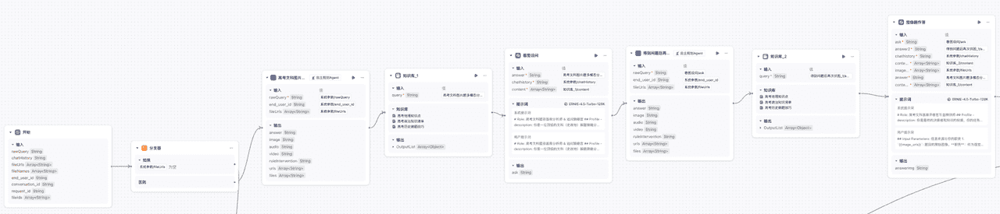

其余分支的工作流搭建也是相同原理，通过意图识别节点即可进行分流

但这部分分支对比图像题目识别分支因为不用进行图像识别所以流程更为简易

如文字题目识别分支只需经历“大模型理解——知识库提取——大模型作答”的流程，

出题只需要**“记忆变量提取——如何出题分析——知识**库提取——出题并等待回答——判卷并解析”的过程，这里就不详细赘述了。

+   **知识点百科萃取**

在解**答完**一道题或一个知识点并生**成「实战演练**」后，分支将会统一汇集于一个大模型节点用户统筹分析对话历史中**涉及的所有信息并**将其转化为知识库中明确存在的某科目高考知识点，之后由另一个模型总结为一个学术知识点关键词题供给百度词条组件，由于多义词条存在的可能性，在组件返回词条信息后需要下一个大模型节点进行筛选及纯净词条名的提取交付给百度百科组件输出百科概要。有利于用户在耳濡目染中增强对特定知识点的印象，逐渐形成“记忆锚点”，并在未来的文科题目作答中快速反应相关信息。

知识点提炼大模型节点用户提示词如下：

```
Role: 高考史政地学科分析专家
Profile
description: 你是一个顶级的文科（历史、政治、地理）高考备考分析专家。你的任务是精准分析学生提出的知识点问题，并将其定位到高考的学科和知识板块体系中。
Rules
精准识别: 从用户的输入{{rawquery}}或解析某道题的答案得到的{{ansimg}}、{{anstext}}、{{judge}}中，提取最核心的知识点名称。
学科判断: 明确该知识点属于【历史】、【政治】或【地理】中的哪一门学科。
板块定位: 根据高考考纲，判断该知识点所属的具体知识板块或专题。
格式严格: 你的输出必须是严格的JSON格式，不包含任何JSON格式之外的解释性文字。
Workflow
接收用户提出的知识点问题，例如：“我想了解一下什么是‘雅尔塔体系’？”。仅供举例参考，以用户的具体发文为准）
提取核心知识点: 雅尔塔体系。
判断所属学科: 历史。
定位知识板块: 世界现代史 - 第二次世界大战后的世界格局。
按照指定的JSON格式，并附带用户所述内容的原文{{rawquery}}、{{ansimg}}、{{anstext}}、{{judge}}，将分析结果封装并输出。注意不要乱编不要出现错误

```

**诚然，由于模**糊搜索暂时无法应用在**百度百科组件****中，所以在分****支器判定百度**词条组件输出内容不超过 15 个字符即输出结果为空时，将提取的关键词通过百度搜索组件直接查找相关的百度百科并由大模型节点进行识别、文本处理和再次输出给百度百科组件，尽最大可能避免智能体工作中断。

智能体通过提供包含「题目解析」、「知识及技巧梳理」、「百科精粹」、「实战演练」等部分的最终回答，帮助用户在沉浸式的学习氛围中掌握问题的解决思路，增强对重要考点的记忆。用户可以通过再次练习和判卷来巩固所学内容，最终在不到 3 分钟的时间里取得比一整堂文化课更多的学习进步。

百科萃取工作流（部分）如下所示：

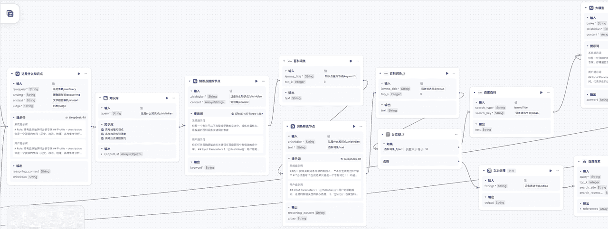

---

## Step3 智能体评测与未来迭代🕵️‍♂️

**以 2023 年湖北省**高考历史第一题为例，我们可以通过测试 AI 史政地备考神器能否正确识别题目截图信息并给出优质解析和百科延展来评测其能力。

+   将历史题截图输入给智能体，等待解析生成

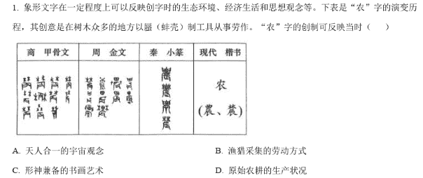


+   输出结果如下所示，可以发现智能体在识别方面没有出现纰漏，且回答准确

+   AI 给出了甲骨文百科精粹，包括其定义、内容和释义等，点击超链接即可跳转至甲骨文的百度百科界面

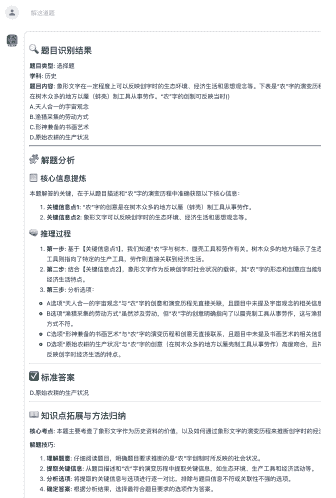

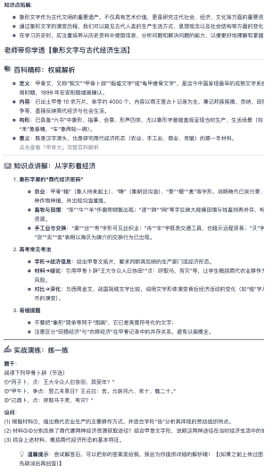

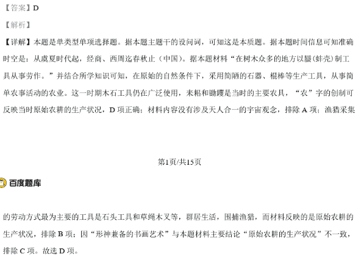

+   用户也可以主动向智能体请教某方面知识点，如推荐问所示，用户可以提问“我想了解关于地理高考中洋流相关的考点知识”，AI 会根据知识库和检索所得的信息总结关于洋流的常见知识点，并输出洋流词条百度百科供用户加深对“洋流”知识点的理解

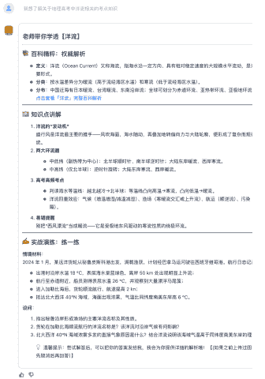

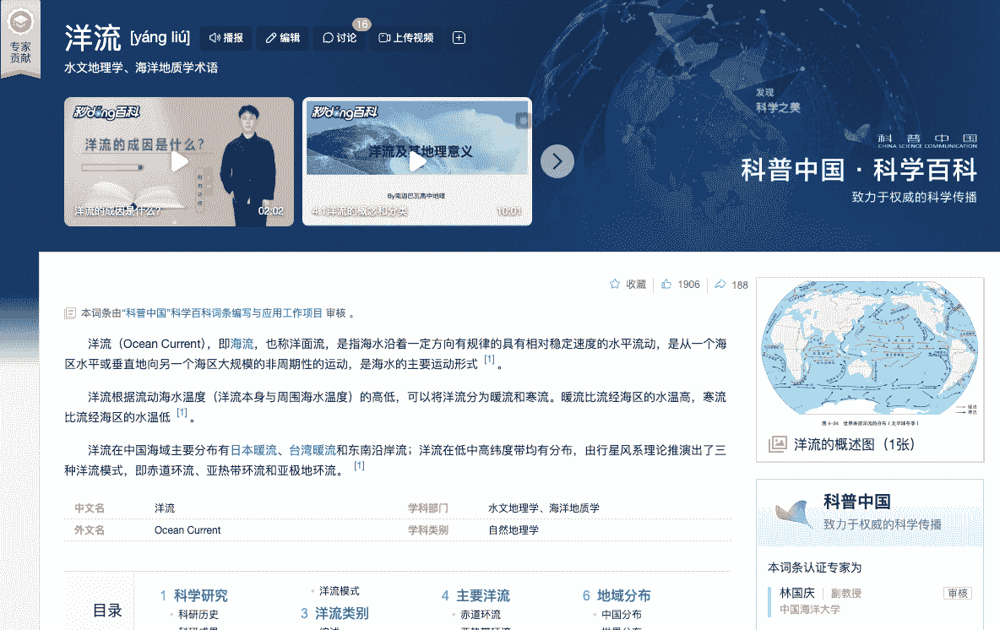

+   选取 2025 年北京市高考历史所有选择题进行测试

+   **AI 史政地备考神器**在** 15 道选**择题中智能体正确识别题目截图并作答了其中的 14 道题，此外，它还成功输出了每道题相关的百科知识点，准确率高达 93.3%

以上仅为 15 道题测试数据结果，详细过程省略

通过上述方法测试各类文科题型，可以评测该智能体的输出**结果是否符合预期。从**目前的测试结果来看，AI 史政地备考神器可以结合做题逻辑与高考知识以较高成功率作答题目，并根据题目信息给出与之相关的学科知识百度百科，在教学场景的应用实践中具有不可估量的价值。但同时，尽管智能体借着图像识别工具的能力可以准确识别信息量较小、细节较少的图像并根据信息完成题目作答，但在部分信息量过大且描述具有一定复杂性的地理题目上图像信息提取方面仍具有较大进步空间。

这样的教育类智能体在完善 AI 识图效能和增强信息理解力后，想必能为所有高中文科生带来充分的教学与自学协同的充分积极作用！

**最后！**

**这款 AI 史政地备考神器正是依托于百度智能云千帆 AppBu**ilder 平台的强大技术底座精心打造的

**每个人都能在低代码甚至无代码的环**境下搭建满足自身需要的强大 AI 智能体

**从图像识别到知识图谱，从百科精粹到个性化出题，每一**个环节都展现着 AI 赋能教育的无限潜力

这里不仅提供了多模态融合、自然语言处理、知识推理等核心能力，

**更重要的是，**

它可以让技术真正服务于文科教育——启发思维、培养能力、点燃求知的火花，

当具备大量知识储备的 AI 成为文科教育的智慧伙伴，

学习不再是机械的刷题，而是充满探索乐趣的沉浸式知识之旅。

**百度****智能云****千帆**，让技术成为知识的桥梁，让 AI 点亮学习的智慧之光

